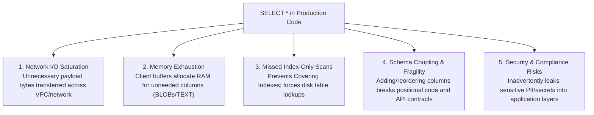
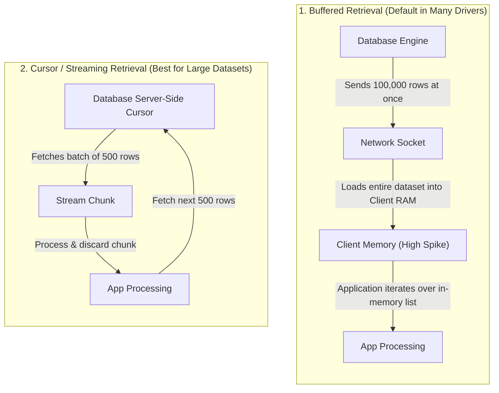
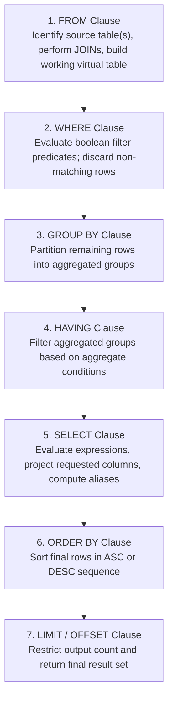

# 📊 Selecting Data from a Database: SQL SELECT Fundamentals

> **Course**: AWS re/Start  
> **Module**: Database Fundamentals – M06 Selecting Data from a Database  
> **Source Document**: `T10-0005-RSDB_EN-US_SG_M06_SELECTINGDATA.pdf`  
> **Target Audience**: AWS re/Start Learners / Cloud Practitioners / Database Practitioners

---

## 🎯 Module Overview

Data stored in a relational database management system (RDBMS) is only as valuable as an organization's ability to extract, filter, shape, and analyze it. The Structured Query Language (`SQL`) provides a declarative paradigm for querying data: rather than programming the step-by-step algorithms to locate files on disk, developers declare **what** data they require, and the RDBMS query optimizer determines **how** to access and return it.

At the core of data retrieval is the `SELECT` statement—the foundational Data Query Language (`DQL`) construct in SQL. Whether querying transactional records in an Amazon Relational Database Service (Amazon RDS) instance or analyzing terabytes of application logs, mastering `SELECT` operations is essential for cloud practitioners and database engineers.

This study guide examines the syntactic structure and logical execution mechanics of the `SELECT` statement, contrasts relational projection against selection, clarifies why wildcard (`SELECT *`) usage is an anti-pattern in production, walks through logical query processing order, explores row-level filtering with `WHERE`, details aliasing and comment syntax, and illustrates queries against the standard `world` sample database (`city`, `country`, and `countrylanguage` tables).

---

### 📌 Learning Objectives

- [ ] **Demonstrate Data Retrieval with `SELECT`**: Formulate SQL queries to retrieve specific attributes or complete records from relational database tables.
- [ ] **Identify Proper SQL Syntax & Structure**: Differentiate required clauses (`SELECT`, `FROM`) from optional clauses (`WHERE`, `GROUP BY`, `HAVING`, `ORDER BY`, `LIMIT`).
- [ ] **Distinguish Relational Projection from Relational Selection**: Differentiate column-level extraction (projection) from row-level filtering (selection).
- [ ] **Deconstruct Logical Query Processing Order**: Trace the difference between lexical/syntactic order and the engine's internal execution pipeline (`FROM` $\rightarrow$ `WHERE` $\rightarrow$ `GROUP BY` $\rightarrow$ `HAVING` $\rightarrow$ `SELECT` $\rightarrow$ `ORDER BY` $\rightarrow$ `LIMIT`).
- [ ] **Evaluate the Risks of Wildcard (`SELECT *`) Queries**: Explain why wildcard selection impairs performance, violates network and memory constraints, and creates application brittleness in production.
- [ ] **Apply Filtering Criteria with `WHERE`**: Construct search predicates using string literals, numeric comparisons, and account for engine-specific case sensitivity rules (e.g., MySQL vs. Oracle).
- [ ] **Leverage Column and Table Aliases**: Utilize the `AS` keyword to assign meaningful labels to output attributes, handle computed expressions, and qualify table references.
- [ ] **Document Code with Standard Comments**: Apply single-line (`--`), inline, and multi-line (`/* ... */`) comment blocks to annotate SQL queries effectively.
- [ ] **Query the World Database**: Formulate and interpret queries executing against the canonical `world` relational schema.

---

## 🔍 1. The `SELECT` Statement: Retrieval, Projection & Selection

### 1.1 Purpose of the `SELECT` Statement
The `SELECT` statement is used to retrieve data stored across one or more database tables or views. Relational operations produce a **Result Set**—a temporary, tabular representation in memory consisting of rows and columns matching the query specifications.

In relational algebra and database theory, retrieving a subset of data involves two fundamental operations:

```
┌────────────────────────────────────────────────────────────────────────┐
│                   Relational Operations in SQL                         │
├────────────────────────────────────────────────────────────────────────┤
│  1. SELECTION (σ - Sigma)  : Filters ROWS based on a condition         │
│     Implemented via        : WHERE, HAVING                             │
│                                                                        │
│  2. PROJECTION (π - Pi)    : Filters/Chooses COLUMNS to return         │
│     Implemented via        : SELECT <col1>, <col2>                     │
└────────────────────────────────────────────────────────────────────────┘
```

| Relational Operation | Mathematical Symbol | SQL Implementation | Dimensional Axis | Purpose |
| :--- | :---: | :--- | :--- | :--- |
| **Selection** (Restriction) | $\sigma$ (Sigma) | `WHERE`, `HAVING` | Horizontal (Rows) | Filters which rows qualify for the result set based on a boolean predicate. |
| **Projection** | $\pi$ (Pi) | `SELECT col1, col2` | Vertical (Columns) | Specifies which attributes/columns are extracted and returned in the output. |

```mermaid
flowchart LR
    subgraph SourceTable["Source Table: city (All Rows & Columns)"]
        direction TB
        R1["Row 1: ID 1025 | Mumbai | IND | Maharashtra"]
        R2["Row 2: ID 2331 | Seoul | KOR | Seoul"]
        R3["Row 3: ID 206  | Sao Paulo | BRA | Sao Paulo"]
        R4["Row 4: ID 1890 | Shanghai | CHN | Shanghai"]
    end

    subgraph SelectionStage["Selection: WHERE countrycode = 'BRA' (Horizontal Filter)"]
        F3["Row 3: ID 206 | Sao Paulo | BRA | Sao Paulo"]
    end

    subgraph ProjectionStage["Projection: SELECT name, countrycode (Vertical Filter)"]
        P3["Row: Sao Paulo | BRA"]
    end

    SourceTable -->|"Selection (σ)"| SelectionStage
    SelectionStage -->|"Projection (π)"| ProjectionStage
```



---

### 1.2 Accessing Rows and Columns: A Worked Example

Consider a sample `city` table containing four columns: `id`, `name`, `countrycode`, and `district`:

```sql
SELECT id, name, countrycode
FROM city;
```

In this query:
1. The **`FROM city`** clause indicates the source table from which records are read.
2. The **`SELECT id, name, countrycode`** clause projects three specific columns out of four, omitting the `district` column.
3. Because no `WHERE` clause is supplied, **all rows** from the table are returned.

#### Source Table (`city`):
| id | name | countrycode | district |
| :--- | :--- | :--- | :--- |
| 1025 | Mumbai | IND | Maharashtra |
| 2331 | Seoul | KOR | Seoul |
| 206 | Sao Paulo | BRA | Sao Paulo |
| 1890 | Shanghai | CHN | Shanghai |
| 939 | Jakarta | IDN | Jakarta Raya |
| 2822 | Karachi | PAK | Sindh |

#### Query Result Set:
| id | name | countrycode |
| :--- | :--- | :--- |
| 1025 | Mumbai | IND |
| 2331 | Seoul | KOR |
| 206 | Sao Paulo | BRA |
| 1890 | Shanghai | CHN |
| 939 | Jakarta | IDN |
| 2822 | Karachi | PAK |

> [!NOTE]
> The result set is generated dynamically upon query execution. It does not alter the underlying storage or schema of the physical database table on disk.

---

## 🏗️ 2. Basic Query Structure & The Wildcard Anti-Pattern

### 2.1 Basic Query Syntax
Every syntactically valid `SELECT` statement in SQL requires at least two clauses:
1. The **`SELECT`** clause, specifying the column expressions to retrieve.
2. The **`FROM`** clause, identifying the target table, view, or joined datasets.

```sql
SELECT colname1 [, colname2, colname3, ...]
FROM table_name;
```

- Square brackets `[` `]` denote optional parameters in formal BNF syntax notation.
- Individual column identifiers must be separated by commas (`,`).
- A terminating semicolon (`;`) is standard in ANSI SQL and required by most CLI clients (such as the MySQL client, PostgreSQL `psql`, or Oracle SQL*Plus) to signal the end of a command.

---

### 2.2 Selecting All Columns with Wildcard (`SELECT *`)

SQL provides an asterisk wildcard (`*`) that instructs the database engine to return **all columns** defined on the target table, in the exact physical or logical order defined by the table schema:

```sql
SELECT * FROM city;
```

#### Output:
```text
+------+-----------+-------------+--------------+
| id   | name      | countrycode | district     |
+------+-----------+-------------+--------------+
| 1025 | Mumbai    | IND         | Maharashtra  |
| 2331 | Seoul     | KOR         | Seoul        |
| 206  | Sao Paulo | BRA         | Sao Paulo    |
| 1890 | Shanghai  | CHN         | Shanghai     |
|  939 | Jakarta   | IDN         | Jakarta Raya |
+------+-----------+-------------+--------------+
5 rows in set (0.00 sec)
```

---

### 2.3 Why `SELECT *` is an Anti-Pattern in Production

While `SELECT *` is convenient during rapid ad-hoc troubleshooting and interactive CLI exploration, using `SELECT *` in production code, application backend services, or automated ETL pipelines is considered a serious **anti-pattern**.



| Factor | Wildcard (`SELECT *`) Risk | Best Practice (`SELECT col1, col2`) |
| :--- | :--- | :--- |
| **Network & Bandwidth** | Pulls wide data types (e.g., `VARCHAR(MAX)`, `TEXT`, `BLOB`, JSON) across network boundaries even if the caller only needs one ID or flag. | Minimizes wire serialization size and payload throughput over AWS VPC interfaces. |
| **Memory Allocation** | Application frameworks buffer full records, multiplying garbage collection pressure and application server memory consumption. | Allocates only memory necessary for the requested attributes. |
| **Covering Index Optimization** | The database query planner cannot satisfy the query solely from an Index. It is forced to perform expensive random I/O table lookups (Clustered Index lookups or Heap RID lookups) to retrieve all columns. | Allows the optimizer to execute an **Index-Only Scan**, returning data directly from B-Tree index leaves without touching base table data pages. |
| **Application Resilience** | Adding, removing, or reordering columns via database migrations breaks positional result mappings (e.g., `row[2]`) and JSON serializers. | Explicit column projections provide a deterministic contract that remains stable across schema migrations. |
| **Data Protection & PII** | Newly added columns containing Sensitive Personal Information (PII), such as passwords, SSNs, or credit card tokens, may automatically be transmitted to downstream layers and logged. | Adheres to the principle of least privilege: only declared, permitted columns are fetched. |

> [!WARNING]
> **Production Rule**: Always explicitly name each column required by your application. Reserve `SELECT *` strictly for ad-hoc database inspection.

---

## 🗄️ 3. Result Sets: Structure, Memory Buffering & Cursor Streaming

When an RDBMS executes a `SELECT` query, it creates a **Result Set**. Understanding how result sets are delivered to application clients is critical when designing cloud applications and backend services.

### 3.1 Tabular Representation
A result set is inherently tabular:
- **Columns (Header / Metadata)**: Fixed data types, precision, and names (or aliases).
- **Rows (Tuples / Records)**: Zero, one, or millions of matching entries.

```
+-------------------------------------------------------------+
|                         RESULT SET                          |
+=============================================================+
| Column 1 (INT)    | Column 2 (VARCHAR) | Column 3 (CHAR(3)) | <- Metadata
+-------------------+--------------------+--------------------+
| 1025              | Mumbai             | IND                | <- Tuple 1
| 2331              | Seoul              | KOR                | <- Tuple 2
| 206               | Sao Paulo          | BRA                | <- Tuple 3
+-------------------+--------------------+--------------------+
```

### 3.2 Memory Buffering vs. Cursor Streaming

When an application queries an RDBMS (such as Amazon RDS for MySQL or PostgreSQL), the result set can be consumed using one of two primary strategies:



1. **Memory Buffering (Buffered Result Sets)**:
   - The client driver (e.g., Python `mysql-connector`, PHP PDO, Node.js `mysql2`) downloads the entire result set over the network into local application memory before allowing the application to iterate over the first row.
   - **Pros**: Fast for small queries; frees server locks immediately.
   - **Cons**: Can trigger client-side `Out-of-Memory (OOM)` crashes when querying large tables.

2. **Cursor Streaming (Unbuffered / Streaming Result Sets)**:
   - The client fetches rows incrementally across the network in batches (e.g., server-side cursors).
   - **Pros**: Constant, predictable client memory footprint regardless of dataset size; ideal for large reporting jobs and ETL pipelines.
   - **Cons**: Keeps an open connection and server resources allocated while streaming.

> [!TIP]
> In AWS Lambda functions, where memory is constrained (e.g., 128 MB – 512 MB), buffering large result sets easily triggers Lambda timeout or memory exhaustion. Always use pagination (`LIMIT`/`OFFSET` or keyset pagination) or cursor streaming for large queries.

---

## ⚙️ 4. Logical Query Processing Order (Order of Operations)

One of the most confusing aspects of SQL for beginners is the discrepancy between **Syntactic (Lexical) Order**—how SQL is written—and **Logical Execution Order**—how the database engine actually processes the statement.

### 4.1 Syntactic Order vs. Logical Execution Order

```
Lexical (Written) Order:
  SELECT  ──>  FROM  ──>  WHERE  ──>  GROUP BY  ──>  HAVING  ──>  ORDER BY  ──>  LIMIT

Logical (Engine Execution) Order:
  FROM    ──>  WHERE  ──>  GROUP BY  ──>  HAVING  ──>  SELECT    ──>  ORDER BY  ──>  LIMIT
```



---

### 4.2 Step-by-Step Processing Breakdown

Let us analyze a concrete query to observe how data is filtered and transformed through the execution pipeline:

```sql
SELECT id, name, countrycode
FROM city
WHERE countrycode = 'BRA'
ORDER BY id;
```

#### Step 1: `FROM city`
- The query execution engine accesses the `city` table.
- All rows and columns present in the table are staged into an initial virtual table in the query workspace.

#### Step 2: `WHERE countrycode = 'BRA'`
- The engine scans the staged rows and evaluates the search predicate `countrycode = 'BRA'`.
- Rows that evaluate to `FALSE` or `UNKNOWN` (e.g., cities in `IND`, `USA`, `CHN`) are immediately dropped.
- Only matching Brazilian city records are preserved for subsequent steps.

#### Step 3: `SELECT id, name, countrycode`
- The engine executes **projection**: it discards all columns not specified in the `SELECT` list (such as `district` or `population`).
- Only `id`, `name`, and `countrycode` remain in the output tuple structure.

#### Step 4: `ORDER BY id`
- The engine sorts the surviving projected rows in ascending order based on the `id` column.

---

### 4.3 Why Column Aliases Cannot Be Used in the `WHERE` Clause

A classic mistake made by developers is attempting to reference an alias defined in the `SELECT` clause within the `WHERE` clause:

```sql
-- ❌ SYNTAX ERROR IN STANDARD SQL
SELECT name, population / surfacearea AS pop_density
FROM country
WHERE pop_density > 1000;
```

#### Why Does This Fail?
Look at the logical query processing order:
1. **`FROM country`** runs first (Step 1).
2. **`WHERE pop_density > 1000`** runs second (Step 2).
3. **`SELECT ... AS pop_density`** runs fifth (Step 5).

At Step 2, the `SELECT` clause has **not yet been evaluated**. The alias `pop_density` does not exist in the engine's symbol table! Therefore, the database returns an error such as:
`ERROR 1054 (42S22): Unknown column 'pop_density' in 'where clause'`.

#### The Correct Approach:
Repeat the underlying expression in the `WHERE` clause, or use a Common Table Expression (CTE) / subquery:

```sql
--  CORRECT: Evaluate the expression directly in the WHERE clause
SELECT name, population / surfacearea AS pop_density
FROM country
WHERE (population / surfacearea) > 1000;
```

```sql
--  ALTERNATIVE: Use a subquery or CTE
WITH CountryMetrics AS (
    SELECT name, (population / surfacearea) AS pop_density
    FROM country
)
SELECT name, pop_density
FROM CountryMetrics
WHERE pop_density > 1000;
```

> [!IMPORTANT]
> Because `ORDER BY` executes **after** `SELECT` (Step 6 vs Step 5), column aliases **can** safely be used in the `ORDER BY` clause:
> ```sql
> SELECT name, population / surfacearea AS pop_density
> FROM country
> ORDER BY pop_density DESC; --  VALID!
> ```

---

## 🎯 5. Row-Level Filtering with the `WHERE` Clause

### 5.1 Basic Filtering Mechanics
The `WHERE` clause is an optional clause that specifies a search condition (predicate). Only rows for which the search condition evaluates to boolean `TRUE` are returned.

```sql
SELECT id, name, countrycode
FROM city
WHERE countrycode = 'BRA';
```

#### Output:
```text
+-----+------------+-------------+
| id  | name       | countrycode |
+-----+------------+-------------+
| 206 | Sao Paulo  | BRA         |
| 208 | Salvador   | BRA         |
| 211 | Fortaleza  | BRA         |
| 212 | Campinas   | BRA         |
+-----+------------+-------------+
```

### 5.2 Syntax Considerations: Literals, Capitalization, and Strings

When constructing queries with search criteria, observe the following rules:

1. **Single Quotation Marks for String & Date Literals**:
   - Character strings, text values, and dates must be enclosed in single quotation marks (`'BRA'`, `'Sao Paulo'`, `'2026-10-12'`).
   - Numeric values (integers, floating point numbers) are written without quotation marks (`WHERE id = 206`).
   - Using double quotation marks (`"`) is non-standard in ANSI SQL (in engines like PostgreSQL or Oracle, double quotes are reserved for database object identifiers such as table and column names).

2. **SQL Keyword Capitalization**:
   - SQL is case-insensitive regarding keywords (`select` vs. `SELECT`), but capitalizing keywords (`SELECT`, `FROM`, `WHERE`, `ORDER BY`) is the universal industry best practice. It visually distinguishes SQL syntax from user-defined identifiers (tables and columns).

---

### 5.3 Case Sensitivity Across Database Engines

A critical database design consideration is how text comparisons behave across different RDBMS engines and collation configurations.

```sql
SELECT name, countrycode
FROM city
WHERE district = 'Sao Paulo';
```

Consider a table containing both `'Sao Paulo'` and uppercase `'SAO Paulo'`:

| Database Engine | Default Collation / Behavior | Result of `WHERE district = 'Sao Paulo'` |
| :--- | :--- | :--- |
| **MySQL / MariaDB** | Case-Insensitive (e.g., `utf8mb4_0900_ai_ci` or `latin1_swedish_ci`) | Returns **both** `'Sao Paulo'` and `'SAO Paulo'`. Matches are case-insensitive by default. |
| **Oracle Database** | Case-Sensitive (binary comparison) | Returns **only** exact match `'Sao Paulo'`. Skips `'SAO Paulo'`. |
| **PostgreSQL** | Case-Sensitive (`=` operator) | Returns **only** exact match `'Sao Paulo'`. Requires `ILIKE` or `LOWER(district) = 'sao paulo'` for case-insensitivity. |
| **Microsoft SQL Server** | Case-Insensitive (default Windows collation `SQL_Latin1_General_CP1_CI_AS`) | Returns **both** rows unless a case-sensitive (`_CS`) collation is configured. |

```text
-- MySQL Output (Case-Insensitive):
+-----------+-------------+
| name      | countrycode |
+-----------+-------------+
| Sao Paulo | BRA         |
| Campinas  | BRA         | (where district is 'SAO Paulo')
+-----------+-------------+

-- Oracle Output (Case-Sensitive):
+-----------+-------------+
| name      | countrycode |
+-----------+-------------+
| Sao Paulo | BRA         |
+-----------+-------------+
```

> [!NOTE]
> In MySQL, the suffix `_ci` in a collation name denotes **Case-Insensitive**, while `_cs` denotes **Case-Sensitive**, and `_bin` denotes **Binary comparison**. To force case sensitivity in MySQL:
> ```sql
> SELECT name, countrycode
> FROM city
> WHERE BINARY district = 'Sao Paulo';
> ```

---

## 🏷️ 6. Column and Table Aliasing

### 6.1 Column Aliases
An **alias** is an alternative temporary name assigned to a column or table for the duration of a single query. Column aliasing is implemented using the `AS` keyword:

```sql
SELECT column_name AS alias_name
FROM table_name;
```

#### Why Use Column Aliases?
1. **Renaming Computed Expressions**: Raw calculations produce unwieldy column headers like `population/surfacearea`. Aliases give them human-readable names.
2. **Disambiguation**: Resolves collisions when joining tables that share identical column names (e.g., `city.name AS city_name`, `country.name AS country_name`).
3. **Application API Alignment**: Matches database output columns to expected JSON keys or object model fields in the application layer.

```sql
-- Example: Aliasing arithmetic expressions
SELECT name, 
       surfacearea, 
       population, 
       population / surfacearea AS population_density
FROM country
WHERE population / surfacearea > 3000;
```

#### Handling Spaces in Aliases
If an alias contains spaces or special characters, it must be enclosed in double quotation marks (`" "`) or backticks (`` ` `` in MySQL):

```sql
SELECT name AS "City Name", 
       countrycode AS "Country Code"
FROM city;
```

> [!TIP]
> While the `AS` keyword is optional in SQL (`SELECT name city_name FROM city`), explicitly including `AS` is strongly recommended for readability. It prevents accidental aliasing if a developer forgets a comma between two column names!

---

### 6.2 Table Aliases
Table aliases assign a short reference label to tables in the `FROM` clause. This is vital when joining multiple tables or writing self-joins:

```sql
SELECT c.name, c.countrycode, c.population
FROM city AS c
WHERE c.countrycode = 'JPN';
```

- In this query, `city AS c` establishes `c` as the alias.
- Attributes are qualified as `c.name` and `c.countrycode`, preventing naming ambiguity.

---

## 🧭 7. Overview of Optional SELECT Clauses

The SQL `SELECT` statement supports four major optional clauses that expand query functionality:

```
SELECT col1, col2               <-- REQUIRED: Projection
FROM table_name                 <-- REQUIRED: Source
[WHERE condition]               <-- OPTIONAL: Row filter
[GROUP BY col1, col2]           <-- OPTIONAL: Aggregation grouping
[HAVING group_condition]        <-- OPTIONAL: Group filter
[ORDER BY col1 [ASC|DESC]]      <-- OPTIONAL: Sorting
[LIMIT count [OFFSET skip]];    <-- OPTIONAL: Pagination
```

### 7.1 Required vs. Optional Clauses Matrix

| Clause | Status | Purpose | Example |
| :--- | :---: | :--- | :--- |
| **`SELECT`** | **Required** | Identifies columns and expressions to project into the result set. | `SELECT id, name` |
| **`FROM`** | **Required** | Specifies table(s) or views from which to fetch data. | `FROM city` |
| **`WHERE`** | Optional | Filters raw rows based on boolean conditions prior to grouping. | `WHERE countrycode = 'CAN'` |
| **`GROUP BY`** | Optional | Collapses rows sharing identical values into summary rows. | `GROUP BY continent` |
| **`HAVING`** | Optional | Filters grouped summary rows after aggregation occurs. | `HAVING COUNT(*) > 10` |
| **`ORDER BY`** | Optional | Sorts result rows by one or more columns in ascending or descending sequence. | `ORDER BY population DESC` |
| **`LIMIT`** / `FETCH` | Optional | Caps the maximum number of rows returned to the client. | `LIMIT 10` |

---

### 7.2 Preview of `GROUP BY`, `HAVING`, and `ORDER BY`

#### 1. Grouping Data with `GROUP BY`
`GROUP BY` condenses individual records into summary groups based on common attribute values. It is typically combined with aggregate functions (`COUNT()`, `SUM()`, `AVG()`, `MAX()`, `MIN()`):

```sql
SELECT continent, COUNT(*) AS country_count
FROM country
GROUP BY continent;
```

#### Output:
| continent | country_count |
| :--- | :--- |
| Africa | 58 |
| Asia | 51 |
| Europe | 46 |
| North America | 37 |
| South America | 14 |
| Oceania | 28 |
| Antarctica | 5 |

#### 2. Filtering Groups with `HAVING`
The `HAVING` clause filters aggregated groups produced by `GROUP BY`. While `WHERE` cannot filter on aggregate results (such as `COUNT(*)`), `HAVING` operates after aggregation:

```sql
SELECT continent, COUNT(*) AS country_count
FROM country
GROUP BY continent
HAVING COUNT(*) > 30;
```

#### Output:
| continent | country_count |
| :--- | :--- |
| Africa | 58 |
| Asia | 51 |
| Europe | 46 |
| North America | 37 |

#### 3. Sorting with `ORDER BY`
By default, relational databases return rows in **non-deterministic** order (the physical storage order on disk or index leaf sequence). To ensure a deterministic, predictable order, use `ORDER BY`:

```sql
SELECT id, name, countrycode
FROM city
ORDER BY id ASC;
```

- `ASC` (default): Ascending order (lowest to highest, A $\rightarrow$ Z).
- `DESC`: Descending order (highest to lowest, Z $\rightarrow$ A).

---

## 📝 8. Documenting SQL Code with Comments

Clear documentation within SQL scripts is essential for maintenance, audit trails, and collaborative engineering. SQL supports three comment forms:

```sql
-- ========================================================
-- 1. Single-Line Comment: Prefixed by double-dash (--)
-- Used for section headings and standalone explanations.
-- ========================================================
DESCRIBE city;

SELECT name, countrycode -- 2. Inline Comment: Follows active syntax
FROM city
WHERE countrycode = 'CHN'; -- Filters exclusively for China

/* ========================================================
   3. Multi-Line Comment: Enclosed between /* and */
   Used for lengthy architectural explanations or
   temporarily commenting out multi-line query blocks.
   ======================================================== */
/*
SELECT id, name, countrycode
FROM city
WHERE countrycode = 'MEX';
*/
```

### Comment Styles Comparison

| Comment Type | Syntax Delimiter | Scope | Best Use Case |
| :--- | :--- | :--- | :--- |
| **Single-Line Comment** | `-- comment text` | From `--` to the end of the line. | Documenting a query block, section headers, explaining the purpose of an upcoming script. |
| **Inline Comment** | `code -- comment text` | Appended to a line of active executable SQL code. | Clarifying specific column expressions or inline business logic (e.g., `-- excluded test accounts`). |
| **Multi-Line (Block) Comment** | `/* comment text */` | Spans across multiple lines until the closing `*/`. | Extended documentation, function/procedure header banners, or temporarily disabling blocks of SQL during debugging. |

> [!NOTE]
> ANSI standard SQL requires a whitespace character immediately following the double dash (`-- `). Some engines (including MySQL) will throw a syntax error if there is no space between `--` and the comment text.

---

## 🌍 9. Practical Queries on the World Database

The MySQL `world` sample database is the international standard training schema used in database education. It models geographical and demographic data across three related tables:

```mermaid
erDiagram
    country ||--o{ city : "contains (1:N)"
    country ||--o{ countrylanguage : "speaks (1:N)"

    country {
        char(3) Code PK
        char(52) Name
        varchar(20) Continent
        char(26) Region
        decimal SurfaceArea
        int Population
        decimal LifeExpectancy
        decimal GNP
    }

    city {
        int ID PK
        char(35) Name
        char(3) CountryCode FK
        char(20) District
        int Population
    }

    countrylanguage {
        char(3) CountryCode PK_FK
        char(30) Language PK
        enum IsOfficial
        decimal Percentage
    }
```

---

### 9.1 Query Set 1: Exploring the `city` Table

#### Query 1.1: Retrieve City Names and Country Codes
```sql
SELECT name, countrycode
FROM city
LIMIT 5;
```
**Output:**
```text
+----------------+-------------+
| name           | countrycode |
+----------------+-------------+
| Kabul          | AFG         |
| Qandahar       | AFG         |
| Herat          | AFG         |
| Mazar-e-Sharif | AFG         |
| Amsterdam      | NLD         |
+----------------+-------------+
```

#### Query 1.2: Filter Cities by Country Code
```sql
SELECT id, name, district, population
FROM city
WHERE countrycode = 'KEN';
```
**Output:**
```text
+------+-----------+---------------+------------+
| id   | name      | district      | population |
+------+-----------+---------------+------------+
| 2251 | Nairobi   | Nairobi Area  |    2343094 |
| 2252 | Mombasa   | Coast         |     665018 |
| 2253 | Kisumu    | Nyanza        |     322734 |
| 2254 | Nakuru    | Rift Valley   |     239000 |
+------+-----------+---------------+------------+
```

---

### 9.2 Query Set 2: Exploring the `country` Table

#### Query 2.1: Calculate Population Density using Arithmetic Expressions
```sql
SELECT name, 
       region, 
       population, 
       surfacearea, 
       population / surfacearea AS pop_density
FROM country
WHERE population / surfacearea > 3000
ORDER BY pop_density DESC;
```
**Output:**
```text
+------------+-----------------+------------+-------------+--------------+
| name       | region          | population | surfacearea | pop_density  |
+------------+-----------------+------------+-------------+--------------+
| Macao      | Eastern Asia    |     473000 |       18.00 | 26277.777778 |
| Monaco     | Western Europe  |      34000 |        1.50 | 22666.666667 |
| Hong Kong  | Eastern Asia    |    6782000 |     1075.00 |  6308.837209 |
| Singapore  | Southeast Asia  |    4017700 |      692.70 |  5799.985564 |
| Gibraltar  | Southern Europe |      25000 |        6.00 |  4166.666667 |
+------------+-----------------+------------+-------------+--------------+
```

#### Query 2.2: Identify Distinct Continents
```sql
SELECT DISTINCT continent
FROM country
ORDER BY continent ASC;
```
**Output:**
```text
+---------------+
| continent     |
+---------------+
| Africa        |
| Antarctica    |
| Asia          |
| Europe        |
| North America |
| Oceania       |
| South America |
+---------------+
```

---

### 9.3 Query Set 3: Exploring the `countrylanguage` Table

#### Query 3.1: Locate Official Languages Spoken by Over 80% of a Population
```sql
SELECT countrycode, language, percentage
FROM countrylanguage
WHERE isofficial = 'T' AND percentage >= 80.0
ORDER BY percentage DESC
LIMIT 5;
```
**Output:**
```text
+-------------+------------------+------------+
| countrycode | language         | percentage |
+-------------+------------------+------------+
| PRK         | Korean           |      100.0 |
| BWA         | Setswana         |       99.7 |
| KOR         | Korean           |       99.9 |
| MDV         | Dhivehi          |       99.0 |
| ALB         | Albaniana        |       97.9 |
+-------------+------------------+------------+
```

---

## ✏️ 10. Hands-on Activities & Class Exercises

### Activity 1: Selecting Columns to be Displayed
**Estimated Duration**: 10 minutes  
**Scenario**: You are a junior database administrator at AnyCompany Publishing House. You are presented with the following extract of the `city` table:

| id | name | countrycode | district |
| :--- | :--- | :--- | :--- |
| 1025 | Mumbai | IND | Maharashtra |
| 2331 | Seoul | KOR | Seoul |
| 206 | Sao Paulo | BRA | Sao Paulo |
| 1890 | Shanghai | CHN | Shanghai |
| 939 | Jakarta | IDN | Jakarta Raya |
| 2822 | Karachi | PAK | Sindh |

#### Task 1:
Write a SQL query that retrieves only the `countrycode` column from the `city` table.

```sql
-- Solution for Task 1
SELECT countrycode
FROM city;
```

#### Task 2:
Write a second SQL query that requests the `name`, `countrycode`, and `district` columns, and groups the results by `countrycode`.

```sql
-- Solution for Task 2
SELECT name, countrycode, district
FROM city
GROUP BY countrycode;
```

> [!NOTE]
> In modern SQL databases operating with strict SQL modes (`ONLY_FULL_GROUP_BY` enabled in MySQL 5.7+ and ANSI standard SQL), selecting non-aggregated columns (`name`, `district`) that are not included in the `GROUP BY` clause will trigger a syntax/engine error. In standard SQL, every column in the `SELECT` list must either appear in the `GROUP BY` clause or be wrapped in an aggregate function (e.g., `MAX(name)`).

---

### Activity 2: AnyCompany Publishing House — Optional Clauses Exploration
**Estimated Duration**: 10 minutes  
**Scenario**: The technical team at AnyCompany Publishing House is designing a data exploration dashboard for the `city` table. The team is divided into four working groups, each evaluating one optional SQL clause:

```
┌─────────────────────────────────────────────────────────────────┐
│               Optional SQL Clauses Working Groups               │
├─────────────────┬──────────────────┬──────────────┬─────────────┤
│ Group 1: WHERE  │ Group 2: GROUP BY│ Group 3:     │ Group 4:    │
│                 │                  │ HAVING       │ ORDER BY    │
└─────────────────┴──────────────────┴──────────────┴─────────────┘
```

#### Group Discussion Guide:
1. **`WHERE` Group**:
   - *Use Case*: When an editor needs to isolate books or publications published in a specific city or region.
   - *Sample Query*: `SELECT name, district FROM city WHERE countrycode = 'IND';`
   - *Why*: Filters raw rows at the storage level before unnecessary data is read or transmitted.

2. **`GROUP BY` Group**:
   - *Use Case*: When an analyst needs to know how many urban distribution centers exist per country.
   - *Sample Query*: `SELECT countrycode, COUNT(*) AS total_cities FROM city GROUP BY countrycode;`
   - *Why*: Aggregates multiple city rows into a single summary record per country code.

3. **`HAVING` Group**:
   - *Use Case*: When management wants to target marketing only in countries with more than 5 major commercial cities.
   - *Sample Query*: `SELECT countrycode, COUNT(*) AS total_cities FROM city GROUP BY countrycode HAVING COUNT(*) > 5;`
   - *Why*: Filters groups based on an aggregate condition that cannot be evaluated in a `WHERE` clause.

4. **`ORDER BY` Group**:
   - *Use Case*: When generating a printed directory where city names must be sorted alphabetically.
   - *Sample Query*: `SELECT name, countrycode FROM city ORDER BY name ASC;`
   - *Why*: Imposes a deterministic, human-readable sort order on the final output.

---

## 🧠 11. Checkpoint Questions & Answers

### Question 1: How do you select all columns in a table?
**Answer**:
Use the wildcard asterisk (`*`) syntax in the `SELECT` clause:
```sql
SELECT * FROM table_name;
```
*Note*: In production systems, explicitly naming each required column is the best practice to avoid unnecessary I/O, reduce memory overhead, preserve covering index optimizations, and protect against breaking schema changes.

---

### Question 2: What are three ways to provide comments in your SQL code?
**Answer**:
1. **Single-Line Comment**: Prefixed with a double dash and a space (`-- comment text`). The engine ignores everything from the double dash to the end of the line.
2. **Inline Comment**: Placed on the same line after executable code using the double dash (`SELECT id, name -- primary identifier`).
3. **Multi-Line (Block) Comment**: Enclosed between `/*` and `*/` (`/* multi-line note */`). Can span multiple lines and is commonly used for header documentation or temporarily disabling query segments.

---

### Question 3: What are the two required clauses for the SELECT statement?
**Answer**:
1. The **`SELECT`** clause (specifying the columns, expressions, or aggregates to retrieve).
2. The **`FROM`** clause (specifying the source table, view, or subquery containing the data).

---

### Question 4 (Advanced): Why does `WHERE column_alias > 100` fail, while `ORDER BY column_alias > 100` succeeds?
**Answer**:
This behavior is governed by the **Logical Query Processing Order**:
- The `WHERE` clause is evaluated at **Step 2**, immediately after the `FROM` clause (Step 1).
- The `SELECT` clause (where column expressions and aliases are evaluated) is not processed until **Step 5**. Therefore, column aliases do not yet exist when `WHERE` executes.
- Conversely, the `ORDER BY` clause is evaluated at **Step 6**, after the `SELECT` list and aliases have been established. Thus, `ORDER BY` can safely sort using column aliases.

---

### Question 5 (Advanced): What is the relational difference between Selection and Projection?
**Answer**:
- **Selection ($\sigma$)** acts along the **horizontal axis** of a table. It filters *rows* based on a conditional boolean expression (e.g., using `WHERE` or `HAVING`), reducing the row count while retaining all available columns for matching rows.
- **Projection ($\pi$)** acts along the **vertical axis** of a table. It selects *columns* (attributes) from the relation (using the `SELECT` list), reducing the column count while retaining all rows supplied by preceding processing phases.

---

## 📌 12. Key Takeaways & Summary

```
┌────────────────────────────────────────────────────────────────────────┐
│                        CORE MODULE TAKEAWAYS                           │
├────────────────────────────────────────────────────────────────────────┤
│  ✓  SELECT extracts data without modifying persistent table contents. │
│  ✓  SELECT and FROM are the minimum required clauses for retrieval.   │
│  ✓  Projection selects COLUMNS (vertical); Selection filters ROWS.    │
│  ✓  SELECT * is an anti-pattern in production due to I/O and latency. │
│  ✓  Logical order: FROM -> WHERE -> GROUP BY -> HAVING -> SELECT ->   │
│     ORDER BY -> LIMIT.                                                 │
│  ✓  Aliases created in SELECT cannot be used in WHERE predicates.      │
│  ✓  Enclose string/date literals in single quotes: 'BRA'.              │
│  ✓  Case sensitivity depends on database engine and collation rules.   │
│  ✓  Document SQL using single-line (--), inline, and block (/* */).    │
└────────────────────────────────────────────────────────────────────────┘
```

1. **Declarative Retrieval**: The `SELECT` statement allows developers to express *what* data they require, relying on the database query planner and optimizer to handle file scanning, indexing, and buffering.
2. **Tabular Results**: All successful `SELECT` queries yield a temporary tabular **result set** in memory consisting of rows and columns.
3. **Execution Pipeline**: SQL does not execute in the order written. Processing begins with `FROM`, continues with `WHERE` filtering, processes aggregations with `GROUP BY` and `HAVING`, executes column projections and aliases in `SELECT`, sorts via `ORDER BY`, and truncates via `LIMIT`.
4. **Reliable Production Code**: Explicit column naming, standardized keyword capitalization, appropriate collation choices, and structured comments ensure database applications remain performant, maintainable, and secure.
