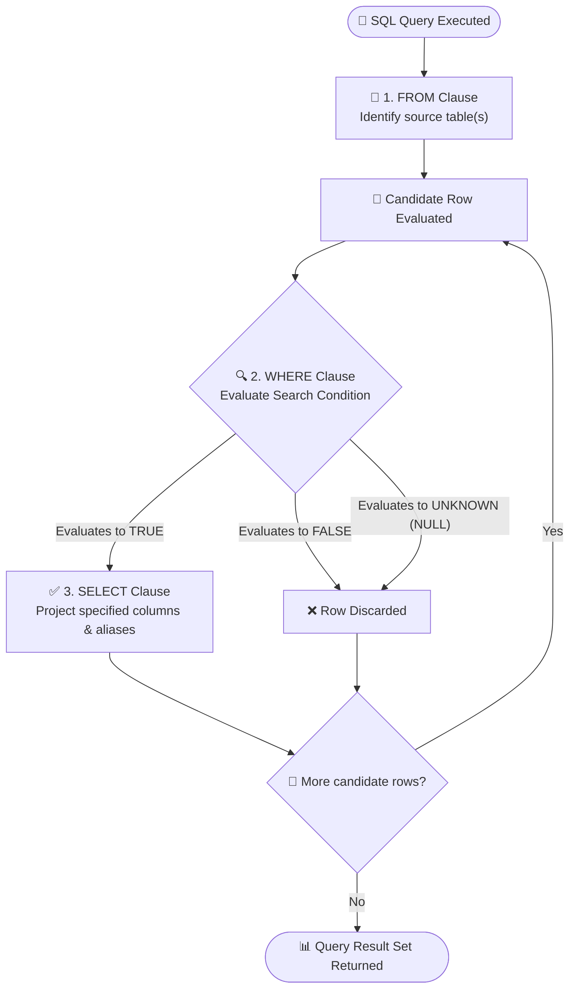
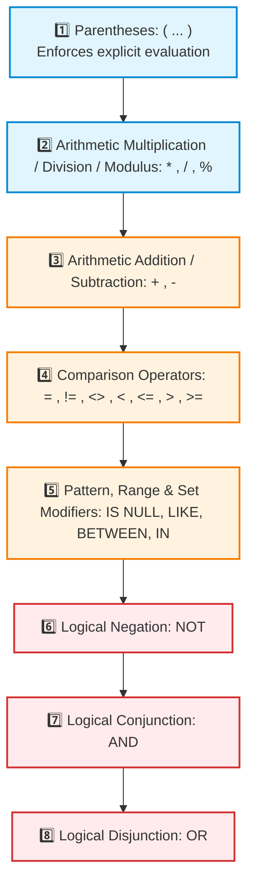
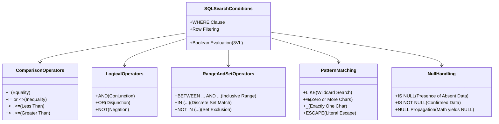

# 🔍 Module 06: Database Fundamentals – Performing a Conditional Search

> **Course**: AWS re/Start  
> **Module**: Database Fundamentals (M06 – Performing a Conditional Search)  
> **Source Document**: `T10-Database/T10-0006-RSDB_EN-US_SG_M06_CONDITIONALSEARCH.pdf`  
> **Target Audience**: AWS re/Start Learners, Cloud Practitioners, and Junior Database Administrators  

---

## 🎯 Module Overview

In relational database management systems (RDBMS), data volume grows rapidly into millions or billions of rows. Retrieving entire tables using unqualified `SELECT *` statements is computationally expensive, introduces network bottlenecks, and obscures critical business insights. To transform raw data into targeted information, SQL provides filtering mechanisms that restrict query outputs to precisely the records meeting defined criteria.

A **conditional search** applies one or more logical tests to each candidate row in a table. In SQL, this filtering capability is governed by the `WHERE` clause. By mastering conditional expressions, comparison predicates, arithmetic transformations, logical combinations, range checks, pattern matching, and three-valued logic (3VL) for `NULL` handling, database practitioners ensure optimal query performance, data integrity, and analytical accuracy across enterprise cloud architectures like Amazon RDS and Amazon Aurora.



---

## 📌 Learning Objectives

By completing this module and working through the practical scenarios, you will be able to:

- [ ] **Define the Purpose of the `WHERE` Clause**: Explain how search conditions filter rows during query execution and differentiate row filtering from column selection.
- [ ] **Evaluate Search Conditions under Three-Valued Logic (3VL)**: Analyze how SQL expressions resolve to `TRUE`, `FALSE`, or `UNKNOWN`, and recognize why only rows evaluating to `TRUE` appear in the output.
- [ ] **Apply Comparison Operators**: Construct predicates using `=`, `!=`, `<>`, `<`, `<=`, `>`, and `>=`, understanding ANSI standard compliance and dialect portability.
- [ ] **Perform Arithmetic Operations in Queries**: Calculate derived values using `+`, `-`, `*`, `/`, and `%` in both projection lists and filtering predicates.
- [ ] **Assign Column Aliases**: Use the `AS` keyword to generate descriptive column headers, properly handle whitespace using quotation marks, and navigate clause execution constraints.
- [ ] **Construct Compound Conditions with Logical Operators**: Combine multiple criteria using `AND`, `OR`, and `NOT`, validating outputs against formal boolean truth tables.
- [ ] **Enforce Operator Precedence with Parentheses**: Explain why `AND` binds tighter than `OR` by default, trace precedence bugs, and use parentheses to enforce correct evaluation logic.
- [ ] **Execute Range and Set Operations**: Query bounded continuous ranges using `BETWEEN ... AND ...` and discrete sets using `IN (...)` and `NOT IN (...)`, identifying NULL pitfalls in set negation.
- [ ] **Perform Pattern Matching with `LIKE`**: Leverage the `%` and `_` wildcard characters to match strings, account for database collation case-sensitivity, and escape special characters.
- [ ] **Handle `NULL` Values Accurately**: Articulate why `= NULL` always fails, utilize `IS NULL` and `IS NOT NULL` predicates, and anticipate `NULL` propagation in arithmetic calculations.
- [ ] **Analyze Real-World Datasets**: Formulate multi-condition SQL queries against sample tables such as the `world` database (`country`, `city`, `countrylanguage`) and retail customer records.

---

## 🧭 1. The Role of the `WHERE` Clause in SQL

### Row Filtering vs. Column Selection
In Structured Query Language (SQL), data retrieval is primarily executed via the `SELECT` statement. A foundational principle of relational database design is the separation of **horizontal filtering** (selecting specific rows) from **vertical projection** (selecting specific columns):

1. **Vertical Projection (`SELECT` list)**: Determines *which columns* appear in the resulting dataset.
2. **Horizontal Filtering (`WHERE` clause)**: Determines *which rows* are included in the calculation or result set based on a logical test.

### Anatomy of the SQL `SELECT` Statement
The standard `SELECT` statement features five primary clauses that are processed in a specific conceptual lifecycle:

| Clause | Status | Evaluation Order | Functional Purpose |
| :--- | :--- | :--- | :--- |
| **`FROM`** | Required | 1st | Specifies the target table(s) or views to retrieve data from. |
| **`WHERE`** | Optional | 2nd | Applies row-level conditional filters before aggregation. |
| **`GROUP BY`** | Optional | 3rd | Groups rows sharing common values into summary rows. |
| **`HAVING`** | Optional | 4th | Filters grouped rows based on aggregate conditions. |
| **`SELECT`** | Required | 5th | Projects the requested expressions, columns, and aliases. |
| **`ORDER BY`** | Optional | 6th | Sorts the final result set in ascending (`ASC`) or descending (`DESC`) order. |

> [!NOTE]
> Even though `SELECT` is written first in SQL syntax, database query execution engines evaluate `FROM` and `WHERE` before `SELECT`. Because `WHERE` runs before `SELECT`, column aliases defined in `SELECT` cannot be referenced within the `WHERE` clause in standard SQL.

### Search Conditions and Boolean Evaluation
A **search condition** is a boolean expression applied to each row. The expression evaluates to one of three possible logical states under ANSI SQL **Three-Valued Logic (3VL)**:

- **`TRUE`**: The condition is met; the row is accepted into the query pipeline.
- **`FALSE`**: The condition is not met; the row is discarded.
- **`UNKNOWN`**: The condition involves missing or `NULL` data; the result cannot be proven true, so the row is discarded.

```sql
-- Basic syntax: Filtering rows where a condition evaluates to TRUE
SELECT column1, column2, ...
FROM table_name
WHERE search_condition;
```

---

## ⚖️ 2. Comparison Operators

Comparison operators compare two expressions (columns, literals, or calculated values) and yield a boolean truth value.

### Comparison Operators Reference Table

| Operator | Standard Meaning | Example Expression | Description |
| :---: | :--- | :--- | :--- |
| **`=`** | Equal to | `Continent = 'Europe'` | Evaluates to `TRUE` if both operands have identical values. |
| **`!=`** or **`<>`** | Not equal to | `Region != 'Caribbean'` | Evaluates to `TRUE` if operands have different values. |
| **`<`** | Less than | `Population < 1000000` | Evaluates to `TRUE` if the left operand is strictly smaller than the right. |
| **`<=`** | Less than or equal to | `SurfaceArea <= 50000` | Evaluates to `TRUE` if the left operand is smaller than or equal to the right. |
| **`>`** | Greater than | `GNP > 1000000` | Evaluates to `TRUE` if the left operand is strictly larger than the right. |
| **`>=`** | Greater than or equal to | `LifeExpectancy >= 75.0` | Evaluates to `TRUE` if the left operand is larger than or equal to the right. |

> [!TIP]
> Both `!=` and `<>` represent "not equal to". While `!=` is widely accepted across modern database engines (MySQL, PostgreSQL, Oracle, SQL Server), `<>` is the official **ANSI/ISO SQL standard** operator. For maximum cross-database portability, `<>` is recommended.

### Target Table Schema: `country`
The standard sample `country` table contains geographic, economic, and demographic records:

```text
Table: country
├── Code            (CHAR(3), Primary Key)
├── Name            (CHAR(52))
├── Continent       (CHAR(20))
├── Region          (CHAR(26))
├── SurfaceArea     (FLOAT)
├── IndepYear       (SMALLINT)
├── Population      (INT)
├── LifeExpectancy  (FLOAT)
├── GNP             (FLOAT)
└── GNPOld          (FLOAT)
```

### Query Example: Equality Predicate
Retrieve geographic and demographic metrics for the sovereign nation of Ireland:

```sql
SELECT continent, surfacearea, population, gnp
FROM country
WHERE name = 'Ireland';
```

**Query Result:**
```text
+-----------+-------------+------------+-------+
| continent | surfacearea | population | gnp   |
+-----------+-------------+------------+-------+
| Europe    |       70273 |    3775100 | 75921 |
+-----------+-------------+------------+-------+
```

*Execution Walkthrough*:
The database scans table `country`. For each row, it tests `name = 'Ireland'`. Rows where `name` equals any other string evaluate to `FALSE` and are skipped. When the row containing `'Ireland'` is read, the test yields `TRUE`, and the engine projects the requested four columns.

---

## ➕ 3. Arithmetic Operators and Column Aliases

SQL allows mathematical computations directly within queries. Arithmetic operators can appear in both the projection (`SELECT` column list) to produce calculated output and the filtering clause (`WHERE`) to evaluate numerical expressions.

### SQL Arithmetic Operators

| Operator | Mathematical Operation | Example | Result |
| :---: | :--- | :--- | :--- |
| **`+`** | Addition | `lifeexpectancy + 5.5` | Sum of operands |
| **`-`** | Subtraction | `population - 350000` | Difference between operands |
| **`*`** | Multiplication | `population * 1.15` | Product of operands |
| **`/`** | Division | `population / surfacearea` | Quotient of operands |
| **`%`** | Modulus (Remainder) | `population % surfacearea` | Remainder of integer division |

---

### Practical Arithmetic Examples

#### 1. Addition (`+`) with Comparison Filtering
Calculate projected life expectancy if medical advances increase average lifespan by 5.5 years for countries with a Gross National Product (GNP) exceeding $1,300,000 million ($1.3 trillion):

```sql
SELECT name, lifeexpectancy, lifeexpectancy + 5.5
FROM country
WHERE gnp > 1300000;
```

**Query Result:**
```text
+----------------+----------------+--------------------+
| name           | lifeexpectancy | lifeexpectancy+5.5 |
+----------------+----------------+--------------------+
| Germany        |           77.4 |               82.9 |
| France         |           78.8 |               84.3 |
| United Kingdom |           77.7 |               83.2 |
| Japan          |           80.7 |               86.2 |
| United States  |           77.1 |               82.6 |
+----------------+----------------+--------------------+
```

#### 2. Subtraction (`-`)
Simulate demographic decline by subtracting 350,000 residents from the population of the United States:

```sql
SELECT name, continent, population, population - 350000
FROM country
WHERE name = 'United States';
```

**Query Result:**
```text
+---------------+---------------+------------+--------------------+
| name          | continent     | population | population-350000  |
+---------------+---------------+------------+--------------------+
| United States | North America |  278357000 |          278007000 |
+---------------+---------------+------------+--------------------+
```

#### 3. Multiplication (`*`)
Model an anticipated 15% population growth (+15% factor of 1.15) for the Mediterranean nation of Malta due to inbound migration:

```sql
SELECT name, continent, population, population * 1.15
FROM country
WHERE name = 'Malta';
```

**Query Result:**
```text
+-------+-----------+------------+-----------------+
| name  | continent | population | population*1.15 |
+-------+-----------+------------+-----------------+
| Malta | Europe    |     380200 |       437230.00 |
+-------+-----------+------------+-----------------+
```

#### 4. Division (`/`) in Selection and Filtering
Compute population density (people per square kilometer) and restrict results to regions where density exceeds 3,000 people/km²:

```sql
SELECT name, region, population, surfacearea, population / surfacearea
FROM country
WHERE population / surfacearea > 3000;
```

**Query Result:**
```text
+-----------+-----------------+------------+-------------+------------------------+
| name      | region          | population | surfacearea | population/surfacearea |
+-----------+-----------------+------------+-------------+------------------------+
| Gibraltar | Southern Europe |      25000 |           6 |            4166.666667 |
| Hong Kong | Eastern Asia    |    6782000 |        1075 |            6308.837209 |
| Macao     | Eastern Asia    |     473000 |          18 |           26277.777778 |
+-----------+-----------------+------------+-------------+------------------------+
```

#### 5. Modulus (`%`)
Calculate the remaining population not evenly distributed per square kilometer for San Marino:

```sql
SELECT name, population, surfacearea, population / surfacearea, population % surfacearea
FROM country
WHERE name = 'San Marino';
```

**Query Result:**
```text
+------------+------------+-------------+------------------------+------------------------+
| name       | population | surfacearea | population/surfacearea | population%surfacearea |
+------------+------------+-------------+------------------------+------------------------+
| San Marino |      27000 |          61 |               442.6230 |                  38.00 |
+------------+------------+-------------+------------------------+------------------------+
```

---

### Column Aliases (`AS`)

When calculations are projected, database engines generate default column labels matching the exact arithmetic formula (e.g., `lifeexpectancy+5.5` or `population/surfacearea`). These headers are difficult to read and awkward to consume in programmatic client applications.

An **alias** assigns a temporary, user-friendly label to a column or expression during query execution:
- Aliases exist only for the duration of the query result set.
- They do not alter underlying table definitions or schemas.
- The keyword `AS` explicitly introduces the alias (though optional in many dialects, including `AS` enhances code clarity).

#### Applying an Identifier Alias
```sql
SELECT name, lifeexpectancy, lifeexpectancy + 5.5 AS newlifeexpectancy
FROM country
WHERE gnp > 1300000;
```

**Query Result:**
```text
+----------------+----------------+-------------------+
| name           | lifeexpectancy | newlifeexpectancy |
+----------------+----------------+-------------------+
| Germany        |           77.4 |              82.9 |
| France         |           78.8 |              84.3 |
| United Kingdom |           77.7 |              83.2 |
| Japan          |           80.7 |              86.2 |
| United States  |           77.1 |              82.6 |
+----------------+----------------+-------------------+
```

#### Aliases Containing Whitespace or Special Characters
If an alias contains spaces, uppercase characters, or punctuation, it must be enclosed within single quotes (`'...'`) or double quotes (`"..."`, depending on the database engine's ANSI SQL configuration):

```sql
SELECT name, lifeexpectancy, lifeexpectancy + 5.5 AS 'new life expectancy'
FROM country
WHERE gnp > 1300000;
```

**Query Result:**
```text
+----------------+----------------+---------------------+
| name           | lifeexpectancy | new life expectancy |
+----------------+----------------+---------------------+
| Germany        |           77.4 |                82.9 |
| France         |           78.8 |                84.3 |
| United Kingdom |           77.7 |                83.2 |
| Japan          |           80.7 |                86.2 |
| United States  |           77.1 |                82.6 |
+----------------+----------------+---------------------+
```

> [!CAUTION]
> **Common Trap**: Attempting to use a column alias in the `WHERE` clause of the same query causes a syntax or runtime error:
> ```sql
> -- ❌ INVALID SQL: Causes 'Unknown column newlifeexpectancy in where clause'
> SELECT name, lifeexpectancy + 5.5 AS newlifeexpectancy
> FROM country
> WHERE newlifeexpectancy > 85.0;
> 
> -- ✅ VALID SQL: Repeat the raw expression in the WHERE clause
> SELECT name, lifeexpectancy + 5.5 AS newlifeexpectancy
> FROM country
> WHERE lifeexpectancy + 5.5 > 85.0;
> ```
> This occurs because the database resolves the `WHERE` clause *before* evaluating the `SELECT` projection list where the alias is instantiated.

---

## 🔀 4. Logical Operators & Compound Conditions

When business rules require records to meet multiple constraints simultaneously, SQL provides **logical operators** to combine individual predicates into compound search conditions.

### Core Logical Operators Overview

| Logical Operator | Operational Behavior | Evaluation Condition |
| :--- | :--- | :--- |
| **`AND`** | Conjunction | Returns `TRUE` **only if all** connected conditions evaluate to `TRUE`. |
| **`OR`** | Disjunction | Returns `TRUE` if **at least one** connected condition evaluates to `TRUE`. |
| **`NOT`** | Negation | Inverts the boolean truth value of the succeeding predicate (`TRUE` $\rightarrow$ `FALSE`, `FALSE` $\rightarrow$ `TRUE`). |

---

### Target Table Schema: `city`
The sample `city` table represents urban municipalities worldwide:

```text
Table: city
├── ID           (INT, Primary Key)
├── Name         (CHAR(35))
├── CountryCode  (CHAR(3))
├── District     (CHAR(20))
└── Population   (INT)
```

---

### The `AND` Operator
The `AND` operator mandates that every search condition must be satisfied simultaneously for a row to qualify.

```sql
SELECT name, district, population
FROM city
WHERE countrycode = 'IND'
  AND district = 'Delhi';
```

**Query Result:**
```text
+------------------+----------+------------+
| name             | district | population |
+------------------+----------+------------+
| Delhi            | Delhi    |    7206704 |
| New Delhi        | Delhi    |     301297 |
| Delhi Cantonment | Delhi    |      94326 |
+------------------+----------+------------+
```

*Logic Check*: A city located in India whose district is NOT Delhi is discarded. Similarly, a city in another country whose district happens to be Delhi is discarded. Both expressions must be `TRUE`.

---

### The `OR` Operator
The `OR` operator requires only one of the specified criteria to evaluate to `TRUE`.

```sql
SELECT name, district, population
FROM city
WHERE district = 'Delhi'
   OR district = 'Punjab';
```

**Query Result:**
```text
+-----------------------+----------+------------+
| name                  | district | population |
+-----------------------+----------+------------+
| Delhi                 | Delhi    |    7206704 |
| New Delhi             | Delhi    |     301297 |
| Delhi Cantonment      | Delhi    |      94326 |
| Ludhiana              | Punjab   |    1042740 |
| Amritsar              | Punjab   |     708835 |
| Jalandhar (Jullundur) | Punjab   |     509510 |
| Lahore                | Punjab   |    5063499 |
+-----------------------+----------+------------+
```

---

### Boolean Truth Tables: Two-Valued Logic & Three-Valued Logic (3VL)

Understanding how SQL computes compound predicates is vital when missing data (`NULL`) is present. SQL implements **Kleene's Three-Valued Logic**:

#### Conjunction (`AND`) Truth Table
| Predicate A | Predicate B | A `AND` B | Analytical Rule |
| :---: | :---: | :---: | :--- |
| `TRUE` | `TRUE` | **`TRUE`** | Both satisfied $\rightarrow$ row included |
| `TRUE` | `FALSE` | **`FALSE`** | One failed $\rightarrow$ row excluded |
| `FALSE` | `TRUE` | **`FALSE`** | One failed $\rightarrow$ row excluded |
| `FALSE` | `FALSE` | **`FALSE`** | Both failed $\rightarrow$ row excluded |
| `TRUE` | `UNKNOWN` | **`UNKNOWN`** | Dependent on unknown $\rightarrow$ row excluded |
| `FALSE` | `UNKNOWN` | **`FALSE`** | Guaranteed false regardless $\rightarrow$ row excluded |
| `UNKNOWN` | `UNKNOWN` | **`UNKNOWN`** | Indeterminate $\rightarrow$ row excluded |

#### Disjunction (`OR`) Truth Table
| Predicate A | Predicate B | A `OR` B | Analytical Rule |
| :---: | :---: | :---: | :--- |
| `TRUE` | `TRUE` | **`TRUE`** | At least one true $\rightarrow$ row included |
| `TRUE` | `FALSE` | **`TRUE`** | At least one true $\rightarrow$ row included |
| `FALSE` | `TRUE` | **`TRUE`** | At least one true $\rightarrow$ row included |
| `FALSE` | `FALSE` | **`FALSE`** | Neither true $\rightarrow$ row excluded |
| `TRUE` | `UNKNOWN` | **`TRUE`** | True satisfied regardless $\rightarrow$ row included |
| `FALSE` | `UNKNOWN` | **`UNKNOWN`** | Indeterminate $\rightarrow$ row excluded |
| `UNKNOWN` | `UNKNOWN` | **`UNKNOWN`** | Indeterminate $\rightarrow$ row excluded |

#### Negation (`NOT`) Truth Table
| Predicate A | `NOT` A |
| :---: | :---: |
| `TRUE` | **`FALSE`** |
| `FALSE` | **`TRUE`** |
| `UNKNOWN` | **`UNKNOWN`** |

> [!IMPORTANT]
> Because SQL `WHERE` clauses **only pass rows that evaluate to `TRUE`**, any row that evaluates to `UNKNOWN` is treated identically to `FALSE` for filtering purposes and is discarded from the result set!

---

## ⚡ 5. Operator Precedence & The Power of Parentheses

When an expression contains multiple arithmetic, comparison, and logical operators without parentheses, SQL adheres to strict internal precedence rules to dictate which operations execute first.

### Comprehensive SQL Operator Precedence Hierarchy



---

### The Classic Precedence Trap: `AND` vs. `OR`

A pervasive source of logic bugs in database queries stems from the fact that **`AND` takes precedence over `OR`**.

#### The Scenario
Suppose you want to query Pakistani cities (`countrycode = 'PAK'`) located in either the district of `Punjab` or `Sindh`, but with a strict population filter: **only include cities with more than 1,500,000 residents**.

#### Attempt 1: Without Parentheses (Flawed Logic)
```sql
SELECT name, district, population
FROM city
WHERE countrycode = 'PAK'
  AND district = 'Punjab'
   OR district = 'Sindh'
  AND population > 1500000;
```

**Flawed Query Result:**
```text
+------------+----------+------------+
| name       | district | population |
+------------+----------+------------+
| Karachi    | Sindh    |    9269265 |
| Lahore     | Punjab   |    5063499 |
| Faisalabad | Punjab   |    1977246 |
| Rawalpindi | Punjab   |    1406214 | <-- Population < 1,500,000!
| Multan     | Punjab   |    1182441 | <-- Population < 1,500,000!
+------------+----------+------------+
```

#### Why Did Attempt 1 Fail?
Because `AND` binds tighter than `OR`, SQL parsed the query as two separate blocks joined by `OR`:

$$\text{Condition} = (\text{countrycode} = \text{'PAK'} \land \text{district} = \text{'Punjab'}) \lor (\text{district} = \text{'Sindh'} \land \text{population} > 1500000)$$

1. **Left Branch**: Any city where `countrycode = 'PAK'` AND `district = 'Punjab'` was included **regardless of population size**! This allowed Rawalpindi ($1,406,214$) and Multan ($1,182,441$) to enter the result set.
2. **Right Branch**: Any city where `district = 'Sindh'` AND `population > 1500000` was included (even cities in other countries if they had a Sindh district!).

---

#### Attempt 2: Enforcing Precedence with Parentheses (Correct Logic)
By placing parentheses around the `OR` expression, you force the database to evaluate the district choice first, and then apply both the country code and population constraints to the entire result:

```sql
SELECT name, district, population
FROM city
WHERE countrycode = 'PAK'
  AND (district = 'Punjab' OR district = 'Sindh')
  AND population > 1500000;
```

**Correct Query Result:**
```text
+------------+----------+------------+
| name       | district | population |
+------------+----------+------------+
| Karachi    | Sindh    |    9269265 |
| Lahore     | Punjab   |    5063499 |
| Faisalabad | Punjab   |    1977246 |
+------------+----------+------------+
```

*Evaluation Analysis*:
Rawalpindi and Multan are in Punjab, satisfying `(district = 'Punjab' OR district = 'Sindh')` and `countrycode = 'PAK'`. However, when tested against `population > 1500000`, the expression yields `FALSE`. Under `AND`, any `FALSE` makes the entire search condition `FALSE`, properly discarding the rows.

---

## 🎯 6. Range and Set Operators

SQL provides specialized operators designed to test whether a value falls within a contiguous range or matches elements within a discrete set.

### The `BETWEEN ... AND ...` Range Operator
The `BETWEEN` operator filters records whose value falls within a specified lower and upper bound.

$$\text{column} \text{ BETWEEN } \text{low\_val} \text{ AND } \text{high\_val}$$

> [!IMPORTANT]
> **Boundary Inclusivity**: The SQL `BETWEEN` operator is **inclusive** on both ends. Testing `x BETWEEN a AND b` is functionally equivalent to `x >= a AND x <= b`.

#### Query Example
Identify mid-sized global cities with populations strictly bounded between 500,000 and 505,000 residents:

```sql
SELECT countrycode, name, district, population
FROM city
WHERE population BETWEEN 500000 AND 505000;
```

**Query Result:**
```text
+-------------+------------+----------------------+------------+
| countrycode | name       | district             | population |
+-------------+------------+----------------------+------------+
| IND         | Chandigarh | Chandigarh           |     504094 |
| YEM         | Sanaa      | Sanaa                |     503600 |
| COG         | Pointe-Noire | Kouilou             |     500000 | <-- Exact lower boundary included!
| MAR         | Salé       | Rabat-Salé-Zammour-Z |     504420 |
| RUS         | Tjumen     | Tjumen               |     503400 |
+-------------+------------+----------------------+------------+
```

#### Equivalent Syntax Using Comparison Operators
```sql
SELECT countrycode, name, district, population
FROM city
WHERE population >= 500000
  AND population <= 505000;
```

---

### The `IN` and `NOT IN` Set Operators
The `IN` operator tests whether an expression matches any value in a comma-delimited literal list or subquery result. It serves as a concise, readable shorthand for multiple `OR` conditions.

#### Using `IN` for Multiple Discrete Matches
Find all cities located in the Indian districts of Delhi, Punjab, or Kerala:

```sql
SELECT name, district, population
FROM city
WHERE district IN ('Delhi', 'Punjab', 'Kerala');
```

**Query Result:**
```text
+---------------------------------+----------+------------+
| name                            | district | population |
+---------------------------------+----------+------------+
| Delhi                           | Delhi    |    7206704 |
| Ludhiana                        | Punjab   |    1042740 |
| Amritsar                        | Punjab   |     708835 |
| Cochin (Kochi)                  | Kerala   |     564589 |
| Thiruvananthapuram (Trivandrum) | Kerala   |     524006 |
| Jalandhar (Jullundur)           | Punjab   |     509510 |
| Lahore                          | Punjab   |    5063499 |
+---------------------------------+----------+------------+
```

*Equivalent `OR` Expansion*:
```sql
WHERE district = 'Delhi' 
   OR district = 'Punjab' 
   OR district = 'Kerala';
```

---

### The `NOT IN` Operator & The Critical `NULL` Pitfall

The `NOT` operator negates membership, returning rows whose column value does not match any item in the list.

```sql
SELECT name, district, population
FROM city
WHERE countrycode = 'CAN'
  AND district NOT IN ('Ontario', 'Alberta');
```

**Equivalent Comparison Syntax**:
```sql
SELECT name, district, population
FROM city
WHERE countrycode = 'CAN'
  AND district <> 'Ontario'
  AND district <> 'Alberta';
```

> [!CAUTION]
> **The Critical `NOT IN` with `NULL` Pitfall**:
> If the list passed to `NOT IN` contains a `NULL` value, **the entire query returns zero rows!**
> 
> *Mathematical Explanation*:
> Consider `x NOT IN (1, 2, NULL)`. Under SQL expansion, this becomes:
> $$x \ne 1 \text{ AND } x \ne 2 \text{ AND } x \ne \text{NULL}$$
> In SQL, $x \ne \text{NULL}$ evaluates to **`UNKNOWN`**.
> Under truth table rules for `AND`, `TRUE AND TRUE AND UNKNOWN` yields **`UNKNOWN`**.
> Because `WHERE` rejects all rows that evaluate to `UNKNOWN`, no rows will ever qualify!
> Always verify that candidate lists in `NOT IN` statements contain no `NULL` values, or filter with `IS NOT NULL`.

---

## 🔡 7. Pattern Matching with `LIKE`

When precise equality cannot be established (e.g., searching for partial names, prefixes, suffixes, or domain patterns), SQL provides the `LIKE` operator to perform wildcard pattern matching on character strings.

### Wildcard Characters

| Wildcard | Operational Meaning | Regex Equivalent | Practical Example |
| :---: | :--- | :---: | :--- |
| **`%`** | Matches **zero or more** arbitrary characters | `.*` | `'West%'` matches `'West'`, `'Western'`, `'West Australia'` |
| **`_`** | Matches **exactly one** single character | `.` | `'_B_'` matches `'GBR'`, `'ABW'`, `'LBN'`, but NOT `'B'` or `'GBRR'` |

---

### Practical Pattern Matching Queries

#### 1. Prefix Matching with `%`
Search for cities whose district name begins with the word "West":

```sql
SELECT name, district, population
FROM city
WHERE district LIKE 'West%';
```

**Query Result:**
```text
+------------+------------------+------------+
| name       | district         | population |
+------------+------------------+------------+
| Perth      | West Australia   |    1096829 |
| Brugge     | West Flanderi    |     116246 |
| Cape Town  | Western Cape     |    2352121 |
| Paarl      | Western Cape     |     105768 |
| George     | Western Cape     |      93818 |
| Zamboanga  | Western Mindanao |     601794 |
| Bacolod    | Western Visayas  |     429076 |
+------------+------------------+------------+
```

#### 2. Fixed-Length Character Positioning with `_`
Search for cities whose 3-character ISO Country Code contains `'B'` as its second character:

```sql
SELECT countrycode, name
FROM city
WHERE countrycode LIKE '_B_';
```

**Query Result:**
```text
+-------------+------------+
| countrycode | name       |
+-------------+------------+
| ABW         | Oranjestad |
| GBR         | London     |
| GBR         | Birmingham |
| LBN         | Beirut     |
| LBY         | Tripoli    |
| LBR         | Monrovia   |
+-------------+------------+
```

---

### Collation and Case Sensitivity

In relational engines, string matching behavior depends on the **collation** configured for the column or database:

- **Case-Insensitive Collations (e.g., `utf8mb4_general_ci`, `utf8mb4_0900_ai_ci`)**:
  Default in MySQL and MariaDB. In these collations, `'west%'`, `'West%'`, and `'WEST%'` produce identical matches.
- **Case-Sensitive / Binary Collations (e.g., `utf8mb4_bin`, `Latin1_General_CS_AS`)**:
  Standard in PostgreSQL, Oracle, and strict SQL environments. `'West%'` will NOT match `'western'`.
- In engines like PostgreSQL, case-insensitive pattern matching is supported via the **`ILIKE`** operator:
  ```sql
  -- PostgreSQL specific case-insensitive matching
  SELECT name FROM city WHERE district ILIKE 'west%';
  ```

---

### Escaping Wildcard Characters
When you need to search for a literal percent sign (`%`) or underscore (`_`) within text data, use an escape character defined by the `ESCAPE` clause:

```sql
-- Searching for a discount column containing the literal string '10%'
SELECT product_name, discount_description
FROM promotions
WHERE discount_description LIKE '%10\%%' ESCAPE '\';

-- Searching for file names containing a literal underscore
SELECT filename
FROM server_logs
WHERE filename LIKE 'app\_log\_%' ESCAPE '\';
```

---

## 🚫 8. Handling `NULL` Values & Three-Valued Logic

### What is `NULL`?
In relational databases, `NULL` represents the **total absence of data, an unknown state, or unrecorded information**. It indicates that a value is missing or inapplicable.

> [!WARNING]
> - `NULL` is **NOT** equal to numerical zero (`0`).
> - `NULL` is **NOT** equal to an empty string (`''`).
> - `NULL` is **NOT** equal to whitespace (`' '`).
> - A zero is a known number; an empty string is a known string of length 0. A `NULL` is completely unknown.

```text
Visual Memory Comparison:
┌─────────────────┬──────────────────┬─────────────────┐
│     Zero (0)    │ Empty String ('')│     NULL        │
├─────────────────┼──────────────────┼─────────────────┤
│ [ 0 ]           │ [ "" ]           │ [ ??? ]         │
│ Value: Known    │ Value: Known     │ Value: ABSENT   │
│ Numeric 0       │ Zero characters  │ Missing/Unknown │
└─────────────────┴──────────────────┴─────────────────┘
```

---

### Why `= NULL` Fails: The Equality Paradox
A frequent beginner mistake is testing for missing data using comparison equality:

```sql
-- ❌ ERRONEOUS QUERY: Always returns zero rows!
SELECT name, lifeexpectancy
FROM country
WHERE lifeexpectancy = NULL;
```

#### Why Does This Fail?
Because `NULL` is by definition unknown, a database cannot determine whether one unknown entity equals another unknown entity. Therefore:
- `NULL = NULL` does **NOT** evaluate to `TRUE`. It evaluates to **`UNKNOWN`**.
- `lifeexpectancy = NULL` evaluates to **`UNKNOWN`** for every single row in the table.
- Because `WHERE` requires an expression to evaluate to `TRUE` to include a row, the query silently returns an empty set.

---

### The Solution: `IS NULL` and `IS NOT NULL`

SQL provides dedicated unary predicates specifically designed to inspect the presence or absence of data:
- **`IS NULL`**: Evaluates to `TRUE` if the field holds no data.
- **`IS NOT NULL`**: Evaluates to `TRUE` if the field contains a valid data value.

#### Querying Missing Life Expectancy Records
Identify non-island sovereign entities that lack life expectancy demographic data:

```sql
SELECT name, lifeexpectancy
FROM country
WHERE lifeexpectancy IS NULL
  AND name NOT LIKE '%Island%';
```

**Query Result:**
```text
+--------------------------------+----------------+
| name                           | lifeexpectancy |
+--------------------------------+----------------+
| Antarctica                     | NULL           |
| French Southern territories    | NULL           |
| British Indian Ocean Territory | NULL           |
| Niue                           | NULL           |
| Pitcairn                       | NULL           |
| Svalbard and Jan Mayen         | NULL           |
| Tokelau                        | NULL           |
| Holy See (Vatican City State)  | NULL           |
| Wallis and Futuna              | NULL           |
+--------------------------------+----------------+
```

---

### `NULL` Propagation in Arithmetic Calculations

In SQL, performing mathematical operations on missing data propagates the unknown state. Any arithmetic operation involving a `NULL` operand **always yields `NULL`**:

$$\text{NULL} + 1 = \text{NULL}$$
$$\text{NULL} \times 100 = \text{NULL}$$
$$\text{NULL} / 2 = \text{NULL}$$

```sql
SELECT name, lifeexpectancy, lifeexpectancy + 1 AS 'adjusted_life'
FROM country
WHERE lifeexpectancy IS NULL
  AND name NOT LIKE '%Island%';
```

**Query Result:**
```text
+--------------------------------+----------------+---------------+
| name                           | lifeexpectancy | adjusted_life |
+--------------------------------+----------------+---------------+
| Antarctica                     | NULL           | NULL          |
| French Southern territories    | NULL           | NULL          |
| British Indian Ocean Territory | NULL           | NULL          |
| Niue                           | NULL           | NULL          |
| Pitcairn                       | NULL           | NULL          |
| Svalbard and Jan Mayen         | NULL           | NULL          |
| Tokelau                        | NULL           | NULL          |
| Holy See (Vatican City State)  | NULL           | NULL          |
| Wallis and Futuna              | NULL           | NULL          |
+--------------------------------+----------------+---------------+
```

> [!TIP]
> If you need to replace `NULL` values with a fallback numerical value during calculations, use ANSI standard `COALESCE(column, default_value)` or engine-specific functions like MySQL's `IFNULL(column, default_value)`. For example: `COALESCE(lifeexpectancy, 0) + 1`.

---

### Integrity Constraints and Table Design
In relational schema design:
1. **Primary Key Columns**: By definition, primary keys must identify rows uniquely and **cannot contain `NULL` values**.
2. **`NOT NULL` Constraints**: Database architects can enforce `NOT NULL` constraints on non-primary columns (e.g., `EmailAddress`, `CreatedAt`) to ensure application consistency.
3. **Foreign Keys**: Foreign key columns *can* accept `NULL` values unless explicitly constrained, representing optional relational associations.

---

## 🛒 9. Practical Query Scenarios & Hands-on Activity

### Activity: E-Commerce Retail Customer Analysis

Consider an online retail customer management system storing order records in table `customer`:

```text
Table: customer
├── CustomerID           (INT, Primary Key)
├── FirstName            (VARCHAR(50))
├── LastName             (VARCHAR(50))
├── StreetAddress        (VARCHAR(100))
├── City                 (VARCHAR(50))
├── StateProvince        (VARCHAR(50))
├── PostalCode           (VARCHAR(20))
├── CountryCode          (CHAR(3))
├── EmailAddress         (VARCHAR(100))
├── LastPurchaseYear     (INT)
├── TotalNumberPurchases (INT)
└── TotalCostOfPurchases (DECIMAL(10,2))
```

#### Business Requirements & Formulated SQL Queries

Develop queries returning `FirstName`, `LastName`, and `EmailAddress` for the following analytical scenarios:

---

#### Scenario 1: Customers located in a specific country code (`GDR`)
*Requirement*: Retrieve all customers residing in the former country jurisdiction designated by code `GDR`.

```sql
SELECT firstname, lastname, emailaddress
FROM customer
WHERE countrycode = 'GDR';
```

---

#### Scenario 2: Customers in Chicago, Illinois
*Requirement*: Target regional marketing to customers residing specifically in the city of Chicago in the state of Illinois.

```sql
SELECT firstname, lastname, emailaddress
FROM customer
WHERE city = 'Chicago'
  AND stateprovince = 'Illinois';
```

---

#### Scenario 3: Customers using Yahoo email services
*Requirement*: Identify users registered with `@yahoo.com` domains.

```sql
SELECT firstname, lastname, emailaddress
FROM customer
WHERE emailaddress LIKE '%@yahoo.com';
```

---

#### Scenario 4: Customers NOT using Yahoo email services (excluding missing emails)
*Requirement*: Identify users whose registered email is not on the `@yahoo.com` domain, ensuring accounts with missing email addresses are omitted.

```sql
SELECT firstname, lastname, emailaddress
FROM customer
WHERE emailaddress NOT LIKE '%@yahoo.com'
  AND emailaddress IS NOT NULL;
```

> [!NOTE]
> The condition `AND emailaddress IS NOT NULL` is essential. If a customer has a `NULL` email address, `NOT LIKE` would evaluate to `UNKNOWN` and skip them. Explicitly declaring `IS NOT NULL` documents business intent and prevents semantic confusion.

---

#### Scenario 5: Medium-sized commercial accounts ($5,000 to $10,000 spend)
*Requirement*: Identify medium-tier accounts whose total historical spend is between $5,000 and $10,000 inclusive.

```sql
-- Solution Option A: Using BETWEEN
SELECT firstname, lastname, emailaddress
FROM customer
WHERE totalcostofpurchases BETWEEN 5000 AND 10000;

-- Solution Option B: Using Comparison Operators
SELECT firstname, lastname, emailaddress
FROM customer
WHERE totalcostofpurchases >= 5000
  AND totalcostofpurchases <= 10000;
```

---

#### Scenario 6: High-value Brazilian accounts with surname "Rodriguez"
*Requirement*: Find customers who live in Brazil (`CountryCode = 'BRA'`), have the last name `Rodriguez`, and have demonstrated high engagement (either made more than 100 purchases or spent more than $20,000).

```sql
SELECT firstname, lastname, emailaddress
FROM customer
WHERE countrycode = 'BRA'
  AND (totalnumberpurchases > 100 OR totalcostofpurchases > 20000)
  AND lastname = 'Rodriguez';
```

*Precedence Check*:
Parentheses around `(totalnumberpurchases > 100 OR totalcostofpurchases > 20000)` guarantee that high engagement is treated as a single composite condition. Without parentheses, a customer with `totalcostofpurchases > 20000` and `lastname = 'Rodriguez'` would be selected regardless of whether their country code was `BRA`.

---

## 💬 10. Discussion & Checkpoint Questions

### Discussion Questions & In-Depth Rationale

#### 1. What is the fundamental purpose of a `NULL` value in database systems?
**Answer**:  
A `NULL` value indicates the complete absence of data or an unrecorded data state. It is not an active value such as `0`, a space, or an empty string `''`. It allows databases to distinguish between a known zero quantity (e.g., zero bank account balance or zero children) and an unknown or uncollected metric (e.g., unreported income or unrecorded phone number).

#### 2. Why is searching for `NULL` values critical in database operations?
**Answer**:  
Records with `NULL` attributes are automatically excluded from standard equality, inequality, and pattern searches because operations against `NULL` evaluate to `UNKNOWN`. If database queries perform aggregations, arithmetic, or joins on columns containing unanticipated `NULL` entries without handling them, reporting summaries may silently omit vital records or return `NULL` results. Searching for `NULL` values enables database administrators to identify missing data, validate data ingestion pipelines, and trigger data cleansing routines.

#### 3. How do you properly search a table for records that do not contain `NULL`?
**Answer**:  
To select records containing populated, valid data, include the unary predicate `IS NOT NULL` within the `WHERE` clause:
```sql
SELECT column1, column2
FROM table_name
WHERE column1 IS NOT NULL;
```
Standard negative comparisons such as `WHERE column1 != NULL` will fail because comparing against `NULL` yields `UNKNOWN`.

---

### Checkpoint Review Questions & Answers

#### Q1: What is the primary operational role of a search condition in a SQL query?
**Answer**:  
A search condition in a SQL query defines a row-level logical test inside the `WHERE` clause. It evaluates each candidate row against comparison, arithmetic, range, or pattern criteria, filtering the table so that only rows evaluating to `TRUE` are processed and returned in the query result set.

#### Q2: Why should database developers use column aliases (`AS`) in SQL queries?
**Answer**:  
Aliases provide several important advantages:
1. **Human Readability**: They assign intuitive, meaningful column headers to computed expressions (e.g., labeling `population / surfacearea` as `population_density`).
2. **Schema Abstraction**: They clarify obscure, abbreviated, or legacy table column names for presentation layer applications.
3. **Application Integration**: They produce predictable JSON object keys or result set property names for client software consuming database query responses.

#### Q3: Which operator has higher precedence: `AND` or `OR`? What are the implications of this rule?
**Answer**:  
`AND` has higher precedence than `OR`. When both appear in an unparenthesized `WHERE` clause, the database evaluates all `AND` conditions first before combining the results with `OR`. To prevent subtle logical errors where unintended rows pass through the query, developers must use parentheses to explicitly enforce the desired evaluation order.

#### Q4: If a query executes `WHERE district NOT IN ('Delhi', 'Punjab', NULL)`, what will be the result?
**Answer**:  
The query will return **zero rows**. Under SQL Three-Valued Logic, `district NOT IN ('Delhi', 'Punjab', NULL)` expands to `district <> 'Delhi' AND district <> 'Punjab' AND district <> NULL`. Because any comparison against `NULL` evaluates to `UNKNOWN`, the entire conjunction evaluates to either `FALSE` or `UNKNOWN`. Since a `WHERE` clause only accepts rows evaluating to `TRUE`, no rows will ever qualify.

---

## 📋 11. Key Takeaways & Operator Reference Matrix



### Comprehensive Operator Summary Matrix

| Operator Category | Syntax / Keyword | Core Evaluation Behavior | Common Best Practice |
| :--- | :--- | :--- | :--- |
| **Row Filtering** | `WHERE <predicate>` | Filters table rows before grouping and projection. | Always filter early to reduce I/O and query latency. |
| **Comparison** | `=`, `<>`, `!=`, `<`, `<=`, `>`, `>=` | Compares scalar values; yields `TRUE`, `FALSE`, or `UNKNOWN`. | Use standard `<>` for portable inequality checks across RDBMS engines. |
| **Arithmetic** | `+`, `-`, `*`, `/`, `%` | Performs mathematical calculations on columns or numbers. | Remember arithmetic involving `NULL` values produces `NULL`. |
| **Aliases** | `AS alias_name` | Temporarily renames output headers in the query result. | Enclose aliases in quotes if spaces are required; cannot use in `WHERE`. |
| **Logical** | `AND`, `OR`, `NOT` | Joins or negates individual boolean search expressions. | Always use parentheses when mixing `AND` and `OR` in the same clause. |
| **Range** | `BETWEEN a AND b` | Evaluates if a value falls between `a` and `b` (inclusive). | Ensure the lower boundary `a` is listed first (`a <= b`). |
| **Set** | `IN (x, y, z)` | Matches any value in a designated list or subquery. | Check candidate lists for `NULL` values to avoid `NOT IN` logic lockouts. |
| **Pattern** | `LIKE 'pattern'` | Matches string patterns using `%` (multi) and `_` (single). | Be mindful of database collation case sensitivity and use `ESCAPE`. |
| **Null Test** | `IS NULL`, `IS NOT NULL` | Tests specifically for absent or populated database entries. | Never use `= NULL` or `!= NULL` to test for nullability. |

---

> [!TIP]
> **Next Steps**: In the subsequent module, you will explore **Database Functions** (string formatting, date/time calculations, numeric roundings, and aggregate summarizations with `GROUP BY` and `HAVING`), building upon the row-level filtering techniques mastered here.
