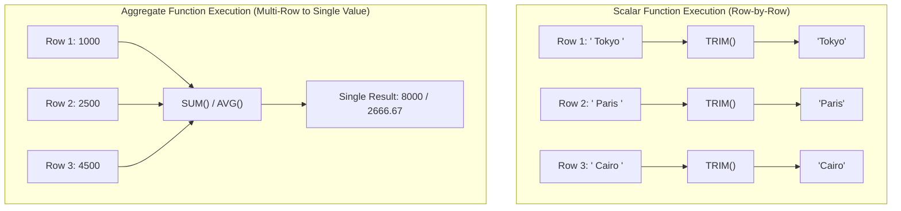
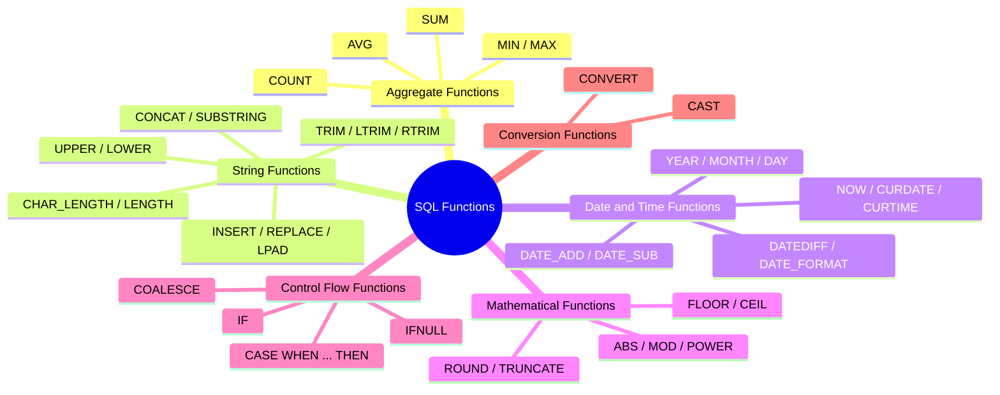

# 🗄️ Module 06: Working with Functions – Study Guide

> **Course**: AWS re/Start  
> **Module**: Database Fundamentals (M06)  
> **Source Document**: `T10-0007-DBAS_WORKINGWITHFUNCTIONS_EN.pdf`  
> **Target Audience**: AWS re/Start Learners / Cloud Practitioners / Database Administrators / Backend Developers  

---

## 🎯 Module Overview

In modern relational database management systems (RDBMS) such as MySQL, MariaDB, and Amazon Aurora, raw stored data is rarely retrieved in its exact raw format. Data must frequently be transformed, formatted, summarized, cleaned, or evaluated conditionally to satisfy business logic and application requirements.

**SQL Functions** are built-in operations and routines provided by the database engine that accept zero or more input parameters, perform specific calculations or data manipulation, and return an evaluated result. Mastering SQL functions enables developers, cloud support associates, and database administrators to:
- Perform computational analysis directly inside the database engine, reducing network bandwidth and compute overhead on application servers.
- Clean dirty data (e.g., stripping accidental whitespace, fixing casing discrepancies).
- Extract temporal metrics from timestamps and calculate durations.
- Compute aggregate summaries across massive datasets with sub-second performance.
- Construct flexible queries that adapt dynamically using conditional control flow.

---

### 📌 Learning Objectives

- [ ] **Identify Built-in SQL Functions**: Distinguish between scalar functions and aggregate functions, and navigate the major functional categories available in SQL.
- [ ] **Master Aggregate Computations**: Execute summary queries using `COUNT(*)`, `COUNT(column)`, `COUNT(DISTINCT column)`, `SUM()`, `AVG()`, `MIN()`, and `MAX()`, and predict how `NULL` values affect aggregate results.
- [ ] **Manipulate Character Strings**: Apply string transformation functions including `CHAR_LENGTH()`, `CONCAT()`, `SUBSTRING()`, `INSERT()`, `UPPER()`, `LOWER()`, `LPAD()`, `RPAD()`, and trim functions (`TRIM()`, `LTRIM()`, `RTRIM()`).
- [ ] **Perform Date and Time Calculations**: Retrieve current timestamps, extract temporal parts (`YEAR()`, `MONTH()`, `DAY()`), perform date arithmetic (`DATE_ADD()`, `DATE_SUB()`, `DATEDIFF()`), and format dates via `DATE_FORMAT()`.
- [ ] **Execute Mathematical Computations**: Apply numeric functions including `ROUND()`, `TRUNCATE()`, `FLOOR()`, `CEIL()`, `ABS()`, `MOD()`, and `POWER()`.
- [ ] **Implement Control Flow and Conversion Logic**: Construct dynamic queries using `IF()`, `IFNULL()`, `COALESCE()`, and `CASE` statements, and safely transform data types using `CAST()` and `CONVERT()`.
- [ ] **Analyze Real-World Datasets**: Query the relational `world` schema (`country`, `city`, `countrylanguage`) using practical production-grade SQL patterns.

---

## 🧠 1. Built-in SQL Functions Overview

A **built-in function** is an intrinsic, pre-compiled routine provided natively by the SQL database engine. Instead of writing custom procedural algorithms, developers invoke functions directly inside SQL statements (`SELECT`, `WHERE`, `HAVING`, `ORDER BY`).

### Scalar Functions vs. Aggregate Functions

SQL functions fall into two primary architectural classifications based on how they process rows:



| Dimension | Scalar Functions (Single-Row) | Aggregate Functions (Multi-Row / Group) |
| :--- | :--- | :--- |
| **Input** | Accepts single values or single-row column references. | Accepts a column across multiple rows or a partitioned group. |
| **Output** | Returns **one value per row** processed. | Returns **one summary value** per set or `GROUP BY` partition. |
| **Execution Scope** | Evaluated independently for each individual record. | Evaluated collectively across the entire dataset or group. |
| **Placement** | `SELECT`, `WHERE`, `ORDER BY`, `ON`, `HAVING`. | `SELECT`, `HAVING`, `ORDER BY` (Never in standard `WHERE`). |
| **Examples** | `UPPER()`, `ROUND()`, `DATE_ADD()`, `IFNULL()`. | `COUNT()`, `SUM()`, `AVG()`, `MIN()`, `MAX()`. |

---

### SQL Function Categories

Modern relational engines categorize functions based on the data types they process and the specific operational role they perform:



---

## 📊 2. Aggregate Functions

Aggregate functions calculate a single summary result from a collection of numerical or textual values across multiple rows. They are heavily utilized in business reporting, analytics dashboards, and data warehousing.

### Common Aggregate Functions

| Aggregate Function | Description | Typical Use Case |
| :--- | :--- | :--- |
| `COUNT()` | Returns the number of items or rows in a dataset. | Count total registered users, cities, or orders. |
| `SUM()` | Calculates the mathematical sum of numeric values. | Total revenue, aggregate population, gross national product. |
| `AVG()` | Calculates the arithmetic mean (`SUM / COUNT`) of numeric values. | Average life expectancy, average customer order value. |
| `MIN()` | Returns the lowest or minimum value in a dataset. | Earliest date, lowest population, minimum product price. |
| `MAX()` | Returns the highest or maximum value in a dataset. | Latest timestamp, most populous city, peak CPU usage. |

---

### Detailed Mechanics & Syntax

#### 1. `COUNT(*)` vs. `COUNT(column)` vs. `COUNT(DISTINCT column)`

- `COUNT(*)`: Counts **every row** in the result set, including rows where individual column values are `NULL`.
- `COUNT(column)`: Counts only rows where the specified column is **NOT NULL**.
- `COUNT(DISTINCT column)`: Evaluates only **unique, non-NULL** occurrences of the specified column.

```sql
-- Count total rows in countrylanguage table
SELECT COUNT(*) AS 'Total Number of Rows'
FROM countrylanguage;
```

**Output:**
```text
+----------------------+
| Total Number of Rows |
+----------------------+
|                  984 |
+----------------------+
1 row in set (0.00 sec)
```

```sql
-- Counting distinct country codes in the city table
SELECT COUNT(DISTINCT CountryCode) AS Unique_Country_Codes
FROM city;
```

**Output:**
```text
+----------------------+
| Unique_Country_Codes |
+----------------------+
|                  118 |
+----------------------+
1 row in set (0.00 sec)
```

> [!NOTE]
> `AS` defines an **alias** (label) for the resulting computed column. When column aliases include spaces or special characters, enclose them in single or double quotes (e.g., `'Total Number of Rows'`).

---

#### 2. `SUM()` and `AVG()`

`SUM()` and `AVG()` require numeric arguments (integers, floats, decimals). When evaluated against non-numeric data, SQL engines attempt type coercion or return errors/zeroes.

```sql
-- Compute the global average life expectancy from the country table
SELECT AVG(LifeExpectancy) AS Average_Life_Expectancy
FROM country;
```

**Output:**
```text
+-------------------------+
| Average_Life_Expectancy |
+-------------------------+
|                72.51200 |
+-------------------------+
1 row in set (0.00 sec)
```

```sql
-- Compute the global total human population recorded in the country table
SELECT SUM(Population) AS Total_World_Population
FROM country;
```

**Output:**
```text
+------------------------+
| Total_World_Population |
+------------------------+
|             6078749450 |
+------------------------+
1 row in set (0.01 sec)
```

---

#### 3. `MIN()` and `MAX()`

`MIN()` and `MAX()` work on numeric values, date/time values, and alphanumeric strings:
- On numbers: returns lowest/highest numeric value.
- On dates: returns earliest/latest chronological date.
- On strings: returns first/last string in alphabetical collation order.

```sql
-- Finding extreme city populations
SELECT 
    MIN(Population) AS Smallest_City_Population,
    MAX(Population) AS Largest_City_Population
FROM city;
```

**Output:**
```text
+--------------------------+-------------------------+
| Smallest_City_Population | Largest_City_Population |
+--------------------------+-------------------------+
|                       42 |                10500000 |
+--------------------------+-------------------------+
1 row in set (0.00 sec)
```

---

### Critical Behavior: Aggregate Functions and `NULL` Values

One of the most frequent misconceptions in SQL is how aggregate functions treat `NULL` (missing) values.

> [!WARNING]
> **Aggregate Functions Ignore `NULL` Values (Except `COUNT(*)`):**
> - `SUM(column)` ignores `NULL` entries completely.
> - `AVG(column)` calculates `SUM(column) / COUNT(column)`. The denominator is the count of **non-NULL rows**, NOT the total table rows!
> - `MIN(column)` and `MAX(column)` ignore `NULL` entries.
> - `COUNT(*)` counts all rows regardless of `NULL` fields.

#### Practical Demonstration:

Consider a table `scores` with 4 rows: `[10, 20, NULL, 30]`.
- `COUNT(*)` = **4**
- `COUNT(score)` = **3**
- `SUM(score)` = **60**
- `AVG(score)` = $60 / 3 =$ **20** (Not $60 / 4 = 15$)

If business rules dictate that missing scores should count as zero:
```sql
SELECT AVG(COALESCE(score, 0)) AS True_Average
FROM scores;
```

---

## 🔤 3. Character Strings and String Functions

String functions allow you to inspect, slice, combine, format, and sanitize character data (`CHAR`, `VARCHAR`, `TEXT`). String literals are enclosed within single quotation marks (`'string'`) or double quotation marks (`"string"`).

| Function | Syntax | Description | Example |
| :--- | :--- | :--- | :--- |
| `CHAR_LENGTH()` | `CHAR_LENGTH(str)` | Returns length measured in characters. | `CHAR_LENGTH('District')` $\rightarrow$ `8` |
| `LENGTH()` | `LENGTH(str)` | Returns length measured in raw bytes. | `LENGTH('Café')` $\rightarrow$ `5` (UTF-8 multi-byte) |
| `CONCAT()` | `CONCAT(str1, str2, ...)` | Concatenates two or more strings together. | `CONCAT(Name, ' (', Code, ')')` |
| `SUBSTRING()` | `SUBSTRING(str, pos, len)` | Extracts substring starting at 1-based index. | `SUBSTRING('Database', 1, 4)` $\rightarrow$ `'Data'` |
| `INSERT()` | `INSERT(str, pos, len, new)` | Replaces `len` chars at `pos` with `new`. | `INSERT('Population', 1, 2, 'Mani')` $\rightarrow$ `'Manipulation'` |
| `UPPER()` | `UPPER(str)` | Converts characters to uppercase. | `UPPER('tokyo')` $\rightarrow$ `'TOKYO'` |
| `LOWER()` | `LOWER(str)` | Converts characters to lowercase. | `LOWER('PARIS')` $\rightarrow$ `'paris'` |
| `LTRIM()` | `LTRIM(str)` | Removes leading whitespace (left side). | `LTRIM('  AWS')` $\rightarrow$ `'AWS'` |
| `RTRIM()` | `RTRIM(str)` | Removes trailing whitespace (right side). | `RTRIM('Cloud  ')` $\rightarrow$ `'Cloud'` |
| `TRIM()` | `TRIM(str)` | Removes both leading and trailing whitespace. | `TRIM('  DevOps  ')` $\rightarrow$ `'DevOps'` |
| `REPLACE()` | `REPLACE(str, from, to)` | Replaces occurrences of a substring. | `REPLACE('v1.0.0', '.', '_')` $\rightarrow$ `'v1_0_0'` |
| `LPAD()` / `RPAD()` | `LPAD(str, len, pad)` | Pads string to length with specified chars. | `LPAD('42', 5, '0')` $\rightarrow$ `'00042'` |

---

### String Operations Illustrated

#### 1. Inspecting Character Length (`CHAR_LENGTH`)
SQL strings are indexed starting at position `1` (unlike programming languages like Python or C which start at `0`).

```sql
SELECT CHAR_LENGTH('District') AS String_Length;
```

**Output:**
```text
+---------------+
| String_Length |
+---------------+
|             8 |
+---------------+
1 row in set (0.00 sec)
```

---

#### 2. String Mutation (`INSERT`)
The `INSERT(str, position, length, new_str)` function replaces a segment of `str` starting at 1-based index `position` for a length of `length` characters with `new_str`.

```sql
-- Replace 2 characters ("Po") starting at position 1 with "Mani"
SELECT INSERT("Population", 1, 2, "Mani") AS Result;
```

**Output:**
```text
+--------------+
| Result       |
+--------------+
| Manipulation |
+--------------+
1 row in set (0.00 sec)
```


---

#### 3. Leading and Trailing Spaces (`TRIM`, `LTRIM`, `RTRIM`)

Extraneous blank spaces accidentally inserted during manual data entry or data migration cause severe query failures:
- `'New York'` $\neq$ `'New York  '` in strict equality checks.
- Space characters consume unintended storage bytes.

```text
  [Leading Space]                           [Trailing Space]
         ↓                                         ↓
     |   | T | E | X | T |   |   |   |
```

- `LTRIM()` strips spaces on the left end.
- `RTRIM()` strips spaces on the right end.
- `TRIM()` strips spaces on both ends.

```sql
SELECT ID, RTRIM(District) AS Clean_District
FROM city
WHERE CountryCode = 'USA'
LIMIT 3;
```

**Output:**
```text
+------+----------------+
| ID   | Clean_District |
+------+----------------+
| 3793 | New York       |
| 3794 | California     |
| 3795 | Illinois       |
+------+----------------+
3 rows in set (0.00 sec)
```

---

#### 4. Concatenation and Formatting (`CONCAT`, `LPAD`)

```sql
-- Formatting employee IDs and localized country labels
SELECT 
    CONCAT(Name, ' belongs to ', Continent) AS Country_Description,
    LPAD(Code, 5, '0') AS Formatted_Code
FROM country
LIMIT 3;
```

**Output:**
```text
+---------------------------------------+----------------+
| Country_Description                   | Formatted_Code |
+---------------------------------------+----------------+
| Aruba belongs to North America        | 00ABW          |
| Afghanistan belongs to Asia           | 00AFG          |
| Angola belongs to Africa              | 00AGO          |
+---------------------------------------+----------------+
3 rows in set (0.00 sec)
```

---

## 📅 4. Date and Time Functions

Temporal functions manage calendars, timestamps, system clocks, and date arithmetic.

### Temporal Getter Functions

| Function | Return Value | Format | Example |
| :--- | :--- | :--- | :--- |
| `CURDATE()` / `CURRENT_DATE()` | Current calendar date | `'YYYY-MM-DD'` | `'2026-10-13'` |
| `CURTIME()` / `CURRENT_TIME()` | Current wall-clock time | `'HH:MM:SS'` | `'14:30:15'` |
| `NOW()` / `CURRENT_TIMESTAMP()` | Current date and time | `'YYYY-MM-DD HH:MM:SS'` | `'2026-10-13 14:30:15'` |

```sql
SELECT CURRENT_DATE() AS Today, CURTIME() AS Current_Time, NOW() AS System_Timestamp;
```

**Output:**
```text
+------------+--------------+---------------------+
| Today      | Current_Time | System_Timestamp    |
+------------+--------------+---------------------+
| 2026-10-13 | 14:30:15     | 2026-10-13 14:30:15 |
+------------+--------------+---------------------+
1 row in set (0.00 sec)
```

---

### Date Part Extraction

```sql
SELECT 
    NOW() AS Full_Timestamp,
    YEAR(NOW()) AS Current_Year,
    MONTH(NOW()) AS Current_Month,
    DAY(NOW()) AS Current_Day,
    HOUR(NOW()) AS Current_Hour;
```

**Output:**
```text
+---------------------+--------------+---------------+-------------+--------------+
| Full_Timestamp      | Current_Year | Current_Month | Current_Day | Current_Hour |
+---------------------+--------------+---------------+-------------+--------------+
| 2026-10-13 14:30:15 |         2026 |            10 |          13 |           14 |
+---------------------+--------------+---------------+-------------+--------------+
1 row in set (0.00 sec)
```

---

### Date Arithmetic: `DATE_ADD()` and `DATE_SUB()`

The `DATE_ADD()` and `DATE_SUB()` functions calculate offsets by adding or subtracting intervals.

```text
DATE_ADD(start_date, INTERVAL value unit)
DATE_SUB(start_date, INTERVAL value unit)
```

Supported interval units include: `MICROSECOND`, `SECOND`, `MINUTE`, `HOUR`, `DAY`, `WEEK`, `MONTH`, `QUARTER`, `YEAR`.

```sql
-- Adding 3 days to a specified date
SELECT DATE_ADD('2026-10-13', INTERVAL 3 DAY) AS Projected_Date;
```

**Output:**
```text
+----------------+
| Projected_Date |
+----------------+
| 2026-10-16     |
+----------------+
1 row in set (0.00 sec)
```

```sql
-- Calculating past backup windows (subtracting 30 days)
SELECT DATE_SUB(CURDATE(), INTERVAL 30 DAY) AS Archive_Cutoff_Date;
```

**Output:**
```text
+---------------------+
| Archive_Cutoff_Date |
+---------------------+
| 2026-09-13          |
+---------------------+
1 row in set (0.00 sec)
```

---

### Duration Calculation (`DATEDIFF`)

`DATEDIFF(date1, date2)` computes the difference in calendar days: $\text{date1} - \text{date2}$.

```sql
-- Days between project start and milestone deadline
SELECT DATEDIFF('2026-12-31', '2026-10-13') AS Days_Remaining;
```

**Output:**
```text
+----------------+
| Days_Remaining |
+----------------+
|             79 |
+----------------+
1 row in set (0.00 sec)
```

---

### Temporal Formatting (`DATE_FORMAT`)

`DATE_FORMAT(date, format_string)` formats timestamps into human-readable strings according to formatting specifiers:

| Specifier | Description | Example |
| :--- | :--- | :--- |
| `%Y` | 4-digit numeric year | `2026` |
| `%y` | 2-digit numeric year | `26` |
| `%m` | 2-digit numeric month (`01`–`12`) | `10` |
| `%M` | Full textual month name | `October` |
| `%b` | Abbreviated month name | `Oct` |
| `%d` | Numeric day of month (`01`–`31`) | `13` |
| `%W` | Full weekday name | `Tuesday` |
| `%H` | Hour in 24-hour format (`00`–`23`) | `14` |
| `%i` | Minutes (`00`–`59`) | `30` |

```sql
SELECT DATE_FORMAT(NOW(), '%W, %M %d, %Y (%H:%i)') AS Formatted_Report_Date;
```

**Output:**
```text
+---------------------------------------+
| Formatted_Report_Date                 |
+---------------------------------------+
| Tuesday, October 13, 2026 (14:30)     |
+---------------------------------------+
1 row in set (0.00 sec)
```

---

## 🔢 5. Mathematical Functions

Mathematical functions execute arithmetic, trigonometric, rounding, and statistical operations directly in the database engine.

| Function | Syntax | Description | Example & Result |
| :--- | :--- | :--- | :--- |
| `ROUND()` | `ROUND(n, [d])` | Rounds to $d$ decimal places (rounds half-up). | `ROUND(72.512, 1)` $\rightarrow$ `72.5` |
| `TRUNCATE()` | `TRUNCATE(n, d)` | Cuts off digits after $d$ places without rounding. | `TRUNCATE(72.599, 1)` $\rightarrow$ `72.5` |
| `FLOOR()` | `FLOOR(n)` | Returns the largest integer less than or equal to $n$. | `FLOOR(4.9)` $\rightarrow$ `4` |
| `CEIL()` / `CEILING()` | `CEIL(n)` | Returns the smallest integer greater than or equal to $n$. | `CEIL(4.1)` $\rightarrow$ `5` |
| `ABS()` | `ABS(n)` | Returns the absolute (positive) magnitude. | `ABS(-42.5)` $\rightarrow$ `42.5` |
| `MOD()` | `MOD(n, m)` / `n % m` | Returns the remainder of division of $n$ by $m$. | `MOD(17, 5)` $\rightarrow$ `2` |
| `POWER()` / `POW()` | `POWER(n, p)` | Calculates $n$ raised to the power of $p$. | `POWER(2, 8)` $\rightarrow$ `256` |

```sql
SELECT 
    Name,
    LifeExpectancy,
    ROUND(LifeExpectancy, 0) AS Rounded_Age,
    FLOOR(LifeExpectancy) AS Floor_Age,
    CEIL(LifeExpectancy) AS Ceil_Age
FROM country
WHERE Code IN ('USA', 'JPN', 'BRA');
```

**Output:**
```text
+---------------+----------------+-------------+-----------+----------+
| Name          | LifeExpectancy | Rounded_Age | Floor_Age | Ceil_Age |
+---------------+----------------+-------------+-----------+----------+
| Brazil        |           62.9 |          63 |        62 |       63 |
| Japan         |           80.7 |          81 |        80 |       81 |
| United States |           77.1 |          77 |        77 |       78 |
+---------------+----------------+-------------+-----------+----------+
3 rows in set (0.00 sec)
```

---

## 🔀 6. Control Flow Functions

Control flow functions introduce procedural conditional decision-making into SQL queries. They evaluate conditions and return specific values depending on whether conditions evaluate to `TRUE`, `FALSE`, or `NULL`.

### 1. `IF()` Function
The `IF(condition, value_if_true, value_if_false)` function provides a concise ternary expression:

```sql
SELECT 
    Name, 
    Population,
    IF(Population >= 50000000, 'Megacountry', 'Standard') AS Demographic_Class
FROM country
ORDER BY Population DESC
LIMIT 4;
```

**Output:**
```text
+---------------+------------+-------------------+
| Name          | Population | Demographic_Class |
+---------------+------------+-------------------+
| China         | 1277558000 | Megacountry       |
| India         | 1013662000 | Megacountry       |
| United States |  278357000 | Megacountry       |
| Indonesia     |  212107000 | Megacountry       |
+---------------+------------+-------------------+
4 rows in set (0.00 sec)
```

---

### 2. `IFNULL()` and `COALESCE()`
Null-handling functions protect applications from null-pointer exceptions and blank fields:

- `IFNULL(expr1, expr2)`: If `expr1` is NOT NULL, returns `expr1`; otherwise returns `expr2`. (Takes 2 arguments).
- `COALESCE(v1, v2, v3, ...)`: Returns the **first non-NULL value** in the argument list. (Takes arbitrary number of arguments).

```sql
-- Gracefully displaying countries where independence year is missing (NULL)
SELECT 
    Name, 
    IFNULL(IndepYear, 0) AS Safe_IndepYear,
    COALESCE(GNPOld, GNP, 0.0) AS Best_Historical_GNP
FROM country
WHERE IndepYear IS NULL
LIMIT 3;
```

**Output:**
```text
+----------------+----------------+---------------------+
| Name           | Safe_IndepYear | Best_Historical_GNP |
+----------------+----------------+---------------------+
| Anguilla       |              0 |               63.20 |
| Antarctica     |              0 |                0.00 |
| American Samoa |              0 |              751.00 |
+----------------+----------------+---------------------+
3 rows in set (0.00 sec)
```

---

### 3. `CASE` Expressions
The ANSI SQL standard `CASE` expression is the most robust and versatile branching structure. It supports complex boolean logic across multiple criteria.

#### Syntax:
```sql
CASE 
    WHEN condition1 THEN result1
    WHEN condition2 THEN result2
    ...
    ELSE default_result
END
```

```sql
SELECT 
    Name,
    LifeExpectancy,
    CASE 
        WHEN LifeExpectancy >= 75 THEN 'Tier 1: High Quality of Life'
        WHEN LifeExpectancy >= 60 THEN 'Tier 2: Moderate Quality of Life'
        WHEN LifeExpectancy < 60  THEN 'Tier 3: Emerging Healthcare Need'
        ELSE 'Data Not Available'
    END AS Development_Status
FROM country
ORDER BY Name ASC
LIMIT 5;
```

**Output:**
```text
+---------------------+----------------+----------------------------------+
| Name                | LifeExpectancy | Development_Status               |
+---------------------+----------------+----------------------------------+
| Afghanistan         |           45.9 | Tier 3: Emerging Healthcare Need |
| Albania             |           71.6 | Tier 2: Moderate Quality of Life |
| Algeria             |           69.7 | Tier 2: Moderate Quality of Life |
| American Samoa      |           75.1 | Tier 1: High Quality of Life     |
| Andorra             |           83.5 | Tier 1: High Quality of Life     |
+---------------------+----------------+----------------------------------+
5 rows in set (0.00 sec)
```

---

## 🔄 7. Conversion Functions

Data conversion functions explicitly transform an expression from one SQL data type to another.

### `CAST()` and `CONVERT()`

Both `CAST()` and `CONVERT()` perform type casting. `CAST()` follows ANSI SQL standards, while `CONVERT()` is MySQL/ODBC syntax that also supports character set encoding transitions.

#### Syntax:
```sql
CAST(expression AS target_datatype)
CONVERT(expression, target_datatype)
```

Common target datatypes include:
- `CHAR` / `CHAR(n)`: Alphanumeric text string.
- `DATE`: Calendar date (`YYYY-MM-DD`).
- `TIME`: Clock time (`HH:MM:SS`).
- `DATETIME`: Combined date and time.
- `DECIMAL(precision, scale)`: Fixed-point exact numeric.
- `SIGNED` / `SIGNED INTEGER`: Signed integer (allows negative numbers).
- `UNSIGNED` / `UNSIGNED INTEGER`: Unsigned non-negative integer.

```sql
SELECT 
    Population,
    CAST(Population AS CHAR) AS Pop_As_String,
    CAST('2026-10-13' AS DATE) AS Converted_Date,
    CONVERT(GNP, SIGNED) AS Rounded_GNP_Integer
FROM country
WHERE Code = 'CAN';
```

**Output:**
```text
+------------+---------------+----------------+---------------------+
| Population | Pop_As_String | Converted_Date | Rounded_GNP_Integer |
+------------+---------------+----------------+---------------------+
|   31147000 | 31147000      | 2026-10-13     |              598862 |
+------------+---------------+----------------+---------------------+
1 row in set (0.00 sec)
```

---

## 🏢 8. Guided Activity: AnyCompany Publishing House

### Scenario Background
**AnyCompany Publishing House** is preparing a global demographic atlas and needs to query their database's `country` table to calculate critical international statistics.

```text
AnyCompany Publishing House Table Inspection:
Schema: country
```

| Column Heading | SQL Data Type | Semantic Description | Can Apply `SUM()`? |
| :--- | :--- | :--- | :---: |
| `Code` | `CHAR(3)` | Unique 3-letter ISO country code | ❌ No (Text identifier) |
| `Name` | `CHAR(52)` | Official name of the nation | ❌ No (Text name) |
| `Continent` | `ENUM/CHAR` | Continental landmass | ❌ No (Category) |
| `Region` | `CHAR(26)` | Geographic sub-region | ❌ No (Category) |
| `SurfaceArea` | `FLOAT(10,2)` | Total surface area in $\text{km}^2$ | ✅ **Yes (Numeric)** |
| `IndepYear` | `SMALLINT` | Year of national independence | ⚠️ Mathematical meaningless |
| `Population` | `INT(11)` | Total recorded count of citizens | ✅ **Yes (Numeric count)** |
| `LifeExpectancy`| `FLOAT(3,1)` | Average life expectancy in years | ⚠️ Better with `AVG()` |
| `GNP` | `FLOAT(10,2)` | Current Gross National Product | ✅ **Yes (Financial sum)** |
| `GNPOld` | `FLOAT(10,2)` | Previous Gross National Product | ✅ **Yes (Financial sum)** |
| `LocalName` | `CHAR(45)` | Native local name | ❌ No (Text name) |
| `Capital` | `INT(11)` | Foreign key city ID of capital | ❌ No (Entity ID) |
| `Code2` | `CHAR(2)` | 2-letter ISO country code | ❌ No (Text identifier) |

---

### Activity Task: Calculating Global Metrics

AnyCompany's editorial board requires an official query to sum the **total population** of all recorded countries in the table, alongside the total global land area and total gross national product.

#### The Query:
```sql
SELECT 
    SUM(Population) AS Total_Global_Population,
    SUM(SurfaceArea) AS Total_Earth_Surface_Area_KM2,
    SUM(GNP) AS Total_Gross_National_Product
FROM country;
```

#### Query Execution Output:
```text
+-------------------------+-------------------------------+------------------------------+
| Total_Global_Population | Total_Earth_Surface_Area_KM2  | Total_Gross_National_Product |
+-------------------------+-------------------------------+------------------------------+
|              6078749450 |                  149428562.00 |                  29048702.00 |
+-------------------------+-------------------------------+------------------------------+
1 row in set (0.01 sec)
```

#### Analysis & Class Discussion Points:
1. **Meaningful Aggregation**: Even though `IndepYear` and `Capital` are stored as integers, summing them (`SUM(IndepYear)`) produces an arbitrary, mathematically meaningless number. Always ensure arithmetic operations match the semantic meaning of the attribute.
2. **Precision vs. Float Types**: Financial data stored in floating-point representations (`FLOAT`) can introduce minor rounding anomalies due to IEEE 754 binary representation. In production enterprise banking, use `DECIMAL` instead of `FLOAT`.

---

## 🔍 9. Real-World Practical Queries on the World Database

### Example 1: Calculating Country Language Statistics
Find the total number of official languages spoken globally and the average language coverage percentage:

```sql
SELECT 
    COUNT(*) AS Total_Languages_Recorded,
    COUNT(DISTINCT Language) AS Unique_Languages,
    ROUND(AVG(Percentage), 2) AS Average_Speaker_Percentage
FROM countrylanguage
WHERE IsOfficial = 'T';
```

**Output:**
```text
+--------------------------+------------------+----------------------------+
| Total_Languages_Recorded | Unique_Languages | Average_Speaker_Percentage |
+--------------------------+------------------+----------------------------+
|                      238 |              102 |                      67.43 |
+--------------------------+------------------+----------------------------+
1 row in set (0.00 sec)
```

---

### Example 2: District-Level Distinct Exploration
Combining `DISTINCT` across multiple columns extracts unique regional pairings:

```sql
SELECT DISTINCT CountryCode, District
FROM city
WHERE CountryCode IN ('BRA', 'CHN', 'GBR')
ORDER BY CountryCode, District
LIMIT 7;
```

**Output:**
```text
+-------------+------------------+
| CountryCode | District         |
+-------------+------------------+
| BRA         | Distrito Federal |
| BRA         | Rio de Janeiro   |
| BRA         | Sao Paulo        |
| CHN         | Guangdong        |
| CHN         | Shanghai         |
| GBR         | England          |
| GBR         | Scotland         |
+-------------+------------------+
7 rows in set (0.01 sec)
```

---

## 📝 10. Checkpoint Questions & Answers

### Question 1
**Which functions remove leading and trailing spaces on strings?**

> **Answer**:
> - `LTRIM(string)`: Removes leading whitespace from the left side of the character string.
> - `RTRIM(string)`: Removes trailing whitespace from the right side of the character string.
> - `TRIM(string)`: Removes both leading and trailing whitespace simultaneously.

---

### Question 2
**What is an aggregate function?**

> **Answer**:
> An aggregate function is a built-in SQL function that performs a computation on a set of values across multiple rows and collapses those values into a single summary result (such as a sum, average, or count).

---

### Question 3
**What are five common aggregate functions in SQL?**

> **Answer**:
> 1. `COUNT()`: Computes the number of rows or non-null items in a set.
> 2. `SUM()`: Calculates the total mathematical sum of a numeric set.
> 3. `AVG()`: Calculates the arithmetic mean (average) of a numeric set.
> 4. `MIN()`: Finds the minimum (lowest) value in a set.
> 5. `MAX()`: Finds the maximum (highest) value in a set.

---

### Question 4 (Advanced)
**How does `COUNT(*)` differ from `COUNT(column_name)` when a table contains rows with `NULL` values?**

> **Answer**:
> `COUNT(*)` counts all rows returned by the query regardless of whether any or all column values are `NULL`. In contrast, `COUNT(column_name)` counts only the rows where the specified column contains a non-`NULL` value, completely skipping rows where that column is `NULL`.

---

### Question 5 (Advanced)
**What will the following query return: `SELECT INSERT('Population', 1, 2, 'Mani');`? Explain how the parameters operate.**

> **Answer**:
> It returns `'Manipulation'`.
> The `INSERT(str, pos, len, newstr)` function starts at character index `1` (`pos`), removes `2` characters (`len`, which corresponds to `'Po'`), and inserts the string `'Mani'` (`newstr`) in their place. The remaining substring `'pulation'` is concatenated to `'Mani'`, yielding `'Manipulation'`.

---

## 📌 11. Key Takeaways

- **Built-in Functions Accelerate Development**: SQL provides robust, optimized built-in routines for aggregating, cleaning, calculating, and transforming data directly in the database engine.
- **Scalar vs. Aggregate Scope**: Scalar functions operate on individual row values and return one result per row. Aggregate functions operate across multiple rows and collapse data into a single summary figure.
- **Handling Nulls in Aggregates**: Aggregate functions (`SUM`, `AVG`, `MIN`, `MAX`) automatically exclude `NULL` entries. When calculating averages with `AVG()`, rows with `NULL` do not count toward the denominator. Use `COALESCE()` or `IFNULL()` if `NULL` should be treated as zero.
- **Whitespace Sanitation**: Invisible leading or trailing spaces disrupt string equality tests and sorting. Use `TRIM()`, `LTRIM()`, and `RTRIM()` to sanitize textual user input.
- **Temporal Precision**: Utilize `CURRENT_DATE()` / `NOW()` for temporal tracking, `DATE_ADD()` / `DATE_SUB()` with `INTERVAL` expressions for scheduling and expiration windows, and `DATE_FORMAT()` for report rendering.
- **Conditional Branching**: Use `IF()` for quick binary decisions and standard `CASE ... WHEN ... THEN ... ELSE ... END` expressions for multi-tier categorical classifications.
