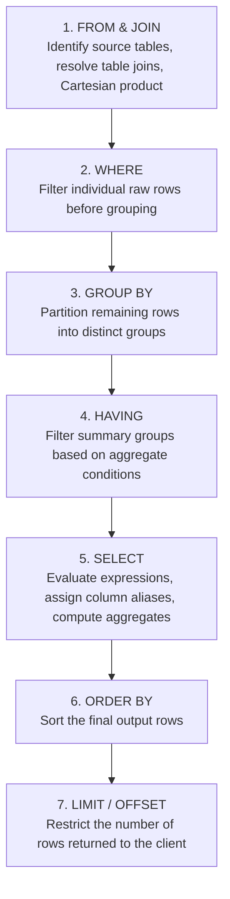
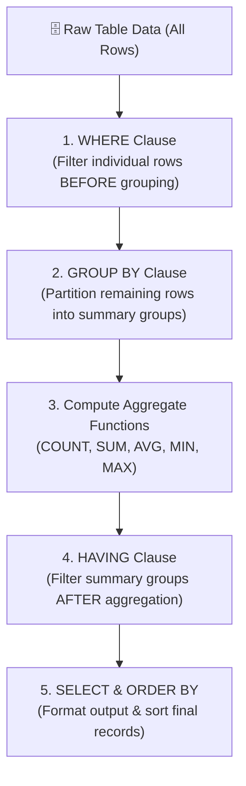

# 📊 Organizing Data in SQL: Sorting, Grouping, and Filtering

> **Course**: AWS re/Start  
> **Module**: Database Fundamentals (M06 – Organizing Data)  
> **Source Document**: `T10-Database/T10-0008-RSDB_EN-US_SG_M06_ORGANIZINGDATA.pdf`  
> **Target Audience**: AWS re/Start Learners, Cloud Practitioners, Junior Database Administrators, and Data Engineers  

---

## 🎯 Module Overview

In relational database systems, querying raw, unordered rows is only the first step in data retrieval. Production cloud architectures, analytics dashboards, enterprise reporting tools, and business intelligence (BI) engines require data to be cleanly ordered, categorized, and summarized. By default, relational tables are treated as mathematical sets; the database engine guarantees no predictable sequence or grouping when executing a basic `SELECT` statement.

To transform disparate transactional records into actionable operational intelligence, Structured Query Language (SQL) provides three fundamental clauses:
- **`ORDER BY`**: Dictates the sequence of the returned result set, sorting values in ascending (`ASC`) or descending (`DESC`) order across single or multiple attributes.
- **`GROUP BY`**: Collapses multiple rows sharing identical attributes into summary rows, enabling statistical calculations via aggregate functions such as `COUNT()`, `SUM()`, `AVG()`, `MIN()`, and `MAX()`.
- **`HAVING`**: Evaluates conditions over aggregated summary groups, filtering out groups that do not satisfy business thresholds.

This study guide examines the syntactic structures, logical execution lifecycles, and performance optimization strategies for organizing relational data. Using the standard relational `world` dataset (`country` and `city` tables), learners will explore how to construct robust queries, understand the differences between row-level filtering (`WHERE`) and group-level filtering (`HAVING`), enforce strict SQL grouping rules (`ONLY_FULL_GROUP_BY`), and master the 7-clause SQL order of operations.

---

### 📌 Learning Objectives

- [ ] **Explain Default Result Set Behavior**: Understand why relational databases return unordered records by default and why explicit sorting is required for deterministic query results.
- [ ] **Sort Data with `ORDER BY`**: Implement single-column and multi-column sort operations utilizing explicit column names, ascending (`ASC`), and descending (`DESC`) keywords.
- [ ] **Evaluate Positional and Alias Sorting**: Compare explicit column sorting against implicit positional placeholders (e.g., `ORDER BY 1, 2`) and column aliases, evaluating readability, maintainability, and code fragility.
- [ ] **Navigate `NULL` Value Sorting**: Analyze how MySQL and ANSI SQL engines evaluate and position `NULL` values during sort routines (`NULLS FIRST` vs. `NULLS LAST`).
- [ ] **Summarize Data with `GROUP BY`**: Group individual records sharing common values into aggregated categories to compute summary metrics.
- [ ] **Enforce `ONLY_FULL_GROUP_BY` Standards**: Apply SQL-92 and ANSI standards ensuring every non-aggregated column in the `SELECT` list is declared in the `GROUP BY` clause.
- [ ] **Filter Summary Sets with `HAVING`**: Implement the `HAVING` clause to filter aggregated groups based on statistical expressions (e.g., `HAVING COUNT(*) > 5`).
- [ ] **Distinguish `WHERE` vs. `HAVING`**: Differentiate row-level pre-aggregation filtering (`WHERE`) from group-level post-aggregation filtering (`HAVING`) in execution stage and index usage.
- [ ] **Optimize Query Performance**: Formulate queries that filter rows as early as possible in the processing pipeline to minimize CPU, memory, and temporary disk usage.
- [ ] **Trace the 7-Clause SQL Execution Pipeline**: Differentiate the syntactic order of SQL clauses from the logical query execution order enforced by relational database query planners.

---

## 📚 Key Terminology

| Term | Definition |
| :--- | :--- |
| **Sorting** | The practice of arranging query output rows into a deterministic sequence based on one or more column values. |
| **`ORDER BY` Clause** | The SQL clause responsible for ordering result rows by specified columns, expressions, or positional placeholders. |
| **`ASC` (Ascending)** | The default sort direction that arranges data from lowest to highest value (e.g., $0 \rightarrow 9$, $A \rightarrow Z$, oldest to newest). |
| **`DESC` (Descending)** | The sort direction that arranges data from highest to lowest value (e.g., $9 \rightarrow 0$, $Z \rightarrow A$, newest to oldest). |
| **Positional Sorting** | Specifying columns in the `ORDER BY` clause using their 1-indexed numerical position in the `SELECT` list instead of explicit names. |
| **`GROUP BY` Clause** | The SQL clause that collapses rows sharing common attribute values into summary rows. |
| **Aggregate Functions** | Mathematical functions (`COUNT()`, `SUM()`, `AVG()`, `MIN()`, `MAX()`) that calculate a single scalar value from a set of values across grouped rows. |
| **`HAVING` Clause** | The SQL clause used to filter aggregated groups after the `GROUP BY` clause has collapsed the rows. |
| **`ONLY_FULL_GROUP_BY`** | A strict SQL mode setting that rejects queries where the `SELECT` list contains non-aggregated columns not present in the `GROUP BY` clause. |
| **Logical Query Processing** | The internal sequence in which a relational database engine evaluates clauses, differing from the lexical (syntactic) writing order. |
| **Three-Valued Logic (3VL)** | The Boolean evaluation framework in SQL producing `TRUE`, `FALSE`, or `UNKNOWN` when dealing with `NULL` markers. |

---

## 🔄 1. Complete SQL Order of Operations: Syntactic vs. Logical Execution

A common source of confusion for SQL developers is the difference between **syntactic order** (how a query is written) and **logical query execution order** (how the RDBMS parser, optimizer, and execution engine evaluate clauses).

### Syntactic Clause Order (How SQL is Written)
When authoring a query, SQL syntax follows this mandatory sequence:

```sql
SELECT      -- 1. Which columns or expressions to display
FROM        -- 2. Source tables to query
WHERE       -- 3. Row-level filters
GROUP BY    -- 4. Grouping attributes
HAVING      -- 5. Group-level filters
ORDER BY    -- 6. Output sort sequence
LIMIT;      -- 7. Row count restriction (or FETCH FIRST / OFFSET)
```

### Logical Query Execution Order (How the Database Engine Evaluates)
The database query planner evaluates clauses in a radically different sequence:



### Key Architectural Insights

1. **Why `WHERE` Cannot Use Column Aliases**:
   Because `WHERE` (Step 2) is evaluated before `SELECT` (Step 5), the column aliases assigned in `SELECT` do not yet exist when `WHERE` executes. Attempting `WHERE my_alias > 10` produces an `Unknown column` error.
2. **Why `ORDER BY` Can Use Column Aliases and Positional Indices**:
   Because `ORDER BY` (Step 6) is evaluated *after* `SELECT` (Step 5), the engine already knows the projected column names, assigned aliases, and ordinal positions.
3. **Why `WHERE` Cannot Evaluate Aggregate Functions**:
   Because `WHERE` runs before `GROUP BY` (Step 3), summary calculations (such as `COUNT(*)` or `AVG()`) have not yet been computed. Aggregated conditions must reside in `HAVING` (Step 4).

---

## 🔀 2. Sorting Data with the `ORDER BY` Clause

### 2.1 The Need for Sorting: Default Result Set Non-Determinism

In relational database management systems (RDBMS) such as MySQL, PostgreSQL, and Oracle, tables are unordered sets of tuples. When executing a query without an `ORDER BY` clause, the returned sequence is **non-deterministic**:
- Rows may return in primary key order, insertion order, physical disk block order, or the order produced by an index scan.
- Subsequent executions of the exact same query may return rows in a completely different sequence if data is updated, cached pages shift, or multiple execution threads process partitions concurrently.

#### The `country` Table Schema
The examples in this module query the standard `country` table from the world demographic database:

| Column | Data Type | Description |
| :--- | :--- | :--- |
| `Code` | `CHAR(3)` | Unique ISO country code (Primary Key) |
| `Name` | `CHAR(52)` | Official name of the nation |
| `Continent` | `VARCHAR(20)` | Continental landmass |
| `Region` | `CHAR(26)` | Geographical region |
| `SurfaceArea` | `FLOAT(10,2)` | Total surface area in square kilometers |
| `IndepYear` | `SMALLINT` | Year of national independence |
| `Population` | `INT` | Total recorded human population |
| `LifeExpectancy` | `FLOAT(3,1)` | Average life expectancy at birth |
| `GNP` | `FLOAT(10,2)` | Gross National Product in millions |
| `GNPOld` | `FLOAT(10,2)` | Previous Gross National Product |
| `LocalName` | `CHAR(45)` | Native local name of the country |
| `Capital` | `INT` | Foreign key referencing the capital city `ID` |
| `Code2` | `CHAR(2)` | Two-letter ISO alternative country code |

#### Unsorted Baseline Query

```sql
SELECT name, continent, surfacearea
FROM country
WHERE surfacearea >= 5000000;
```

#### Query Output (No Specific Order):
```text
+--------------------+---------------+-------------+
| name               | continent     | surfacearea |
+--------------------+---------------+-------------+
| Antarctica         | Antarctica    | 13120000.00 |
| Brazil             | South America |  8547403.00 |
| Australia          | Oceania       |  7741220.00 |
| Canada             | North America |  9970610.00 |
| United States      | North America |  9363520.00 |
| Russian Federation | Europe        | 17075400.00 |
| China              | Asia          |  9572900.00 |
+--------------------+---------------+-------------+
7 rows in set (0.00 sec)
```

> [!NOTE]
> In the absence of an explicit `ORDER BY` clause, the database makes no guarantees about row sequencing. Never rely on implicit table order in application code or production reporting.

---

### 2.2 Ascending Sort Order (`ASC`)

To arrange results from lowest value to highest value, append the `ORDER BY` clause with the `ASC` keyword:
- **Numeric values**: Sorted from smallest to largest ($0 \rightarrow 100$).
- **Character strings**: Sorted alphabetically according to the database collation ($A \rightarrow Z$).
- **Dates and timestamps**: Sorted chronologically from earliest to latest ($1900 \rightarrow 2026$).

Because **`ASC` is the default sorting mode** in SQL, omitting the keyword produces identical results.

#### Query: Explicit Ascending Sort

```sql
SELECT name, continent, surfacearea
FROM country
WHERE surfacearea >= 5000000
ORDER BY surfacearea ASC;
```

#### Query Output:
```text
+--------------------+---------------+-------------+
| name               | continent     | surfacearea |
+--------------------+---------------+-------------+
| Australia          | Oceania       |  7741220.00 |  <-- Lowest value
| Brazil             | South America |  8547403.00 |
| United States      | North America |  9363520.00 |
| China              | Asia          |  9572900.00 |
| Canada             | North America |  9970610.00 |
| Antarctica         | Antarctica    | 13120000.00 |
| Russian Federation | Europe        | 17075400.00 |  <-- Highest value
+--------------------+---------------+-------------+
7 rows in set (0.00 sec)
```

> [!TIP]
> While `ORDER BY surfacearea` works identically to `ORDER BY surfacearea ASC`, explicitly writing `ASC` improves code clarity when multiple columns with mixed sort directions are present.

---

### 2.3 Descending Sort Order (`DESC`)

To reverse the sort direction and arrange records from highest to lowest, include the `DESC` keyword after the target column name:
- **Numeric values**: Sorted from largest to smallest ($100 \rightarrow 0$).
- **Character strings**: Sorted reverse-alphabetically ($Z \rightarrow A$).
- **Dates and timestamps**: Sorted reverse-chronologically from newest to oldest ($2026 \rightarrow 1900$).

#### Query: Descending Sort

```sql
SELECT name, continent, surfacearea
FROM country
WHERE surfacearea >= 5000000
ORDER BY surfacearea DESC;
```

#### Query Output:
```text
+--------------------+---------------+-------------+
| name               | continent     | surfacearea |
+--------------------+---------------+-------------+
| Russian Federation | Europe        | 17075400.00 |  <-- Highest value
| Antarctica         | Antarctica    | 13120000.00 |
| Canada             | North America |  9970610.00 |
| China              | Asia          |  9572900.00 |
| United States      | North America |  9363520.00 |
| Brazil             | South America |  8547403.00 |
| Australia          | Oceania       |  7741220.00 |  <-- Lowest value
+--------------------+---------------+-------------+
7 rows in set (0.00 sec)
```

---

### 2.4 Multi-Column Sorting: Hierarchical Sorting

Queries often require sorting across multiple dimensions. When multiple columns are provided in an `ORDER BY` clause separated by commas, the database engine executes a **hierarchical sort**:
1. **Primary Sort Order**: The query sorts all rows by the first specified column.
2. **Secondary Sort Order**: For rows that share identical values in the primary column (ties), the engine sorts those matching rows by the second column.
3. **Tertiary and Subsequent Sort Orders**: Additional columns resolve remaining ties sequentially.

Each column can specify its own sort direction (`ASC` or `DESC`) independently.

#### Query: Primary Sort on `continent`, Secondary Sort on `surfacearea`

```sql
SELECT name, continent, surfacearea
FROM country
WHERE surfacearea >= 5000000
ORDER BY continent ASC, surfacearea DESC;
```

#### Query Output:
```text
+--------------------+---------------+-------------+
| name               | continent     | surfacearea |
+--------------------+---------------+-------------+
| Antarctica         | Antarctica    | 13120000.00 |  -- Antarctica group
| China              | Asia          |  9572900.00 |  -- Asia group
| Russian Federation | Europe        | 17075400.00 |  -- Europe group
| Canada             | North America |  9970610.00 |  -- North America (Rank 1: larger)
| United States      | North America |  9363520.00 |  -- North America (Rank 2: smaller)
| Australia          | Oceania       |  7741220.00 |  -- Oceania group
| Brazil             | South America |  8547403.00 |  -- South America group
+--------------------+---------------+-------------+
7 rows in set (0.00 sec)
```

In the output above:
- Continents are ordered alphabetically: `Antarctica` $\rightarrow$ `Asia` $\rightarrow$ `Europe` $\rightarrow$ `North America` $\rightarrow$ `Oceania` $\rightarrow$ `South America`.
- Within `North America`, `Canada` ($9,970,610\text{ km}^2$) appears ahead of `United States` ($9,363,520\text{ km}^2$) because the secondary sort evaluates `surfacearea DESC`.

---

### 2.5 Sorting by Column Position, Aliases, and Expressions

SQL supports several syntactic mechanisms to designate sort keys:

#### 1. Positional Placeholders (Implicit Columns)
Instead of typing column names, you can provide the 1-based integer position of the column as declared in the `SELECT` list.

```sql
SELECT name, continent, surfacearea
FROM country
WHERE surfacearea >= 5000000
ORDER BY 2 ASC, 3 DESC;
```
Here, `2` corresponds to `continent`, and `3` corresponds to `surfacearea`.

> [!CAUTION]
> **Production Anti-Pattern**: Positional sorting is convenient for fast interactive debugging in the terminal, but it introduces severe maintenance risks in production scripts. If an engineer later alters the `SELECT` list (e.g., adding a column at position 1), the sort silently switches to unintended columns, corrupting output logic without throwing a syntax error.

#### 2. Column Aliases
Because `ORDER BY` is evaluated after `SELECT`, it can directly reference column aliases assigned in the projection list:

```sql
SELECT name, continent, (population / surfacearea) AS population_density
FROM country
WHERE surfacearea >= 5000000
ORDER BY population_density DESC;
```

#### 3. Explicit Expressions
You can sort directly by calculated mathematical or string expressions, even if they do not appear in the `SELECT` list:

```sql
SELECT name, continent
FROM country
WHERE surfacearea >= 5000000
ORDER BY (population / surfacearea) DESC;
```

---

### 2.6 `NULL` Sorting Behavior in MySQL vs. ANSI SQL

A `NULL` marker represents unknown or missing data. Because `NULL` cannot be equated to any real value, database engines must adopt conventions regarding where `NULL` records appear in sort routines:

| Database Engine | `ORDER BY column ASC` | `ORDER BY column DESC` | ANSI Override Syntax Supported |
| :--- | :--- | :--- | :--- |
| **MySQL / MariaDB** | `NULL` appears **FIRST** (treated as lowest possible value) | `NULL` appears **LAST** | No native `NULLS FIRST / LAST` syntax |
| **PostgreSQL** | `NULL` appears **LAST** | `NULL` appears **FIRST** | Yes (`NULLS FIRST / LAST`) |
| **Oracle** | `NULL` appears **LAST** | `NULL` appears **FIRST** | Yes (`NULLS FIRST / LAST`) |
| **SQL Server** | `NULL` appears **FIRST** | `NULL` appears **LAST** | No native syntax |

#### Controlling `NULL` Placement in MySQL
To force `NULL` records to appear at the end in an ascending sort in MySQL, use a boolean expression or `IS NULL`:

```sql
-- Technique 1: Boolean sorting (IS NULL evaluates to 1 for TRUE, 0 for FALSE)
SELECT Name, IndepYear
FROM country
ORDER BY (IndepYear IS NULL) ASC, IndepYear ASC;

-- Technique 2: Using COALESCE with a sentinel high value
SELECT Name, IndepYear
FROM country
ORDER BY COALESCE(IndepYear, 9999) ASC;
```

#### Standard ANSI SQL Syntax (PostgreSQL / Oracle)
```sql
SELECT Name, IndepYear
FROM country
ORDER BY IndepYear ASC NULLS LAST;
```

---

## 🧱 3. Grouping Data with the `GROUP BY` Clause

### 3.1 Aggregating vs. Listing Detailed Records

In transactional processing, queries often retrieve individual rows. However, in reporting, management dashboards, and analytics, business stakeholders do not want to read hundreds of individual rows; they need aggregated summaries.

Consider this query retrieving individual countries meeting specific geographic and population criteria:

```sql
SELECT continent, name
FROM country
WHERE (continent = 'South America' AND population > 12000000)
   OR continent = 'Antarctica'
ORDER BY 1, 2;
```

#### Query Output (Detailed List):
```text
+---------------+----------------------------------------------+
| continent     | name                                         |
+---------------+----------------------------------------------+
| Antarctica    | Antarctica                                   |
| Antarctica    | Bouvet Island                                |
| Antarctica    | French Southern territories                  |
| Antarctica    | Heard Island and McDonald Islands            |
| Antarctica    | South Georgia and the South Sandwich Islands |
| South America | Argentina                                    |
| South America | Brazil                                       |
| South America | Chile                                        |
| South America | Colombia                                     |
| South America | Ecuador                                      |
| South America | Peru                                         |
| South America | Venezuela                                    |
+---------------+----------------------------------------------+
12 rows in set (0.00 sec)
```

If an analyst wants to know **how many matching countries exist per continent**, listing 12 separate country rows is inefficient. The `GROUP BY` clause combines rows sharing identical attribute values into consolidated summary rows.

```mermaid
flowchart LR
    subgraph RawRows ["📥 Raw Input Records (12 Rows)"]
        R1["Antarctica - Antarctica"]
        R2["Antarctica - Bouvet Island"]
        R3["Antarctica - French South. terr."]
        R4["Antarctica - Heard Island"]
        R5["Antarctica - South Georgia"]
        R6["South America - Argentina"]
        R7["South America - Brazil"]
        R8["South America - Chile"]
        R9["South America - Colombia"]
        R10["South America - Ecuador"]
        R11["South America - Peru"]
        R12["South America - Venezuela"]
    end

    subgraph GroupingStage ["⚙️ GROUP BY continent"]
        G1["Group: 'Antarctica'"]
        G2["Group: 'South America'"]
    end

    subgraph AggregateStage ["📊 COUNT(name)"]
        A1["Antarctica: 5 countries"]
        A2["South America: 7 countries"]
    end

    RawRows --> GroupingStage --> AggregateStage
```



---

### 3.2 Anatomy of `GROUP BY` and Aggregate Functions

The `GROUP BY` clause groups all matching values for the specified column and enables aggregate functions to calculate summary statistics for each distinct group.

#### Core Aggregate Functions

| Aggregate Function | Description | Handling of `NULL` Values |
| :--- | :--- | :--- |
| `COUNT(column)` | Counts the number of non-null values in the group | Ignores `NULL` values |
| `COUNT(*)` | Counts the total number of rows in the group | Includes rows with `NULL` |
| `SUM(column)` | Calculates the numeric sum of values in the group | Ignores `NULL` values |
| `AVG(column)` | Computes the arithmetic mean of numeric values | Ignores `NULL` values |
| `MIN(column)` | Identifies the minimum value in the group | Ignores `NULL` values |
| `MAX(column)` | Identifies the maximum value in the group | Ignores `NULL` values |

#### Query: Summarizing Countries by Continent

```sql
SELECT continent, COUNT(name) AS 'countries'
FROM country
WHERE (continent = 'South America' AND population > 12000000)
   OR continent = 'Antarctica'
GROUP BY continent
ORDER BY 1, 2;
```

#### Query Output:
```text
+---------------+-----------+
| continent     | countries |
+---------------+-----------+
| Antarctica    |         5 |
| South America |         7 |
+---------------+-----------+
2 rows in set (0.00 sec)
```

In this query:
1. The `WHERE` clause filters candidate rows down to the matching 12 rows.
2. The `GROUP BY continent` clause partitions the rows into two buckets: `Antarctica` and `South America`.
3. The `COUNT(name)` aggregate function tallies the number of names within each bucket.
4. The `ORDER BY 1, 2` clause sorts the final summary rows by column 1 (`continent`) and column 2 (`countries`).

---

### 3.3 Strict Grouping Rules & `ONLY_FULL_GROUP_BY`

A fundamental rule of relational database integrity is the **SQL-92 / ANSI Grouping Rule**:

> [!IMPORTANT]
> **The Strict Grouping Rule**:  
> Every column in the `SELECT` list must either be:
> 1. Declared explicitly in the `GROUP BY` clause, OR
> 2. Enclosed inside an aggregate function (`COUNT`, `SUM`, `AVG`, `MIN`, `MAX`).

#### The Ambiguity Problem
Consider what happens if an engine allows non-aggregated columns:

```sql
-- INCORRECT / INVALID QUERY:
SELECT continent, name, population
FROM country
GROUP BY continent;
```
For each continent (e.g., `Asia`), there are dozens of different `name` and `population` values. Which single `name` should the database engine return alongside the continent group?
- Returning a random row is non-deterministic and leads to corrupted analytical data.
- Legacy versions of MySQL allowed this non-standard behavior by default, silently picking arbitrary values.

#### Modern MySQL Strict Mode
Modern MySQL versions (5.7+ and 8.0+) enforce `ONLY_FULL_GROUP_BY` by default. Executing the ambiguous query above triggers an explicit database error:

```text
ERROR 1055 (42000): Expression #2 of SELECT list is not in GROUP BY clause 
and contains nonaggregated column 'world.country.Name' which is not 
functionally dependent on columns in GROUP BY clause; this is incompatible 
with sql_mode=only_full_group_by
```

#### Correct Formulations
To fix this error, either aggregate the attribute or include it in the `GROUP BY` list:

```sql
-- Solution A: Use aggregate functions
SELECT continent, COUNT(name) AS total_nations, MAX(population) AS max_pop
FROM country
GROUP BY continent;

-- Solution B: Include both columns in the GROUP BY clause
SELECT continent, region, COUNT(*) AS nation_count
FROM country
GROUP BY continent, region;
```

---

### 3.4 Multi-Column Grouping

Grouping by multiple columns creates composite categories. The engine generates a unique summary row for every distinct combination of values across the specified grouping columns.

#### Practical Query: Multi-Column Grouping on the `world` Database

```sql
SELECT continent, region, COUNT(*) AS country_count, SUM(population) AS total_population
FROM country
WHERE continent IN ('North America', 'South America')
GROUP BY continent, region
ORDER BY continent ASC, country_count DESC;
```

#### Query Output:
```text
+---------------+---------------------------+---------------+------------------+
| continent     | region                    | country_count | total_population |
+---------------+---------------------------+---------------+------------------+
| North America | Caribbean                 |            24 |         38140000 |
| North America | Central America           |             8 |        135973000 |
| North America | North America             |             5 |        309632000 |
| South America | South America             |            14 |        345780000 |
+---------------+---------------------------+---------------+------------------+
4 rows in set (0.00 sec)
```

---

## 🔍 4. Filtering Aggregated Groups with `HAVING`

### 4.1 Purpose of the `HAVING` Clause

The `WHERE` clause filters individual source rows *before* aggregation occurs. Consequently, you **cannot** write a `WHERE` condition that checks an aggregate function:

```sql
-- SYNTAX ERROR:
SELECT continent, COUNT(name) AS countries
FROM country
WHERE COUNT(name) > 5          -- Fails! Aggregate not permitted in WHERE
GROUP BY continent;
```

To filter summary rows *after* the `GROUP BY` aggregation step has calculated group statistics, SQL provides the **`HAVING` clause**.

#### Query: Filtering Continents with More Than 5 Countries

```sql
SELECT continent, COUNT(name) AS 'countries'
FROM country
WHERE (continent = 'South America' AND population > 12000000)
   OR continent = 'Antarctica'
GROUP BY continent
HAVING COUNT(name) > 5
ORDER BY 1, 2;
```

#### Query Output:
```text
+---------------+-----------+
| continent     | countries |
+---------------+-----------+
| South America |         7 |
+---------------+-----------+
1 row in set (0.00 sec)
```

In this query:
1. The `GROUP BY continent` produces two candidate groups: `Antarctica` (5) and `South America` (7).
2. The `HAVING COUNT(name) > 5` evaluates each group.
3. Because `Antarctica` has exactly 5 countries, it fails the strict inequality `> 5` and is eliminated.
4. Only `South America` (7 countries) is returned in the final result.

---

### 4.2 Comprehensive Comparison: `WHERE` vs. `HAVING`

Understanding when to apply `WHERE` versus `HAVING` is essential for writing accurate, high-performance SQL.



#### Comparison Matrix

| Feature | `WHERE` Clause | `HAVING` Clause |
| :--- | :--- | :--- |
| **Pipeline Stage** | Evaluated **before** rows are grouped | Evaluated **after** rows are grouped |
| **Target of Filtering** | Evaluates individual rows/records | Evaluates aggregated groups/buckets |
| **Aggregate Functions** | **Cannot** use aggregate functions (`COUNT`, `SUM`, etc.) | **Can** use aggregate functions (`HAVING AVG(x) > 50`) |
| **Index Utilization** | Can leverage B-Tree/hash table indexes directly | Cannot use table indexes directly (evaluates memory buffers) |
| **Column Requirements** | Can filter columns not included in the `SELECT` list | Typically references aggregate expressions or `GROUP BY` columns |
| **Primary Purpose** | Eliminates irrelevant source records early | Eliminates unwanted summary categories |

---

### 4.3 Performance Implications: The "Filter Early" Rule

In cloud computing environments and distributed database systems (such as Amazon RDS MySQL, Amazon Aurora, or Amazon Redshift), execution efficiency directly impacts latency and infrastructure costs.

> [!CAUTION]
> **Performance Anti-Pattern**: Filtering raw row attributes inside `HAVING` instead of `WHERE`.
> 
> While SQL syntax technically permits non-aggregate conditions in `HAVING` if the column is in `GROUP BY`, doing so forces the database engine to group rows that should have been discarded immediately.

#### Example Comparison: The Inefficient vs. The Optimized Pattern

```sql
-- ❌ INNEFFICIENT PATTERN: Filtering row attributes in HAVING
SELECT continent, COUNT(*) AS total_countries
FROM country
GROUP BY continent
HAVING continent IN ('Asia', 'Europe');

-- ✅ OPTIMIZED PATTERN: Filtering row attributes early in WHERE
SELECT continent, COUNT(*) AS total_countries
FROM country
WHERE continent IN ('Asia', 'Europe')
GROUP BY continent;
```

#### Why the `WHERE` Pattern Outperforms `HAVING`:
1. **Reduced Working Memory**: Filtering rows with `WHERE` reduces the volume of rows that must be retained in memory or spilled to temporary disk tables during grouping.
2. **Index Acceleration**: The database optimizer can utilize indexes on `continent` to jump directly to the target rows, bypassing a full table scan.
3. **Fewer Aggregation Cycles**: The CPU evaluates aggregate calculations only for relevant records rather than computing aggregates across all 239 countries only to discard them in `HAVING`.

---

## 🌍 5. Practical Laboratory & Real-World Query Workflows

The following production-style queries demonstrate how `ORDER BY`, `GROUP BY`, and `HAVING` combine to solve complex data analysis challenges using the `world` database.

### Scenario 1: Continental Demographic Ranking

**Objective**: Find the total population, total surface area, and number of nations for all continents with more than 10 countries. Sort the results from most populated to least populated continent.

```sql
SELECT 
    continent,
    COUNT(Code) AS total_countries,
    SUM(population) AS aggregate_population,
    ROUND(SUM(surfacearea), 2) AS total_surface_area,
    ROUND(AVG(lifeexpectancy), 1) AS avg_life_expectancy
FROM country
GROUP BY continent
HAVING COUNT(Code) > 10
ORDER BY aggregate_population DESC;
```

#### Expected Output:
```text
+---------------+-----------------+----------------------+--------------------+--------------------+
| continent     | total_countries | aggregate_population | total_surface_area | avg_life_expectancy|
+---------------+-----------------+----------------------+--------------------+--------------------+
| Asia          |              51 |           3705025700 |        31881005.00 |               67.4 |
| Africa        |              58 |            784475000 |        30250377.00 |               52.6 |
| Europe        |              46 |            730074600 |        23049133.90 |               75.1 |
| North America |              37 |            482993000 |        24214472.00 |               73.0 |
| South America |              14 |            345780000 |        17864926.00 |               70.9 |
| Oceania       |              28 |             30401150 |         8507565.00 |               69.7 |
+---------------+-----------------+----------------------+--------------------+--------------------+
6 rows in set (0.01 sec)
```

---

### Scenario 2: Urban Concentration Analysis (The `city` Table)

**Objective**: In the `city` table, find all countries (`CountryCode`) that contain at least 20 listed cities. Display the country code, total number of listed cities, and the average city population. Sort the results alphabetically by country code.

```sql
SELECT 
    CountryCode,
    COUNT(ID) AS city_count,
    ROUND(AVG(Population), 0) AS average_city_population,
    MAX(Population) AS largest_city_population
FROM city
GROUP BY CountryCode
HAVING COUNT(ID) >= 20
ORDER BY CountryCode ASC;
```

#### Sample Output:
```text
+-------------+------------+-------------------------+-------------------------+
| CountryCode | city_count | average_city_population | largest_city_population |
+-------------+------------+-------------------------+-------------------------+
| ARG         |         57 |                  349348 |                 2982146 |
| BRA         |        250 |                  342084 |                 9968485 |
| CAN         |         49 |                  248744 |                 2481494 |
| CHN         |        363 |                  484551 |                 9696300 |
| DEU         |         93 |                  255530 |                 3386667 |
| IND         |        341 |                  361526 |                10500000 |
| JPN         |        248 |                  317056 |                 7980230 |
| MEX         |        173 |                  346654 |                 8591309 |
| RUS         |        189 |                  365778 |                 8389200 |
| USA         |        274 |                  286955 |                 8008278 |
+-------------+------------+-------------------------+-------------------------+
10 rows in set (0.01 sec)
```

---

## 👥 6. Interactive Learning Activities & Practice Scenarios

### Activity 1: Step-by-Step Query Construction

**Scenario**: You are tasked with generating a summary report for the Global Development Fund. The committee needs to identify all geographic regions where:
1. The country independence year is after 1900.
2. The total combined regional population exceeds 50,000,000.
3. The results display the continent, region, number of qualifying countries, and total population.
4. Output is sorted primarily by continent ascending, and secondarily by total population descending.

#### Step 1: Identify source tables and row-level filters (`WHERE`)
- Table: `country`
- Row condition: `IndepYear > 1900`

#### Step 2: Determine grouping attributes (`GROUP BY`)
- Dimensions: `continent, region`

#### Step 3: Define group-level aggregate filter (`HAVING`)
- Group condition: `SUM(population) > 50000000`

#### Step 4: Specify sorting sequence (`ORDER BY`)
- Sort: `ORDER BY continent ASC, total_population DESC`

#### Guided Solution:
```sql
SELECT 
    continent,
    region,
    COUNT(*) AS modern_nations_count,
    SUM(population) AS total_population
FROM country
WHERE IndepYear > 1900
GROUP BY continent, region
HAVING SUM(population) > 50000000
ORDER BY continent ASC, total_population DESC;
```

---

### Activity 2: Diagnostic Debugging Challenge

Analyze the three flawed SQL queries below. Identify the exact error and write the corrected SQL statement.

#### Problem Scenario A: Invalid `WHERE` Aggregate
```sql
-- FLAWED:
SELECT Continent, AVG(LifeExpectancy) AS AvgLife
FROM country
WHERE AVG(LifeExpectancy) > 70.0
GROUP BY Continent;
```
- **Diagnostic Error**: An aggregate function (`AVG`) cannot be used in a `WHERE` clause because `WHERE` runs before aggregation.
- **Remediation**:
  ```sql
  SELECT Continent, AVG(LifeExpectancy) AS AvgLife
  FROM country
  GROUP BY Continent
  HAVING AVG(LifeExpectancy) > 70.0;
  ```

#### Problem Scenario B: `ONLY_FULL_GROUP_BY` Violation
```sql
-- FLAWED:
SELECT Continent, Name, MAX(Population)
FROM country
GROUP BY Continent;
```
- **Diagnostic Error**: `Name` is neither in the `GROUP BY` clause nor wrapped in an aggregate function, violating strict SQL grouping rules.
- **Remediation**:
  ```sql
  SELECT Continent, MAX(Population) AS MaxPop
  FROM country
  GROUP BY Continent;
  ```

#### Problem Scenario C: Fragile Positional Sorting After Column Edit
```sql
-- FLAWED: Original intended sort was by population descending (initially position 2)
-- A developer prepended 'Code', shifting column ordinals:
SELECT Code, Name, Population
FROM country
ORDER BY 2 DESC;
```
- **Diagnostic Error**: The query now sorts alphabetically descending by `Name` (column 2) instead of numerically descending by `Population` (column 3).
- **Remediation**: Always use explicit column names in production:
  ```sql
  SELECT Code, Name, Population
  FROM country
  ORDER BY Population DESC;
  ```

---

## 📝 7. Knowledge Check & Review Questions

### Question 1
**What is the primary function of the `ORDER BY` clause in a `SELECT` statement?**
> **Answer**:  
> The `ORDER BY` clause is used to sort the rows in a query result set into a specified order (ascending or descending) based on one or more columns or expressions. Without `ORDER BY`, result row sequencing is non-deterministic.

---

### Question 2
**What is the primary function of the `GROUP BY` clause in a `SELECT` statement?**
> **Answer**:  
> The `GROUP BY` clause combines rows sharing identical attribute values into summary rows, enabling calculation of summary statistics (such as counts, sums, or averages) via aggregate functions.

---

### Question 3
**Why does the SQL statement `SELECT Continent, Region, AVG(Population) FROM country GROUP BY Continent;` fail under `sql_mode=only_full_group_by`?**
> **Answer**:  
> It violates the strict grouping standard because `Region` is present in the `SELECT` list but is neither included in the `GROUP BY` clause nor enclosed in an aggregate function. The database cannot determine which distinct regional value to display for a multi-region continent.

---

### Question 4
**Can a query contain both a `WHERE` clause and a `HAVING` clause? If so, in what order are they evaluated?**
> **Answer**:  
> Yes. The `WHERE` clause is evaluated first to filter individual raw rows before grouping. The `GROUP BY` clause then partitions the remaining rows, aggregates are calculated, and finally the `HAVING` clause filters the resulting summary groups.

---

### Question 5
**What is the correct logical execution sequence for the following SQL clauses: `SELECT`, `WHERE`, `GROUP BY`, `FROM`, `ORDER BY`, `HAVING`, `LIMIT`?**
> **Answer**:  
> The logical evaluation order is:
> 1. `FROM` (table identification and joins)
> 2. `WHERE` (row filtering)
> 3. `GROUP BY` (group partitioning)
> 4. `HAVING` (group filtering)
> 5. `SELECT` (expression and alias computation)
> 6. `ORDER BY` (result sorting)
> 7. `LIMIT` (result count truncation)

---

## 🚀 8. Key Takeaways & Summary

- **Sorting Principle**: Sorting organizes the sequence of query results so that data can be effectively inspected, consumed, and analyzed.
- **Directional Keywords**: Use `ORDER BY` with `ASC` (default, lowest to highest) or `DESC` (highest to lowest) to define sorting direction.
- **Multi-Column Sorting**: Hierarchical sorting evaluates primary, secondary, and tertiary columns sequentially to break ties.
- **Positional Sorting Caution**: While implicit numeric placeholders (`ORDER BY 1, 2`) are supported, explicit column names are recommended in production to prevent schema modification bugs.
- **Grouping Principle**: Use `GROUP BY` to collapse matching data items into groups and calculate summary values with aggregate functions (`COUNT`, `SUM`, `AVG`, `MIN`, `MAX`).
- **Group Filtering with `HAVING`**: Use `HAVING` exclusively to filter aggregated summary rows based on group metrics (`HAVING COUNT(*) > 5`).
- **Performance Guideline ("Filter Early")**: Always filter row-level attributes in `WHERE` rather than `HAVING` to reduce memory consumption and allow the query optimizer to utilize table indexes.
- **Execution Order Mastery**: Master the distinction between syntactic writing order (`SELECT ... FROM ... WHERE ...`) and logical execution order (`FROM -> WHERE -> GROUP BY -> HAVING -> SELECT -> ORDER BY -> LIMIT`).
