# 🔗 Retrieving Data from Multiple Tables: Set Operators & Relational Joins

> **Course**: AWS re/Start  
> **Module**: Database Fundamentals (M06 – Retrieving Data from Multiple Tables)  
> **Source Document**: `T10-Database/T10-0009-RSDB_EN-US_SG_M06_RETRIEVINGDATA.pdf`  
> **Target Audience**: AWS re/Start Learners, Cloud Practitioners, and Junior Database Administrators  

---

## 🎯 Module Overview

In modern relational database architectures, enterprise data is rarely consolidated into a single monolithic table. Principles of database normalization dictate that data entities—such as customers, orders, products, countries, and cities—are separated into distinct, specialized tables to minimize redundancy, prevent update anomalies, and enforce data integrity. Consequently, the true power of Structured Query Language (SQL) lies in its ability to recompose these disparate entities into cohesive, meaningful reports.

There are two primary paradigms for combining data from multiple tables:
1. **Vertical Combination (Set Operators)**: Stacking row sets on top of one another using mathematical set theory (`UNION`, `UNION ALL`, `INTERSECT`, `MINUS`/`EXCEPT`).
2. **Horizontal Combination (Relational Joins)**: Merging columns side-by-side based on logical foreign-key-to-primary-key relationships (`INNER JOIN`, `LEFT JOIN`, `RIGHT JOIN`, `FULL OUTER JOIN`, `CROSS JOIN`, and `SELF JOIN`).

This comprehensive study guide explores both paradigms in depth. We will examine the mathematical mechanics, syntax, execution planning, performance trade-offs, and dialect-specific variations across MySQL, PostgreSQL, Oracle, and AWS managed database engines (such as Amazon RDS and Amazon Aurora).

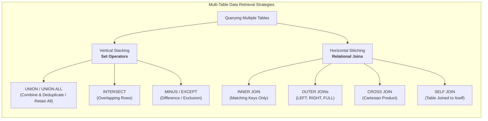

---

## 📌 Learning Objectives

By completing this module and working through these study notes and practical exercises, you will be able to:

- [ ] **Distinguish Vertical vs. Horizontal Operations**: Clearly differentiate between stacking records vertically via set operators and merging attributes horizontally via relational joins.
- [ ] **Apply Set Operations Rules**: Identify and enforce the core structural requirements for compound queries: matching projection counts, compatible data types, and first-query alias inheritance.
- [ ] **Evaluate `UNION` vs. `UNION ALL`**: Analyze the sorting, deduplication, and execution plan overhead of `UNION` compared to the high-performance linear append of `UNION ALL`.
- [ ] **Implement `INTERSECT` and `EXCEPT`/`MINUS`**: Utilize set intersection and set difference in supported engines, and implement equivalent queries in older MySQL dialects using subqueries and outer joins.
- [ ] **Resolve Column Ambiguity**: Use table aliases and fully qualified column names (`table.column` or `alias.column`) to write clean, collision-free join queries.
- [ ] **Master Relational Join Mechanics**: Construct syntactically correct `INNER JOIN`, `LEFT OUTER JOIN`, `RIGHT OUTER JOIN`, and `CROSS JOIN` statements.
- [ ] **Emulate `FULL OUTER JOIN` in MySQL**: Synthesize a full outer join in database engines lacking native support by chaining `LEFT JOIN` and `RIGHT JOIN` with a `UNION` operator.
- [ ] **Implement Self-Referential Queries (`SELF JOIN`)**: Join a table to itself using multiple aliases to model hierarchical, recursive, or peer-matching relationships.
- [ ] **Compare `ON` vs. `USING` Clauses**: Contrast explicit boolean join conditions with shorthand column binding and evaluate their impact on column projection.
- [ ] **Query Normalized Real-World Schemas**: Execute complex multi-table queries on the canonical `world` sample database (`country`, `city`, `countrylanguage`).

---

## 📚 Key Terminology

| Term | Definition |
| :--- | :--- |
| **Set Operator** | A SQL operator that combines the output tuples of two or more independent `SELECT` statements into a single vertical result set. |
| **Compound Query** | A SQL query constructed by linking two or more simple `SELECT` statements using set operators. |
| **`UNION`** | A set operator that combines rows from multiple queries, eliminating duplicate rows through an internal sorting and hashing step. |
| **`UNION ALL`** | A set operator that concatenates result sets directly without filtering duplicates, providing maximum query performance. |
| **`INTERSECT`** | A set operator that returns only the distinct rows that appear simultaneously in both query result sets. |
| **`MINUS` / `EXCEPT`** | A set operator that returns the distinct rows present in the first query result set that do not appear in the second. |
| **Relational Join** | An operation that correlates and combines columns from two or more tables horizontally based on common relational keys. |
| **Qualified Column Name** | A reference to a column that explicitly prefixes the table name or alias (`table_name.column_name`) to eliminate naming ambiguity. |
| **Table Alias** | A temporary identifier assigned to a table within the `FROM` or `JOIN` clause to simplify syntax and enable self-referencing joins. |
| **`INNER JOIN`** | A join type that evaluates a join predicate and returns only the rows where matching keys exist in both participating tables. |
| **`LEFT (OUTER) JOIN`** | A join type that preserves all rows from the left table, populating matched columns from the right table or filling them with `NULL` if no match exists. |
| **`RIGHT (OUTER) JOIN`** | A join type that preserves all rows from the right table, populating matched columns from the left table or filling them with `NULL` if no match exists. |
| **`FULL (OUTER) JOIN`** | A join that retains all rows from both tables, substituting `NULL` values on either side whenever a corresponding relationship is absent. |
| **`CROSS JOIN`** | A join that computes the Cartesian product of two tables, matching every row of the first table with every row of the second table. |
| **`SELF JOIN`** | A regular join operation where a table is joined with itself by assigning distinct aliases to differentiate its roles. |
| **Cartesian Product** | A mathematical operation returning a set of all possible ordered pairs from two sets; in SQL, results in $M \times N$ total rows. |

---

## 🧮 1. Combining Query Results with Set Operators (Vertical Stacking)

### 1.1 What Are Set Operators?

Set operators treat the result sets of individual SQL `SELECT` queries as mathematical sets. Instead of extending records horizontally by adding attributes side-by-side, set operators stack rows vertically.

```
Query 1 Result:   [ A, B, C ]
Query 2 Result:   [ B, C, D ]

UNION Result:     [ A, B, C, D ]       (Vertical stack, duplicates purged)
UNION ALL Result: [ A, B, C, B, C, D ] (Vertical stack, all rows retained)
```

Queries linked by set operators are formally designated as **compound queries**.

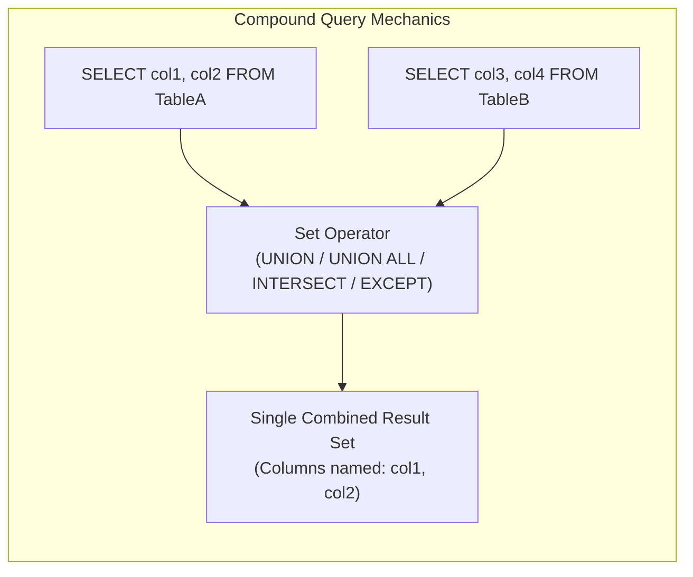

---

### 1.2 Mandatory Rules for Set Operations

For an RDBMS query engine to execute a compound query, the participating queries must satisfy strict structural invariants:

1. **Identical Column Arity (Number of Columns)**:
   Every `SELECT` statement in the compound query must project the exact same number of columns.
   ```sql
   -- INVALID: Query 1 projects 2 columns; Query 2 projects 1 column
   SELECT Code, Name FROM country
   UNION
   SELECT Name FROM city; -- ERROR 1222 (21000): The used SELECT statements have a different number of columns
   ```

2. **Compatible Data Types**:
   Corresponding columns in each `SELECT` list must share compatible (or implicitly convertible) data types. For example, if Column 1 in Query 1 is an integer, Column 1 in Query 2 must be an integer or convertible numeric type.
   ```sql
   -- Valid: Both project VARCHAR/CHAR string columns
   SELECT Name FROM country
   UNION
   SELECT Name FROM city;
   ```

3. **Column Names Inherited from the First Query**:
   The column headers, aliases, and display names of the final result set are governed entirely by the first `SELECT` statement. Aliases specified in subsequent queries are ignored for labeling purposes.
   ```sql
   SELECT Name AS 'Geographic Entity' FROM country
   UNION
   SELECT Name AS 'Urban Center' FROM city;
   -- Final result header will be: 'Geographic Entity'
   ```

4. **Placement of the `ORDER BY` Clause**:
   Individual `SELECT` statements cannot have independent trailing `ORDER BY` clauses (unless wrapped in subqueries or parentheses depending on engine rules). The sorting directive must appear at the very end of the compound query and references column names or positional indices defined in the first query:
   ```sql
   SELECT Name FROM country
   UNION
   SELECT Name FROM city
   ORDER BY Name ASC;
   ```

---

### 1.3 `UNION` vs. `UNION ALL`: Performance and Mechanics

The SQL standard provides two variations of the union operator: `UNION` and `UNION ALL`. Choosing between them is one of the most critical query optimization decisions a database developer makes.

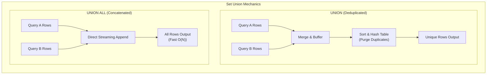

#### Detailed Comparison

| Attribute | `UNION` | `UNION ALL` |
| :--- | :--- | :--- |
| **Duplicate Handling** | Removes all duplicate rows across query results. | Preserves all duplicate rows across query results. |
| **Engine Execution** | Performs a temporary sort, hash lookup, or distinct filter. | Performs a direct linear append / stream of rows. |
| **Memory & CPU Impact** | High CPU and buffer pool usage for sorting/hashing. | Minimal memory footprint; streams directly to client. |
| **Disk Spilling Risk** | May spill intermediate sort runs to `tempdb` / disk on large sets. | Almost never spills to disk; no sorting required. |
| **Performance Complexity** | $\mathcal{O}(N \log N)$ due to sorting and comparison. | $\mathcal{O}(N)$ linear time complexity. |
| **Default Recommendation** | Use only when duplicate elimination is an explicit business requirement. | Use by default whenever datasets are disjoint or duplicates are acceptable. |

#### Concrete Example: The "Armenia" Case Study

Consider the `world` database. There is a sovereign state named **Armenia** (country code `ARM`), and there is also a major coffee-producing municipality named **Armenia** in the department of Quindío, Colombia (city ID `2266`).

```sql
-- Query 1: Deduplicated UNION
SELECT Name FROM country WHERE Name = 'Armenia'
UNION
SELECT Name FROM city WHERE Name = 'Armenia';
```

**Output (`UNION`):**
```
+---------+
| Name    |
+---------+
| Armenia |
+---------+
1 row in set (0.00 sec)
```
*Explanation*: The database recognizes that `'Armenia'` was produced by both queries, runs an internal distinct operation, and suppresses the duplicate record.

```sql
-- Query 2: All Records UNION ALL
SELECT Name FROM country WHERE Name = 'Armenia'
UNION ALL
SELECT Name FROM city WHERE Name = 'Armenia';
```

**Output (`UNION ALL`):**
```
+---------+
| Name    |
+---------+
| Armenia |
| Armenia |
+---------+
2 rows in set (0.00 sec)
```
*Explanation*: Both rows are preserved. No distinct hash pass is executed.

> [!TIP]
> **Performance Best Practice**: Always write `UNION ALL` unless business logic strictly dictates that duplicate rows must be suppressed. Even when you believe there are no duplicate records between two tables, using `UNION` forces the query planner to allocate memory buffers and sort all combined records to prove uniqueness.

---

### 1.4 `INTERSECT`: Finding Common Records

The `INTERSECT` operator takes the results of two queries and returns only the rows that exist in **both** result sets.

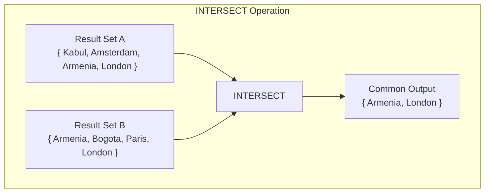

#### Syntax and Execution
```sql
-- Standard SQL INTERSECT (Available in PostgreSQL, Oracle, SQLite, and MySQL 8.0.31+)
SELECT Name FROM country
INTERSECT
SELECT Name FROM city;
```

#### Engine Compatibility and Emulation
While native `INTERSECT` is supported in PostgreSQL, Oracle, Microsoft SQL Server, and MySQL (version 8.0.31 and later), legacy MySQL instances (such as MySQL 5.7 or 8.0 prior to 8.0.31) do not support the keyword.

In database versions lacking native `INTERSECT`, developers emulate the behavior using an `INNER JOIN` or an `IN` subquery:

```sql
-- Emulating INTERSECT via INNER JOIN (Distinct common names)
SELECT DISTINCT co.Name
FROM country co
INNER JOIN city ci ON co.Name = ci.Name;

-- Emulating INTERSECT via Subquery with IN
SELECT DISTINCT Name
FROM country
WHERE Name IN (SELECT Name FROM city);
```

---

### 1.5 `MINUS` / `EXCEPT`: Set Difference

The set difference operator evaluates two queries and returns all distinct rows that appear in the **first** query but are **not present** in the second query.

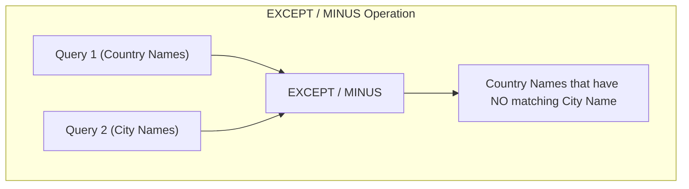

#### Dialect Differences
- **ANSI SQL / PostgreSQL / SQLite / MySQL (8.0.31+)**: Uses the keyword `EXCEPT`.
- **Oracle Database**: Uses the keyword `MINUS`.

```sql
-- ANSI Standard / PostgreSQL / MySQL 8.0.31+:
SELECT Name FROM country
EXCEPT
SELECT Name FROM city;

-- Oracle Syntax:
SELECT Name FROM country
MINUS
SELECT Name FROM city;
```

#### Emulating `EXCEPT` in Legacy MySQL
In MySQL environments where `EXCEPT` is unavailable, developers emulate set difference using a `LEFT JOIN` filtered by a `NULL` check, or a `NOT EXISTS` / `NOT IN` subquery:

```sql
-- Emulating EXCEPT using LEFT JOIN and IS NULL (High Performance)
SELECT DISTINCT co.Name
FROM country co
LEFT JOIN city ci ON co.Name = ci.Name
WHERE ci.Name IS NULL;

-- Emulating EXCEPT using NOT EXISTS
SELECT DISTINCT co.Name
FROM country co
WHERE NOT EXISTS (
    SELECT 1 FROM city ci WHERE ci.Name = co.Name
);
```

---

## 🧩 2. Joining Tables Horizontally with SQL `JOIN`

### 2.1 Relational Data Normalization & Why Joins Are Necessary

In flat-file systems, spreadsheets, or denormalized stores, all attributes are bundled into a single expansive table. In such a model, recording city information alongside country attributes results in massive data redundancy:

| City ID | City Name | Country Code | Country Name | Continent | HeadOfState |
| :--- | :--- | :--- | :--- | :--- | :--- |
| 1 | Kabul | AFG | Afghanistan | Asia | Mohammad Omar |
| 2 | Qandahar | AFG | Afghanistan | Asia | Mohammad Omar |
| 3 | Herat | AFG | Afghanistan | Asia | Mohammad Omar |
| ... | ... | ... | ... | ... | ... |

Notice the critical flaws of this denormalized structure:
- **Redundant Storage**: Continent, Country Name, and Head of State are duplicated thousands of times.
- **Update Anomalies**: Changing the head of state requires updating hundreds of rows; missing a single row creates conflicting data.
- **Insertion Anomalies**: You cannot record a new country until it has at least one city registered.
- **Deletion Anomalies**: Deleting the last city in a country inadvertently deletes all record of the country itself.

To resolve these anomalies, relational databases normalize data into separate entities linked by **Primary Key (PK)** and **Foreign Key (FK)** constraints:
- `country` table: `Code` (PK), `Name`, `Continent`, `HeadOfState`
- `city` table: `ID` (PK), `Name`, `CountryCode` (FK referencing `country.Code`), `District`, `Population`

**A SQL `JOIN` is the mechanism used at query runtime to reconstruct these related tables horizontally.**

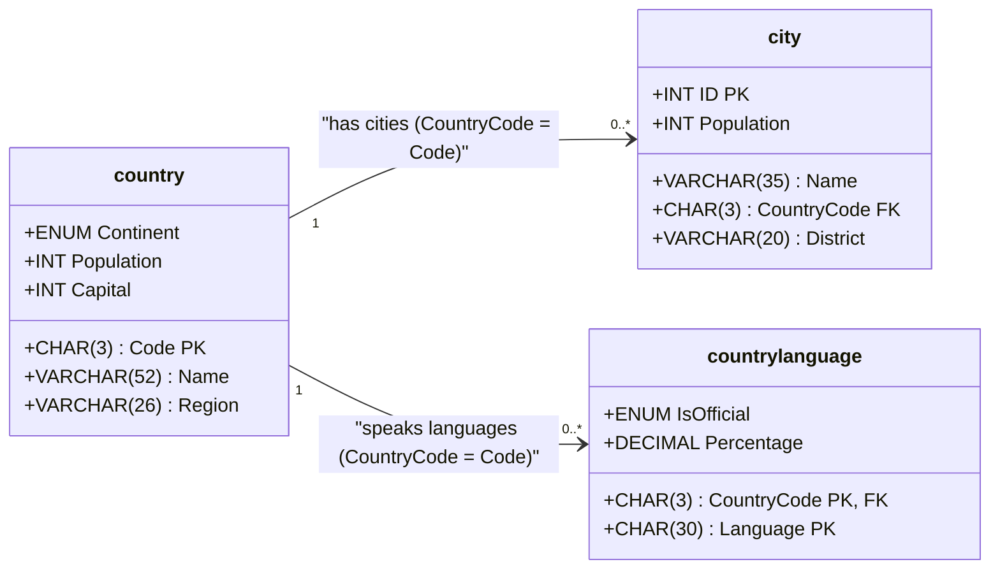

---

### 2.2 Relational Join Taxonomy

SQL defines multiple join algorithms to dictate how unmatched records are treated:

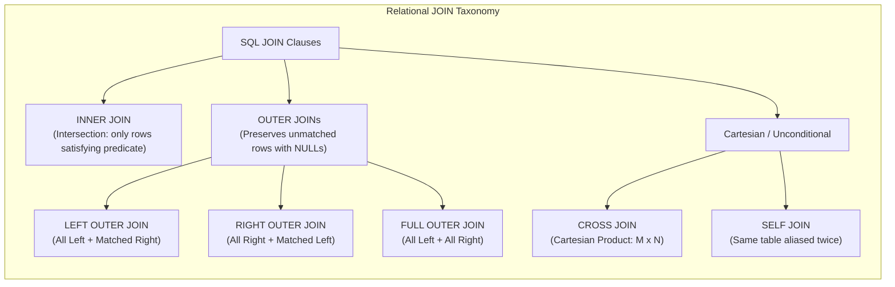

---

### 2.3 Qualified Column Names and Table Aliasing

When joining multiple tables, column names frequently collide. In the `world` database, both the `country` table and the `city` table contain a column called `Name` and a column called `Population`.

If you execute:
```sql
-- AMBIGUOUS ERROR
SELECT Name, Population
FROM city
JOIN country ON CountryCode = Code;
-- ERROR 1052 (23000): Column 'Name' in field list is ambiguous
```

#### Resolving Ambiguity with Qualified Names and Aliases
To eliminate ambiguity, prefix each column with its table name or a concise table alias:

```sql
SELECT 
    ci.ID AS 'City ID',
    ci.Name AS 'City Name',
    co.Name AS 'Country Name',
    ci.Population AS 'City Population',
    co.Population AS 'Country Population'
FROM city AS ci
INNER JOIN country AS co
    ON ci.CountryCode = co.Code;
```

> [!NOTE]
> The `AS` keyword for table aliases is optional in SQL (`FROM city ci JOIN country co`), but using clean 2–3 character aliases matching entity initials significantly enhances code readability.

---

### 2.4 Visualizing JOIN Types with Venn Diagrams

The Venn diagram model visually illustrates how row matching operates across joined tables:

```
        Table A: city                    Table B: country
        +-------------------+           +-------------------+
        |                   |           |                   |
        |        (A)        |   (A ∩ B) |        (B)        |
        |    Left-Only      |  Matching |    Right-Only     |
        |                   |           |                   |
        +-------------------+-----------+-------------------+
```

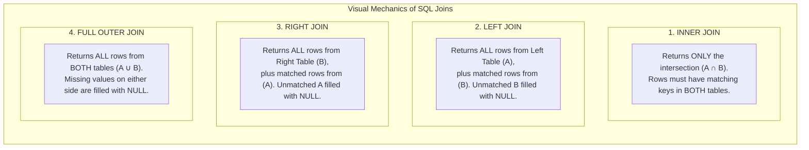

---

### 2.5 `INNER JOIN`

The `INNER JOIN` is the default and most common join operation. It returns rows only when there is a match between the specified columns in both tables.

#### Syntax
```sql
SELECT 
    ci.ID AS 'City ID', 
    ci.Name AS 'City Name', 
    co.Name AS 'Country Name'
FROM city ci
INNER JOIN country co
    ON ci.CountryCode = co.Code
WHERE co.Continent = 'Europe'
ORDER BY ci.Name ASC
LIMIT 5;
```

#### Sample Query Output
```
+---------+-------------------+---------------+
| City ID | City Name         | Country Name  |
+---------+-------------------+---------------+
|    3068 | A Coruña          | Spain         |
|     558 | Aachen            | Germany       |
|     561 | Aalborg           | Denmark       |
|    2448 | Aalter            | Belgium       |
|    2673 | Aarau             | Switzerland   |
+---------+-------------------+---------------+
5 rows in set (0.01 sec)
```

#### Under the Hood: Join Evaluation Flow
1. The query processor scans the driving table (`city`).
2. For each row in `city`, it extracts the `CountryCode` value (e.g., `'NLD'`).
3. It performs an index lookup on the `Code` column of the `country` table.
4. If a match is found (`'NLD' = 'NLD'`), the columns from both rows are concatenated and passed down the pipeline.
5. If no match is found, the record is discarded from the output stream.

---

### 2.6 `LEFT (OUTER) JOIN`

A `LEFT JOIN` (or `LEFT OUTER JOIN`) returns all records from the **left** table (the table declared after `FROM`), and the matched records from the **right** table (the table declared after `JOIN`). If there is no match in the right table, all right-table columns in the result set contain `NULL`.

#### Syntax
```sql
SELECT 
    co.Code AS 'Country Code',
    co.Name AS 'Country Name',
    ci.Name AS 'Capital City Name'
FROM country co
LEFT JOIN city ci
    ON co.Capital = ci.ID
ORDER BY co.Name ASC
LIMIT 5;
```

#### Sample Query Output
```
+--------------+---------------------+-------------------+
| Country Code | Country Name        | Capital City Name |
+--------------+---------------------+-------------------+
| AFG          | Afghanistan         | Kabul             |
| ALB          | Albania             | Tirana            |
| DZA          | Algeria             | Alger             |
| ASM          | American Samoa      | Fagatogo          |
| AND          | Andorra             | Andorra la Vella  |
+--------------+---------------------+-------------------+
5 rows in set (0.00 sec)
```

#### Detecting Missing Relationships with `LEFT JOIN ... WHERE right.key IS NULL`
A powerful administrative technique is using a `LEFT JOIN` to identify orphaned records or entities with no associated data. For instance, finding countries that have no capital city defined in the database:

```sql
SELECT 
    co.Code,
    co.Name,
    co.Continent
FROM country co
LEFT JOIN city ci
    ON co.Capital = ci.ID
WHERE ci.ID IS NULL;
```

```
+------+----------------------------------------------+---------------+
| Code | Name                                         | Continent     |
+------+----------------------------------------------+---------------+
| ATA  | Antarctica                                   | Antarctica    |
| BVT  | Bouvet Island                                | Antarctica    |
| ATF  | French Southern territories                  | Antarctica    |
| HMD  | Heard Island and McDonald Islands            | Antarctica    |
| SGS  | South Georgia and the South Sandwich Islands | Antarctica    |
| UMI  | United States Minor Outlying Islands         | Oceania       |
| PSE  | Palestine                                    | Asia          |
+------+----------------------------------------------+---------------+
7 rows in set (0.00 sec)
```

> [!IMPORTANT]
> Because Antarctica and outlying island territories have no permanent cities registered in the `city` table, their `Capital` foreign key cannot match any `city.ID`. In an `INNER JOIN`, these countries would vanish completely from your report. With a `LEFT JOIN`, they are safely preserved.

---

### 2.7 `RIGHT (OUTER) JOIN`

A `RIGHT JOIN` (or `RIGHT OUTER JOIN`) operates symmetrically to the `LEFT JOIN`. It preserves every row from the **right** table, supplementing columns with matching data from the left table or `NULL` if no match exists.

#### Syntax
```sql
SELECT 
    ci.Name AS 'City Name',
    co.Name AS 'Country Name'
FROM country co
RIGHT JOIN city ci
    ON co.Code = ci.CountryCode
WHERE ci.Name IN ('Kabul', 'Amsterdam', 'Springfield')
ORDER BY ci.Name;
```

#### Structural Equivalence: LEFT vs. RIGHT
Every `RIGHT JOIN` can be rewritten as a `LEFT JOIN` simply by reversing the order in which the tables are declared:

$$\text{TableA RIGHT JOIN TableB} \equiv \text{TableB LEFT JOIN TableA}$$

> [!TIP]
> **Code Style Guideline**: In professional SQL codebases, teams almost universally standardize on `LEFT JOIN` rather than alternating between `LEFT` and `RIGHT` joins. Maintaining a consistent left-to-right table reading order significantly reduces mental overhead when auditing queries that link four or more tables.

---

### 2.8 `FULL (OUTER) JOIN` and Its Emulation in MySQL

A `FULL OUTER JOIN` returns all rows from the left table and all rows from the right table. Where a match occurs, the records are joined horizontally. Where no match occurs, the missing side is populated with `NULL`.

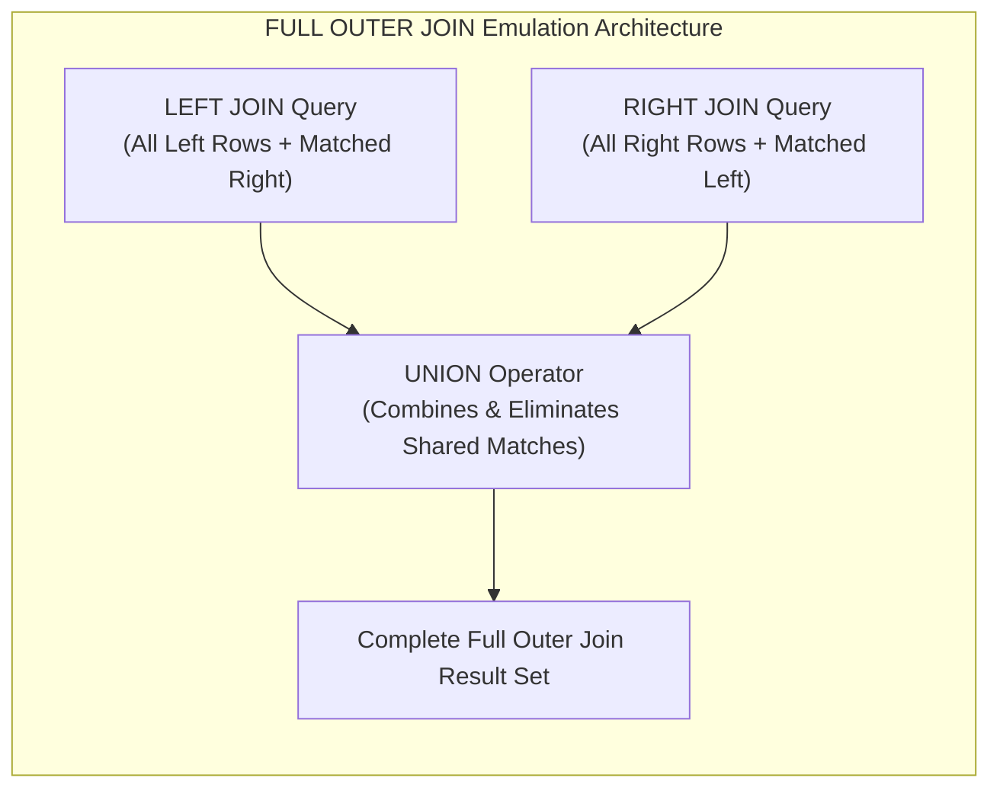

#### Engine Support
- **PostgreSQL / Oracle / Microsoft SQL Server**: Native syntax supported:
  ```sql
  SELECT co.Name, ci.Name 
  FROM country co 
  FULL OUTER JOIN city ci ON co.Code = ci.CountryCode;
  ```
- **MySQL (all versions, including MySQL 8.0)**: Does **not** support the `FULL OUTER JOIN` keyword directly.

#### Emulating `FULL OUTER JOIN` in MySQL
To achieve a full outer join in MySQL, combine a `LEFT JOIN` query with a `RIGHT JOIN` query using the `UNION` operator:

```sql
-- Emulating FULL OUTER JOIN in MySQL
SELECT 
    co.Code AS 'Country Code',
    co.Name AS 'Country Name',
    ci.Name AS 'City Name'
FROM country co
LEFT JOIN city ci 
    ON co.Code = ci.CountryCode

UNION

SELECT 
    co.Code AS 'Country Code',
    co.Name AS 'Country Name',
    ci.Name AS 'City Name'
FROM country co
RIGHT JOIN city ci 
    ON co.Code = ci.CountryCode;
```

*How this works*:
1. The first block (`LEFT JOIN`) outputs all countries and their matched cities, plus countries with zero cities (right side filled with `NULL`).
2. The second block (`RIGHT JOIN`) outputs all cities and their matched countries, plus orphan cities with no valid country code (left side filled with `NULL`).
3. The `UNION` operator concatenates both sets and purges the overlapping matched records that were computed by both queries.

---

### 2.9 `CROSS JOIN` (The Cartesian Product)

A `CROSS JOIN` produces the mathematical Cartesian product of two tables. Every row from Table 1 is paired with every row from Table 2.

If Table 1 contains $M$ rows and Table 2 contains $N$ rows, the resulting table will contain:
$$\text{Total Rows} = M \times N$$

```sql
-- Syntax:
SELECT co.Name AS 'Country', ci.Name AS 'City'
FROM country co
CROSS JOIN city ci;
```

If `country` contains 239 rows and `city` contains 4,079 rows, this query generates:
$$239 \times 4{,}079 = 974{,}881 \text{ rows}$$

> [!CAUTION]
> **Cartesian Explosion Hazard**: If you inadvertently omit an `ON` or `WHERE` join condition in an older comma-separated join syntax (`FROM country, city`), the database engine defaults to executing a Cartesian product! On enterprise tables with millions of records, an unintentional Cartesian join can saturate the database server's CPU, exhaust disk space with temporary swap files, and cause application outages.

#### Valid Use Cases for `CROSS JOIN`:
1. **Generating Combinatorial Calendars / Matrices**: Combining a table of store locations with a table of calendar dates to identify missing daily sales reports.
2. **Generating Test Datasets**: Multiplying small lookup tables to seed millions of test records in QA environments.

---

### 2.10 Self-Joins (`SELF JOIN`)

A `SELF JOIN` is not a distinct SQL keyword; rather, it is a technique where a table is joined with itself. To execute a self-join, you **must** assign distinct table aliases to distinguish the two virtual instances of the table.

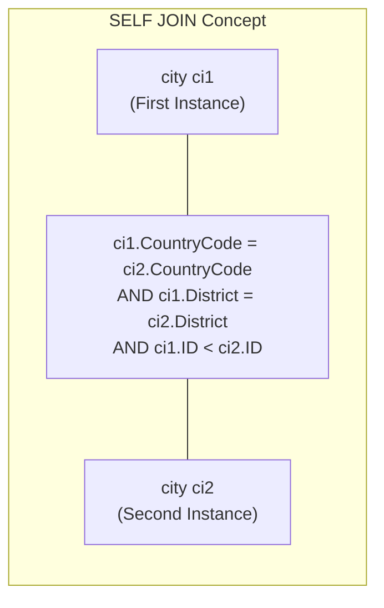

#### Use Cases for Self-Joins:
- **Hierarchical Tree Structures**: Tables storing employee/manager relationships where the `ManagerID` column references the `EmployeeID` in the same table.
- **Peer Matching**: Finding entities that share a common attribute within the same table.

#### Concrete Example: Finding Sister Cities in the Same District
Suppose we want to find distinct pairs of cities in the `world` database that share the exact same country and district:

```sql
SELECT 
    ci1.Name AS 'City A',
    ci2.Name AS 'City B',
    ci1.District,
    ci1.CountryCode
FROM city ci1
INNER JOIN city ci2
    ON ci1.CountryCode = ci2.CountryCode
    AND ci1.District = ci2.District
    AND ci1.ID < ci2.ID -- Prevents pairing a city with itself (ci1.ID != ci2.ID) and prevents mirrored duplicates (A,B vs B,A)
WHERE ci1.CountryCode = 'NLD';
```

**Output:**
```
+----------------+----------------+---------------+-------------+
| City A         | City B         | District      | CountryCode |
+----------------+----------------+---------------+-------------+
| Amsterdam      | Haarlem        | Noord-Holland | NLD         |
| Amsterdam      | Zaanstad       | Noord-Holland | NLD         |
| Haarlem        | Zaanstad       | Noord-Holland | NLD         |
| Rotterdam      | Dordrecht      | Zuid-Holland  | NLD         |
| Rotterdam      | Leiden         | Zuid-Holland  | NLD         |
| 's-Gravenhage  | Rotterdam      | Zuid-Holland  | NLD         |
| Eindhoven      | Tilburg        | Noord-Brabant | NLD         |
| Eindhoven      | Breda          | Noord-Brabant | NLD         |
+----------------+----------------+---------------+-------------+
8 rows in set (0.00 sec)
```

---

### 2.11 Join Predicates: `ON` Clause vs. `USING` Clause

When linking tables, SQL provides two ways to declare the join predicate:

#### 1. The `ON` Clause (Standard and Flexible)
The `ON` clause accepts any valid boolean expression, allowing comparisons across differently named columns, compound conditions, or range inequalities:
```sql
SELECT ci.Name, co.Name
FROM city ci
JOIN country co 
    ON ci.CountryCode = co.Code;
```

#### 2. The `USING` Clause (Shorthand for Identical Column Names)
When both tables share the **exact same column name** for the relationship (such as `CountryCode` in `city` and `countrylanguage`), you can use the `USING` clause:
```sql
SELECT 
    ci.Name AS 'City Name', 
    cl.Language, 
    cl.IsOfficial
FROM city ci
JOIN countrylanguage cl 
    USING (CountryCode)
WHERE ci.Name = 'Geneve';
```

#### Key Differences Between `ON` and `USING`:

| Feature | `ON` Clause | `USING` Clause |
| :--- | :--- | :--- |
| **Column Names** | Can join columns with completely different names (`ci.CountryCode = co.Code`). | Requires identical column names in both tables (`CountryCode`). |
| **Syntax Format** | Requires full boolean expression: `ON t1.id = t2.id`. | Enclosed in parentheses: `USING (id)`. |
| **Projection (`SELECT *`)** | Retains both columns in the result set (`t1.id` and `t2.id`). | Coalesces the column into a single column in `SELECT *`. |
| **Complex Conditions** | Supports multiple predicates, inequalities (`<`, `>`), and expressions. | Restricted strictly to equi-joins on the specified column names. |

---

## 🌍 3. Practical Queries on the World Database

The `world` sample database is the international standard reference schema for relational SQL education. It comprises three core tables:
- `country`: 239 rows representing sovereign states and territories.
- `city`: 4,079 rows representing major global cities.
- `countrylanguage`: 984 rows representing spoken languages by territory.

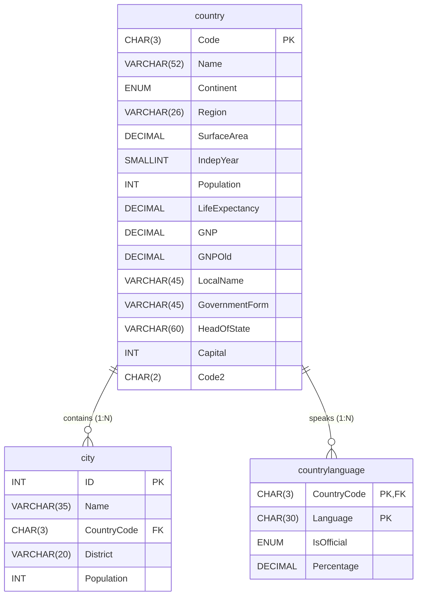

---

### Query 1: Three-Table Join (Country, Capital City, and Official Language)

This query joins all three tables to generate a report showing each European nation, its official capital city name, and its primary official language:

```sql
SELECT 
    co.Name AS 'Country',
    ci.Name AS 'Capital City',
    cl.Language AS 'Official Language',
    cl.Percentage AS 'Speaker %'
FROM country co
INNER JOIN city ci 
    ON co.Capital = ci.ID
INNER JOIN countrylanguage cl 
    ON co.Code = cl.CountryCode
WHERE co.Continent = 'Europe' 
  AND cl.IsOfficial = 'T'
ORDER BY co.Name ASC, cl.Percentage DESC
LIMIT 10;
```

**Output:**
```
+----------------+--------------------+-------------------+-----------+
| Country        | Capital City       | Official Language | Speaker % |
+----------------+--------------------+-------------------+-----------+
| Albania        | Tirana             | Albaniana         |      97.9 |
| Austria        | Wien               | German            |      92.0 |
| Belarus        | Minsk              | Belorussian       |      65.6 |
| Belarus        | Minsk              | Russian           |      32.0 |
| Belgium        | Bruxelles [Brussel]| Dutch             |      59.2 |
| Belgium        | Bruxelles [Brussel]| French            |      32.6 |
| Belgium        | Bruxelles [Brussel]| German            |       1.0 |
| Bosnia and Her.| Sarajevo           | Serbo-Croatian    |      99.2 |
| Bulgaria       | Sofia              | Bulgarian         |      84.8 |
| Croatia        | Zagreb             | Serbo-Croatian    |      95.9 |
+----------------+--------------------+-------------------+-----------+
10 rows in set (0.00 sec)
```

---

### Query 2: Aggregate Statistics Across Joins (Total Urban Population by Continent)

By combining an `INNER JOIN` with `GROUP BY` and aggregate functions (`SUM`, `COUNT`), we can compute continent-wide urban demographics:

```sql
SELECT 
    co.Continent,
    COUNT(DISTINCT co.Code) AS 'Total Countries',
    COUNT(ci.ID) AS 'Total Cities Recorded',
    FORMAT(SUM(ci.Population), 0) AS 'Total Recorded Urban Population',
    FORMAT(AVG(ci.Population), 0) AS 'Average City Population'
FROM country co
INNER JOIN city ci 
    ON co.Code = ci.CountryCode
GROUP BY co.Continent
ORDER BY SUM(ci.Population) DESC;
```

**Output:**
```
+---------------+-----------------+-----------------------+---------------------------------+-------------------------+
| Continent     | Total Countries | Total Cities Recorded | Total Recorded Urban Population | Average City Population |
+---------------+-----------------+-----------------------+---------------------------------+-------------------------+
| Asia          |              51 |                  1766 | 697,604,103                     | 395,019                 |
| South America |              14 |                   520 | 185,556,666                     | 356,840                 |
| Europe        |              46 |                   841 | 179,307,858                     | 213,208                 |
| North America |              37 |                   523 | 168,103,171                     | 321,421                 |
| Africa        |              58 |                   366 | 132,607,404                     | 362,315                 |
| Oceania       |               8 |                    63 | 11,466,400                      | 181,990                 |
+---------------+-----------------+-----------------------+---------------------------------+-------------------------+
6 rows in set (0.01 sec)
```

---

### Query 3: Identifying Non-Capital Megacities with Subqueries and Joins

This query finds all cities with a population exceeding 5,000,000 that are **not** the official capital of their respective nation:

```sql
SELECT 
    ci.Name AS 'Megacity',
    co.Name AS 'Country',
    FORMAT(ci.Population, 0) AS 'Population',
    cap.Name AS 'Actual Capital City'
FROM city ci
INNER JOIN country co 
    ON ci.CountryCode = co.Code
LEFT JOIN city cap 
    ON co.Capital = cap.ID
WHERE ci.Population > 5000000 
  AND ci.ID != co.Capital
ORDER BY ci.Population DESC;
```

**Output:**
```
+-------------------+---------------+------------+---------------------+
| Megacity          | Country       | Population | Actual Capital City |
+-------------------+---------------+------------+---------------------+
| Mumbai (Bombay)   | India         | 10,500,000 | New Delhi           |
| São Paulo         | Brazil        |  9,968,485 | Brasília            |
| Shanghai          | China         |  9,696,300 | Peking              |
| Karachi           | Pakistan      |  9,269,265 | Islamabad           |
| Istanbul          | Turkey        |  8,787,958 | Ankara              |
| New York          | United States |  8,008,278 | Washington          |
| Rio de Janeiro    | Brazil        |  5,598,958 | Brasília            |
| Lahore            | Pakistan      |  5,063,499 | Islamabad           |
+-------------------+---------------+------------+---------------------+
8 rows in set (0.01 sec)
```

---

## 🏢 4. Group Activity: AnyCompany Publishing House

### 4.1 Scenario Background
**AnyCompany Publishing House** is a global educational and trade media distributor preparing international book fulfillment catalogs. Their operations data warehouse utilizes the `country` table and supplementary regional fulfillment logs. 

The publishing team needs to analyze territory readiness for international shipping, language translations, and regional book marketing.

```mermaid
flowchart TD
    subgraph AnyCompanyWorkflow["AnyCompany Publishing Territory Analysis"]
        CountryTable["`country` Table<br>(Code, Name, Continent, Population, Capital)"]
        CityTable["`city` Table<br>(ID, Name, CountryCode, Population)"]
        LangTable["`countrylanguage` Table<br>(CountryCode, Language, IsOfficial)"]
        
        Q1["Analysis 1: European Distribution Hubs<br><b>INNER JOIN + LEFT JOIN</b>"]
        Q2["Analysis 2: Translation Coverage Gaps<br><b>LEFT JOIN + NULL Filtering</b>"]
        
        CountryTable & CityTable --> Q1
        CountryTable & LangTable --> Q2
    end
```

---

### 4.2 Group Challenge Directives
1. Assemble in teams of 3–4 learners (Time: 20 minutes).
2. Formulate at least **two distinct queries** against the `country` table:
   - Query A must incorporate at least **two different `JOIN` clauses** (e.g., an `INNER JOIN` combined with a `LEFT JOIN`).
   - Query B must identify potential territory data anomalies or missing relationship fields (e.g., countries without capitals or languages).
3. Generate sample SQL scripts and test outputs.
4. Prepare to present findings explaining which join types were selected and why.

---

### 4.3 Structured Solution & Query Implementations

#### Query A: Publishing Hub Logistics & Capital Mapping
**Objective**: List all South American nations, their designated capital cities, and their top primary city by population, ensuring nations are not dropped even if their capital is unassigned.

```sql
SELECT 
    co.Code AS 'Territory Code',
    co.Name AS 'Territory Name',
    co.Population AS 'National Population',
    cap.Name AS 'Administrative Capital',
    largest_city.Name AS 'Commercial Center'
FROM country co
-- 1. LEFT JOIN to retain countries even if capital city ID is NULL
LEFT JOIN city cap 
    ON co.Capital = cap.ID
-- 2. INNER JOIN to a correlated derived table finding the largest urban market
INNER JOIN (
    SELECT c1.CountryCode, c1.Name
    FROM city c1
    INNER JOIN (
        SELECT CountryCode, MAX(Population) AS MaxPop
        FROM city
        GROUP BY CountryCode
    ) c2 ON c1.CountryCode = c2.CountryCode AND c1.Population = c2.MaxPop
) largest_city ON co.Code = largest_city.CountryCode
WHERE co.Continent = 'South America'
ORDER BY co.Population DESC;
```

**Output:**
```
+----------------+----------------+---------------------+------------------------+-------------------+
| Territory Code | Territory Name | National Population | Administrative Capital | Commercial Center |
+----------------+----------------+---------------------+------------------------+-------------------+
| BRA            | Brazil         |           170115000 | Brasília               | São Paulo         |
| COL            | Colombia       |            42321000 | Santafé de Bogotá      | Santafé de Bogotá |
| ARG            | Argentina      |            37032000 | Buenos Aires           | Buenos Aires      |
| PER            | Peru           |            25662000 | Lima                   | Lima              |
| VEN            | Venezuela      |            24170000 | Caracas                | Caracas           |
| CHL            | Chile          |            15211000 | Santiago de Chile      | Santiago de Chile |
| ECU            | Ecuador        |            12646000 | Quito                  | Guayaquil         |
+----------------+----------------+---------------------+------------------------+-------------------+
7 rows in set (0.01 sec)
```

#### Query B: Editorial Translation Risk Analysis
**Objective**: Identify territories with recorded populations greater than 100,000 where **no official language** is registered in the database, representing an editorial translation gap:

```sql
SELECT 
    co.Code,
    co.Name,
    co.Continent,
    co.Population
FROM country co
LEFT JOIN countrylanguage cl 
    ON co.Code = cl.CountryCode 
    AND cl.IsOfficial = 'T'
WHERE cl.Language IS NULL 
  AND co.Population > 100000
ORDER BY co.Population DESC;
```

**Output:**
```
+------+----------------------+---------------+------------+
| Code | Name                 | Continent     | Population |
+------+----------------------+---------------+------------+
| USA  | United States        | North America |  278357000 |
| GBR  | United Kingdom       | Europe        |   59623400 |
| BWA  | Botswana             | Africa        |    1622000 |
| MUS  | Mauritius            | Africa        |    1158000 |
| TLS  | East Timor           | Asia          |     885000 |
| BHS  | Bahamas              | North America |     307000 |
+------+----------------------+---------------+------------+
6 rows in set (0.00 sec)
```

> [!NOTE]
> Notice that both the **United States (USA)** and the **United Kingdom (GBR)** appear in this result! In the `world` database, English has `IsOfficial = 'F'` for the USA because the United States does not have a legally codified official federal language in its constitution. This highlights why thorough join analysis is necessary for accurate data interpretation.

---

## ❓ 5. Checkpoint Questions & In-Depth Answers

### Question 1: What is a SQL `JOIN`?
**Core Answer**:  
A `JOIN` is a SQL clause used to horizontally combine rows and columns from two or more database tables based on a logical relationship or matching key values between them.

**Architectural Explanation**:  
In normalized database systems, entities are stored in dedicated tables to prevent duplication and modification anomalies. A `JOIN` reconstructs these separate entities at query time by matching the primary key of one table to a foreign key in another table. Depending on the join type (`INNER`, `LEFT`, `RIGHT`, `FULL`, `CROSS`), the RDBMS engine will either discard unmatched rows or populate missing values with `NULL`.

---

### Question 2: What does a `UNION` operator do?
**Core Answer**:  
A `UNION` operator vertically combines the output tuples of two or more independent `SELECT` statements into a single, unified result set while automatically removing any duplicate rows.

**Architectural Explanation**:  
Unlike a `JOIN` which connects tables horizontally by adding columns, `UNION` stacks result sets vertically. Under the hood, `UNION` executes each query independently, buffers the records into a temporary structure, sorts or hashes the combined dataset, and filters out duplicate rows before delivering the final output. If duplicate elimination is unnecessary, developers should utilize `UNION ALL` to bypass the CPU and memory overhead of the sorting phase.

---

### Question 3: What are the three fundamental rules for combining queries with set operators?
**Core Answer**:  
1. **Equal Column Count**: Every `SELECT` query must project the exact same number of columns.
2. **Data Type Compatibility**: Columns in corresponding ordinal positions across all `SELECT` queries must share compatible or implicitly convertible data types.
3. **First-Query Precedence**: The column names, aliases, and labels of the final result set are determined solely by the first `SELECT` query in the compound statement.

---

### Question 4: How do you perform a `FULL OUTER JOIN` in MySQL, given that MySQL does not natively support the keyword?
**Core Answer**:  
You emulate a `FULL OUTER JOIN` in MySQL by executing a `LEFT JOIN` query and a `RIGHT JOIN` query, linking them together with the `UNION` operator:

```sql
SELECT * FROM tableA LEFT JOIN tableB ON tableA.id = tableB.id
UNION
SELECT * FROM tableA RIGHT JOIN tableB ON tableA.id = tableB.id;
```
The `LEFT JOIN` retrieves all records from `tableA` and matched records from `tableB`. The `RIGHT JOIN` retrieves all records from `tableB` and matched records from `tableA`. The `UNION` operator concatenates both sets and eliminates the overlapping matched records that were computed by both queries.

---

### Question 5: When should you use a `SELF JOIN`, and what syntactic requirement is mandatory?
**Core Answer**:  
A `SELF JOIN` is used when you need to compare records within the same table, evaluate peer-matching relationships, or traverse hierarchical trees (such as employee-to-manager structures or category parent-child trees).  
**Mandatory Requirement**: You **must** define distinct table aliases (e.g., `FROM city c1 JOIN city c2`) so the SQL parser can distinguish between the two virtual roles of the same underlying table.

---

## 🏆 6. Key Takeaways & Decision Matrix

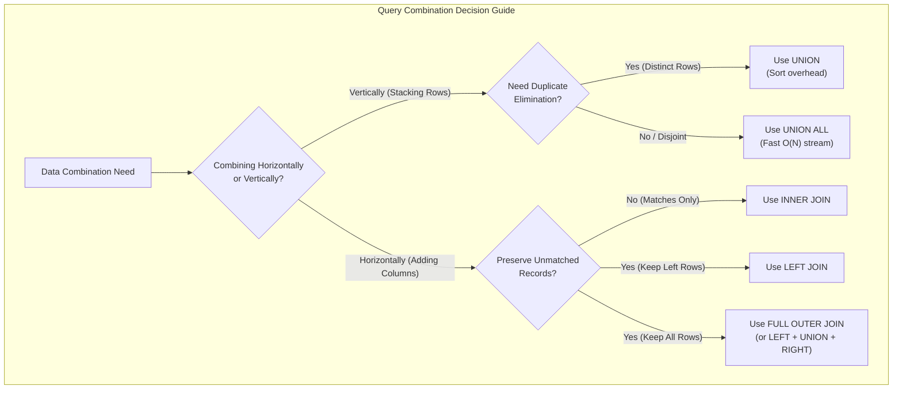

### Operational Rules of Thumb:
- **Default to `UNION ALL`**: Never write `UNION` out of habit. Default to `UNION ALL` unless your application logic explicitly requires duplicate suppression, saving unnecessary sorting and hash table memory allocation.
- **Always Qualify Joined Columns**: In multi-table queries, always prefix column names with concise table aliases (`co.Name`, `ci.Population`) to eliminate ambiguity and prevent runtime syntax failures when schemas evolve.
- **Prefer `LEFT JOIN` over `RIGHT JOIN`**: Keep table order consistent from left to right. It improves readability across team pull requests and simplifies multi-table join cascades.
- **Watch for Cartesian Explosions**: Always ensure join predicates (`ON` or `USING`) are properly specified. A missing join predicate triggers a `CROSS JOIN`, multiplying rows ($M \times N$) and exhausting database resources.
- **Leverage Self-Joins for Hierarchies**: Model recursive relationships and intra-table correlations by aliasing the table twice with distinct variable names.

---

## 📝 7. Knowledge Check & Practice Exercises

### Practice Exercise 1: Set Operations
**Task**: Write a compound query that lists all distinct country codes that exist in the `country` table but have **no cities** registered in the `city` table. Provide both the modern ANSI SQL syntax (`EXCEPT`) and the legacy MySQL equivalent.

<details>
<summary>👉 View Solution</summary>

**ANSI Standard (`EXCEPT`):**
```sql
SELECT Code FROM country
EXCEPT
SELECT CountryCode FROM city;
```

**Legacy MySQL Syntax (`LEFT JOIN` Emulation):**
```sql
SELECT co.Code
FROM country co
LEFT JOIN city ci ON co.Code = ci.CountryCode
WHERE ci.CountryCode IS NULL;
```
</details>

---

### Practice Exercise 2: Multi-Table Joins & Percentages
**Task**: Write a query that returns the top 5 most spoken languages across the entire world, calculating the estimated total number of global speakers by multiplying each country's population by the language's percentage (`Population * (Percentage / 100)`).

<details>
<summary>👉 View Solution</summary>

```sql
SELECT 
    cl.Language,
    COUNT(DISTINCT cl.CountryCode) AS 'Countries Spoken In',
    FORMAT(SUM(co.Population * (cl.Percentage / 100)), 0) AS 'Estimated Total Speakers'
FROM countrylanguage cl
INNER JOIN country co 
    ON cl.CountryCode = co.Code
GROUP BY cl.Language
ORDER BY SUM(co.Population * (cl.Percentage / 100)) DESC
LIMIT 5;
```

**Expected Output:**
```
+----------------+---------------------+--------------------------+
| Language       | Countries Spoken In | Estimated Total Speakers |
+----------------+---------------------+--------------------------+
| Chinese        |                   5 | 1,191,843,539            |
| Hindi          |                   1 | 405,633,080              |
| Spanish        |                  28 | 355,029,462              |
| English        |                  44 | 347,077,867              |
| Arabic         |                  24 | 233,839,238              |
+----------------+---------------------+--------------------------+
```
</details>

---

### Practice Exercise 3: Full Outer Join Emulation
**Task**: Construct a query in MySQL that emulates a `FULL OUTER JOIN` between a hypothetical `departments` table (`DeptID`, `DeptName`) and an `employees` table (`EmpID`, `EmpName`, `DeptID`), displaying departments with no employees and employees without a department.

<details>
<summary>👉 View Solution</summary>

```sql
SELECT 
    d.DeptID,
    d.DeptName,
    e.EmpID,
    e.EmpName
FROM departments d
LEFT JOIN employees e 
    ON d.DeptID = e.DeptID

UNION

SELECT 
    d.DeptID,
    d.DeptName,
    e.EmpID,
    e.EmpName
FROM departments d
RIGHT JOIN employees e 
    ON d.DeptID = e.DeptID;
```
</details>
