# 🗄️ Amazon Relational Database Service (Amazon RDS) & Amazon Aurora

> **Course**: AWS re/Start  
> **Module**: Database Fundamentals (M06 – Amazon RDS & Amazon Aurora)  
> **Source Document**: `T10-Database/T10-0010-RSDB_EN-US_SG_M06_AMAZONRDS.pdf`  
> **Target Audience**: AWS re/Start Learners, Cloud Practitioners, and Systems Operations Associates  

---

## 🎯 Module Overview

Relational databases serve as the foundational transactional backbone for mission-critical enterprise workloads, e-commerce engines, financial platforms, and web applications. However, deploying and administering self-managed relational database management systems (RDBMS) on physical hardware or bare virtual servers introduces immense operational friction—often described by AWS as **"undifferentiated heavy lifting."** Database administrators (DBAs) and systems engineers spend countless hours provisioning hardware, installing operating systems, applying security patches, orchestrating complex synchronous clustering for high availability, configuring replication for read scaling, executing manual backups, and provisioning excess disk capacity to accommodate future growth.

**Amazon Relational Database Service (Amazon RDS)** revolutionizes database administration by delivering a fully managed, cost-efficient, and resizable cloud database service. Amazon RDS automates time-consuming routine tasks while preserving the standard functionality, native tools, and full compatibility of leading relational database engines. Furthermore, AWS engineered **Amazon Aurora**, a cloud-native relational engine built from the ground up for massive cloud scale, decoupling compute from distributed self-healing storage to deliver up to five times the throughput of standard MySQL and three times the throughput of standard PostgreSQL.

```mermaid
flowchart LR
    subgraph OperationalBurden["Traditional Self-Managed Database"]
        H1["Server Hardware Provisioning"]
        OS1["OS Installation & Patching"]
        DB1["DBMS Engine Setup & Patching"]
        HA1["Manual High Availability Clustering"]
        BK1["Manual Backups & Log Archiving"]
        SC1["Complex Storage & Compute Scaling"]
    end

    OperationalBurden ==>|"Automated by Amazon RDS"| RDSManaged["☁️ Amazon RDS / Amazon Aurora"]

    subgraph CustomerFocus["Customer Responsibility on Amazon RDS"]
        App["Application Optimization"]
        Schema["Schema Design & Indexes"]
        Query["SQL Query Tuning"]
        Data["Data Security & IAM Policies"]
    end

    RDSManaged --> CustomerFocus
```

---

## 📌 Learning Objectives

By completing this module and working through these comprehensive study notes, you will be able to:

- [ ] **Define Amazon RDS**: Explain the core architecture of Amazon RDS as a managed relational database service and identify the operational burdens it eliminates.
- [ ] **Contrast Self-Managed EC2 vs. Amazon RDS**: Analyze the shared responsibility model differences between running self-managed databases on Amazon EC2 versus managed Amazon RDS.
- [ ] **Identify the Six Supported RDS Engines**: Distinguish between open-source engines (MySQL, MariaDB, PostgreSQL), commercial engines (Oracle, Microsoft SQL Server), and cloud-native Amazon Aurora.
- [ ] **Evaluate Licensing Models**: Compare License Included (LI) versus Bring Your Own License (BYOL) for commercial database engines on Amazon RDS.
- [ ] **Master Amazon RDS High Availability**: Explain the mechanics of Multi-AZ synchronous replication, health checks, and automated DNS failover with zero data loss.
- [ ] **Implement Read Scalability**: Explain how asynchronous Read Replicas scale read-heavy workloads, describe cross-region replication for disaster recovery, and contrast Multi-AZ with Read Replicas.
- [ ] **Implement Backup and Recovery Strategies**: Differentiate between automated backups (point-in-time recovery down to a second) and user-initiated manual DB snapshots stored durably in Amazon S3.
- [ ] **Select and Scale RDS Storage**: Choose between General Purpose SSD (gp2/gp3), Provisioned IOPS SSD (io1/io2), and Magnetic storage, and leverage Storage Auto Scaling.
- [ ] **Architect RDS Security**: Secure DB instances using Amazon VPC private subnets, DB subnet groups, security groups, KMS encryption at rest, SSL/TLS in transit, and IAM database authentication.
- [ ] **Deep Dive into Amazon Aurora**: Explain Aurora's decoupled compute and storage architecture, 6-way replication across three Availability Zones, self-healing distributed storage, and reader endpoints scaling up to 15 replicas.
- [ ] **Identify Primary Workload Use Cases**: Map Amazon RDS and Aurora to enterprise business applications, software as a service (SaaS), e-commerce platforms, and high-throughput online gaming.

---

## ⚙️ 1. What is Amazon Relational Database Service (Amazon RDS)?

### 1.1 The Operational Burden of Unmanaged Databases

In a traditional on-premises data center or unmanaged virtual machine environment, running a relational database requires extensive administrative overhead:
- **Server Procurement & Racking**: Long hardware procurement cycles, physical power, cooling, cabling, and hypervisor maintenance.
- **Operating System Maintenance**: Installing, configuring, securing, and patching the host OS (Linux or Windows Server).
- **DBMS Software Management**: Installing database binaries, managing licensing keys, and executing complex patch management procedures.
- **High Availability & Disaster Recovery (HA/DR)**: Hand-crafting multi-node clustering software, managing heartbeat networks, configuring shared SAN/NAS storage, and writing custom failover scripts.
- **Backups & Log Rotation**: Writing cron jobs to run `mysqldump`, `pg_dump`, or physical disk snapshots, copying files off-site, and verifying tape or block integrity.
- **Capacity Planning & Storage Scaling**: Guessing storage requirements years in advance to avoid running out of disk space, leading to expensive over-provisioning.

These operational tasks represent **undifferentiated heavy lifting**—they consume substantial engineering time without differentiating the organization's business products or core services.

### 1.2 Amazon RDS as a Managed Database Service

**Amazon Relational Database Service (Amazon RDS)** is a fully managed cloud service that makes it easy to set up, operate, and scale a relational database in the AWS Cloud. 

Amazon RDS automates routine database administration:
1. **Automated Provisioning**: Rapid deployment of database instances via the AWS Management Console, AWS CLI, AWS SDKs, or AWS CloudFormation in minutes.
2. **Automated Patching**: Automatic application of operating system and database engine maintenance updates during a user-defined maintenance window.
3. **Automated High Availability**: Native Multi-AZ deployments with synchronous standby replication and automated failover.
4. **Continuous Backup Protection**: Turnkey automated daily snapshots and continuous transaction log backups supporting point-in-time recovery (PITR).
5. **Elastic Scalability**: Seamless modification of compute resources (CPU and RAM) and non-disruptive storage expansion.
6. **Built-in Monitoring & Metrics**: Out-of-the-box integration with Amazon CloudWatch, Performance Insights, and Enhanced Monitoring.

> [!NOTE]
> Amazon RDS allows developers and DBAs to redirect their focus from infrastructure maintenance to application optimization, schema design, index tuning, and business logic.

---

### 1.3 Amazon RDS vs. Self-Managed Databases on Amazon EC2

While organizations can choose to install relational database engines directly onto Amazon EC2 virtual machines (self-managed), Amazon RDS provides a shared responsibility model tailored specifically for database efficiency.

```mermaid
flowchart TD
    subgraph EC2Model["Self-Managed Database on Amazon EC2"]
        direction TB
        E1["Customer: App Optimization & SQL Queries"]
        E2["Customer: Schema Design & Indexing"]
        E3["Customer: DB Engine Installation & Patching"]
        E4["Customer: OS Installation, Hardening & Patching"]
        E5["Customer: HA Clustering, Replication & Failover"]
        E6["Customer: Backup Scripts & Snapshot Schedules"]
        E7["Customer: Storage Provisioning & Volume Striping"]
        E8["AWS: Physical Hardware, Power, Racks & Hypervisor"]
    end

    subgraph RDSModel["Managed Amazon RDS"]
        direction TB
        R1["Customer: App Optimization & SQL Queries"]
        R2["Customer: Schema Design & Indexing"]
        R3["AWS: Automated DB Engine Patching"]
        R4["AWS: Automated OS Maintenance & Hardening"]
        R5["AWS: Automated Multi-AZ Synchronous Failover"]
        R6["AWS: Automated Daily Backups & 5-Min Log Archival"]
        R7["AWS: Automated Storage Provisioning & Scaling"]
        R8["AWS: Physical Hardware, Power, Racks & Hypervisor"]
    end
```

| Management Dimension | Self-Managed Database on Amazon EC2 | Fully Managed Amazon RDS |
| :--- | :--- | :--- |
| **Server Hardware** | Managed by AWS (underlying physical host). | Managed by AWS. |
| **OS Installation & Hardening** | **Customer Responsibility**: Customer installs OS, manages kernels, and applies security patches. | **Managed by AWS**: AWS secures and maintains the underlying OS; no host OS access is provided. |
| **Database Installation & Updates** | **Customer Responsibility**: Customer downloads binaries, manages versions, and executes upgrades. | **Managed by AWS**: AWS handles automated minor version patching during maintenance windows. |
| **High Availability (HA)** | **Customer Responsibility**: Customer must configure clustering (e.g., Pacemaker, Corosync, Always On), heartbeat networks, and failover automation. | **Managed by AWS**: One-click Multi-AZ deployment with automated synchronous replication and sub-2-minute DNS failover. |
| **Read Scaling** | **Customer Responsibility**: Customer manually provisions replica instances, sets up replication channels, and monitors replication lag. | **Managed by AWS**: Push-button Read Replicas (up to 5 for standard RDS, up to 15 for Aurora) with native endpoints. |
| **Backups & Recovery** | **Customer Responsibility**: Customer scripts storage snapshots, dumps, transaction log backups, and manual restore procedures. | **Managed by AWS**: Automated daily full snapshots + continuous transaction log backups to S3 every 5 minutes (PITR up to 35 days). |
| **Operating System Access** | **Full Access**: Customer has SSH/RDP root/administrator access to the underlying OS. | **No OS Access**: Access is restricted to native database protocol ports (e.g., 3306, 5432) to ensure service integrity. |
| **Storage Scaling** | **Customer Responsibility**: Customer creates, attaches, formats, and stripes EBS volumes or LVM partitions manually. | **Managed by AWS**: Dynamic online storage expansion and Storage Auto Scaling with zero downtime. |
| **Database Tuning & Indexing** | **Customer Responsibility**: Schema design, query optimization, indexing, and connection pooling. | **Customer Responsibility**: Schema design, query optimization, indexing, and connection pooling. |

> [!WARNING]
> Because Amazon RDS is a managed service, AWS **does not provide root shell access (SSH/RDP)** to the underlying virtual machine host. If an enterprise legacy workload requires direct access to the operating system filesystem or custom OS kernel extensions, the database must be run on Amazon EC2 or Amazon RDS Custom.

---

## 🏛️ 2. Amazon RDS DB Instances & Supported Engines

### 2.1 The DB Instance Construct

The fundamental building block of Amazon RDS is the **DB instance**. A DB instance is an isolated database environment running in the cloud that contains one or more user-created databases.

Each DB instance is characterized by two distinct resource dimensions:
1. **DB Instance Class**: Determines compute capacity (vCPUs), memory (RAM), and network throughput.
2. **DB Instance Storage**: Determines disk capacity, storage type, and I/O performance (IOPS).

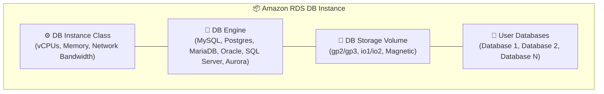

### 2.2 DB Instance Classes & Performance Profiles

Amazon RDS provides three primary families of instance classes to cater to different operational profiles:

1. **Standard Compute Classes (`db.m6g`, `db.m6i`, `db.m5`)**:
   - Provide a balanced ratio of CPU compute and RAM.
   - Ideal for general-purpose application backends, mid-tier web applications, and moderate operational workloads.
2. **Memory-Optimized Classes (`db.r6g`, `db.r6i`, `db.r5`, `db.x2g`)**:
   - Provide high memory-to-vCPU ratios.
   - Relational database performance depends heavily on keeping the active working set (tables, indexes, buffer pool) entirely in memory. Memory-optimized instances are the gold standard for production databases with high transactional concurrency.
3. **Burstable Performance Classes (`db.t4g`, `db.t3`)**:
   - Provide baseline CPU performance with the ability to burst CPU utilization when needed via accumulated CPU credits.
   - Cost-effective choice for development, staging, testing environments, and non-critical workloads with low baseline utilization.

> [!TIP]
> AWS Graviton-based instances (designated by the `g` suffix, such as `db.m6g` and `db.r6g`) utilize custom 64-bit ARM Neoverse processor cores engineered by AWS. They typically deliver up to **40% better price-performance** compared to equivalent x86 instances for open-source engines like MySQL and PostgreSQL.

---

### 2.3 The Six Supported Database Engines

Amazon RDS supports **six industry-standard relational database engines**, grouped into three distinct categories:

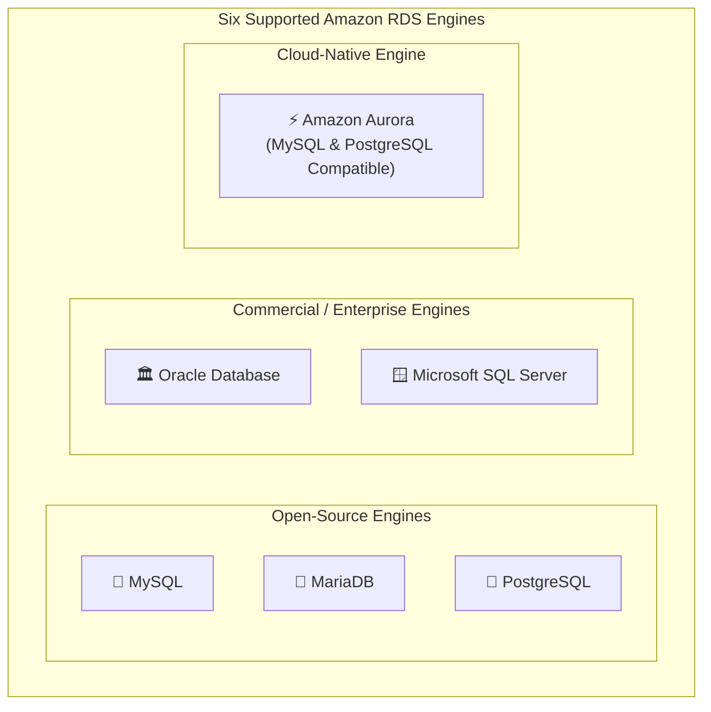

#### Category 1: Open-Source Engines
1. **MySQL**:
   - The world's most popular open-source relational database.
   - Native support for MySQL Community Edition (versions 5.7, 8.0+).
   - Standard port: **3306**.
   - Fully compatible with standard tools such as `mysql` CLI, MySQL Workbench, phpMyAdmin, and standard connectors.
2. **MariaDB**:
   - Developed by the original creators of MySQL as an open-source, community-driven drop-in fork.
   - Supports rich storage engines, advanced thread pooling, and high compatibility with MySQL schemas.
   - Standard port: **3306**.
3. **PostgreSQL**:
   - Enterprise-grade, highly extensible object-relational database system emphasizing standards compliance and complex query execution.
   - Extensive support for advanced data types (JSONB, UUID, HSTORE), geospatial data via PostGIS extension, and rich full-text search.
   - Standard port: **5432**.

#### Category 2: Commercial / Enterprise Engines
4. **Oracle Database**:
   - Enterprise database engine supporting complex enterprise architectures (Enterprise Edition, Standard Edition Two).
   - Standard port: **1521**.
   - Supports Oracle PL/SQL, Oracle Application Express (APEX), and fine-grained enterprise security.
5. **Microsoft SQL Server**:
   - Enterprise database platform from Microsoft (Express, Web, Standard, and Enterprise Editions).
   - Standard port: **1433**.
   - Native support for T-SQL, SQL Server Management Studio (SSMS), SQL Server Agent, and integration with Microsoft enterprise applications.

#### Category 3: Cloud-Native Engine
6. **Amazon Aurora**:
   - AWS's flagship cloud-native relational database designed specifically for the AWS Cloud.
   - Drop-in compatible with MySQL and PostgreSQL.
   - Combines the speed and availability of high-end commercial databases with the simplicity and cost-effectiveness of open-source databases.

---

### 2.4 Commercial Licensing Models: License Included vs. BYOL

When deploying commercial database engines (Oracle Database and Microsoft SQL Server) on Amazon RDS, AWS offers two licensing models:

| Dimension | License Included (LI) | Bring Your Own License (BYOL) |
| :--- | :--- | :--- |
| **Model Concept** | Database software license is bundled directly into the hourly Amazon RDS service pricing. | Customer utilizes their existing on-premises software licenses on AWS. |
| **Procurement** | No separate licensing agreement or upfront purchase required from Oracle or Microsoft. | Customer purchases and maintains active software licenses directly with vendor. |
| **Applicability** | - **Microsoft SQL Server**: Express, Web, Standard, Enterprise. - **Oracle Database**: Standard Edition Two (SE2). | - **Microsoft SQL Server**: Eligible via Microsoft License Mobility through Software Assurance. - **Oracle Database**: Standard Edition Two (SE2) and Enterprise Edition (EE). |
| **Flexibility** | Pay-as-you-go; shut down the instance and billing stops immediately. | Must comply with vendor core licensing agreements and audit policies. |
| **Best For** | Organizations without existing enterprise agreements or dynamic, temporary workloads. | Enterprises with substantial pre-existing long-term enterprise license agreements (ELAs). |

---

### 2.5 Provisioning Methods: Standard Create vs. Easy Create

When creating an Amazon RDS DB instance in the AWS Management Console, users can select between two configuration workflows:

1. **Easy Create**:
   - Designed for rapid onboarding and deployment following AWS architectural best practices.
   - Automatically sets configuration parameters (such as automated backup retention, VPC default networking, and automatic minor version updates).
   - The user only specifies the database engine, instance sizing tier (Production, Dev/Test, Free Tier), DB instance identifier, and master credentials.
2. **Standard Create**:
   - Provides granular control over all deployment parameters.
   - Enables explicit configuration of Multi-AZ deployment, custom DB subnet groups, public accessibility flags, VPC security groups, database port, KMS encryption keys, parameter groups, option groups, maintenance windows, and Enhanced Monitoring intervals.

> [!NOTE]
> Regardless of the provisioning method selected, initializing and provisioning a new DB instance typically requires **5 to 20 minutes** depending on the instance class, allocated storage volume size, and database engine selected.

---

## 💾 3. Amazon RDS Storage Architecture & Performance

### 3.1 Storage Classes

Amazon RDS decouples compute from underlying storage. When creating an RDS instance, storage is provisioned on network-attached **Amazon Elastic Block Store (Amazon EBS)** volumes (or Aurora's distributed storage subsystem). Amazon RDS provides three primary EBS storage volume types:

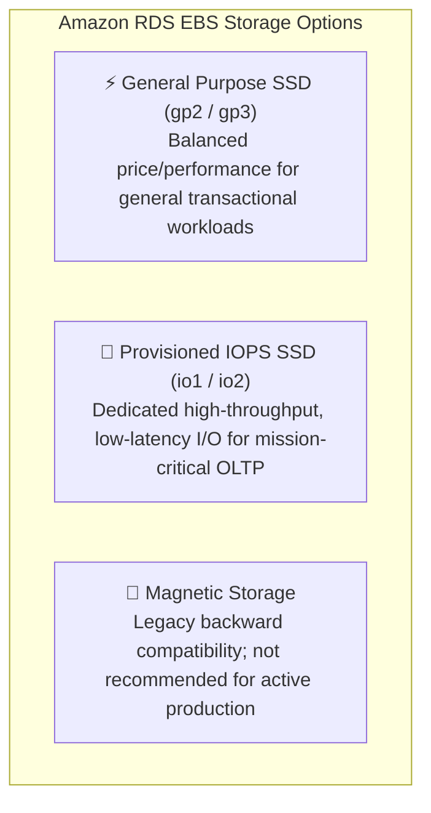

| Storage Class | Volume Type | Baseline / Maximum Performance | Ideal Workloads & Use Cases |
| :--- | :--- | :--- | :--- |
| **General Purpose SSD** | `gp2` / `gp3` | - **gp3**: Baseline 3,000 IOPS and 125 MB/s throughput included free, scalable independently up to **64,000 IOPS** and **1,000 MB/s**. - **gp2**: 3 IOPS per GB allocated, bursting up to 3,000 IOPS. | Small to medium database workloads, web application backends, staging and development environments. `gp3` decouples IOPS and throughput from storage allocation. |
| **Provisioned IOPS SSD** | `io1` / `io2` | Delivers dedicated, predictable I/O performance up to **64,000 to 256,000 IOPS** with sub-millisecond latencies. IOPS are explicitly provisioned alongside storage size. | High-throughput Online Transaction Processing (OLTP) systems, enterprise ERPs, and latency-sensitive production databases with rigorous I/O requirements. |
| **Magnetic Storage** | Legacy | Limited throughput and variable high latencies. | Legacy applications and non-critical small databases. **Not recommended** for modern cloud architectures. |

---

### 3.2 Amazon RDS Storage Auto Scaling

In traditional database environments, running out of disk storage leads to database crashes and catastrophic service outages (`ERROR 1114: The table is full`). Conversely, allocating massive unneeded storage wastes financial capital.

**Amazon RDS Storage Auto Scaling** eliminates this operational challenge by automatically monitoring available free storage space and dynamically increasing volume capacity when free space drops below critical thresholds:
- **Trigger Mechanism**: Storage auto-scales when available free space is **less than 10%** of allocated storage, the low-storage condition persists for at least 5 minutes, and at least 6 hours have elapsed since the last modification.
- **Increment Calculation**: Automatically expands storage by whichever is greater: **10% of current storage** or the predicted storage growth over the next 7 hours based on CloudWatch metrics.
- **Maximum Storage Threshold**: Administrators configure a **Maximum Storage Threshold** ceiling (e.g., up to 64 TiB for RDS MySQL/PostgreSQL) to prevent unexpected runaway billing costs.
- **Zero Downtime**: Volume modification is performed online at the EBS volume layer without restarting the database engine or incurring downtime.

> [!IMPORTANT]
> While scaling **storage capacity** up occurs seamlessly online without downtime, changing the **DB instance class** (scaling CPU and RAM vertically) requires a brief downtime while the instance is rebooted onto new hardware. In a Multi-AZ deployment, this downtime is minimized to minutes because the standby instance is upgraded first, followed by an automatic failover.

---

## 🛡️ 4. High Availability Architecture: Multi-AZ Deployments

### 4.1 Architecture & Synchronous Replication

For mission-critical production database workloads, high availability and disaster resilience within an AWS Region are accomplished using **Amazon RDS Multi-AZ deployments**.

When Multi-AZ is enabled:
1. Amazon RDS provisions a **Primary DB Instance** in one Availability Zone (e.g., AZ-a).
2. Amazon RDS simultaneously provisions and maintains an exact replica **Standby DB Instance** in a physically isolated, independent Availability Zone (e.g., AZ-b) within the same VPC.
3. Every write transaction executed against the primary instance is **synchronously replicated at the block/storage level** to the standby copy.
4. The write transaction is only confirmed as committed to the client application after it has been safely written to disk on **both** the primary and standby instances.

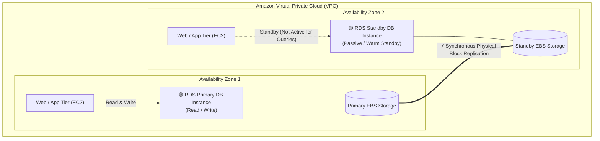

> [!IMPORTANT]
> The standby instance in a standard Amazon RDS Multi-AZ deployment is a **passive, warm standby**. It cannot accept read queries or write transactions from applications. Its sole purpose is high-availability failover protection and offloading automated backups.

---

### 4.2 Automated Failover Mechanics

Amazon RDS monitors the health of the primary instance continuously. If an infrastructure disruption occurs, Amazon RDS executes an **automatic failover** without requiring administrative intervention.

#### Failover Conditions:
- Loss of availability in the primary instance's Availability Zone (e.g., power or network disruption).
- Physical hardware host failure on the primary instance.
- Operating system failure or database engine crash.
- Storage drive failure on the primary EBS volume.
- User-initiated reboot with failover (commonly performed during maintenance or testing).

#### Failover Execution:
1. **Detection**: Amazon RDS health monitors detect a heartbeat loss on the primary instance.
2. **Standby Promotion**: The passive standby DB instance in AZ-b is automatically promoted to become the new primary instance.
3. **DNS Endpoint Flip**: Amazon RDS updates the canonical Domain Name System (**CNAME**) record of the DB instance endpoint to resolve to the IP address of the newly promoted instance in AZ-b.
4. **Application Reconnection**: Applications continue using the same persistent endpoint (e.g., `mydb.c123456789.us-east-1.rds.amazonaws.com`). Once DNS propagates and connection pools retry, connections route seamlessly to the new primary.
5. **Standby Re-creation**: Once the failed AZ recovers, Amazon RDS automatically provisions a new standby instance in that AZ and resumes synchronous replication.

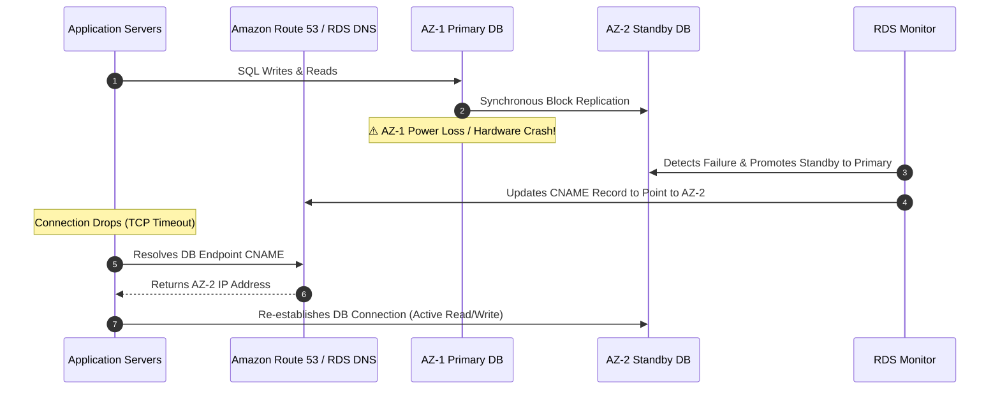

- **Failover Duration**: Typically completes within **60 to 120 seconds**.
- **Data Loss**: **Zero data loss ($RPO = 0$)** because of synchronous storage replication.
- **Application Impact**: No application configuration or connection string changes are required because the DNS endpoint name remains invariant. Applications must simply implement standard connection retry logic.

---

## 📈 5. Read Scaling & Performance: Read Replicas

### 5.1 Asynchronous Replication Mechanics

While Multi-AZ deployments provide high availability, they do not resolve scalability bottlenecks caused by heavy read traffic (such as reporting dashboards, BI analytics, or search queries). For read-heavy workloads, Amazon RDS provides **Read Replicas**.

Read Replicas utilize **asynchronous logical replication** native to the database engine:
- Supported on **MySQL, MariaDB, PostgreSQL, Oracle**, and **Amazon Aurora**.
- Read Replicas are active, read-only database instances.
- Applications direct all write traffic (`INSERT`, `UPDATE`, `DELETE`) to the primary instance, while routing read queries (`SELECT`) to one or more Read Replicas.
- Amazon RDS supports up to **5 Read Replicas** per primary instance for standard RDS engines (and up to **15** for Amazon Aurora).

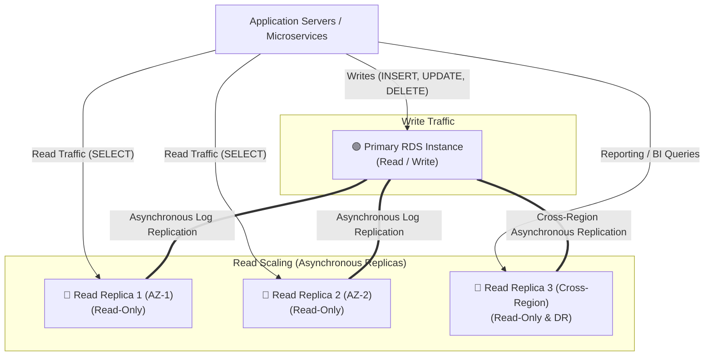

---

### 5.2 Read Replica Capabilities & Advanced Patterns

1. **Independent DNS Endpoints**: Each Read Replica receives its own dedicated DNS endpoint. Applications can configure connection pools to route analytical reporting queries to specific replicas.
2. **Promotion to Standalone Instance**: A Read Replica can be promoted to become an independent, read-write standalone database instance. Promotion breaks replication and requires manual user initiation.
3. **Cross-Region Read Replicas**:
   - Replicas can be provisioned in an AWS Region geographically distinct from the primary DB instance.
   - **Reduced Latency**: Directs read traffic to a replica geographically closer to end users in foreign regions.
   - **Disaster Recovery (DR)**: Serves as a rapid cross-region disaster recovery standby that can be promoted to primary if an entire AWS Region becomes unavailable.
4. **Cascading Read Replicas**: In MySQL and MariaDB, Read Replicas can be chained (a replica replicating from another replica) to reduce replication load on the primary DB instance.

> [!CAUTION]
> Because Read Replicas utilize **asynchronous replication**, there is inherent **replication lag** between the primary and the replica. Applications reading from a replica might observe slight eventual consistency delays. Therefore, Read Replicas are not suitable for workloads requiring strict read-after-write consistency.

---

### 5.3 Multi-AZ Deployments vs. Read Replicas: Architectural Comparison

A common point of confusion for cloud practitioners is when to implement Multi-AZ versus Read Replicas. They serve completely distinct architectural purposes:

| Architectural Dimension | Amazon RDS Multi-AZ Deployment | Amazon RDS Read Replicas |
| :--- | :--- | :--- |
| **Primary Purpose** | **High Availability & Disaster Recovery** (HA/DR). | **Horizontal Scalability & Performance** (Read Scaling). |
| **Replication Type** | **Synchronous physical block-level replication**. | **Asynchronous logical replication** (engine native logs). |
| **Instance Accessibility** | Standby instance is **passive**; cannot accept read or write queries. | Replicas are **active**; accept read-only queries (`SELECT`). |
| **Connection Endpoint** | **Single DNS endpoint**; resolves automatically to whichever instance is primary. | **Distinct DNS endpoints** for each Read Replica instance. |
| **Failover Behavior** | **Automatic failover** in 60–120 seconds with zero data loss. | **No automatic failover**; can be manually promoted to standalone DB. |
| **Impact on Performance** | Negligible write latency overhead due to synchronous replication commits. | No write latency overhead on primary; slight replication lag on reads. |
| **Number of Instances** | Exactly 1 standby instance in standard Multi-AZ. | Up to 5 for standard RDS; up to 15 for Amazon Aurora. |
| **Geographic Scope** | Limited to multiple AZs within a **single AWS Region**. | Can be within the **same AZ, cross-AZ, or Cross-Region**. |
| **Engine Availability** | All 6 engines (MySQL, MariaDB, Postgres, Oracle, SQL Server, Aurora). | MySQL, MariaDB, PostgreSQL, Oracle, Aurora. |

> [!TIP]
> Multi-AZ and Read Replicas can be combined! An enterprise architecture can run a **Multi-AZ primary instance** for zero-data-loss high availability, while deploying multiple **Read Replicas** across availability zones to offload read traffic.

---

## 💾 6. Backup, Restore, and Disaster Recovery Architecture

Amazon RDS provides two robust mechanisms for backing up database instances: **Automated Backups** and **Manual DB Snapshots**. Both backup types capture complete storage volume images and are stored durably across multiple AZs in **Amazon Simple Storage Service (Amazon S3)**.

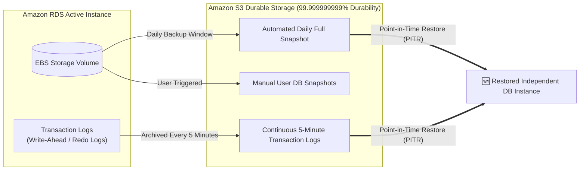

---

### 6.1 Automated Backups & Point-in-Time Recovery (PITR)

Automated backups are enabled by default on Amazon RDS:
1. **Daily Storage Volume Snapshots**: During a user-defined daily **backup window**, Amazon RDS takes a full storage volume snapshot of the DB instance. The initial backup captures the entire storage volume; subsequent snapshots are **incremental** (saving only changed disk blocks).
2. **Continuous Transaction Log Archival**: Transaction logs (WAL / binlogs / redo logs) are uploaded to Amazon S3 every **5 minutes**.
3. **Retention Period**: Configurable from **1 to 35 days** (setting retention to `0` disables automated backups).
4. **Point-in-Time Recovery (PITR)**:
   - Combining the most recent incremental snapshot with archived transaction logs enables restoration to **any specific second** within the retention window (up to the last 5 minutes).
   - Ideal for recovering from human error (e.g., an engineer executing an accidental `DROP TABLE` or `DELETE FROM users` without a `WHERE` clause at 14:23:10).
5. **No Impact on Multi-AZ**: In a Multi-AZ deployment, automated backups are taken from the **standby instance**, completely eliminating I/O suspension on the primary instance.

> [!NOTE]
> When you perform a Point-in-Time Restore, Amazon RDS **does not overwrite** the existing database instance. Instead, it provisions a **brand new DB instance** with a new endpoint containing the restored data.

---

### 6.2 Manual DB Snapshots

Manual snapshots are initiated explicitly by users via the AWS Management Console, CLI, or API:
- **Storage Durability**: Stored durably in Amazon S3.
- **Retention**: Retained indefinitely until explicitly deleted by the user, even if the source parent RDS instance is deleted.
- **Shareability**: Manual snapshots can be shared across AWS accounts.
- **Cross-Region Copying**: Can be copied to different AWS Regions for long-term disaster recovery compliance and archival.

### 6.3 Backup vs. Snapshot Comparison Table

| Dimension | Automated Backups | Manual DB Snapshots |
| :--- | :--- | :--- |
| **Trigger Mechanism** | Automatically orchestrated by AWS during backup window. | Manually triggered by administrator via Console, CLI, or API. |
| **Retention Period** | **1 to 35 days** (configurable); deleted when instance is deleted. | **Indefinite**; persists until explicitly deleted by user. |
| **Transaction Logs** | Captured continuously every 5 minutes. | Not captured (represents a frozen point-in-time image only). |
| **Restoration Capability** | **Point-in-Time Restore (PITR)** to any second within retention. | Restores to the exact minute the snapshot was taken. |
| **Deletion of Instance** | Automated backups can be retained or deleted upon instance termination. | Manual snapshots are **always preserved** after instance deletion. |
| **Cross-Account Sharing** | Cannot be shared across AWS accounts directly. | Can be shared with specific AWS accounts or made public. |

---

## 🔒 7. Amazon RDS Security Architecture

Amazon RDS incorporates enterprise-grade defense-in-depth security across network isolation, identity authorization, encryption at rest, and transport layer security.

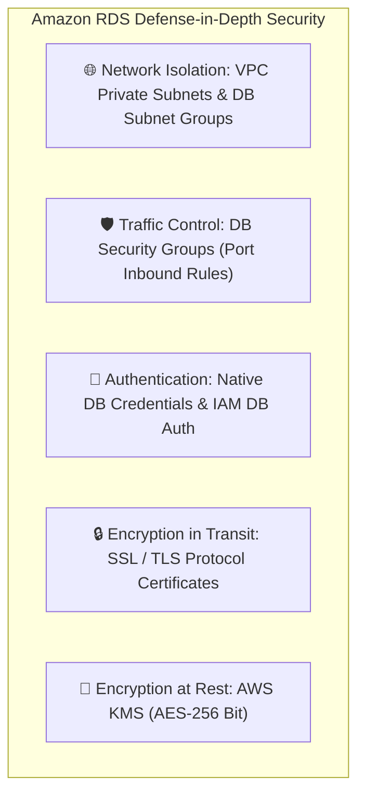

### 7.1 VPC Network Isolation & DB Subnet Groups

Best security practices dictate that relational database instances should **never be publicly accessible**:
1. **Private Subnets**: Place database instances in private VPC subnets that have no Internet Gateway (IGW) route.
2. **DB Subnet Group**:
   - A collection of subnets designated for RDS within a VPC.
   - Must contain subnets in at least **two distinct Availability Zones** within the Region, ensuring that Amazon RDS has pre-configured network topology to provision standby instances or fail over seamlessly during Multi-AZ operations.

### 7.2 DB Security Groups

Access to the database port must be strictly locked down using stateful **Security Groups**:
- Inbound rules should never allow `0.0.0.0/0`.
- Instead, inbound rules should specify the **Security Group ID of the application tier** (e.g., EC2 web servers, Elastic Beanstalk instances, or ECS containers) as the source, restricting communication to the database engine port:
  - MySQL / MariaDB: Port `3306`
  - PostgreSQL: Port `5432`
  - Microsoft SQL Server: Port `1433`
  - Oracle Database: Port `1521`

### 7.3 Encryption at Rest & In Transit

1. **Encryption at Rest**:
   - Implemented using industry-standard **AES-256** encryption managed through **AWS Key Management Service (AWS KMS)**.
   - Encrypts the underlying storage volume, automated backups, Read Replicas, and manual snapshots.
   - Must be enabled during initial instance creation; cannot be toggled on/off after instance provisioning.
2. **Encryption in Transit**:
   - All supported RDS engines support SSL/TLS encrypted connections.
   - AWS provides root CA certificates to validate database endpoints.
   - Connections can be enforced via parameter groups (e.g., `rds.force_ssl = 1` in PostgreSQL or `require_secure_transport = ON` in MySQL).

### 7.4 IAM Database Authentication

For MySQL and PostgreSQL engines, applications can authenticate to the database using **AWS Identity and Access Management (IAM)** credentials instead of hardcoded database passwords:
- Applications request temporary, short-lived authentication tokens (valid for 15 minutes) from the AWS Security Token Service (AWS STS).
- Eliminates the need to store static database passwords in application configuration files or environment variables.
- Integrates seamlessly with **AWS Secrets Manager** for automated credential rotation.

---

## ⚡ 8. Deep Dive: Amazon Aurora Architecture

### 8.1 Disaggregated Compute and Storage Architecture

Traditional relational databases tie compute (query parsing, optimization, transaction processing) directly to monolithic block storage volumes. Under high write concurrency, traditional storage architectures suffer from I/O bottlenecks and lock contention.

**Amazon Aurora** is a proprietary, cloud-native relational database engine engineered specifically to overcome these bottlenecks. It is fully managed within Amazon RDS and provides drop-in compatibility with **MySQL** and **PostgreSQL**.

The architectural innovation of Aurora is its **disaggregated architecture**:
- **Compute Tier**: Stateless database instances executing SQL parsing, optimization, and transaction management.
- **Storage Tier**: An independent, purpose-built, log-structured distributed virtual database volume that scales automatically up to **128 TiB**.

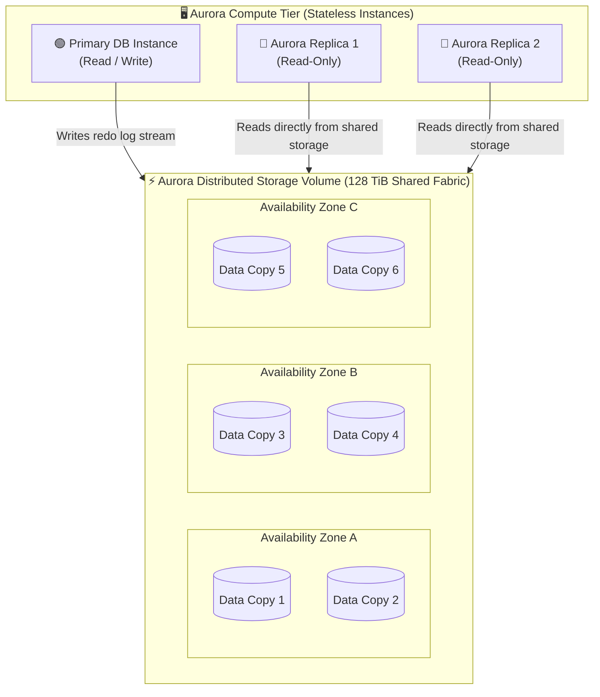

---

### 8.2 The 6-Way Distributed Storage Subsystem

Aurora's cluster volume spans **three Availability Zones** within an AWS Region:
- **6 Copies of Data**: Aurora replicates every data block **6 times across 3 AZs** (2 copies in each AZ).
- **Quorum-Based Consistency**:
  - **Write Quorum ($4/6$)**: Write operations succeed as soon as **4 out of 6** storage nodes acknowledge the write. If an entire AZ fails (losing 2 copies), Aurora can still process writes without interruption.
  - **Read Quorum ($3/6$)**: Read operations require consensus from **3 out of 6** storage nodes.
- **Self-Healing Storage**: Aurora continuously scans storage disks in the background. If a block or storage node corrupts or fails, Aurora repairs it automatically using peer data blocks without affecting application availability.
- **The "Log is the Database"**: Aurora does not write full database pages over the network. Instead, it streams only lightweight **redo log records** to the storage nodes. The storage nodes materialize data pages in parallel. This radical architectural shift reduces network I/O by up to **90%**, allowing Aurora to achieve:
  - Up to **5x the throughput of standard MySQL**.
  - Up to **3x the throughput of standard PostgreSQL**.

---

### 8.3 Aurora DB Clusters & Replicas

An Aurora deployment is organized as an **Aurora DB Cluster**:
1. **Primary DB Instance**: Supports read and write operations, handling all transactional data modifications.
2. **Aurora Replicas (Up to 15)**:
   - Connect directly to the **same shared cluster volume** as the primary instance.
   - Because all replicas share the underlying distributed storage volume, there is **zero replication delay for storage**. Replicas experience typical lag of **under 10 milliseconds**.
   - Any Aurora Replica can act as a failover target. If the primary instance fails, Aurora automatically promotes one of the replicas to primary in **under 30 seconds**.
   - Aurora supports **Aurora Auto Scaling**, automatically adding or removing read replicas based on CPU utilization or connection metrics.

### 8.4 Aurora Endpoints

Aurora provides specialized DNS endpoints to simplify application connection management:

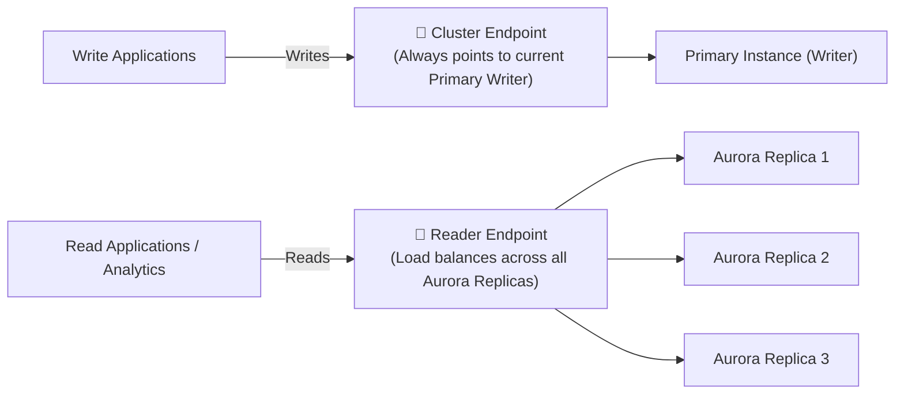

- **Cluster Endpoint (Writer Endpoint)**: Connects directly to the current primary DB instance. Automatically points to the new primary following a failover.
- **Reader Endpoint**: Load-balances incoming read connections across all available Aurora Replicas in the cluster.
- **Custom Endpoints**: Allows grouping specific subsets of DB instances (e.g., dedicating high-memory instances for heavy reporting queries while reserving smaller instances for user web reads).

---

## 💼 9. Amazon RDS Primary Use Cases & Patterns

Amazon RDS and Aurora provide proven database architectures across a broad spectrum of commercial industries:

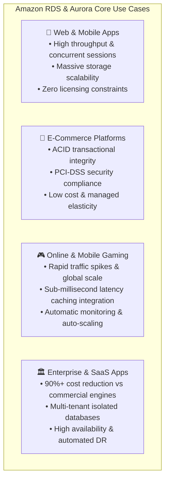

1. **Web and Mobile Applications**:
   - Require high transactional throughput, support for thousands of concurrent user sessions, and elastic storage growth.
   - Open-source engines (MySQL, PostgreSQL) eliminate restrictive per-core licensing costs, accommodating unpredictable viral traffic patterns.
2. **E-Commerce and Retail Applications**:
   - Require strict **ACID transactional guarantees** to ensure financial records, inventory counts, and order checkouts never experience data corruption or partial commits.
   - Multi-AZ deployments protect retail businesses against downtime during peak shopping events (e.g., Black Friday / Cyber Monday).
3. **Online and Mobile Gaming**:
   - Character progression, player inventories, and leaderboard data require sustained high write throughput and instant horizontal read scaling.
   - Amazon Aurora and RDS manage infrastructure scaling so game developers can focus entirely on player experience without managing server clusters.
4. **Enterprise Applications & SaaS**:
   - Software-as-a-Service providers can run multi-tenant databases with automated patching, automated backups, and database cloning.
   - Migrating from commercial on-premises engines (Oracle, SQL Server) to Amazon Aurora reduces licensing overhead by up to **90%** while enhancing availability.

---

## 🧠 10. Checkpoint Review & Comprehensive Knowledge Check

Test your mastery of Amazon RDS and Amazon Aurora with the following technical review questions:

### Question 1: What is Amazon RDS, and what operational burdens does it eliminate for database administrators?
> **Answer**:
> **Amazon Relational Database Service (Amazon RDS)** is a fully managed cloud service that simplifies setting up, operating, and scaling relational databases in the AWS Cloud. It eliminates **undifferentiated heavy lifting**, including:
> - Server hardware provisioning and power/cooling management.
> - Operating system installation, hardening, and patching.
> - Database engine installation, software maintenance, and minor version upgrades.
> - Manual storage volume provisioning and disk striping.
> - Complex manual scripting of backups, transaction log rotation, and high-availability failover clusters.

### Question 2: List the six relational database engines supported by Amazon RDS.
> **Answer**:
> 1. **Amazon Aurora** (Cloud-native; MySQL and PostgreSQL compatible)
> 2. **PostgreSQL** (Open source)
> 3. **MySQL** (Open source)
> 4. **MariaDB** (Open source)
> 5. **Oracle Database** (Commercial / Enterprise)
> 6. **Microsoft SQL Server** (Commercial / Enterprise)

### Question 3: What is the architectural difference between a Multi-AZ deployment and a Read Replica in Amazon RDS?
> **Answer**:
> - **Multi-AZ Deployment**: Designed for **High Availability and Disaster Recovery**. Uses **synchronous physical replication** to a passive standby instance located in a second Availability Zone. If the primary fails, RDS triggers an **automatic DNS failover** in 60–120 seconds with **zero data loss**. The standby instance cannot serve read traffic.
> - **Read Replica**: Designed for **Read Scalability**. Uses **asynchronous logical replication** to create active, read-only copies of the database (up to 5 in RDS, up to 15 in Aurora). Applications query replica endpoints directly to offload read-heavy traffic. Read Replicas do not provide automatic failover (though they can be manually promoted).

### Question 4: How does failover occur in an Amazon RDS Multi-AZ deployment, and what application changes are required?
> **Answer**:
> Failover occurs automatically:
> 1. Amazon RDS detects a health check failure or loss of the primary instance.
> 2. The passive standby instance in the secondary AZ is promoted to primary.
> 3. Amazon RDS switches the **CNAME record of the database DNS endpoint** to resolve to the new primary instance's IP address.
> 4. **No application configuration or connection string changes are required** because applications connect to the invariant DNS endpoint name. Applications simply require connection retry logic to reconnect once DNS propagation finishes (typically within 60–120 seconds).

### Question 5: How do Amazon RDS automated backups work, and what is the minimum and maximum retention period?
> **Answer**:
> Automated backups take a daily storage volume snapshot during a designated backup window and continuously upload transaction logs to Amazon S3 every 5 minutes. This enables **Point-in-Time Recovery (PITR)** to any second within the retention window. The retention period can be configured between **1 and 35 days** (setting retention to 0 disables automated backups).

### Question 6: What happens when you restore an Amazon RDS DB instance from an automated backup or manual snapshot?
> **Answer**:
> Amazon RDS **never overwrites or modifies the existing DB instance**. Instead, it provisions a **brand new DB instance** with a new endpoint, new compute resources, and restored data. The administrator can then redirect application traffic to the new instance endpoint.

### Question 7: Describe the underlying storage architecture of Amazon Aurora and explain how it achieves high durability and availability.
> **Answer**:
> Amazon Aurora decouples compute from storage. Its storage tier consists of a shared, distributed, log-structured virtual cluster volume spanning **three Availability Zones**. Aurora maintains **6 copies of data** (2 copies in each of the 3 AZs). Aurora uses a quorum model: writes require $4/6$ node acknowledgments and reads require $3/6$. It features **self-healing storage**, continuously repairing damaged disk blocks in the background without user intervention, and supports up to **15 Aurora Replicas** sharing the same underlying storage volume.

### Question 8: How does Amazon Aurora achieve up to 5x the throughput of standard MySQL on identical hardware?
> **Answer**:
> Aurora adheres to the architectural philosophy **"the log is the database."** Unlike traditional MySQL, which writes dirty data pages, doublewrite buffers, undo logs, and binary logs across the network to disk, Aurora writes **only lightweight redo log records** to its distributed storage nodes. The distributed storage nodes materialize disk pages asynchronously and in parallel. This eliminates 90% of network I/O traffic and removes heavy buffer pool disk write locks.

---

## 📌 11. Key Takeaways & Summary

- **Managed Cloud Service**: Amazon RDS eliminates undifferentiated database administration tasks—automating provisioning, patching, OS updates, backups, scaling, and high availability.
- **Six Database Engines**: Amazon RDS supports MySQL, MariaDB, PostgreSQL, Oracle Database, Microsoft SQL Server, and Amazon Aurora.
- **Licensing Flexibility**: Commercial engines (Oracle and SQL Server) support License Included (LI) for on-demand flexibility and Bring Your Own License (BYOL) for existing enterprise agreements.
- **Multi-AZ for High Availability**: Synchronously replicates data to a passive standby in another AZ within the same Region. Provides automated failover via DNS switching in 60–120 seconds with zero data loss ($RPO = 0$).
- **Read Replicas for Scalability**: Asynchronously replicates data to active read-only instances (up to 5 for RDS, 15 for Aurora) to scale read-heavy reporting and web traffic. Supports cross-region replication for lower latency and disaster recovery.
- **Robust Backup Options**:
  - **Automated Backups**: Daily incremental snapshots + continuous 5-minute transaction logs to S3; enables Point-in-Time Recovery (PITR) down to a second for 1–35 days.
  - **Manual Snapshots**: User-initiated, stored indefinitely in S3, shareable across accounts, and retained even after DB instance termination.
- **Storage Flexibility**: Offers General Purpose SSD (`gp2`/`gp3`), Provisioned IOPS SSD (`io1`/`io2`), and Storage Auto Scaling to dynamically expand disk capacity without downtime.
- **Enterprise Security**: Enforces defense-in-depth through VPC private subnets, DB subnet groups (spanning at least 2 AZs), security group port isolation, AWS KMS encryption at rest, SSL/TLS in transit, and IAM database authentication.
- **Amazon Aurora Superiority**: Cloud-native engine delivering up to 5x MySQL and 3x PostgreSQL throughput via decoupled compute and 6-way distributed self-healing storage across 3 AZs with cluster and reader endpoints.
