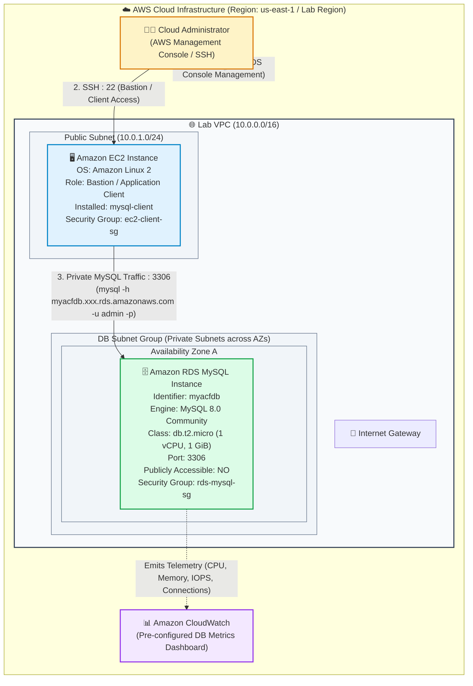
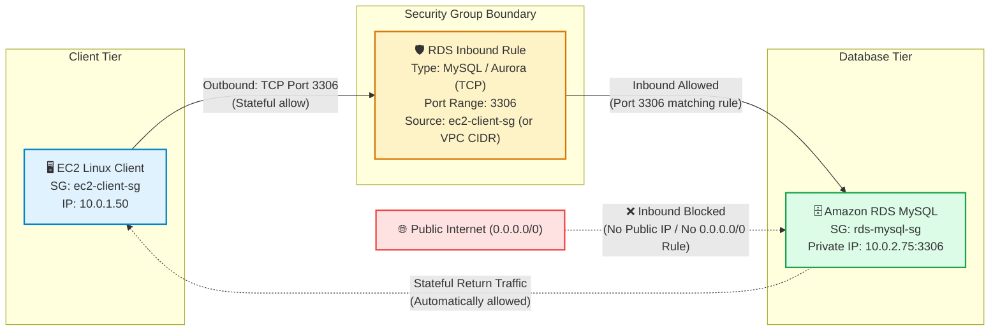
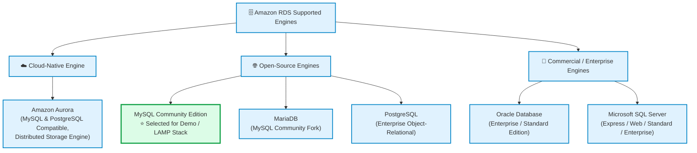
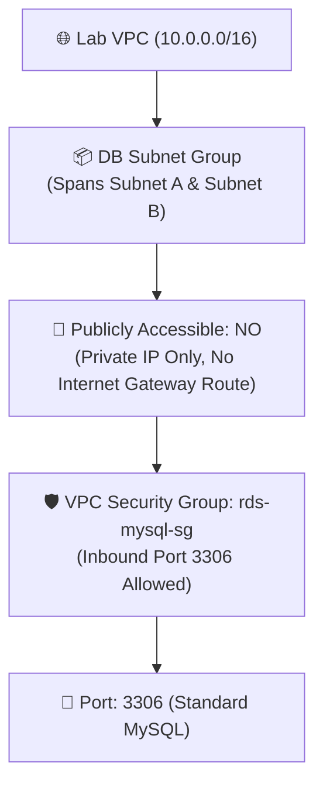
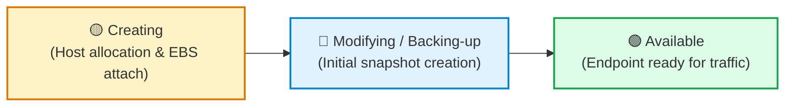
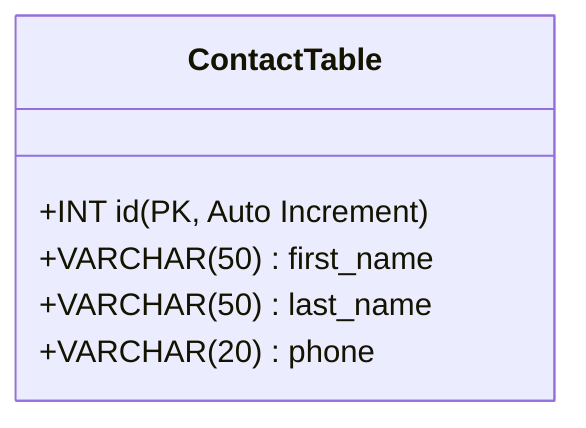
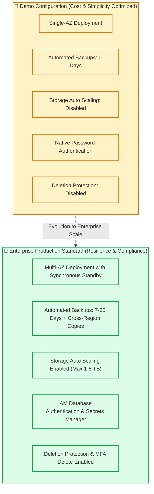

# 🎥 AWS Technical Demonstration: Provisioning and Connecting to an Amazon RDS MySQL Database

> **Course**: AWS re/Start  
> **Module**: Database Fundamentals (M06 – Introduction to Databases & Amazon RDS)  
> **Source Media**: `T10-Database/T10-0011-RSSCHAB_EN-US_Video_M06_RDS_Demo.mp4`  
> **Format**: Video Audio Transcription & Comprehensive Hands-On Lab Walkthrough  
> **Target Audience**: AWS re/Start Learners, Cloud Practitioners, Solutions Architects, and Database Administrators  

---

## 🎯 Demonstration Overview

In this comprehensive technical demonstration, the instructor guides learners through the end-to-end lifecycle of deploying and connecting to a relational database in the cloud using **Amazon Relational Database Service (Amazon RDS)**. 

Beginning within the AWS Management Console, the demonstration walks through provisioning a managed **MySQL** database instance within an isolated Amazon Virtual Private Cloud (**Lab VPC**). The instructor explains key configuration trade-offs across database engines, compute instance classes, storage options, high availability architectures (Single-AZ vs. Multi-AZ), network access boundaries, and operational telemetry in **Amazon CloudWatch**. Following instance provisioning, the walkthrough transitions to an **Amazon Linux EC2 instance** acting as an application client within the same VPC. From the Linux command line, the instructor connects to the database via the MySQL CLI client using the RDS DNS endpoint, creates a relational table schema, populates records, and executes targeted SQL queries.

```
┌──────────────────────────────────────────────────────────────────────────────────────────────────┐
│                                    END-TO-END DEMO WORKFLOW                                      │
│                                                                                                  │
│  Phase 1: RDS Console Provisioning                                                               │
│  AWS Console ──> Amazon RDS ──> MySQL Engine ──> Free Tier (db.t2.micro) ──> Lab VPC (Private)    │
│                                                                                                  │
│  Phase 2: Provisioning & Health Monitoring                                                       │
│  Status: "Creating" ──[ CloudWatch Metrics & Endpoint Discovery ]──> Status: "Available"         │
│                                                                                                  │
│  Phase 3: Secure Private Client Connection                                                       │
│  EC2 Linux Client ──[ Port 3306 / RDS SG Inbound ]──> Amazon RDS MySQL (myacfdb)                 │
│                                                                                                  │
│  Phase 4: SQL Schema & Query Execution                                                           │
│  CREATE TABLE contact ──> INSERT (4 Records) ──> SELECT WHERE first_name = 'Chris'               │
└──────────────────────────────────────────────────────────────────────────────────────────────────┘
```

---

## 📌 Learning Objectives

By completing this tutorial and studying the architectural patterns demonstrated, you will be able to:

- [ ] **Explain Amazon RDS Managed Value Proposition**: Articulate how Amazon RDS offloads undifferentiated heavy lifting (provisioning, operating system and engine patching, automated backups, storage management) while preserving native database engine compatibility.
- [ ] **Compare Supported Relational Database Engines**: Identify the six relational engines available on RDS (Amazon Aurora, PostgreSQL, MySQL, MariaDB, Oracle, and Microsoft SQL Server) and select the optimal engine for specific workloads.
- [ ] **Differentiate Single-AZ vs. Multi-AZ Deployments**: Contrast cost-optimized Single-AZ configurations suitable for development and testing against highly available, synchronously replicated Multi-AZ deployments used in production.
- [ ] **Configure RDS Networking and Security Controls**: Deploy an RDS instance within a custom VPC, assign a DB Subnet Group, enforce private access isolation (`Publicly Accessible: No`), and configure VPC Security Group inbound rules for TCP Port 3306.
- [ ] **Size Compute and Storage for Free Tier Eligibility**: Select burstable compute instance classes (`db.t2.micro`), configure General Purpose SSD (gp2) storage, and disable Storage Auto Scaling for controlled laboratory environments.
- [ ] **Monitor RDS Instance Metrics via Amazon CloudWatch**: Track provisioning lifecycle states and interpret core CloudWatch telemetry dashboards (CPU Utilization, Database Connections, Free Storage Space, Freeable Memory, Write/Read IOPS).
- [ ] **Connect to RDS from an Amazon Linux EC2 Client**: Locate and copy the database DNS endpoint, verify network reachability, and establish an interactive session using the native MySQL CLI utility (`mysql -h <endpoint> -u admin -p`).
- [ ] **Execute DDL and DML Statements on Amazon RDS**: Create relational database tables, insert sample data records, and run conditional `SELECT` queries with filtering clauses to verify end-to-end relational data operations.

---

## 🏗️ Architectural Topology: EC2 Client to Private Amazon RDS Instance

The demonstration establishes a standard two-tier cloud architecture inside the **Lab VPC**. The compute layer (EC2 Linux instance) interacts securely with the database layer (Amazon RDS MySQL instance) over private IP addresses within the virtual network boundary.



---

## 🔒 Security Group Ingress & Egress Traffic Architecture

Security Groups act as stateful virtual firewalls at the Elastic Network Interface (ENI) level. To adhere to the principle of least privilege, direct access to the database from the public internet is blocked. Ingress to TCP port 3306 is explicitly restricted to authorized compute resources within the VPC.



### Security Group Ingress & Egress Rules Matrix

| Security Group | Direction | Protocol | Port Range | Source / Destination | Purpose & Rationale |
| :--- | :--- | :--- | :--- | :--- | :--- |
| **`ec2-client-sg`** | Inbound | TCP | `22` | Admin IP (`x.x.x.x/32`) | Secure SSH management of the Linux application/client host |
| **`ec2-client-sg`** | Outbound | TCP | `3306` | `rds-mysql-sg` (Security Group ID) | Allows outbound MySQL traffic targeting the database tier |
| **`rds-mysql-sg`** | Inbound | TCP | `3306` | `ec2-client-sg` (or `10.0.0.0/16`) | Restricts database ingress strictly to trusted application hosts |
| **`rds-mysql-sg`** | Outbound | All | All | `0.0.0.0/0` | Default stateful egress for updates and service synchronization |

---

## 🛠️ Step-by-Step Hands-On Implementation Walkthrough

Follow these detailed steps to reproduce the exact configuration demonstrated in the video tutorial.

```
┌────────────────────────────────────────────────────────────────────────────────────────┐
│                                LAB EXECUTION PHASES                                    │
│                                                                                        │
│  Phase 1: Database Engine & Template Selection (Steps 1 – 3)                           │
│  Phase 2: Sizing, Storage & Network Configuration (Steps 4 – 6)                        │
│  Phase 3: Database Authentication & Advanced Settings (Step 7)                         │
│  Phase 4: Provisioning & Telemetry Observation (Steps 8 – 9)                           │
│  Phase 5: CLI Client Connection & SQL Data Operations (Steps 10 – 12)                  │
└────────────────────────────────────────────────────────────────────────────────────────┘
```

---

### Phase 1: Database Engine & Template Selection

#### Step 1: Navigating to the Amazon RDS Console
1. Log in to the **AWS Management Console** using your authorized credentials.
2. In the top search bar, type `RDS` and select **RDS (Managed Relational Database Service)** under Services.
3. On the Amazon RDS Landing Page, explore the left navigation drawer:
   - **Databases**: Lists provisioned instances and Aurora clusters.
   - **Snapshots**: Manual and automated full database storage volume backups.
   - **Automated Backups**: Retention schedules, point-in-time restore configurations, and system transaction logs.
   - **Query Editor**: Browser-based SQL interface (available for Aurora Serverless and supported RDS engines).
   - **Subnet Groups**: Collections of subnets (at least two across distinct AZs) used to launch RDS instances into a VPC.
   - **Parameter Groups & Option Groups**: Custom engine configuration variables and plugins.
4. Click the orange **Create database** button located in the dashboard overview or the databases list.

```
┌────────────────────────────────────────────────────────────────────────────────────────┐
│ RDS Management Console                                                                 │
│ ├── Dashboard                                                                          │
│ ├── Databases ───────────> [ Create database ] (Orange Action Button)                  │
│ ├── Query Editor                                                                       │
│ ├── Performance Insights                                                               │
│ ├── Snapshots                                                                          │
│ ├── Automated backups                                                                  │
│ └── Subnet groups                                                                      │
└────────────────────────────────────────────────────────────────────────────────────────┘
```

---

#### Step 2: Database Creation Method & Engine Selection
1. Under **Choose a database creation method**, select **Standard create** to inspect all architectural parameters.
2. Under **Engine options**, review the six relational engines supported by Amazon RDS:



3. Select the **MySQL** card.
4. Under **Edition**, keep the default **MySQL Community**.
5. Under **Engine Version**, retain the recommended default (e.g., MySQL 8.0 or 5.7 depending on lab environment).

> [!NOTE]
> **Why MySQL?** MySQL is one of the most widely adopted open-source relational database management systems in the world, powering the database layer of the ubiquitous **LAMP stack** (Linux, Apache, MySQL, PHP/Python/Perl) as well as countless modern microservices and web applications.

---

#### Step 3: Database Templates & Use Case Configuration
Under the **Templates** section, RDS offers three pre-tuned workload profiles:

| Template Option | Architecture Profile | Target Workload | Cost / Free Tier Impact |
| :--- | :--- | :--- | :--- |
| **Production** | Multi-AZ deployment enabled by default, provisioned IOPS, automated backups enabled, high availability failover. | Mission-critical enterprise apps with zero-downtime SLA. | Highest compute, storage, and cross-AZ replication costs. |
| **Dev/Test** | Single-AZ deployment default, moderate compute sizing, baseline performance. | Staging environments, internal development, integration testing. | Moderate cost; does not qualify for zero-cost free tier. |
| **Free usage tier** | Single-AZ deployment locked, burstable `db.t2.micro` or `db.t3.micro`, 20 GiB gp2 storage. | Hands-on learning, prototyping, academic courses. | **100% Free** within 750 monthly hours under AWS Free Tier. |

1. Select the **Free usage tier** radio button (or **Dev/Test** configured for free-tier eligible instance classes).
2. Selecting this template automatically disables Multi-AZ deployment, ensuring the instance runs as a standalone single-instance database without an active standby replica in a second Availability Zone.

> [!IMPORTANT]
> **Single-AZ vs. Multi-AZ in Production**: In production deployments, Multi-AZ provides automatic synchronous replication to a standby instance in an independent Availability Zone. If the primary instance experiences hardware degradation, storage failure, or an AZ disruption, Amazon RDS executes an automated DNS failover to the standby replica within 60–120 seconds with zero data loss. In this demonstration, Single-AZ is selected to eliminate unnecessary cross-AZ infrastructure costs.

---

### Phase 2: Sizing, Storage & Network Configuration

#### Step 4: Settings & Instance Sizing
1. In the **Settings** section:
   - **DB instance identifier**: Enter `myacfdb` (Unique DNS identifier within your AWS account and region).
   - **Master username**: Enter `admin`.
   - **Master password**: Enter a secure password (e.g., `LabPassword123!`).
   - **Confirm password**: Re-type the password.
2. In the **DB instance class** section:
   - Choose **Burstable classes (includes t classes)**.
   - Select **`db.t2.micro`** (1 vCPU, 1.0 GiB RAM) or `db.t3.micro`.
   - This class provides baseline compute performance with CPU credit accumulation, fully eligible for the AWS Free Tier.

```
┌────────────────────────────────────────────────────────────────────────────────────────┐
│ Settings Configuration                                                                 │
│ ├── DB instance identifier : [ myacfdb                                               ] │
│ ├── Master username        : [ admin                                                 ] │
│ ├── Master password        : [ ****************                                     ] │
│ └── Confirm password       : [ ****************                                     ] │
│                                                                                        │
│ DB Instance Class                                                                      │
│ └── Burstable classes (t)  : [ db.t2.micro (1 vCPU, 1 GiB RAM)                       ] │
└────────────────────────────────────────────────────────────────────────────────────────┘
```

---

#### Step 5: Storage Configuration
1. **Storage type**: Retain **General Purpose SSD (gp2)**.
2. **Allocated storage**: Set to **20 GiB** (the minimum allowable storage for MySQL and within Free Tier limits).
3. **Storage auto scaling**:
   - Locate the checkbox **Enable storage autoscaling**.
   - **Uncheck / Disable** this option.

> [!TIP]
> **Cost Control via Storage Auto Scaling Disabling**: When enabled in production, Storage Auto Scaling monitors storage consumption and automatically increases disk capacity when free space drops below 10%, scaling up to a user-defined threshold (e.g., 1000 GiB). While vital for production databases to prevent out-of-disk crashes, disabling auto scaling in training labs prevents accidental unexpected billing if continuous write operations occur.

4. Review the **Estimated monthly cost** summary panel displayed on the right or bottom of the screen, verifying that compute and storage allocations align with Free Tier limits.

---

#### Step 6: Connectivity & Network Configuration
Configure the virtual network perimeter to place the database inside the isolated laboratory VPC:

1. **Virtual private cloud (VPC)**: Select **`Lab VPC`** from the dropdown menu.
2. **Subnet group**: Retain the default DB Subnet Group associated with the Lab VPC (which spans multiple private subnets).
3. **Public access**: Select **No**.
   - An RDS instance configured with *Public access: No* does **not** receive a public IPv4 address.
   - Devices outside the VPC (including the public internet) cannot establish direct TCP connections to the database, even if security group rules permitted it.
4. **Availability Zone**: Retain **No preference**.
5. **VPC security groups**:
   - Select **Choose existing**.
   - Remove the default security group.
   - Select the pre-provisioned security group named **`rds-mysql-sg`** (or the Lab VPC RDS Security Group).
   - Verify that this security group allows inbound TCP traffic on port `3306` from the Lab VPC CIDR block (`10.0.0.0/16`) or the EC2 client security group.
6. **Database port**: Confirm the default port is set to **`3306`**.



---

### Phase 3: Database Authentication & Advanced Settings

#### Step 7: Database Authentication & Additional Configuration
Expand the **Additional configuration** section:

1. **Database options**:
   - **Initial database name**: Enter `myacfdb` (or leave blank to create schemas manually via SQL).
   - Setting an initial database name instructs RDS to execute `CREATE DATABASE myacfdb;` automatically during cluster initialization.
2. **Database authentication**:
   - Ensure **Password authentication** is selected.
   - (Do not select *Password and IAM database authentication* or *Kerberos authentication* for this demonstration).
3. **Encryption**:
   - **Disable encryption** (Uncheck *Enable encryption*) if using `db.t2.micro` under older Free Tier constraints, or accept default AWS KMS encryption (`aws/rds`) if supported.
4. **Backup**:
   - Set **Backup retention period** to **0 days**.
   - Setting retention to 0 days disables automated backups.

> [!WARNING]
> **Production Backup Best Practice**: In production environments, never set backup retention to 0 days! Automated backups allow Point-in-Time Recovery (PITR) down to a specific second within the retention window (1 to 35 days) by combining daily Amazon EBS snapshot baselines with archived transaction logs. For a temporary classroom lab that will be terminated after 30 minutes, disabling automated backups accelerates provisioning and decommissioning.

5. **Monitoring**:
   - **Disable Enhanced Monitoring** (Uncheck *Enable Enhanced Monitoring*) to avoid running the CloudWatch agent daemon at the hypervisor level.
6. **Log exports**: Retain all checkboxes unselected (Audit log, Error log, General log, Slow query log).
7. **Maintenance**:
   - **Auto minor version upgrade**: Disable / Uncheck to maintain version stability.
8. **Deletion protection**:
   - **Uncheck / Disable Enable deletion protection**.
   - When deletion protection is enabled, any attempt to delete the RDS instance via the console or CLI returns an `InvalidParameterCombination` error until explicitly toggled off. Disabling it simplifies teardown at the end of the lab.
9. Click the orange **Create database** button at the bottom of the page.

---

### Phase 4: Provisioning & Telemetry Observation

#### Step 8: Provisioning Lifecycle & CloudWatch Metrics
Upon clicking *Create database*, RDS returns you to the **Databases** inventory table.

1. Locate the entry with DB identifier `myacfdb`.
2. Observe the **Status** column:
   - Initial Status: **`Creating`** (Amazon RDS provisions the underlying EC2 compute host, attaches the EBS storage volume, installs and configures the MySQL database engine, and applies network interfaces).
   - This process typically takes between **5 to 10 minutes**.

```
┌────────────────────────────────────────────────────────────────────────────────────────┐
│ Databases (1)                                                                          │
│ ┌───────────────┬────────────┬─────────────┬──────────────┬─────────────┬────────────┐ │
│ │ DB identifier │ Role       │ Engine      │ Region & AZ  │ Size        │ Status     │ │
│ ├───────────────┼────────────┼─────────────┼──────────────┼─────────────┼────────────┤ │
│ │ myacfdb       │ Instance   │ MySQL 8.0   │ us-east-1a   │ db.t2.micro │ Creating ⏳ │ │
│ └───────────────┴────────────┴─────────────┴──────────────┴─────────────┴────────────┘ │
└────────────────────────────────────────────────────────────────────────────────────────┘
```

3. Click on the hyperlinked DB identifier `myacfdb` to view its detailed resource dashboard.
4. Select the **Monitoring** tab to review the pre-configured **Amazon CloudWatch** metrics dashboards:
   - **CPU Utilization (%)**: Hypervisor CPU usage across the database instance.
   - **DB Connections**: Active client connections currently open to the MySQL daemon.
   - **Free Storage Space (Bytes / GiB)**: Available space remaining on the provisioned EBS storage volume.
   - **Freeable Memory (Bytes / MiB)**: RAM available for database caching and OS operations.
   - **Write IOPS (Operations/Second)**: Input/output operations per second written to storage.
   - **Read IOPS (Operations/Second)**: Input/output operations per second read from storage.
5. Periodically click the **Refresh** button in the top right corner of the console while the database finishes initialization.



---

#### Step 9: Obtaining the Database Endpoint & Hostname
1. Once the **Status** changes to **`Available`**, click the **Connectivity & security** tab.
2. Under the **Endpoint & port** pane:
   - Locate the **Endpoint** value. It follows the standard AWS RDS DNS format:
     ```
     myacfdb.c9abcdefghij.us-east-1.rds.amazonaws.com
     ```
   - Locate the **Port** value: `3306`.
3. Click the copy icon next to the Endpoint string and paste it into a temporary text editor or notepad for use in the connection command.

> [!IMPORTANT]
> **Why DNS Endpoints Instead of IP Addresses?**
> Amazon RDS instances do not expose permanent static IP addresses. The underlying virtual machine may change its private IP during automated maintenance, host hardware failover, or scaling operations. The **RDS DNS Endpoint** acts as a dynamic CNAME that AWS automatically updates to point to the current active primary host, ensuring that application connection strings remain unchanged.

---

### Phase 5: CLI Client Connection & SQL Data Operations

#### Step 10: Connecting from the Linux EC2 Client
1. Connect via SSH to the pre-provisioned **Amazon Linux EC2 instance** residing in the Lab VPC:
   ```bash
   ssh -i /path/to/lab-key.pem ec2-user@<EC2-Public-IP>
   ```
2. Verify that the MySQL command-line client utility is installed:
   ```bash
   mysql --version
   ```
   *Expected Output*:
   ```
   mysql  Ver 15.1 Distrib 10.2.38-MariaDB, for Linux (x86_64) using readline 5.1
   ```
3. Formulate the MySQL connection string using the copied RDS endpoint, master username (`admin`), and password prompt flag (`-p`):
   ```bash
   mysql -h myacfdb.c9abcdefghij.us-east-1.rds.amazonaws.com -u admin -p
   ```
4. When prompted, enter the master password you specified in Step 4 and press **Enter**:
   ```
   Enter password: ****************
   ```
5. Upon successful authentication, the MySQL welcome banner and interactive prompt appear:
   ```
   Welcome to the MariaDB monitor.  Commands end with ; or \g.
   Your MySQL connection id is 14
   Server version: 8.0.28 Source distribution

   Copyright (c) 2000, 2018, Oracle, MariaDB Corporation Ab and others.

   Type 'help;' or '\h' for help. Type '\c' to clear the current input statement.

   MySQL [(none)]>
   ```

---

#### Step 11: Schema Creation & Data Population
With an active interactive session established, execute SQL Data Definition Language (DDL) and Data Manipulation Language (DML) statements.

1. Switch to or create the working database:
   ```sql
   CREATE DATABASE IF NOT EXISTS myacfdb;
   USE myacfdb;
   ```

2. **Statement 1 (DDL)**: Create the `contact` table schema containing fields for an auto-incrementing ID, first name, last name, and telephone number:
   ```sql
   CREATE TABLE contact (
       id INT AUTO_INCREMENT PRIMARY KEY,
       first_name VARCHAR(50) NOT NULL,
       last_name VARCHAR(50) NOT NULL,
       phone VARCHAR(20) NOT NULL
   );
   ```
   *Terminal Output*:
   ```
   Query OK, 0 rows affected (0.02 sec)
   ```

3. **Statements 2 through 5 (DML)**: Insert four individual contact records into the newly created table:
   ```sql
   INSERT INTO contact (first_name, last_name, phone) VALUES ('John', 'Doe', '555-0100');
   INSERT INTO contact (first_name, last_name, phone) VALUES ('Jane', 'Smith', '555-0101');
   INSERT INTO contact (first_name, last_name, phone) VALUES ('Chris', 'Miller', '555-0102');
   INSERT INTO contact (first_name, last_name, phone) VALUES ('Mary', 'Johnson', '555-0103');
   ```
   *Terminal Output for each insert*:
   ```
   Query OK, 1 row affected (0.01 sec)
   ```



---

#### Step 12: Query Verification & Data Inspection
1. Run a conditional SQL query using the `WHERE` clause to filter for records where `first_name` equals `'Chris'`:
   ```sql
   SELECT first_name, last_name, phone FROM contact WHERE first_name = 'Chris';
   ```
2. Inspect the formatted tabular output returned by the MySQL engine:
   ```
   +------------+-----------+----------+
   | first_name | last_name | phone    |
   +------------+-----------+----------+
   | Chris      | Miller    | 555-0102 |
   +------------+-----------+----------+
   1 row in set (0.00 sec)
   ```
3. Run an unfiltered query to inspect the complete table population:
   ```sql
   SELECT * FROM contact;
   ```
   *Formatted Output*:
   ```
   +----+------------+-----------+----------+
   | id | first_name | last_name | phone    |
   +----+------------+-----------+----------+
   |  1 | John       | Doe       | 555-0100 |
   |  2 | Jane       | Smith     | 555-0101 |
   |  3 | Chris      | Miller    | 555-0102 |
   |  4 | Mary       | Johnson   | 555-0103 |
   +----+------------+-----------+----------+
   4 rows in set (0.00 sec)
   ```
4. Disconnect cleanly from the MySQL CLI:
   ```sql
   EXIT;
   ```
   *Terminal Output*:
   ```
   Bye
   ```

---

## 📋 Complete Parameter Configuration Reference

This reference table outlines the comprehensive settings utilized throughout the demonstration:

| Parameter Category | Specific Setting | Configured Value in Demonstration | Architectural Rationale & Operational Context |
| :--- | :--- | :--- | :--- |
| **Creation Method** | Database creation method | `Standard create` | Permits explicit configuration of all network, storage, and security parameters. |
| **Engine Selection** | Engine Type | `MySQL` (Community Edition) | Ubiquitous open-source relational engine standard for web and LAMP architectures. |
| **Workload Template**| DB Template | `Dev/Test` / `Free usage tier` | Enforces single-instance provisioning and selects free-tier eligible default configurations. |
| **Settings** | DB Instance Identifier | `myacfdb` | Unique alphanumeric identifier for the instance, defining the prefix of its DNS endpoint. |
| **Authentication** | Master Username | `admin` | Default administrative account for schema management and initial privilege assignment. |
| **Authentication** | Master Password | `[Secure Password]` | Master user credential; must be at least 8 characters and conform to engine complexity rules. |
| **Instance Sizing** | DB Instance Class | `db.t2.micro` (1 vCPU, 1 GiB RAM)| General-purpose burstable compute class eligible for 750 free monthly hours. |
| **Storage** | Storage Type | General Purpose SSD (`gp2`) | Standard balance of price and performance backed by baseline IOPS with burst capability. |
| **Storage** | Allocated Storage | `20 GiB` | Minimum allowable volume size for MySQL on RDS; perfectly fits AWS Free Tier allocation. |
| **Storage** | Storage Auto Scaling | `Disabled` | Prevents disk from growing automatically; caps unexpected lab costs. |
| **Availability** | Multi-AZ Deployment | `Disabled` (Single-AZ) | Eliminates costs associated with running a standby instance and synchronous replication. |
| **Network** | Virtual Private Cloud | `Lab VPC` | Places the database inside the isolated customer virtual network alongside client compute. |
| **Network** | Subnet Group | Default Lab VPC Subnet Group | Defines the IP address pools across multiple AZs where RDS may instantiate the ENI. |
| **Network** | Public Access | `No` | Enforces defense-in-depth: database lacks a public IPv4 address and cannot be reached from WAN. |
| **Network** | VPC Security Groups | `rds-mysql-sg` | Firewall rule allowing inbound TCP traffic on port 3306 from the EC2 client security group. |
| **Network** | Database Port | `3306` | Standard default listening port for MySQL network daemon connections. |
| **Database Options** | Initial Database Name | `myacfdb` | Directs the engine to create an initial schema during the initial boot sequence. |
| **Authentication** | Authentication Method | `Password authentication` | Native MySQL password validation; simpler for CLI demo than IAM DB token generation. |
| **Encryption** | Storage Encryption | `Disabled` (or default KMS) | Bypasses KMS encryption key overhead for baseline demo micro instance classes. |
| **Backups** | Backup Retention | `0 days` | Disables automated daily snapshots and binlog retention; accelerates lab teardown. |
| **Monitoring** | Enhanced Monitoring | `Disabled` | Disables granular OS-level metric collection agent to avoid additional CloudWatch ingestion. |
| **Maintenance** | Auto Minor Version Upgrade| `Disabled` | Prevents automatic engine patching during maintenance windows, ensuring static test baseline. |
| **Protection** | Deletion Protection | `Disabled` | Permits immediate deletion of the database upon completion of testing without manual unprotecting. |

---

## ⚖️ Production Best Practices vs. Demonstration Configuration

To prepare for enterprise environments and AWS certification exams, examine how the demonstration's cost-optimized lab configuration contrasts with production architecture standards:



| Architectural Aspect | Demonstration Lab Setting | Enterprise Production Standard | Why the Change is Required in Production |
| :--- | :--- | :--- | :--- |
| **High Availability** | Single-AZ | **Multi-AZ Deployment** | Single-AZ represents a Single Point of Failure (SPOF). Multi-AZ delivers automated synchronous replication and sub-2-minute automatic failover. |
| **Data Protection** | Backups disabled (`0 days`) | **Automated Backups (7–35 days) + Daily Snapshots** | Backups are mandatory for disaster recovery and Point-in-Time Recovery (PITR) to reverse human errors or corruption. |
| **Storage Scaling** | Auto Scaling disabled | **Storage Auto Scaling Enabled** | Relational databases halt and crash when storage volumes reach 100% capacity. Auto scaling provides automated zero-downtime volume expansion. |
| **Credential Security**| Hardcoded master password | **AWS Secrets Manager + IAM DB Authentication** | Prevents hardcoding database credentials in application source code; enables automated periodic credential rotation without application downtime. |
| **Accidental Deletion**| Deletion protection disabled | **Deletion Protection Enabled** | Prevents catastrophic accidental database deletion via console clicks, CLI scripts, or rogue CloudFormation teardowns. |
| **Encryption at Rest** | Disabled | **AWS KMS Encryption (Customer Managed Keys - CMK)** | Enforces compliance with regulatory frameworks (PCI-DSS, HIPAA, GDPR) by cryptographically protecting underlying storage, snapshots, and backups. |
| **Operational Telemetry**| Basic CloudWatch (5-min)| **Enhanced Monitoring (1-sec) & Performance Insights** | Enables real-time OS process monitoring and database load attribution by SQL query, wait state, and client host. |

---

## 🔍 Troubleshooting Guide & Common Failure Scenarios

When deploying and connecting to Amazon RDS instances, learners frequently encounter common configuration pitfalls. Use this reference to diagnose and resolve errors rapidly.

### 1. Connection Timeout: `ERROR 2003 (HY000): Can't connect to MySQL server (110 / Timed out)`
- **Symptom**: When running `mysql -h <endpoint> -u admin -p`, the terminal hangs for 60 seconds before failing with an error code `110: Connection timed out`.
- **Root Cause**: A network or firewall barrier is dropping TCP packets before they reach the MySQL port.
- **Diagnostic Steps**:
  1. **Check Security Group Inbound Rules**: Navigate to the RDS instance's VPC Security Group (`rds-mysql-sg`). Ensure an Inbound Rule exists for **Type: MySQL/Aurora (Port 3306)**. Verify that the **Source** is set to either the EC2 client's security group ID (`sg-xxxxxx`) or the VPC CIDR (`10.0.0.0/16`).
  2. **Check Security Group Outbound Rules**: Verify that the EC2 instance's security group permits outbound TCP traffic on port 3306 (default security groups allow all outbound traffic).
  3. **Verify VPC Subnet Routing**: Verify that the EC2 client and the RDS instance are in the **same VPC**, or that VPC Peering / Transit Gateway routing is established.
  4. **Inspect Network ACLs (NACLs)**: Ensure the subnets hosting the RDS instance have Network ACL rules allowing inbound port 3306 and outbound ephemeral ports (`1024-65535`).

### 2. Authentication Failure: `ERROR 1045 (28000): Access denied for user 'admin'@'host'`
- **Symptom**: The client immediately reaches the database, but returns `Access denied for user 'admin'@'x.x.x.x' (using password: YES)`.
- **Root Cause**: The master password entered at the prompt does not match the password specified during RDS creation, or the master username was misspelled.
- **Resolution**:
  1. Verify the master username in the RDS console under the **Configuration** tab (it was set to `admin`, not `root`).
  2. If the password was forgotten, click **Modify** on the database instance in the RDS console, enter a new master password, check **Apply immediately**, and submit. Password changes take effect within seconds.

### 3. Unknown Database Error: `ERROR 1049 (42000): Unknown database 'myacfdb'`
- **Symptom**: Executing `USE myacfdb;` returns `Unknown database`.
- **Root Cause**: The **Initial database name** parameter was left empty during database creation. When left blank, Amazon RDS creates the database instance without any user databases.
- **Resolution**:
  - Run `CREATE DATABASE myacfdb;` manually from the MySQL prompt before issuing the `USE myacfdb;` command.

### 4. Instance Stuck in "Creating" State for > 15 Minutes
- **Symptom**: The RDS instance remains in the `Creating` status for an extended period.
- **Root Cause**: Normal initialization behavior. Provisioning an Amazon RDS instance involves creating virtual network interfaces (ENIs), provisioning underlying EBS storage volumes, bootstrapping the MySQL engine, performing initial file system checks, and executing an initial automated backup.
- **Resolution**: Allow up to 10–15 minutes. Ensure the DB Subnet Group contains at least two subnets across two distinct Availability Zones with sufficient available IP addresses in their respective CIDR blocks.

---

## 🎬 Verbatim Demonstration Audio Transcript

Below is the complete transcript transcribed from the demonstration media (`T10-Database/T10-0011-RSSCHAB_EN-US_Video_M06_RDS_Demo.mp4`), featuring speaker segmentation and detailed topic markers.

<details>
<summary><strong>▶️ Expand Verbatim Audio Transcript (Instructor Walkthrough)</strong></summary>

```text
[00:00] Instructor: Hello, and welcome to this Academy Cloud Foundations demonstration. In this segment, we're going to be speaking about Amazon Relational Database Service or Amazon RDS.

[00:13] Instructor: Amazon RDS makes it easy to set up, operate, and scale a relational database in the Cloud.

[00:20] Instructor: It provides cost-efficient and resizable capacity while automating time-consuming administration tasks such as hardware provisioning, database setup, patching, and backups.

[00:33] Instructor: It frees you to focus on your applications so you can give them the fast performance, high availability, security, and compatibility that they need.

[00:43] Instructor: Amazon RDS is available on several database instance types, optimized for memory, performance, or input and output.

[00:52] Instructor: It also provides you with six familiar database engines to choose from, including Amazon Aurora, PostgreSQL, MySQL, MariaDB, Oracle, and Microsoft SQL Server.

[01:07] Instructor: You can use the AWS Database Migration Service to easily migrate or replicate your existing databases to Amazon RDS.

[01:17] Instructor: In this demonstration, we go through the steps of creating a MySQL database using Amazon Relational Database Service and the AWS Management Console.

[01:27] Instructor: We then connect to the database in AWS using a MySQL client running on an Amazon Linux EC2 instance.

[01:36] Instructor: So we are at the console and we're going to be navigating to the RDS landing page.

[01:42] Instructor: Once we are on the Amazon RDS landing page, we focus our attention on the orange button that says Create Database.

[01:50] Instructor: We also notice how the left navigation panel has a number of items related to snapshots, automated backups, query editor, and others.

[01:59] Instructor: These items are a little bit more advanced and we suggest that you explore them individually to become familiar with what is it that they do, what benefit they render to you.

[02:10] Instructor: We're going to click on Create Database and on the following panel, we get to select the engine that we're going to be using.

[02:18] Instructor: In our case, the MySQL engine.

[02:22] Instructor: We get to see Amazon Aurora, MariaDB, PostgreSQL, Oracle, Microsoft SQL Server.

[02:30] Instructor: In this case, we use MySQL as it is a common database implementation for LAMP stacks.

[02:36] Instructor: On the MySQL configuration, we're going to click on Next.

[02:40] Instructor: And RDS gives us a way to be able to choose what type of use case are we going to be applying in this particular case.

[02:47] Instructor: In our case, we're going to be generating a development and testing database.

[02:53] Instructor: And we're going to make it applicable for the free usage tier.

[02:58] Instructor: We're going to click on Next after that and we get to answer some questions related to this particular database instance.

[03:05] Instructor: Scrolling down a little bit.

[03:08] Instructor: On the DB instance class, we're going to scroll up and select T2 micro.

[03:14] Instructor: That's going to give us a database engine that's actually applicable for the free tier usage.

[03:20] Instructor: Because this is a development database, we're not going to be doing multi-availability zone deployment.

[03:26] Instructor: Normally, that is reserved for production where you have a master instance and a standby instance receiving changes and copies of what has changed in the master.

[03:36] Instructor: In a synchronous type fashion, meaning as fast as possible.

[03:41] Instructor: We're going to leave the storage exactly as is and we're going to be disabling the storage auto scaling.

[03:48] Instructor: Notice how the panel for estimated monthly cost gives you an estimate of what you will expect to pay for this particular implementation on a monthly basis.

[03:57] Instructor: On the database instance identifier, we're going to give it a name.

[04:02] Instructor: For a master username, we're going to be selecting admin.

[04:07] Instructor: We're going to be providing the master password and confirm it and click on Next.

[04:14] Instructor: Following that, a number of advanced settings come into play.

[04:18] Instructor: As far as the virtual private cloud that we're going to be using to land this particular RDS instance, we're going to select Lab VPC.

[04:26] Instructor: The subnet group, we're going to keep the same.

[04:30] Instructor: And for public accessibility, we already have a check. We don't want it to be publicly accessible.

[04:36] Instructor: We have no preference for availability zone.

[04:40] Instructor: However, on the VPC security groups, we have pre-provisioned an RDS security group, which is actually open for the MySQL port 3306.

[04:51] Instructor: The database name.

[04:54] Instructor: And the port 3306, everything looks good.

[04:58] Instructor: We're not going to be using identity and access management authentication. So that radio button is selected correctly.

[05:05] Instructor: We're not going to be using encryption.

[05:08] Instructor: And for backup, we're going to select zero days.

[05:12] Instructor: We're not going to copy any tags.

[05:15] Instructor: And we have disabled enhanced monitoring.

[05:18] Instructor: As far as log exports, we're going to leave everything as is.

[05:22] Instructor: And we're going to be disabling auto-minor version upgrades.

[05:26] Instructor: We're also going to be deselecting enable deletion protection.

[05:31] Instructor: That's all it takes.

[05:33] Instructor: We're going to select create database.

[05:36] Instructor: And that will immediately begin defining our database instance.

[05:40] Instructor: We select DB instance details.

[05:43] Instructor: And we get to observe the database provisioning.

[05:47] Instructor: Initially, notice on the DB instance status, it indicates creating.

[05:53] Instructor: We also get to observe how there are a number of CloudWatch metrics already prefabricated as far as being able to observe CPU utilization, DB connections, free storage space, memory, write input outputs per second, read input outputs per second.

[06:12] Instructor: On the connect panel, under the endpoint is where we will receive once the database is available, the actual hostname that we will be using to connect.

[06:22] Instructor: At this point, we scroll back up.

[06:26] Instructor: And we're going to be using the refresh button as a way of having the page refresh while we wait for the DB instance status to indicate available.

[06:36] Instructor: Okay, we now get to observe from the info that the database instance, myacfdb, is marked as available.

[06:45] Instructor: So we're ready to go and begin connectivity.

[06:49] Instructor: As we scroll down on the endpoint and port, we're able to then copy and paste the hostname for connectivity to this database instance.

[06:58] Instructor: We're going to be maintaining a copy of that RDS endpoint here on a text editor.

[07:05] Instructor: Following this, we're going to be using the MySQL call to be able to invoke the command line interface to the MySQL database.

[07:14] Instructor: Providing the password, then allows us to begin to interact through the MySQL command line interface.

[07:22] Instructor: We're going to be invoking some table creation as well as some data population of that table.

[07:29] Instructor: So a total of five statements, the first one create table, defines the schema, and then of course we populate with four names, last names, and phone numbers.

[07:40] Instructor: All of the queries and all of the requests to the instance actually appear to be working correctly.

[07:47] Instructor: Now let's do a small query to verify.

[07:51] Instructor: Pasting a small query will give us the proper result. In this case, we're searching for Chris. We get first name, last name, and phone as a table.

[08:02] Instructor: So we have successfully provisioned a MySQL database instance using the simplest configuration possible, including the database engine that qualifies for the free tier.

[08:14] Instructor: Using an EC2 instance, running the Linux operating environment, we connected to that MySQL database, created a table, populated that table with data, and finally made a small query to verify.

[08:28] Instructor: This concludes this demonstration for Amazon RDS. Thanks for watching.
```

</details>

---

## 🔬 Self-Assessment & Review Questions

Reinforce your comprehension of Amazon RDS architecture, networking, security groups, and database operations:

### Question 1
**Why does Amazon RDS provide a DNS Endpoint rather than a static public or private IP address for client connections?**
- A) DNS lookups encrypt all database traffic automatically using SSL/TLS.
- B) Relational databases cannot bind TCP listening ports to IP addresses in cloud environments.
- C) The underlying virtual machine instance and its IP address may change during host hardware failures, software upgrades, or Multi-AZ failovers, while the DNS CNAME endpoint dynamically updates to point to the active host.
- D) DNS endpoints eliminate the need for security group rules.

> [!TIP]
> **Correct Answer: C**  
> *Explanation*: In cloud infrastructure, managed database instances may be migrated to healthy hardware during maintenance or failover events. By configuring applications to connect to the Amazon RDS DNS Endpoint (e.g., `myacfdb.xxxx.rds.amazonaws.com`), client applications do not need to be reconfigured with new IP addresses when AWS moves the instance to another physical host or promotes a Multi-AZ standby replica.

---

### Question 2
**What occurs during an automated failover on an Amazon RDS Multi-AZ instance?**
- A) The primary database shuts down, and all read/write traffic is redirected to an Amazon S3 backup bucket.
- B) Amazon RDS automatically flips the canonical DNS record of the DB instance endpoint from the failed primary instance to the synchronized standby replica in the secondary Availability Zone.
- C) Amazon RDS provisions a brand-new EC2 instance from scratch and restores the latest daily snapshot, taking several hours.
- D) The database administrator must manually update the application connection strings with the private IP address of the standby instance.

> [!TIP]
> **Correct Answer: B**  
> *Explanation*: In a Multi-AZ deployment, replication between the primary and standby instances is synchronous. When the primary instance experiences an outage, RDS modifies the DNS record for the DB instance endpoint to resolve to the standby instance's IP address. This automated DNS failover typically completes in 60 to 120 seconds without requiring administrative intervention or application code modifications.

---

### Question 3
**An application running on an Amazon EC2 instance cannot connect to an Amazon RDS MySQL instance, returning `ERROR 2003 (HY000): Can't connect to MySQL server (110 / Connection timed out)`. Both resources reside in the same VPC. What is the most likely cause?**
- A) The master database password expired.
- B) The RDS instance was provisioned with the wrong database engine.
- C) The VPC Security Group attached to the RDS instance does not have an inbound rule allowing TCP traffic on port 3306 from the EC2 instance's security group or subnet.
- D) Storage Auto Scaling was disabled on the RDS instance.

> [!TIP]
> **Correct Answer: C**  
> *Explanation*: A "Connection timed out" error indicates that network packets are being silently dropped by a firewall. On AWS, this almost always points to an ingress security group configuration issue or a misconfigured Network ACL. If the password was incorrect, MySQL would immediately respond with `ERROR 1045: Access denied` rather than timing out.

---

### Question 4
**In the demonstrated configuration, why was "Publicly Accessible" explicitly set to "No"?**
- A) Setting public access to "No" is mandatory to qualify for the AWS Free Tier.
- B) To enforce defense-in-depth security by ensuring the database has no public IPv4 address and cannot be accessed or attacked directly from the public internet.
- C) MySQL does not support connections originating from public IP networks.
- D) Publicly accessible databases cannot be monitored using Amazon CloudWatch metrics.

> [!TIP]
> **Correct Answer: B**  
> *Explanation*: Relational databases holding application and corporate data should never be exposed to the public internet unless strictly necessary. Setting *Publicly Accessible: No* ensures the RDS instance receives only a private IP address within the VPC, meaning only resources within the VPC (or connected via VPN/Direct Connect) can establish connections.

---

### Question 5
**What is the operational consequence of setting the Backup Retention Period to `0 days` on an Amazon RDS instance?**
- A) It deletes the database instance immediately upon creation.
- B) It completely disables automated daily snapshots and point-in-time recovery capabilities.
- C) It causes backups to be stored in an Amazon S3 Glacier Flexible Retrieval vault.
- D) It enables continuous automated backups that retain data indefinitely at zero cost.

> [!TIP]
> **Correct Answer: B**  
> *Explanation*: A backup retention period of 0 days turns off automated backups for the RDS instance. This disables automated daily storage volume snapshots as well as continuous transaction log archiving, meaning Point-in-Time Recovery (PITR) cannot be performed. Manual snapshots can still be taken, but automated recovery points are unavailable.

---

## 📚 Key Technical Terms & Acronym Glossary

| Term / Acronym | Technical Definition & Operational Context |
| :--- | :--- |
| **Amazon RDS** | **Relational Database Service**: A managed web service that makes it easy to set up, operate, and scale a relational database in the AWS cloud. |
| **DB Instance** | An isolated database environment in the cloud. A DB instance can contain multiple user-created databases or schemas. |
| **DB Instance Class** | The compute and memory sizing profile of the RDS instance (e.g., `db.t2.micro` provides 1 vCPU and 1 GiB of RAM on burstable infrastructure). |
| **DB Subnet Group** | A collection of subnets (typically private) that you designate for your RDS DB instances in a VPC. It must span at least two Availability Zones in the chosen region. |
| **DNS Endpoint** | The canonical domain name address (e.g., `myacfdb.c9abcdefghij.us-east-1.rds.amazonaws.com`) used by client applications to connect to the RDS database instance. |
| **General Purpose SSD (`gp2`)** | An Amazon EBS-backed storage volume type offering cost-effective storage with baseline IOPS of 3 IOPS per GiB and burst capability up to 3,000 IOPS. |
| **Multi-AZ Deployment** | A high-availability feature where Amazon RDS synchronously replicates data to a standby instance in a different Availability Zone within the same Region. |
| **Storage Auto Scaling** | An RDS feature that automatically increases storage capacity when free storage space falls below 10%, mitigating out-of-disk downtime. |
| **Single-AZ Deployment** | An RDS deployment running on a single host in one Availability Zone without an active standby replica; optimized for development, testing, and learning. |
| **VPC Security Group** | A virtual stateful firewall that controls inbound and outbound network traffic at the instance/ENI level. |
| **CloudWatch Metrics** | Telemetry and monitoring data automatically collected by AWS (CPU, connections, memory, disk IOPS) to evaluate database health. |
| **LAMP Stack** | A foundational open-source web platform software architecture comprising **L**inux, **A**pache, **M**ySQL, and **P**HP/Python/Perl. |
| **DDL** | **Data Definition Language**: SQL statements used to define database structures and schemas (e.g., `CREATE TABLE`, `ALTER TABLE`, `DROP TABLE`). |
| **DML** | **Data Manipulation Language**: SQL statements used to manage data within schema objects (e.g., `INSERT`, `UPDATE`, `DELETE`, `SELECT`). |
| **Deletion Protection** | A safety safeguard setting that blocks accidental database deletion via the AWS Management Console, CLI, or API until explicitly disabled. |
