# ⚡ Database Fundamentals: Amazon DynamoDB & Nonrelational Architecture

> **Course**: AWS re/Start  
> **Module**: Database Fundamentals (M06 – Amazon DynamoDB)  
> **Source Document**: `T10-Database/T10-0012-RSDB_EN-US_SG_M06_DYNAMODB.pdf`  
> **Target Audience**: AWS re/Start Learners, Cloud Practitioners, and Cloud Solutions Architects  

---

## 🎯 Module Overview

Modern web applications, e-commerce platforms, mobile backends, gaming leaderboards, and IoT sensor networks generate massive volumes of requests with unpredictable traffic spikes. While traditional relational databases excel at enforcing normalized schemas and complex multi-table joins, they inherently face scaling bottlenecks and performance degradation when distributed across large server clusters.

**Amazon DynamoDB** is AWS's fully managed, serverless, key-value and document **NoSQL** database designed to deliver single-digit millisecond latency at any scale. DynamoDB eliminates the operational friction of database administration—such as hardware provisioning, operating system patching, distributed clustering, software installation, setup, configuration, and partition management. 

This comprehensive study guide explores nonrelational architectures in depth, contrasting them with traditional relational systems across data modeling, query paradigms, and horizontal scaling. It thoroughly covers DynamoDB’s core architecture (tables, items, attributes, data types), primary key design (simple hash vs. composite hash + sort key), secondary indexing (LSI vs. GSI), partition hashing mechanisms, read consistency tiers, capacity billing modes (on-demand vs. provisioned), and enterprise-grade capabilities like DynamoDB Streams, DynamoDB Accelerator (DAX), and multi-region Global Tables.

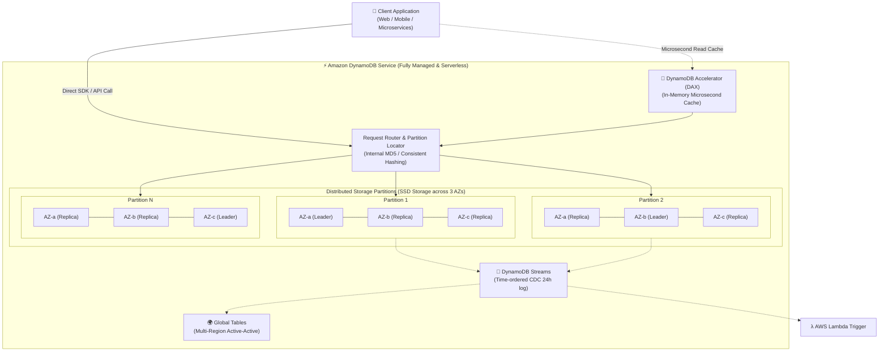

---

## 📌 Learning Objectives

By completing this module and reviewing these study notes, you will be able to:

- [ ] **Contrast Relational and Nonrelational Databases**: Articulate core design differences in data modeling, normalization vs. denormalization, vertical vs. horizontal scaling, and query paradigms.
- [ ] **Define Amazon DynamoDB**: Explain its serverless nature, key-value/document data model, automated 3-AZ data replication, and single-digit millisecond latency guarantees.
- [ ] **Analyze the DynamoDB Data Model**: Understand tables, items (up to 400 KB), attributes, and supported data types (Scalar, Document, Set).
- [ ] **Design DynamoDB Primary Keys**: Distinguish between simple primary keys (Partition Key / Hash attribute) and composite primary keys (Partition Key + Sort Key / Range attribute).
- [ ] **Explain Internal Partitioning**: Detail how DynamoDB uses an internal hashing function on the partition key to distribute items across physical storage partitions.
- [ ] **Evaluate Secondary Indexes**: Compare Local Secondary Indexes (LSIs) and Global Secondary Indexes (GSIs) in terms of partition keys, sort keys, creation lifecycles, and capacity consumption.
- [ ] **Select Read Consistency Levels**: Contrast Eventually Consistent Reads (default, 50% cost savings) with Strongly Consistent Reads (guaranteed latest data, 2x RCU cost).
- [ ] **Calculate Read and Write Capacity**: Differentiate between On-Demand capacity and Provisioned capacity modes, and calculate RCUs and WCUs based on item size and consistency requirements.
- [ ] **Assess Advanced Enterprise Features**: Describe the architecture and operational use cases of DynamoDB Accelerator (DAX), DynamoDB Streams, and Global Tables.

---

## 🗄️ 1. Relational (SQL) vs. Nonrelational (NoSQL) Databases

To understand why Amazon DynamoDB was created, developers must understand the architectural trade-offs between traditional relational database management systems (RDBMS) and nonrelational (NoSQL) database systems.

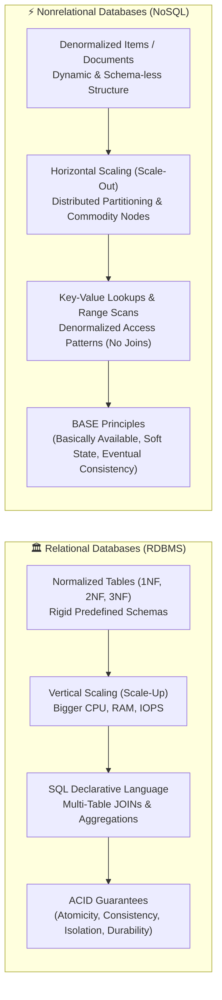

### 1.1 Data Modeling: Normalized vs. Flexible Document / Key-Value

#### Relational Databases (SQL)
- **Rigid Predefined Schema**: In an RDBMS (such as MySQL, PostgreSQL, Oracle, Microsoft SQL Server), a table's schema must be defined in advance via Data Definition Language (`CREATE TABLE`). Every row in a table must conform to identical column definitions, data types, and nullability constraints.
- **Normalization (1NF, 2NF, 3NF)**: Relational data modeling minimizes data redundancy and eliminates update anomalies by splitting data into multiple discrete tables linked by foreign key relationships.
- **Schema Migrations**: Modifying schemas (e.g., `ALTER TABLE`) in production tables containing hundreds of millions of rows requires table locks, complex migration scripts, or maintenance downtime.

#### Nonrelational Databases (NoSQL)
- **Flexible & Dynamic Schema**: NoSQL systems such as DynamoDB do not require upfront attribute definitions for non-key data elements. Each item can contain completely different attributes, data structures, and nested hierarchies.
- **Denormalization**: Related data is intentionally grouped together within a single item or document. Rather than joining customer, order, and line-item tables at query time, all related data can be embedded in a single JSON document or retrieved via denormalized primary key lookups.
- **Agile Development**: Application developers can add new fields (e.g., user preferences, new sensor telemetry fields) instantaneously without database administrator approvals or schema migration locks.

---

### 1.2 Scaling Mechanisms: Vertical Scaling vs. Horizontal Partitioning

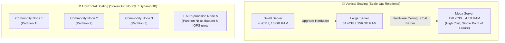

- **Vertical Scaling (Scale-Up)**:
  - Relational engines maintain cross-table relational integrity (foreign keys) and transactional atomicity across all tables. Consequently, they run predominantly on a single monolithic server.
  - When query volume or database size increases, the administrator must upgrade to a larger server instance with more compute cores, memory, and high-performance storage.
  - **Limitations**: Physical hardware limits exist (maximum available CPU cores/RAM), high-tier instances become prohibitively expensive, and server resizing typically incurs downtime.
- **Horizontal Scaling (Scale-Out)**:
  - Nonrelational databases are engineered to scale horizontally by distributing records across an elastic cluster of commodity storage nodes through **sharding (partitioning)**.
  - If workload traffic surges from 1,000 requests/sec to 1,000,000 requests/sec, or if storage expands from 10 GB to 100 TB, the system seamlessly adds additional physical partitions behind the scenes.
  - Throughput and storage scale linearly with zero downtime.

---

### 1.3 Query Models: Declarative Joins vs. Key-Value Lookups

| Query Aspect | Relational Database (SQL) | Nonrelational Database (DynamoDB / NoSQL) |
| :--- | :--- | :--- |
| **Query Mechanism** | Declarative SQL (`SELECT ... FROM ... JOIN ... WHERE`) | RESTful API calls (`GetItem`, `PutItem`, `Query`, `Scan`) |
| **Join Operations** | Supported natively across multiple tables (`INNER JOIN`, `LEFT JOIN`) | Not supported natively; joins are resolved in application code or avoided via denormalization |
| **Aggregation** | Dynamic aggregation via `GROUP BY`, `SUM`, `AVG`, `COUNT` | Limited server-side aggregations; performed via client streams or pre-calculated attributes |
| **Predictability** | Query execution time depends heavily on table sizes, indexes, and join complexity ($O(N \log N)$ or worse) | Predictable, single-digit millisecond latency regardless of whether table holds 100 items or 10 billion items ($O(1)$ lookup) |
| **Access Pattern Design** | Model data first around business entities; optimize queries later using indexes | Design access patterns and queries first; model primary keys and tables to serve those specific queries |

---

### 1.4 Comprehensive Comparison Table: Relational vs. NoSQL

| Architectural Dimension | Relational Database (e.g., MySQL, PostgreSQL, Amazon RDS) | Nonrelational Database (e.g., Amazon DynamoDB) |
| :--- | :--- | :--- |
| **Primary Data Model** | Tabular (relations, tuples, attributes) | Key-Value, Document (JSON), Wide-Column, Graph |
| **Schema Strictness** | Strict, pre-defined schema; enforced at database engine level | Dynamic, schema-less (only Primary Key must be defined) |
| **Scaling Approach** | Primarily Vertical (Scale-Up); Read replicas for read scaling | Horizontal (Scale-Out) via automated partitioning |
| **Primary Keys** | Enforces entity uniqueness; can be surrogate or natural key | Partition Key (Hash) or Composite Key (Hash + Sort Key); directs physical partitioning |
| **Foreign Keys / Joins** | Enforced referential integrity; cross-table SQL joins | No foreign keys; data is denormalized or joined in application logic |
| **Transaction Model** | Strict ACID (Atomicity, Consistency, Isolation, Durability) | BASE (Basically Available, Soft State, Eventual Consistency); optional ACID transactions via TransactWriteItems |
| **Storage Limits** | Typically capped per instance/volume (e.g., 64 TB in RDS) | Virtually limitless; automatic unbounded storage expansion |
| **Latency Profile** | Variable (tens of milliseconds depending on locks, joins, and load) | Consistent single-digit millisecond latency at any throughput scale |
| **Best Suited Workloads** | Complex analytical queries, OLTP with dynamic relationships, ERP/CRM systems | High-throughput web applications, mobile games, IoT ingestion, e-commerce shopping carts, session states |

---

## ⚡ 2. What is Amazon DynamoDB?

**Amazon DynamoDB** is a fully managed, serverless, NoSQL database service that provides fast, predictable performance with seamless scalability.

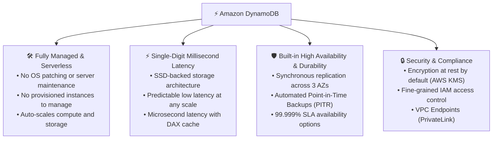

### 2.1 Core Architectural Characteristics

1. **Serverless & Fully Managed**:
   - There are no EC2 instances to provision, operating systems to patch, daemon processes to tune, or clustering software to configure.
   - Developers create a table and immediately read and write data. DynamoDB handles hardware provisioning, storage tiering, software patching, replication, and failover automatically.
2. **Predictable Single-Digit Millisecond Latency**:
   - Unlike relational systems where query latency increases exponentially as tables grow into gigabytes or terabytes, DynamoDB utilizes a direct hashing mechanism. Retrieving a record by its partition key takes the exact same single-digit milliseconds whether the table stores 1,000 items or 10 billion items.
3. **Automatic 3-AZ Synchronous Replication**:
   - Every DynamoDB table is automatically replicated across a minimum of **three Availability Zones (AZs)** within an AWS Region.
   - When a write request is accepted, DynamoDB commits the write synchronously across a quorum of storage nodes before returning success, guaranteeing high durability and fault tolerance against data center failures.
4. **Built-in Security and Encryption**:
   - **Encryption at Rest**: Enabled by default for all tables using AWS Key Management Service (AWS KMS) with zero performance impact.
   - **Encryption in Transit**: All API requests communicate over secure HTTPS/TLS endpoints.
   - **Fine-Grained Access Control**: Integrated with AWS Identity and Access Management (IAM). Administrators can create policies that restrict users to specific tables, specific items (using IAM condition keys like `dynamodb:LeadingKeys`), or specific attributes.

---

## 🧱 3. Core DynamoDB Architecture & Data Model

The DynamoDB data model consists of three primary structural units: **Tables**, **Items**, and **Attributes**.

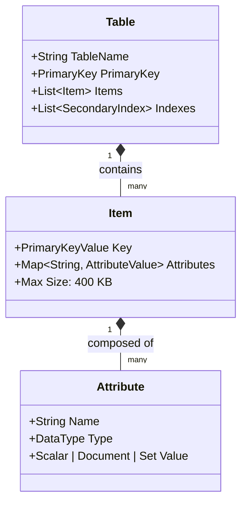

### 3.1 Structural Units

#### 1. Tables
- A **Table** is a collection of data items. It is conceptually similar to a table in a relational database or a collection in MongoDB.
- When creating a table, you must define:
  - **Table Name** (unique within your AWS account and Region).
  - **Primary Key** definition (the partition key attribute, and optionally a sort key attribute, including their data types).
  - **Capacity Mode** (Provisioned or On-Demand).

#### 2. Items
- An **Item** is a group of attributes that is uniquely identifiable among all other items in the table.
- It is analogous to a row, record, or tuple in a relational database.
- **Maximum Item Size**: An individual item (including attribute names and attribute values) can be up to **400 KB**.
- Unlike relational databases where all rows have identical columns, items in a DynamoDB table can have entirely different attributes, schemas, and data structures.

#### 3. Attributes
- An **Attribute** is a fundamental data element that cannot be divided any further.
- It is analogous to a column or field in a relational database.
- Except for the primary key attributes, attributes do not need to be defined when the table is created.

---

### 3.2 Supported Data Types

DynamoDB supports three categories of data types: **Scalar**, **Document**, and **Set**.

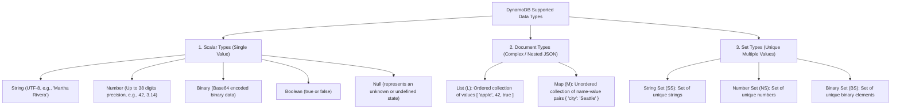

#### Detailed Data Type Specifications

| Category | Type Code | Name | Description & Constraints | Example Representation |
| :--- | :--- | :--- | :--- | :--- |
| **Scalar** | `S` | String | UTF-8 encoded string. Length up to 400 KB limit. | `"Martha Rivera"` |
| **Scalar** | `N` | Number | Exact decimal representation up to 38 digits of precision. | `101`, `3.14159`, `-42` |
| **Scalar** | `B` | Binary | Any binary data (Base64-encoded in API requests). | `dGhpcyBpcyBhIHRlc3Q=` |
| **Scalar** | `BOOL` | Boolean | Binary logical true or false. | `true`, `false` |
| **Scalar** | `NULL` | Null | Represents null / undefined value. | `null` |
| **Document** | `L` | List | Ordered collection of elements. Elements can be of mixed data types. | `[ "dancing", "hiking", 42 ]` |
| **Document** | `M` | Map | Unordered collection of key-value pairs (JSON object). Can be nested up to 32 levels deep. | `{"Street": "123 Main St", "City": "Seattle"}` |
| **Set** | `SS` | String Set | Collection of unique strings. Cannot contain empty strings or duplicates. | `[ "red", "blue", "green" ]` |
| **Set** | `NS` | Number Set | Collection of unique numbers. | `[ 10, 25, 42, 100 ]` |
| **Set** | `BS` | Binary Set | Collection of unique binary blobs. | `[ "aGVsbG8=", "d29ybGQ=" ]` |

> [!NOTE]
> **Sets vs. Lists**: A `List` allows duplicate values and maintains element order. A `Set` enforces uniqueness across all elements and does not guarantee element ordering.

---

### 3.3 Visual Example: The `Friends` Table

The course curriculum uses the `Friends` table to demonstrate how different items store varying attributes:

```
Friends Table
├── Item 1 (FriendID = 1):
│   ├── FriendID: 1 (Number - Partition Key)
│   ├── Name: "Martha Rivera" (String)
│   ├── Hobbies: ["dancing", "hiking", "sailing"] (List of Strings)
│   └── FavoriteColors: ["red", "blue"] (String Set)
│
└── Item 2 (FriendID = 2):
    ├── FriendID: 2 (Number - Partition Key)
    ├── Name: "Zhang Wei" (String)
    ├── Hobbies: ["painting", "hiking", "yoga"] (List of Strings)
    ├── FavoriteColors: ["green", "blue"] (String Set)
    ├── FavoriteGames: ["chess"] (String Set)   <-- Additional Attribute
    └── FavoriteFoods: ["pizza", "chicken"]     <-- Additional Attribute
```

Because DynamoDB is schema-less, Item 2 can freely store `FavoriteGames` and `FavoriteFoods` without affecting Item 1 or requiring table-level alterations.

---

## 🔑 4. Primary Key Design & Architecture

Every item in a DynamoDB table must be uniquely identified by its **Primary Key**. DynamoDB supports two primary key structures:

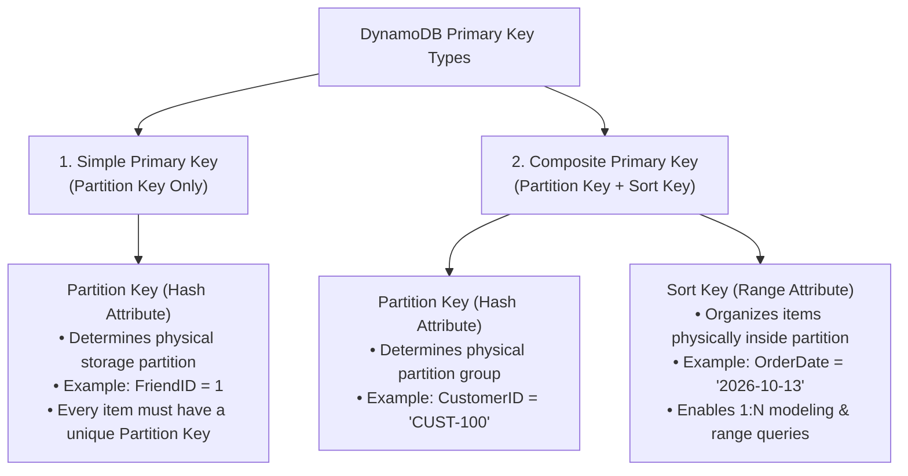

### 4.1 Simple Primary Key (Partition Key Only)

- Composed of a **single attribute**, known as the **Partition Key** (or **Hash Key**).
- **Uniqueness**: No two items in the table can have the same partition key value.
- **Access Pattern**: Exact match lookups only (`PartitionKey = value`).
- **Example**: A `Users` table where `UserID` uniquely identifies each user:
  - `UserID = "USR-001"` $\rightarrow$ Alice
  - `UserID = "USR-002"` $\rightarrow$ Bob

---

### 4.2 Composite Primary Key (Partition Key + Sort Key)

- Composed of **two attributes**:
  1. **Partition Key** (Hash Attribute)
  2. **Sort Key** (Range Attribute)
- **Uniqueness Rule**: Two items can have the same partition key value, provided their **sort key values are different**. The combination of `(PartitionKey, SortKey)` must be globally unique across the table.
- **Physical Organization**: All items sharing the same partition key are stored together on the same physical partition, sorted in ascending order by their sort key.
- **Advanced Querying Capabilities**: Composite keys allow rich range queries on the sort key:
  - Exact match: `SortKey = :val`
  - Comparison: `SortKey < :val`, `SortKey <= :val`, `SortKey > :val`, `SortKey >= :val`
  - Range: `SortKey BETWEEN :val1 AND :val2`
  - Substring matching: `begins_with(SortKey, :prefix)`
- **Example**: An `Orders` table:
  - Partition Key: `CustomerID` (`"CUST-101"`)
  - Sort Key: `OrderTimestamp` (`"2026-10-12T14:30:00Z"`)
  - A single customer can place hundreds of orders, all stored under their partition key and retrieved in chronological order.

---

## 🗂️ 5. The Concept of Partitioning

Behind the scenes, DynamoDB automatically divides table data across physical storage engines called **Partitions**.

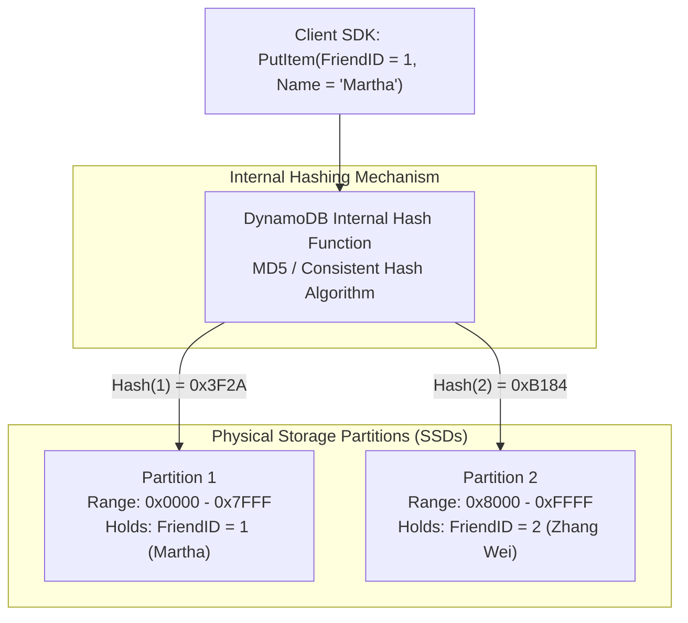

### 5.1 Partition Allocation Rules

A physical partition in DynamoDB is an allocation of SSD storage with dedicated compute resources:
- **Maximum Storage**: Up to **10 GB** of data per physical partition.
- **Maximum Throughput**:
  - Up to **1,000 Write Capacity Units (WCUs)** per partition.
  - Up to **3,000 Read Capacity Units (RCUs)** per partition.

DynamoDB automatically allocates a new partition when:
1. The cumulative data size exceeds the 10 GB partition boundary.
2. The provisioned throughput exceeds 1,000 WCUs or 3,000 RCUs.

### 5.2 Hot Partitions and High-Cardinality Partition Keys

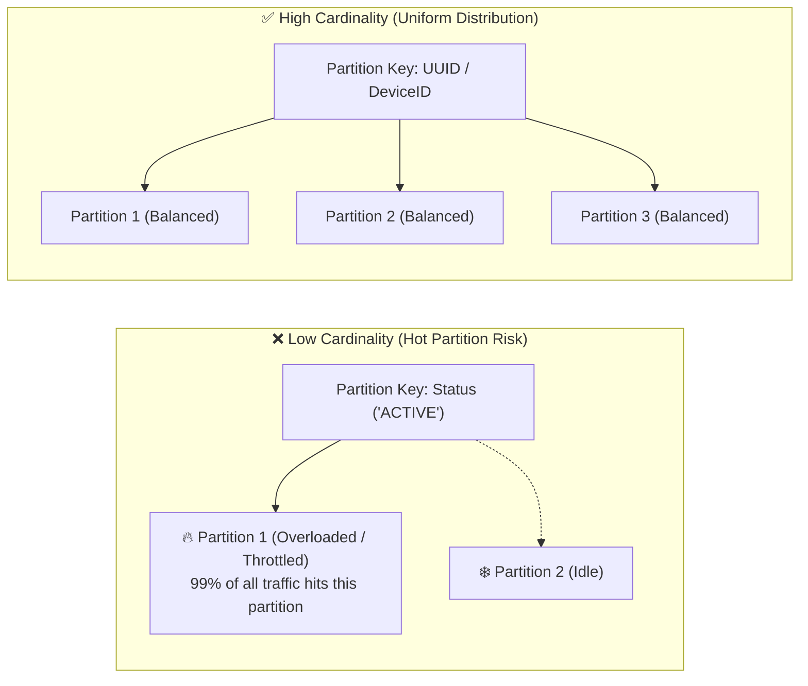

> [!WARNING]
> **Hot Partitioning**: If application traffic concentrates on a single partition key (e.g., using `Country` or `Status` with low cardinality), that single partition will exhaust its 1,000 WCU / 3,000 RCU limit, triggering `ProvisionedThroughputExceededException` (throttling), even if the overall table capacity is underutilized.
> 
> **Best Practice**: Always select a partition key with **high cardinality** (such as UUIDs, User IDs, Customer IDs, or Sensor IDs) so that traffic is evenly distributed across all partitions.

---

## 🔍 6. Secondary Indexes: LSI vs. GSI

In DynamoDB, queries are normally restricted to filtering on the table's primary key. To query attributes outside the primary key without performing expensive, full-table scans, you can create **Secondary Indexes**.

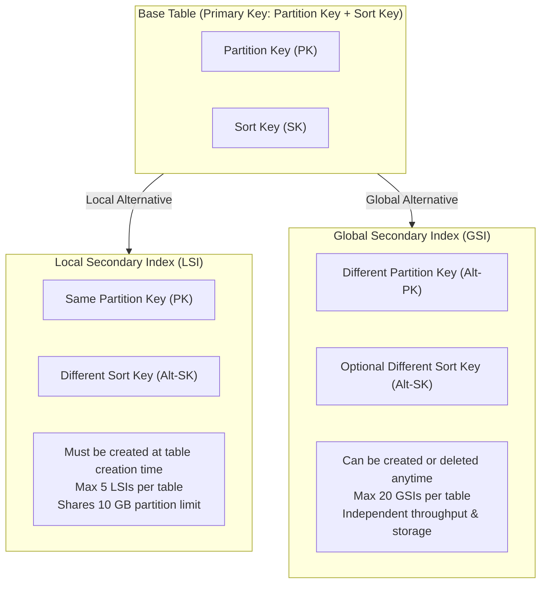

### 6.1 Local Secondary Index (LSI)
- **Structure**: Uses the **same partition key** as the base table, but defines a **different sort key**.
- **Scope**: Local to the partition; queries are scoped to a single partition key value.
- **Creation Lifecycle**: **Strictly created at table creation time**. You cannot add or remove an LSI after the table has been provisioned.
- **Size Limitation**: An item collection (all items in base table and LSIs sharing the same partition key) cannot exceed **10 GB**.
- **Consistency**: Supports both **Strongly Consistent** and **Eventually Consistent** reads.
- **Capacity**: Consumes capacity from the base table's provisioned RCUs and WCUs.

---

### 6.2 Global Secondary Index (GSI)
- **Structure**: Can define a **completely different partition key** and an optional **different sort key** from the base table.
- **Scope**: Spans the entire table across all partitions ("global").
- **Creation Lifecycle**: Can be **created, updated, or deleted at any time**, even on existing tables populated with data.
- **Size Limitation**: No size limits; scales horizontally across its own dedicated partitions.
- **Consistency**: Supports **Eventually Consistent** reads only.
- **Capacity**: Has its own **dedicated provisioned RCU and WCU allocations** (or independent on-demand scaling). Writes to the base table trigger asynchronous replication to the GSI; if the GSI is under-provisioned, base table writes may be throttled.

---

### 6.3 Comprehensive Comparison: LSI vs. GSI

| Feature / Property | Local Secondary Index (LSI) | Global Secondary Index (GSI) |
| :--- | :--- | :--- |
| **Partition Key** | Must be identical to base table PK | Can be different from base table PK |
| **Sort Key** | Must be different from base table SK | Optional; can be any scalar attribute |
| **Creation Timing** | Only at table creation (`CREATE TABLE`) | Anytime (create or drop dynamically) |
| **Deletion** | Cannot be deleted without deleting the table | Can be deleted at any time |
| **Read Consistency** | Eventually Consistent OR Strongly Consistent | Eventually Consistent only |
| **Capacity Management** | Consumes base table RCUs / WCUs | Has its own independent RCU / WCU billing |
| **Size Constraint** | 10 GB limit per item collection | No size limit (unbounded) |
| **Max Indexes Allowed** | Up to 5 per table | Up to 20 per table (default) |
| **Attribute Projections** | `KEYS_ONLY`, `INCLUDE`, or `ALL` | `KEYS_ONLY`, `INCLUDE`, or `ALL` |

---

## 📖 7. Read Consistency Models

DynamoDB automatically replicates data across three Availability Zones. When reading data via `GetItem`, `Query`, or `BatchGetItem`, developers can configure the desired **Read Consistency**.

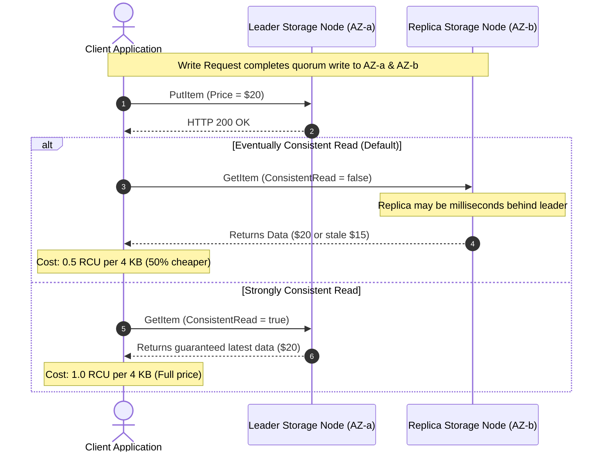

### 7.1 Eventually Consistent Reads (Default)
- **Mechanism**: Reads data from any one of the three storage replicas. Because replication across replicas takes a few milliseconds, a read request might return stale data that does not reflect a write that completed immediately prior.
- **Advantages**:
  - Maximum read throughput.
  - Lowest read latency.
  - **Cost Savings**: Consumes **50% fewer RCUs** (1 RCU provides two 4 KB eventually consistent reads per second).
- **Ideal Use Cases**: Social media feeds, product reviews, video stream view counters, weather data.

### 7.2 Strongly Consistent Reads
- **Mechanism**: DynamoDB queries a quorum of storage nodes (or the leader node) to guarantee that the returned response contains the most up-to-date data reflecting all prior successful write operations.
- **Trade-offs**:
  - Higher read latency compared to eventual consistency.
  - Potential unavailability if a network partition isolates nodes.
  - **Cost**: Consumes **twice as many RCUs** as eventually consistent reads (1 RCU provides one 4 KB strongly consistent read per second).
- **Configuration**: Set `ConsistentRead = true` in API calls.
- **Ideal Use Cases**: Bank account balances, ticket reservations, inventory stock counts, security authorization tokens.

---

## ⚖️ 8. Read and Write Capacity Modes

DynamoDB offers two flexible billing and capacity management modes: **On-Demand Mode** and **Provisioned Mode**.

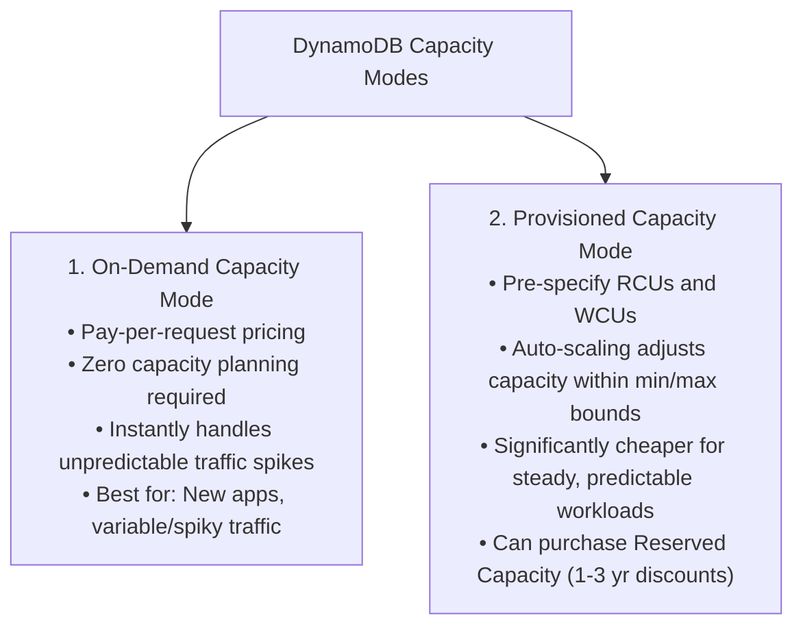

### 8.1 On-Demand Capacity Mode
- **Billing**: Charged strictly per read and write request unit.
- **Scaling**: DynamoDB automatically adapts to traffic fluctuations, instantly accommodating up to double the previous peak throughput.
- **Best Suited For**:
  - New applications with unknown traffic profiles.
  - Workloads with unpredictable, spiky traffic (e.g., flash sales, breaking news).
  - Development and test environments.

---

### 8.2 Provisioned Capacity Mode
- **Billing**: Charged hourly for the provisioned throughput capacity, regardless of whether that capacity is consumed.
- **Auto Scaling**: Integrates with Application Auto Scaling to dynamically increase or decrease provisioned RCUs and WCUs based on target utilization metrics (e.g., maintaining 70% capacity utilization).
- **Best Suited For**:
  - Predictable traffic patterns with gradual changes.
  - Workloads running at steady, consistent utilization where provisioned pricing is significantly more cost-effective than on-demand pricing.

---

### 8.3 RCU and WCU Sizing Calculations

#### Read Capacity Unit (RCU) Definition
- **1 RCU** = **One Strongly Consistent Read** per second for an item up to **4 KB** in size.
- **1 RCU** = **Two Eventually Consistent Reads** per second for an item up to **4 KB** in size.
- **2 RCUs** = **One Transactional Read** per second for an item up to **4 KB** in size.

$$\text{RCU Formula (Strongly Consistent)} = \left\lceil \frac{\text{Item Size (KB)}}{4\text{ KB}} \right\rceil \times \text{Reads Per Second}$$

$$\text{RCU Formula (Eventually Consistent)} = \left\lceil \frac{\text{Item Size (KB)}}{4\text{ KB}} \right\rceil \times \text{Reads Per Second} \times 0.5$$

#### Write Capacity Unit (WCU) Definition
- **1 WCU** = **One Standard Write** per second for an item up to **1 KB** in size.
- **2 WCUs** = **One Transactional Write** per second for an item up to **1 KB** in size.

$$\text{WCU Formula (Standard Write)} = \left\lceil \frac{\text{Item Size (KB)}}{1\text{ KB}} \right\rceil \times \text{Writes Per Second}$$

#### Capacity Calculation Examples Matrix

| Scenario | Item Size | Target Throughput | Read Consistency | Calculation Steps | Total Capacity Required |
| :--- | :--- | :--- | :--- | :--- | :--- |
| **Scenario 1: User Profile Reads** | 3.5 KB | 100 reads/sec | Eventually Consistent | $\lceil 3.5 / 4 \rceil = 1 \text{ block}$<br>$1 \times 100 \times 0.5$ | **50 RCUs** |
| **Scenario 2: Financial Account Reads** | 7.2 KB | 100 reads/sec | Strongly Consistent | $\lceil 7.2 / 4 \rceil = 2 \text{ blocks}$<br>$2 \times 100 \times 1.0$ | **200 RCUs** |
| **Scenario 3: Sensor Data Logging** | 1.8 KB | 500 writes/sec | Standard Write | $\lceil 1.8 / 1 \rceil = 2 \text{ blocks}$<br>$2 \times 500$ | **1,000 WCUs** |
| **Scenario 4: E-Commerce Product Write**| 500 Bytes | 200 writes/sec | Standard Write | $\lceil 0.5 / 1 \rceil = 1 \text{ block}$<br>$1 \times 200$ | **200 WCUs** |

---

## 🚀 9. Advanced DynamoDB Features

DynamoDB includes several enterprise-grade extensions designed for ultra-low latency, real-time event processing, and global business continuity.

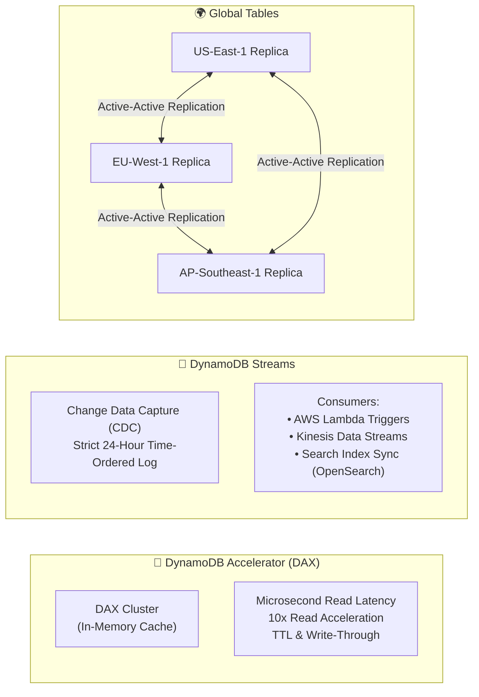

### 9.1 DynamoDB Accelerator (DAX)
- **What is DAX?**: A fully managed, highly available, in-memory cache purpose-built for DynamoDB that delivers up to a **10x performance improvement**—dropping read response times from single-digit milliseconds to **microseconds**.
- **Architecture**:
  - Sits directly in front of DynamoDB tables within an Amazon VPC.
  - SDK-compatible: Applications swap the DynamoDB SDK client with the DAX client without rewriting query logic.
- **Caching Mechanism**:
  - **Item Cache**: Caches individual items retrieved via `GetItem` or `BatchGetItem`.
  - **Query Cache**: Caches query and scan result sets.
- **Write-Through**: When items are written through DAX, changes are written to the underlying DynamoDB table and updated in the DAX cache simultaneously.

---

### 9.2 DynamoDB Streams
- **What is DynamoDB Streams?**: A time-ordered sequence of item-level modifications (insertions, updates, deletions) captured in near real-time (**Change Data Capture / CDC**).
- **Log Retention**: Changes are retained in the stream for exactly **24 hours**, after which they are purged.
- **Stream View Types**:
  1. `KEYS_ONLY`: Captures only the key attributes of the modified item.
  2. `NEW_IMAGE`: Captures the entire item as it appears after the modification.
  3. `OLD_IMAGE`: Captures the entire item as it appeared before the modification.
  4. `NEW_AND_OLD_IMAGES`: Captures both the before and after states of the item.
- **Integration**: Powers event-driven architectures by triggering **AWS Lambda functions** automatically upon data changes (e.g., sending welcome emails upon user registration, auditing data changes, or updating external search engines like Amazon OpenSearch).

---

### 9.3 Global Tables
- **What are Global Tables?**: A fully managed multi-Region, active-active replication solution that replicates DynamoDB tables across designated AWS Regions worldwide.
- **Key Capabilities**:
  - **Fast Local Reads and Writes**: Worldwide users read and write to their geographically closest regional replica table, ensuring low latency.
  - **Disaster Recovery & Business Continuity**: If an entire AWS Region experiences degradation, applications can seamlessly redirect read and write traffic to another healthy regional replica.
  - **Conflict Resolution**: Employs a **last-writer-wins** reconciliation strategy based on internal timestamps to resolve simultaneous concurrent writes across regions.
  - **Under the Hood**: Global Tables rely on **DynamoDB Streams** to propagate regional updates across replicas within seconds.

---

## 🛠️ 10. Interactive Worksheets & Self-Coaching

### Worksheet 1: Primary Key & Data Model Design
Complete the following architecture matrix to determine the optimal DynamoDB primary key and data types for three common application use cases.

| Application Use Case | Selected Partition Key | Selected Sort Key | Justification & Query Access Patterns |
| :--- | :--- | :--- | :--- |
| **IoT Fleet Management** | *(e.g., `DeviceID`)* | *(e.g., `Timestamp`)* | *High cardinality partition key avoids hot partitions; sort key enables time-series range queries (`BETWEEN`).* |
| **Global User Authentication** | *[ Fill in ]* | *[ None / Simple Key ]* | *[ Fill in rationale ]* |
| **E-Commerce Order History** | *[ Fill in ]* | *[ Fill in ]* | *[ Fill in rationale ]* |

<details>
<summary>👉 Click to view Model Solution for Worksheet 1</summary>

- **Global User Authentication**:
  - *Partition Key*: `UserID` (UUID) or `Username`.
  - *Sort Key*: None (Simple Primary Key).
  - *Rationale*: Authentication lookups are $O(1)$ point-lookups by unique identifier. A simple key delivers single-digit millisecond latency without needing range queries.
- **E-Commerce Order History**:
  - *Partition Key*: `CustomerID` (String).
  - *Sort Key*: `OrderDate` or `OrderID` (String / Number).
  - *Rationale*: Groups all orders placed by a single customer onto the same partition. Allows the user to query their orders sorted by date using `begins_with(OrderDate, '2026-10')`.
</details>

---

### Worksheet 2: Capacity Planning & Cost Optimization
Your application handles **2,000 reads per second** of items averaging **6 KB** in size, and **300 writes per second** of items averaging **2.5 KB** in size.

1. **Calculate RCU requirements if all reads are Strongly Consistent:**
   - Blocks per item: $\lceil 6 / 4 \rceil = 2$ blocks.
   - Total RCUs: $2 \times 2,000 = \mathbf{4,000\text{ RCUs}}$.
2. **Calculate RCU requirements if business accepts Eventually Consistent Reads:**
   - Blocks per item: $\lceil 6 / 4 \rceil = 2$ blocks.
   - Total RCUs: $2 \times 2,000 \times 0.5 = \mathbf{2,000\text{ RCUs}}$ (50% cost savings!).
3. **Calculate WCU requirements for standard writes:**
   - Blocks per item: $\lceil 2.5 / 1 \rceil = 3$ blocks.
   - Total WCUs: $3 \times 300 = \mathbf{900\text{ WCUs}}$.

---

## 🧠 11. Knowledge Check & Review Questions

Test your understanding of the concepts presented in this module.

### Question 1: Why are nonrelational (NoSQL) databases a good choice when you must get started quickly on a project?
> **Answer**:
> Nonrelational databases feature **flexible, dynamic schemas**. Developers do not need to perform complex upfront data engineering, create rigid normalized tables, or define foreign keys before storing data. Applications can evolve and adapt data structures rapidly by storing nested JSON documents or key-value items without running schema migration scripts.

### Question 2: Which table attribute is responsible for determining where item data is partitioned in Amazon DynamoDB?
> **Answer**:
> The **Partition Key** (also known as the **Hash Key**). DynamoDB applies an internal cryptographic hashing algorithm to the partition key value to determine the physical storage partition where the item will reside.

### Question 3: When you create items in a DynamoDB table, does each entry need to have the same attributes?
> **Answer**:
> **No.** DynamoDB is schema-less for all attributes outside the primary key. Individual items in the same table can store completely different numbers, types, and structures of attributes. Only the primary key attributes defined at table creation are required for every item.

### Question 4: How does a composite primary key differ from a simple primary key, and what query capabilities does it unlock?
> **Answer**:
> - A **Simple Primary Key** consists of only a Partition Key (Hash attribute). Each item must have a unique partition key value. Queries are limited to exact-match lookups.
> - A **Composite Primary Key** consists of a Partition Key (Hash attribute) and a Sort Key (Range attribute). Multiple items can share the same partition key as long as their sort keys differ. This unlocks One-to-Many relationships and rich range queries (`begins_with`, `between`, `<`, `>`) scoped to a single partition key.

### Question 5: Contrast Local Secondary Indexes (LSIs) and Global Secondary Indexes (GSIs) regarding their partition keys and creation timing.
> **Answer**:
> - **LSI**: Must use the **same partition key** as the base table with a different sort key. It can **only be created at table creation time** and cannot be added or deleted later.
> - **GSI**: Can define a **completely different partition key** and an optional different sort key. It can be **created or deleted dynamically at any time**, even on active production tables.

### Question 6: Under what conditions would an architect select DynamoDB Accelerator (DAX) over native DynamoDB queries?
> **Answer**:
> DAX is selected when read-intensive applications require **microsecond latency** (rather than single-digit millisecond latency), or when applications experience extreme read volume on a small set of popular items ("hot keys"), such as live auction bids, gaming leaderboards, or viral social media posts.

### Question 7: How do DynamoDB Global Tables achieve multi-Region data synchronization, and how are write conflicts resolved?
> **Answer**:
> Global Tables utilize **DynamoDB Streams** to capture item-level modifications in near real-time and asynchronously replicate them across replica tables in designated AWS Regions. If concurrent writes occur in different regions to the same item, DynamoDB resolves the conflict using a **last-writer-wins** strategy based on item timestamps.

---

## 📌 12. Key Takeaways & Summary

- **Fully Managed NoSQL Service**: Amazon DynamoDB is a serverless, key-value and document database that eliminates administrative overhead (patching, scaling, clustering).
- **Single-Digit Millisecond Latency**: Delivers predictable, single-digit millisecond response times at any scale, backed by SSD storage and automated partitioning.
- **Core Data Elements**:
  - **Tables**: Collections of items.
  - **Items**: Individual records (up to 400 KB max).
  - **Attributes**: Fundamental data elements (Scalar, Document, Set).
- **Primary Key Architecture**:
  - **Simple Key**: Partition Key only (Hash).
  - **Composite Key**: Partition Key (Hash) + Sort Key (Range), enabling 1:N modeling and range searches.
- **Secondary Indexes**:
  - **LSI**: Same PK, new SK; created only at table creation; 10 GB partition limit.
  - **GSI**: New PK, new SK; created anytime; independent capacity scaling.
- **Read Consistency**:
  - **Eventually Consistent**: Default, lowest latency, 50% cheaper (0.5 RCU per 4 KB).
  - **Strongly Consistent**: Guaranteed latest data, 2x cost (1 RCU per 4 KB).
- **Billing & Capacity Modes**:
  - **On-Demand**: Pay-per-request for spiky, unpredictable workloads.
  - **Provisioned**: Specify RCUs and WCUs with Auto Scaling for predictable, steady workloads.
- **Global Availability & Advanced Features**:
  - **3-AZ Replication**: Built-in synchronous replication within every region.
  - **DAX**: In-memory microsecond cache.
  - **Streams**: Time-ordered 24-hour change data capture log.
  - **Global Tables**: Fully managed active-active multi-Region disaster recovery and low-latency global distribution.
