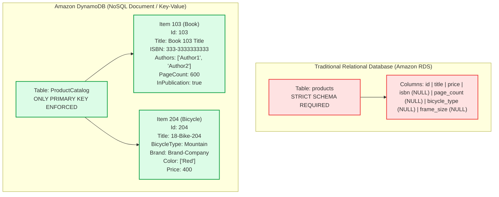
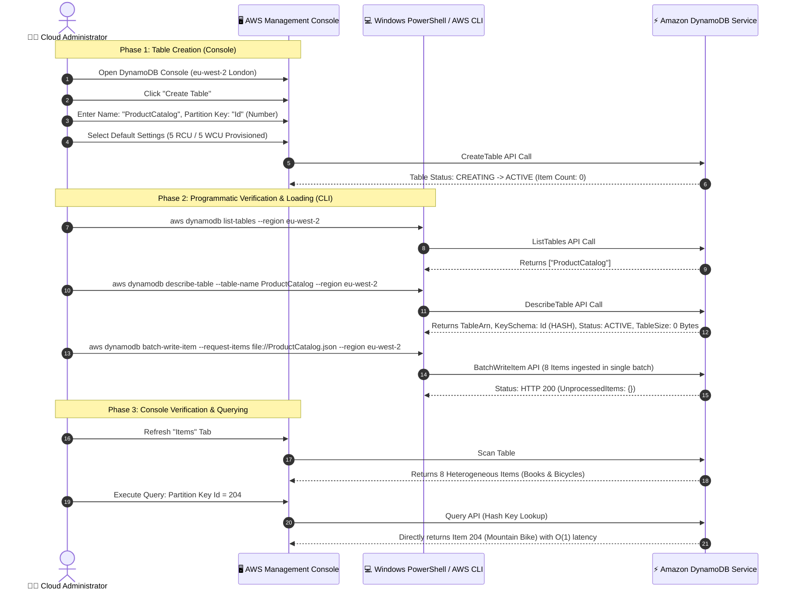
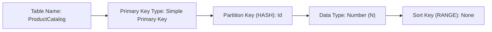
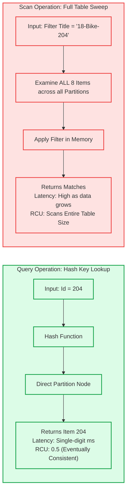

# 🎥 AWS Technical Demonstration: Amazon DynamoDB NoSQL Table Creation, Batch Loading & Querying

> **Course**: AWS re/Start  
> **Module**: Database Fundamentals (M06 – Amazon DynamoDB NoSQL Database)  
> **Source Media**: `T10-Database/T10-0013-RSSCHAB_EN-US_Video_M06_Dynamodb_Demo.mp4` (2 min 40 sec)  
> **Format**: Video Audio Transcription & Comprehensive Hands-On Lab Walkthrough  
> **Target Audience**: AWS re/Start Learners, Cloud Practitioners, Solutions Architects, and Database Specialists  

---

## 🎯 Demonstration Overview

In this technical demonstration, the instructor guides learners through the end-to-end process of provisioning, populating, and querying a non-relational (**NoSQL**) database table using **Amazon DynamoDB**. 

Traditional relational database management systems (RDBMS) enforce rigid schemas defined ahead of time using Data Definition Language (`DDL`). In contrast, modern web and mobile applications—such as e-commerce storefronts, gaming backends, and IoT systems—frequently handle semi-structured data where items belonging to the same entity category exhibit distinct, non-uniform attributes. 

This lab demonstrates how Amazon DynamoDB enables developers to create a flexible, schema-less **`ProductCatalog`** table where every item shares a primary identifier (`Id`), while allowing completely heterogeneous sets of attributes (such as authors and page counts for books, or frame types, colors, and dimensions for bicycles) to co-exist within the same table without schema migrations, `ALTER TABLE` overhead, or sparse `NULL` column waste.

```
┌────────────────────────────────────────────────────────────────────────────────────────┐
│                                 CORE LAB OBJECTIVE                                     │
│                                                                                        │
│  Data Source    : Heterogeneous Product Catalog JSON (Books, Bicycles, Apparel)        │
│                   └── Common Primary Key: 'Id' (Number)                                │
│                                                                                        │
│  Table Setup    : Amazon DynamoDB Console                                              │
│                   └── Table Name: 'ProductCatalog' (or 'product_catalog')              │
│                   └── Partition Key (HASH): 'Id' (Number / N)                          │
│                   └── Capacity Settings: Default (5 RCU / 5 WCU Provisioned)           │
│                                                                                        │
│  Ingestion & Ops: AWS CLI / PowerShell for AWS                                          │
│                   ├── aws dynamodb list-tables                                         │
│                   ├── aws dynamodb describe-table                                      │
│                   └── aws dynamodb batch-write-item --request-items file://...          │
│                                                                                        │
│  Verification   : Console Scan vs. Query (Partition Key Lookup: Id = 204)             │
└────────────────────────────────────────────────────────────────────────────────────────┘
```

---

## 📌 Learning Objectives

By completing this tutorial and studying the architectural patterns demonstrated, you will be able to:

- [ ] **Contrast Relational vs. NoSQL Data Paradigms**: Explain the architectural differences between fixed tabular relational schemas (RDS) and flexible key-value/document models (DynamoDB).
- [ ] **Analyze Semi-Structured JSON Data Models**: Identify how heterogeneous attributes exist within a single table unified by a common Partition Key.
- [ ] **Navigate the Amazon DynamoDB Console**: Access the regional DynamoDB service interface and configure table parameters.
- [ ] **Provision a DynamoDB Table**: Define table names and specify a primary key schema (Partition Key `Id` with Number type).
- [ ] **Evaluate Capacity Modes (Provisioned vs. On-Demand)**: Compare the operational and cost implications of Provisioned Throughput (RCUs/WCUs) against On-Demand auto-scaling capacity.
- [ ] **Automate Table Management via AWS CLI**: Execute `list-tables` and `describe-table` commands to programmatically inspect table status, primary key schemas, and storage metrics.
- [ ] **Perform High-Throughput Ingestion with `BatchWriteItem`**: Construct a valid DynamoDB batch JSON payload using type descriptors (`S`, `N`, `L`, `M`, `BOOL`) and ingest items in a single API operation.
- [ ] **Distinguish Query from Scan Operations**: Articulate why `Query` provides efficient, predictable $O(1)$ partition access while `Scan` performs an exhaustive, costly $O(N)$ full table traversal.
- [ ] **Validate Schema-less Elasticity**: Confirm that items with disparate schemas co-exist seamlessly without database downtime or schema redefinition.

---

## 🏗️ Architectural & Data Structure Analysis

### 1. Relational Schema vs. DynamoDB Schema-less Model

In a relational database (such as MySQL or PostgreSQL on Amazon RDS), storing diverse product types requires either:
1. **Multiple normalized tables** (`books`, `bicycles`, `electronics`) connected through foreign keys, requiring complex and expensive `JOIN` operations at read time.
2. **A single wide table** with dozens of columns where most rows contain `NULL` values for irrelevant attributes (sparse table anti-pattern).
3. **An Entity-Attribute-Value (EAV) model**, which drastically complicates query syntax and destroys indexing performance.

Amazon DynamoDB resolves this architectural challenge through its **schema-less** document model. In DynamoDB, the table schema applies **only to the Primary Key**. Attributes outside the primary key are determined at the item level, allowing dynamic and heterogeneous data structures.



---

### 2. Heterogeneous JSON Data Structure Analysis

The demonstration introduces a source file named `ProductCatalog.json`. Every product entity contains an `Id` attribute formatted as a Number (`N`), but the accompanying attribute sets vary drastically depending on the product category:

#### Item Category Comparison Matrix

| Attribute Name | Data Type Descriptor | Book Entity (e.g., ID 103) | Bicycle Entity (e.g., ID 204) | Architectural Significance |
| :--- | :---: | :---: | :---: | :--- |
| **`Id`** | `N` (Number) | `103` | `204` | **Partition Key (HASH)**; mandatory for all items |
| **`ProductCategory`** | `S` (String) | `"Book"` | `"Bicycle"` | Functional classification attribute |
| **`Title`** | `S` (String) | `"Book 103 Title"` | `"18-Bike-204"` | Common descriptive text |
| **`Price`** | `N` (Number) | `2000` | `400` | Standard commercial attribute |
| **`ISBN`** | `S` (String) | `"333-3333333333"` | *Not Present* | Specific to publications |
| **`Authors`** | `L` (List of Strings) | `["Author1", "Author2"]` | *Not Present* | Multi-valued ordered collection |
| **`PageCount`** | `N` (Number) | `600` | *Not Present* | Specific to book physical specs |
| **`Dimensions`** | `S` (String) | `"8.5 x 11.0 x 1.5"` | *Not Present* | Form factor measurement |
| **`InPublication`**| `BOOL` (Boolean) | `true` | *Not Present* | Availability status flag |
| **`BicycleType`** | `S` (String) | *Not Present* | `"Mountain"` | Specific to sporting goods |
| **`Brand`** | `S` (String) | *Not Present* | `"Brand-Company"` | Manufacturer identifier |
| **`Color`** | `L` (List of Strings) | *Not Present* | `[{"S": "Red"}]` | Colorway options array |
| **`Description`** | `S` (String) | *Not Present* | `"204 Description"` | Rich item summary |

---

### 3. DynamoDB Low-Level JSON Type Descriptors

When communicating with the low-level DynamoDB wire protocol or using CLI commands like `batch-write-item`, attribute values must be explicitly tagged with DynamoDB type descriptors:

```
┌────────────────────────────────────────────────────────────────────────┐
│                  DynamoDB Low-Level Data Type Descriptors              │
├────────────────────────────────────────────────────────────────────────┤
│  Scalar Types:                                                         │
│    "S"    : String (UTF-8 binary/text)                                 │
│    "N"    : Number (up to 38 digits precision, sent as string)         │
│    "B"    : Binary (Base64-encoded)                                    │
│    "BOOL" : Boolean (true / false)                                     │
│    "NULL" : Null value representation                                  │
│                                                                        │
│  Document / Complex Types:                                             │
│    "L"    : List (ordered collection of heterogeneous DynamoDB values) │
│    "M"    : Map (unordered collection of name-value attribute pairs)   │
│                                                                        │
│  Set Types:                                                            │
│    "SS"   : String Set (unique collection of strings)                  │
│    "NS"   : Number Set (unique collection of numbers)                  │
│    "BS"   : Binary Set (unique collection of binary blobs)             │
└────────────────────────────────────────────────────────────────────────┘
```

> [!NOTE]
> In DynamoDB JSON, numbers are always enclosed in quotation marks (e.g., `"N": "204"` or `"N": "103"`). This design prevents precision loss across different programming languages and client runtime environments when serializing large numbers or floating-point decimals.

---

### 4. End-to-End Workflow Diagram



---

## 🛠️ Step-by-Step Hands-On Tutorial

### Step 1: Accessing the Amazon DynamoDB Console

1. Open your web browser and sign in to the **AWS Management Console**.
2. In the top navigation bar, locate the **Region Selector** drop-down menu.
   - For this demonstration, the instructor operates in the **EU (London)** Region (`eu-west-2`).
   - You may select any region where DynamoDB is supported (e.g., `us-east-1`, `us-west-2`, `eu-west-1`).

```
┌────────────────────────────────────────────────────────────────────────┐
│ AWS Management Console Navigation                                      │
├────────────────────────────────────────────────────────────────────────┤
│ Services Search Bar  : Type "DynamoDB"                                 │
│ Results              : Select "DynamoDB - Managed NoSQL Database"      │
│ Region Selector      : London (eu-west-2)                              │
└────────────────────────────────────────────────────────────────────────┘
```

3. On the left navigation pane of the DynamoDB dashboard, select **Tables**.
4. Review the dashboard. If no tables exist, the table inventory displays an empty list.

---

### Step 2: Creating the Table

1. Click the blue **Create table** button.
2. In the **Table details** section, configure the primary attributes:
   - **Table name**: Enter `ProductCatalog` (or `product_catalog`).
   - **Partition key**: Enter `Id`.
   - **Partition key data type**: Select **Number** from the drop-down menu (`N`).
   - **Sort key**: Leave the **Add sort key** checkbox unchecked.



> [!IMPORTANT]
> **Primary Key Architecture in DynamoDB**:
> - **Simple Primary Key (Partition Key only)**: DynamoDB uses the partition key value as input to an internal cryptographic hash function. The output determines the physical partition (storage node) where the item is stored. All items in the table must have a unique partition key.
> - **Composite Primary Key (Partition Key + Sort Key)**: Also known as a HASH + RANGE key. Items can share the same partition key as long as their sort key is distinct. Useful for 1-to-many relationships (e.g., `CustomerId` + `OrderDate`).
> - In this demonstration, a **Simple Primary Key** (`Id`) uniquely identifies each catalog item.

---

### Step 3: Capacity Settings Review (Default vs. Customized)

Under the **Table settings** section, the console offers two configuration paths:

```
┌────────────────────────────────────────────────────────────────────────┐
│ Table settings Selection                                               │
├────────────────────────────────────────────────────────────────────────┤
│ [X] Use default settings                                               │
│     • No secondary indexes                                             │
│     • Provisioned capacity: 5 Read Capacity Units (RCU)                │
│     • Provisioned capacity: 5 Write Capacity Units (WCU)               │
│     • CloudWatch basic alarms at 80% utilization threshold             │
│                                                                        │
│ [ ] Customize settings                                                 │
│     • Table class: DynamoDB Standard vs Standard-Infrequent Access     │
│     • Capacity mode: Provisioned vs On-Demand                          │
│     • Auto Scaling parameters and secondary indexes (LSI / GSI)        │
└────────────────────────────────────────────────────────────────────────┘
```

1. Select **Use default settings**.
2. Click **Create** at the bottom of the page.
3. The table status transitions from `CREATING` to `ACTIVE` within a few seconds.
4. Click on the table name (`ProductCatalog`), then select the **Items** tab.
   - Confirm that the table contains zero items: `"Viewing 0 to 0 items"`.

#### Architectural Breakdown: Provisioned vs. On-Demand Capacity

Understanding capacity modes is vital for database architecture and cost optimization:

| Dimension | Provisioned Capacity Mode (Default) | On-Demand Capacity Mode |
| :--- | :--- | :--- |
| **Billing Model** | Charged per provisioned RCU and WCU per hour, regardless of actual usage. | Charged per million read request units (RRU) and write request units (WRU). |
| **Throughput Unit** | **1 RCU**: 1 strongly consistent read/sec (or 2 eventually consistent reads/sec) up to 4 KB.<br>**1 WCU**: 1 write/sec up to 1 KB. | 1 RRU = 1 strongly consistent read up to 4 KB.<br>1 WRU = 1 write up to 1 KB. |
| **Scaling Mechanism** | Automatically adjusts provisioned units via AWS Application Auto Scaling based on target utilization (e.g., 70%). | Instantaneous auto-scaling; accommodates spiky, unpredictable traffic with zero ramp-up time. |
| **Best For** | Predictable, stable workloads; capacity planning; bulk batch imports with scheduled ramping. | Unpredictable traffic, new applications, serverless architectures with intermittent spikes. |
| **Throttling Risk** | Returns `ProvisionedThroughputExceededException` if consumption exceeds provisioned limits. | Virtually zero throttling unless traffic doubles within a 30-minute window beyond historical peak. |

---

### Step 4: Adding Items (Console vs. AWS CLI & Batch Loading)

DynamoDB allows data insertion through the AWS Management Console, SDKs (Python Boto3, Java, Node.js), or the AWS Command Line Interface (`aws dynamodb`).

#### Method A: Manual Item Creation via AWS Management Console

To illustrate item-level flexibility, items can be manually added in the console:

##### Creating Item 1 (Standard E-Commerce Product):
1. Navigate to the **Items** tab and click **Create item**.
2. Set `Id` (Number) = `101`.
3. Click the `+` icon or **Append** drop-down to add new attributes:
   - Add String (`S`): `Title` $\rightarrow$ `"Wireless Bluetooth Headphones"`
   - Add Number (`N`): `Price` $\rightarrow$ `59.99`
   - Add String (`S`): `ProductCategory` $\rightarrow$ `"Electronics"`
4. Click **Save**.

##### Creating Item 2 (Heterogeneous Product with Nested Attributes):
1. Click **Create item**.
2. Set `Id` (Number) = `201`.
3. Append diverse attribute types:
   - Add String (`S`): `Title` $\rightarrow$ `"Carbon Road Bike"`
   - Add List (`L`): `Colors` $\rightarrow$ `["Matte Black", "Cobalt Blue", "Crimson Red"]`
   - Add Map (`M`): `Weight` $\rightarrow$ `{"value": 8.2, "unit": "kg"}`
   - Add Boolean (`BOOL`): `InStock` $\rightarrow$ `true`
4. Click **Save**.

> [!TIP]
> Notice that Item 2 contains neither `Price` nor `ProductCategory`, but introduces `Colors` (List), `Weight` (Map), and `InStock` (Boolean). DynamoDB accepts both items without complaining about missing columns or structural differences.

---

#### Method B: High-Throughput Bulk Ingestion via AWS CLI (Demonstrated in Video)

In the video demonstration, the instructor leverages **AWS CLI on Windows PowerShell for AWS** to programmatically inspect the table and batch-load the product catalog.

##### 1. Listing Tables in the Target Region
Open the PowerShell terminal and query DynamoDB:

```powershell
aws dynamodb list-tables --region eu-west-2
```

**Expected JSON Output:**
```json
{
    "TableNames": [
        "ProductCatalog"
    ]
}
```

---

##### 2. Describing Table Configuration and Metadata
Verify that the table is active and examine its low-level schema definition:

```powershell
aws dynamodb describe-table --table-name ProductCatalog --region eu-west-2
```

**Output Breakdown:**
```json
{
    "Table": {
        "AttributeDefinitions": [
            {
                "AttributeName": "Id",
                "AttributeType": "N"
            }
        ],
        "TableName": "ProductCatalog",
        "KeySchema": [
            {
                "AttributeName": "Id",
                "KeyType": "HASH"
            }
        ],
        "TableStatus": "ACTIVE",
        "CreationDateTime": 1521726613.734,
        "ProvisionedThroughput": {
            "NumberOfDecreasesToday": 0,
            "ReadCapacityUnits": 5,
            "WriteCapacityUnits": 5
        },
        "TableSizeBytes": 0,
        "ItemCount": 0,
        "TableArn": "arn:aws:dynamodb:eu-west-2:409201224315:table/ProductCatalog"
    }
}
```

Key observations from the output:
- `KeySchema`: Specifies `Id` with `KeyType: "HASH"`. In DynamoDB terminology, `HASH` represents the Partition Key.
- `AttributeDefinitions`: Lists only attributes that participate in primary keys or secondary indexes. Arbitrary non-key attributes do **not** appear here.
- `ItemCount` and `TableSizeBytes`: Both reflect `0` prior to ingestion.

---

##### 3. Structuring the `ProductCatalog.json` Batch File

To write multiple items in a single network round-trip, DynamoDB provides the `BatchWriteItem` API. The payload specifies the target table name and a list of `PutRequest` objects:

```json
{
  "ProductCatalog": [
    {
      "PutRequest": {
        "Item": {
          "Id": { "N": "101" },
          "Title": { "S": "Book 101 Title" },
          "Price": { "N": "2" },
          "ProductCategory": { "S": "Book" }
        }
      }
    },
    {
      "PutRequest": {
        "Item": {
          "Id": { "N": "102" },
          "Title": { "S": "Book 102 Title" },
          "Price": { "N": "20" },
          "ProductCategory": { "S": "Book" }
        }
      }
    },
    {
      "PutRequest": {
        "Item": {
          "Id": { "N": "103" },
          "Title": { "S": "Book 103 Title" },
          "ISBN": { "S": "333-3333333333" },
          "Authors": {
            "L": [
              { "S": "Author1" },
              { "S": "Author2" }
            ]
          },
          "Price": { "N": "2000" },
          "Dimensions": { "S": "8.5 x 11.0 x 1.5" },
          "PageCount": { "N": "600" },
          "InPublication": { "BOOL": true },
          "ProductCategory": { "S": "Book" }
        }
      }
    },
    {
      "PutRequest": {
        "Item": {
          "Id": { "N": "201" },
          "Title": { "S": "18-Bike-201" },
          "Price": { "N": "100" },
          "ProductCategory": { "S": "Bicycle" },
          "BicycleType": { "S": "Road" },
          "Brand": { "S": "Mountain A" },
          "Color": { "L": [{ "S": "Red" }] },
          "Description": { "S": "201 Description" }
        }
      }
    },
    {
      "PutRequest": {
        "Item": {
          "Id": { "N": "202" },
          "Title": { "S": "21-Bike-202" },
          "Price": { "N": "200" },
          "ProductCategory": { "S": "Bicycle" },
          "BicycleType": { "S": "Road" },
          "Brand": { "S": "Brand-Company" },
          "Color": { "L": [{ "S": "Green" }] },
          "Description": { "S": "202 Description" }
        }
      }
    },
    {
      "PutRequest": {
        "Item": {
          "Id": { "N": "203" },
          "Title": { "S": "19-Bike-203" },
          "Price": { "N": "300" },
          "ProductCategory": { "S": "Bicycle" },
          "BicycleType": { "S": "Road" },
          "Brand": { "S": "Brand-Company" },
          "Color": { "L": [{ "S": "Red" }] },
          "Description": { "S": "203 Description" }
        }
      }
    },
    {
      "PutRequest": {
        "Item": {
          "Id": { "N": "204" },
          "Title": { "S": "18-Bike-204" },
          "Price": { "N": "400" },
          "ProductCategory": { "S": "Bicycle" },
          "BicycleType": { "S": "Mountain" },
          "Brand": { "S": "Brand-Company" },
          "Color": { "L": [{ "S": "Red" }] },
          "Description": { "S": "204 Description" }
        }
      }
    },
    {
      "PutRequest": {
        "Item": {
          "Id": { "N": "205" },
          "Title": { "S": "18-Bike-204" },
          "Price": { "N": "500" },
          "ProductCategory": { "S": "Bicycle" },
          "BicycleType": { "S": "Hybrid" },
          "Brand": { "S": "Brand-Company" },
          "Color": { "L": [{ "S": "Red" }] },
          "Description": { "S": "205 Description" }
        }
      }
    }
  ]
}
```

##### 4. Executing `BatchWriteItem` via AWS CLI
Run the following CLI command in PowerShell:

```powershell
aws dynamodb batch-write-item --request-items file://ProductCatalog.json --region eu-west-2
```

> [!IMPORTANT]
> **Constraints of `BatchWriteItem`**:
> - Can put or delete up to **25 items** per call.
> - Maximum total request payload size is **16 MB**.
> - Each individual item cannot exceed **400 KB**.
> - Does **not** support attribute updates (`UpdateItem`); only full puts (`PutRequest`) or deletes (`DeleteRequest`).
> - Unprocessed items due to throttling are returned in the `UnprocessedItems` response field and must be retried with exponential backoff.

---

### Step 5: Query vs. Scan Deep Dive

After populating the table, return to the **Amazon DynamoDB Console** and navigate to the **Items** tab. Click the **Refresh** button (circular arrow).

All 8 items are displayed in the console table view. Notice that:
- Columns appear dynamically for attributes present across the items (`Authors`, `BicycleType`, `Brand`, `Color`, `Dimensions`, `ISBN`, `PageCount`, `InPublication`).
- For items lacking those attributes, the cells simply display blank space. No `NULL` storage overhead is incurred.

```
┌────────────────────────────────────────────────────────────────────────────────────────────────────────┐
│ Console Table View (Items Tab)                                                                         │
├─────┬───────┬─────────────────┬──────────────┬─────────────┬───────────────┬───────────────┬───────────┤
│ Id  │ Price │ ProductCategory │ Title        │ BicycleType │ Brand         │ Color         │ PageCount │
├─────┼───────┼─────────────────┼──────────────┼─────────────┼───────────────┼───────────────┼───────────┤
│ 101 │ 2     │ Book            │ Book 101...  │             │               │               │           │
│ 102 │ 20    │ Book            │ Book 102...  │             │               │               │           │
│ 103 │ 2000  │ Book            │ Book 103...  │             │               │               │ 600       │
│ 201 │ 100   │ Bicycle         │ 18-Bike-201  │ Road        │ Mountain A    │ [{"S":"Red"}] │           │
│ 204 │ 400   │ Bicycle         │ 18-Bike-204  │ Mountain    │ Brand-Company │ [{"S":"Red"}] │           │
└─────┴───────┴─────────────────┴──────────────┴─────────────┴───────────────┴───────────────┴───────────┘
```

#### Performing a Query Operation

In the console items interface:
1. Open the search configuration panel.
2. Toggle the operation selector from **Scan** to **Query**.
3. Under **Partition key**, enter:
   - Attribute name: `Id`
   - Value: `204`
4. Click **Start search** (or **Run**).
5. The console instantaneously returns exactly one record:
   - **`Id`**: `204`
   - **`Price`**: `400`
   - **`ProductCategory`**: `Bicycle`
   - **`Title`**: `18-Bike-204`
   - **`BicycleType`**: `Mountain`
   - **`Brand`**: `Brand-Company`
   - **`Color`**: `[{"S": "Red"}]`
   - **`Description`**: `204 Description`



#### In-Depth Comparison: Query vs. Scan

| Architectural Aspect | `Query` Operation | `Scan` Operation |
| :--- | :--- | :--- |
| **Search Mechanism** | Uses the table's Partition Key (and optional Sort Key condition) to locate the exact storage partition. | Reads every single item in the entire table or secondary index sequentially. |
| **Computational Complexity**| $O(1)$ constant time partition access. | $O(N)$ linear time traversal proportional to total table size. |
| **Read Capacity Units (RCUs)**| Consumes capacity based solely on the size of the returned items (rounded up to 4 KB increments). | Consumes capacity based on the size of **all** items evaluated, even if zero items match filter criteria! |
| **Performance at Scale** | Latency remains constant (typically 1–9 ms) whether the table holds 10 items or 10 billion items. | Latency degrades dramatically as table grows from megabytes to terabytes. |
| **Pagination** | Paginates results in 1 MB chunks if multiple items share the same Partition Key (with sort keys). | Evaluates up to 1 MB of raw table data per call; requires repeated round-trips via `LastEvaluatedKey`. |
| **Production Recommendation**| **Primary access pattern**: Design schemas so 95%+ of application reads utilize `Query`. | **Anti-pattern for OLTP**: Restrict `Scan` to offline ETL, data backups, or small static lookup tables. |

---

### Step 6: Verifying Schema-less Flexibility

The presence of diverse records within `ProductCatalog` validates the fundamental proposition of Amazon DynamoDB:

1. **Zero Database Migrations**: Adding a new product category (e.g., Electronics with `WarrantyPeriod` and `Voltage`) requires **zero** schema modification scripts or table locks. Applications write the new JSON structure immediately.
2. **Storage Efficiency**: DynamoDB does not allocate fixed byte buffers for unpopulated attributes. Unused attributes consume zero storage bytes and zero read capacity.
3. **Application Agility**: Multiple microservices or software components can share the same table while independently evolving their internal data schemas.

---

## 📋 Configuration & Parameter Reference Table

| Parameter / Command Element | Value in Video | Valid Alternatives | Purpose & Architectural Impact |
| :--- | :--- | :--- | :--- |
| **AWS Region** | `eu-west-2` (London) | Any AWS Region (e.g., `us-east-1`, `ap-southeast-1`) | Determines geographical latency, compliance boundary, and service pricing. |
| **Table Name** | `ProductCatalog` | 3 to 255 characters (`[a-zA-Z0-9_.-]`) | Unique table identifier within an AWS account and Region. |
| **Partition Key Name** | `Id` | Any valid attribute name (e.g., `productId`, `SKU`, `PK`) | The hash key attribute used by DynamoDB's internal partition routing engine. |
| **Partition Key Type** | `Number` (`N`) | `String` (`S`), `Binary` (`B`) | Defines the data type used for hash computation. Cannot be changed after table creation. |
| **Sort Key** | None (Simple Key) | String, Number, or Binary | Enables composite primary keys and range queries (`begins_with`, `between`, `<`, `>`). |
| **Capacity Mode** | Provisioned (Default) | On-Demand (`PAY_PER_REQUEST`) | Defines billing and throughput management strategy. |
| **Provisioned RCU** | `5` | `1` to tens of thousands | Guarantees up to 20 KB/sec strongly consistent or 40 KB/sec eventually consistent reads. |
| **Provisioned WCU** | `5` | `1` to tens of thousands | Guarantees up to 5 KB/sec standard writes. |
| **Auto Scaling** | Disabled by default in demo | Enabled with target utilization (e.g., 70%) | Dynamically scales provisioned throughput using CloudWatch alarms and Application Auto Scaling. |
| **CLI Ingestion Command** | `batch-write-item` | `put-item`, DynamoDB SDK `batch_write()`, Glue | Ingests up to 25 items (16 MB payload) per single API round-trip. |

---

## 💡 Production Best Practices & Architectural Guidelines

> [!NOTE]
> **Partition Key Cardinality**: Always choose a partition key with high cardinality (many distinct values, such as UUIDs, user IDs, device serial numbers, or incrementing order IDs). High cardinality evenly distributes read and write I/O across DynamoDB's underlying storage nodes, preventing "hot partitions" and throttling.

> [!TIP]
> **Eventually Consistent vs. Strongly Consistent Reads**: By default, DynamoDB read operations (including `Query`, `Scan`, and `GetItem`) use **Eventually Consistent Reads**, which consume **half** the Read Capacity Units of a Strongly Consistent Read (e.g., 0.5 RCU for items up to 4 KB). Use Strongly Consistent Reads (`ConsistentRead=true`) only when an application cannot tolerate replication lag (typically under 1 second).

> [!IMPORTANT]
> **Single-Table Design**: In advanced DynamoDB architecture, enterprise applications often consolidate multiple business entities (Users, Orders, Products) into a single table using generic primary keys (e.g., `PK` and `SK`). This pattern allows fetching a user and all their recent orders in a single `Query` call, completely eliminating relational joins.

> [!CAUTION]
> **Avoid Unbounded Table Scans**: Never expose an API endpoint directly to a DynamoDB `Scan` operation in production web applications. As the database grows to millions of records, full table scans consume massive amounts of RCUs, inflate AWS monthly billing, and degrade user experience due to HTTP request timeouts.

---

## ❓ Knowledge Check & Review Questions

### Question 1
**Why does Amazon DynamoDB require the primary key attributes to be specified during table creation, but does not require specifying non-key attributes?**
- A) Non-key attributes are automatically converted to strings.
- B) DynamoDB is a schema-less NoSQL database; primary key attributes are required for physical partition indexing and unique identification, while non-key attributes are defined dynamically at the item level.
- C) Non-key attributes are stored in Amazon S3 rather than DynamoDB storage nodes.
- D) DynamoDB only supports simple key-value lookups and cannot store complex non-key data.

> **Answer: B**  
> *Explanation*: DynamoDB enforces schemas only on the primary key (Partition Key and optional Sort Key) because it relies on the partition key hash to distribute and locate items across storage partitions. Non-key attributes can vary freely between items without prior definition.

---

### Question 2
**What is the primary difference between a DynamoDB `Query` operation and a `Scan` operation?**
- A) A `Query` searches across all items in the table, whereas a `Scan` only looks at items within a specific partition.
- B) A `Query` can only return numeric attributes, while a `Scan` returns strings and booleans.
- C) A `Query` directly accesses items matching a specific partition key value with $O(1)$ efficiency, whereas a `Scan` reads every item in the entire table sequentially with $O(N)$ overhead.
- D) A `Query` is only available via the AWS CLI, while a `Scan` is only available in the Management Console.

> **Answer: C**  
> *Explanation*: `Query` utilizes the table's Partition Key to route directly to the appropriate storage partition, yielding single-digit millisecond latency and minimal RCU consumption. `Scan` reads every item in the table, consuming significant capacity and degrading in performance as data volume increases.

---

### Question 3
**When using the AWS CLI command `aws dynamodb batch-write-item`, what is the maximum number of items that can be processed in a single request?**
- A) 10 items
- B) 25 items
- C) 100 items
- D) Unlimited items

> **Answer: B**  
> *Explanation*: DynamoDB limits `BatchWriteItem` requests to a maximum of 25 items (or 16 MB total payload size). Batches containing more items must be split across multiple API calls.

---

### Question 4
**An e-commerce startup experiences erratic, unpredictable flash sales where traffic spikes from zero to tens of thousands of requests within seconds. Which DynamoDB capacity mode should they select?**
- A) Provisioned Capacity Mode with static 5 RCUs and 5 WCUs.
- B) On-Demand Capacity Mode (`PAY_PER_REQUEST`).
- C) Standard-Infrequent Access with manual provisioning.
- D) Amazon RDS Aurora Serverless v1 with MySQL.

> **Answer: B**  
> *Explanation*: On-Demand Capacity Mode is purpose-built for unpredictable or spiky workloads. It charges strictly per request and instantly scales to accommodate traffic surges without manual capacity planning or risk of throttling.

---

### Question 5
**In DynamoDB low-level JSON syntax, why are numeric values represented as strings (for example, `{"N": "204"}`)?**
- A) DynamoDB does not support integer data types natively.
- B) String representations ensure maximum precision (up to 38 digits) across diverse client SDK languages that may have differing numeric precision limits.
- C) It allows DynamoDB to compress numbers into text files.
- D) It enables regex filtering directly on numbers.

> **Answer: B**  
> *Explanation*: DynamoDB represents numbers as strings across its wire protocol to guarantee that high-precision numbers (up to 38 decimal digits) do not suffer precision truncation when transmitted across heterogeneous client platforms and programming languages.

---

## 📝 Complete Verbatim Audio Transcript

<details>
<summary><b>Click to expand full audio transcription (2 min 40 sec)</b></summary>

> **Speaker**: AWS Technical Instructor  
> **Media Reference**: `T10-Database/T10-0013-RSSCHAB_EN-US_Video_M06_Dynamodb_Demo.mp4`

```text
[00:00 - 00:06]
Instructor: In this setup demonstration, I'll show you how to create a table in DynamoDB.

[00:06 - 00:15]
Instructor: Let's take a look at the data we want to store first. Here I have a JSON file, which is a product catalog.

[00:15 - 00:23]
Instructor: The products have lots of different attributes, but one thing they have in common is this ID number.

[00:23 - 00:28]
Instructor: Let's go back to the console and create the table.

[00:28 - 00:37]
Instructor: My table name will be Product Catalog. The partition key will be the ID, which is a number, and I can just click Create.

[00:37 - 00:43]
Instructor: It's very simple. That's all I need to do to create a new table.

[00:43 - 00:52]
Instructor: If I click on Items, we can see there's nothing at the moment in this table.

[00:52 - 01:03]
Instructor: I'll use the CLI to populate the table, so I'll open a window which is a PowerShell for AWS, and first of all, I'll just list the tables that I've got.

[01:03 - 01:13]
Instructor: I'm using the list tables command and I've specified the region I'm using. Now you can see I've got one table called Product Catalog.

[01:13 - 01:25]
Instructor: Now I'll query that table with a describe table and the table name and the region again. You can see it shows me the details about my table.

[01:25 - 01:34]
Instructor: The total table size at the moment is zero. The partition key we're using is the ID, which is a number.

[01:34 - 01:42]
Instructor: Let's try adding my data into this table now. I'm using BatchWriteItem, and I'll use a file for where to get the data from.

[01:42 - 01:54]
Instructor: That's the path to my file name, and lastly, the region again.

[01:54 - 02:05]
Instructor: Back in the console, let's refresh this page, and there you can see all of my products are now in the table.

[02:05 - 02:22]
Instructor: I could even do a query in my table. I could look for everything where my number is, for example, 204, and there's the one item that matches that.

[02:22 - 02:39]
Instructor: So it's very simple. We've created a table and we've populated that table with some items using the AWS CLI.
```

</details>
