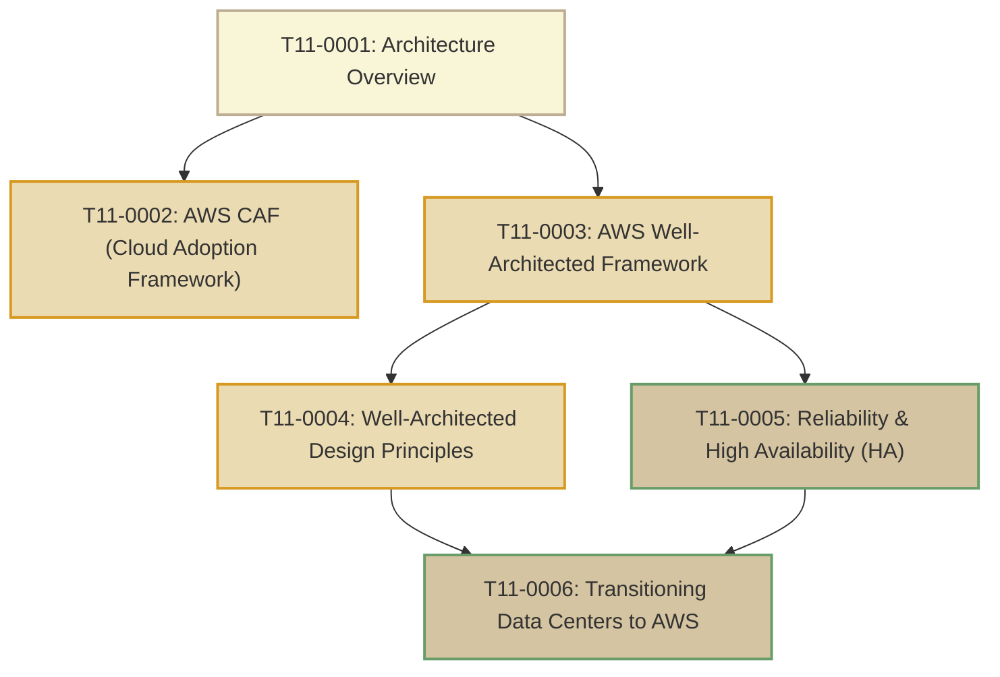

# T11: AWS Architecture

> **Course**: AWS re/Start Curriculum  
> **Module**: T11 – AWS Architecture (`M07`)  
> **Total Guides**: 6 Study Guides  
> **Status**: Completed (100%)

---

## Module Overview

The **AWS Architecture** module establishes the core mental models, frameworks, and architectural principles required to design resilient, scalable, and cost-effective cloud solutions on Amazon Web Services. It transitions practitioners from traditional monolithic data center designs to modern cloud-native architectures guided by the AWS Cloud Adoption Framework (AWS CAF) and the AWS Well-Architected Framework.

---

## Study Guide Index

| # | Study Guide | Primary Topics Covered |
|---|-------------|------------------------|
| **0001** | [T11-0001-RSARCH_EN-US_SG_M07_OVERVIEW.md](file:///work/tmp/aws-cf/T11-AWS_Architecture/T11-0001-RSARCH_EN-US_SG_M07_OVERVIEW.md) | Module roadmap, Solutions Architect role, decoupling, elasticity, fail-fast mindset, architectural tradeoffs |
| **0002** | [T11-0002-RSARCH_EN-US_SG_M07_AWSCAF.md](file:///work/tmp/aws-cf/T11-AWS_Architecture/T11-0002-RSARCH_EN-US_SG_M07_AWSCAF.md) | AWS Cloud Adoption Framework (AWS CAF), 6 perspectives (Business, People, Governance, Platform, Security, Operations), Envision/Align/Launch/Scale phases |
| **0003** | [T11-0003-RSARCH_EN-US_SG_M07_AWSWELLARCHITECTED.md](file:///work/tmp/aws-cf/T11-AWS_Architecture/T11-0003-RSARCH_EN-US_SG_M07_AWSWELLARCHITECTED.md) | AWS Well-Architected Framework, 6 Pillars, AWS Well-Architected Tool, identifying HRIs and MRIs, partner program |
| **0004** | [T11-0004-RSARCH_EN-US_SG_M07_WAPRINCIPLES.md](file:///work/tmp/aws-cf/T11-AWS_Architecture/T11-0004-RSARCH_EN-US_SG_M07_WAPRINCIPLES.md) | 6 General Design Principles: stop guessing capacity, test at scale, automate experimentation, evolutionary architectures, data-driven, game days |
| **0005** | [T11-0005-RSARCH_EN-US_SG_M07_RELIABLEHIGHLYAVAILABLE.md](file:///work/tmp/aws-cf/T11-AWS_Architecture/T11-0005-RSARCH_EN-US_SG_M07_RELIABLEHIGHLYAVAILABLE.md) | Reliability vs HA vs Fault Tolerance, MTBF/MTTR mathematics, "The Nines" downtime reference table, Multi-AZ design |
| **0006** | [T11-0006-RSARCH_EN-US_SG_M07_TRANSITIONDATACENTER.md](file:///work/tmp/aws-cf/T11-AWS_Architecture/T11-0006-RSARCH_EN-US_SG_M07_TRANSITIONDATACENTER.md) | On-premises multi-tier DC to AWS migration, component-by-component mapping, Gartner 7 Rs strategies, AWS migration services |

---

## Core Architecture Principles Summary

1. **Stop Guessing Capacity Needs**: Leverage automated elasticity (EC2 Auto Scaling, serverless compute) rather than over-provisioning static hardware.
2. **Test Systems at Production Scale**: Spin up complete production-like staging environments on demand, conduct load tests, and terminate them to pay only for test duration.
3. **Automate Architectural Experimentation**: Treat Infrastructure as Code (IaC) via AWS CloudFormation to replicate configurations consistently and safely.
4. **Allow for Evolutionary Architectures**: Decouple components into microservices and event-driven patterns so systems can evolve without full rebuilds.
5. **Drive Architectures Using Data**: Collect metrics and telemetry with Amazon CloudWatch and CloudTrail to make evidence-based design iterations.
6. **Improve Through Game Days**: Regularly rehearse crisis responses, simulate system failures, and conduct chaos engineering (AWS FIS) before real disruptions occur.
