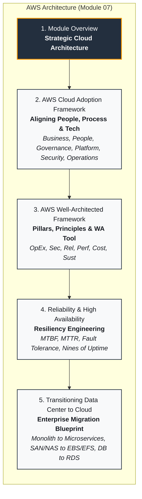
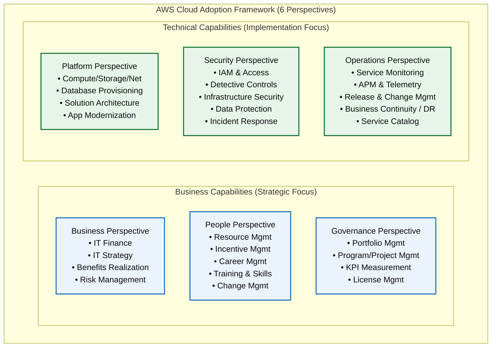
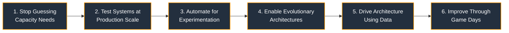
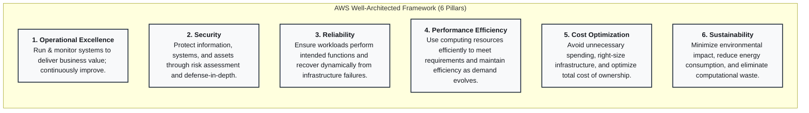
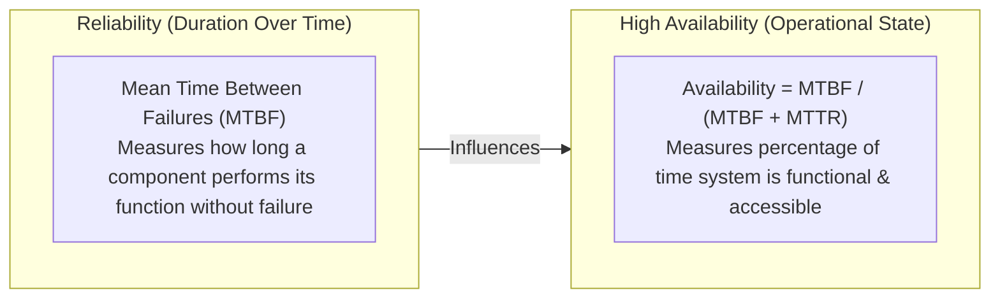
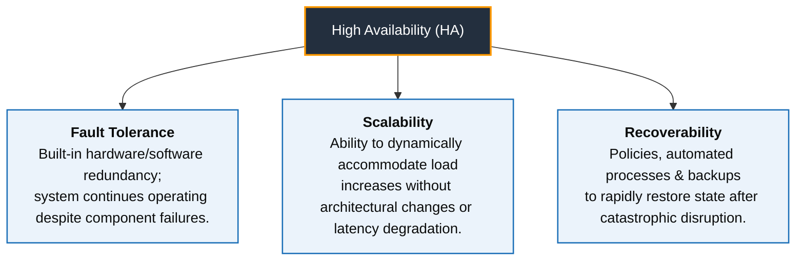
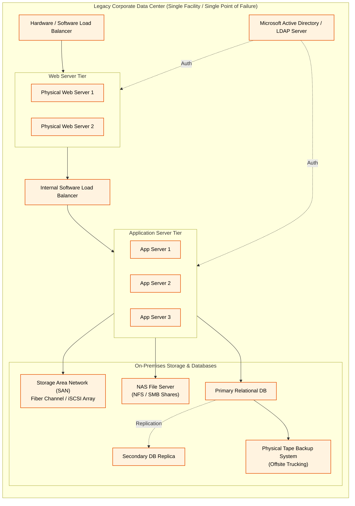
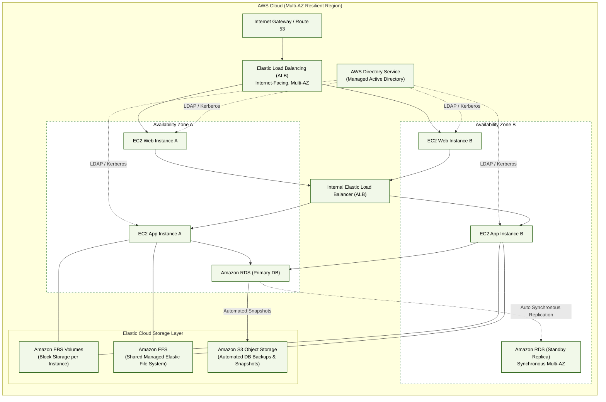
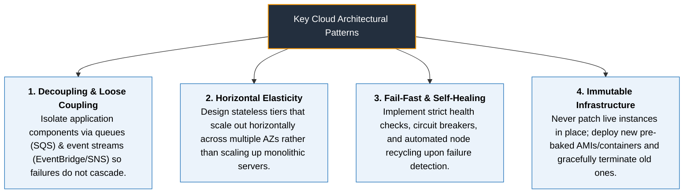

# 🏗️ AWS Architecture: Module 07 Overview & Cloud Adoption Blueprint

> **Course**: AWS re/Start  
> **Module**: AWS Architecture  
> **Source Document**: `T11-0001-RSARCH_EN-US_SG_M07_OVERVIEW.pdf`  
> **Target Audience**: AWS re/Start Learners / Solutions Architect Candidates / Cloud Practitioners  

---

## 🎯 Module Overview & Strategic Importance of Cloud Architecture

In enterprise technology, architecture is the discipline of translating business vision, operational requirements, and technical constraints into robust, scalable, secure, and cost-effective distributed systems. In traditional IT environments, architectural decisions were constrained by physical data centers, long procurement cycles, static hardware allocations, and rigid capital expenditure budgets. 

The cloud computing model fundamentally transforms systems architecture from a world of physical constraints to one of software-defined, programmable, and elastic infrastructure. Cloud architecture is not merely about hosting virtual servers in remote facilities; it is a holistic paradigm shift encompassing organizational alignment, operational modernization, automated governance, fault-tolerant design, and continuous optimization.

This module provides the architectural foundation for the entire AWS curriculum. It equips cloud practitioners and aspiring Solutions Architects with the conceptual frameworks, design principles, mathematical reliability models, and workload transformation methodologies required to design modern cloud solutions on Amazon Web Services (AWS).

```
┌────────────────────────────────────────────────────────────────────────┐
│               Core Imperatives of Modern Cloud Architecture            │
├────────────────────────────────────────────────────────────────────────┤
│  1. Business Alignment: Tie technical capability directly to ROI       │
│  2. Architectural Resiliency: Design with failure as a given premise   │
│  3. Elastic Scaling: Match supply dynamically to real-time demand      │
│  4. Security by Design: Apply least privilege & defense-in-depth       │
│  5. Operational Velocity: Automate provisioning, testing, and recovery │
│  6. Sustainable Footprint: Maximize resource utilization efficiency    │
└────────────────────────────────────────────────────────────────────────┘
```

---

## 📌 Learning Objectives

- [ ] **Analyze the AWS Cloud Adoption Framework (AWS CAF)**: Understand how the AWS CAF bridges organizational silos across six business and technical perspectives (Business, People, Governance, Platform, Security, Operations) to accelerate the digital transformation journey.
- [ ] **Master the AWS Well-Architected Framework**: Internalize the six foundational pillars—Operational Excellence, Security, Reliability, Performance Efficiency, Cost Optimization, and Sustainability—and apply their underlying design principles to cloud workloads.
- [ ] **Evaluate General Cloud Design Principles**: Contrast traditional hardware assumptions with cloud-native practices, including capacity demand matching, production-scale experimentation, automation, evolutionary architectures, data-driven decisions, and game days.
- [ ] **Differentiate Reliability and High Availability (HA)**: Formulate mathematical models of availability, define Mean Time Between Failures (MTBF) and Mean Time to Repair (MTTR), calculate "nines" of uptime, and analyze architectural trade-offs.
- [ ] **Synthesize the Factors of High Availability**: Examine how fault tolerance, scalability, and recoverability combine to deliver continuous operational availability without manual human intervention.
- [ ] **Transition an On-Premises Data Center to AWS**: Map legacy monolithic tiers (compute servers, LDAP, software load balancers, SAN block arrays, NAS file shares, relational databases, tape archives) to modern, resilient, managed AWS cloud services.
- [ ] **Implement Cloud-Native Design Patterns**: Apply decoupling, horizontal elasticity, fail-fast mechanics, and immutable infrastructure patterns to eliminate single points of failure.
- [ ] **Understand the Solutions Architect Role**: Define how architects evaluate trade-offs, govern technical risk, and drive successful cloud migration strategies.

---

## 🗺️ Module Curriculum Roadmap

The following architectural roadmap outlines the four progressive domains comprising Module 07 in the AWS re/Start curriculum:



---

## 🧭 1. The AWS Cloud Adoption Framework (AWS CAF)

### Holistic Cloud Transformation
Moving to the cloud is not merely a technical migration—it is an organizational transformation. When an enterprise migrates its workloads to AWS, technical readiness alone is insufficient. If governance models, financial tracking, operational processes, and team skills do not modernize in tandem, migrations stall or fail to deliver expected business value.

The **AWS Cloud Adoption Framework (AWS CAF)** provides actionable guidance and best practices to help organizations structure, plan, and execute a comprehensive cloud adoption journey. It aligns three fundamental pillars of modern enterprise capability: **People**, **Processes**, and **Technology**.



### The Six CAF Perspectives

The AWS CAF organizes complex organizational transformation into six distinct perspectives, divided equally between business-oriented capabilities and technical capabilities:

| Perspective | Primary Stakeholders | Core Focus & Responsibilities | Key Capabilities |
| :--- | :--- | :--- | :--- |
| **Business** | Business Managers, Finance Managers, Budget Owners, Strategy Stakeholders | Ensures that IT strategy aligns directly with business objectives and that technology investments yield measurable business outcomes and positive ROI. | • IT Finance & TCO Analysis<br>• IT Strategy Alignment<br>• Benefits Realization Tracking<br>• Business Risk Management |
| **People** | Human Resources, Talent Acquisition, People Managers, Training Directors | Evaluates organizational structures, organizational change management (OCM), skill deficits, and evolves teams to support cloud-native operating models. | • Resource Management<br>• Incentive & Reward Models<br>• Career Path Evolution<br>• Training & Skills Development<br>• Organizational Change Management |
| **Governance** | Chief Information Officer (CIO), Enterprise Architects, PMO, Portfolio Managers | Establishes the controls, processes, and measurement frameworks to maximize IT value, ensure regulatory compliance, and optimize software licenses. | • Portfolio Management<br>• Program & Project Management<br>• Business Performance Metrics<br>• Software License Management |
| **Platform** | Chief Technology Officer (CTO), Systems Architects, Solutions Architects, Tech Leads | Details the target-state IT architecture, design patterns, infrastructure provisioning, and application modernizations required to execute workloads on AWS. | • Compute, Network & Storage Provisioning<br>• Database Provisioning<br>• Systems & Solutions Architecture<br>• Application Modernization |
| **Security** | Chief Information Security Officer (CISO), Security Directors, Security Analysts | Directs security policies, defense-in-depth architectures, cryptographic compliance, and identity governance to satisfy confidentiality, integrity, and availability. | • Identity & Access Management (IAM)<br>• Detective Controls & Logging<br>• Infrastructure & Network Security<br>• Data Protection (Encryption)<br>• Incident Response & Forensics |
| **Operations** | IT Operations Managers, Site Reliability Engineers (SRE), IT Support Leads | Defines how workloads are deployed, monitored, supported, and sustained throughout their operational lifecycle to meet service-level agreements (SLAs). | • Service Monitoring & APM<br>• Resource Inventory Management<br>• Release & Change Management<br>• Business Continuity & Disaster Recovery<br>• IT Service Catalog Delivery |

> [!NOTE]
> **CAF in Practice**: The AWS CAF is structured to turn migration uncertainty into actionable workstreams. Before a single production workload moves, business leaders and architects run an **AWS CAF Action Plan** or **Cloud Readiness Assessment** to systematically identify cross-departmental readiness gaps.

---

## 🏛️ 2. The AWS Well-Architected Framework

### Purpose and Architecture Review Methodology
The **AWS Well-Architected Framework** provides a consistent, structured approach for customers and partners to evaluate cloud architectures against established best practices. Built upon lessons learned from reviewing tens of thousands of customer systems across Amazon's global footprint, the framework provides actionable guidelines, reference architectures, and self-assessment questions.

Rather than treating architecture as a static blueprint reviewed once prior to go-live, the Well-Architected methodology treats cloud systems as evolutionary constructs evaluated continuously via the **AWS Well-Architected Tool** in the AWS Management Console.

```
┌────────────────────────────────────────────────────────────────────────┐
│               The 6 Pillars of the Well-Architected Framework          │
├────────────────────────────────────────────────────────────────────────┤
│  1. Operational Excellence  ── Run & monitor systems; evolve procedures│
│  2. Security                ── Protect data, assets & IAM boundaries   │
│  3. Reliability             ── Recover dynamically; mitigate disruptions│
│  4. Performance Efficiency  ── Use compute resources efficiently       │
│  5. Cost Optimization       ── Eliminate waste; maximize ROI           │
│  6. Sustainability          ── Minimize long-term environmental impact │
└────────────────────────────────────────────────────────────────────────┘
```

---

### Six General Design Principles for Cloud Architecture

The Well-Architected Framework identifies six overarching design principles that facilitate high-quality cloud engineering:



#### 1. Stop Guessing Your Capacity Needs
* **Traditional IT Constraint**: In on-premises data centers, capacity decisions require purchasing servers months in advance based on rough forecasts. Underestimating capacity leads to catastrophic outages during traffic spikes; overestimating capacity strands capital in idle, depreciating silicon.
* **Cloud Architecture Solution**: Eliminate upfront capacity guesswork. Provision only what is currently required and leverage **Amazon EC2 Auto Scaling** and serverless computing to scale compute resources dynamically up or down in real-time as application demand fluctuates.

#### 2. Test Systems at Production Scale
* **Traditional IT Constraint**: Duplicating a production data center for load testing is prohibitively expensive. Testing on fractional staging environments fails to uncover concurrency bottlenecks, storage saturation, and networking latencies that emerge under full production volume.
* **Cloud Architecture Solution**: In the cloud, provision a full-scale replica of the production environment on demand, run comprehensive load and stress tests, capture empirical telemetry, and immediately decommission the resources. Organizations pay only for the fraction of an hour the test environment ran.

#### 3. Automate to Make Architectural Experimentation Easier
* **Traditional IT Constraint**: Manual server configuration, physical cabling, and manual operating system patching create configuration drift and make architecture testing slow, risky, and error-prone.
* **Cloud Architecture Solution**: Use **Infrastructure as Code (IaC)** with services like **AWS CloudFormation** or the **AWS Cloud Development Kit (CDK)**. Automate environment creation, track configuration changes in Git version control, execute repeatable rollouts, and automatically revert parameters if an update fails.

#### 4. Provide for Evolutionary Architectures
* **Traditional IT Constraint**: In physical data centers, architecture choices are static, one-time capital commitments locked in for 3 to 7 years. Changing a storage backend or database engine requires physically swapping racks, cabling, and controllers.
* **Cloud Architecture Solution**: Cloud infrastructure is programmable and modular. Systems evolve seamlessly over time. Architects can rapidly adopt new innovations—such as migrating from virtual machines to containerized workloads on Amazon ECS/EKS or serverless functions with AWS Lambda—with minimal risk and no hardware sunk costs.

#### 5. Drive Architectures Using Data
* **Traditional IT Constraint**: Traditional architecture decisions rely heavily on historical intuition, vendor marketing, or arbitrary corporate defaults because detailed telemetry across the physical stack is difficult to collect and aggregate.
* **Cloud Architecture Solution**: Modern cloud systems emit comprehensive telemetry. Architects collect operational telemetry using **Amazon CloudWatch**, analytical logs through **AWS CloudTrail**, and cost allocation tags in **AWS Cost Explorer** to make empirical, fact-based engineering adjustments.

#### 6. Improve Through Game Days
* **Traditional IT Constraint**: On-premises disaster recovery runbooks are rarely exercised until an actual catastrophic event strikes in production, resulting in prolonged outages and panic.
* **Cloud Architecture Solution**: Regularly schedule "Game Days"—controlled chaos engineering simulations where engineers inject synthetic faults into systems to validate how automated self-healing mechanisms and operational response teams perform. This methodology was pioneered by Netflix using **Chaos Monkey** (part of the Simian Army suite) on AWS, proving that constant, simulated failure builds ultimate operational resilience.

---

### Deep Dive: The Six Well-Architected Pillars



#### Pillar 1: Operational Excellence
* **Focus**: The ability to support development, run workloads effectively, gain insight into their operations, and continuously improve supporting processes and procedures.
* **Key Design Principles**:
  * *Perform operations as code*: Define operational procedures as code and trigger them automatically on events.
  * *Make frequent, small, reversible changes*: Design workloads to allow components to be updated in small increments that can be quickly rolled back if an error occurs.
  * *Refine operations procedures frequently*: As workloads evolve, regularly review and refine operational runbooks.
  * *Anticipate failure*: Perform pre-mortem exercises to identify potential sources of failure and remove single points of failure.
  * *Learn from all operational failures*: Conduct root cause analyses (RCAs) and post-incident reviews without blame to drive systemic remediation.

#### Pillar 2: Security
* **Focus**: The ability to protect data, systems, and assets while taking advantage of cloud technologies to improve your security posture.
* **Key Design Principles**:
  * *Implement a strong identity foundation*: Adhere to the principle of least privilege, enforce Multi-Factor Authentication (MFA), and eliminate long-lived static credentials.
  * *Enable traceability*: Monitor, alert, and audit actions and changes to the environment in real-time using AWS CloudTrail and Amazon GuardDuty.
  * *Apply security at all layers*: Implement defense-in-depth across edge networks, VPC subnets, security groups, host operating systems, applications, and storage volumes.
  * *Automate security best practices*: Codify automated security incident detection, remediation, and patch management.
  * *Protect data in transit and at rest*: Use strong encryption protocols (TLS/HTTPS for data in transit; KMS envelope encryption with AES-256 for data at rest).
  * *Keep people away from data*: Minimize manual direct access to raw production data using automated tooling and API interfaces.
  * *Prepare for security events*: Execute automated incident response simulations and forensic investigations.

#### Pillar 3: Reliability
* **Focus**: The ability of a workload to perform its intended function correctly and consistently when it is expected to, and recover dynamically from infrastructure or service disruptions.
* **Key Design Principles**:
  * *Automatically recover from failure*: Monitor Key Performance Indicators (KPIs) and trigger automated remediation (e.g., auto-terminating unhealthy instances and provisioning replacements).
  * *Test recovery procedures*: Simulate real-world failure modes to validate automated recovery workflows.
  * *Scale horizontally to increase aggregate workload availability*: Replace a single large resource with multiple smaller resources to minimize the blast radius of any individual failure.
  * *Stop guessing capacity*: Monitor demand and automate elastic resource allocation to avoid saturation.
  * *Manage change in automation*: Execute infrastructure updates using automated deployment pipelines rather than manual operator intervention.

#### Pillar 4: Performance Efficiency
* **Focus**: The ability to use computing resources efficiently to meet system requirements, and to maintain that efficiency as demand changes and technologies evolve.
* **Key Design Principles**:
  * *Democratize advanced technologies*: Consume complex technologies (NoSQL databases, machine learning, streaming ingestion) as managed services rather than maintaining custom implementations.
  * *Go global in minutes*: Deploy applications globally into multiple AWS Regions and CloudFront edge locations to reduce latency for end-users.
  * *Use serverless architectures*: Eliminate operational overhead of managing physical or virtual servers by running event-driven compute (AWS Lambda, AWS Fargate).
  * *Experiment more often*: Perform comparative testing with different instance types, storage classes, and database configurations.
  * *Consider mechanical sympathy*: Select the technological tool or service that best aligns with the operational characteristics of the workload (e.g., in-memory caching vs. disk-backed storage).

#### Pillar 5: Cost Optimization
* **Focus**: The ability to run systems to deliver business value at the lowest price point.
* **Key Design Principles**:
  * *Implement cloud financial management (FinOps)*: Establish cross-functional accountability for cloud spending across engineering and finance teams.
  * *Adopt a consumption model*: Pay only for the computing resources consumed, shutting down idle dev/test resources when not in use.
  * *Measure overall efficiency*: Quantify business output against cloud cost (e.g., cost per customer transaction or cost per active user).
  * *Stop spending money on undifferentiated heavy lifting*: Offload data center operations, racking, stacking, and power provisioning to AWS so engineers can focus on business value.
  * *Analyze and attribute expenditure*: Use resource tagging to accurately attribute cloud spending to specific departments, projects, and revenue streams.

#### Pillar 6: Sustainability
* **Focus**: The ability to minimize the environmental impacts of running cloud workloads, with emphasis on energy consumption and computational efficiency.
* **Key Design Principles**:
  * *Understand your impact*: Measure carbon footprint and resource utilization across the entire lifecycle of the workload.
  * *Establish sustainability goals*: Set explicit targets to reduce compute, storage, and networking resources per transaction.
  * *Maximize utilization*: Right-size resources so underlying hardware operates at high efficiency (e.g., running one host at 60% utilization consumes significantly less baseline power than running two hosts at 30% utilization).
  * *Anticipate and adopt more efficient hardware and software offerings*: Rapidly adopt next-generation energy-efficient architectures (such as AWS Graviton processors).
  * *Use managed services*: Maximize shared multitenant efficiency across AWS managed services (e.g., Amazon S3 Lifecycle policies, DynamoDB).
  * *Reduce the downstream impact of your cloud workloads*: Minimize client-side device processing requirements and network transmission payloads.

---

## ⚖️ 3. Reliability vs. High Availability

In distributed cloud computing, **Reliability** and **High Availability** are interrelated but fundamentally distinct architectural properties. 

As famously stated by **Dr. Werner Vogels**, Chief Technology Officer of Amazon.com:
> *"Everything fails, all the time."*

Because physical components, network switches, optical cables, memory chips, and software applications inevitably experience failure, resilient cloud architecture must be engineered with failure as a standard operational assumption.



### Definitions and Mathematical Formulations

#### 1. Reliability
* **Definition**: Reliability is a measure of the probability that a resource or system will perform its intended function without failure over a specified period under stated operating conditions.
* **Core Metrics**:
  * **MTBF (Mean Time Between Failures)**: The average operational time elapsed between inherent failures of a repairable system.
  * **Failure Rate ($\lambda$)**: The frequency with which an engineered system fails, typically expressed as:
    $$\lambda = \frac{1}{\text{MTBF}}$$

#### 2. High Availability (HA)
* **Definition**: High Availability is a measure of the percentage of time that a system remains operational, accessible, and capable of servicing requests within acceptable performance parameters without requiring human intervention.
* **Core Metric**:
  * **Availability ($A$)**: Expressed as the ratio of operational uptime to total scheduled time:
    $$A = \frac{\text{Uptime}}{\text{Total Time}} = \frac{\text{MTBF}}{\text{MTBF} + \text{MTTR}}$$
  * Where **MTTR (Mean Time to Repair)** is the average time required to detect, isolate, repair, and restore a failed component back to service.

> [!IMPORTANT]
> **Reliability vs. High Availability Contrast**:
> * A component can be **highly reliable** (runs for 6 months without failing) but have **low availability** if, upon failure, it takes 3 weeks to repair (high MTTR).
> * Conversely, a cloud system can be built out of **low-reliability, commodity virtual machines** that fail frequently, yet achieve **extremely high availability** if automated health checks and elastic load balancers restore or reroute traffic within seconds (near-zero MTTR).

---

### The "Nines" of Availability

System availability is universally categorized by the number of "nines" achieved. The following table illustrates the allowable downtime per time interval for varying availability tiers:

| Availability Target | Classification | Allowable Downtime / Year | Allowable Downtime / Month | Allowable Downtime / Week | Architectural Implications & Example Workloads |
| :---: | :---: | :---: | :---: | :---: | :--- |
| **99.0%** | "Two Nines" | 3.65 days | 7.30 hours | 1.68 hours | Internal non-critical batch processing; staging and dev environments. |
| **99.9%** | "Three Nines" | 8.77 hours | 43.8 minutes | 10.1 minutes | Standard internal corporate applications; Single-AZ architectures. |
| **99.99%** | "Four Nines" | 52.6 minutes | 4.38 minutes | 1.01 minutes | Critical production e-commerce, banking, and SaaS; Multi-AZ deployments with automated failover. |
| **99.999%** | "Five Nines" | 5.25 minutes | 26.3 seconds | 6.05 seconds | Mission-critical financial transaction processing, telecommunications, healthcare; Multi-Region active-active designs. |

---

### Prime Factors of High Availability

High Availability in cloud architecture is governed by three primary engineering pillars:



1. **Fault Tolerance**:
   * Refers to the built-in redundancy of system components that allows an application to remain operational even when underlying infrastructure elements fail.
   * *Traditional Fault Tolerance*: Relies on specialized, expensive physical hardware (dual power supplies, ECC memory, mirrored CPU sockets) to mask hardware defects instantaneously. It does not protect against software bugs or operational errors.
   * *Cloud Fault Tolerance*: Relies on distributed, software-defined resilience across isolated fault domains (Availability Zones).
2. **Scalability**:
   * The architectural capacity to accommodate growth in transaction volume or data throughput without degrading performance or requiring system redesign.
   * Auto Scaling ensures that spikes in user demand do not saturate hardware and cause cascading failure outages.
3. **Recoverability**:
   * The processes, automated procedures, and data replication strategies that ensure fast restoration of service and zero or minimal data loss following a catastrophic event.
   * Quantified through **Recovery Time Objective (RTO)** (maximum allowable downtime) and **Recovery Point Objective (RPO)** (maximum allowable data loss measured in time).

---

### Architectural Trade-Offs: The Availability-Cost Curve

Achieving higher tiers of availability is not simply a matter of toggling a setting; each additional "nine" of availability incurs an exponential increase in infrastructure complexity, replication overhead, and financial cost:

```
Cost / Complexity
  ▲
  │                                                      ● Five 9s (99.999%)
  │                                                     /  Multi-Region Active-Active
  │                                                    /   DynamoDB Global Tables
  │                                                   /
  │                                                  ● Four 9s (99.99%)
  │                                                 /  Multi-AZ Auto Scaling
  │                                                /   RDS Multi-AZ Failover
  │                                               /
  │                                 ● Three 9s (99.9%)
  │                                /  Single-AZ Redundancy
  │                 ● Two 9s (99%) /  Scheduled Cold Backups
  │                /
  └────────────────────────────────────────────────────────► Availability (%)
```

* **On-Premises High Availability**: Prohibitively expensive because it requires building redundant physical data centers in geographically separated regions, purchasing duplicate enterprise storage area networks (SANs), maintaining dark fiber links, and leasing standby power generators.
* **AWS Cloud High Availability**: Democritizes resilience by providing global infrastructure building blocks:
  * Redundant, isolated physical data centers bundled into **Availability Zones (AZs)**.
  * Multiple AZs connected via low-latency, private high-speed fiber within each **AWS Region**.
  * Native managed fault-tolerant services (e.g., Amazon S3 providing 99.999999999% [11 nines] of data durability across at least 3 AZs).

---

## 🏢 4. Transitioning an On-Premises Data Center to the Cloud

### The Traditional On-Premises Corporate Data Center

A standard multi-tier corporate data center architecture typically relies on tightly coupled, monolithic hardware appliances located within a single physical facility:



#### Vulnerabilities of Legacy On-Premises Environments:
1. **Single Point of Failure (SPOF)**: A failure in local utility power, cooling, or core fiber entry can take down the entire corporate enterprise.
2. **Rigid Capacity**: If web traffic spikes beyond physical server CPU limits, requests drop. Procurement of new servers requires weeks or months.
3. **Manual Disaster Recovery**: Backups stored on physical tapes trucked offsite yield RTOs of several days and RPOs measured in 24-hour increments.
4. **Maintenance Burden**: Systems engineering teams spend extensive effort patching firmware, upgrading SAN controllers, and managing physical disk arrays ("undifferentiated heavy lifting").

---

### The Modern Cloud-Native AWS Architecture

Transitioning this workload to AWS replaces physical appliances with resilient, elastic, managed cloud primitives spread across multiple Availability Zones:



---

### Component-by-Component Mapping: On-Premises vs. AWS

The following matrix provides an exhaustive mapping of traditional on-premises data center infrastructure to modern AWS services:

| On-Premises Infrastructure | Equivalent AWS Service | Architectural Modernization & Operational Benefits |
| :--- | :--- | :--- |
| **Physical Web & Application Servers** | **Amazon Elastic Compute Cloud (Amazon EC2)** | Run instances supporting Windows Server, Linux (Amazon Linux, Ubuntu, RHEL, SUSE). Instances can scale automatically within an **Auto Scaling group** across multiple AZs to absorb traffic spikes and replace unhealthy nodes automatically. |
| **Microsoft Active Directory / LDAP Server** | **AWS Directory Service** | Fully managed Microsoft Active Directory in the AWS Cloud. Enables seamless single sign-on (SSO), joins EC2 instances to the domain, and allows secure hybrid trusts with existing on-premises Active Directory trees via AWS Direct Connect or VPN. |
| **Software / Hardware Load Balancers** (e.g., F5, HAProxy) | **Elastic Load Balancing (ELB / ALB / NLB)** | Highly available, fully managed load balancing service that automatically scales to handle incoming traffic. Conducts continuous health checks, terminates TLS/SSL certificates, and reroutes traffic away from failed compute nodes. |
| **Storage Area Network (SAN)** (Fibre Channel, iSCSI arrays) | **Amazon Elastic Block Store (Amazon EBS)** | High-performance, persistent block storage volumes mounted directly to individual EC2 instances. Provides independent lifecycle, automatic replication within an AZ, and instant point-in-time snapshots stored durably in Amazon S3. |
| **Network Attached Storage (NAS)** (NFS / SMB file servers) | **Amazon Elastic File System (Amazon EFS)** | Serverless, fully elastic network file system conforming to POSIX standards. Grows and shrinks automatically as files are added or deleted; concurrently mounted across thousands of EC2 instances spanning multiple AZs. |
| **Relational Database Servers** (Oracle, SQL Server, MySQL, Postgres) | **Amazon Relational Database Service (Amazon RDS)** | Fully managed relational database engine supporting Aurora, PostgreSQL, MySQL, MariaDB, Oracle, and SQL Server. Automates provisioning, OS patching, automated point-in-time backups, and Multi-AZ synchronous standby failover in <60 seconds. |
| **Physical Tape Backup Libraries** (LTO tapes, robotic changers) | **Amazon Simple Storage Service (Amazon S3) & S3 Glacier** | Internet-scale object storage delivering 99.999999999% (11 nines) of data durability. Automates lifecycle management from active S3 Standard to low-cost archival storage classes (S3 Glacier Flexible / Deep Archive), eliminating tape degradation and logistics. |

---

### Economic & Operational Value Drivers of Cloud Migration

Organizations migrating enterprise data centers to AWS realize six core transformative advantages:


1. **Trade Upfront Capital Expense for Variable Expense**:
   * Instead of committing millions of dollars in upfront capital investments for hardware racks that depreciate over years, pay only for computing resources consumed, billed by the second or minute.
2. **Benefit from Massive Economies of Scale**:
   * Because hundreds of thousands of customers aggregate usage on AWS, AWS achieves massive purchasing economies that translate into lower pay-as-you-go prices and continuous historical price reductions.
3. **Eliminate Guessing Capacity Needs**:
   * Replace fixed physical server ceilings with elastic auto-scaling infrastructure that expands during peak seasonal bursts (e.g., Black Friday) and shrinks during off-peak hours to prevent overpayment.
4. **Increase Speed and Agility**:
   * Reduce the time required to provision infrastructure from weeks or months down to minutes. Developers spin up complex testing or production environments with a single API call or CloudFormation template.
5. **Stop Spending Money on Undifferentiated Heavy Lifting**:
   * Free IT staff from physical data center chores—server racking, cooling maintenance, UPS battery replacements, and hardware diagnostics—allowing human talent to focus on customer-facing software innovations.
6. **Go Global in Minutes**:
   * Deploy applications into multiple AWS Regions around the globe with minimal latency for international customers using AWS's private high-speed global backbone.

---

## 🛠️ 5. Architectural Design Patterns for Cloud Resiliency

Modern cloud architecture incorporates specific software and infrastructure patterns designed to isolate failures and guarantee business continuity:



### Pattern 1: Decoupling & Loose Coupling
* **Monolithic Tightly Coupled Risk**: In traditional architectures, a web server invokes an application tier synchronously over RPC; if the database slows down, the application tier runs out of threads, which in turn exhausts web server connections, causing a complete system outage.
* **Cloud Architecture Solution**: Decouple components using asynchronous message buffers like **Amazon Simple Queue Service (Amazon SQS)** and **Amazon Simple Notification Service (Amazon SNS)**. If the downstream consumer fails or slows down, messages buffer safely in the queue without crashing upstream components.

### Pattern 2: Horizontal Elasticity & Statelessness
* **Principle**: Servers should be designed as disposable, stateless resources ("cattle, not pets"). 
* **Implementation**: Store session state in centralized, low-latency, external managed databases or memory caches (such as **Amazon DynamoDB** or **Amazon ElastiCache**). Web and application servers remain completely stateless, allowing Auto Scaling groups to add or terminate instances on demand without disrupting active user sessions.

### Pattern 3: Fail-Fast & Graceful Degradation
* **Principle**: Systems should quickly acknowledge downstream service failures, reject impossible requests without wasting computing cycles, and return cached or degraded responses rather than hanging indefinitely.
* **Implementation**: Combine client-side exponential backoff with jitter and architectural circuit breakers to avoid overwhelming recovering services with "thundering herd" traffic.

### Pattern 4: Immutable Infrastructure via Code
* **Principle**: Production servers should never be modified interactively (no manual SSH or RDP configuration changes).
* **Implementation**: Whenever code updates, patches, or configuration changes are required, bake a new **Amazon Machine Image (AMI)** or container image, deploy it via CloudFormation, route traffic through Elastic Load Balancing, and terminate the previous generation instances.

---

## 🧑‍💻 6. The Role of the Solutions Architect in Cloud Migrations

An **AWS Solutions Architect** plays a pivotal strategic role bridging organizational business goals with distributed systems engineering. Solutions Architects are responsible for:

1. **Translating Business Requirements into Architectural Specifications**:
   * Evaluating business constraints (budget, compliance, RTO/RPO targets, SLA commitments) and architecting matching AWS cloud solutions.
2. **Balancing Cross-Pillar Trade-Offs**:
   * Navigating the inherent engineering tensions between the Well-Architected Framework's pillars (e.g., increasing availability and redundancy usually increases cost; maximizing performance may require specialized hardware that impacts sustainability).
3. **Leading Enterprise Migration Strategies (The "6 Rs")**:
   * Classifying enterprise workloads into proven cloud migration pathways:
     * **Rehost** ("Lift and Shift"): Moving applications without architectural changes.
     * **Replatform** ("Lift, Tinker, and Shift"): Adopting managed database engines (e.g., migrating self-hosted MySQL to Amazon RDS) without core application rewrite.
     * **Repurchase** ("Drop and Shop"): Transitioning to a SaaS platform.
     * **Refactor / Re-architect**: Redesigning applications natively using microservices, containers, and serverless technologies.
     * **Retire**: Decommissioning unneeded, legacy applications.
     * **Retain**: Keeping specific legacy systems on-premises until a future deprecation milestone.

---

## 📝 Knowledge Check & Review Questions

Test your understanding of the foundational concepts introduced in Module 07:

### Question 1
An enterprise is migrating an on-premises web application to AWS. In their physical data center, the application relies on an enterprise NFS file server shared among multiple application hosts. Which AWS managed service provides an elastic, POSIX-compliant, Multi-AZ shared file system that can directly replace the legacy NFS server?
- [ ] A) Amazon Elastic Block Store (Amazon EBS)
- [ ] B) Amazon Elastic File System (Amazon EFS)
- [ ] C) Amazon S3 Glacier
- [ ] D) AWS Storage Gateway Volume Gateway

**Answer**: **B) Amazon Elastic File System (Amazon EFS)**  
*Explanation*: Amazon EFS is an elastic, fully managed file system designed to be mounted concurrently by multiple EC2 instances across multiple Availability Zones, making it the direct cloud replacement for legacy on-premises NAS/NFS file servers. Amazon EBS volumes can only be attached to single instances (unless using EBS Multi-Attach on specific Nitro volume types within a single AZ).

---

### Question 2
Under the AWS Well-Architected Framework, which pillar specifically focuses on the ability to run workloads effectively, gain visibility into operations, and continuously improve supporting processes and procedures?
- [ ] A) Reliability
- [ ] B) Operational Excellence
- [ ] C) Security
- [ ] D) Performance Efficiency

**Answer**: **B) Operational Excellence**  
*Explanation*: The Operational Excellence pillar focuses on executing operations as code, making frequent, small, reversible changes, anticipating failure, and continually evolving runbooks and operating procedures.

---

### Question 3
An architect designs a system targeting an annual availability of 99.99% ("four nines"). What is the maximum allowable cumulative downtime permitted for this workload across an entire operational year?
- [ ] A) 3.65 days
- [ ] B) 8.77 hours
- [ ] C) 52.6 minutes
- [ ] D) 5.25 minutes

**Answer**: **C) 52.6 minutes**  
*Explanation*: $100\% - 99.99\% = 0.01\%$ allowable downtime. $365 \text{ days} \times 24 \text{ hours/day} \times 60 \text{ minutes/hour} = 525,600 \text{ minutes/year}$. $525,600 \times 0.0001 = 52.56 \text{ minutes}$ (approximately 52.6 minutes).

---

### Question 4
Which core perspective of the AWS Cloud Adoption Framework (AWS CAF) focuses on evaluating organizational structure, identifying skills gaps, modernizing career paths, and managing organizational change management (OCM)?
- [ ] A) Governance Perspective
- [ ] B) Business Perspective
- [ ] C) Operations Perspective
- [ ] D) People Perspective

**Answer**: **D) People Perspective**  
*Explanation*: The People perspective helps HR, staffing, and organizational leaders evaluate team roles, address skill and process deficits, and lead organizational change management to support cloud agility.

---

### Question 5
Why does Werner Vogels emphasize the engineering philosophy that "Everything fails, all the time"?
- [ ] A) To convince enterprises that the cloud is inherently unreliable and requires local data center backups.
- [ ] B) To guide architects to build systems that automatically anticipate, isolate, and recover from component failures without human intervention.
- [ ] C) To justify purchasing expensive fault-tolerant server hardware for every cloud instance.
- [ ] D) To discourage the use of decoupled microservices architectures.

**Answer**: **B) To guide architects to build systems that automatically anticipate, isolate, and recover from component failures without human intervention.**  
*Explanation*: In distributed cloud computing, hardware and network component failures are inevitable at scale. Cloud architects must design architectures with automated health checks, dynamic failover, and loose coupling so that component failures do not result in catastrophic system-wide outages.

---

## 🔗 Next Steps & Module Navigation

Continue your study of AWS Architecture through the subsequent detailed lessons in this module:

1. **[T11-0002: AWS Cloud Adoption Framework (AWS CAF)](file:///work/tmp/aws-cf/T11-AWS_Architecture/T11-0002-RSARCH_EN-US_SG_M07_AWSCAF.md)** – Deep dive into the 6 perspectives and cloud transformation roadmaps.
2. **[T11-0003: The AWS Well-Architected Framework](file:///work/tmp/aws-cf/T11-AWS_Architecture/T11-0003-RSARCH_EN-US_SG_M07_AWSWELLARCHITECTED.md)** – Detailed exploration of the six pillars and the AWS Well-Architected Tool.
3. **[T11-0004: Well-Architected Design Principles](file:///work/tmp/aws-cf/T11-AWS_Architecture/T11-0004-RSARCH_EN-US_SG_M07_WAPRINCIPLES.md)** – Translating foundational principles into practical cloud engineering decisions.
4. **[T11-0005: Reliability & High Availability](file:///work/tmp/aws-cf/T11-AWS_Architecture/T11-0005-RSARCH_EN-US_SG_M07_RELIABLEHIGHLYAVAILABLE.md)** – Quantitative availability engineering, MTBF/MTTR, and fault-tolerant topologies.
5. **[T11-0006: Transitioning a Data Center to the Cloud](file:///work/tmp/aws-cf/T11-AWS_Architecture/T11-0006-RSARCH_EN-US_SG_M07_TRANSITIONDATACEN-USTER.md)** – Practical migration blueprints from legacy infrastructure to AWS managed services.
