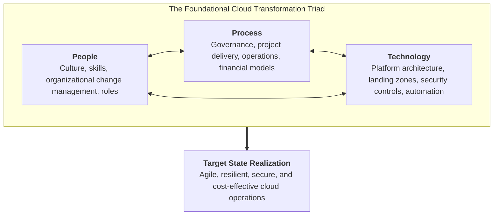
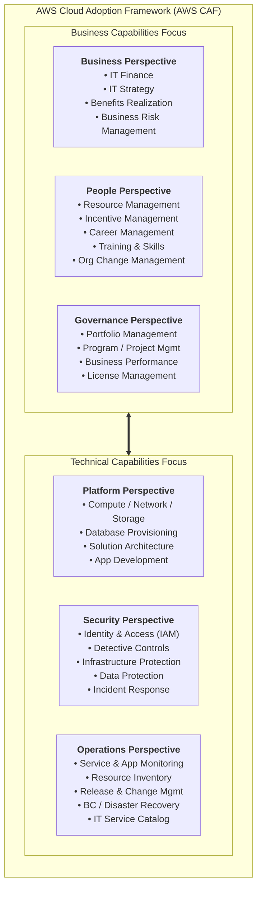
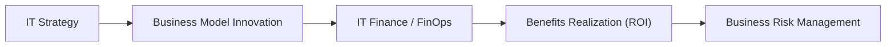
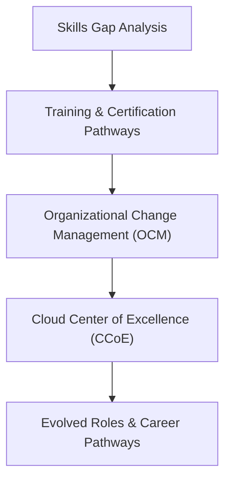
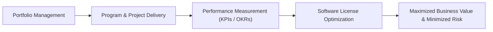
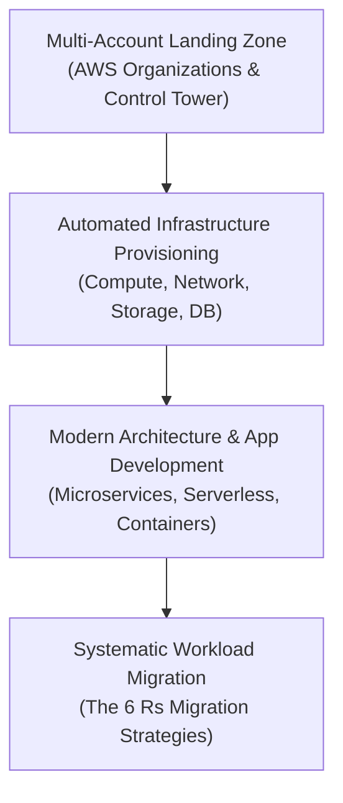
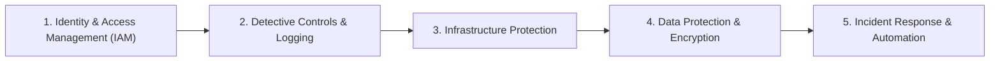
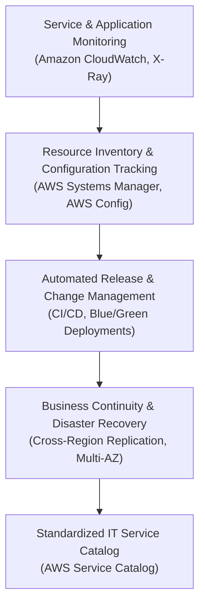
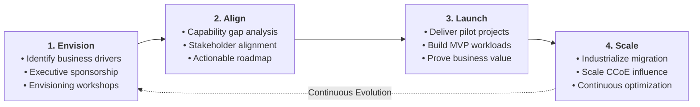
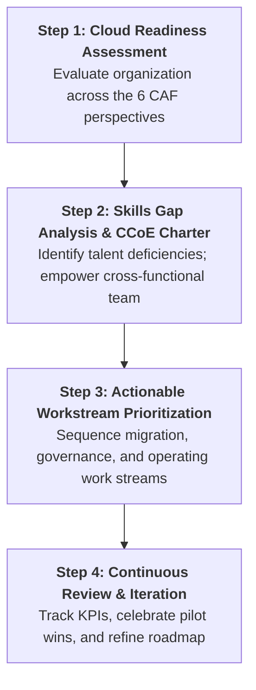

# 🏛️ AWS Cloud Adoption Framework (AWS CAF)

> **Course**: AWS re/Start  
> **Module**: AWS Architecture  
> **Source Document**: `T11-0002-RSARCH_EN-US_SG_M07_AWSCAF.pdf`  
> **Target Audience**: AWS re/Start Learners & Cloud Practitioners  

---

## 🎯 Module Overview

Migrating enterprise workloads to the cloud is fundamentally a business transformation, not merely a technical infrastructure upgrade. While provisioning Amazon EC2 instances or configuring Amazon S3 buckets can be accomplished in minutes, successful and sustainable cloud transformation requires an organization-wide alignment across executive strategy, corporate culture, governance models, operating procedures, and security postures.

Without structured guidance, organizations frequently encounter roadblocks:
- IT initiatives become decoupled from measurable business ROI.
- Staff lack the necessary cloud skills, resulting in resistance and inertia.
- Traditional change-management and governance processes throttle agile delivery.
- Security and compliance postures fail to keep pace with rapid cloud deployment.
- Day-to-day operations struggle to monitor dynamic, distributed architectures.

The **AWS Cloud Adoption Framework (AWS CAF)** resolves these challenges. Created by AWS Professional Services from thousands of enterprise customer engagements, AWS CAF delivers actionable guidance and best practices to help organizations build a comprehensive, structured approach to cloud computing across the entire enterprise and throughout the IT lifecycle.

AWS CAF deconstructs the immense complexity of cloud transformation into **six core perspectives**, each comprising distinct **capabilities** owned and executed by functionally related stakeholders.

---

### 📌 Learning Objectives

- [ ] Define the purpose, structure, and strategic value of the AWS Cloud Adoption Framework (AWS CAF).
- [ ] Explain why successful cloud migration requires the alignment of **people, process, and technology**.
- [ ] Contrast current state, target state, and transition execution within cloud transformation planning.
- [ ] Differentiate between **Business Capabilities** and **Technical Capabilities** within AWS CAF.
- [ ] Analyze the three business-focused perspectives: **Business**, **People**, and **Governance**.
- [ ] Analyze the three technical-focused perspectives: **Platform**, **Security**, and **Operations**.
- [ ] Map key organizational stakeholders, core capabilities, and strategic questions across all six perspectives.
- [ ] Trace the four iterative phases of the **Cloud Transformation Journey**: Envision, Align, Launch, and Scale.
- [ ] Synthesize an actionable cloud adoption roadmap utilizing skills gap analysis, readiness assessments, and a Cloud Center of Excellence (CCoE).

---

## 📚 Key Terminology

| Term | Definition |
| :--- | :--- |
| **AWS Cloud Adoption Framework (AWS CAF)** | A structured framework of guidance and best practices designed to help organizations develop efficient, effective plans for cloud migration and transformation. |
| **Perspective** | An essential domain of focus within AWS CAF that groups functionally related stakeholders, responsibilities, and challenges into a manageable area. |
| **Capability** | An organizational or technical ability required to successfully adopt the cloud, consisting of specific processes, skills, and tools owned by key stakeholders. |
| **Current State** | An organization's baseline operational, cultural, and technical condition prior to cloud adoption. |
| **Target State** | The desired future architectural, cultural, and operational model an organization aims to achieve in the cloud. |
| **Transition Path** | The prescriptive work streams, roadmaps, and milestones required to move an organization from its current state to its target state. |
| **Cloud Center of Excellence (CCoE)** | A multi-disciplinary team within an organization dedicated to driving cloud best practices, training, architectural standards, and transformation velocity. |
| **Landing Zone** | A well-architected, multi-account AWS environment that is scalable, secure, and configured with baseline security, networking, and governance policies. |
| **Total Cost of Ownership (TCO)** | A comprehensive financial estimate calculating all direct and indirect costs associated with acquiring, operating, and managing IT infrastructure over time. |
| **FinOps (Cloud Financial Management)** | An operational framework and cultural shift that brings financial accountability to the variable, consumption-based spending model of cloud computing. |

---

## 🏛️ Strategic Framework: People, Process, and Technology

Every organization's cloud journey is unique in workload mix, legacy dependencies, regulatory landscape, and cultural maturity. However, across every industry and company size, successful cloud transformation consistently depends on aligning three foundational pillars:



> [!IMPORTANT]
> Technology alone cannot guarantee a successful cloud adoption. Even the most elegant cloud architecture will stall if staff lack training (People), if budget approval processes require three months of manual paperwork (Process), or if security policies prohibit automated provisioning. AWS CAF guarantees that all three pillars advance in lockstep.

### Bridging Current State to Target State

AWS CAF guides organizational leadership through three analytical stages:
1. **Understand the Current State**: Rigorously assess existing organizational structures, legacy technical debt, workforce skills, governance gates, and operating procedures.
2. **Define the Target State**: Clearly articulate the future-state cloud vision—faster time-to-market, global elasticity, modernized microservices architectures, and automated compliance.
3. **Chart the Transition**: Translate the gap between current and target states into prioritized, prescriptive work streams that incrementally deliver measurable business value.

---

## 🧩 The Six Core Perspectives of AWS CAF

AWS CAF divides organizational focus into **six core perspectives**, bifurcated into **Business Capabilities** and **Technical Capabilities**:



### High-Level Capabilities Matrix

| Category | Perspective | Primary Organizational Scope | Key Question Answered |
| :--- | :--- | :--- | :--- |
| **Business Capabilities** | **Business** | Strategy, ROI, Financial Optimization, Value Modeling | *"How does cloud adoption drive our business growth and competitive advantage?"* |
| **Business Capabilities** | **People** | Talent, Culture, Training, Change Management, Roles | *"How do we equip and organize our people to thrive in a cloud-first culture?"* |
| **Business Capabilities** | **Governance** | Program Management, Risk Oversight, Performance KPIs | *"How do we align IT projects with corporate priorities and control business risk?"* |
| **Technical Capabilities** | **Platform** | Infrastructure, Architecture, Landing Zones, Development | *"How do we design and build scalable, modern cloud systems and data platforms?"* |
| **Technical Capabilities** | **Security** | IAM, Data Protection, Compliance, Incident Response | *"How do we ensure visibility, control, and robust cyber defense in the cloud?"* |
| **Technical Capabilities** | **Operations** | Service Monitoring, Reliability, Release, Disaster Recovery | *"How do we manage, support, and sustain day-to-day cloud operations at scale?"* |

---

## 💼 Deep-Dive: Business Capabilities Focus

The Business, People, and Governance perspectives focus on aligning business outcomes, workforce dynamics, and organizational steering mechanisms with cloud modernization.

```
       ┌────────────────────────────────────────────────────────┐
       │              BUSINESS CAPABILITIES FOCUS               │
       ├───────────────────┬──────────────────┬─────────────────┤
       │     BUSINESS      │      PEOPLE      │   GOVERNANCE    │
       │  Finance & Value  │ Talent & Culture │ Program & Risk  │
       └───────────────────┴──────────────────┴─────────────────┘
```

---

### 1. 📈 Business Perspective

> *"We must ensure that IT is aligned with business needs and that IT investments can be traced to demonstrable business results."*  
> — **Common voice of Business Managers, Finance Managers, Budget Owners, and Strategy Stakeholders**

The **Business Perspective** guarantees that cloud investments directly advance organizational strategy, deliver measurable financial returns, and accelerate competitive differentiation.



#### Key Stakeholders
- Business Unit Leaders & General Managers
- Chief Financial Officer (CFO) & Finance Controllers
- Budget Owners & Procurement Specialists
- Corporate Strategy & Business Development Directors

#### Core Capabilities

1. **IT Finance (Cloud Financial Management / FinOps)**:
   - Transitioning from rigid **Capital Expenditures (CapEx)** (multi-year datacenter hardware leases and amortization) to agile **Operational Expenditures (OpEx)** (pay-as-you-go consumption).
   - Establishing unit economics (e.g., cost per customer transaction or cost per active user).
   - Implementing showback and chargeback models using AWS Cost Allocation Tags.
2. **IT Strategy**:
   - Aligning technical roadmaps with core corporate goals (e.g., entering new international markets, shortening product release cycles, expanding e-commerce).
   - Transitioning IT from a cost center to a value-generating engine of innovation.
3. **Benefits Realization**:
   - Defining measurable KPIs to track post-migration value (e.g., reduction in hardware maintenance cost, percentage increase in developer productivity, reduction in downtime).
   - Tracking Total Cost of Ownership (TCO) models against initial business cases.
4. **Business Risk Management**:
   - Assessing macroeconomic, competitive, and supply chain risks.
   - Mitigating vendor lock-in risks while leveraging managed services to reduce time-to-market.
5. **Innovation & Agility**:
   - Accelerating Experimentation: Reducing the cost of failure by enabling teams to spin up sandbox environments in minutes and terminate them immediately without financial penalties.

> [!TIP]
> **FinOps Principle**: In traditional on-premises setups, over-provisioning was a defense mechanism against capacity shortages. In the cloud, over-provisioning is pure financial waste. The Business Perspective champions continuous cost optimization through rightsizing, Spot instances, Savings Plans, and automated shutdowns.

---

### 2. 👥 People Perspective

> *"We must prioritize training, staffing, and organizational changes to build an agile organization."*  
> — **Common voice of Human Resources, Staffing, and People Managers**

The **People Perspective** focuses on the workforce: developing skills, evolving organizational structures, overcoming cultural inertia, and establishing new cloud career pathways.



#### Key Stakeholders
- Chief Human Resources Officer (CHRO) & HR Business Partners
- Talent Acquisition & Staffing Managers
- Learning and Development (L&D) Leaders
- Organizational Change Management (OCM) Consultants
- People Managers and Team Leads

#### Core Capabilities

1. **Resource Management**:
   - Assessing current workforce staffing levels, identifying missing cloud specialties, and forecasting future talent requirements.
   - Balancing internal workforce upskilling with external hiring or systems integrator (SI) partnerships.
2. **Training Management & Cloud Fluency**:
   - Developing comprehensive, role-based training programs across executive leadership, architects, developers, security engineers, and support staff.
   - Instituting AWS certification and continuous learning programs to drive technical competency.
3. **Organizational Change Management (OCM)**:
   - Overcoming fear of change and resistance to modern practices (such as DevOps and infrastructure-as-code).
   - Shifting organizational culture from risk aversion and silos to collaboration, transparency, and blameless post-mortems.
4. **Career Management & Roles Evolution**:
   - Modernizing traditional job descriptions:
     - *On-Premises SysAdmin* $\rightarrow$ *Cloud Systems Engineer / Site Reliability Engineer (SRE)*
     - *Database Administrator (DBA)* $\rightarrow$ *Data Platform & Analytics Engineer*
     - *Network Engineer* $\rightarrow$ *Cloud Networking & Infrastructure-as-Code Architect*
   - Mapping transparent career advancement ladders for cloud practitioners.
5. **Incentive Management**:
   - Structuring recognition, rewards, and performance metrics aligned with cloud adoption goals (e.g., rewarding cost efficiency, security automation, and accelerated feature delivery).
6. **Cloud Center of Excellence (CCoE)**:
   - Establishing a cross-functional governing body to incubate cloud expertise, define blueprints, guide pilot workloads, and diffuse best practices across all business units.

---

### 3. ⚖️ Governance Perspective

> *"We must ensure that skills and processes align IT strategy and goals with business strategy and goals so the organization can maximize the business value of its IT investment and minimize business risks."*  
> — **Common voice of CIO, Program Managers, Enterprise Architects, Business Analysts, and Portfolio Managers**

The **Governance Perspective** establishes the steering mechanisms, portfolio management practices, and risk guardrails that orchestrate the cloud adoption lifecycle.



#### Key Stakeholders
- Chief Information Officer (CIO)
- Portfolio, Program, and Project Managers (PMO)
- Enterprise Architects (EA)
- Business Analysts
- IT Compliance and License Managers

#### Core Capabilities

1. **Portfolio Management**:
   - Cataloging and categorizing all organizational applications, platforms, and workloads.
   - Prioritizing workloads for migration using migration assessment models (e.g., evaluating business criticality, technical complexity, and dependencies).
2. **Program and Project Management**:
   - Transitioning from rigid, multi-year waterfall delivery methodologies to agile, iterative sprint cycles.
   - Managing cloud transformation roadmaps with clear milestones, deliverables, and dependency tracking.
3. **Business Performance Measurement**:
   - Establishing quantifiable Key Performance Indicators (KPIs) and Objectives and Key Results (OKRs).
   - Measuring velocity metrics: lead time for changes, deployment frequency, mean time to restore (MTTR), and change failure rate (DORA metrics).
4. **License Management (Bring Your Own License - BYOL)**:
   - Auditing existing commercial enterprise software agreements (e.g., Microsoft Windows Server, SQL Server, Oracle).
   - Evaluating AWS licensing strategies (e.g., Dedicated Hosts, license-included EC2 instances, AWS License Manager) to prevent punitive vendor license penalties.
5. **Risk & Value Realization**:
   - Establishing proactive governance guardrails (such as AWS Service Control Policies) that enforce organizational boundaries without impeding developer autonomy.

---

## ⚙️ Deep-Dive: Technical Capabilities Focus

The Platform, Security, and Operations perspectives provide the engineering foundation, threat mitigation, and operational resilience necessary to run production workloads in AWS.

```
       ┌────────────────────────────────────────────────────────┐
       │              TECHNICAL CAPABILITIES FOCUS              │
       ├───────────────────┬──────────────────┬─────────────────┤
       │     PLATFORM      │     SECURITY     │   OPERATIONS    │
       │  Infrastructure   │ Protection & IAM │  Monitoring &   │
       │   & Architecture  │   & Compliance   │   Reliability   │
       └───────────────────┴──────────────────┴─────────────────┘
```

---

### 4. 🏗️ Platform Perspective

> *"We must understand and communicate the nature of IT systems and their relationships. We must be able to describe the architecture of the target state environment in detail."*  
> — **Common voice of CTO, IT Managers, Solutions Architects, and Software Engineers**

The **Platform Perspective** defines the technical blueprint for the cloud environment: provisioning infrastructure, designing resilient architectures, modernizing applications, and engineering enterprise landing zones.



#### Key Stakeholders
- Chief Technology Officer (CTO)
- Cloud Infrastructure Managers
- Solutions Architects & Enterprise Infrastructure Engineers
- Software Engineering & Application Development Leads
- Database Administrators (DBAs)

#### Core Capabilities

1. **Compute, Network, and Storage Provisioning**:
   - Architecting automated infrastructure-as-code (IaC) templates using AWS CloudFormation or Terraform.
   - Deploying virtual compute (Amazon EC2, AWS Lambda, Amazon ECS/EKS), networking (Amazon VPC, AWS Direct Connect, Route 53), and storage tiers (Amazon S3, Amazon EBS, Amazon EFS).
2. **Database Provisioning**:
   - Transitioning legacy self-hosted relational databases to fully managed engines (Amazon RDS, Amazon Aurora) or purpose-built NoSQL stores (Amazon DynamoDB, Amazon DocumentDB).
3. **Systems and Solution Architecture**:
   - Designing cloud-native systems grounded in horizontal scalability, stateless compute, and loose coupling via messaging queues (Amazon SQS, Amazon SNS, Amazon EventBridge).
4. **Application Development & Modernization**:
   - Refactoring monolithic applications into containerized microservices and serverless architectures.
   - Building automated Continuous Integration and Continuous Deployment (CI/CD) pipelines (AWS CodePipeline, AWS CodeBuild, GitHub Actions).
5. **Enterprise Multi-Account Landing Zones**:
   - Deploying governed multi-account architectures using AWS Organizations and AWS Control Tower to isolate production, staging, development, and shared security workloads.
6. **Migration Execution (The 6 Rs)**:
   - Selecting appropriate workload migration patterns: **Rehost** (lift-and-shift), **Replatform** (lift, tinker, and shift), **Repurchase** (switch to SaaS), **Refactor/Re-architect**, **Retire**, or **Retain**.

---

### 5. 🛡️ Security Perspective

> *"We must ensure that the organization meets its security objectives for visibility, auditability, control, and agility."*  
> — **Common voice of CISO, IT Security Managers, and IT Security Analysts**

The **Security Perspective** ensures that the cloud infrastructure meets or exceeds enterprise security, risk, and regulatory standards. In AWS, security shifts from reactive perimeter defense to automated, defense-in-depth controls across every layer.



#### Key Stakeholders
- Chief Information Security Officer (CISO)
- IT Security Managers & Security Operations Center (SOC) Leads
- IT Security Analysts & Ethical Hackers
- Information Governance & Regulatory Compliance Officers

#### Core Capabilities

1. **Identity and Access Management (IAM)**:
   - Implementing zero-trust principles and the **Principle of Least Privilege**.
   - Centralizing authentication with identity federation (AWS IAM Identity Center, Okta, Active Directory) and enforcing Multi-Factor Authentication (MFA).
2. **Detective Controls**:
   - Achieving total auditability and continuous monitoring across all API calls and network flows using AWS CloudTrail, Amazon CloudWatch Logs, Amazon GuardDuty, and AWS Security Hub.
3. **Infrastructure Security**:
   - Implementing layered network firewalls: VPC Security Groups, Network ACLs, AWS WAF (Web Application Firewall), and AWS Shield for DDoS mitigation.
4. **Data Protection**:
   - Enforcing data encryption both **in transit** (TLS 1.2/1.3) and **at rest** using AWS Key Management Service (AWS KMS) and AWS CloudHSM.
   - Managing data classification, backup retention, and data immutability (S3 Object Lock).
5. **Incident Response**:
   - Establishing automated remediation playbooks (using AWS Lambda and EventBridge) to quarantine compromised instances or revoke exposed credentials in seconds.
6. **Regulatory Compliance & Continuous Audit**:
   - Aligning cloud infrastructure with external compliance standards (SOC 1/2/3, PCI-DSS, HIPAA, FedRAMP, GDPR, ISO 27001) using AWS Artifact and AWS Audit Manager.

> [!CAUTION]
> **The Shared Responsibility Model Reminder**: AWS secures the *cloud infrastructure* (hardware, global regions, hypervisors), while the customer remains strictly responsible for security *in the cloud* (data encryption, IAM credentials, OS patching, and network firewall rules). The Security Perspective operationalizes this customer responsibility.

---

### 6. ⚙️ Operations Perspective

> *"We align with and support the operations of the business, and define how day-to-day, quarter-to-quarter, and year-to-year business will be conducted."*  
> — **Common voice of IT Operations Managers, IT Support Managers, and Site Reliability Engineers**

The **Operations Perspective** defines how workloads are monitored, executed, and maintained in production, transforming traditional ITIL processes into cloud-native automation and observability.



#### Key Stakeholders
- IT Operations Managers & IT Support Leads
- Site Reliability Engineers (SREs) & Systems Administrators
- Service Desk Managers & Help Desk Leads
- Disaster Recovery & Business Continuity Coordinators

#### Core Capabilities

1. **Service and Application Performance Monitoring (APM)**:
   - Establishing full-stack observability with Amazon CloudWatch metrics, alarms, dashboards, and distributed tracing via AWS X-Ray.
   - Defining Service Level Agreements (SLAs), Service Level Objectives (SLOs), and Service Level Indicators (SLIs).
2. **Resource Inventory Management & Configuration Auditing**:
   - Tracking dynamic cloud resource configurations and compliance history using AWS Config and AWS Systems Manager (SSM) Inventory.
   - Eliminating manual patching through automated SSM Patch Manager routines.
3. **Release Management & Change Management**:
   - Eliminating risky, manual maintenance windows by adopting immutable infrastructure, canary deployments, and automated blue/green release pipelines.
4. **Reporting and Analytics**:
   - Delivering operational dashboards to leadership that display workload health, uptime, operational incidents, and resource utilization trends.
5. **Business Continuity and Disaster Recovery (BC/DR)**:
   - Designing and validating Recovery Time Objectives (**RTO**) and Recovery Point Objectives (**RPO**).
   - Implementing automated cross-region backup replication and multi-Availability Zone (Multi-AZ) failover strategies.
6. **IT Service Catalog**:
   - Creating self-service portals using AWS Service Catalog, enabling authorized business users to deploy approved, pre-governed cloud environments with push-button simplicity.

---

## 🔄 The Cloud Transformation Journey Lifecycle

Cloud adoption is not a one-time project; it is an iterative journey of continuous improvement. AWS CAF organizes this journey into four distinct phases:



### Transformation Journey Phases Breakdown

| Phase | Core Objective | Key Activities | Primary Deliverable |
| :--- | :--- | :--- | :--- |
| **1. Envision** | Connect business strategy with cloud capabilities and secure executive buy-in. | • Run executive envisioning workshops<br>• Identify digital transformation catalysts<br>• Formulate measurable business outcomes | Cloud Transformation Vision & Executive Business Case |
| **2. Align** | Identify organizational and technical capability gaps across all 6 perspectives. | • Conduct Cloud Adoption Readiness Tool (CART) assessment<br>• Form the Cloud Center of Excellence (CCoE)<br>• Define target landing zone blueprint | Comprehensive Cloud Adoption Action Plan & Roadmap |
| **3. Launch** | Build foundational infrastructure and deliver initial production pilot workloads. | • Deploy AWS Landing Zone baseline<br>• Execute Minimum Viable Product (MVP) migrations<br>• Demonstrate immediate business value | Validated Pilot Workload in Production & Operational Playbooks |
| **4. Scale** | Expand cloud adoption across the full IT portfolio and institutionalize cloud operations. | • Industrialize mass application migrations (Factory model)<br>• Automate FinOps, compliance, and DevSecOps<br>• Drive organizational-wide cloud literacy | Optimized Enterprise Cloud Operating Model at Scale |

---

## 🗺️ Creating an Actionable Cloud Adoption Roadmap

To transform high-level perspective guidance into execution, organizations execute three foundational exercises:



### 1. Cloud Adoption Readiness Assessment (CART)
The AWS Cloud Adoption Readiness Tool (CART) surveys organizational maturity across the six CAF perspectives. Scoring each perspective identifies structural bottlenecks (e.g., strong platform readiness but weak governance and licensing strategy) before migrating production workloads.

### 2. Skills Gap Analysis & Training Roadmaps
A common pitfall is attempting to migrate before the operations and security teams understand AWS constructs. The People perspective mandates:
- Mapping existing staff competencies against required cloud certifications (AWS Certified Cloud Practitioner, Solutions Architect, SysOps Administrator, Security Specialty).
- Establishing a continuous training curriculum combined with hands-on AWS sandbox environments.

### 3. Cross-Functional Stakeholder Engagement Matrix

| Role / Title | Perspective Alignment | Primary Cloud Responsibility | Key Engagement Cadence |
| :--- | :--- | :--- | :--- |
| **CFO / Finance Director** | Business | Approves FinOps budget models, monitors cloud ROI, reviews monthly AWS bills | Monthly FinOps review |
| **CHRO / HR Manager** | People | Establishes cloud training incentives, updates job descriptions, addresses culture | Bi-weekly talent sync |
| **CIO / PMO Director** | Governance | Prioritizes migration portfolio, aligns IT milestones with business strategy | Weekly governance council |
| **CTO / Chief Architect** | Platform | Approves architecture standards, oversees landing zone design and CI/CD | Daily / Weekly architecture sync |
| **CISO / SecOps Lead** | Security | Defines guardrails, manages IAM policies, reviews compliance audits | Continuous / Daily security triage |
| **Director of IT Ops / SRE** | Operations | Establishes monitoring alarms, manages patching, validates disaster recovery | Daily standup / On-call review |

---

## 📊 Comprehensive CAF Perspective Summary

The following master reference table summarizes the six core perspectives of the AWS Cloud Adoption Framework:

| Perspective | Domain Focus | Key Stakeholders | Core Capabilities | Strategic Question Answered |
| :--- | :--- | :--- | :--- | :--- |
| **Business** | Business Capabilities | Business Managers, Finance Managers, Budget Owners, Strategy Stakeholders | • IT Finance (FinOps, TCO, ROI)<br>• IT Strategy<br>• Benefits Realization<br>• Business Risk Management<br>• Innovation & Agility | *"How does our cloud investment directly drive demonstrable business results and competitive advantage?"* |
| **People** | Business Capabilities | HR, Staffing, People Managers, L&D Directors, Change Management Teams | • Resource Management<br>• Incentive Management<br>• Career Management<br>• Training & Skills Development<br>• Organizational Change Management (OCM)<br>• CCoE Establishment | *"How do we prepare, train, and structure our workforce to thrive in an agile cloud organization?"* |
| **Governance** | Business Capabilities | CIO, Program Managers, Enterprise Architects, Business Analysts, Portfolio Managers | • Portfolio Management<br>• Program & Project Management<br>• Business Performance Measurement<br>• License Management (BYOL)<br>• Strategic Alignment | *"How do we orchestrate cloud initiatives to maximize IT investment value while minimizing organizational risk?"* |
| **Platform** | Technical Capabilities | CTO, IT Managers, Solutions Architects, Infrastructure Engineers, Developers | • Compute, Network, Storage, Database Provisioning<br>• Solution Architecture<br>• Application Modernization<br>• Multi-Account Landing Zones<br>• 6 Rs Migration Execution | *"How do we architect, build, and migrate scalable, secure target-state cloud systems?"* |
| **Security** | Technical Capabilities | CISO, IT Security Managers, IT Security Analysts, Compliance Officers | • Identity and Access Management (IAM)<br>• Detective Controls & Logging<br>• Infrastructure Protection<br>• Data Protection (Encryption)<br>• Incident Response Automation<br>• Compliance Validation | *"How do we ensure visibility, auditability, control, and agility while protecting organizational assets?"* |
| **Operations** | Technical Capabilities | IT Operations Managers, IT Support Managers, SREs, Service Delivery Leads | • Service Monitoring<br>• Application Performance Monitoring (APM)<br>• Resource Inventory & Configuration<br>• Release & Change Management<br>• Business Continuity / Disaster Recovery<br>• IT Service Catalog | *"How do we execute, monitor, maintain, and recover day-to-day business operations in the cloud?"* |

---

## 📝 Checkpoint Questions & Knowledge Check

### Official Slides Checkpoint Questions

#### Question 1
**What is the AWS CAF?**  
> **Answer**: The AWS Cloud Adoption Framework (AWS CAF) provides guidance and best practices that help organizations develop efficient and effective plans for their cloud adoption journey across the entire enterprise and throughout their IT lifecycle.

#### Question 2
**Why is the AWS CAF important?**  
> **Answer**: For any organization to successfully migrate its IT portfolio to the cloud, three foundational elements—**people, process, and technology**—must be aligned. The AWS CAF provides a structured approach that deconstructs the immense complexity of cloud adoption into manageable perspectives, helping leaders understand their current state, define their target state, and execute the transition path.

#### Question 3
**Which core perspectives of the AWS CAF focus on business capabilities?**  
> **Answer**: The **Business**, **People**, and **Governance** perspectives focus on business capabilities.

#### Question 4
**Which of the core perspectives of the AWS CAF focus on technical capabilities?**  
> **Answer**: The **Platform**, **Security**, and **Operations** perspectives focus on technical capabilities.

---

### Extended Practice Questions & Exam Scenarios

#### Scenario 1: Developing Cloud Skills and Overcoming Resistance
An enterprise is planning to migrate 200 virtual machines to AWS. However, the existing system administrators are anxious about job security, and the organization lacks personnel with AWS experience. Which AWS CAF perspective directly addresses this challenge?
- (A) Platform Perspective
- (B) People Perspective
- (C) Governance Perspective
- (D) Business Perspective

> **Correct Answer: (B)**  
> **Explanation**: The **People Perspective** focuses on training management, organizational change management (OCM), career management, and resource planning. It helps organizations assess skill gaps, develop cloud training curricula, and evolve traditional roles into cloud engineering careers to overcome anxiety and cultural resistance.

#### Scenario 2: Selecting and Tracking Migration Projects
The leadership of an organization wants to prioritize which applications should be migrated first, establish KPIs to track delivery milestones, and optimize existing commercial software licenses. Stakeholders involved include the CIO, portfolio managers, and enterprise architects. Which AWS CAF perspective governs these activities?
- (A) Governance Perspective
- (B) Operations Perspective
- (C) Platform Perspective
- (D) Business Perspective

> **Correct Answer: (A)**  
> **Explanation**: The **Governance Perspective** is owned by stakeholders like the CIO, program managers, and portfolio managers. Its capabilities include portfolio management, program/project management, business performance measurement, and software license management.

#### Scenario 3: Infrastructure Architecture and Provisioning
A Solutions Architect is designing the multi-account network topology, selecting compute instances, and choosing database engines for a modernized web application. Which AWS CAF perspective encompasses these capabilities?
- (A) Security Perspective
- (B) Operations Perspective
- (C) Platform Perspective
- (D) Governance Perspective

> **Correct Answer: (C)**  
> **Explanation**: The **Platform Perspective** focuses on technical architecture, compute, network, storage, and database provisioning, application development, and landing zone design.

#### Scenario 4: Observability, Patching, and Disaster Recovery
An IT team is configuring Amazon CloudWatch alarms, defining Recovery Time Objectives (RTO) for disaster recovery, and setting up automated patch baselines for server instances. Which AWS CAF perspective does this work fall under?
- (A) Security Perspective
- (B) Governance Perspective
- (C) Operations Perspective
- (D) Business Perspective

> **Correct Answer: (C)**  
> **Explanation**: The **Operations Perspective** covers day-to-day and quarter-to-quarter service operations, including service monitoring, resource inventory management, change release management, business continuity / disaster recovery, and the IT service catalog.

---

## 📌 Summary & Key Takeaways

```
  ┌────────────────────────────────────────────────────────────────────────┐
  │                           AWS CAF CORE SUMMARY                         │
  ├────────────────────────────────────────────────────────────────────────┤
  │ • Purpose: Guidance and best practices to structure cloud adoption.   │
  │ • Core Triad: Synchronizes People, Process, and Technology.           │
  │ • Current -> Target -> Transition: Guides planning and execution.     │
  │ • 6 Perspectives:                                                      │
  │     - Business Focus: Business, People, Governance                     │
  │     - Technical Focus: Platform, Security, Operations                  │
  │ • Transformation Journey: Envision -> Align -> Launch -> Scale         │
  │ • Key Enabler: Cloud Center of Excellence (CCoE) drives adoption.      │
  └────────────────────────────────────────────────────────────────────────┘
```

- **Holistic Framework**: Cloud transformation is not an isolated IT project. AWS CAF organizes planning into six manageable perspectives covering every organizational layer.
- **Business Capabilities Focus**:
  - **Business**: Focuses on IT finance, ROI, business cases, and strategic alignment.
  - **People**: Focuses on training, organizational change management, culture, and talent evolution.
  - **Governance**: Focuses on portfolio prioritization, project management, performance measurement, and license management.
- **Technical Capabilities Focus**:
  - **Platform**: Focuses on landing zones, infrastructure provisioning, solution architecture, and workload migration.
  - **Security**: Focuses on IAM, detective controls, infrastructure security, data encryption, and incident response.
  - **Operations**: Focuses on service monitoring, resource configuration, release management, and disaster recovery.
- **Iterative Journey**: Organizations progress through four repeatable phases—**Envision**, **Align**, **Launch**, and **Scale**—iterating from pilot MVPs to enterprise-wide cloud maturity.

---

## 🔗 References & Further Reading

- [AWS Cloud Adoption Framework Official Overview](https://aws.amazon.com/professional-services/CAF/)
- [AWS Cloud Adoption Framework Whitepaper (PDF)](https://docs.aws.amazon.com/whitepapers/latest/aws-caf-overview/aws-caf-overview.pdf)
- [AWS Cloud Adoption Readiness Tool (CART)](https://cloudreadiness.amazonaws.com/)
- [AWS Well-Architected Framework](https://aws.amazon.com/architecture/well-architected/)
- [AWS Training and Certification](https://aws.amazon.com/training/)
