# 🏛️ AWS Well-Architected Framework: Architectural Rigor, Six Pillars, & Continuous Workload Evaluation

> **Course**: AWS re/Start  
> **Module**: AWS Architecture (M07 – AWS Well-Architected Framework)  
> **Source Document**: `T11-AWS_Architecture/T11-0003-RSARCH_EN-US_SG_M07_AWSWELLARCHITECTED.pdf`  
> **Target Audience**: Cloud Architects, Cloud Practitioners, DevOps Engineers, and System Administrators  

---

## 🎯 Module Overview

In modern cloud computing, **architecture** represents both the art and science of designing, engineering, and operating large-scale, software-defined systems. As enterprise workloads transition away from physical on-premises infrastructure toward globally distributed, hyper-scale environments, complexity grows exponentially. Without structured architectural governance, organizations frequently incur technical debt, introduce security vulnerabilities, deploy over-provisioned resources, and struggle with catastrophic failure modes.

The **AWS Well-Architected Framework** was created by Amazon Web Services to codify decades of architectural expertise gained across millions of customer workloads. It provides a consistent, objective evaluation rubric and a set of foundational questions that enable architects and technology leaders to assess cloud designs against established cloud-native best practices. Rather than imposing rigid, dogmatic rules or generating boiler-plate code, the framework guides engineering teams through a systematic process of identifying trade-offs, discovering latent risks, and executing continuous, measurable improvements across the entire workload lifecycle.

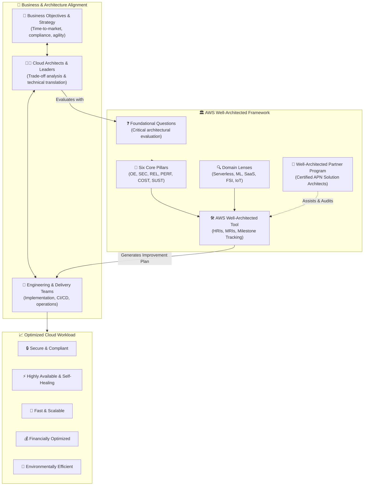

---

## 📌 Learning Objectives

By studying this guide, learners will develop the foundational knowledge and practical skills required to:

- [ ] **Define Cloud Architecture**: Understand the systemic role of cloud architects in bridging business strategy, stakeholder deliverables, and cloud-native solutions.
- [ ] **Articulate the Purpose of the AWS Well-Architected Framework**: Explain how the framework increases architectural awareness, surfaces foundational blind spots, and provides an objective rubric for evaluating cloud designs.
- [ ] **Differentiate Scope & Deliverables**: Discern what the Well-Architected Framework provides (guiding questions, lenses, evaluation tooling) versus what it does not provide (rigid prescriptions, implementation details, automated code generation).
- [ ] **Navigate the AWS Well-Architected Tool**: Explain how to define workloads in the AWS Management Console, execute structured reviews, categorize High Risk Issues (HRIs) and Medium Risk Issues (MRIs), and manage milestone improvement plans.
- [ ] **Leverage the AWS Well-Architected Partner Program**: Recognize the role of certified AWS Partner Network (APN) partners in conducting formal architectural assessments and remediation initiatives.
- [ ] **Master the Six Pillars of the Well-Architected Framework**: Examine the core definitions, focus areas, and mandatory design principles underpinning:
  1. *Operational Excellence*
  2. *Security*
  3. *Reliability*
  4. *Performance Efficiency*
  5. *Cost Optimization*
  6. *Sustainability*

---

## 📐 What is Cloud Architecture?

At its core, **architecture** is the discipline and practice of designing and constructing complex structures. In physical engineering, civil architects assess soil stability, weight distribution, thermal dynamics, and environmental hazards to ensure buildings remain structurally sound, safe, and fit for human habitation.

In digital systems, **Cloud Architecture** translates enterprise business objectives into software-defined, reliable, and scalable technical implementations across the cloud fabric:

| Traditional On-Premises Architecture | Cloud-Native Architecture |
| :--- | :--- |
| **Capacity Guessing**: Upfront procurement based on peak capacity estimates 3–5 years out. | **Dynamic Elasticity**: On-demand resource acquisition matching actual real-time demand. |
| **Rigid Monoliths**: Monolithic stacks bound to physical chassis and fixed network topologies. | **Modular & Evolutionary**: Microservices, containers, and serverless architectures decoupled via message queues. |
| **Manual Operations**: Physical racking, cabling, manual OS patching, and undocumented runbooks. | **Operations as Code**: Immutable infrastructure defined via templates (IaC) and automated CI/CD pipelines. |
| **Perimeter Security**: Firewall perimeter defenses with open trust inside the local area network. | **Zero Trust & Layered Defense**: Identity-centric security, micro-segmentation, and encryption everywhere. |
| **Fixed Cost Center**: Depreciated capital expenditure (CapEx) requiring long finance cycles. | **Variable Consumption**: Variable operational expenditure (OpEx) with direct cost-to-unit attribution. |

### The Strategic Role of Cloud Architects
Cloud architects serve as the critical connective tissue within modern technology organizations:
1. **Engaging Decision Makers**: Identifying core business drivers, regulatory boundaries, time-to-market constraints, and revenue impact.
2. **Translating Requirements**: Transforming high-level business goals into decoupled, secure, and resilient architectural designs.
3. **Evaluating Trade-Offs**: Navigating engineering compromises (e.g., choosing eventual consistency to gain extreme low-latency write performance, or trading upfront development velocity against long-term cost optimization).
4. **Partnering with Delivery Teams**: Collaborating closely with DevOps, SecOps, software development, and QA teams to implement, test, and iterate systems safely.

---

## 🎯 Purpose and Philosophy of the Well-Architected Framework

Modern cloud systems are susceptible to architectural drift. As systems evolve under aggressive product deadlines, design compromises are made that often go undocumented. The AWS Well-Architected Framework was created to establish a structured, repeatable standard across all workloads.

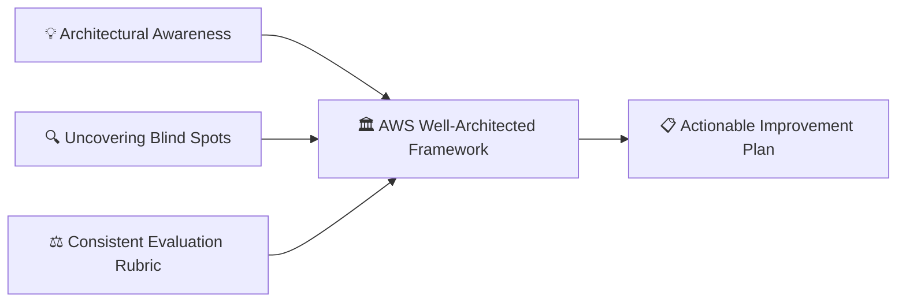

### 1. Fostering Architectural Best Practices Awareness
Cloud technologies evolve at an unprecedented velocity. Patterns that were optimal five years ago may be legacy today. The framework continuously updates its guidance based on AWS engineering reviews across thousands of enterprises, empowering architects to stay ahead of modern cloud design patterns.

### 2. Surfacing Foundational Blind Spots and Neglected Trade-Offs
Engineers naturally focus on delivering immediate functional features (business logic, UI, APIs), while non-functional foundations are frequently neglected:
- *Disaster Recovery*: Has failover ever been simulated under load?
- *Key Management*: Are KMS keys rotated automatically, and who retains cryptographic authorization?
- *Telemetry*: Can the system alert operators before end customers experience errors?
- *Idle Capacity*: Are staging and QA environments running during non-working weekends?

The framework systematically exposes these hidden risks before they materialize into outages, data breaches, or budget overruns.

### 3. Establishing a Consistent, Objective Evaluation Rubric
Architectural reviews are frequently subjective, often turning into debates between conflicting engineering factions. The Well-Architected Framework provides an **objective, question-based rubric** grounded in cloud best practices. It removes organizational politics by framing discussions around standard, non-punitive evaluation criteria.

> [!NOTE]
> The Well-Architected Framework is not an audit or a pass/fail compliance exam. It is a **collaborative discovery mechanism** designed to empower teams to understand the state of their workloads and make informed, risk-aware business decisions.

---

## ⚖️ Framework Scope: What It Provides vs. What It Does NOT Provide

To maximize the value of the Well-Architected Framework, architects must understand its intended scope and boundaries.

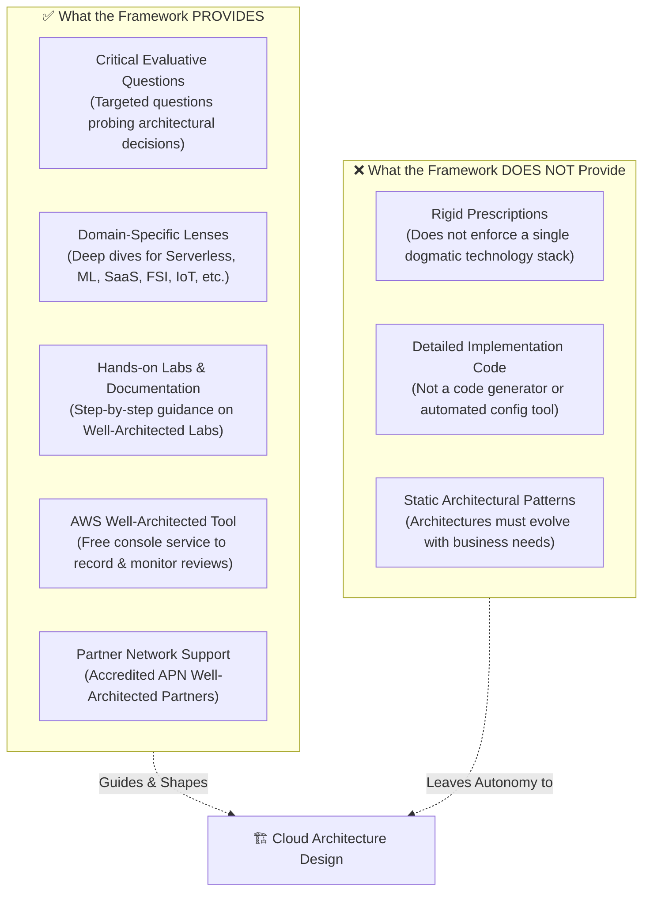

| Feature / Dimension | ✅ What the Framework Provides | ❌ What the Framework Does NOT Provide |
| :--- | :--- | :--- |
| **Guidance Style** | In-depth foundational questions centered on understanding architectural intent and trade-offs. | Rigid prescriptions that dictate specific frameworks or enforce a single dogma. |
| **Technical Depth** | Architectural principles, design strategies, and direct references to relevant AWS services and solutions. | Step-by-step proprietary code implementations, Terraform/CloudFormation templates, or automated code generators. |
| **Specialized Contexts** | **Well-Architected Lenses** tailored to specific workloads (e.g., Serverless, Machine Learning, Analytics, Financial Services, IoT, SaaS). | A universal, one-size-fits-all blueprint for every unique enterprise situation. |
| **Tooling & Tracking** | The **AWS Well-Architected Tool** embedded within the AWS Console for structured reviews, risk logging, and milestone tracking. | Automated compliance enforcement or automatic blocking of non-compliant infrastructure deployments. |
| **Human Expertise** | Access to **AWS Well-Architected Partner Program** partners and AWS Solutions Architects for formal peer reviews. | Replacement for internal engineering accountability or hands-on systems architecture design. |

---

## 🛠️ The AWS Well-Architected Tool

The **AWS Well-Architected Tool (AWS WA Tool)** is a native, self-service service integrated directly into the **AWS Management Console**, available at **no additional cost**. It operationalizes the Well-Architected Framework by enabling organizations to document, evaluate, and track their workloads across all lifecycle phases.

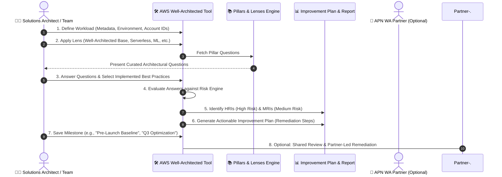

### Core Capabilities of the AWS WA Tool

1. **Defining Workloads**:
   - Workloads represent an individual application, system, or collection of cloud resources delivering business value (e.g., "E-Commerce Checkout System", "Real-Time Telemetry Pipeline").
   - Architects define workload metadata, including environment type (Production vs. Non-Production), target AWS Regions, associated AWS Account IDs, and applicable industry lenses.

2. **Conducting Structured Architectural Reviews**:
   - The tool guides cross-functional stakeholders through question sets organized by the six pillars.
   - For each question, users check off the specific AWS best practice controls currently implemented in their environment.
   - Teams can record operational notes, capture specific architectural trade-offs, and note exceptions.

3. **Risk Identification: High Risk Issues (HRIs) and Medium Risk Issues (MRIs)**:
   - When essential best practices are omitted, the evaluation engine automatically flags the deficiency:
     - **High Risk Issues (HRIs)**: Architectural weaknesses that introduce severe vulnerability to system outage, major security breach, data loss, or extreme uncontrolled cost.
     - **Medium Risk Issues (MRIs)**: Deficiencies that degrade performance, hinder operational visibility, or cause suboptimal cost efficiency under specific stress conditions.

4. **Generating Actionable Improvement Plans**:
   - The tool produces an exportable, prioritized **Improvement Plan** (in PDF format) detailing the exact remediation steps recommended by AWS for each discovered HRI and MRI.
   - Each recommendation links directly to AWS technical documentation, architectural whitepapers, and hands-on lab guides.

5. **Milestone Tracking and Workload History**:
   - Organizations can save point-in-time **Milestones** (e.g., `v1.0-Pre-Launch`, `v1.1-Post-Security-Audit`, `v2.0-Serverless-Migration`).
   - Milestones enable engineering leaders to track their risk burndown curve over time, demonstrating measurable governance and posture improvement to executive leadership.

---

## 🤝 The AWS Well-Architected Partner Program

While internal teams can conduct reviews independently using the AWS WA Tool, complex enterprise architectures benefit greatly from external, unbiased validation. The **AWS Well-Architected Partner Program** bridges this gap:

- **Certified APN Partners**: Consists of accredited AWS Partner Network (APN) consulting partners whose Solutions Architects have undergone rigorous training and accreditation in Well-Architected evaluation methodologies.
- **Deep Technical Immersion**: Partner architects facilitate structured review workshops with workload owners, system operators, and business stakeholders.
- **Remediation & Funding Programs**: AWS frequently offers financial incentives (such as AWS service credits) to eligible customers who engage certified partners to conduct Well-Architected reviews and remediate identified High Risk Issues (HRIs).
- **Domain Specialization**: Partners offer specialized lens competencies, addressing strict compliance regimes (HIPAA, PCI-DSS, FedRAMP) and advanced paradigms (high-performance computing, generative AI, hybrid architectures).

---

## 🏛️ The Six Pillars of the Well-Architected Framework

The Well-Architected Framework assesses workloads across **six distinct architectural dimensions**, known as pillars. Each pillar addresses a fundamental operational or technological challenge.

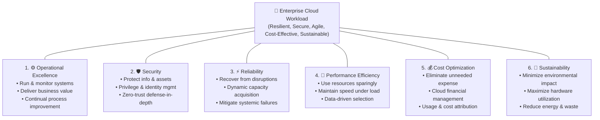

### Comparative Summary of the Six Pillars

| Pillar | Core Mission | Key Operational Topics | Distinctive Design Principles |
| :--- | :--- | :--- | :--- |
| **1. Operational Excellence** | Deliver business value and continually improve supporting processes. | Change automation, event response, daily operational standards. | Operations as code; frequent, small, reversible changes; anticipate failure; learn from failures. |
| **2. Security** | Protect information, systems, and assets while managing risk. | Identity & privilege management, detective controls, infrastructure & data protection. | Strong identity foundation; traceability; security at all layers; keep people away from data. |
| **3. Reliability** | Recover from failure, mitigate disruptions, and dynamically acquire resources. | Foundations, workload architecture, change management, failure management. | Automatically recover from failure; scale horizontally; stop guessing capacity; test recovery. |
| **4. Performance Efficiency** | Use computing resources efficiently and adapt as technologies evolve. | Architecture selection, continuous review, performance monitoring, trade-off analysis. | Democratize advanced tech; go global in minutes; use serverless; mechanical sympathy. |
| **5. Cost Optimization** | Eliminate unneeded expense, maximize ROI, and avoid suboptimal resources. | Cloud financial management, expenditure awareness, cost-effective resources, supply/demand. | Adopt a consumption model; measure overall efficiency; stop spending on data centers; attribute cost. |
| **6. Sustainability** | Minimize the environmental impact of running cloud workloads. | Quantifying lifecycle impact, energy consumption, efficiency levers, downstream impact. | Understand your impact; establish goals; maximize utilization; adopt efficient hardware; use managed services. |

---

## ⚙️ Pillar 1: Operational Excellence

### Definition & Business Value
The **Operational Excellence** pillar focuses on your organization’s ability to support business objectives, run workloads effectively, gain deep operational insight, and continually refine supporting processes to deliver sustained business value.

Rather than treating operations as manual, isolated maintenance overhead, cloud-native operational excellence embeds operations into the engineering lifecycle.

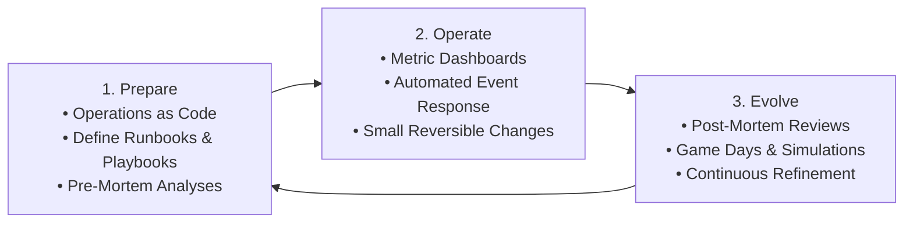

### Key Topics & Practices
- **Manage and Automate Changes**: Replace manual infrastructure provisioning with automated deployment pipelines (CI/CD) and Infrastructure as Code (AWS CloudFormation, AWS CDK).
- **Respond to Events**: Instrument comprehensive telemetry using **Amazon CloudWatch** metrics, logs, and alarms to trigger automated event remediation (via AWS Systems Manager Automation or AWS Lambda).
- **Define Standards for Daily Operations**: Establish well-defined runbooks (step-by-step procedures for routine maintenance) and playbooks (guided response plans for unexpected incidents).

### Design Principles for Operational Excellence

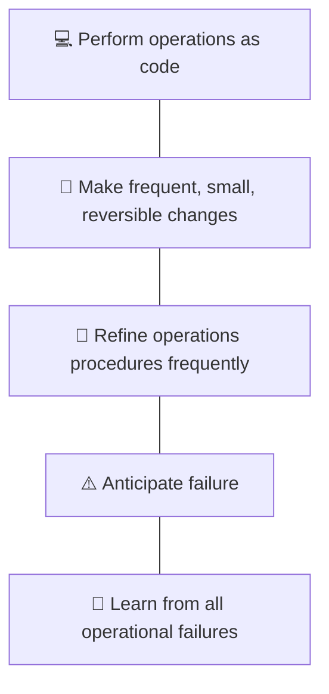

1. **Perform Operations as Code**:
   - Define your entire infrastructure, application configuration, and operational runbooks as software code.
   - Trigger operational procedures automatically in response to cloud events.
   - *Impact*: Eliminates manual human error, ensures deterministic, repeatable execution, and enables version-controlled auditing of operational updates.

2. **Make Frequent, Small, Reversible Changes**:
   - Design application components to be updated independently in small increments rather than deploying massive quarterly releases.
   - If an error occurs, small changes can be rapidly rolled back without impacting broader operations.
   - *Impact*: Dramatically increases engineering velocity while reducing the radius of deployment failures.

3. **Refine Operations Procedures Frequently**:
   - As workloads evolve, operational runbooks and procedures must evolve in tandem.
   - Schedule structured **Game Days** where teams simulate production scenarios to validate that operational procedures remain accurate and effective.
   - *Impact*: Prevents operational documentation rot and ensures operations teams are fully prepared for incident response.

4. **Anticipate Failure**:
   - Conduct **pre-mortem** exercises to identify potential failure modes before systems enter production.
   - Intentionally inject faults (chaos engineering) using tools such as **AWS Fault Injection Service (AWS FIS)** to validate that auto-recovery mechanisms function under stress.
   - *Impact*: Removes single points of failure and builds organizational confidence in system resilience.

5. **Learn from All Operational Failures**:
   - Treat outages and unexpected events as learning opportunities rather than punitive events.
   - Conduct blameless post-mortems (Correction of Error / COE processes) to identify root causes and circulate findings across the broader enterprise.
   - *Impact*: Prevents recurring systemic issues and elevates the technical competency of the entire organization.

---

## 🛡️ Pillar 2: Security

### Definition & Business Value
The **Security** pillar encompasses the ability to protect information, assets, and computational systems while delivering business value through structured risk assessments and proactive mitigation strategies.

In AWS, security is the top priority. The cloud transforms security by enabling automated, software-driven guardrails, fine-grained access policies, and real-time auditing across all system activities.

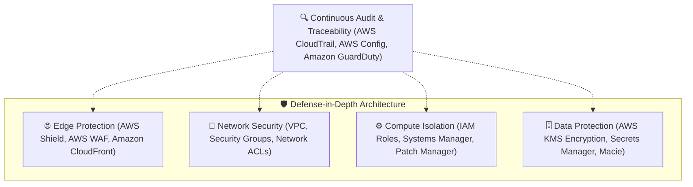

### Key Topics & Focus Areas
- **Identity and Privilege Management**: Defining precisely who (or what) can perform actions on which resources under specific conditions (**AWS Identity and Access Management [IAM]**).
- **Detective Controls**: Implementing real-time visibility into infrastructure modifications and anomalous API calls (**AWS CloudTrail**, **Amazon GuardDuty**, **AWS Security Hub**).
- **Infrastructure Protection**: Safeguarding network perimeters, compute instances, and application entry points using **VPCs**, **Security Groups**, and **AWS WAF**.
- **Data Protection**: Enforcing end-to-end data confidentiality and integrity via encryption at rest (**AWS Key Management Service [AWS KMS]**) and in transit (TLS/HTTPS).

### Design Principles for Security

1. **Implement a Strong Identity Foundation**:
   - Centralize identity management and enforce least-privilege permissions.
   - Eliminate long-lived credentials; leverage temporary security tokens via **AWS STS** and IAM roles.
   - Require Multi-Factor Authentication (MFA) across all interactive identities.

2. **Enable Traceability**:
   - Continuously record, monitor, alert, and audit every API invocation, configuration change, and administrative action in real time using **AWS CloudTrail** and **Amazon CloudWatch Logs**.
   - Integrate logs into automated security analytics pipelines to trigger instant remediation workflows.

3. **Apply Security at All Layers**:
   - Implement a rigorous **defense-in-depth** strategy.
   - Place layered controls at the network edge, VPC subnets, load balancers, EC2 operating systems, containers, application code, and data storage.

4. **Automate Security Best Practices**:
   - Define security baselines, firewall rules, and posture policies as version-controlled code templates.
   - Automate vulnerability patching, configuration compliance checking (**AWS Config**), and security remediation scripts to scale defenses cost-effectively.

5. **Protect Data in Transit and at Rest**:
   - Classify all workload data into sensitivity tiers (Public, Internal, Confidential, Restricted).
   - Enforce ubiquitous encryption at rest using AES-256 keys managed in AWS KMS.
   - Mandate modern cryptographic transport protocols (TLS 1.2+) for all communication in transit.

6. **Keep People Away from Data**:
   - Minimize or completely eliminate direct manual human access to live data stores, databases, and production servers.
   - Build automated ETL pipelines, administrative tools, and API abstraction layers to handle data manipulation, preventing accidental exposure or human data tampering.

7. **Prepare for Security Events**:
   - Establish well-rehearsed incident response plans, digital forensics pipelines, and investigation playbooks.
   - Regularly execute simulated security drills (red team / blue team simulations) to ensure cross-functional teams detect, isolate, and recover from breaches rapidly.

---

## ⚡ Pillar 3: Reliability

### Definition & Business Value
The **Reliability** pillar encompasses the ability of a workload to perform its intended functions correctly and consistently when expected. This includes the capacity to operate, monitor, and recover systems dynamically throughout their entire lifecycle.

A reliable architecture does not pretend that failures will never happen; instead, it assumes that components *will* fail and designs automated resilience mechanisms into every layer of the distributed system.

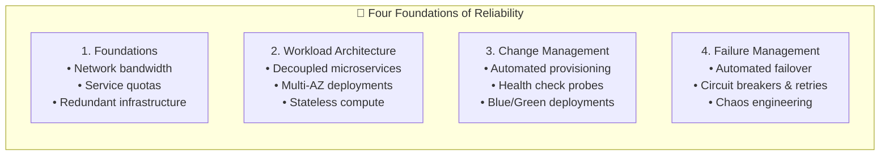

### The Four Focus Areas of Reliability
1. **Foundations**: Ensuring fundamental prerequisites—such as account limits, service quotas, cross-region connectivity, and resilient physical infrastructure—are properly planned and provisioned.
2. **Workload Architecture**: Structuring distributed systems into modular, loosely coupled components (using **Amazon SQS**, **Amazon SNS**, and **AWS Step Functions**) so that a failure in one service does not cascade into a total outage.
3. **Change Management**: Controlling the introduction of code, configuration, and infrastructure modifications so changes are thoroughly monitored, reversible, and predictable.
4. **Failure Management**: Proactively anticipating faults, detecting degraded performance through health checks, and initiating automatic self-healing workflows (such as **Amazon EC2 Auto Scaling** replacement).

### Design Principles for Reliability

1. **Test Recovery Procedures**:
   - In traditional environments, testing only verifies that systems work under expected conditions.
   - In the cloud, use automation to simulate real-world failure scenarios (e.g., terminating database instances, severing network connections, simulating latency).
   - Expose and remediate hidden failure paths before catastrophic production events occur.

2. **Automatically Recover from Failure**:
   - Instrument workloads with Key Performance Indicator (KPI) thresholds in Amazon CloudWatch.
   - When a failure is detected, trigger automated remediation mechanisms—such as restarting containers, replacing unhealthy EC2 instances, or failing over to a Multi-AZ database replica—without waiting for human intervention.

3. **Scale Horizontally to Increase Aggregate Workload Availability**:
   - Replace a single, monolithic, vertically scaled resource with multiple smaller, redundant resources.
   - Distribute incoming client traffic across these instances using **Elastic Load Balancing (ELB)** to ensure that the failure of any single instance has minimal impact on overall system availability.

4. **Stop Guessing Capacity**:
   - Physical data centers suffer from frequent capacity saturation outages or massive over-provisioning waste.
   - Cloud workloads monitor real-time utilization and automatically provision or de-provision compute capacity using Auto Scaling, ensuring systems always meet demand seamlessly.

5. **Manage Change in Automation**:
   - Apply infrastructure changes exclusively through automated deployment pipelines and Infrastructure as Code.
   - Track, review, and audit every change to the automation scripts themselves to maintain strict configuration consistency.

---

## 🚀 Pillar 4: Performance Efficiency

### Definition & Business Value
The **Performance Efficiency** pillar refers to the ability to use computing resources efficiently to meet system requirements, and to sustain that efficiency as customer demand fluctuates and technologies evolve.

Performance in the cloud is not a static benchmark; it requires a continuous, data-driven methodology that balances resource selection against evolving architectural requirements and costs.

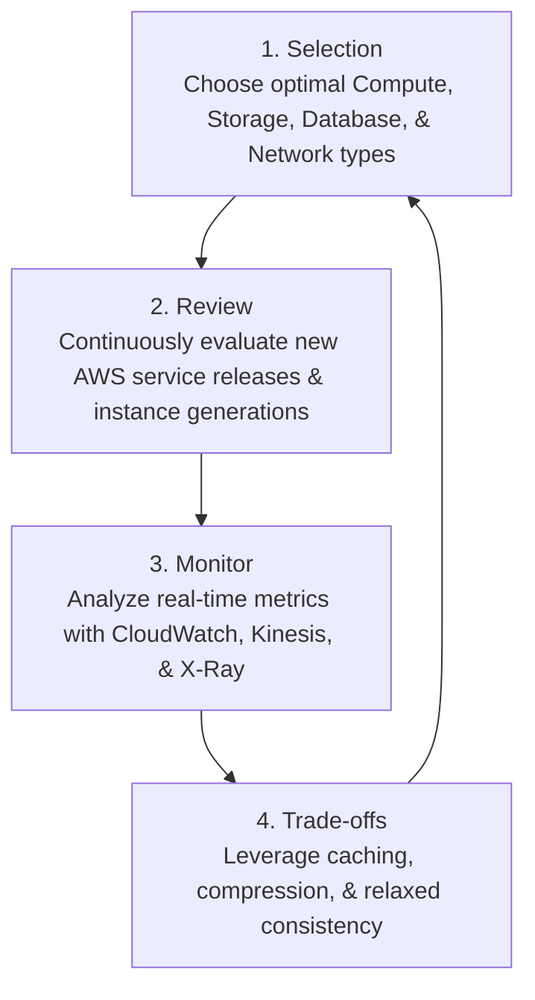

### Key Factors Influencing Performance
- **Selection**: Selecting the right combination of compute (instances, containers, serverless), storage (block, object, file), database (relational, NoSQL, in-memory, graph), and network technologies tailored to the workload's specific I/O and latency profile.
- **Review**: Continually evaluating newly released AWS services, instance types (e.g., AWS Graviton processors), and features to improve performance without redesigning core code.
- **Monitoring**: Collecting performance telemetry across all tiers using **Amazon CloudWatch**, **Amazon Kinesis**, and **AWS X-Ray** to pinpoint bottlenecks before end users experience degradation.
- **Trade-Offs**: Deliberately trading off non-critical properties (e.g., using caching layers like **Amazon ElastiCache** to trade absolute real-time database consistency for sub-millisecond read latency).

### Design Principles for Performance Efficiency

1. **Democratize Advanced Technologies**:
   - Rather than forcing internal IT staff to master, host, and maintain complex technologies (such as machine learning models, media transcoding, or distributed NoSQL databases), consume them as managed cloud services.
   - *Example*: Use **Amazon Rekognition** for computer vision or **Amazon OpenSearch Service** for indexing, allowing teams to focus on core business logic.

2. **Go Global in Minutes**:
   - Deploy applications across multiple geographic **AWS Regions** and edge locations using **Amazon CloudFront** and **AWS Global Accelerator**.
   - Drastically reduce network latency for end users worldwide while maintaining low operational overhead.

3. **Use Serverless Architectures**:
   - Adopt serverless computing services such as **AWS Lambda**, **AWS Fargate**, and **Amazon Aurora Serverless**.
   - Offload operating system maintenance, provisioning, and fleet management to AWS; pay only for actual execution duration while scaling instantaneously.

4. **Experiment More Often**:
   - The virtualized, automated nature of cloud infrastructure makes spinning up temporary benchmarking environments effortless.
   - Test different processor architectures, storage volumes, and network configurations under simulated production load to discover the most performant topology.

5. **Have Mechanical Sympathy**:
   - Understand how underlying cloud services operate and align workload design with their technical strengths.
   - *Example*: Align database access patterns with appropriate storage engines (e.g., using **Amazon DynamoDB** for key-value lookups and **Amazon S3** for sequential analytical queries).

---

## 💰 Pillar 5: Cost Optimization

### Definition & Business Value
The **Cost Optimization** pillar focuses on your ability to run systems to deliver business value at the lowest price point, eliminating unneeded expense and avoiding suboptimal resource allocations over the entire lifecycle of a workload.

Cost optimization is not merely about slashing budgets; it is an ongoing practice of maximizing business value realization and aligning infrastructure spending directly with business revenue.

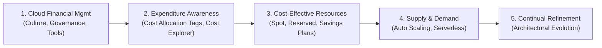

### The Five Focus Areas of Cost Optimization
1. **Practice Cloud Financial Management (CFM)**: Establishing organizational capabilities, policies, and ownership for cloud spending across technology and finance teams.
2. **Expenditure and Usage Awareness**: Tracking costs at granular levels using **AWS Cost Allocation Tags**, **AWS Cost Explorer**, and **AWS Budgets** to attribute spending directly to specific products, teams, or revenue streams.
3. **Cost-Effective Resources**: Selecting the most economical instance types, purchasing models (**Compute Savings Plans**, **Reserved Instances**, **Amazon EC2 Spot Instances**), and storage lifecycle tiers (**Amazon S3 Glacier**).
4. **Manage Demand and Supply**: Aligning provisioned capacity dynamically with real-time customer demand through Auto Scaling and scheduled shutdowns.
5. **Optimize Over Time**: Reviewing workload architectures periodically to adopt newer, more cost-effective AWS service offerings.

> [!TIP]
> **Speed-to-Market vs. Upfront Cost Trade-Off**:  
> In early startup phases or critical product rollouts, optimizing for rapid speed-to-market often takes precedence over initial cost efficiency. Re-architecting upfront can delay business value. A recommended cloud pattern is to deploy rapidly (or perform a lift-and-shift migration), establish baseline metrics, and subsequently iterate to optimize costs once product-market fit is secured.

### Design Principles for Cost Optimization

1. **Implement Cloud Financial Management**:
   - Dedicate executive sponsorship, time, and organizational resources to establish cloud financial management capabilities.
   - Build cross-functional collaboration between engineering, operations, and finance teams to make cost transparency a core engineering metric.

2. **Adopt a Consumption Model**:
   - Pay only for computing resources actively consumed.
   - Scale down or terminate non-production resources (dev/test environments) outside business hours:
   $$\text{Hours Running: } 40 \text{ hrs/week} \text{ vs. } 168 \text{ hrs/week} \implies \approx 76\% \text{ Cost Savings}$$

3. **Measure Overall Efficiency**:
   - Quantify workload business output (e.g., number of active users, customer transactions, processed orders) and divide by total infrastructure spend.
   - Use this unit-cost metric to evaluate whether technological changes genuinely improve economic efficiency.

4. **Stop Spending Money on Undifferentiated Heavy Lifting**:
   - AWS manages physical data center operations, security, cooling, racking, stacking, and hardware maintenance.
   - Managed cloud services eliminate the operational overhead of OS administration and database patching, freeing internal talent to focus on high-value business innovation.

5. **Analyze and Attribute Expenditure**:
   - Implement rigorous resource tagging policies to accurately map infrastructure costs to specific projects, business units, and revenue streams.
   - Provide workload owners with direct visibility into their expenditures to incentivize proactive cost optimization.

---

## 🌱 Pillar 6: Sustainability

### Definition & Business Value
The **Sustainability** pillar focuses on minimizing the environmental impacts of running cloud workloads. The discipline of sustainability addresses the long-term ecological, economic, and societal consequences of business activities, with a particular focus on **energy consumption**, **carbon emissions**, and **resource waste**.

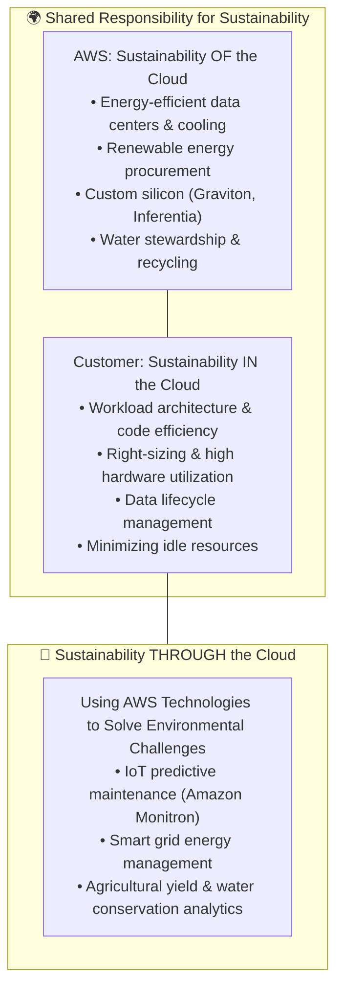

### The Three Dimensions of Cloud Sustainability
1. **Sustainability *OF* the Cloud (AWS Responsibility)**:
   - AWS engineers and operates ultra-efficient data centers, procures utility-scale renewable energy, designs energy-efficient custom hardware (e.g., AWS Graviton processors delivering up to 60% better energy efficiency for the same performance), and reuses water in cooling systems.
2. **Sustainability *IN* the Cloud (Customer Responsibility)**:
   - Customers optimize how their workloads are architected, deployed, and scaled. This involves choosing optimal instance sizes, eliminating idle infrastructure, managing data lifecycles, and maximizing hardware utilization.
3. **Sustainability *THROUGH* the Cloud (Transformational Solutions)**:
   - Leveraging AWS services (such as AI/ML, IoT, and data analytics) to solve broader global sustainability problems.
   - *Example*: Utilizing **Amazon Monitron** machine learning to detect vibrational anomalies in industrial motors, enabling predictive maintenance that prevents equipment failure, minimizes energy waste, and avoids hazardous industrial emissions.

### Design Principles for Sustainability

1. **Understand Your Impact**:
   - Measure the total environmental impact of your cloud workload across its entire lifecycle, including customer usage and ultimate decommissioning.
   - Establish Key Performance Indicators (KPIs) evaluating productive output relative to carbon emissions and electrical energy consumed per transaction.

2. **Establish Sustainability Goals**:
   - Formulate long-term sustainability benchmarks for each workload (such as decreasing compute and storage required per API call).
   - Architect workloads so that organic business growth results in reduced impact intensity per user.

3. **Maximize Utilization**:
   - Right-size instances and eliminate idle compute, storage, and networking resources.
   - Consolidate under-utilized workloads onto fewer physical hosts:
   > [!IMPORTANT]
   > Two servers running at 30% utilization consume significantly more total electrical power than a single server running at 60% utilization, due to fixed baseline hardware power consumption. High utilization maximizes energy efficiency.

4. **Anticipate and Adopt New, More Efficient Hardware and Software Offerings**:
   - Continually monitor and migrate workloads to new, energy-efficient instance families (such as upgrading from older x86 instances to ARM-based **AWS Graviton3** instances).
   - Design architectures with modular flexibility to allow rapid adoption of next-generation hardware.

5. **Use Managed Services**:
   - Multi-tenant managed services share physical cloud resources across millions of customers, driving collective hardware utilization rates far higher than dedicated private infrastructure.
   - Leverage automated data tiering (such as **Amazon S3 Lifecycle** policies to transition cold data to Glacier Flexible Retrieval) to shut down spinning disks and conserve power.

6. **Reduce the Downstream Impact of Your Cloud Workloads**:
   - Minimize the client-side device processing, memory, and energy consumption required for customers to consume your digital services.
   - Ensure software does not mandate frequent customer device upgrades, reducing global electronic waste (e-waste).

---

## 🔬 Architectural Trade-Off Analysis Matrix

Architecting systems in the cloud involves balancing trade-offs between competing pillar priorities. A design decision that maximizes one pillar frequently impacts another:

| Architectural Decision | Primary Pillar Benefited | Impacted / Compromised Pillar | Mitigation Strategy |
| :--- | :--- | :--- | :--- |
| **Multi-Region Active-Active Deployment** | **Reliability** (Extreme fault tolerance & near-zero RTO/RPO) | **Cost Optimization** (Doubled infrastructure spend & cross-region data transfer fees) | Use pilot-light or warm-standby multi-region patterns instead of fully active redundant fleets for non-critical workloads. |
| **In-Memory Caching (ElastiCache)** | **Performance Efficiency** (Sub-millisecond query response) | **Cost Optimization** (Dedicated cache cluster running continuously) | Implement cache eviction TTLs and auto-scaling cache nodes based on memory and CPU utilization. |
| **Comprehensive Synchronous Encryption & Deep Packet Inspection** | **Security** (Maximum confidentiality & threat detection) | **Performance Efficiency** (Increased processing latency & CPU load) | Offload cryptographic handshakes to AWS KMS and dedicated hardware accelerators; optimize network paths with VPC endpoints. |
| **Rapid Feature Deployment (MVP Speed)** | **Operational Velocity / Agility** (Fast time-to-market) | **Cost & Operational Excellence** (Over-provisioned capacity, lack of automated runbooks) | Plan immediate post-launch milestones in the AWS WA Tool to refactor architectures once initial market validation is achieved. |
| **Long-Term Cold Data Archiving to S3 Glacier Deep Archive** | **Cost & Sustainability** (Minimal storage cost, powered-down magnetic media) | **Performance Efficiency** (Retrieval times range from minutes to hours) | Architect asynchronous retrieval queues and clearly notify end-users regarding batch retrieval latency. |

---

## ❓ Checkpoint Questions & In-Depth Technical Solutions

### Question 1
**What does the AWS Well-Architected Framework provide?**

> **Comprehensive Answer**:  
> The AWS Well-Architected Framework provides a structured, comprehensive ecosystem of architectural guidance designed to help organizations evaluate and refine their cloud workloads:
> 1. **Foundational Critical Questions**: A curated set of evaluative questions developed by senior AWS Solutions Architects that prompt engineering teams to critically analyze their architectural decisions, assumptions, and trade-offs.
> 2. **Domain-Specific Lenses**: Specialized extensions to the core framework that provide targeted best practices for specific technology domains and industries, including Serverless, Machine Learning, SaaS, Financial Services, IoT, and High Performance Computing (HPC).
> 3. **Hands-On Labs**: Practical, code-level educational modules ([Well-Architected Labs](https://wellarchitectedlabs.com)) that walk engineers through implementing recommended best practices using real AWS services.
> 4. **AWS Well-Architected Tool**: A free, console-based service that enables teams to register workloads, answer pillar questions, automatically identify High Risk Issues (HRIs) and Medium Risk Issues (MRIs), track improvement plans, and record point-in-time milestones.
> 5. **AWS Well-Architected Partner Program**: An extensive network of certified APN consulting partners qualified to conduct formal architectural reviews and assist in remediating discovered risks.

---

### Question 2
**What are the six pillars of the AWS Well-Architected Framework?**

> **Comprehensive Answer**:  
> The framework evaluates architectures across six pillars:
> 1. **Operational Excellence**: Delivering business value, running and monitoring workloads effectively, and continually evolving supporting processes and procedures.
> 2. **Security**: Protecting information, systems, data integrity, and assets through structured risk assessment, least privilege access, and layered defense mechanisms.
> 3. **Reliability**: Ensuring workloads perform their intended functions correctly and consistently, recovering automatically from disruptions, and dynamically managing computing resources to satisfy demand.
> 4. **Performance Efficiency**: Using computing resources efficiently to meet technical and business requirements, and sustaining that efficiency as technologies and customer demands evolve.
> 5. **Cost Optimization**: Eliminating unneeded expense, avoiding suboptimal resource allocations, and maximizing business value through cloud financial management.
> 6. **Sustainability**: Minimizing the long-term environmental footprint of running cloud workloads, with an emphasis on energy efficiency, carbon reduction, and waste minimization.

---

### Question 3
**Which two types of guidance do the pillars of the Well-Architected Framework describe?**

> **Comprehensive Answer**:  
> Each of the six pillars describes two fundamental types of guidance:
> 1. **Design Principles**: Foundational, high-level strategic directives that guide architects when designing systems in the cloud (e.g., *"Perform operations as code"*, *"Apply security at all layers"*, *"Automatically recover from failure"*).
> 2. **Best Practices**: Specific, actionable technical and operational methodologies, processes, and service implementations that demonstrate how to realize the design principles in day-to-day cloud engineering.

---

### Question 4
**How does the AWS Well-Architected Tool distinguish between High Risk Issues (HRIs) and Medium Risk Issues (MRIs)?**

> **Comprehensive Answer**:  
> During an architectural review in the AWS WA Tool, the system categorizes identified weaknesses based on their potential impact:
> - **High Risk Issues (HRIs)** represent critical architectural deficiencies where failure to adopt a best practice exposes the organization to severe risks, such as catastrophic system outages, catastrophic data loss, major security breaches, or massive uncontrollable cost escalation. HRIs require immediate prioritization and remediation.
> - **Medium Risk Issues (MRIs)** represent suboptimal architectural choices that introduce moderate operational friction, degraded performance under specific conditions, or minor cost inefficiencies. While not posing immediate catastrophic risk, MRIs should be tracked and remediated systematically during milestone improvement plans.

---

### Question 5
**Explain the distinction between "Sustainability OF the cloud", "Sustainability IN the cloud", and "Sustainability THROUGH the cloud".**

> **Comprehensive Answer**:  
> Cloud sustainability operates across three distinct operational spheres:
> - **Sustainability OF the Cloud**: This is the direct responsibility of AWS. It encompasses the physical and structural engineering of data centers, sourcing 100% renewable energy for facilities, recycling cooling water, designing energy-efficient server hardware (such as AWS Graviton processors), and minimizing physical e-waste.
> - **Sustainability IN the Cloud**: This is the responsibility of the cloud customer. It focuses on how workloads are architected and operated—such as selecting efficient compute instances, right-sizing workloads, terminating idle dev/staging servers, adopting serverless architectures, and optimizing data lifecycles.
> - **Sustainability THROUGH the Cloud**: This involves using AWS technologies, algorithms, and cloud services as business tools to solve broader environmental problems in the physical world (e.g., using IoT predictive maintenance to prevent industrial leaks, or analyzing satellite imagery to optimize agricultural water usage).

---

## 📝 Key Takeaways & Architectural Principles Summary

- **Architecture is Evolutionary**: Modern cloud architecture is not a static one-time blueprint; it is a continuous, iterative practice that adapts to business objectives, emerging technologies, and operational feedback.
- **The Power of Foundational Questions**: The AWS Well-Architected Framework uses critical, objective questions to reveal neglected trade-offs and eliminate blind spots across engineering teams.
- **Objective Evaluation**: The AWS Well-Architected Tool provides a standardized, non-punitive evaluation rubric directly inside the AWS Management Console to systematically identify HRIs, track MRIs, and manage remediation roadmaps over time.
- **Six Balanced Pillars**: Successful cloud workloads maintain balanced harmony across all six pillars—**Operational Excellence**, **Security**, **Reliability**, **Performance Efficiency**, **Cost Optimization**, and **Sustainability**.
- **Deliberate Trade-Offs**: Architectural decisions always involve compromises. The framework empowers architects to make informed, data-driven trade-offs rather than accidental compromises driven by haste.
- **Leverage the Ecosystem**: Organizations should combine the Well-Architected whitepapers, domain-specific lenses, hands-on labs, the AWS WA Tool, and accredited APN Partner Network architects to achieve operational and technical excellence.

---

## 🔗 Related Resources & References
- [AWS Well-Architected Framework Official Documentation](https://aws.amazon.com/architecture/well-architected/)
- [AWS Well-Architected Tool User Guide](https://docs.aws.amazon.com/wellarchitected/latest/userguide/intro.html)
- [Well-Architected Hands-On Labs Portal](https://wellarchitectedlabs.com)
- [AWS Well-Architected Partner Program Overview](https://aws.amazon.com/architecture/well-architected/partners/)
