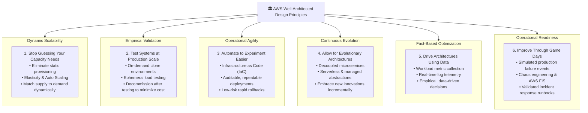
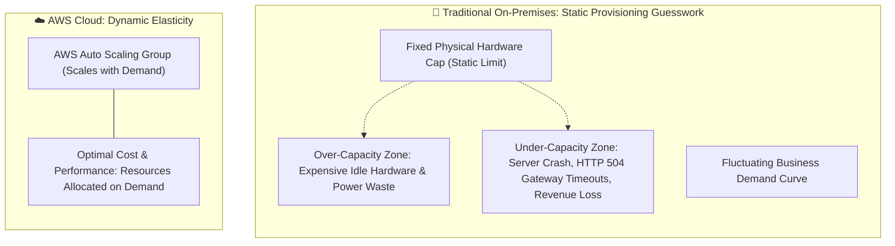
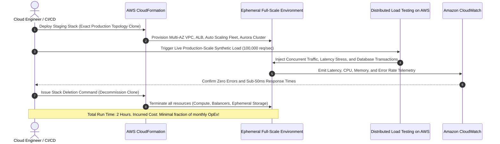
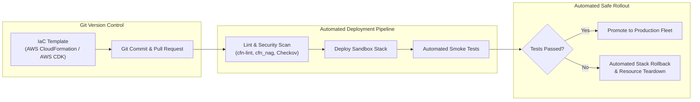
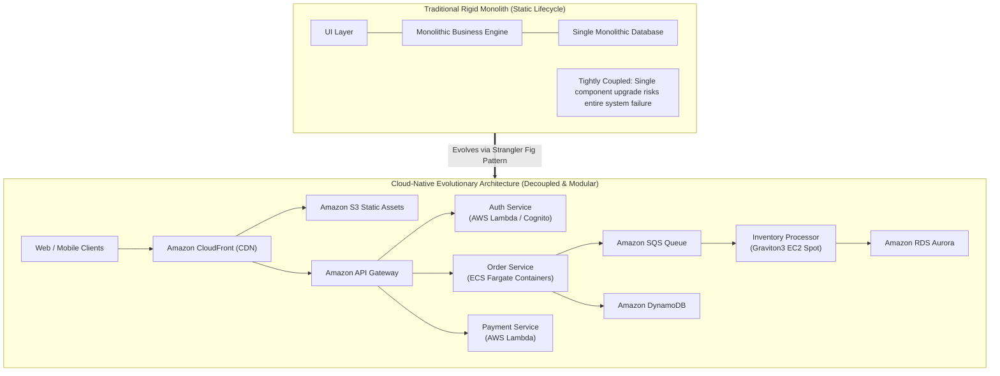
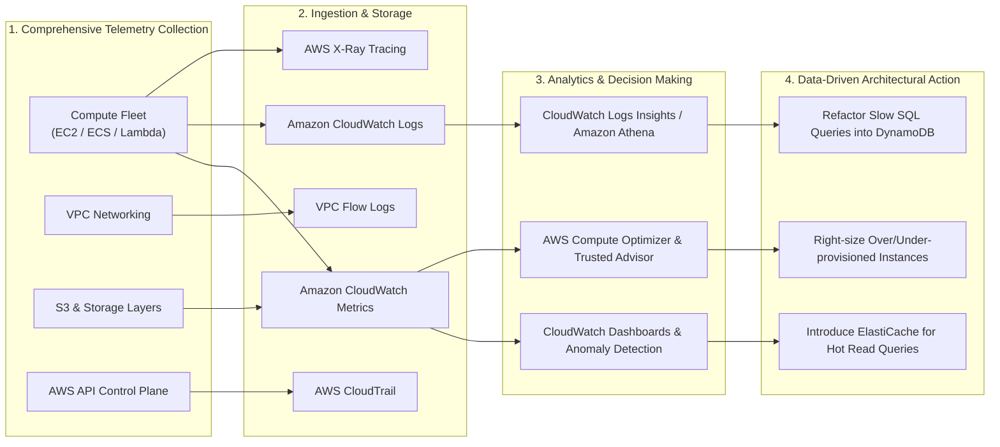
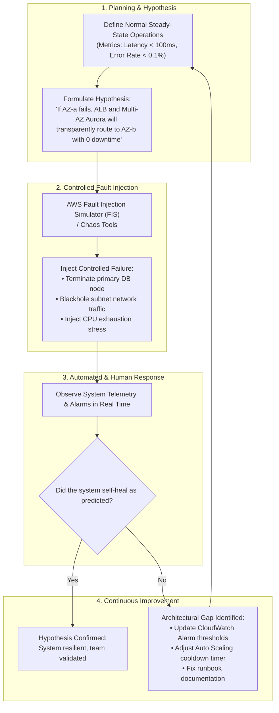
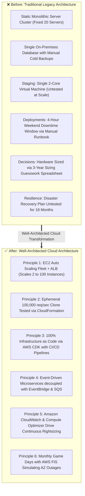

# 🏛️ AWS Well-Architected Framework: General Design Principles for Cloud Architecture

> **Course**: AWS re/Start  
> **Module**: AWS Architecture (M07 – Well-Architected Principles)  
> **Source Document**: `T11-AWS_Architecture/T11-0004-RSARCH_EN-US_SG_M07_WAPRINCIPLES.pdf`  
> **Target Audience**: AWS re/Start Learners, Solutions Architects, and Cloud Practitioners  

---

## 🎯 Module Overview

In traditional on-premises IT environments, system architecture is defined by physical limitations: purchasing specialized hardware, sizing server racks for hypothetical multi-year peak demand, managing multi-vendor proprietary appliances, and dealing with lengthy procurement cycles. Architectural decisions were treated as static, high-stakes events. If engineers made an incorrect estimate, the organization either suffered catastrophic outages during traffic surges or wasted substantial capital on idle, depreciating hardware.

The **AWS Well-Architected Framework** fundamentally alters how systems are designed, deployed, and operated. By transforming infrastructure into programmable software and abstracting physical constraints, AWS introduces a modern paradigm where systems are elastic, automated, testable, and continuously evolving. 

To help cloud architects and engineers evaluate architectures and implement resilient, secure, and cost-efficient solutions, AWS defines **Six General Design Principles for Cloud Architecture**:

1. **Stop guessing your capacity needs**
2. **Test systems at production scale**
3. **Automate to make architectural experimentation easier**
4. **Allow for evolutionary architectures**
5. **Drive architectures using data**
6. **Improve through game days**

Adhering to these principles empowers organizations to move rapidly, reduce operational risk, make empirical business decisions, and maintain architectural excellence.

---

## 📌 Learning Objectives

By studying this guide and completing the checkpoint questions, learners will be able to:

- [ ] Identify and define the **six general design principles** of the AWS Well-Architected Framework.
- [ ] Contrast traditional on-premises capacity sizing with cloud **elasticity and auto-scaling**.
- [ ] Explain how on-demand cloud infrastructure enables **testing systems at production scale** cost-effectively.
- [ ] Describe the role of **Infrastructure as Code (IaC)** and automation in lowering the risk of architectural experimentation.
- [ ] Articulate how loosely coupled microservices and managed services facilitate **evolutionary architectures**.
- [ ] Detail how telemetry, logging, and metrics are utilized to **drive architectures using data**.
- [ ] Define **Game Days** and chaos engineering practices, citing real-world methodologies like Netflix's Chaos Monkey and AWS Fault Injection Simulator (FIS).
- [ ] Apply the six design principles to real-world cloud modernization scenarios and cloud practitioner certification questions.

---

## 🗺️ Visual Taxonomy: The Six General Design Principles

---

## 📈 Principle 1: Stop Guessing Your Capacity Needs

### 1. The Core Philosophy
In a traditional IT environment, capacity planning requires engineers to estimate future computational, network, and storage demands months or years before deploying an application. This static guesswork leads to two detrimental business outcomes:
- **Over-provisioning**: If an organization buys excess servers to accommodate speculative peak traffic, those expensive resources sit idle during standard operations, wasting capital expenditures (CapEx) and operational overhead.
- **Under-provisioning**: If traffic exceeds initial forecasts, servers become resource-starved, leading to high latency, dropped requests, system brownouts, and lost revenue.

In the AWS Cloud, organizations **eliminate capacity guesswork**. By leveraging horizontal and vertical elasticity, cloud workloads scale dynamically in response to real-time telemetry, automatically provisioning compute when demand rises and retiring excess capacity when traffic subsides.

### 2. Traditional On-Premises vs. AWS Cloud Comparison

| Architectural Dimension | Traditional On-Premises Environment | AWS Cloud Architecture |
| :--- | :--- | :--- |
| **Sizing Approach** | Static guesswork based on historical or peak predictions | Dynamic, responsive elasticity based on real-time metrics |
| **Procurement Cycle** | Weeks to months (quoting, purchasing, shipping, racking) | Seconds to minutes via AWS APIs and management console |
| **Cost Model** | Large upfront Capital Expenditure (CapEx) | Pay-as-you-go Operational Expenditure (OpEx) |
| **Response to Spikes** | Resource exhaustion, degraded performance, outages | Automated horizontal scaling (e.g., adding EC2 instances) |
| **Off-Peak Utilization** | Servers sit idle, drawing power, cooling, and maintenance | Resources automatically terminated; zero spend when idle |
| **Core AWS Services** | N/A | **Amazon EC2 Auto Scaling**, **AWS Auto Scaling**, **AWS Lambda**, **Amazon DynamoDB On-Demand** |

### 3. Real-World Architectural Scenario & Trade-Offs

> **Scenario**: An e-commerce retail platform experiences an average baseline load of 2,000 active concurrent shoppers, but experiences sudden spikes of 50,000 concurrent shoppers during Black Friday flash sales.
> 
> - **Traditional Approach**: The company purchases 60 physical blade servers to handle the peak event. For the remaining 360 days of the year, 55 of those servers sit idle at 3% CPU utilization, consuming power and rack space.
> - **Well-Architected Cloud Approach**: The architecture deploys an Application Load Balancer (ALB) paired with an EC2 Auto Scaling group and target tracking policies based on ALB request count per target and average CPU utilization. Baseline traffic runs on 4 instances across multiple Availability Zones. When the flash sale starts, Auto Scaling transparently spins up 50 instances within minutes. Once the sale concludes, the fleet scales back down, saving up to 80% in annual hosting costs.

> [!TIP]
> **Architectural Best Practice**: Use **Target Tracking Scaling Policies** (e.g., keep average CPU at 60%) for smooth day-to-day demand curves, complemented by **Scheduled Scaling** for known, predictable promotional events, and **Predictive Scaling** powered by machine learning algorithms that forecast future load.

---

## 🧪 Principle 2: Test Systems at Production Scale

### 1. The Core Philosophy
In traditional on-premises data centers, building a testing or staging environment that exactly mirrors the scale, performance, and topology of the production system is financially and operationally cost-prohibitive. As a consequence, staging environments are typically downsized "miniatures" (e.g., running on a single dual-core virtual machine instead of a distributed multi-node cluster). 

When software or database migrations are tested exclusively on downsized environments:
- High-concurrency race conditions and deadlocks remain undetected.
- Distributed network latency and connection pool exhaustion are obscured.
- Performance regressions emerge only *after* deployment to the production fleet.

In the AWS Cloud, compute and storage resources are completely **ephemeral** and billed on a per-second or per-hour basis. Cloud architects can replicate an entire production topology on demand, execute full-scale synthetic load tests, validate operational performance, and immediately terminate all resources.

### 2. Traditional On-Premises vs. AWS Cloud Comparison

| Architectural Dimension | Traditional On-Premises Environment | AWS Cloud Architecture |
| :--- | :--- | :--- |
| **Staging Topology** | Downscaled, fractional prototype (under-sized hardware) | Exact 1:1 replica of production environment |
| **Financial Feasibility** | Cost-prohibitive to buy duplicate hardware for testing | High feasibility; pay-as-you-go micro-billing |
| **Environment Lifecycle** | Permanent, static, depreciating lab equipment | Ephemeral; created in minutes, destroyed after tests |
| **Testing Realism** | Low concurrency, synthetic low-volume approximations | Realistic live-level production traffic and stress testing |
| **Defect Detection** | Scalability bottlenecks leak into production live rollout | Concurrency bugs and memory leaks caught pre-launch |
| **Core AWS Services** | N/A | **AWS CloudFormation**, **AWS Step Functions**, **Distributed Load Testing on AWS**, **Amazon Aurora Cloning** |

### 3. Real-World Architectural Scenario & Trade-Offs

> **Scenario**: An enterprise financial services application plans to upgrade its primary transactional database engine from PostgreSQL 12 to PostgreSQL 15, introducing schema index modifications and query optimizer changes.
> 
> - **Traditional Approach**: Testing is conducted on a small developer workstation or a low-spec virtual machine. The upgrade succeeds on the small test dataset. When applied to production, a high-volume query triggers a sequential table scan on a 500 GB table, locking transactions and freezing customer accounts.
> - **Well-Architected Cloud Approach**: The engineering team uses **Amazon Aurora Fast Database Cloning** to spin up an exact, point-in-time clone of their production cluster in under five minutes without impacting production performance or duplicating storage costs. They run an automated test suite with full production transaction replay. Finding the query plan anomaly in the clone, they add the required index, re-run the benchmark, verify sub-millisecond execution, and safely apply the patch to production. The clone cluster is deleted after 90 minutes.

> [!NOTE]
> Aurora Fast Database Cloning utilizes a copy-on-write protocol. Storage space is only allocated when data changes within the clone, making full-scale database performance validation fast and economical.

---

## ⚙️ Principle 3: Automate to Make Architectural Experimentation Easier

### 1. The Core Philosophy
In traditional on-premises infrastructure, systems are composed of diverse, heterogeneous hardware components—physical network switches, storage area networks (SANs), hardware load balancers, and hypervisors—each with disparate management interfaces and proprietary firmware. Because there is no unified programmatic API across the entire infrastructure, provisioning and maintaining environments relies heavily on manual human configuration and manual runbooks. 

Manual processes introduce severe friction:
- **High Risk**: Manual modifications risk human typing errors, configuration drift, and undocumented security flaws.
- **Hesitation to Innovate**: Because building or altering an environment is labor-intensive, teams resist architectural experimentation and retain legacy, inefficient setups.
- **Slow Disaster Recovery**: Reconstructing a damaged environment from scratch requires hours or days of manual configuration.

In AWS, **every resource is controlled through standardized software APIs**. This enables **Infrastructure as Code (IaC)**, treating infrastructure blueprints with the same rigor as application code—subject to version control, automated linting, code reviews, continuous integration/continuous delivery (CI/CD), and instant rollback mechanisms.

### 2. Traditional On-Premises vs. AWS Cloud Comparison

| Architectural Dimension | Traditional On-Premises Environment | AWS Cloud Architecture |
| :--- | :--- | :--- |
| **Configuration Medium** | Manual console clicks, physical cabling, static runbooks | Declarative code (**JSON**, **YAML**, **TypeScript**, **Python**) |
| **API Uniformity** | Disjointed vendor APIs or absence of APIs altogether | Universal, unified REST APIs across all services |
| **Change Tracking** | Disorganized change logs, undocumented drift | Git commit history, pull request reviews, audit logs |
| **Rollback Capability** | Complex, error-prone manual reversal procedures | One-click or automated rollback to previous stack state |
| **Experimentation Velocity**| Low (weeks to provision sandbox test architectures) | High (minutes to stand up isolated experimental stacks) |
| **Core AWS Services** | N/A | **AWS CloudFormation**, **AWS Cloud Development Kit (CDK)**, **AWS CodePipeline**, **AWS Service Catalog** |

### 3. Real-World Architectural Scenario & Trade-Offs

> **Scenario**: An organization wants to evaluate whether migrating from an ALB + Amazon EC2 model to an API Gateway + AWS Lambda serverless architecture reduces operational latency and cost for an internal microservice.
> 
> - **Traditional Approach**: Testing this would require procuring specialized application runtime appliances and rewiring physical networks. The engineering team decides not to bother because the effort exceeds the budget.
> - **Well-Architected Cloud Approach**: The engineer writes an **AWS CloudFormation** template defining the API Gateway, Lambda function, and DynamoDB backend. The experimental stack is deployed in an isolated AWS account in 3 minutes. The team runs benchmarks, captures metrics, and discovers a 40% cost reduction. The template is merged into the mainline repository, while the experimental stack is deleted with a single CLI command (`aws cloudformation delete-stack`).

> [!IMPORTANT]
> Infrastructure as Code guarantees **idempotency**—deploying the same template repeatedly produces identical environments without configuration drift or manual intervention.

---

## 🧬 Principle 4: Allow for Evolutionary Architectures

### 1. The Core Philosophy
In traditional enterprise IT, architectural decisions were treated as one-time, monumental milestones. Systems were designed as large, tightly coupled monoliths intended to run on fixed hardware for a 3-to-5-year hardware refresh cycle. Once implemented, these monolithic systems were extremely brittle; changing an underlying library or upgrading an operating system could break unforeseen dependencies across the entire stack. Consequently, businesses remained trapped on outdated technology, unable to pivot to meet shifting customer demands.

In the AWS Cloud, architecture is viewed as an **evolving living organism**. By decoupling systems into modular, loosely coupled components and abstracting infrastructure through managed and serverless services, architectures can evolve incrementally. Organizations can adopt new CPU architectures (e.g., AWS Graviton), switch database engines, or replace batch processors with event-driven pipelines without rewriting the entire application.

### 2. Traditional On-Premises vs. AWS Cloud Comparison

| Architectural Dimension | Traditional On-Premises Environment | AWS Cloud Architecture |
| :--- | :--- | :--- |
| **System Coupling** | Tightly coupled monoliths with deep inter-dependencies | Loosely coupled microservices and event-driven queues |
| **Architecture Lifecycle** | Static, multi-year lifespan with rare, high-risk upgrades | Incremental, continuous evolution with zero downtime |
| **Upgrade Risk** | High; single change can trigger cascade failures | Low; isolated components can be upgraded independently |
| **Hardware Evolution** | Bound to physical servers until lease/depreciation ends | Seamless migration across instance generations and chipsets |
| **Innovation Velocity** | Stifled by fear of system instability | High; rapid adoption of newly released cloud capabilities |
| **Core AWS Services** | N/A | **Amazon SQS**, **Amazon SNS**, **Amazon EventBridge**, **AWS Step Functions**, **AWS Lambda**, **Amazon ECS/EKS** |

### 3. Real-World Architectural Scenario & Trade-Offs

> **Scenario**: A SaaS company runs an image processing application on standard x86-based EC2 instances. AWS releases **AWS Graviton3** processors, which offer up to 25% better compute performance and 20% lower cost for equivalent workloads.
> 
> - **Traditional Approach**: Migrating to a different processor architecture would require purchasing entirely new server hardware, retiring existing physical servers at a financial loss, and recabling data centers over several months.
> - **Well-Architected Cloud Approach**: Because the application runs in a containerized environment on Amazon ECS, the engineering team builds multi-architecture container images (`linux/amd64` and `linux/arm64`). They update their IaC template to point their Auto Scaling Launch Template to `c7g` (Graviton3) instances. ECS performs a rolling update, gradually replacing x86 instances with ARM instances. The application immediately achieves better performance and lower hourly costs with zero customer interruption.

> [!TIP]
> Use the **Strangler Fig Application Pattern** to incrementally replace monolithic legacy components with modern cloud-native serverless functions or container microservices, routing traffic via Amazon Route 53 or Application Load Balancers.

---

## 📊 Principle 5: Drive Architectures Using Data

### 1. The Core Philosophy
In traditional IT architectures, critical design decisions—such as memory allocation, disk throughput, network bandwidth, and thread pools—are frequently driven by organizational habit, subjective intuition, vendor rules of thumb, or outright guesswork. Furthermore, because physical logs are fragmented across dozens of discrete servers and network appliances without centralized aggregation, generating actionable, empirical datasets to measure system behavior is nearly impossible.

In the AWS Cloud, **telemetry and observability are foundational primitives**. Every compute cycle, storage access, API invocation, network packet, and database query emits structured telemetry. Cloud architects do not guess how their system is performing; they collect, visualize, and analyze operational metrics in real time. Architectures are continuously refined and optimized based on factual operational data.

### 2. Traditional On-Premises vs. AWS Cloud Comparison

| Architectural Dimension | Traditional On-Premises Environment | AWS Cloud Architecture |
| :--- | :--- | :--- |
| **Decision Driver** | Organizational defaults, personal opinions, assumptions | Empirical data, continuous metrics, and telemetry |
| **Telemetry Availability** | Siloed, local log files; sporadic SNMP polling | Centralized, unified real-time logs and metric streams |
| **Root Cause Analysis** | Manual SSH log inspection across individual machines | Distributed tracing and centralized log analytics queries |
| **Rightsizing Guidance** | Static spreadsheets and rough estimates | Machine-learning-driven recommendations |
| **Continuous Optimization**| Rarely attempted due to lack of visibility | Ongoing, iterative process baked into operational reviews |
| **Core AWS Services** | N/A | **Amazon CloudWatch**, **AWS CloudTrail**, **AWS X-Ray**, **AWS Compute Optimizer**, **Amazon Athena** |

### 3. Real-World Architectural Scenario & Trade-Offs

> **Scenario**: An organization notices that their database CPU utilization occasionally spikes to 95%, causing latency degradation across their web portal.
> 
> - **Traditional Approach**: Systems engineers assume the database server is underpowered and order a new, double-priced server with twice the RAM and CPU cores, without investigating root cause.
> - **Well-Architected Cloud Approach**: The architect reviews **Amazon RDS Performance Insights** and **CloudWatch Metrics**. The data reveals that 85% of database CPU cycles are consumed by a single unindexed SQL query generated by a reporting module that runs every 15 minutes. Rather than upgrading to an expensive instance class, the team adds a database index and offloads the read-heavy reporting queries to an **Amazon RDS Read Replica**. Database CPU drops to 25%, saving thousands of dollars while solving the performance issue permanently.

> [!NOTE]
> **AWS Compute Optimizer** uses machine learning algorithms to analyze historical CloudWatch utilization metrics over days and weeks, delivering prescriptive rightsizing recommendations for Amazon EC2 instances, Amazon EBS volumes, and AWS Lambda functions.

---

## 🎮 Principle 6: Improve Through Game Days

### 1. The Core Philosophy
In traditional enterprise environments, disaster recovery (DR) plans and operational runbooks are rarely exercised in realistic conditions. Typically, runbooks sit unread in static binders or shared drives until an actual catastrophe strikes production. Even when DR exercises do occur, they are usually conducted as theoretical tabletop discussions or scheduled during maintenance windows where systems are cleanly shut down and manually restarted.

This leaves critical blind spots:
- Teams discover that emergency recovery runbooks are outdated or broken during live outages.
- Monitoring alarms fail to alert the right personnel when dependencies fail.
- Staff lack muscle memory and operational confidence under high-stress incident scenarios.

In the AWS Cloud, resilience is validated through **Game Days** and **Chaos Engineering**. A Game Day is an organized exercise where teams simulate real-world catastrophic failure modes—such as an entire Availability Zone going dark, a database primary node failing abruptly, sudden network latency spikes, or security breaches—within a simulated or live environment. By regularly testing how systems, automation, and human operators respond under crisis, organizations identify hidden architectural flaws and build organizational operational readiness.

### 2. The Evolution of Chaos Engineering: From Chaos Monkey to AWS FIS

The discipline of Chaos Engineering was pioneered by Netflix in 2011 after migrating its streaming architecture to AWS. To enforce architectural resilience, Netflix engineers created **Chaos Monkey**, an automated tool designed to randomly terminate virtual machine instances within Auto Scaling groups during business hours. 

The underlying philosophy was simple: **the best way to avoid major production outages is to fail constantly**. By deliberately causing random failures, engineers were forced to architect every application service to withstand the sudden death of underlying infrastructure. Netflix expanded Chaos Monkey into a comprehensive resilience test suite known as the **Simian Army**, introducing tools like Chaos Kong (which simulates entire AWS Region outages).

Today, AWS provides **AWS Fault Injection Simulator (AWS FIS)**, a fully managed chaos engineering service. AWS FIS enables teams to execute controlled fault injection experiments across Amazon EC2, Amazon ECS, Amazon EKS, and Amazon RDS with built-in safeguards (stop conditions that automatically abort the experiment if unexpected error thresholds are reached).

### 3. Traditional On-Premises vs. AWS Cloud Comparison

| Architectural Dimension | Traditional On-Premises Environment | AWS Cloud Architecture |
| :--- | :--- | :--- |
| **Disaster Recovery Testing**| Rare, theoretical tabletop walk-throughs in conference rooms | Hands-on, empirical Game Days simulating realistic failure |
| **Testing Environment** | Hesitant to touch production; fear of unexpected downtime | Controlled experiments using **AWS FIS** and ephemeral clones |
| **Operational Runbooks** | Static paper binders; rarely tested or updated | Automated, executable runbooks via **AWS Systems Manager** |
| **Team Readiness** | High stress, panic, and uncertainty during live incidents | Calm, practiced incident response with drilled muscle memory |
| **Failure Philosophy** | Attempt to prevent all failures through physical redundancy | Assume failure will happen; design systems to self-heal |
| **Core AWS Services** | N/A | **AWS Fault Injection Simulator (FIS)**, **AWS Systems Manager Incident Manager**, **Amazon CloudWatch Synthetics** |

### 4. Real-World Architectural Scenario & Trade-Offs

> **Scenario**: A healthcare billing platform runs across multiple Availability Zones. Management wants assurance that the system will survive an unexpected Availability Zone outage without losing patient billing records.
> 
> - **Traditional Approach**: The team reviews a PowerPoint architecture diagram from two years ago and assumes the secondary data center will pick up the load. During an actual power substation failure, they discover the secondary database replication had stalled three months earlier, causing 12 hours of data loss.
> - **Well-Architected Cloud Approach**: The organization schedules a Game Day. Using **AWS Fault Injection Simulator (FIS)**, the team injects a target network fault that disrupts all outbound traffic from Availability Zone 1 (`us-east-1a`). They monitor their CloudWatch Synthetics canary and Application Load Balancer. They observe that:
>   1. The ALB health checks detect target failures in AZ-1 within 10 seconds and stop routing traffic to those instances.
>   2. The Multi-AZ Amazon RDS cluster automatically promotes the standby replica in AZ-2 to primary within 35 seconds.
>   3. The application recovers completely with zero data loss.
>   4. However, they discover an overlooked internal microservice was hardcoded to an IP in AZ-1. The team corrects the configuration in their CloudFormation template immediately, eliminating an outage vulnerability before it ever occurs in production.

> [!CAUTION]
> Always define clear **Stop Conditions** in AWS Fault Injection Simulator using CloudWatch Alarms. If customer-impacting metrics exceed acceptable thresholds during a Game Day experiment, AWS FIS will immediately halt the experiment and roll back injected faults.

---

## 🏛️ Comprehensive Master Comparison Matrix

The following matrix consolidates the six Well-Architected general design principles, contrasting traditional on-premises constraints with modern AWS cloud capabilities:

| # | General Design Principle | Traditional On-Premises Constraint | AWS Cloud Modern Capability | Primary AWS Enabling Services |
| :-: | :--- | :--- | :--- | :--- |
| **1** | **Stop guessing your capacity needs** | Static capacity sizing; risk of expensive idle capacity or performance degradation during peaks | Dynamic elasticity; automated horizontal and vertical scaling matching exact demand curve | Amazon EC2 Auto Scaling, AWS Auto Scaling, AWS Lambda, DynamoDB On-Demand |
| **2** | **Test systems at production scale** | Cost-prohibitive duplicate physical environments; testing limited to underpowered staging rigs | Ephemeral on-demand production clones; pay only for the minutes or hours tests run | AWS CloudFormation, Amazon Aurora Cloning, Distributed Load Testing on AWS |
| **3** | **Automate to make architectural experimentation easier** | Disjointed vendor APIs, manual hardware setup, error-prone runbooks, high risk of configuration drift | Infrastructure as Code (IaC); standardized APIs, version-controlled templates, instant rollback | AWS CloudFormation, AWS CDK, AWS CodePipeline, AWS Service Catalog |
| **4** | **Allow for evolutionary architectures** | Rigid monolithic designs; multi-year hardware refresh cycles; architectural decisions are static one-time events | Decoupled microservices and serverless components; continuous incremental evolution with zero downtime | Amazon SQS, Amazon SNS, Amazon EventBridge, AWS Step Functions, Amazon ECS/EKS |
| **5** | **Drive architectures using data** | Intuition-driven sizing; organizational defaults; lack of centralized telemetry and metrics | Data-driven architecture; comprehensive real-time metrics, logs, distributed tracing, and automated rightsizing | Amazon CloudWatch, AWS CloudTrail, AWS X-Ray, AWS Compute Optimizer, Athena |
| **6** | **Improve through game days** | Theoretical paper drills; runbooks exercised only during real production disasters; fear of failure | Scheduled Game Days; chaos engineering, controlled fault injection, practiced incident response | AWS Fault Injection Simulator (FIS), AWS Systems Manager, Amazon CloudWatch Synthetics |

---

## 💡 Real-World Architectural Case Study

### Modernizing an Enterprise E-Commerce Platform

To see how all six design principles synthesize into a coherent architecture, consider the transformation of **GlobalMart Online**:

### Architectural Benefits Realized
1. **Financial Optimization**: GlobalMart reduced average monthly compute costs by 58% by terminating idle instances during off-peak hours and adopting Graviton3 instances.
2. **Deployment Velocity**: Deployment frequency increased from once a month with scheduled downtime to multiple zero-downtime releases per day.
3. **Resilience & Uptime**: During an actual AWS Availability Zone network disruption, the self-healing architecture rerouted traffic within 12 seconds with zero customer impact, validated by previous Game Day drills.

---

## 📝 Checkpoint Questions & Detailed Explanations

Test your knowledge of the Well-Architected design principles:

### Question 1
**What is the primary benefit of a cloud environment when it comes to understanding capacity?**
- A) Cloud providers guarantee unlimited free compute resources during emergency spikes.
- B) Organizations do not need to guess infrastructure capacity needs; they can monitor usage and scale resources up and down automatically.
- C) Cloud capacity is fixed permanently at contract signing, locking in wholesale hardware pricing.
- D) Organizations must purchase physical servers in advance, but AWS handles shipping and installation.

> **Correct Answer: B**  
> **Explanation**: In a cloud environment, organizations eliminate guesswork. By monitoring demand and system utilization, architectures leverage auto-scaling to dynamically provision or terminate resources, ensuring optimal performance without paying for idle capacity.

---

### Question 2
**How can developers effectively test their system at production scale in an AWS cloud environment without incurring massive long-term costs?**
- A) By testing solely on small development instances and mathematically extrapolating the results.
- B) By running load tests directly against live production users during peak business hours.
- C) By creating a duplicate environment on demand using Infrastructure as Code, completing tests, and immediately decommissioning the resources.
- D) By purchasing discounted physical servers from AWS Marketplace and shipping them to a local lab.

> **Correct Answer: C**  
> **Explanation**: Cloud resources are ephemeral and billed pay-as-you-go. Teams can spin up a full-scale duplicate production environment with tools like AWS CloudFormation, run realistic high-concurrency load tests for several hours, and then delete the stack, paying only for the duration of the test.

---

### Question 3
**How does a cloud environment facilitate future architectural design changes and system evolution?**
- A) The cloud enforces a single monolithic architecture that prevents code modifications.
- B) Automation and on-demand testing lower the risk of design changes, allowing systems to evolve incrementally and adopt new innovations over time.
- C) Cloud architectures require hardware lease contracts that reset every 12 months.
- D) System changes are automatically approved without testing or version control.

> **Correct Answer: B**  
> **Explanation**: Because cloud resources can be automated, tested, and provisioned on demand, the friction and risk of making design changes are dramatically reduced. Systems can evolve incrementally (e.g., decoupling components, shifting to serverless, upgrading CPU architectures) rather than remaining locked in static, one-time designs.

---

### Question 4
**How do development and operational teams use Game Days to improve their architectural design?**
- A) By hosting video game tournaments to boost employee morale during software releases.
- B) By scheduling tabletop discussions to review theoretical procedures without modifying any infrastructure.
- C) By regularly scheduling simulations of realistic production events and failures to discover weaknesses, refine runbooks, and build operational muscle memory.
- D) By disabling all monitoring alarms to test how long the system takes to crash unassisted.

> **Correct Answer: C**  
> **Explanation**: Game Days involve deliberately simulating realistic operational events and crisis scenarios (such as server terminations, database failovers, or network disruptions) using tools like AWS Fault Injection Simulator. This reveals architectural flaws, verifies monitoring alerts, and prepares teams for real-world incidents.

---

### Question 5
**Which AWS service enables teams to implement the principle 'Automate to make architectural experimentation easier' by defining infrastructure as declarative code templates?**
- A) AWS CloudFormation
- B) Amazon Simple Storage Service (Amazon S3)
- C) AWS Trusted Advisor
- D) Amazon Route 53

> **Correct Answer: A**  
> **Explanation**: AWS CloudFormation is an Infrastructure as Code (IaC) service that allows teams to model and provision AWS resources through declarative JSON or YAML templates. This makes provisioning repeatable, auditable, and automated.

---

### Question 6
**Which software tool, developed by Netflix in 2011, inspired modern cloud chaos engineering by deliberately shutting down virtual machines in AWS Auto Scaling groups?**
- A) Simian Sentry
- B) Chaos Monkey
- C) Gorilla Tester
- D) Elastic Disruptor

> **Correct Answer: B**  
> **Explanation**: Chaos Monkey was created by Netflix in 2011 to test the resilience of their AWS infrastructure by randomly terminating EC2 instances within Auto Scaling groups. It established the principle that systems must be designed to withstand continuous, unexpected component failures.

---

## 📌 Summary & Key Takeaways

1. **Eliminate Guesswork**: Leverage AWS Auto Scaling to scale dynamically based on demand. Pay for what you use, rather than maintaining idle, expensive hardware for hypothetical peaks.
2. **Ephemeral Production Scale**: Use Infrastructure as Code to spin up full-scale test environments on demand. Catch concurrency and scalability bugs before deploying to production, then tear down the test environment to keep costs low.
3. **Automate Infrastructure**: Treat infrastructure as code with AWS CloudFormation and AWS CDK. Automated deployments enable rapid, low-risk experimentation, repeatable sandboxes, and safe rollbacks.
4. **Architect for Evolution**: Decouple monolithic systems into modular, loosely coupled microservices and event-driven patterns using Amazon SQS, SNS, and EventBridge. Adopt new technologies and instance types incrementally without system downtime.
5. **Decide with Data**: Centralize telemetry and metrics using Amazon CloudWatch, AWS CloudTrail, and AWS X-Ray. Base architectural modifications and instance rightsizing on empirical data rather than intuition or assumptions.
6. **Embrace Failure via Game Days**: Validate system resilience and operational runbooks by conducting regular Game Days and chaos engineering experiments with AWS Fault Injection Simulator (FIS). Ensure both systems and personnel are prepared for production emergencies.
