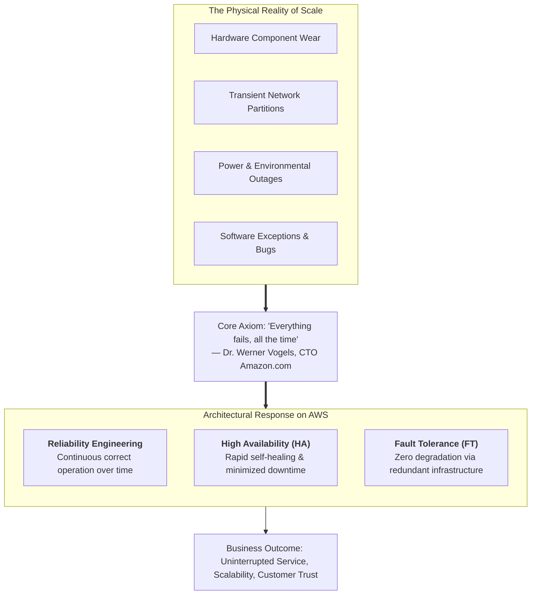
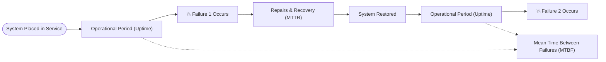
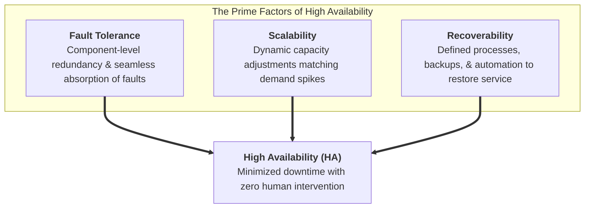
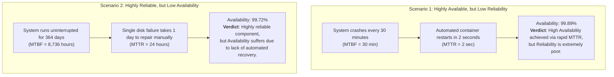
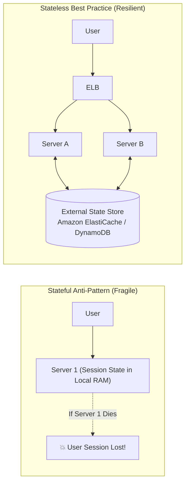

# 🛡️ AWS Architecture: Reliability & High Availability

> **Course**: AWS re/Start  
> **Module**: AWS Architecture (M07 – Reliability and High Availability)  
> **Source Document**: `T11-AWS_Architecture/T11-0005-RSARCH_EN-US_SG_M07_RELIABLEHIGHLYAVAILABLE.pdf`  
> **Target Audience**: AWS re/Start Learners, Cloud Practitioners, and Solutions Architects  

---

## 🎯 Module Overview

In modern cloud computing, architecting enterprise workloads requires an absolute paradigm shift away from traditional, fail-fragile data center assumptions. Physical components—hard disks, solid-state drives, power supplies, fiber lines, network switches, and compute nodes—eventually deteriorate or experience transient faults. Recognizing this physical reality is the foundation of modern cloud architecture.

As Dr. Werner Vogels, Chief Technology Officer (CTO) of Amazon.com, famously stated:

> *"Failures are a given, and everything will eventually fail over time: from routers to hard drives, from operating systems to memory units corrupting TCP packets, from transient network outages to total power grid collapses. Everything fails, all the time."*

Because failure is an inevitable statistical certainty at scale, the primary objective of cloud architecture is not to build an impossible, unbreakable system. Instead, cloud architects design systems that **anticipate failure**, isolate blast radiuses, gracefully handle degradation, and heal automatically without human intervention. This module explores the foundational engineering principles of **Reliability**, **High Availability (HA)**, and **Fault Tolerance (FT)**, establishing quantitative formulas, availability benchmarks, and implementation patterns across the AWS Cloud.



---

## 📌 Learning Objectives

By completing this module and reviewing these comprehensive architectural notes, you will be able to:

- [ ] **Internalize the Failure Axiom**: Articulate Dr. Werner Vogels' core axiom and understand why modern distributed systems must be architected for inevitable failure.
- [ ] **Define Reliability Engineering Foundations**: Formulate the statistical definition of reliability and quantify system performance using Mean Time Between Failures ($\text{MTBF}$), Failure Rate ($\lambda$), and Mean Time to Repair ($\text{MTTR}$).
- [ ] **Differentiate System Availability**: Calculate system availability using uptime and downtime formulas, and analyze the mathematical relationship $\frac{\text{MTBF}}{\text{MTBF} + \text{MTTR}}$.
- [ ] **Master 'The Nines' Downtime Benchmarks**: Map availability percentages (from $99\%$ "two nines" to $99.999\%$ "five nines") to permissible downtime allowances per year, month, week, and day.
- [ ] **Contrast Reliability, High Availability, and Fault Tolerance**: Analyze the definitions, mechanisms, cost impacts, and trade-offs of each paradigm.
- [ ] **Analyze the Prime Factors of High Availability**: Examine how Fault Tolerance, Scalability, and Recoverability converge to guarantee end-to-end service continuity.
- [ ] **Compare On-Premises vs. AWS High Availability**: Contrast legacy hardware-bound clustering with AWS multi-datacenter Availability Zone clustering and globally distributed services.
- [ ] **Implement Resilient AWS Architectural Patterns**: Architect resilient workloads using Multi-AZ deployments, Elastic Load Balancing (ELB) health checks, Auto Scaling self-healing compute, stateless architectures, graceful degradation, circuit breakers, and chaos engineering.

---

## 📐 1. Reliability Engineering Foundations

### 1.1 Formal Definition of Reliability
**Reliability** is formally defined as the **probability ($R(t)$) that an entire system—encompassing all underlying hardware, firmware, and software layers—will satisfactorily perform its intended function under specified operating conditions for a specified period of time ($t$)**.

```
Reliability = The probability of continuous, error-free operation over a specified duration.
```

Reliability is a measure of **how long** a component or collection of interdependent subsystems performs without interruption.

> [!NOTE]
> Reliability is an end-to-end system attribute. In an automotive analogy, a vehicle is a collection of interdependent subsystems: fuel injection, braking, battery, ignition, cooling, and steering. If any critical subsystem fails—such as the ignition refusing to turn over—the entire system fails its intended function. Similarly, in a distributed cloud application, an outage in a database, authentication service, or DNS resolution compromises the reliability of the entire user journey.

---

### 1.2 Mathematical Metrics of Reliability

Reliability engineering uses standardized quantitative metrics to model failure rates and operational life cycles:



#### 1. Mean Time Between Failures ($\text{MTBF}$)
$\text{MTBF}$ represents the average operational time elapsed between inherent failures of a repairable system during normal operating conditions.

$$\text{MTBF} = \frac{\text{Total Operational Uptime}}{\text{Total Number of Failures}}$$

- **Example**: If an Amazon EC2 fleet runs for a combined total of $10,000$ operating hours and experiences $4$ system failures over the reporting period:
  $$\text{MTBF} = \frac{10,000\text{ hours}}{4\text{ failures}} = 2,500\text{ hours/failure}$$

#### 2. Failure Rate ($\lambda$)
The failure rate, denoted by the Greek letter lambda ($\lambda$), represents the frequency with which an engineered system or component fails, expressed in failures per unit of operational time. Assuming a constant failure rate during the operational life cycle:

$$\lambda = \frac{1}{\text{MTBF}} = \frac{\text{Total Number of Failures}}{\text{Total Operational Uptime}}$$

- Using the previous example where $\text{MTBF} = 2,500\text{ hours}$:
  $$\lambda = \frac{1}{2,500} = 0.0004\text{ failures per hour}$$

#### 3. Mean Time to Repair / Recover ($\text{MTTR}$)
$\text{MTTR}$ measures the average time required to diagnose, repair, and restore a failed system or component back to normal operating service:

$$\text{MTTR} = \frac{\text{Total Corrective Maintenance Downtime}}{\text{Total Number of Failures}}$$

- **Significance in Cloud Computing**: While hardware MTBF is largely governed by physics and manufacturing tolerances, cloud architects can directly influence $\text{MTTR}$. Through automated health checks, stateless compute instances, Auto Scaling replacement, and rapid DNS redirection, modern cloud architectures drive $\text{MTTR}$ down from hours or days to mere seconds.

---

### 1.3 System Configurations: Series vs. Parallel Reliability

System reliability is governed by how individual components are arranged:

| Architecture Model | Formula | Behavior | Visual Representation |
| :--- | :--- | :--- | :--- |
| **Series System** (Single Point of Failure) | $R_{\text{sys}} = R_1 \times R_2 \times \dots \times R_n$ | The system fails if **any** component fails. System reliability is strictly **lower** than the least reliable component. | `[Component A] ───> [Component B]` |
| **Parallel System** (Redundant Components) | $R_{\text{sys}} = 1 - \prod_{i=1}^{n} (1 - R_i)$ | The system functions as long as **at least one** parallel component remains operational. Reliability is **higher** than any single component. | `┌─> [Component A] ─┐`<br/>`└─> [Component B] ─┘` |

> [!IMPORTANT]
> The primary objective of high-availability cloud architecture is to eliminate series dependencies (Single Points of Failure or SPOFs) and transform them into parallel, horizontally redundant structures across multiple isolated failure domains.

---

## ⏱️ 2. High Availability (HA) Foundations

### 2.1 Formal Definition of High Availability
**Availability** refers specifically to the **percentage of time that a system remains operational, responsive, and accessible to authorized users to perform its required functions**.

While reliability measures continuous duration without failure, availability measures the aggregate proportion of time a resource is available over a specified interval (such as a calendar month or year).

**High Availability (HA)** is the architectural discipline of ensuring that application downtime is minimized as much as possible **without the need for human intervention**. HA does not simply replicate physical hardware; it coordinates system-wide, shared cloud resources to guarantee essential service continuity.

---

### 2.2 The Availability Formula

Availability is expressed mathematically as the ratio of operational uptime to total time:

$$\text{Availability} = \frac{\text{Total Operational Uptime}}{\text{Total Time (Uptime + Downtime)}} \times 100\%$$

In terms of reliability engineering metrics ($\text{MTBF}$ and $\text{MTTR}$):

$$\text{Availability} = \frac{\text{MTBF}}{\text{MTBF} + \text{MTTR}} \times 100\%$$

```
                   MTBF
Availability = ───────────── × 100%
                MTBF + MTTR
```

> [!TIP]
> The formula reveals two independent engineering pathways to achieve high availability:
> 1. **Increase MTBF**: Make components fail less often (e.g., enterprise-grade hardware, comprehensive testing). However, this yields diminishing returns and escalating costs.
> 2. **Minimize MTTR**: Rapidly detect, isolate, and recover from failures using automation. In AWS cloud design, driving $\text{MTTR} \to 0$ via automated failover is significantly more cost-effective and scalable than attempting to prevent every possible failure.

---

### 2.3 "The Nines" Downtime Reference Table

Industry standard Service Level Agreements (SLAs) express availability targets in terms of the "number of nines." Because downtime directly translates into revenue loss, brand damage, and contractual penalties, understanding permitted downtime per time horizon is essential for infrastructure budgeting.

| Availability Tier | SLA Shorthand | Maximum Downtime / Year | Maximum Downtime / Month (30.4 days) | Maximum Downtime / Week (7 days) | Maximum Downtime / Day (24 hrs) | Typical Business Use Case |
| :--- | :--- | :--- | :--- | :--- | :--- | :--- |
| **90.0%** | *"One 9"* | **36.5 days** | 73.0 hours | 16.8 hours | 2.4 hours | Internal development/scratch environments |
| **99.0%** | *"Two 9s"* | **3.65 days** | 7.30 hours | 1.68 hours | 14.4 minutes | Non-critical internal batch systems, staging |
| **99.9%** | *"Three 9s"* | **8.76 hours** (~8.77 hrs) | 43.8 minutes | 10.1 minutes | 1.44 minutes | Standard enterprise business applications |
| **99.99%** | *"Four 9s"* | **52.56 minutes** (~52.6 min) | 4.38 minutes | 1.01 minutes | 8.64 seconds | E-commerce websites, production SaaS platforms |
| **99.999%** | *"Five 9s"* | **5.26 minutes** (~5.25 min) | 25.9 seconds | 6.05 seconds | 0.86 seconds | Financial trading systems, telecommunications, healthcare |
| **99.9999%** | *"Six 9s"* | **31.5 seconds** | 2.59 seconds | 0.60 seconds | 0.086 seconds | Military, emergency dispatch (911), aerospace |

> [!WARNING]
> Achieving higher availability exhibits an **exponential cost curve**. Moving from 99.9% (Three 9s: ~8.8 hours downtime/year) to 99.999% (Five 9s: ~5 minutes downtime/year) requires multi-AZ clustering, active-active multi-region replication, real-time data synchronization, automated chaos testing, and redundant networks, multiplying infrastructure and operational costs. Architects must balance the financial cost of extra "nines" against the actual business cost of downtime.

---

### 2.4 The Prime Factors of High Availability

High Availability is not an isolated configuration setting; it is an emergent property derived from three interdependent prime factors:



#### 1. Fault Tolerance (FT)
- **Definition**: The built-in redundancy of an application's components and its physical architecture, enabling it to continue operating properly in the event of the failure of one or more sub-components.
- **Characteristics**: Instantaneous component failover without manual intervention.
- **Traditional Focus**: Specialized hardware (e.g., dual power supplies, mirrored RAM, RAID storage arrays, dual NICs).
- **Limitation**: Classical fault tolerance addresses hardware component failures but rarely shields against application software bugs, memory leaks, corrupted state, or logic exceptions.

#### 2. Scalability
- **Definition**: The ability of an application's infrastructure to adapt to workload growth and capacity fluctuations without architectural changes.
- **Connection to HA**: If an application experiences a massive influx of user traffic and cannot scale out compute or database resources, it will suffer performance degradation, timeouts, and eventual denial of service. While hardware remains healthy, the application becomes unavailable to users. Scalability preserves operational availability under fluctuating loads.

#### 3. Recoverability
- **Definition**: The processes, automated procedures, and data governance policies designed to restore normal service operations rapidly after a catastrophic disruption or disaster.
- **Key Metrics**:
  - **Recovery Point Objective (RPO)**: The acceptable data loss measured in time (e.g., maximum permissible duration of uncommitted database transactions lost).
  - **Recovery Time Objective (RTO)**: The maximum permissible elapsed time between service disruption and restoration of service.

---

## ⚖️ 3. Reliability vs. Availability vs. Fault Tolerance

Cloud architects frequently encounter confusion between these three related concepts. Understanding their key distinctions and operational boundaries is essential for the AWS exam and production systems design.

### 3.1 Side-by-Side Comparison Matrix

| Architectural Dimension | Reliability | High Availability (HA) | Fault Tolerance (FT) |
| :--- | :--- | :--- | :--- |
| **Core Question** | *"How long will this service operate continuously without breaking?"* | *"What percentage of the time can users successfully interact with the service?"* | *"Can this component fail completely without any noticeable drop in service?"* |
| **Primary Metric** | Mean Time Between Failures ($\text{MTBF}$), Failure Rate ($\lambda$) | Percentage of Uptime (% "Nines"), $\frac{\text{MTBF}}{\text{MTBF} + \text{MTTR}}$ | Zero downtime ($RTO = 0$, $RPO = 0$), Zero degradation |
| **Scope of Coverage** | Entire integrated system (hardware, firmware, software code quality) | System-wide shared resources, redundant tiers, automated routing | Specific hardware/subsystem redundancy (mirrored resources) |
| **Failure Response** | Focuses on minimizing the occurrence of failure events | Acknowledges failures will happen; automates recovery within seconds/minutes | Masks failures instantaneously; redundant resource assumes load immediately |
| **Handling of Software Bugs** | Addressed through rigorous testing, error handling, and code quality | Mitigated by restarting/replacing instances and rolling back deployments | Generally cannot fix software faults or logic corruption |
| **Cost & Complexity Profile** | Moderate to high (thorough QA, code audits, architectural hardening) | Balanced cost-to-benefit via shared cloud elasticity and multi-AZ routing | Extremely expensive (requires 100% active standby hardware overprovisioning) |

---

### 3.2 Real-World Conceptual Trade-Offs



> [!IMPORTANT]
> - **A system can be highly available without being reliable**: If a web microservice crashes every 30 minutes due to a memory leak, but an AWS Auto Scaling health check or ECS daemon automatically reboots the container in two seconds, the uptime remains over 99.8%. The application is technically **available**, yet deeply **unreliable**.
> - **A system can be reliable without being highly available**: A monolithic legacy mainframe might run without a single failure for two straight years. However, when a power supply finally fails, obtaining specialized parts and performing manual maintenance requires 48 hours of downtime. The hardware was exceptionally **reliable**, yet its overall **availability** across that incident plummeted because recovery lacked automation.

---

## 🏢 4. Traditional On-Premises HA vs. AWS Cloud High Availability

Achieving high availability in a traditional corporate data center requires massive capital investment and complex engineering. In contrast, the AWS Cloud provides high availability primitives out of the box.

```mermaid
flowchart LR
    subgraph OnPremises["Traditional On-Premises Architecture"]
        direction TB
        C1["Capital Expense (CapEx) for duplicate standby hardware"]
        C2["Single Physical Facility / Campus (Power, Flood, Transit SPOFs)"]
        C3["Manual Failover Scripts & Human DBA Intervention"]
        C4["Months of lead time to procure and rack hardware"]
    end

    subgraph AWSCloud["AWS Cloud Architecture"]
        direction TB
        A1["Pay-as-you-go Elastic Redundancy (OpEx)"]
        A2["Multi-AZ Isolation (Independent power, cooling, fiber grids)"]
        A3["Automated Health Checks, ELB DNS Shifting, Auto Scaling"]
        A4["Spin up Multi-Region redundancy in seconds via API / IaC"]
    end

    OnPremises -.->|"Cloud Transformation"| AWSCloud
```



### 4.1 Comparative Architectural Breakdown

| Architectural Vector | Traditional On-Premises IT | AWS Cloud Computing |
| :--- | :--- | :--- |
| **Capital Investment** | **Heavy CapEx**: Must pre-purchase and rack 100% redundant idle hardware, power units, and generators. | **Flexible OpEx**: Pay only for active resources consumed. Scale out capacity on-demand. |
| **Failure Domain Isolation** | Limited. Secondary servers typically reside in the same physical building, rack, or local network switch. | **Availability Zones**: Distinct, physically separated data center facilities connected via low-latency, private dark fiber. |
| **Failover Automation** | Complex. Relies on custom heartbeat scripts, manual IP takeover, or human intervention during off-hours. | **Built-in Automation**: Health-checked load balancers, managed database failover, and Auto Scaling self-healing. |
| **Disaster Recovery (DR)** | Secondary data centers miles away require duplicate real estate leases, colocation fees, and telco circuits. | Global infrastructure spanning multiple Regions worldwide, deployable programmatically via AWS CloudFormation. |
| **Target Applicability** | Economically feasible only for mission-critical core banking and ERP workloads. | Accessible to all workloads—from simple blogs to enterprise transaction engines. |

---

## 🏗️ 5. Designing Resilient & Highly Available Architectures on AWS

Resilient architectures on AWS do not happen by accident; they adhere to proven Well-Architected design patterns that isolate failures, eliminate single points of failure, and automate self-healing.

```mermaid
flowchart TD
    subgraph Route53Zone["Global Traffic Routing"]
        R53["Amazon Route 53 (DNS / Latency / Failover Routing)"]
    end

    subgraph Region["AWS Region (Multi-AZ Architecture)"]
        ALB["Elastic Load Balancer (Application Load Balancer)"]
        
        subgraph AZ1["Availability Zone 1"]
            subgraph Public1["Public Subnet"]
                NAT1["NAT Gateway 1"]
            end
            subgraph PrivateApp1["Private Application Subnet"]
                EC2_1["EC2 Web/App Instance (AZ1)"]
            end
            subgraph PrivateDB1["Private Database Subnet"]
                DB_Primary[("Amazon Aurora / RDS<br/>Primary (Read/Write)")]
            end
            subgraph Cache1["Cache Subnet"]
                Redis1["ElastiCache Redis (Primary)"]
            end
        end

        subgraph AZ2["Availability Zone 2"]
            subgraph Public2["Public Subnet"]
                NAT2["NAT Gateway 2"]
            end
            subgraph PrivateApp2["Private Application Subnet"]
                EC2_2["EC2 Web/App Instance (AZ2)"]
            end
            subgraph PrivateDB2["Private Database Subnet"]
                DB_Standby[("Amazon Aurora / RDS<br/>Standby / Replica (Sync)")]
            end
            subgraph Cache2["Cache Subnet"]
                Redis2["ElastiCache Redis (Replica)"]
            end
        end

        ASG["Auto Scaling Group (Health-Checked, Self-Healing)"]
    end

    Users(("Internet Users")) --> R53
    R53 --> ALB
    ALB --> EC2_1
    ALB --> EC2_2
    ASG -.->|"Maintains Desired Capacity"| EC2_1
    ASG -.->|"Replaces Unhealthy Nodes"| EC2_2
    EC2_1 & EC2_2 <-->|"Session State"| Redis1
    Redis1 -.->|"Replication"| Redis2
    EC2_1 & EC2_2 --> DB_Primary
    DB_Primary <==|"Synchronous Replication"| DB_Standby
```

---

### 5.1 Multi-AZ Deployments
- **Core Principle**: Deploy every tier of an application across at least **two or three Availability Zones** within an AWS Region.
- **Physical Isolation**: Each Availability Zone consists of one or more physical data centers with independent power, cooling, network feeds, and flood-plain isolation.
- **Sub-Millisecond Latency**: AZs within a Region are connected through high-bandwidth, low-latency private optical fiber, enabling **synchronous database replication** and real-time state synchronization without impacting application response times.

---

### 5.2 Elastic Load Balancing (ELB) and Active Health Checking
- **Traffic Distribution**: Elastic Load Balancing automatically distributes incoming application traffic across target instances located in multiple AZs.
- **Active Health Checks**: The load balancer continuously polls registered EC2 instances or container tasks (e.g., via `HTTP GET /healthz` status code 200).
- **Traffic Isolation**: When an instance encounters an internal failure (e.g., out-of-memory crash, process deadlock), the health check fails. The load balancer immediately halts routing new user requests to that specific target, redirecting traffic to remaining healthy instances across other AZs with zero downtime.
- **Connection Draining (Deregistration Delay)**: Enables in-flight transactions to complete cleanly before an instance is taken out of service.

---

### 5.3 Auto Scaling and Self-Healing Compute
- **Fleet Maintenance**: EC2 Auto Scaling groups ensure that the running instance fleet matches the configured `Desired Capacity`.
- **Automated Replacement (Self-Healing)**: If an EC2 instance is terminated, suffers a physical hypervisor crash, or fails an ELB health check, the Auto Scaling group automatically terminates the unhealthy instance and provisions a fresh replacement from an **Amazon Machine Image (AMI)** using an **EC2 Launch Template**.
- **Dynamic & Predictive Scaling**: Automatically scales instance counts out during traffic surges (preventing saturation downtime) and scales in during quiet periods (optimizing cost).

---

### 5.4 Stateless Application Architecture
In traditional stateful applications, user session state (e.g., shopping cart data, login tokens) is stored in local server memory (`RAM`) or on local ephemeral disks. If that specific server crashes, the user's session is lost.



- **Cloud Best Practice**: Decouple state entirely from compute nodes.
- **Implementation**:
  - Offload session states to ultra-fast, distributed caching engines such as **Amazon ElastiCache for Redis / Memcached**.
  - Store persistent user records in managed, horizontally scalable databases such as **Amazon DynamoDB**.
- **Architectural Benefit**: Any web or application server can handle any request at any time. If an instance fails, the load balancer routes subsequent requests to another instance that reads session state directly from ElastiCache or DynamoDB, ensuring zero disruption to the user experience.

---

### 5.5 Graceful Degradation & Circuit Breaker Pattern
- **Graceful Degradation**: When a system component experiences severe latency or partial failure, the application remains functional by serving non-critical paths in a simplified mode (e.g., displaying cached product recommendations or read-only catalogs rather than crashing the checkout flow).
- **Circuit Breaker Pattern**:
  - Software services call external APIs or databases through a "circuit breaker" wrapper.
  - If downstream calls repeatedly time out, the circuit "trips open," immediately returning a fallback response or cached data instead of waiting for long timeouts.
  - This prevents **cascading failures**, where slow downstream dependencies exhaust the upstream thread pool and collapse the entire system.

---

### 5.6 Chaos Engineering & Automated Failure Recovery
- **Chaos Engineering**: The discipline of experimenting on a distributed system to build confidence in the system's capability to withstand turbulent conditions in production.
- **AWS Fault Injection Service (AWS FIS)**: A fully managed service that allows teams to run controlled, automated fault injection experiments on AWS workloads (e.g., simulating CPU spikes, terminating random EC2 instances, throttling API calls, injecting network latency, and triggering RDS multi-AZ failovers).
- **Proactive Verification**: Instead of waiting for a 2:00 AM production hardware failure, teams deliberately inject failures during business hours to verify that alarms trigger, load balancers drain traffic, and Auto Scaling groups self-heal properly.

---

## 💡 6. Deep Dive: High Availability Architectural Callouts

> [!NOTE]
> **Availability Zones Are Not Single Data Centers**  
> An AWS Availability Zone is not a single server room. An AZ is composed of one or more physical, discrete data centers, each with independent redundant power supplies, backup diesel generators, cooling infrastructure, and on-site sub-stations. They are separated by meaningful physical distance (typically miles) to avoid shared risk from local environmental events (e.g., fires, floods, localized grid blackouts), yet close enough to provide single-digit millisecond latency between AZs.

> [!TIP]
> **Combine MTTR Reduction with Loose Coupling**  
> To maximize availability, decouple services using asynchronous message queues such as **Amazon Simple Queue Service (Amazon SQS)**. When an upstream ingestion service places work items onto an SQS queue, temporary downtime or maintenance in the downstream processing fleet does not fail the transaction; the messages wait durably in the queue until the processing instances heal and resume consumption.

> [!IMPORTANT]
> **Multi-AZ vs. Multi-Region**  
> - **Multi-AZ**: Delivers **High Availability** within a single geographic territory ($99.99\%$ SLA). Provides synchronous data replication and automatic failover in 60–120 seconds with zero data loss ($RPO = 0$).
> - **Multi-Region**: Delivers **Disaster Recovery (DR)** and global low-latency access against rare regional events. Involves asynchronous cross-region data replication (e.g., Aurora Global Database, DynamoDB Global Tables, S3 Cross-Region Replication), which may carry a slight replication lag ($RPO > 0$).

> [!CAUTION]
> **Beware of "Split-Brain" Scenarios in Clustering**  
> In distributed systems spanning two nodes across networks, a network partition can cause both nodes to assume the other has failed. Both nodes attempt to claim the "primary/write" lock, leading to data corruption ("split-brain"). AWS services avoid this by using consensus algorithms and quorum architectures (such as Amazon Aurora's 6-way replication requiring 4 of 6 write quorums across three AZs) to ensure a clear majority decision.

---

## 📝 7. Comprehensive Checkpoint Questions & Answers

### Question 1: What is the formal definition of reliability?
> **Answer**:  
> **Reliability** is the probability that an entire system (including all hardware, firmware, and software components) will perform its intended function satisfactorily under specified operating conditions for a specified duration of time. It measures how long a resource operates continuously without experiencing an interruption or failure.

---

### Question 2: What is the difference between high availability and fault tolerance?
> **Answer**:  
> - **Fault Tolerance (FT)** refers to an architecture's ability to remain operational without any interruption or degradation when underlying components fail. It relies on active redundant components (such as mirrored hardware or multi-node clusters) to mask failures instantaneously ($RTO = 0$, $RPO = 0$).
> - **High Availability (HA)** is a broader system-wide metric representing the percentage of time a service remains accessible and operational without requiring human intervention. HA combines **Fault Tolerance**, **Scalability**, and **Recoverability**. Unlike pure fault tolerance, an HA system may experience a brief, automated recovery window (often less than 1–2 minutes) during which traffic is redirected, instances are replaced, or DNS is updated.

---

### Question 3: How is high availability made possible in the AWS Cloud?
> **Answer**:  
> High availability in the AWS Cloud is made possible by:
> 1. **Multiple Physical Servers**: Virtualized compute resources running on modern, resilient hardware fleets.
> 2. **Isolated Redundant Data Centers**: Grouped into distinct Availability Zones with redundant power, networking, and cooling.
> 3. **Multiple Availability Zones per Region**: Interconnected with low-latency private optical fiber, enabling synchronous multi-AZ replication.
> 4. **Multiple Geographic Regions**: Geographically dispersed around the world for global disaster recovery and edge routing.
> 5. **Native Fault-Tolerant Managed Services**: Services like Amazon S3, Amazon DynamoDB, Route 53, and Elastic Load Balancing that incorporate multi-datacenter redundancy and automated health-checking by default.

---

### Question 4: If an enterprise requires "Four Nines" (99.99%) availability, what is their maximum permitted downtime per year and per day?
> **Answer**:  
> For **99.99%** availability:
> - **Maximum Downtime per Year**: $\approx \mathbf{52.56\text{ minutes}}$ (calculated as $0.0001 \times 365\text{ days} \times 24\text{ hrs} \times 60\text{ min} = 52.56\text{ min}$).
> - **Maximum Downtime per Day**: $\approx \mathbf{8.64\text{ seconds}}$ (calculated as $0.0001 \times 86,400\text{ seconds} = 8.64\text{ seconds}$).

---

### Question 5: What is the mathematical relationship between MTBF, MTTR, and Availability?
> **Answer**:  
> The relationship is given by:
> $$\text{Availability} = \frac{\text{MTBF}}{\text{MTBF} + \text{MTTR}} \times 100\%$$
> This indicates that availability increases either by lengthening the time between failures ($\text{MTBF} \uparrow$) or by shortening the time required to detect and repair failures ($\text{MTTR} \downarrow$). In cloud architectures, driving $\text{MTTR}$ toward zero through automation (Auto Scaling, automated load balancer routing, managed RDS DNS failover) is the primary technique for reaching high availability.

---

### Question 6: Why is a stateless application architecture preferred over a stateful architecture for high availability?
> **Answer**:  
> In a **stateful architecture**, user session data is locked inside the local memory or local disk of a specific instance. If that instance experiences a hardware or software failure, all connected users lose their active sessions, cart data, or transaction progress.  
> In a **stateless architecture**, session state is offloaded to a centralized, highly available, distributed data store (such as Amazon ElastiCache or Amazon DynamoDB). As a result, compute instances become completely interchangeable. If an instance fails, the load balancer reroutes user traffic to any other healthy instance in another Availability Zone, which immediately retrieves the user's active session from the external store with zero data loss or disruption.

---

### Question 7: Explain the concept of "Graceful Degradation" and how the Circuit Breaker pattern supports it.
> **Answer**:  
> - **Graceful Degradation** is an architectural strategy where a system experiencing component failure or extreme traffic spikes intentionally scales back non-critical auxiliary features to keep core business transactions functional. For example, an e-commerce platform under heavy load might disable personalized product recommendations while keeping search, cart, and payment processing fully available.
> - The **Circuit Breaker Pattern** wraps external remote calls in an automated monitoring wrapper. If the remote service repeatedly times out or fails, the circuit trips "open." Subsequent calls immediately return a fallback response (or cached data) instead of hanging and exhausting server worker threads. This prevents transient downstream issues from escalating into cascading, system-wide outages.

---

## 📌 8. Key Takeaways & Summary

- **The Werner Vogels Axiom**: *"Everything fails, all the time."* Systems must be architected with the assumption that hardware, software, and network components will inevitably experience faults.
- **Reliability Defined**: The probability that an entire system (hardware, firmware, and software) will function continuously and satisfactorily over a specified time under defined conditions.
- **Reliability Metrics**:
  - $\text{MTBF} = \frac{\text{Total Operating Time}}{\text{Failures}}$ (Mean Time Between Failures)
  - $\lambda = \frac{1}{\text{MTBF}}$ (Failure Rate)
  - $\text{MTTR} = \frac{\text{Total Downtime}}{\text{Failures}}$ (Mean Time to Repair / Recover)
- **High Availability Defined**: The percentage of time a system is fully operational and accessible to users: $\text{Availability} = \frac{\text{Uptime}}{\text{Uptime} + \text{Downtime}} \times 100\% = \frac{\text{MTBF}}{\text{MTBF} + \text{MTTR}} \times 100\%$.
- **"The Nines" Benchmarks**:
  - **99% (Two 9s)**: $3.65\text{ days}$ downtime/year, $14.4\text{ minutes}$/day.
  - **99.9% (Three 9s)**: $8.76\text{ hours}$ downtime/year, $1.44\text{ minutes}$/day.
  - **99.99% (Four 9s)**: $52.56\text{ minutes}$ downtime/year, $8.64\text{ seconds}$/day.
  - **99.999% (Five 9s)**: $5.26\text{ minutes}$ downtime/year, $0.86\text{ seconds}$/day.
- **The Three Prime Factors of HA**: **Fault Tolerance** (component redundancy), **Scalability** (capacity adaptability), and **Recoverability** (disaster restoration, RTO/RPO).
- **Core Resilient Architecture Patterns on AWS**:
  - **Multi-AZ Deployments**: Eliminate data center SPOFs via isolated physical facilities connected by dedicated, low-latency dark fiber.
  - **Elastic Load Balancing**: Automatically detect instance degradation via health checks and redirect traffic to healthy targets.
  - **Auto Scaling Groups**: Automatically heal compute capacity by replacing degraded instances with fresh AMIs from launch templates.
  - **Stateless Application Tier**: Externalize user sessions to Amazon ElastiCache or Amazon DynamoDB to make compute instances interchangeable.
  - **Graceful Degradation & Circuit Breakers**: Prevent cascading failure by isolating failing dependencies and serving fallback responses.
  - **Chaos Engineering**: Proactively test and validate resilience hypotheses using tools like **AWS Fault Injection Service (AWS FIS)** before production failures occur.
