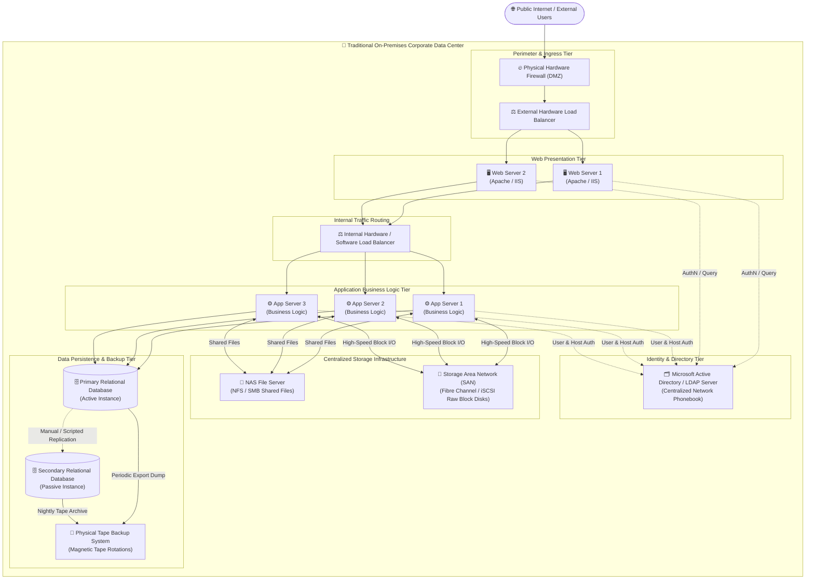
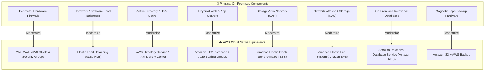
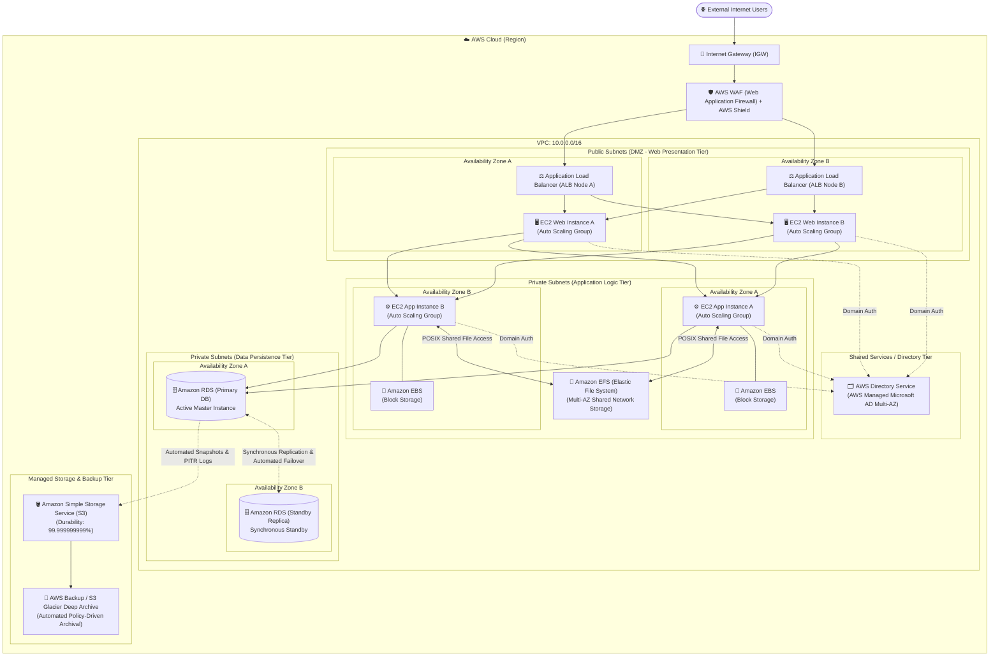
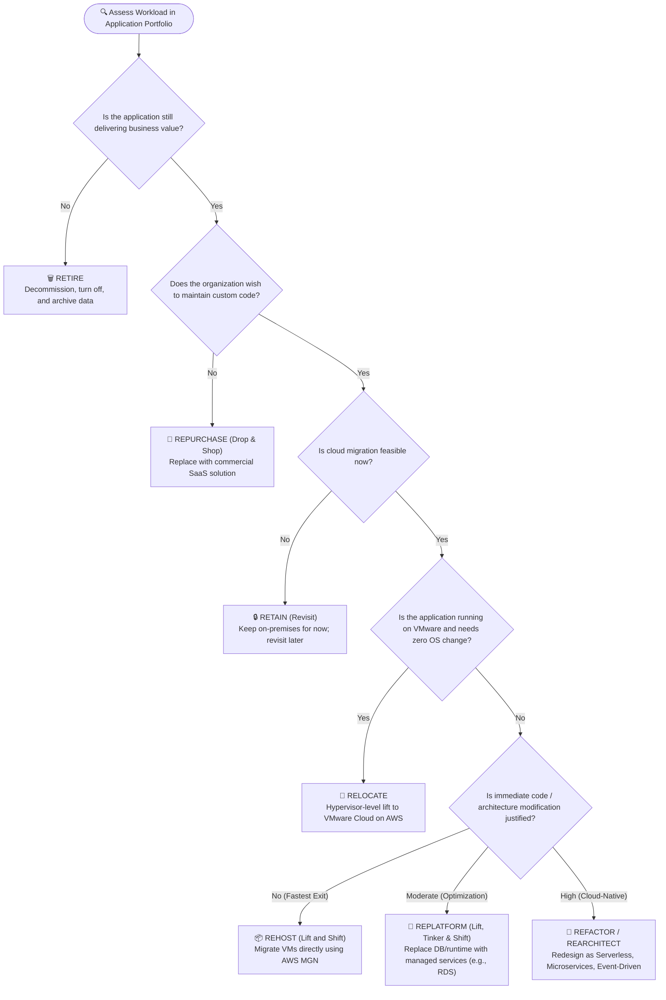
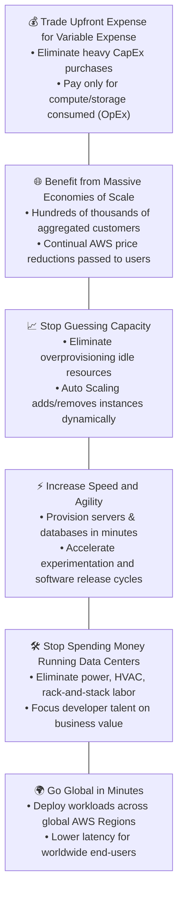

# 🏢 Transitioning a Corporate Data Center to the AWS Cloud

> **Course**: AWS re/Start  
> **Module**: AWS Architecture (M07 – Transitioning a Data Center to the Cloud)  
> **Source Document**: `T11-AWS_Architecture/T11-0006-RSARCH_EN-US_SG_M07_TRANSITIONDATACEN-USTER.pdf`  
> **Target Audience**: AWS re/Start Learners, Cloud Practitioners, Solutions Architects, and SysOps Administrators  

---

## 🎯 Executive Summary & Architectural Overview

In traditional enterprise IT environments, organizations host their core business workloads inside on-premises corporate data centers. These facilities house complex multi-tier client-server architectures featuring physical edge firewalls, hardware load balancers, enterprise directory servers, web server farms, application middleware, centralized Storage Area Networks (SAN), Network-Attached Storage (NAS) appliances, and clustered relational database engines backed up to magnetic tape drives.

While these traditional environments have supported mission-critical workloads for decades, they introduce immense operational friction, rigid scalability limits, and significant financial risk. Managing physical data center facilities requires massive upfront capital expenditures (CapEx), complex capacity forecasting, and extensive routine maintenance—an operational burden known as **"undifferentiated heavy lifting."**

```mermaid
flowchart LR
    subgraph TraditionalDC["🏢 Traditional On-Premises Data Center"]
        direction TB
        T1["Hardware CapEx & Procurement Cycles"]
        T2["Fixed Capacity & Peak Overprovisioning"]
        T3["Single Points of Failure & Manual Failover"]
        T4["Physical Maintenance, HVAC & Power"]
        T5["Slow Provisioning (Weeks to Months)"]
    end

    TraditionalDC ==>|"Cloud Migration & Modernization"| AWSCloud["☁️ Modernized AWS Cloud Architecture"]

    subgraph AWSCloud["☁️ Modernized AWS Cloud Architecture"]
        direction TB
        A1["Pay-As-You-Go Variable OpEx"]
        A2["Dynamic Auto Scaling & High Elasticity"]
        A3["Multi-AZ Redundancy & Automated Failover"]
        A4["Fully Managed Services (No Facilities Overhead)"]
        A5["On-Demand Infrastructure via Code & APIs"]
    end
```



Transitioning a corporate data center to Amazon Web Services (AWS) is not merely a technical relocation of virtual machines; it is an architectural modernization. By systematically decomposing each layer of the enterprise stack and mapping it to native AWS managed services—such as Amazon Elastic Compute Cloud (Amazon EC2), Elastic Load Balancing (ELB), AWS Directory Service, Amazon Elastic File System (Amazon EFS), Amazon Elastic Block Store (Amazon EBS), Amazon Relational Database Service (Amazon RDS), and Amazon Simple Storage Service (Amazon S3)—organizations unlock high availability, continuous scalability, enhanced security postures, and global reach.

---

## 📌 Learning Objectives

By reviewing this study guide and completing the architectural migration exercises, you will be able to:

- [ ] **Analyze Traditional Multi-Tier Architectures**: Dissect the presentation, business logic, storage, and persistence tiers of a standard enterprise corporate data center.
- [ ] **Identify Operational & Financial Vulnerabilities**: Pinpoint single points of failure (SPOFs), manual failover risks, CapEx burdens, and capacity forecasting dilemmas in physical data centers.
- [ ] **Map Physical Components to AWS Services**: Transition on-premises compute, load balancing, directory services, SAN, NAS, database, and tape backup systems to AWS managed equivalents.
- [ ] **Master AWS Storage Categorization**: Distinguish between block storage (Amazon EBS), shared file storage (Amazon EFS), and scalable object storage (Amazon S3) in cloud modernization architectures.
- [ ] **Design Multi-AZ Cloud Architectures**: Formulate target AWS network designs leveraging Amazon Virtual Private Cloud (VPC), Public/Private subnets, Auto Scaling Groups, and Multi-AZ database deployments.
- [ ] **Apply the 7 Rs Migration Strategies**: Evaluate and select migration approaches using Gartner's and AWS CAF's 7 Rs: Rehost, Replatform, Refactor, Repurchase, Retain, Retire, and Relocate.
- [ ] **Leverage AWS Migration Acceleration Tools**: Identify key AWS migration services, including AWS Application Migration Service (MGN), AWS Database Migration Service (DMS), AWS Schema Conversion Tool (SCT), and AWS DataSync.
- [ ] **Quantify Cloud Value Pillars**: Articulate the six fundamental financial and agility advantages of cloud computing realized through data center transition.

---

## 🏛️ 1. Traditional On-Premises Corporate Data Center Architecture

### 1.1 The Classical Multi-Tier Client-Server Layout

Traditional enterprise IT architectures typically follow a **three-tier client-server model** designed to segregate concerns across presentation, business processing, and data persistence:

1. **Perimeter Security & Traffic Ingress**:
   - Hardware firewalls and demilitarized zones (DMZs) inspect incoming traffic from the public internet.
   - External hardware load balancers distribute incoming TCP/HTTP requests to presentation hosts.
2. **Web Presentation Tier**:
   - Physical or virtualized web servers (e.g., Apache HTTP Server, NGINX, Microsoft IIS) handle presentation logic, terminate SSL/TLS connections, and render static UI elements.
3. **Identity & Directory Tier**:
   - On-premises domain controllers running Microsoft Active Directory (AD) or Lightweight Directory Access Protocol (LDAP) manage user authentication, machine accounts, group policies, and intra-network trust.
4. **Internal Load Balancing & Application Tier**:
   - Secondary internal load balancers route presentation requests down to middle-tier application servers.
   - Application servers (e.g., Apache Tomcat, Oracle WebLogic, Red Hat JBoss, .NET runtime) execute core business logic, maintain user state/sessions, and coordinate transactional workflows.
5. **Shared File Storage & Network Storage**:
   - **Network-Attached Storage (NAS)**: Dedicated file servers connected over Ethernet using NFS or SMB/CIFS provide centralized file sharing for application assets, shared directories, and user home folders.
   - **Storage Area Network (SAN)**: Specialized, high-speed Fibre Channel or iSCSI storage fabrics providing low-latency, raw block-level storage directly to database servers and hypervisors.
6. **Data Persistence & Database Tier**:
   - Primary and secondary database management systems (RDBMS) configured in active-passive or active-active clustering to store relational transaction data.
7. **Backup, Archive & Recovery**:
   - Physical magnetic tape drives and tape libraries connected via SAS or Fibre Channel. DBAs execute nightly database dumps, write them to physical tape media, and physically courier tapes off-site (e.g., via Iron Mountain) for cold archival storage and disaster recovery.

---

### 1.2 Mermaid Diagram: Traditional On-Premises Architecture



---

### 1.3 Inherent Architectural Vulnerabilities & Operational Challenges

Maintaining the traditional architecture illustrated above imposes deep structural vulnerabilities and operational constraints:

| Challenge | On-Premises Manifestation | Business & Operational Impact |
| :--- | :--- | :--- |
| **Single Points of Failure (SPOFs)** | Hardware appliances (load balancers, SAN controllers, top-of-rack switches) often lack automatic multi-site failover. | A physical component failure halts revenue-generating customer operations until physical replacement occurs. |
| **Manual Failovers** | Secondary databases and standby application servers frequently require manual DNS edits, IP reassignment, and database promotion scripts. | Extended Recovery Time Objectives (RTO) and high human operational error risk during high-stress outages. |
| **Capital Expenditures (CapEx)** | Servers, enterprise SAN storage frames, software licenses, and network switches must be purchased upfront. | Massive cash outlay required upfront, locking enterprise capital into depreciating physical assets. |
| **Rigid Capacity Forecasting** | Capacity is planned based on projected peak utilization over 3 to 5 years. | **Overprovisioning**: Idle, wasted servers during normal operation.<br>**Underprovisioning**: System crashes and service degradation during unexpected demand surges. |
| **Slow Provisioning Velocities** | Ordering, shipping, racking, cabling, provisioning, and hardening new physical servers takes **weeks or months**. | Inability to respond quickly to new business opportunities, delayed software release cycles, and lost competitive edge. |
| **Undifferentiated Heavy Lifting** | Teams spend substantial hours managing datacenter power, cooling (HVAC), rack space, hardware firmware, and cabling. | IT talent is distracted from writing software and improving customer experiences. |
| **Disaster Recovery Vulnerabilities** | Tape backups are vulnerable to media degradation, physical theft, drive incompatibility, and slow manual transport. | Recovery Point Objectives (RPO) can span 24+ hours, with multi-day RTO during catastrophic events. |

> [!CAUTION]
> **The Hidden Danger of Physical Tape Backups**: In on-premises environments, tape backups often give organizations a false sense of security. Without frequent, automated recovery rehearsals, companies discover only during a disaster that tapes are corrupted, unreadable, or missing critical transaction logs.

---

## ☁️ 2. Step-by-Step Modernization & Cloud Transition to AWS

To modernize a traditional data center, cloud architects decompose the physical infrastructure into functional layers and substitute on-premises components with scalable, managed AWS cloud services.



---

### 2.1 Component-by-Component Modernization Deep Dive

#### 🛡️ Edge Security & Perimeter Protection
- **On-Premises**: Physical firewall appliances and DMZs deployed at the network ingress point.
- **AWS Replacement**:
  - **AWS WAF (Web Application Firewall)**: Protects web applications against common web exploits (e.g., SQL injection, cross-site scripting, HTTP floods) at Layer 7.
  - **AWS Shield**: Provides automated DDoS protection. Shield Standard is enabled automatically at no cost; Shield Advanced offers dedicated threat mitigation and financial protection against DDoS-related scaling spikes.
  - **VPC Security Groups & Network ACLs (NACLs)**: Stateful and stateless software-defined virtual firewalls securing traffic at instance and subnet boundaries.
  - **Internet Gateway (IGW)**: Scalable, highly available VPC edge component providing bidirectional internet access without bandwidth bottlenecks.

#### ⚖️ Routing & Traffic Distribution (Load Balancers)
- **On-Premises**: Specialized hardware load balancer appliances (e.g., F5 BIG-IP, Citrix NetScaler) or self-hosted software proxies (e.g., HAProxy, NGINX).
- **AWS Replacement**:
  - **Elastic Load Balancing (ELB)**: Fully managed, fault-tolerant traffic routing service that automatically scales to handle incoming request spikes.
  - **Application Load Balancer (ALB)**: Operates at Layer 7 (HTTP/HTTPS) supporting content-based routing, path-based routing, SSL/TLS offloading, sticky sessions, and integration with AWS WAF.
  - **Network Load Balancer (NLB)**: Operates at Layer 4 (TCP/UDP/TLS) for ultra-low latency, capable of processing millions of requests per second with static IP and elastic IP support.
  - **Automated Health Checks**: ELB continuously evaluates the health of downstream EC2 instances, instantly redirecting traffic away from degraded instances.

#### 🗂️ Directory & Identity Management (AD / LDAP)
- **On-Premises**: Physical or virtual domain controllers hosting Microsoft Active Directory or OpenLDAP for user authentication and authorization.
- **AWS Replacement**:
  - **AWS Directory Service**:
    - **AWS Managed Microsoft AD**: A fully managed Microsoft Active Directory running actual Windows Server instances managed and patched by AWS, with multi-Region replication and domain trust capabilities.
    - **AD Connector**: A proxy service that redirects authentication requests directly to existing on-premises Active Directory domains without cloud directory synchronization.
    - **Simple AD**: A low-cost, Samba-based directory service for workloads requiring basic LDAP/Kerberos compatibility.
  - **AWS IAM Identity Center (formerly AWS SSO)**: Provides centralized single sign-on access across all AWS accounts, cloud applications, and existing directory identities.

#### 🖥️ Web & Application Compute (Servers)
- **On-Premises**: Dedicated physical rackmount blade servers or hypervisor-managed virtual machines running Linux or Windows Server.
- **AWS Replacement**:
  - **Amazon Elastic Compute Cloud (Amazon EC2)**: Resizable, virtual compute capacity supporting a vast variety of operating systems (Amazon Linux, Red Hat Enterprise Linux, Ubuntu, SUSE, Windows Server) and tailored instance families (General Purpose, Compute Optimized, Memory Optimized, Storage Optimized).
  - **Amazon EC2 Auto Scaling**: Automatically provisions and terminates EC2 instances according to demand metrics (CPU utilization, request count, network I/O) or schedule.
  - **Multi-AZ Availability**: Instances are distributed across multiple physically separated Availability Zones (AZs) inside a Region, ensuring that a physical facility outage does not interrupt application availability.

#### 🗄️ Enterprise Storage Architectures (SAN vs. NAS vs. Object Storage)
Enterprise storage requirements vary across block, file, and object abstractions. The AWS Cloud provides dedicated, purpose-built storage engines for each:

1. **Storage Area Network (SAN) $\rightarrow$ Amazon Elastic Block Store (Amazon EBS)**:
   - A SAN provides raw, unformatted block-level volumes over Fibre Channel/iSCSI for mission-critical low-latency workloads.
   - **Amazon EBS** delivers high-performance block storage volumes attached over a dedicated storage network directly to an EC2 instance.
   - Volume types include General Purpose SSD (`gp2`/`gp3`), Provisioned IOPS SSD (`io1`/`io2` with sub-millisecond latencies for transactional DBs), and Throughput Optimized HDD (`st1` for streaming workloads).
   - Point-in-time snapshots of EBS volumes are automatically stored durably in Amazon S3.

2. **Network-Attached Storage (NAS) $\rightarrow$ Amazon Elastic File System (Amazon EFS)**:
   - A NAS server shares hierarchical file systems across multiple network clients via NFS or SMB protocols.
   - **Amazon EFS** provides a serverless, fully elastic, cloud-native file storage service supporting the Network File System (NFSv4.1/NFSv4.0) protocol.
   - Concurrently accessible by hundreds or thousands of EC2 instances spanning multiple Availability Zones.
   - Automatically grows and shrinks as files are added and removed—eliminating storage capacity pre-provisioning.
   - Includes lifecycle management to automatically tier infrequently accessed files to EFS Infrequent Access (EFS IA) for significant cost reduction.

3. **Unstructured File Storage $\rightarrow$ Amazon Simple Storage Service (Amazon S3)**:
   - Replaces local storage file repositories with highly durable (99.999999999% - 11 9's), virtually unlimited object storage accessible via RESTful APIs.

#### 🛢️ Database Management & Data Persistence
- **On-Premises**: Self-managed database installations (Oracle, SQL Server, MySQL, PostgreSQL) requiring DBAs to manage OS patching, DBMS clustering, synchronous mirroring, tablespace sizing, and log rotation.
- **AWS Replacement**:
  - **Amazon Relational Database Service (Amazon RDS)**: Fully managed relational database service supporting six major engines: Amazon Aurora, PostgreSQL, MySQL, MariaDB, Oracle, and Microsoft SQL Server.
  - **Multi-AZ Synchronous Replication**: Amazon RDS automatically provisions a standby replica in a distinct Availability Zone. Database transactions are synchronously replicated to the standby.
  - **Automated Failover**: In the event of primary instance failure, host maintenance, or AZ loss, RDS automatically executes a transparent DNS failover to the standby replica within 60 to 120 seconds with zero manual DBA intervention and zero data loss.
  - **Read Replicas**: Asynchronously offload read traffic across up to 15 read replicas (or 15 for Aurora) to scale read-heavy application demands.

#### 📼 Backup, Recovery & Long-Term Archival
- **On-Premises**: Physical magnetic tapes, tape silos, robotic autoloaders, and manual off-site transit.
- **AWS Replacement**:
  - **Amazon S3 Automated RDS Backups**: RDS automatically captures daily storage volume snapshots and continuously archives transaction logs to Amazon S3, allowing point-in-time restore (PITR) down to the second within a retention window up to 35 days.
  - **AWS Backup**: Centralized, policy-driven backup orchestration automating backup scheduling, retention management, and compliance across EBS, RDS, EFS, DynamoDB, and EC2.
  - **Amazon S3 Glacier & Glacier Deep Archive**: Replaces physical off-site tape vaults with cloud archival tiers delivering 11 9's durability at a fraction of a cent per gigabyte per month.

---

### 2.2 Comprehensive Mapping Matrix: On-Premises vs. AWS Cloud

| On-Premises Component | Primary Role & Bottleneck | AWS Cloud Service / Resource | Architectural Advantage & Operational Gain |
| :--- | :--- | :--- | :--- |
| **Physical Edge Firewall** | Perimeter inspection; hardware throughput limits | **AWS WAF & AWS Shield** + **VPC Security Groups** | Layer 7 application inspection, automated DDoS mitigation, granular software-defined microsegmentation. |
| **Hardware Load Balancers** | Ingress traffic distribution; fixed capacity; high maintenance | **Application Load Balancers (ALB)** / **Network Load Balancers (NLB)** | Managed auto-scaling, Multi-AZ high availability, dynamic health checks, built-in TLS termination. |
| **Active Directory / LDAP Server** | Centralized directory & credential authentication | **AWS Directory Service** (Managed Microsoft AD / AD Connector) | Fully managed directory with multi-AZ resilience; federates on-premises identities to cloud workloads. |
| **Physical Web Servers (Apache/IIS)** | Static asset delivery & web presentation; rigid sizing | **Amazon EC2 Auto Scaling Groups** (in Public Subnets) | Dynamic horizontal scaling based on request volume; multi-AZ resilience; zero idle-capacity expense. |
| **Physical App Servers (Tomcat/.NET)** | Business logic processing; state management bottlenecks | **Amazon EC2 Auto Scaling Groups** (in Private Subnets) | Decoupled tier architecture; isolated in private subnets; automated self-healing replacement. |
| **Storage Area Network (SAN)** | Fibre Channel/iSCSI raw block storage for servers | **Amazon Elastic Block Store (Amazon EBS)** | High-throughput, low-latency block volumes (`gp3`, `io2`); independent lifecycle; automated point-in-time snapshots. |
| **Network-Attached Storage (NAS)** | Centralized shared file server (NFS/CIFS) | **Amazon Elastic File System (Amazon EFS)** | Serverless, fully elastic POSIX shared storage accessible concurrently across thousands of EC2 instances and AZs. |
| **On-Premises Relational Databases** | Transactional data persistence; complex manual failover | **Amazon Relational Database Service (Amazon RDS / Aurora)** | Automated synchronous Multi-AZ failover; push-button scaling; automated OS & engine patching; Read Replicas. |
| **Magnetic Tape Backup Drives** | Nightly backup dumps, physical storage media transport | **Amazon S3** + **AWS Backup** + **S3 Glacier Deep Archive** | Automated continuous backups, 99.999999999% durability, point-in-time recovery (PITR), low-cost long-term archival. |

---

### 2.3 Mermaid Diagram: Target AWS Cloud Architecture



---

## 🔄 3. The 7 Rs Cloud Migration Strategies (Gartner & AWS CAF)

When organizations prepare to transition applications and systems from a physical data center to AWS, they do not treat all workloads identically. As defined by **Gartner** and adopted within the **AWS Cloud Adoption Framework (AWS CAF)**, the **7 Rs** represent the standard decision framework for categorizing and migrating enterprise workloads.



---

### 3.1 Detailed Breakdown of the 7 Rs

#### 1. Rehost ("Lift and Shift")
- **Definition**: Moving an application from on-premises to AWS without modifying the core software architecture, operating system code, or configuration.
- **Typical Use Cases**: Large-scale legacy data center migrations under strict deadline pressure (e.g., data center lease expiration or hardware end-of-life).
- **Core Tool**: **AWS Application Migration Service (AWS MGN)**—continuously replicates block storage data at the OS level directly into Amazon EC2.
- **Benefits**: Fastest time to market, lowest migration risk, minimal engineering effort.
- **Drawbacks**: Does not exploit cloud-native features (auto scaling, managed databases, serverless) immediately.

#### 2. Replatform ("Lift, Tinker, and Shift")
- **Definition**: Moving an application to the cloud while introducing a few targeted cloud optimizations to achieve tangible benefits without changing the core application logic.
- **Typical Use Cases**: Migrating self-managed databases on VMs to **Amazon RDS**, or running containerized workloads on **Amazon Elastic Container Service (Amazon ECS)** / **Amazon Elastic Kubernetes Service (Amazon EKS)** instead of managing Docker nodes on EC2.
- **Benefits**: Reduces database administration and OS patching overhead without costly application code rewrites.

#### 3. Refactor / Rearchitect ("Cloud-Native Transformation")
- **Definition**: Reimagining and rewriting how an application is architected and developed using cloud-native features and modern paradigms.
- **Typical Use Cases**: Decomposing a monolithic legacy application into decoupled microservices, moving from relational databases to NoSQL engines (**Amazon DynamoDB**), or adopting serverless architectures (**AWS Lambda**, **Amazon API Gateway**, **AWS Step Functions**).
- **Benefits**: Maximum scalability, highest resilience, optimized operational agility, and lowest long-term run cost.
- **Drawbacks**: Highest initial capital investment, developer effort, and project complexity.

#### 4. Repurchase ("Drop and Shop")
- **Definition**: Retiring the existing custom on-premises application entirely and moving to a third-party Software as a Service (SaaS) platform or purchasing a modern pre-packaged offering through **AWS Marketplace**.
- **Typical Use Cases**: Migrating from an on-premises legacy CRM or HR system to modern SaaS platforms (e.g., Salesforce, Workday, Zendesk).
- **Benefits**: Completely offloads infrastructure, operational maintenance, and code maintenance to specialized SaaS providers.

#### 5. Retain ("Revisit / Keep On-Premises")
- **Definition**: Keeping specific applications in the on-premises environment because migration is not technically feasible, economically justified, or regulatory compliant at the present time.
- **Typical Use Cases**: Legacy mainframe systems scheduled for retirement in 12 months, applications subject to strict data sovereignty residency laws, or workloads requiring sub-millisecond physical latency connected to local machinery (which can alternatively leverage **AWS Outposts**).

#### 6. Retire ("Decommission")
- **Definition**: Identifying redundant, obsolete, or underutilized applications during portfolio discovery and shutting them down.
- **Typical Impact**: Discovery assessments frequently reveal that **10% to 20%** of an enterprise's running data center inventory consists of zombie applications, idle test environments, or decommissioned services that are no longer used by anyone. Turning them off saves immediate hardware and licensing expenditure.

#### 7. Relocate ("Hypervisor-Level Migration")
- **Definition**: Moving a collection of virtual machines to AWS at the hypervisor layer without rewriting software, modifying OS kernels, or changing internal IP addresses.
- **Typical Use Cases**: Migrating VMware vSphere environments directly to **VMware Cloud on AWS (VMC)**.
- **Benefits**: Zero downtime VM migrations using VMware vMotion, preserving familiar enterprise VMware management tools without containerizing or rehosting onto EC2 native instances.

---

### 3.2 The 7 Rs Strategy Comparison Matrix

| Strategy | Primary Driver | Code Modification | Migration Speed | Operational Effort | AWS Cloud Optimization |
| :--- | :--- | :--- | :--- | :--- | :--- |
| **Rehost** | Rapid data center exit | None | ⚡ Very Fast | High (Self-Managed EC2) | Low |
| **Replatform** | Reduce operational DB/OS burden | Minimal / None | 🚀 Fast | Low (Managed Services) | Medium |
| **Refactor** | Agility, scale, microservices | Significant Rewrite | ⏳ Extended | Very Low (Serverless / Cloud-Native) | ⭐ Maximum |
| **Repurchase** | Commodity business capabilities | None (Replace with SaaS) | 🚀 Fast | None (SaaS Vendor) | N/A (SaaS Model) |
| **Retain** | High latency/legal constraints | None | N/A (Stay On-Prem) | High (Maintain Hardware) | None |
| **Retire** | Eliminating waste & zombie VMs | None (Turn Off) | ⚡ Immediate | Zero | High Cost Savings |
| **Relocate** | Preserving VMware hypervisor tools | None | ⚡ Very Fast | Medium (VMware Cloud) | Low to Medium |

---

## 🚀 4. Post-Migration Benefits & Architectural Transformation

Transitioning workloads from physical facilities to the AWS Cloud transforms how organizations build, deploy, and finance IT capabilities. These benefits map directly to the **Six Advantages of Cloud Computing**:



### 4.1 The Six Core Value Pillars Detailed

1. **Trade Capital Expense for Variable Expense (CapEx to OpEx)**:
   - On-premises infrastructure requires upfront capital budgeting, purchasing servers, SAN storage, and networking gears before writing a single line of business code.
   - On AWS, organizations shift to an operational expenditure (OpEx) model, paying strictly for the gigabytes, compute seconds, and network bandwidth consumed.

2. **Benefit from Massive Economies of Scale**:
   - Because AWS aggregates usage from hundreds of thousands of active customers worldwide, it achieves massive purchasing power for hardware and utilities, translating into systematically lower pay-as-you-go prices.

3. **Stop Guessing Capacity Needs**:
   - On-premises environments must be sized for peak theoretical loads (such as Black Friday sales). Resources sit idle during normal operational hours.
   - On AWS, **Amazon EC2 Auto Scaling** and serverless engines scale out compute capacity in response to real-time metrics and scale in when demand subsides, matching costs exactly to demand.

4. **Increase Speed and Agility**:
   - Obtaining a physical database server on-premises requires weeks for procurement, delivery, racking, power, OS installation, and clustering.
   - In AWS, deploying an Amazon RDS Multi-AZ PostgreSQL or MySQL database cluster takes minutes via the AWS Management Console, AWS CLI, or AWS CloudFormation.

5. **Stop Spending Money on Running and Maintaining Data Centers**:
   - Eliminates the undifferentiated heavy lifting of managing facility real estate, diesel generators, biometric access controls, rack cable management, and hardware maintenance contracts.

6. **Go Global in Minutes**:
   - Organizations can deploy identical multi-tier architectures across multiple AWS geographic Regions around the globe with a few clicks or infrastructure-as-code templates, providing low-latency experiences to international users.

---

### 4.2 Alignment with the AWS Well-Architected Framework

Transitioning the data center directly aligns with the six pillars of the **AWS Well-Architected Framework**:

- **Operational Excellence**: Replaces manual racking and patching with Infrastructure as Code (AWS CloudFormation / Terraform), automated monitoring (Amazon CloudWatch), and auditing (AWS CloudTrail).
- **Security**: Enhances the security posture via IAM least-privilege policies, security groups, KMS encryption at rest, and automated AWS WAF rule sets.
- **Reliability**: Eliminates single points of failure through multi-Availability Zone architecture, automated ELB routing, EBS snapshot backups, and automated Amazon RDS failover.
- **Performance Efficiency**: Leverages purpose-built compute instance families, SSD-backed storage, and managed caching (Amazon ElastiCache, Amazon CloudFront).
- **Cost Optimization**: Adopts AWS Cost Explorer, AWS Budgets, Savings Plans, Reserved Instances, and auto-scaling to eliminate idle hardware expenditures.
- **Sustainability**: Consolidates enterprise workloads onto AWS's energy-efficient, custom-designed data centers and high-efficiency Graviton processors.

---

## 🛠️ 5. Practical Migration Implementation & Walkthrough Activity

### 5.1 Architecture Transformation Walkthrough Activity

In this section, we analyze the architectural modernization exercise presented in the curriculum. The goal is to evaluate each on-premises component and document its transformation plan.

```mermaid
sequenceDiagram
    autonumber
    actor Admin as Cloud Migration Team
    participant Disc as AWS Application Discovery Service
    participant MGN as AWS Application Migration Service (MGN)
    participant DMS as AWS Database Migration Service (DMS)
    participant Cloud as AWS Target VPC

    Admin->>Disc: 1. Deploy discovery agents & map on-prem server dependencies
    Disc-->>Admin: 2. Return server inventory, CPU/RAM utilization, and network flows
    Admin->>MGN: 3. Install MGN replication agents on Web & App physical servers
    MGN->>Cloud: 4. Continuous block-level data replication into staging EBS volumes
    Admin->>DMS: 5. Configure DMS replication task + SCT schema conversion for On-Prem DB
    DMS->>Cloud: 6. Full database load + continuous Change Data Capture (CDC) to Amazon RDS
    Admin->>Cloud: 7. Launch cutover instances behind ALB; verify directory authentication
    Admin->>Admin: 8. Update public DNS (Route 53) to point traffic to AWS ALB
    Admin->>Admin: 9. Decommission on-premises servers, SAN, NAS, and tape hardware
```

---

### 5.2 Phase-by-Phase Migration Blueprint

#### Phase 1: Assessment & Discovery
- **Inventory Discovery**: Deploy **AWS Application Discovery Service** or **Migration Evaluator** to collect server hardware configurations, performance metrics, and network communication patterns.
- **Dependency Mapping**: Identify interdependencies between web servers, application servers, LDAP directories, and backend database ports.
- **Strategy Classification**: Assign each workload to one of the 7 Rs (e.g., Web/App servers $\rightarrow$ Rehost or Replatform; Database $\rightarrow$ Replatform to RDS).

#### Phase 2: Foundational Cloud Architecture (The Landing Zone)
- **Networking**: Create a custom **Amazon VPC** with non-overlapping IP address ranges (CIDR block), public subnets for load balancers, and private subnets across multiple AZs for compute and databases.
- **Identity Federation**: Deploy **AWS Directory Service** (AD Connector or Managed Microsoft AD) and configure secure connections to existing corporate active directories using AWS Site-to-Site VPN or AWS Direct Connect.
- **Security Baseline**: Establish default security groups, network ACLs, AWS CloudTrail audit logs, and Amazon GuardDuty threat detection.

#### Phase 3: Workload Replication & Data Migration
- **Compute Replication**: Install the AWS MGN replication agent on on-premises physical/virtual servers. MGN continuously replicates source server volumes over TLS to staging EBS volumes without production interruption.
- **Database Migration**: Run the **AWS Schema Conversion Tool (SCT)** to convert database schemas, and initiate the **AWS Database Migration Service (DMS)** to perform an initial data load followed by continuous Change Data Capture (CDC) replication to Amazon RDS.
- **File System Migration**: Migrate unstructured shared files from the NAS appliance to **Amazon EFS** using **AWS DataSync**.

#### Phase 4: Validation, Cutover, and Post-Migration Modernization
- **Non-Disruptive Testing**: Launch test EC2 instances from staging EBS volumes in isolated subnets to execute user acceptance testing (UAT).
- **Cutover**: Schedule a maintenance window, pause write transactions on the source database, allow the final CDC replication to synchronize, promote Amazon RDS as primary, switch Route 53 DNS records to the Application Load Balancer, and redirect incoming user traffic.
- **Modernization**: Transition fixed EC2 instances into dynamic Auto Scaling Groups, configure Amazon EFS lifecycle management, and establish automated backup retention policies via AWS Backup.

---

## ❓ 6. Knowledge Check & Review Questions

### Checkpoint Questions (from Curriculum Slides)

#### Question 1
**Which AWS services can organizations use to transition a traditional corporate data center to the cloud?**

> **Official Answer & Comprehensive Explanation**:  
> Organizations can transition traditional data center components to AWS services by mapping each physical asset to its cloud-managed equivalent:
> - **Web and Application Servers** $\rightarrow$ **Amazon Elastic Compute Cloud (Amazon EC2)** instances managed in an **Auto Scaling Group**.
> - **LDAP / Active Directory Server** $\rightarrow$ **AWS Directory Service** (Managed Microsoft AD, AD Connector, or Simple AD).
> - **Software & Hardware Load Balancers** $\rightarrow$ **Elastic Load Balancing (ELB)** (Application Load Balancer or Network Load Balancer).
> - **Storage Area Network (SAN)** $\rightarrow$ **Amazon Elastic Block Store (Amazon EBS)** attached directly to EC2 instances.
> - **Network-Attached Storage (NAS) File Server** $\rightarrow$ **Amazon Elastic File System (Amazon EFS)** or managed AWS Marketplace file solutions.
> - **On-Premises Relational Databases** $\rightarrow$ **Amazon Relational Database Service (Amazon RDS)** or **Amazon Aurora**.
> - **Physical Tape Backup Storage** $\rightarrow$ **Amazon Simple Storage Service (Amazon S3)** and **AWS Backup** with long-term cold archival in **Amazon S3 Glacier Deep Archive**.

---

#### Question 2
**What are some of the primary benefits of transitioning a corporate data center to the cloud?**

> **Official Answer & Comprehensive Explanation**:  
> Transitioning to the cloud delivers the fundamental advantages of cloud computing:
> 1. **Trade Upfront Costs for Variable Costs**: Stop buying expensive physical hardware upfront; pay only for computing resources consumed.
> 2. **Benefit from Massive Economies of Scale**: AWS aggregates hundreds of thousands of customers, driving down infrastructure costs and passing savings on as lower prices.
> 3. **Eliminate Guessing Capacity Needs**: Use Auto Scaling to dynamically match compute capacity with real-time demand, preventing both overprovisioning and underprovisioning.
> 4. **Increase Speed and Agility**: Provision storage, servers, and multi-region database clusters in minutes rather than waiting weeks or months for hardware procurement.
> 5. **Stop Spending Money to Run and Maintain Data Centers**: Eliminate the costs of physical real estate, power, cooling, cabling, and hardware maintenance to focus on business value.
> 6. **Go Global in Minutes**: Deploy applications across multiple geographic Regions with low latency and high availability.

---

#### Question 3
**Which AWS service can replace a data center Storage Area Network (SAN) system?**

> **Official Answer & Comprehensive Explanation**:  
> **Amazon Elastic Block Store (Amazon EBS)**.  
> An on-premises SAN provides high-speed, block-level network access to storage for physical or virtual servers. In AWS, Amazon EBS provides persistent, low-latency, raw block-level storage volumes that attach directly to running Amazon EC2 instances, supporting critical operating systems, transactional applications, and database files.

---

### Additional Review & Exam Preparation Questions

#### Question 4
A company maintains an on-premises Oracle database with a passive standby database in a colocation facility. During outages, the operations team must manually update DNS records and execute failover scripts, causing 90 minutes of downtime. How does migrating to Amazon RDS Multi-AZ resolve this issue?

- A) Amazon RDS uses Route 53 to reboot the primary server automatically.
- B) Amazon RDS synchronously replicates data to a standby instance in another Availability Zone and automatically updates the database DNS endpoint to point to the standby upon failure with zero manual intervention.
- C) Amazon RDS automatically converts the Oracle database into an Amazon DynamoDB table.
- D) Amazon RDS uses Amazon EFS to share the same physical hard drive between two EC2 instances simultaneously.

> **Correct Answer: B**  
> *Explanation*: In an Amazon RDS Multi-AZ configuration, data is synchronously replicated to a standby replica in a physically distinct Availability Zone. If the primary instance fails or experiences network impairment, RDS automatically performs a failover by flipping the canonical name (CNAME) DNS record to point to the standby replica, typically completing in 60 to 120 seconds without human intervention.

---

#### Question 5
An organization has 50 TB of unstructured document files shared across 12 application servers via an on-premises Linux NFS file server. Which AWS service is the most architecturally appropriate drop-in replacement that allows all application instances to access the shared file system concurrently without managing server hardware?

- A) Amazon EBS gp3 volumes
- B) Amazon S3 Glacier Flexible Recovery
- C) Amazon Elastic File System (Amazon EFS)
- D) Instance Store volumes

> **Correct Answer: C**  
> *Explanation*: Amazon EFS is a managed, serverless, POSIX-compliant shared file storage service that natively supports the NFSv4 protocol. It allows hundreds to thousands of Amazon EC2 instances across multiple Availability Zones to read and write to the same file system concurrently, automatically scaling storage capacity up and down on demand.

---

#### Question 6
During an application portfolio discovery assessment prior to cloud migration, an enterprise discovers that 35 internal reporting servers have received no network traffic or user logins over the past nine months. Which of the 7 Rs migration strategies should the enterprise apply to these workloads?

- A) Rehost
- B) Replatform
- C) Retire
- D) Retain

> **Correct Answer: C**  
> *Explanation*: The **Retire** strategy involves identifying redundant, obsolete, or unused applications and decommissioning them. Removing these workloads eliminates hardware costs, software licensing fees, and unnecessary migration effort.

---

## 📚 7. Key Terms & Acronym Glossary

| Term / Acronym | Definition & Architectural Context |
| :--- | :--- |
| **SAN (Storage Area Network)** | A dedicated high-speed network that interconnects and delivers shared pools of raw block-level storage devices to multiple servers. In AWS, replaced primarily by **Amazon EBS**. |
| **NAS (Network-Attached Storage)** | A dedicated file-level data storage device connected to a computer network providing data access to a heterogeneous group of clients using NFS or SMB. In AWS, replaced by **Amazon EFS**. |
| **Amazon EBS (Elastic Block Store)** | High-performance, persistent block storage volumes designed for use with Amazon EC2 instances for transactional and throughput-intensive workloads. |
| **Amazon EFS (Elastic File System)** | A serverless, fully elastic, cloud-native NFS file system supporting concurrent access from thousands of compute instances across multiple Availability Zones. |
| **Amazon S3 (Simple Storage Service)** | An object storage service offering industry-leading scalability, data availability, security, and 99.999999999% (11 9's) durability. |
| **Amazon RDS (Relational Database Service)** | A managed service that makes it simple to set up, operate, and scale relational databases (Aurora, MySQL, PostgreSQL, MariaDB, Oracle, SQL Server) in the cloud. |
| **Multi-AZ Deployment** | An architectural pattern where database or compute resources are provisioned across two or more physically isolated Availability Zones within an AWS Region for high availability and automated failover. |
| **ELB (Elastic Load Balancing)** | A managed service that automatically distributes incoming application traffic across multiple targets (such as EC2 instances, containers, and IP addresses) in one or more Availability Zones. |
| **ALB (Application Load Balancer)** | An Elastic Load Balancer operating at Layer 7 (HTTP/HTTPS) supporting advanced routing rules, microservices, containerized workloads, and SSL termination. |
| **Auto Scaling Group (ASG)** | A collection of Amazon EC2 instances that is treated as a logical grouping for the purposes of automatic scaling and management based on demand and health checks. |
| **AWS CAF (Cloud Adoption Framework)** | A comprehensive framework developed by AWS to help organizations create an effective digital transformation plan across six perspectives: Business, People, Governance, Platform, Security, and Operations. |
| **The 7 Rs** | The standard cloud migration strategy taxonomy: Rehost, Replatform, Refactor, Repurchase, Retain, Retire, and Relocate. |
| **CapEx (Capital Expenditures)** | Upfront funds used by a company to acquire, upgrade, and maintain physical assets such as data center buildings, servers, and network equipment. |
| **OpEx (Operational Expenditures)** | Ongoing, day-to-day operational costs of running a business or infrastructure on a pay-as-you-go utility basis. |
| **Undifferentiated Heavy Lifting** | Repetitive, non-differentiating operational tasks (such as rack-and-stack server hardware, cooling, and firmware updates) that do not directly contribute to competitive business differentiation. |
