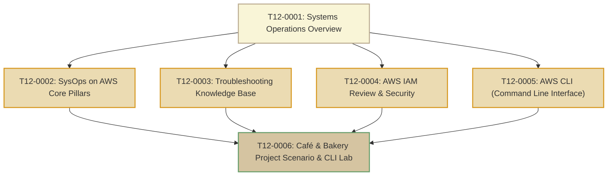
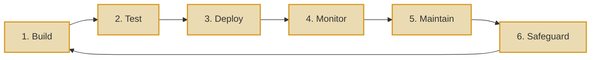

# T12: Systems Operations

> **Course**: AWS re/Start Curriculum  
> **Module**: T12 – Systems Operations (`M08`)  
> **Total Guides**: 6 Study Guides  
> **Status**: Completed (100%)

---

## Module Overview

The **Systems Operations** module explores the operational lifecycle of workloads deployed to Amazon Web Services. It establishes the foundations of cloud operations engineering: infrastructure provisioning, ongoing health monitoring, configuration security, automated administration via the AWS Command Line Interface (AWS CLI), and structured incident troubleshooting. The module introduces the multi-stage **Café and Bakery** business scenario (Frank, Martha, Sofía, Nikhil) which serves as the overarching practical storyline throughout subsequent modules.

---

## Study Guide Index

| # | Study Guide | Primary Topics Covered |
|---|-------------|------------------------|
| **0001** | [T12-0001-RSSYOP_EN-US_SG_M08_OVERVIEW.md](file:///work/tmp/aws-cf/T12-Systems_Operations/T12-0001-RSSYOP_EN-US_SG_M08_OVERVIEW.md) | SysOps operational mandate, on-prem vs cloud sysadmin evolution, 6 core responsibilities, operational feedback loops |
| **0002** | [T12-0002-RSSYOP_EN-US_SG_M08_SYSOPSAWS.md](file:///work/tmp/aws-cf/T12-Systems_Operations/T12-0002-RSSYOP_EN-US_SG_M08_SYSOPSAWS.md) | Build, Test, Deploy, Monitor, Maintain, Safeguard responsibilities; environment parity (Dev->Test->Prod); automation artifacts |
| **0003** | [T12-0003-SYOP_KNOWLEDGEBASEINTRO_EN.md](file:///work/tmp/aws-cf/T12-Systems_Operations/T12-0003-SYOP_KNOWLEDGEBASEINTRO_EN.md) | Standard 8-pillar Troubleshooting Knowledge Base schema, 7-step cloud troubleshooting methodology, real-world AWS incident runbooks |
| **0004** | [T12-0004-RSSYOP_EN-US_SG_M08_AWSIAM.md](file:///work/tmp/aws-cf/T12-Systems_Operations/T12-0004-RSSYOP_EN-US_SG_M08_AWSIAM.md) | Authentication vs Authorization, IAM Users/Groups/Roles/Policies, SigV4 API signing, credential hygiene, least privilege |
| **0005** | [T12-0005-RSSYOP_EN-US_SG_M08_AWSCLI.md](file:///work/tmp/aws-cf/T12-Systems_Operations/T12-0005-RSSYOP_EN-US_SG_M08_AWSCLI.md) | AWS CLI v2 installation on Linux, `aws configure`, `~/.aws/credentials`, named profiles, JMESPath `--query` filtering, `--dry-run` |
| **0006** | [T12-0006-RSSYOP_EN-US_SG_M08_CAFEINSTALLAWSCLI.md](file:///work/tmp/aws-cf/T12-Systems_Operations/T12-0006-RSSYOP_EN-US_SG_M08_CAFEINSTALLAWSCLI.md) | Café business scenario (Frank, Martha, Sofía, Nikhil), stakeholder management, bastion workstation AWS CLI v2 installation & testing |

---

## The 6 Core SysOps Responsibilities

1. **Build**: Provisioning cloud infrastructure resources cleanly and repeatedly using Infrastructure as Code (IaC).
2. **Test**: Verifying environment integrity, connectivity, security policies, and performance before releasing workloads.
3. **Deploy**: Promoting changes across Development, Testing, and Production environments with zero or minimal downtime.
4. **Monitor**: Collecting continuous telemetry via Amazon CloudWatch metrics, logs, and alarms to assess health.
5. **Maintain**: Applying operating system patches, managing backups, optimizing resource usage, and preventing configuration drift.
6. **Safeguard**: Enforcing least-privilege IAM permissions, rotating credentials, encrypting data at rest and in transit, and ensuring audit compliance.
