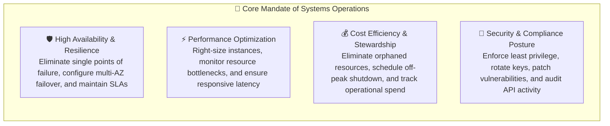
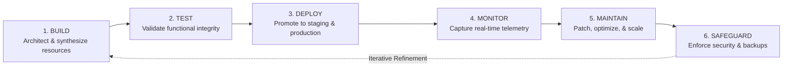
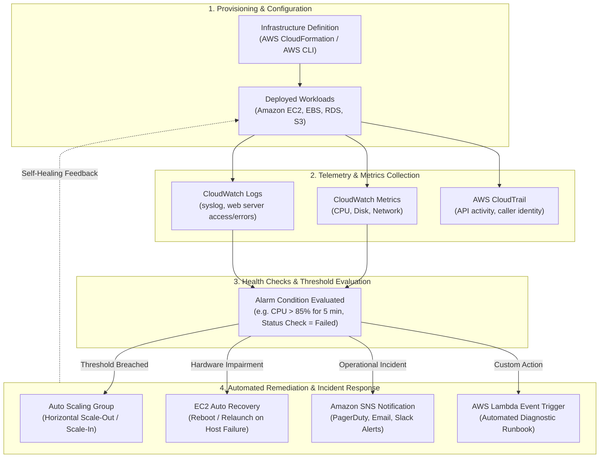
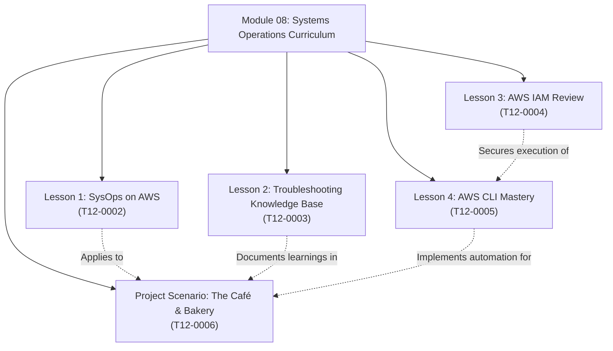
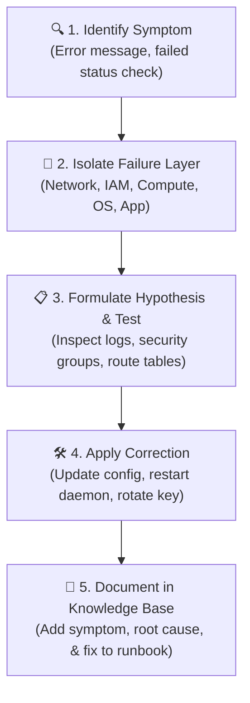
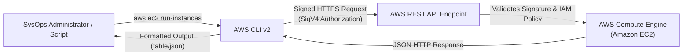
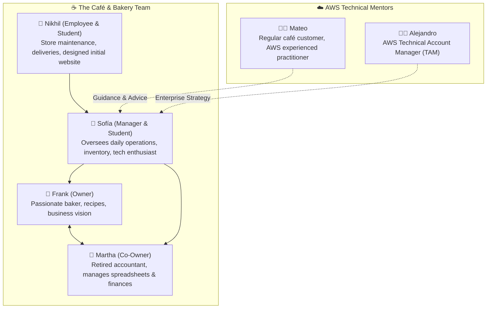
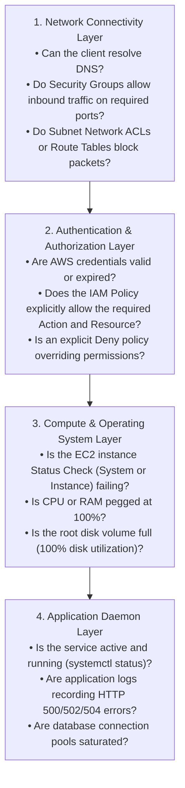

# ⚙️ Module 08: Systems Operations Overview – Study Guide

> **Course**: AWS re/Start  
> **Module**: M08 – Systems Operations  
> **Source Document**: `T12-0001-RSSYOP_EN-US_SG_M08_OVERVIEW.pdf`  
> **Target Audience**: AWS re/Start Learners / Cloud Practitioners / Systems Operations (SysOps) Administrators  

---

## 🎯 Module Overview

Welcome to **Module 08: Systems Operations (SysOps)**. In modern cloud architecture, provisioning infrastructure is only the starting point. The true operational test lies in running, maintaining, monitoring, and evolving computing environments reliably, securely, and cost-effectively at scale. 

**Systems Operations (SysOps)** encompasses the operational discipline, toolsets, and best practices required to ensure that cloud workloads achieve continuous availability, optimal performance, and robust security. Rather than relying on fragile manual administrative interventions, cloud-native SysOps emphasizes repeatable automation, declarative configuration, comprehensive telemetry, and proactive remediation.

This module introduces the operational mindset and technical toolkit required of an AWS SysOps Administrator, tracing the evolution from traditional on-premises system administration to automated cloud operations. It establishes foundational competencies across core responsibilities, structured troubleshooting playbooks, identity security governance, and command-line automation—grounded through the ongoing real-world business case study of the **Café and Bakery**.

---

### 📌 Learning Objectives

- [ ] **Define Systems Operations (SysOps) in Cloud Computing**: Understand the scope and mandate of SysOps in maintaining workload availability, performance, and efficiency through automated and repeatable deployments.
- [ ] **Contrast On-Premises Administration with Cloud Operations**: Analyze the operational shift from hardware racking, manual patching, and reactive fire-fighting to infrastructure-as-code, elasticity, and automated telemetry.
- [ ] **Map the Six Core SysOps Responsibilities**: Master the lifecycle tasks of modern systems operations: **Build**, **Test**, **Deploy**, **Monitor**, **Maintain**, and **Safeguard**.
- [ ] **Implement the SysOps Operational Feedback Loop**: Trace how continuous feedback flows through Provisioning $\rightarrow$ Telemetry $\rightarrow$ Health Checks $\rightarrow$ Automated Remediation.
- [ ] **Construct an Operational Troubleshooting Knowledge Base**: Structure diagnostic runbooks, error tracking logs, and incident post-mortems to institutionalize root-cause solutions.
- [ ] **Review AWS Identity and Access Management (IAM) Governance**: Secure cloud environments by defining principals, distinguishing authentication from authorization, establishing IAM roles, and enforcing least-privilege credential management.
- [ ] **Leverage the AWS Command Line Interface (AWS CLI)**: Understand the power of CLI-driven operational automation, syntax structure, initial configuration (`aws configure`), and programmatic access keys.
- [ ] **Examine the Café and Bakery Transformation Case Study**: Analyze operational pain points facing Frank, Martha, Sofía, and Nikhil, identifying how cloud services and CLI automation eliminate administrative friction.

---

## ☁️ 1. Role & Importance of Systems Operations in Cloud Computing

### What is Systems Operations (SysOps)?

**Systems Operations (SysOps)** is the technical and organizational discipline responsible for the **deployment, administration, scaling, and continuous monitoring** of computing infrastructure, network topologies, storage fabrics, and application services in an automatable, predictable, and reusable manner.

In production environments, downtime translates directly into lost revenue, compromised customer trust, and reputational degradation. A SysOps professional maintains a holistic, panoramic understanding of the system's runtime environment—including network paths, security boundaries, storage limits, and compute utilization.



### The Paradigm Shift: On-Premises System Administration vs. Cloud SysOps

Traditional systems administration required physical custody of server rooms, hardware lifecycle management, manual network cabling, and individual operating system installations. When hardware failed, sysadmins physically replaced power supplies, swapped failed hard drives, and restored backups from physical tapes.

In the AWS Cloud, infrastructure is virtualized, software-defined, and fully accessible via programmatic Application Programming Interfaces (APIs). Systems operations shifts from manual maintenance to **infrastructure automation, policy governance, and observability**.

| Operational Dimension | Traditional On-Premises SysAdmin | Cloud-Native Systems Operations (AWS SysOps) |
| :--- | :--- | :--- |
| **Infrastructure Delivery** | Physical procurement (weeks to months), rack-and-stack cabling | Programmatic API provisioning via AWS Console, CLI, or CloudFormation (minutes) |
| **Deployment Model** | Manual configuration, snowflake servers, custom shell scripts | Automated, repeatable deployments, golden AMIs, containerized images |
| **Capacity Planning** | Over-provisioning for peak capacity based on long-term hardware forecasts | Dynamic elasticity and auto-scaling based on real-time operational load |
| **Hardware Failures** | Physical component replacement, on-site technician visits | Software-defined self-healing, automatic instance replacement, Multi-AZ failover |
| **Monitoring & Telemetry** | Fragmented SNMP polling, local syslog files, proprietary server monitors | Centralized metric aggregation with Amazon CloudWatch, centralized logging, automated alarms |
| **Security Perimeter** | Perimeter firewalls, physical badge entry, static bastion servers | Software-defined Security Groups, Network ACLs, IAM granular role-based policies |
| **Maintenance & Patching**| Scheduled downtime windows, manual OS patch installation | Rolling deployments, blue/green cutovers, automated patch baselines via Systems Manager |

> [!NOTE]
> **Snowflake Servers vs. Cattle**: Traditional sysadmins often nurtured "pets" (individually configured, unique servers affectionately maintained over years). Modern cloud SysOps treats infrastructure as "cattle" (stateless, identical, disposable units generated from automated templates and easily replaced upon failure).

---

## 🔄 2. The SysOps Operational Lifecycle & Feedback Loop

SysOps is not a one-off project; it is an ongoing, cyclical discipline. Systems operate within an iterative feedback loop where telemetry data directly informs maintenance and automated remediation.

### The Six Core SysOps Responsibilities

Every cloud operational engineer routinely navigates six distinct lifecycle responsibilities:



1. **Build**:
   - Synthesizing computing resources, Virtual Private Clouds (VPCs), subnets, storage volumes, and database engines according to architectural blueprints.
   - Creating base machine templates (Amazon Machine Images - AMIs) and automation scripts.
2. **Test**:
   - Validating infrastructure health, connectivity rules, network latency, and stress load limits prior to production release.
   - Executing staging drills, automated synthetic checks, and non-destructive fault injection.
3. **Deploy**:
   - Promoting code releases, operating system upgrades, and configuration adjustments using repeatable deployment strategies (e.g., in-place updates, rolling deployments, blue/green switches).
4. **Monitor**:
   - Observing infrastructure vitals continuously using services like **Amazon CloudWatch**, **AWS CloudTrail**, and **AWS Config**.
   - Tracking CPU utilization, disk I/O, network bandwidth, API invocation histories, and application error rates.
5. **Maintain**:
   - Performing routine operational care: updating kernel packages, rotating log files, resizing over-utilized or idle EBS volumes, and decommissioning stale resources.
6. **Safeguard**:
   - Enforcing encryption at rest and in transit, establishing scheduled point-in-time snapshots and cross-region backups, conducting vulnerability audits, and implementing Disaster Recovery (DR) runbooks.

---

### The Closed-Loop Operational Telemetry Engine

The hallmark of modern cloud operations is closing the loop between telemetry generation and automated corrective action. When an anomaly occurs, human intervention should not be the first line of defense.



> [!IMPORTANT]
> **Key SysOps Principle**: A system that cannot be measured cannot be managed. Cloud operations demands that metrics, log streams, and audit events be treated as first-class citizens right alongside application source code.

---

## 🗺️ 3. Core Competencies & Module Roadmap

Module 08 builds practical systems operations fluency across five interlinked competency areas:



---

### Pillar 1: Systems Operations on AWS ([`T12-0002`](file:///work/tmp/aws-cf/T12-Systems_Operations/T12-0002-RSSYOP_EN-US_SG_M08_SYSOPSAWS.pdf))

The first lesson dives into the professional identity and workflows of an AWS SysOps engineer:
- **Automation at Scale**: Managing tens, hundreds, or thousands of servers predictably without manual per-instance logins.
- **Error Reduction**: Eliminating configuration drift (where individual servers gradually diverge from expected configurations due to ad-hoc manual adjustments).
- **Deep Visibility**: Leveraging unified dashboards and AWS Systems Manager to gather inventory, run fleet-wide patch baselines, and execute commands without opening SSH ports.

---

### Pillar 2: Operational Troubleshooting Knowledge Base ([`T12-0003`](file:///work/tmp/aws-cf/T12-Systems_Operations/T12-0003-SYOP_KNOWLEDGEBASEINTRO_EN.pdf))

A major project throughout the Systems Operations curriculum is creating and refining an **Operational Troubleshooting Knowledge Base**:
- **Why build a personal knowledge base?** In fast-paced operational environments, solving a complex issue once is good; documenting the diagnosis, symptoms, and remediation so that anyone on the team can resolve it in seconds is essential.
- **Components of an effective Troubleshooting Article**:
  1. **Title & Categorization**: Clear description (e.g., `EC2: Connection Refused via SSH on Port 22`).
  2. **Symptoms & Error Messages**: Exact terminal output, HTTP status codes, or AWS CLI error responses.
  3. **Root Cause Analysis (RCA)**: The underlying technical flaw (e.g., missing Security Group inbound rule, misconfigured route table, expired IAM session credentials).
  4. **Step-by-Step Remediation Procedure**: Ordered commands or console steps to restore normal state.
  5. **Verification & Prevention**: Tests to confirm operational recovery, along with architectural adjustments to ensure the fault cannot reoccur.



---

### Pillar 3: AWS Identity and Access Management (IAM) Review ([`T12-0004`](file:///work/tmp/aws-cf/T12-Systems_Operations/T12-0004-RSSYOP_EN-US_SG_M08_AWSIAM.pdf))

Security is the foremost operational responsibility. SysOps administrators must manage identities and access boundaries with surgical precision:
- **Principals**: Human users, automated federated identities, and AWS services that make API requests.
- **Authentication vs. Authorization**:
  - *Authentication (AuthN)*: "Who are you?" Validated by usernames, passwords, access keys, and Multi-Factor Authentication (MFA).
  - *Authorization (AuthZ)*: "What are you permitted to do?" Evaluated against IAM policies attached to the identity or resource.
- **IAM Policies**: JSON documents containing statements specifying `Effect` (`Allow` or `Deny`), `Action` (e.g., `ec2:DescribeInstances`), `Resource` (e.g., ARNs), and optional `Condition` clauses.
- **IAM Roles vs. Access Keys**:
  - Long-term credentials (access key ID and secret access key) create security risks if hardcoded or leaked.
  - **IAM Roles** provide short-term, automatically rotated temporary credentials using AWS Security Token Service (AWS STS). Systems administrators preferentially attach IAM Instance Profiles to EC2 instances rather than embedding credentials in configuration files.
- **The Principle of Least Privilege**: Granting users and services only the permissions strictly required to perform their intended function.

> [!CAUTION]
> **Root Account Hygiene**: Never generate access keys for the AWS Account Root User. The root user should be protected with physical hardware MFA and locked away, reserved exclusively for account-level billing and governance tasks.

---

### Pillar 4: AWS Command Line Interface (AWS CLI) ([`T12-0005`](file:///work/tmp/aws-cf/T12-Systems_Operations/T12-0005-RSSYOP_EN-US_SG_M08_AWSCLI.pdf))

While the AWS Management Console is ideal for visual exploration, production SysOps relies on the **AWS Command Line Interface (AWS CLI)**:
- **Programmatic Power**: Enables rapid bulk operations, repeatable shell scripts, cron automated jobs, and integration into CI/CD delivery pipelines.
- **Universal API Access**: Direct parity with the AWS SDKs and underlying REST APIs.
- **Standard Command Anatomy**:
  ```bash
  aws <service> <command> [subcommand] [parameters]
  ```
  *Example*:
  ```bash
  aws ec2 describe-instances --filters "Name=instance-state-name,Values=running" --output table
  ```
- **Configuration & Profiles (`aws configure`)**:
  - Sets up the `~/.aws/credentials` and `~/.aws/config` local files.
  - Configures:
    1. **AWS Access Key ID**: Programmatic public identifier.
    2. **AWS Secret Access Key**: Cryptographic secret used to sign API requests.
    3. **Default Region Name**: (e.g., `us-east-1`, `eu-west-1`).
    4. **Default Output Format**: (`json`, `yaml`, `text`, or `table`).



---

### Pillar 5: Case Study: The Café and Bakery Project Scenario ([`T12-0006`](file:///work/tmp/aws-cf/T12-Systems_Operations/T12-0006-RSSYOP_EN-US_SG_M08_CAFEINSTALLAWSCLI.pdf))

Real-world operations come to life through the ongoing narrative of the **Café and Bakery**, a local business founded in 2016 by Frank and Martha that is expanding its digital presence and operational scale.



#### The Operational Challenges Facing the Café:
1. **Administrative Overhead**: Martha spends hours manually entering invoice line items and reconciling supply costs across disconnected spreadsheets.
2. **Inventory Stockouts**: Sofía manually monitors ingredient bins; unexpected surges in pastry orders create supply shortages or food waste.
3. **Fragile Digital Presence**: Nikhil built a simple static website hosted on a local computer, which crashes during peak lunch hours when customers check the daily menu.
4. **Lack of Automation**: Server updates, backups, and menu changes require someone to physically access a computer terminal after hours.

#### The Cloud Operations Solution:
With advice from **Mateo** and **Alejandro**, Sofía embarks on modernizing the café's infrastructure using AWS. Sofía learns how to set up dedicated IAM credentials with least privilege and install the **AWS CLI** on her development workstation to begin automating café inventory tracking and online menu deployment.

---

## 📊 4. Operational Tooling & Interface Comparison

In systems operations, choosing the right management interface depends directly on scale, frequency, and whether a human or an automated machine is initiating the action.

| Interface | Primary User / Trigger | Best Used For | Drawbacks |
| :--- | :--- | :--- | :--- |
| **AWS Management Console** | Human operators, beginners, architects | Visual discovery, rapid one-off prototyping, viewing CloudWatch metric charts | Prone to human error ("fat-finger"), non-repeatable, difficult to audit at scale |
| **AWS Command Line Interface (AWS CLI)** | SysOps administrators, shell scripts | Interactive administrative tasks, batch querying, rapid triage, cron automation | Requires command syntax knowledge, local credential management |
| **AWS Software Development Kits (SDKs)** | Application developers, backend services | Programmatic application logic (Python Boto3, Node.js, Java) | Requires full programming development environment and compilation/runtime |
| **AWS CloudFormation / Terraform (IaC)** | DevOps teams, platform engineers | Declarative, version-controlled provisioning of immutable infrastructure stacks | Requires code authoring, linting, and formal deployment pipelines |

---

## 🛠️ 5. Practical SysOps Troubleshooting Triage Framework

When a cloud workload malfunctions, SysOps professionals follow an orderly investigative hierarchy:



> [!TIP]
> **Two-Minute Rule for SysOps**: Whenever an EC2 instance is unreachable:
> 1. Check **EC2 Instance Status Checks** (System Status Check vs Instance Status Check).
> 2. Verify **Security Group Inbound Rules** (Source CIDR and Destination Port).
> 3. Verify that the instance has an assigned **Public IP / Elastic IP** and sits in a subnet with a default route (`0.0.0.0/0`) targeting an **Internet Gateway (IGW)**.

---

## 🧠 6. Knowledge Check & Comprehension Review

Test your understanding of the concepts introduced in this overview.

### Questions

1. **What is the primary difference between traditional on-premises systems administration and cloud-native Systems Operations (SysOps)?**
   - A) Cloud SysOps eliminates the need for monitoring and backups.
   - B) On-premises administration relies on software APIs, while cloud SysOps relies on manual physical maintenance.
   - C) Cloud SysOps emphasizes software-defined infrastructure, automated repeatability, and programmatic API governance instead of physical hardware management.
   - D) Cloud SysOps only deals with application source code, never operating systems or networks.

2. **Which of the following is considered the best practice for granting an Amazon EC2 instance permissions to access an Amazon S3 bucket?**
   - A) Hardcoding root user credentials in the application configuration file.
   - B) Running `aws configure` on the instance with a permanent IAM user access key.
   - C) Attaching an IAM Role with an appropriate policy to the EC2 instance profile.
   - D) Making the S3 bucket completely public so credentials are not required.

3. **In the SysOps operational feedback loop, which service is primarily responsible for aggregating real-time metrics and triggering automated alarms?**
   - A) AWS CloudTrail
   - B) Amazon CloudWatch
   - C) AWS IAM
   - D) AWS Billing Dashboard

4. **When configuring the AWS CLI using `aws configure`, which four configuration parameters are requested?**
   - A) Username, Password, IP Address, SSH Port
   - B) Account ID, VPC ID, Subnet ID, Region
   - C) AWS Access Key ID, AWS Secret Access Key, Default Region Name, Default Output Format
   - D) IAM Role ARN, MFA Token, Bucket Name, Domain Name

5. **In the Café and Bakery project scenario, which character is primarily driving the exploration and implementation of AWS cloud services to reduce administrative friction?**
   - A) Frank
   - B) Martha
   - C) Sofía
   - D) Nikhil

---

### Detailed Answers & Explanations

1. **Correct Answer: C**  
   *Explanation*: Cloud computing abstracts physical hardware, transforming infrastructure into software-defined components governed via APIs. Cloud SysOps focuses on repeatable automation, elasticity, and declarative configuration rather than manual hardware procurement and physical maintenance.

2. **Correct Answer: C**  
   *Explanation*: Attaching an IAM Role via an Instance Profile provides short-term temporary credentials through AWS STS, eliminating the risk of hardcoded, permanent access keys being exposed or stolen.

3. **Correct Answer: B**  
   *Explanation*: Amazon CloudWatch collects and tracks metrics, monitors log files, and sets alarms that can automatically invoke Auto Scaling or send notifications. AWS CloudTrail, by contrast, records API call history for auditing and compliance.

4. **Correct Answer: C**  
   *Explanation*: Running `aws configure` prompts for the `AWS Access Key ID`, `AWS Secret Access Key`, `Default region name` (e.g., `us-east-1`), and `Default output format` (such as `json`, `text`, or `table`).

5. **Correct Answer: C**  
   *Explanation*: Sofía, who manages café operations and has an interest in technology and business, identifies AWS cloud services as the catalyst to automate the café's manual tasks, freeing up Frank and Martha to focus on baking and community engagement.

---

## 📖 7. Terminology & Conceptual Index

| Term | Technical Definition |
| :--- | :--- |
| **SysOps (Systems Operations)** | The professional discipline of deploying, operating, maintaining, and optimizing IT infrastructure and cloud workloads reliably and repeatably. |
| **Infrastructure as Code (IaC)**| The practice of managing and provisioning computer data centers and cloud resources through machine-readable definition files, rather than physical hardware configuration or interactive configuration tools. |
| **Telemetry** | The automated collection, transmission, and measurement of runtime diagnostic data (metrics, logs, traces) from remote cloud workloads. |
| **Configuration Drift** | The gradual accumulation of unrecorded, manual changes to an environment that causes its actual state to diverge from its intended configuration baseline. |
| **IAM Policy** | A JSON document explicitly defining permissions, specifying what actions are allowed or denied on specified AWS resources under certain conditions. |
| **IAM Role** | An IAM identity that you can create in your account that has specific permissions, but is not associated with a specific person; instead, it is assumed dynamically by human users, applications, or AWS services. |
| **AWS CLI** | A unified command-line tool to manage your AWS services, allowing programmatic control and scripting across the entire AWS ecosystem. |
| **Least Privilege** | The foundational security standard of granting a user or service only the minimum levels of access or permissions necessary to perform their assigned task. |

---

## 🚀 8. Looking Ahead: Next Steps in Systems Operations

With this foundational overview established, proceed to the subsequent lessons in Module 08:
1. **[T12-0002: Systems Operations on AWS](file:///work/tmp/aws-cf/T12-Systems_Operations/T12-0002-RSSYOP_EN-US_SG_M08_SYSOPSAWS.pdf)**: Deep dive into the 6 operational responsibilities, server fleet management, and cloud infrastructure automation.
2. **[T12-0003: Troubleshooting Knowledge Base](file:///work/tmp/aws-cf/T12-Systems_Operations/T12-0003-SYOP_KNOWLEDGEBASEINTRO_EN.pdf)**: Build your career-long operational playbook and master root-cause analysis.
3. **[T12-0004: AWS IAM Review](file:///work/tmp/aws-cf/T12-Systems_Operations/T12-0004-RSSYOP_EN-US_SG_M08_AWSIAM.pdf)**: Master IAM policies, roles, and identity protection.
4. **[T12-0005: AWS Command Line Interface (AWS CLI)](file:///work/tmp/aws-cf/T12-Systems_Operations/T12-0005-RSSYOP_EN-US_SG_M08_AWSCLI.pdf)**: Master the CLI tools and programmatic operational workflows.
5. **[T12-0006: Café & Bakery - Install AWS CLI Project](file:///work/tmp/aws-cf/T12-Systems_Operations/T12-0006-RSSYOP_EN-US_SG_M08_CAFEINSTALLAWSCLI.pdf)**: Hands-on scenario project setting up the AWS CLI for the Café and Bakery team.
