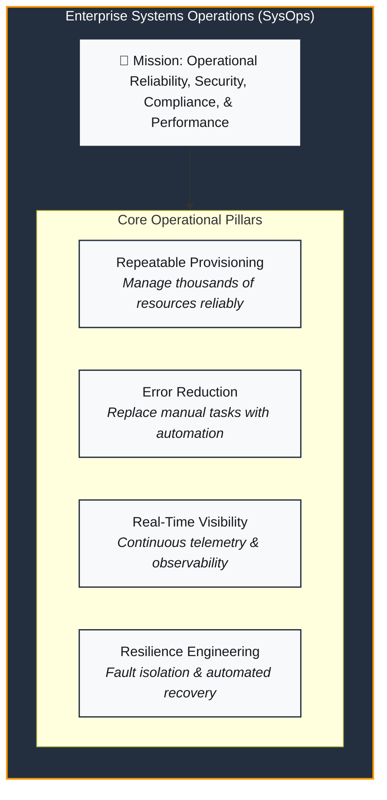
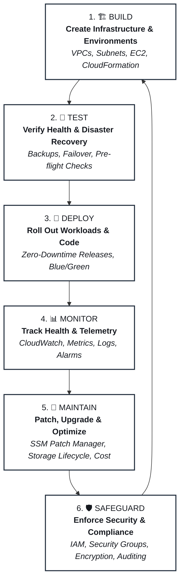
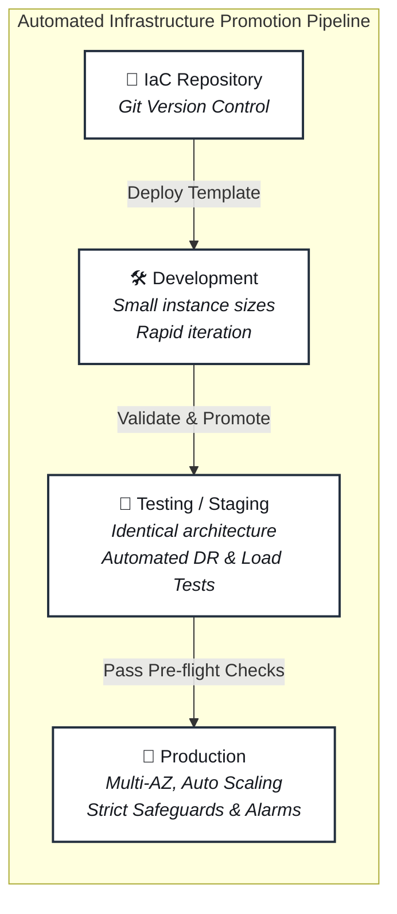
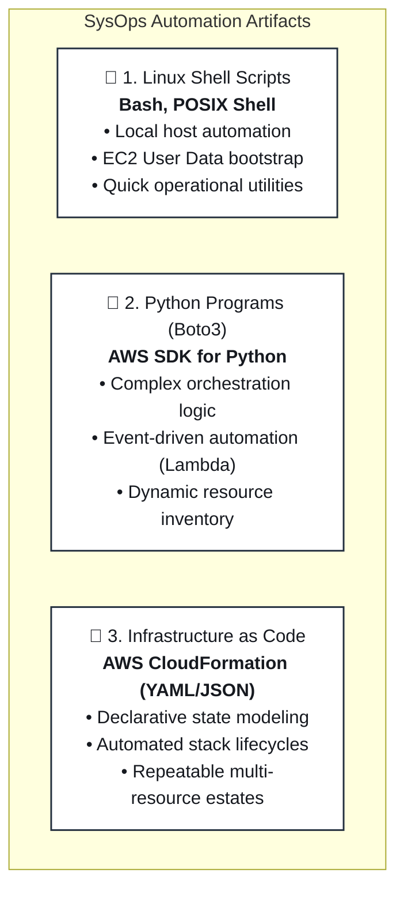
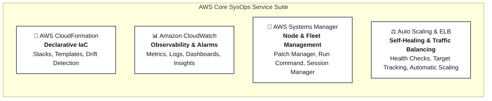
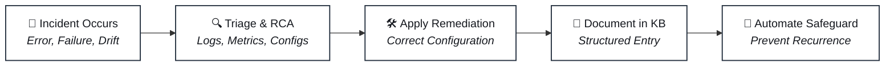

# ⚙️ Systems Operations on AWS: Principles, Responsibilities & Cloud Automation

> **Course**: AWS re/Start  
> **Module**: Systems Operations (M08 – Systems Operations on AWS)  
> **Source Document**: `T12-Systems_Operations/T12-0002-RSSYOP_EN-US_SG_M08_SYSOPSAWS.pdf`  
> **Target Audience**: AWS re/Start Learners / Cloud Operations Associates / SysOps Administrators  

---

## 🎯 Module & Lesson Overview

In modern cloud environments, infrastructure is no longer composed of static, physical appliances housed in locked server rooms. Instead, modern cloud infrastructure is software-defined, dynamic, globally distributed, and entirely programmable. **Systems Operations (SysOps)** is the operational discipline responsible for orchestrating, managing, and sustaining these complex IT systems throughout their operational lifecycle.

SysOps professionals operate at the critical intersection of software delivery and infrastructure stability. Their mission is to guarantee operational reliability, high availability, security posture, regulatory compliance, and performance efficiency. Rather than manually configuring physical switches or installing operating systems from optical media, cloud SysOps administrators harness automation, Infrastructure as Code (IaC), event-driven remediation, and real-time observability to manage fleets of thousands of cloud resources seamlessly.

```
┌────────────────────────────────────────────────────────────────────────┐
│               Core Imperatives of Modern Cloud SysOps                  │
├────────────────────────────────────────────────────────────────────────┤
│  1. Operational Reliability: Ensure services run continuously & reliably│
│  2. Absolute Repeatability: Eliminate human error through code & IaC   │
│  3. Continuous Observability: Telemetry, metrics, logs, and alarms     │
│  4. Automated Remediation: Replace failed components programmatically │
│  5. Robust Governance: Enforce least privilege & compliance baselines  │
│  6. Environmental Parity: Identical Dev, Test, and Production estates  │
└────────────────────────────────────────────────────────────────────────┘
```

---

## 📌 Learning Objectives

By studying this lesson and engaging with its operational frameworks, learners will be able to:

- [ ] **Define Systems Operations (SysOps)**: Articulate the core definition, scope, and objectives of SysOps within modern enterprise and cloud computing environments.
- [ ] **Analyze the Evolution of System Administration**: Contrast traditional on-premises systems administration with cloud systems operations, including the shift from "pets" to "cattle" and from manual runbooks to automated code.
- [ ] **Master the Six Core SysOps Responsibilities**: Deconstruct the continuous operational lifecycle across **Build**, **Test**, **Deploy**, **Monitor**, **Maintain**, and **Safeguard**.
- [ ] **Evaluate the Necessity of Cloud Automation**: Explain why automation is mandatory at cloud scale, how it guarantees consistency, and how it eliminates configuration drift.
- [ ] **Implement Environment Parity**: Formulate strategies for promoting identical, self-describing environments across Development, Test/Staging, and Production tiers.
- [ ] **Differentiate Automation Artifacts**: Compare the appropriate use cases for Linux shell scripts, Python/Boto3 applications, and declarative AWS CloudFormation templates.
- [ ] **Contrast On-Premises and Cloud Provisioning**: Analyze the architectural, operational, and financial differences between physical hardware procurement and cloud-based provisioning.
- [ ] **Identify Core AWS SysOps Services**: Map operational responsibilities to supporting AWS services, including AWS CloudFormation, Amazon CloudWatch, AWS Systems Manager, and AWS Auto Scaling.
- [ ] **Initiate a Troubleshooting Knowledge Base**: Structure and document operational incidents, root cause analyses, and troubleshooting procedures for security and foundational IT domains.

---

## 🧭 1. Definition and Scope of Systems Operations (SysOps)

### 1.1 The Operational Mandate
At its core, **Systems Operations (SysOps)** is concerned with the deployment, administration, configuration, maintenance, and monitoring of systems and network resources in an **automatable and reusable manner**. 

SysOps professionals ensure that IT systems meet or exceed their Service Level Objectives (SLOs) and Service Level Agreements (SLAs). In any enterprise, applications generate business value only when the underlying systems infrastructure operates correctly, remains secure, and performs efficiently under varying user demand.

SysOps responsibilities span every layer of the infrastructure stack:
- **Compute layer**: Virtual machine instances, containerized workloads, serverless runtimes.
- **Storage layer**: Block storage volumes, shared network file systems, scalable object storage.
- **Networking layer**: Virtual Private Clouds (VPCs), subnets, routing tables, gateways, load balancers, and DNS.
- **Security & Identity layer**: Identity and Access Management (IAM) policies, security groups, encryption keys, and audit logging.



### 1.2 Evolution: From Traditional Sysadmin to Cloud Systems Operator
The transition from traditional on-premises data centers to the AWS Cloud has revolutionized the role of system administrators:

1. **Physical Hardware vs. API-Driven Abstraction**:
   - *Traditional Sysadmin*: Spent significant time unboxing servers, mounting chassis in racks, routing physical Cat6/fiber cables, replacing failed hard drives, and configuring RAID controllers.
   - *Cloud SysOps*: Interacts with infrastructure purely through software APIs, Command Line Interfaces (CLI), Software Development Kits (SDKs), and declarative code templates. Physical hardware failures are abstracted away and handled by AWS.

2. **"Pets vs. Cattle" Paradigm**:
   - *Pets (Traditional)*: Servers are given unique hostnames, nurtured, individually patched, manually upgraded, and mourned when they crash. Downtime on a "pet" server requires urgent manual triage.
   - *Cattle (Cloud Native)*: Servers are homogeneous, disposable, and identified by instance IDs. If an instance experiences hardware degradation, automated health checks terminate it and launch an identical replacement from a golden machine image or launch template without human intervention.

3. **Manual Runbooks vs. Declarative Code**:
   - *Traditional*: Human operators followed multi-page step-by-step Word documents or wikis to configure servers manually, introducing human error and configuration drift.
   - *Cloud Native*: Infrastructure is codified in version-controlled templates (e.g., AWS CloudFormation). Deployments are executed by continuous delivery pipelines.

### 1.3 Key Architectural Benefits of Modern SysOps
- **Scale**: The ability to deploy, configure, and operate tens of thousands of resources across multiple global AWS Regions as easily as managing a single server.
- **Consistency**: Eliminating configuration drift by enforcing baseline configurations and automated state convergence.
- **Velocity**: Reducing system provisioning times from months (hardware procurement cycles) to minutes or seconds (cloud API calls).
- **Comprehensive Observability**: Full end-to-end visibility into resource metrics, operating system metrics, network flow logs, and audit trails.

---

## 🔄 2. The Six Core SysOps Responsibilities

SysOps professionals are involved in all facets of delivering and sustaining IT solutions. These responsibilities operate in a continuous, interconnected lifecycle rather than a linear sequence.



---

### 2.1 Responsibility 1: Build (Creating Infrastructure and Environments)
The **Build** phase focuses on constructing the foundational environments and cloud resources required to host enterprise applications.

* **Key Objectives**:
  - Provision segregated, isolated environments (Development, Testing/QA, Staging, and Production).
  - Architect highly available network topologies (Amazon VPC, multi-AZ public and private subnets, NAT Gateways, Internet Gateways).
  - Define computing, container, and database resources using automated mechanisms.
* **SysOps Activities**:
  - Authoring declarative Infrastructure as Code (IaC) templates using AWS CloudFormation.
  - Baking hardened, pre-configured Amazon Machine Images (AMIs) using EC2 Image Builder.
  - Setting up launch templates and Auto Scaling groups with standardized user-data initialization scripts.

> [!NOTE]
> In cloud operations, the Build phase should rarely occur through manual clicks in the AWS Management Console. Manual creation leads to undocumented snowflake environments that cannot be reliably reproduced during outages.

---

### 2.2 Responsibility 2: Test (Verifying Infrastructure and Application Health)
Before applications are exposed to user traffic or infrastructure changes are applied to production, rigorous testing is mandatory.

* **Key Objectives**:
  - Validate that provisioned environments conform to design specifications and performance baselines.
  - Verify that backup and disaster recovery (DR) mechanisms function correctly and meet Recovery Time Objectives (RTO) and Recovery Point Objectives (RPO).
* **SysOps Activities**:
  - Simulating hardware and Availability Zone failures to verify that Elastic Load Balancing and Auto Scaling successfully reroute traffic.
  - Executing automated backup restore drills from Amazon EBS snapshots, Amazon RDS automated snapshots, and Amazon S3 backups to prove data integrity.
  - Conducting load tests and stress tests to evaluate auto-scaling triggers and identify architectural bottlenecks.
  - Performing security vulnerability scans against provisioned hosts and container images prior to deployment.

---

### 2.3 Responsibility 3: Deploy (Rolling Out Changes with Minimal Downtime)
Deploying workloads involves promoting new code, configuration updates, and infrastructure revisions into active runtime environments.

* **Key Objectives**:
  - Deliver updates reliably and rapidly while minimizing or eliminating service disruptions.
  - Ensure that rollbacks can occur instantaneously if a deployment displays anomalous behavior.
* **SysOps Activities**:
  - Selecting and executing appropriate deployment strategies:
    - **In-place / Rolling Deployment**: Updates existing instances in batches; reduces resource overhead but may reduce serving capacity during updates.
    - **Blue/Green Deployment**: Provisions a brand-new identical environment ("Green") alongside the current production environment ("Blue"), verifies its health, and flips traffic using DNS or load balancer target groups. Offers zero downtime and rapid rollback.
    - **Canary Deployment**: Directs a small percentage of user traffic (e.g., 5%) to the new version to monitor real-time error rates before routing 100% of traffic.
  - Integrating automated deployment scripts and pipelines that interact with runtime services.

---

### 2.4 Responsibility 4: Monitor (Telemetry, Metrics, Logs, Alarms & Dashboards)
SysOps professionals cannot manage what they cannot see. Monitoring provides real-time situational awareness across the entire technical landscape.

* **Key Objectives**:
  - Gain continuous visibility into resource utilization, performance bottlenecks, system health, and error rates.
  - Detect anomalies and trigger automated remediations before end users experience service degradations.
* **SysOps Activities**:
  - Collecting system-level metrics (CPU utilization, memory usage, disk I/O, network throughput) using the Amazon CloudWatch Agent.
  - Centralizing and querying application and OS logs using Amazon CloudWatch Logs and CloudWatch Logs Insights.
  - Configuring Amazon CloudWatch Alarms with static thresholds or anomaly detection algorithms.
  - Hooking alarms into Amazon Simple Notification Service (Amazon SNS) to page on-call engineers and into AWS Auto Scaling or AWS Lambda to trigger self-healing actions.
  - Designing centralized CloudWatch Dashboards for operations teams and executives.

---

### 2.5 Responsibility 5: Maintain (Patching, Backups, Optimization & Capacity)
Systems require ongoing stewardship to ensure stability, efficiency, and compliance over long operational horizons.

* **Key Objectives**:
  - Keep operating systems, runtimes, and dependencies secure and up to date without impacting workload availability.
  - Optimize resource capacity and cloud expenditures to eliminate waste.
* **SysOps Activities**:
  - Managing OS and software updates using **AWS Systems Manager Patch Manager** and predefined Maintenance Windows.
  - Enforcing automated snapshot and backup lifecycle policies across EBS, RDS, and DynamoDB using **AWS Backup**.
  - Transitioning older object storage data to Amazon S3 Glacier or Deep Archive via S3 Lifecycle management rules to reduce costs.
  - Reviewing AWS Compute Optimizer and AWS Cost Explorer recommendations to right-size over-provisioned EC2 instances and terminate orphan resources (e.g., unattached EBS volumes or unassociated Elastic IP addresses).

---

### 2.6 Responsibility 6: Safeguard (Security Controls, Access Policies & Compliance)
Security is **job zero** for SysOps. Safeguarding involves defending the infrastructure, networks, applications, and data against security threats and policy violations.

* **Key Objectives**:
  - Protect confidentiality, integrity, and availability of workloads across the AWS Shared Responsibility Model.
  - Ensure adherence to enterprise policies, industry standards, and regulatory frameworks (e.g., SOC 2, HIPAA, PCI-DSS).
* **SysOps Activities**:
  - Applying the principle of **least privilege** through fine-grained AWS Identity and Access Management (IAM) policies, roles, and Service Control Policies (SCPs).
  - Hardening network perimeters using Amazon VPC Security Groups (stateful), Network ACLs (stateless), and AWS WAF (Web Application Firewall).
  - Enforcing encryption of all data at rest (using AWS Key Management Service - AWS KMS) and data in transit (TLS/SSL certificates via AWS Certificate Manager - ACM).
  - Continuously auditing configuration compliance and tracking drift using **AWS Config** and recording administrative API activity with **AWS CloudTrail**.

---

### 2.7 SysOps Responsibilities Matrix

| Responsibility | Primary Objective | Supporting AWS Services & Tools | Primary SysOps Tasks | Impact if Neglected |
| :--- | :--- | :--- | :--- | :--- |
| **1. Build** | Provision infrastructure reliably | AWS CloudFormation, EC2, VPC, Image Builder | Author templates, configure VPC subnets, generate AMIs | Inconsistent environments, manual configuration errors |
| **2. Test** | Validate resiliency & DR readiness | AWS Backup, CloudWatch Synthetic Canaries | Disaster recovery drills, failover testing, load testing | Data loss during outages, unverified backups failing |
| **3. Deploy** | Roll out changes with zero downtime | Elastic Load Balancing, Route 53, CodeDeploy | Blue/Green releases, rolling updates, rollbacks | Outages during release windows, customer disruption |
| **4. Monitor** | Gain telemetry & real-time visibility | Amazon CloudWatch, CloudWatch Logs, SNS | Metric collection, alarm configuration, dashboards | Unnoticed system failures, prolonged Mean Time to Detect (MTTD) |
| **5. Maintain** | Prevent degradation & optimize cost | AWS Systems Manager (SSM), AWS Backup, S3 Lifecycle | Patching, backup lifecycle, instance right-sizing | Unpatched vulnerabilities, ballooning cloud costs |
| **6. Safeguard** | Enforce security, access & compliance | AWS IAM, Security Groups, KMS, CloudTrail, Config | Least privilege IAM, encryption enforcement, audit logs | Security breaches, unauthorized access, regulatory fines |

---

## ⚡ 3. Automation in Cloud SysOps

### 3.1 Why Automation is Mandatory in the Cloud
At traditional scale, an enterprise might manage dozens or hundreds of servers. In the cloud, elastic architectures automatically scale to hundreds or thousands of instances based on consumer demand spikes. 

Manual human administration at cloud scale fails for several fundamental reasons:
1. **Human Latency**: Humans cannot manually deploy, configure, or patch hundreds of instances within seconds of a traffic surge.
2. **Configuration Drift**: Manual changes ("snowflake configurations") inevitably diverge over time, making systems fragile and unpredictable.
3. **Operational Errors**: Fat-finger mistakes during manual command execution represent one of the leading causes of enterprise downtime.
4. **Auditability**: Manual console actions often lack change-control attribution, whereas automated pipelines produce version-controlled commit logs.

> [!IMPORTANT]
> In cloud SysOps, automation is not merely a tool for convenience—it is an architectural requirement. High availability, rapid disaster recovery, and elastic scaling are impossible to achieve without robust automation.

---

### 3.2 Environment Parity & Promotion Pipeline
A core best practice in SysOps is **environment parity**: ensuring that Development, Test (QA/Staging), and Production environments are architecturally identical in structure, configuration, and security baselines. 

When environments are defined as code templates, the exact same template used to validate a feature in Development can be promoted directly to Production, varying only by parameterized capacity (e.g., instance types or cluster sizes).



#### The Value of Self-Describing Systems
Automated infrastructure templates create **self-describing systems**. The template itself serves as the single source of truth for the entire infrastructure architecture. Anyone auditing the system can inspect the code to verify:
- What networking subnets and routes are configured.
- Which ports and CIDR blocks are permitted by security groups.
- What IAM service roles and permissions are attached to instances.
- What storage volume types and encryption flags are enforced.

---

### 3.3 Core Automation Artifacts in AWS SysOps
SysOps professionals leverage three primary categories of automation artifacts:



#### 1. Linux Shell Scripts (Bash)
- **Primary Use Case**: Host-level bootstrap routines, local configuration management, and administrative CLI utilities.
- **Example in AWS**: Embedding Bash scripts within the **EC2 User Data** field to automatically update operating system packages, install web server software (e.g., Apache, Nginx), and pull application code when an EC2 instance launches.

```bash
#!/bin/bash
# Example EC2 User Data Bootstrap Script
yum update -y
yum install -y httpd php
systemctl start httpd
systemctl enable httpd
echo "<h1>Instance Healthy - Provisioned via Automated SysOps Script</h1>" > /var/www/html/index.html
```

#### 2. Python Programs & AWS SDK (Boto3)
- **Primary Use Case**: Complex procedural automation, multi-service workflows, conditional logic, and serverless event-driven remediation.
- **Example in AWS**: A Boto3 script running inside an AWS Lambda function triggered by an Amazon CloudWatch Event to automatically scan for unencrypted EBS volumes and terminate non-compliant instances.

```python
import boto3

def audit_unencrypted_volumes():
    ec2 = boto3.client('ec2')
    volumes = ec2.describe_volumes()
    
    unencrypted = []
    for vol in volumes['Volumes']:
        if not vol['Encrypted']:
            unencrypted.append(vol['VolumeId'])
            print(f"Non-compliant volume found: {vol['VolumeId']}")
            
    return unencrypted
```

#### 3. Declarative Infrastructure as Code (AWS CloudFormation)
- **Primary Use Case**: Enterprise-wide infrastructure provisioning, drift detection, repeatable environment instantiation, and stack management.
- **Key Characteristic**: **Declarative** rather than imperative. The author defines *what* the desired end-state infrastructure should look like, and the AWS CloudFormation engine determines the optimal sequence of API calls to create, update, or delete the resources.

---

### 3.4 On-Premises vs. AWS Cloud Operations Comparison

The operational agility gained by moving from on-premises infrastructure to AWS Cloud automation is profound:

| Operational Dimension | Traditional On-Premises SysOps | AWS Cloud SysOps |
| :--- | :--- | :--- |
| **Provisioning Speed** | **Weeks to Months**: Requires purchase orders, budgeting approval, vendor shipping, unboxing, racking, cabling, and hypervisor installation. | **Minutes or Seconds**: Executed via CloudFormation templates or CLI commands calling AWS APIs. |
| **Capacity Management** | **Static & Over-provisioned**: Sized for peak hypothetical demand; excess capacity sits idle and wastes capital. | **Dynamic & Elastic**: AWS Auto Scaling expands and contracts resources dynamically to match real-time demand. |
| **Hardware Failures** | **Manual Repair**: Technicians physically swap failed power supplies, failed disk drives, or damaged RAM sticks. | **Automated Replacement**: Degraded EC2 instances are terminated and replaced automatically by Auto Scaling across healthy AZs. |
| **Configuration Drift** | **Pervasive & Difficult to Detect**: Engineers make manual hotfixes directly on servers, creating undocumented deviations. | **Audited & Preventable**: Managed via IaC drift detection, AWS Config rules, and immutable AMI/container replacements. |
| **Disaster Recovery** | **Expensive Secondary Data Center**: Requires paying lease and maintenance fees for an idle mirror site. | **Multi-AZ / Multi-Region on Demand**: Pilot light, warm standby, or automated multi-region CloudFormation stack spin-up. |
| **Capital & Cost Model** | **CapEx Heavy**: Sunk capital investment in physical hardware amortized over 3–5 years. | **OpEx Pay-as-you-go**: Variable operating expense paid per second or hour of active resource consumption. |

---

## 🛠️ 4. Key AWS Services Supporting SysOps

AWS provides a specialized suite of services designed specifically to empower Systems Operations teams to automate, monitor, and safeguard workloads:



### 4.1 AWS CloudFormation (Declarative Infrastructure as Code)
- **Role**: Serves as the foundation for modern cloud provisioning.
- **Capabilities**:
  - Treats infrastructure as source code stored in JSON or YAML formatted text files.
  - Manages collections of related resources as a single unit called a **Stack**.
  - Provides **Change Sets** to preview the operational impact of template updates before executing them.
  - Detects **Drift** when resources managed by a stack are modified outside of CloudFormation.
  - Automatically handles dependencies between resources and rolls back gracefully if stack creation encounters an error.

### 4.2 Amazon CloudWatch (Metrics, Logs, Alarms & Dashboards)
- **Role**: Provides the centralized observability backbone for all AWS workloads.
- **Capabilities**:
  - **Metrics**: Gathers native performance data (CPU, network, disk) automatically at 5-minute intervals (basic) or 1-minute intervals (detailed), and ingests custom metrics from applications.
  - **Logs**: Aggregates operating system system logs (`/var/log/messages`, Windows Event Logs) and application logs, enabling real-time filtering and querying via CloudWatch Logs Insights.
  - **Alarms**: Evaluates metric thresholds and triggers actions (e.g., sending SNS alerts, invoking Lambda functions, executing Auto Scaling policies).
  - **Dashboards**: Creates customizable, single-pane-of-glass operational visualizations for NOC (Network Operations Center) teams.

### 4.3 AWS Systems Manager (SSM) (Fleet & Node Management)
- **Role**: Acts as the operational hub for EC2 instances and on-premises virtual machines.
- **Capabilities**:
  - **Session Manager**: Grants secure, auditable, browser-based shell access to EC2 instances without opening inbound port 22 (SSH) or managing bastion hosts.
  - **Run Command**: Allows SysOps administrators to remotely execute scripts or commands across an entire fleet of hundreds of instances simultaneously without logging into them individually.
  - **Patch Manager**: Automates the scanning and patching of operating systems against defined patch baselines during maintenance windows.
  - **Fleet Manager & Inventory**: Collects and visualizes detailed OS, application, and network configuration metadata across all managed nodes.

### 4.4 AWS Auto Scaling & Elastic Load Balancing (Self-Healing Remediation)
- **Role**: Delivers dynamic elasticity, traffic distribution, and automated fault recovery.
- **Capabilities**:
  - **Elastic Load Balancing (ELB)**: Periodically performs health checks against backend targets. If an instance fails consecutive health checks, ELB immediately stops routing user requests to that degraded node.
  - **AWS Auto Scaling**: Works in tandem with ELB health checks. When an instance is marked unhealthy, Auto Scaling automatically terminates the failing instance and launches a fresh, pre-configured replacement to maintain the desired capacity baseline.

---

## 🗂️ 5. Project Workshop: Building a Troubleshooting Knowledge Base

A central hands-on initiative introduced in this module challenges learners to construct an enterprise-grade **Troubleshooting Knowledge Base**. In production environments, SysOps professionals do not merely resolve incidents in isolation; they systematically document technical challenges, root causes, and remediation procedures to build institutional knowledge.



### 5.1 Project Goals and Stakeholder Value
1. **Identify Technical Challenges**: Recognize common failure modes encountered when deploying, configuring, and updating AWS services.
2. **Standardize Troubleshooting Workflows**: Follow structured diagnostic workflows to identify root causes rather than guessing or applying random fixes.
3. **Institutional Memory**: Prevent teams from repeatedly solving the same recurring problems, drastically reducing Mean Time to Resolution (MTTR).
4. **Stakeholder Communication**: Translate technical incident post-mortems into actionable reports for engineering teams and management.

### 5.2 Core Focus Categories

#### Category 1: Security and Compliance
Focuses on permissions, identity misconfigurations, and regulatory governance issues:
- Resolving **IAM Access Denied (HTTP 403)** errors caused by missing explicit allow permissions or conflicting SCPs.
- Identifying and remediating overly permissive **Security Group rules** (e.g., port 22 or 3389 open to `0.0.0.0/0`).
- Troubleshooting AWS KMS key policy restrictions preventing services from decrypting storage volumes.

#### Category 2: Foundational IT & System Administration
Focuses on networking, host configuration, command-line tooling, and runtime environments:
- Resolving connection timeouts in Linux terminals during **AWS CLI installation or configuration**.
- Debugging IAM credential profile issues (`~/.aws/credentials` and `~/.aws/config`).
- Diagnosing VPC routing failures (e.g., EC2 instance in a private subnet unable to access the Internet due to missing NAT Gateway or incorrect route tables).

### 5.3 Standard Knowledge Base Entry Template
SysOps teams utilize standardized entry templates to ensure technical rigor:

```markdown
### KB Entry: [Unique ID / Title]
- **Category**: [Security & Compliance | Foundational IT | Networking | Compute]
- **Date / Author**: [YYYY-MM-DD] / [Engineer Name]
- **Symptoms / Error Message**:
  Exact error string, HTTP status code, or observable system behavior.
- **Environment & Services Affected**:
  AWS Region, VPC ID, Instance IDs, IAM Role, CLI version.
- **Root Cause Analysis (RCA)**:
  Detailed technical explanation of what caused the failure.
- **Step-by-Step Remediation**:
  1. Detailed step 1
  2. Detailed step 2
- **Verification & Testing**:
  How the fix was validated to ensure normal operational state.
- **Preventative Action & Automation**:
  IaC update, CloudWatch alarm, or Config rule implemented to prevent recurrence.
```

---

## 💡 6. Checkpoint Questions & Technical Explanations

### Question 1
> **True or False**: SysOps supports technical systems by monitoring systems and helping ensure that system performance is accurate and trouble-free.

- **Answer**: **True**
- **Technical Explanation**: A foundational responsibility of SysOps is proactive observability. By collecting telemetry through monitoring services such as Amazon CloudWatch and configuring automated alarms, SysOps professionals detect potential bottlenecks and errors early, ensuring systems meet performance baselines and operate without unplanned outages.

---

### Question 2
> **True or False**: SysOps involves the responsibilities and tasks required to build (create), test, deploy, monitor, maintain, and safeguard complex computing systems.

- **Answer**: **True**
- **Technical Explanation**: These six pillars—**Build**, **Test**, **Deploy**, **Monitor**, **Maintain**, and **Safeguard**—form the complete operational lifecycle of modern systems administration. SysOps professionals manage environments from initial provisioning through active deployment, ongoing maintenance, and security enforcement.

---

### Question 3
> **True or False**: SysOps professionals can create reusable infrastructure templates by using the AWS Identity and Access Management (IAM) service.

- **Answer**: **False**
- **Technical Explanation**: **AWS CloudFormation** (not IAM) is the dedicated AWS service used to author and manage reusable Infrastructure as Code (IaC) templates. While IAM is a critical service used to manage users, groups, and access permissions (part of the Safeguard pillar), it does not provision or template infrastructure components like VPCs, EC2 instances, or load balancers.

---

## 🧠 Extended Scenario-Based Knowledge Check

### Scenario A: Mitigating Configuration Drift
**Scenario**: A company has three distinct environments: Development, Test, and Production. Over several months, developers and junior administrators made direct manual adjustments to EC2 security groups and web server configuration files in the Test environment to quickly patch issues. When a new application release was deployed from Test to Production, the application failed catastrophically.

1. **What operational anti-pattern caused this failure?**
   - **Analysis**: The failure was caused by **configuration drift** and the absence of **environment parity**. Because manual changes were applied directly to the Test environment ("snowflake" configuration) without being codified in version-controlled templates, the Test environment no longer matched Production.
2. **How should a SysOps engineer remediate this process moving forward?**
   - **Remediation**: 
     - Mandate that all infrastructure modifications be defined in **AWS CloudFormation** templates.
     - Prohibit manual console or CLI modifications in non-sandbox environments.
     - Implement **AWS CloudFormation Drift Detection** and **AWS Config** rules to automatically alert on unauthorized out-of-band changes.

---

### Scenario B: Self-Healing Architecture
**Scenario**: An e-commerce web application hosted on an Amazon EC2 instance becomes unresponsive due to a memory leak in the application server process every few days. The on-call operations engineer currently receives a phone alert, logs into the AWS console, and manually reboots the instance.

1. **How should this process be modernized using AWS SysOps automation?**
   - **Modernization Architecture**:
     - Configure the **Amazon CloudWatch Agent** on the EC2 instances to monitor operating system memory utilization.
     - Place the EC2 instances behind an **Application Load Balancer (ALB)** within an **Auto Scaling Group (ASG)** spanning at least two Availability Zones.
     - Configure ALB **HTTP health checks** targeting a specific application health endpoint (e.g., `/healthz`).
     - When the memory leak degrades the web process, the health check fails. The ALB stops routing traffic to the impaired node, and Auto Scaling automatically terminates the failing instance and launches a clean instance.
     - Result: Zero downtime for end users and zero manual intervention required by the on-call engineer.

---

## 📌 7. Key Takeaways & Summary

- **Definition of SysOps**: Systems Operations is the discipline of deploying, administering, maintaining, and monitoring systems and network resources in a scalable, repeatable, and automated manner.
- **The Six Core Pillars**: SysOps encompasses six continuous operational responsibilities:
  1. **Build**: Creating environments and provisioning resources.
  2. **Test**: Validating configurations, failover, and disaster recovery.
  3. **Deploy**: Releasing applications with minimal downtime via rolling, blue/green, or canary strategies.
  4. **Monitor**: Tracking telemetry, metrics, and logs through Amazon CloudWatch.
  5. **Maintain**: Applying regular OS patches via SSM Patch Manager, managing backups, and optimizing cost.
  6. **Safeguard**: Enforcing least privilege, security boundaries, and compliance audits.
- **The Imperative of Automation**: At cloud scale, manual system administration is unviable. Automation via shell scripts, Python (Boto3), and AWS CloudFormation ensures environment parity, eliminates configuration drift, and minimizes human error.
- **Cloud Agility vs. On-Premises**: The AWS Cloud replaces long physical procurement lead times with instant, software-defined API calls, transforming static hardware overhead into elastic, self-healing infrastructure.
- **Knowledge Base Documentation**: Documenting real-world incident triage, root causes, and resolutions creates vital institutional memory, shortens MTTR, and elevates the operational maturity of the organization.
