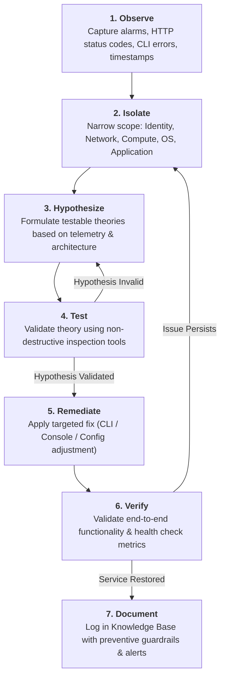
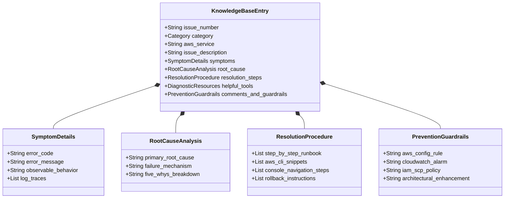
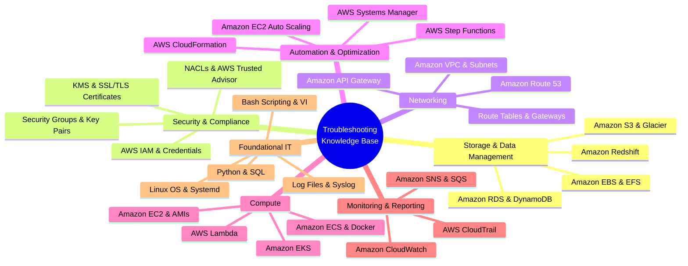
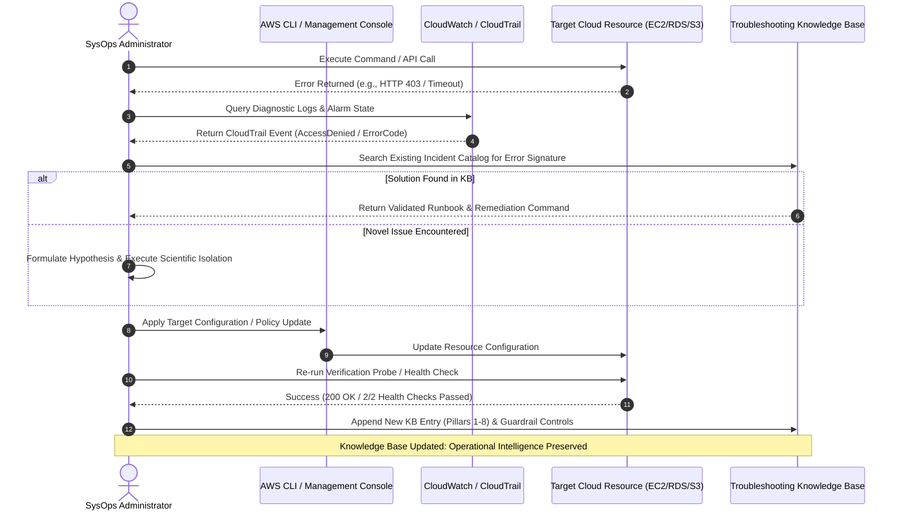

# 🛠️ AWS Systems Operations: Creating a Troubleshooting Knowledge Base

> **Course**: AWS re/Start  
> **Module**: Systems Operations  
> **Source Document**: `T12-0003-SYOP_KNOWLEDGEBASEINTRO_EN.pdf`  
> **Target Audience**: AWS re/Start Learners / Cloud Operations Engineers / SysOps Administrators  

---

## 🎯 Executive Summary & Purpose of a Troubleshooting Knowledge Base

In enterprise cloud operations and Systems Operations (SysOps), system incidents, infrastructure misconfigurations, and service degradation represent critical operational risks. When production workloads fail or encounter runtime exceptions, the speed and accuracy with which operations personnel detect, isolate, and remediate the underlying failure directly dictate business continuity, service-level agreement (SLA) compliance, and customer trust.

A **Troubleshooting Knowledge Base (KB)** serves as an organization's centralized, structured repository of operational intelligence. Rather than relying on ephemeral tribal knowledge or forcing engineers to re-investigate identical errors repeatedly, a standardized Knowledge Base transforms individual troubleshooting experiences into permanent institutional assets.

```
┌────────────────────────────────────────────────────────────────────────┐
│      Strategic Value of a Cloud Troubleshooting Knowledge Base         │
├────────────────────────────────────────────────────────────────────────┤
│  1. Accelerated MTTR: Drastically reduce Mean Time to Resolution       │
│  2. Institutional Memory: Eliminate single points of human failure     │
│  3. Standardization: Establish uniform diagnostic & runbook procedures │
│  4. Continuous Improvement: Drive root-cause elimination & guardrails  │
│  5. Team Onboarding: Provide structured real-world training artifacts  │
│  6. Blameless Culture: Foster transparent incident analysis & learning │
└────────────────────────────────────────────────────────────────────────┘
```

Throughout the AWS re/Start curriculum and professional SysOps practice, engineers capture every technical roadblock encountered—across hands-on labs, AWS CLI configurations, infrastructure automation tasks, and custom sandbox deployments. This document outlines the structural framework, systematic troubleshooting methodologies, catalog categories, real-world case studies, presentation rubrics, and incident analysis standards required to build a world-class Cloud Troubleshooting Knowledge Base.

---

## 📌 Learning Objectives

- [ ] **Establish a Structured Knowledge Base**: Design and maintain a standardized cloud operations troubleshooting repository using a multi-column schema aligned with enterprise SysOps standards.
- [ ] **Execute the Systematic Cloud Troubleshooting Methodology**: Apply the rigorous 7-stage diagnostic lifecycle (*Observe $\rightarrow$ Isolate $\rightarrow$ Hypothesize $\rightarrow$ Test $\rightarrow$ Remediate $\rightarrow$ Verify $\rightarrow$ Document*) to resolve complex cloud failures.
- [ ] **Master the 8 Essential Pillars of a Knowledge Base Entry**: Document every incident with precision across Unique ID, Service Category, Issue Description, Symptoms, Root Cause Analysis (RCA), Resolution Procedures, Diagnostic Tools, and Prevention Guardrails.
- [ ] **Categorize Cloud Architecture Incidents**: Classify operational challenges across the seven core domains: Storage & Data Management, Security & Compliance, Networking, Automation & Optimization, Compute, Monitoring & Reporting, and Foundational IT.
- [ ] **Perform Root Cause Analysis (RCA)**: Apply the "5 Whys" methodology and AWS diagnostic telemetry (CloudWatch, CloudTrail, VPC Flow Logs) to distinguish superficial symptoms from true root causes.
- [ ] **Construct Repeatable Remediations**: Write validated, step-by-step technical procedures utilizing AWS CLI commands, Infrastructure as Code (IaC), and AWS Management Console workflows.
- [ ] **Implement Preventive Guardrails**: Establish proactive infrastructure controls using AWS Config rules, Service Control Policies (SCPs), and CloudWatch automated alarms to eliminate recurring failure modes.
- [ ] **Deliver Blameless Incident Presentations**: Formulate Correction of Error (COE) reports and deliver executive and technical briefings evaluated against enterprise SysOps assessment rubrics.

---

## 🔄 The Systematic Cloud Troubleshooting Methodology

Troubleshooting distributed cloud systems requires moving away from guesswork and adopting a deterministic, scientific method. In cloud environments like AWS, resources are interconnected through software-defined networks, identity evaluation policies, and distributed control planes. A failure in one service (e.g., an EC2 instance failing to pull data from S3) may stem from compute, networking, security groups, routing, DNS, or IAM permissions.

The **7-Stage Cloud Troubleshooting Lifecycle** provides an engineering framework to resolve incidents efficiently without introducing unintended side effects:



### Breakdown of the 7 Diagnostic Stages

1. **Observe (Symptom Collection)**:
   - Collect exact error messages, exit codes (e.g., `403 Forbidden`, `Connection timed out`, exit code `127`).
   - Identify affected resource IDs (Instance IDs, Bucket Names, VPC IDs, IAM ARNs).
   - Record exact timestamps (UTC) and correlate against release schedules or configuration changes.
2. **Isolate (Boundary Delineation)**:
   - Determine the blast radius: Is the issue isolated to a single instance, an entire Availability Zone (AZ), a specific subnet, or all clients?
   - Deconstruct the communication path: Layer 3/4 network connectivity vs. Layer 7 application routing vs. AWS Control Plane authorization.
3. **Hypothesize (Theory of Probable Cause)**:
   - Formulate a prioritized list of potential failure points based on AWS architectural dependencies.
   - Distinguish common failure modes (e.g., Security Group stateful filtering vs. NACL stateless rules vs. route table entries).
4. **Test (Diagnostic Validation)**:
   - Execute non-intrusive diagnostic tests to confirm or invalidate the hypothesis without causing data loss or service disruption.
   - Utilize native tools: AWS VPC Reachability Analyzer, `curl -Iv`, `dig`/`nslookup`, `aws iam simulate-principal-policy`.
5. **Remediate (Targeted Correction)**:
   - Execute the minimal configuration change required to restore healthy operation.
   - Document the exact modification made (e.g., modifying security group ingress rule, attaching an IAM policy).
6. **Verify (Validation & Health Check)**:
   - Perform synthetic tests to confirm complete service restoration from the client's perspective.
   - Monitor Amazon CloudWatch metrics (e.g., `StatusCheckFailed_System`, `5xxErrorRate`) to ensure stability.
7. **Document (Knowledge Ingestion & Prevention)**:
   - Record the complete incident lifecycle into the Troubleshooting Knowledge Base.
   - Define architectural guardrails (AWS Config rules, SCPs, automated alarms) to prevent recurrence.

---

## 🏛️ The 8 Essential Pillars of a Knowledge Base Entry

A high-utility Knowledge Base entry must provide sufficient detail so that any systems administrator can understand the incident, verify whether it matches a current outage, execute the remediation safely, and implement long-term preventative controls.



### Pillar Definitions and Quality Criteria

| Pillar # | Column Name | Technical Scope & Mandatory Content | SysOps Best Practice & Common Pitfalls |
| :---: | :--- | :--- | :--- |
| **1** | **Issue Number** | Unique primary key identifier (e.g., `KB-001`, `KB-SYS-042`). Monotonically increasing counter. | **Avoid**: Reusing numbers or leaving blank. Use standardized prefixing. |
| **2** | **Category & AWS Service** | One of the 7 standard curriculum categories plus the specific AWS service involved (e.g., `Networking: Amazon VPC`, `Security: AWS IAM`). | **Avoid**: Generic classifications like "AWS". Tag both category and service precisely. |
| **3** | **Issue Description** | High-level executive summary defining the technical obstacle and user/application impact. | **Avoid**: Vague descriptions such as "Instance not working". State what failed and when. |
| **4** | **Symptoms & Observable Indicators** | Verbatim error messages, HTTP status codes (`403`, `502`, `504`), CLI error outputs, CloudWatch alarm states, and system logs. | **Avoid**: Summarizing errors as "failed". Always provide raw log snippets and error strings. |
| **5** | **Root Cause Analysis (RCA)** | The foundational engineering defect that triggered the failure (e.g., missing Route Table entry, IAM implicit deny, disk saturation). | **Avoid**: Confusing symptoms with root cause (e.g., stating "the website went down" instead of "TCP port 80 blocked"). |
| **6** | **Resolution Procedures** | Deterministic, sequential runbook with action verbs, exact AWS CLI commands, parameters, and console paths. | **Avoid**: Passive voice or ambiguous instructions like "fix the network". Provide exact syntax. |
| **7** | **Helpful Tools & Diagnostic Resources** | Documentation URLs, terminal diagnostic commands (`traceroute`, `curl`, `netstat`), and native AWS diagnostic tools used. | **Avoid**: Listing generic links like "google.com". Cite exact AWS documentation sections and scripts. |
| **8** | **Prevention & Guardrail Comments** | CloudWatch alarms, AWS Config conformance rules, Service Control Policies (SCPs), and IaC guardrails to prevent recurrence. | **Avoid**: Leaving blank. True systems operations focuses on systemic defect prevention. |

---

## 🗂️ Knowledge Base Categories & AWS Services Taxonomy

To organize incident documentation across large teams, the Troubleshooting Knowledge Base classifies operational issues into seven core technical categories.



### Detailed Category Matrix

| Category | Associated AWS Services & Technologies | Common Production Operational Challenges |
| :--- | :--- | :--- |
| **1. Storage & Data Management** | Amazon S3, Amazon S3 Glacier, Amazon EBS, Amazon EFS, Amazon RDS, Amazon DynamoDB, Amazon Redshift | Bucket policy permission conflicts, S3 Block Public Access blocks, EBS filesystem mounting & expansion, EFS NFS mount targets, RDS connection limits, database IOPS starvation, DynamoDB provisioned throughput throttling. |
| **2. Security & Compliance** | AWS IAM, Security Groups, EC2 Key Pairs, AWS KMS, AWS Trusted Advisor, TLS/SSL Certificates (ACM), Network ACLs | IAM permission boundaries vs. SCPs, expired access keys, SSH public key permission denials (`0644` vs `0400`), cross-account KMS decryption denials, missing SSL certificates on ALB, security group circular rule references. |
| **3. Networking** | Amazon VPC, Public/Private Subnets, Internet Gateways (IGW), NAT Gateways, Route Tables, Route 53, API Gateway | Route table missing `0.0.0.0/0` route to IGW, NAT Gateway deployed in private subnet, DNS resolution failure in custom VPCs, asymmetric routing, API Gateway integration timeout, port forwarding failure. |
| **4. Automation & Optimization** | AWS CloudFormation, AWS Systems Manager (SSM), EC2 Auto Scaling, AWS Step Functions, Trusted Advisor | CloudFormation stack rollback failures (`UPDATE_ROLLBACK_FAILED`), SSM Agent offline or lacking instance profile, Auto Scaling cool-down misconfiguration, cyclic dependency in CloudFormation templates. |
| **5. Compute** | Amazon EC2, Amazon ECS, Docker Containers, Amazon EKS, AWS Lambda | EC2 `StatusCheckFailed_Instance` vs `StatusCheckFailed_System`, SSH keypair mismatch, Lambda memory exhaustion / execution timeout, container exit code 137 (OOM), AMI virtualization incompatibility. |
| **6. Monitoring & Reporting** | Amazon CloudWatch (Metrics, Logs, Alarms), Amazon SNS, Amazon SQS, AWS CloudTrail | CloudWatch agent failed to push disk metrics, missing SNS topic subscription confirmation, SQS queue depth accumulation, CloudTrail delay or multi-region trail disabled, metric filter regex errors. |
| **7. Foundational IT** | Linux OS (Amazon Linux, Ubuntu), Systemd, Bash, VI/Vim, Python, SQL, Networking Utilities (`curl`, `dig`, `tcpdump`) | File descriptor exhaustion (`ulimit`), `/var/log` disk saturation, wrong file permissions (`chmod`/`chown`), syntax errors in shell scripts, corrupt `/etc/fstab` entries preventing OS reboot, database SQL deadlocks. |

---

## 🛠️ Common AWS Technical Challenges Catalog (Production Runbooks)

The following in-depth case studies illustrate complete, production-grade Knowledge Base entries addressing the most frequent operational challenges encountered by cloud administrators.

---

### Case Study 1: Amazon EC2 SSH Connection Timeout (`Port 22 Connection Refused / Timed Out`)

> **Entry ID**: `KB-NET-001` | **Category**: Networking / Compute | **Severity**: High

#### 1. Issue Description
Systems administrator is unable to establish an SSH management session to an Amazon EC2 Linux instance launched in a custom VPC. The client terminal hangs for approximately 60 seconds before failing.

#### 2. Symptoms & Observable Indicators
- **Terminal Output**:
  ```bash
  ssh -i ~/.ssh/my-aws-key.pem ec2-user@54.214.18.92 -v
  # OpenSSH_8.9p1, OpenSSL 1.1.1w  11 Sep 2023
  # Connecting to 54.214.18.92 [54.214.18.92] port 22.
  # connect to address 54.214.18.92 port 22: Connection timed out
  # ssh: connect to host 54.214.18.92 port 22: Connection timed out
  ```
- **EC2 Management Console Status**:
  - Instance State: `Running`
  - System Status Check: `2/2 checks passed`
  - Public IPv4 Address: `54.214.18.92` assigned.

#### 3. Root Cause Analysis (RCA)
A systematic inspection through the AWS networking layers revealed two compound defects:
1. **Security Group Ingress Filtering**: The associated Security Group (`sg-0a8b7c6d5e4f3a1b2`) only allowed inbound traffic on TCP port 80/443; TCP port 22 was completely omitted.
2. **VPC Route Table Misconfiguration**: While the EC2 instance possessed an auto-assigned public IP, the subnet was associated with a custom Route Table (`rtb-0123456789abcdef0`) that lacked a default route (`0.0.0.0/0`) targeting the VPC's Internet Gateway (`igw-0987654321fedcba0`). Traffic could not route to or from the internet.

```
┌──────────────┐     TCP:22      ┌─────────────────────────┐        X (No Route)      ┌───────────────┐
│ Client (SSH) │ ──────────────> │ Security Group (Dropped)│ ─── ── ── ── ── ── ── ──>│  VPC IGW      │
└──────────────┘                 └─────────────────────────┘                          └───────────────┘
```

#### 4. Resolution Procedure (Step-by-Step Runbook)

```bash
# Step 1: Query the Security Group rules attached to the instance
aws ec2 describe-security-groups \
    --group-ids sg-0a8b7c6d5e4f3a1b2 \
    --query "SecurityGroups[*].IpPermissions"

# Step 2: Authorize inbound SSH traffic (port 22) from the administrator's authorized IP range (/32)
aws ec2 authorize-security-group-ingress \
    --group-id sg-0a8b7c6d5e4f3a1b2 \
    --protocol tcp \
    --port 22 \
    --cidr 198.51.100.45/32

# Step 3: Identify the Route Table associated with the instance's subnet
SUBNET_ID=$(aws ec2 describe-instances --instance-ids i-0123456789abcdef0 \
    --query "Reservations[0].Instances[0].SubnetId" --output text)

ROUTE_TABLE_ID=$(aws ec2 describe-route-tables \
    --filters "Name=association.subnet-id,Values=${SUBNET_ID}" \
    --query "RouteTables[0].RouteTableId" --output text)

# Step 4: Add default route (0.0.0.0/0) pointing to the Internet Gateway
aws ec2 create-route \
    --route-table-id ${ROUTE_TABLE_ID} \
    --destination-cidr-block 0.0.0.0/0 \
    --gateway-id igw-0987654321fedcba0

# Step 5: Validate SSH connectivity with debug output
ssh -i ~/.ssh/my-aws-key.pem ec2-user@54.214.18.92
```

#### 5. Helpful Diagnostic Resources
- **AWS VPC Reachability Analyzer**: Ran analysis between source Internet Gateway and target network interface (`eni-0abc123`). Flagged missing route table path.
- **AWS CLI Command**: `aws ec2 get-console-output --instance-id i-0123456789abcdef0` to verify SSH daemon (`sshd`) started successfully on OS boot.

#### 6. Prevention & Guardrails
- **AWS Config Rule**: Deploy rule `ec2-instance-no-public-ip` to prevent launching instances with direct public IPs; mandate AWS Systems Manager Session Manager for SSH-less terminal access.
- **SSM Session Manager Integration**: Attach `AmazonSSMManagedInstanceCore` managed policy to eliminate port 22 inbound exposure completely.

---

### Case Study 2: Amazon S3 `Access Denied (HTTP 403 Forbidden)` on API/CLI Object Retrieval

> **Entry ID**: `KB-SEC-002` | **Category**: Security & Compliance / Storage | **Severity**: Medium

#### 1. Issue Description
An automated backup ingestion script running on an EC2 instance in account `111122223333` fails to download configuration files from S3 bucket `corp-app-configs-us-east-1`, returning `403 Forbidden`.

#### 2. Symptoms & Observable Indicators
- **AWS CLI Output**:
  ```bash
  aws s3 cp s3://corp-app-configs-us-east-1/prod/app-config.json ./
  # fatal error: An error occurred (AccessDenied) when calling the GetObject operation: Access Denied
  ```
- **CloudTrail Event**:
  - `eventName`: `GetObject`
  - `errorCode`: `AccessDenied`
  - `errorMessage`: `Access Denied`
  - `userIdentity.arn`: `arn:aws:iam::111122223333:role/AppBackupInstanceRole`

#### 3. Root Cause Analysis (RCA)
Authorization evaluation in AWS S3 uses multi-layer policy evaluation. Inspection revealed:
1. The IAM instance role had policy `S3ReadPolicy` allowing `s3:GetObject` on `arn:aws:s3:::corp-app-configs-us-east-1/*`.
2. However, the S3 Bucket Policy contained an **Explicit Deny** block enforcing server-side encryption with AWS KMS:
   ```json
   {
       "Effect": "Deny",
       "Principal": "*",
       "Action": "s3:GetObject",
       "Resource": "arn:aws:s3:::corp-app-configs-us-east-1/*",
       "Condition": {
           "StringNotEquals": {
               "s3:x-amz-server-side-encryption": "aws:kms"
           }
       }
   }
   ```
3. Furthermore, the objects were encrypted using a Customer Managed Key (CMK) (`arn:aws:kms:us-east-1:111122223333:key/a1b2c3d4-e5f6-7890`), but the instance role lacked `kms:Decrypt` permission in the KMS Key Policy!

> [!IMPORTANT]
> In AWS IAM evaluation, an **Explicit Deny** overrides any **Allow**. Additionally, accessing KMS-encrypted S3 objects requires dual authorization: both `s3:GetObject` on the object AND `kms:Decrypt` on the associated encryption key.

#### 4. Resolution Procedure (Step-by-Step Runbook)

```bash
# Step 1: Update the KMS Key Policy to allow the IAM Role decrypt permissions
aws kms put-key-policy \
    --key-id a1b2c3d4-e5f6-7890 \
    --policy-name default \
    --policy file://kms-updated-policy.json

# Step 2: Attach an inline IAM policy to the instance role granting KMS decryption
aws iam put-role-policy \
    --role-name AppBackupInstanceRole \
    --policy-name KMSDecryptAccess \
    --policy-document '{
        "Version": "2012-10-17",
        "Statement": [
            {
                "Effect": "Allow",
                "Action": [
                    "kms:Decrypt",
                    "kms:DescribeKey"
                ],
                "Resource": "arn:aws:kms:us-east-1:111122223333:key/a1b2c3d4-e5f6-7890"
            }
        ]
    }'

# Step 3: Re-verify download operation
aws s3 cp s3://corp-app-configs-us-east-1/prod/app-config.json ./
# download: s3://corp-app-configs-us-east-1/prod/app-config.json to ./app-config.json
```

#### 5. Helpful Diagnostic Resources
- **AWS IAM Policy Simulator**: Evaluated role ARN against `s3:GetObject` and `kms:Decrypt` actions.
- **AWS CloudTrail Event History**: Filtered by `errorCode = AccessDenied` to isolate whether S3 or KMS rejected the API call.

#### 6. Prevention & Guardrails
- **AWS Service Catalog / Terraform Modules**: Standardize IAM role definitions to automatically bundle corresponding KMS key grants whenever encrypted S3 buckets are provisioned.

---

### Case Study 3: Amazon RDS Database Connection Timeout & Refusal

> **Entry ID**: `KB-DAT-003` | **Category**: Storage & Data Management / Networking | **Severity**: Critical

#### 1. Issue Description
A web application running on Amazon EC2 instances in an Auto Scaling group reports database connection errors (`Can't connect to MySQL server on 'db-prod.c123456789.us-east-1.rds.amazonaws.com' (110)`).

#### 2. Symptoms & Observable Indicators
- **Application Error Log (`/var/log/nginx/error.log`)**:
  ```
  [error] 1420#1420: *12 FastCGI sent in stderr: "PHP message: PDOException: SQLSTATE[HY000] [2002] Connection timed out in /var/www/html/db.php:12"
  ```
- **CLI Connectivity Test from EC2**:
  ```bash
  nc -zv -w 5 db-prod.c123456789.us-east-1.rds.amazonaws.com 3306
  # nc: connect to db-prod.c123456789.us-east-1.rds.amazonaws.com port 3306 (tcp) timed out: Operation now in progress
  ```

#### 3. Root Cause Analysis (RCA)
1. **Network Layer Isolation**: The RDS instance is located in a private DB Subnet Group (`subnet-db-az1`, `subnet-db-az2`).
2. **Security Group Disconnect**: The RDS DB Security Group (`sg-rds-prod`) had an inbound rule allowing port 3306 only from an old, terminated staging EC2 instance IP (`10.0.1.55/32`). It did **not** reference the Application Security Group (`sg-app-webservers`).

#### 4. Resolution Procedure (Step-by-Step Runbook)

```bash
# Step 1: Identify the Security Group attached to the Web App instances
APP_SG_ID=$(aws ec2 describe-security-groups \
    --group-names "app-webservers" \
    --query "SecurityGroups[0].GroupId" --output text)

# Step 2: Authorize inbound MySQL (TCP 3306) on the RDS Security Group referencing the App Security Group ID
aws ec2 authorize-security-group-ingress \
    --group-id sg-0f1e2d3c4b5a6978 \
    --protocol tcp \
    --port 3306 \
    --source-group ${APP_SG_ID}

# Step 3: Remove the obsolete static IP rule to prevent stale configurations
aws ec2 revoke-security-group-ingress \
    --group-id sg-0f1e2d3c4b5a6978 \
    --protocol tcp \
    --port 3306 \
    --cidr 10.0.1.55/32

# Step 4: Verify TCP handshake from EC2 instance
nc -zv -w 5 db-prod.c123456789.us-east-1.rds.amazonaws.com 3306
# Connection to db-prod.c123456789.us-east-1.rds.amazonaws.com 3306 port [tcp/mysql] succeeded!
```

#### 5. Helpful Diagnostic Resources
- `nc` (Netcat) utility for Layer 4 TCP connection probing without installing database client binaries.
- AWS RDS Console $\rightarrow$ Connectivity & Security panel.

#### 6. Prevention & Guardrails
- **Security Group Nesting Best Practice**: Always authorize security groups using source Security Group IDs (`sg-xxxx`) rather than individual subnet or instance IP addresses. This guarantees dynamic scaling compatibility.

---

### Case Study 4: IAM Cross-Account Role Assumption & Circular Trust Failure

> **Entry ID**: `KB-IAM-004` | **Category**: Security & Compliance | **Severity**: High

#### 1. Issue Description
A deployment pipeline running in Development Account (`111111111111`) fails to assume the deployment role in Production Account (`222222222222`), blocking deployment automation.

#### 2. Symptoms & Observable Indicators
- **AWS CLI Output**:
  ```bash
  aws sts assume-role \
      --role-arn arn:aws:iam::222222222222:role/ProductionDeployerRole \
      --role-session-name PipelineDeployment
  # An error occurred (AccessDenied) when calling the AssumeRole operation: User: arn:aws:iam::111111111111:user/ci-deployer is not authorized to perform: sts:AssumeRole on resource: arn:aws:iam::222222222222:role/ProductionDeployerRole
  ```

#### 3. Root Cause Analysis (RCA)
Cross-account role assumption requires a bidirectional handshake:
1. **Source Principal Permissions**: The user `ci-deployer` in Account 1 must have an IAM policy granting `sts:AssumeRole` on the target ARN.
2. **Target Role Trust Relationship**: The role `ProductionDeployerRole` in Account 2 must have a Trust Policy (`AssumeRolePolicyDocument`) explicitly designating `arn:aws:iam::111111111111:user/ci-deployer` (or Account 1 root) as a trusted `Principal`.
- **Defect Identified**: The Trust Policy in Account 2 had a typo in the Principal ARN (`arn:aws:iam::111111111111:user/ci_deployer` with an underscore instead of a hyphen), causing an implicit authorization denial.

#### 4. Resolution Procedure (Step-by-Step Runbook)

```bash
# Step 1: Update the Trust Relationship JSON on the Production Role
cat << 'EOF' > trust-policy.json
{
  "Version": "2012-10-17",
  "Statement": [
    {
      "Effect": "Allow",
      "Principal": {
        "AWS": "arn:aws:iam::111111111111:user/ci-deployer"
      },
      "Action": "sts:AssumeRole",
      "Condition": {
        "Bool": {
          "aws:MultiFactorAuthPresent": "false"
        }
      }
    }
  ]
}
EOF

aws iam update-assume-role-policy \
    --role-name ProductionDeployerRole \
    --policy-document file://trust-policy.json

# Step 2: Validate assume-role output from source user
aws sts assume-role \
    --role-arn arn:aws:iam::222222222222:role/ProductionDeployerRole \
    --role-session-name PipelineDeployment
```

#### 5. Helpful Diagnostic Resources
- `aws sts get-caller-identity` to verify the active authenticated ARN.
- CloudTrail Event History in the target production account (Account 2) monitoring `AssumeRole` calls.

#### 6. Prevention & Guardrails
- Maintain cross-account IAM trust definitions via centralized Infrastructure as Code (Terraform/CloudFormation) rather than manual console modifications to eliminate naming typos.

---

### Case Study 5: VPC Private Subnet Outbound Failure via Misconfigured NAT Gateway

> **Entry ID**: `KB-NET-005` | **Category**: Networking / Automation | **Severity**: High

#### 1. Issue Description
Backend EC2 instances located in a private subnet cannot pull software updates via `yum update` or download dependencies from external package repositories.

#### 2. Symptoms & Observable Indicators
- **Terminal Session on Private Instance**:
  ```bash
  sudo yum check-update
  # Loaded plugins: extras_suggestions, langpacks, priorities, update-motd
  # Could not retrieve mirrorlist http://amazonlinux.default.amazonaws.com/...
  # Cannot find a valid baseurl for repo: amzn2-core/2/x86_64
  # Timeout while connecting to server
  ```
- **ICMP Ping**: `ping 8.8.8.8` returns 100% packet loss.

#### 3. Root Cause Analysis (RCA)
1. The private subnet route table (`rtb-private-1`) correctly pointed `0.0.0.0/0` to NAT Gateway `nat-0abcd1234ef567890`.
2. **Defect**: The NAT Gateway itself was mistakenly deployed into the **private subnet** rather than a **public subnet**!
3. Because the NAT Gateway resided in a subnet whose route table lacked a direct path to an Internet Gateway (`igw-xxxx`), the NAT Gateway could not reach external networks, blackholing all outbound egress traffic from the entire private tier.

```
┌────────────────────────────────────────────────────────┐
│ VPC Misconfiguration                                   │
│                                                        │
│ [Private Subnet]                                       │
│   Backend EC2 ──> NAT Gateway (In Private Subnet!) ──X │ (No IGW Path)
│                                                        │
│ Correct Architecture:                                  │
│   Backend EC2 ──> NAT Gateway (In Public Subnet) ────> IGW ──> Internet
└────────────────────────────────────────────────────────┘
```

#### 4. Resolution Procedure (Step-by-Step Runbook)

```bash
# Step 1: Allocate an Elastic IP for the new NAT Gateway
ALLOC_ID=$(aws ec2 allocate-address --domain vpc --query "AllocationId" --output text)

# Step 2: Create a new NAT Gateway in a verified PUBLIC subnet (subnet-pub-az1)
NAT_GW_ID=$(aws ec2 create-nat-gateway \
    --subnet-id subnet-pub-az1 \
    --allocation-id ${ALLOC_ID} \
    --query "NatGateway.NatGatewayId" --output text)

# Step 3: Wait until NAT Gateway status transitions from 'pending' to 'available'
aws ec2 wait nat-gateway-available --nat-gateway-ids ${NAT_GW_ID}

# Step 4: Update the Private Subnet Route Table to point 0.0.0.0/0 to the new NAT Gateway
aws ec2 replace-route \
    --route-table-id rtb-private-1 \
    --destination-cidr-block 0.0.0.0/0 \
    --nat-gateway-id ${NAT_GW_ID}

# Step 5: Delete the misconfigured old NAT Gateway to stop hourly charges
aws ec2 delete-nat-gateway --nat-gateway-id nat-0abcd1234ef567890

# Step 6: Verify outbound HTTP/HTTPS connectivity from private EC2 instance
curl -Iv https://amazonlinux-2-repos-us-east-1.s3.amazonaws.com
# Connected to ... port 443 (#0) - HTTP/1.1 200 OK
```

#### 5. Helpful Diagnostic Resources
- **AWS VPC Reachability Analyzer**: Source = `i-private123`, Destination = Internet Gateway `igw-xxx`. Indicated packet drop at NAT Gateway network interface.

#### 6. Prevention & Guardrails
- **AWS CloudFormation / CDK Linter**: Implement CI/CD linter checks that validate NAT Gateway subnet properties prior to stack execution.

---

## ⚡ Resolution Procedure Interaction Workflow

The following sequence diagram models the real-time operational interaction between the SysOps Administrator, AWS telemetry endpoints, management controls, and monitored cloud resources during a live service remediation event:



---

## 📋 Master Troubleshooting Knowledge Base Template & Live Records

The official course template (`JAWS_KNOWLEDGEBASESPREADSHEET_EN.xlsx`) tabulates each incident across standard columns. Below is the structured production catalog demonstrating populated, high-quality entries across diverse AWS service domains.

### Master Production Entries Table

| Issue # | Category & Service | Issue Description | Symptoms & Observable Indicators | Root Cause Analysis (RCA) | Resolution Procedures | Helpful Tools & Resources | Prevention & Guardrails |
| :---: | :--- | :--- | :--- | :--- | :--- | :--- | :--- |
| **KB-001** | **Compute**: Amazon EC2 | Instance launch failure with status `InsufficientInstanceCapacity`. | **CLI Error**: `Server.InsufficientInstanceCapacity: We currently do not have sufficient c5.2xlarge capacity in the Availability Zone requested.` | AWS data center AZ capacity exhaustion for requested instance type family in `us-east-1a`. | 1. Retry launch in alternative AZ (`us-east-1b`, `us-east-1c`).<br>2. Switch instance type to equivalent family (`m5.2xlarge`).<br>3. Leverage EC2 Auto Scaling with mixed instance policy. | [AWS EC2 Capacity Troubleshooting](https://docs.aws.amazon.com/AWSEC2/latest/UserGuide/troubleshooting-launch.html) | Configure Auto Scaling Groups with multiple instance types across at least 3 AZs. |
| **KB-002** | **Storage**: Amazon EBS | Linux EC2 instance unable to write logs; services crashing. | **OS Error**: `No space left on device` on `/dev/xvdf`. `df -h` shows 100% utilization. | EBS volume storage fully consumed by unrotated log files in `/var/log`. | 1. Expand EBS volume via AWS CLI: `aws ec2 modify-volume --volume-id vol-xxx --size 50`.<br>2. Extend OS partition: `sudo growpart /dev/xvdf 1`.<br>3. Resize filesystem: `sudo xfs_growfs -d /data` or `sudo resize2fs /dev/xvdf1`. | Linux commands: `df -h`, `lsblk`, `growpart`, `xfs_growfs`. | Deploy CloudWatch Agent with `disk_used_percent` metric and automated alarm at 80% threshold. |
| **KB-003** | **Storage**: Amazon EFS | EC2 instance hangs indefinitely when executing `mount -t nfs4 ...`. | **Command Output**: `mount.nfs4: Connection timed out` after 120 seconds. | EFS Mount Target Security Group does not allow inbound TCP port 2049 from the EC2 instance Security Group. | 1. Identify EFS Mount Target SG.<br>2. Add inbound rule: TCP port 2049 with source set to EC2 instance SG ID.<br>3. Re-execute mount command using Amazon EFS mount helper. | [Amazon EFS Mount Troubleshooting](https://docs.aws.amazon.com/efs/latest/ug/troubleshooting-efs-mounting.html) | Automate EFS and EC2 provisioning via CloudFormation ensuring security group cross-references. |
| **KB-004** | **Security**: AWS IAM | IAM user unable to create S3 bucket despite having `AdministratorAccess`. | **Console Error**: `API Error: You are not authorized to perform this operation.` | Service Control Policy (SCP) attached to the AWS Organization OU explicitly denies `s3:CreateBucket` outside `eu-west-1`. | 1. Check AWS Organizations SCP hierarchy.<br>2. Verify user attempted creation in unauthorized region `us-east-1`.<br>3. Create bucket in allowed region or request SCP modification from Cloud Governance team. | AWS Organizations Management Console; CloudTrail `s3:CreateBucket` deny events. | Publish organizational region restrictions in developer onboarding documentation. |
| **KB-005** | **Networking**: Amazon Route 53 | Internal microservices cannot resolve custom private domain `api.corp.internal`. | **OS Error**: `curl: (6) Could not resolve host: api.corp.internal`. `nslookup` returns `NXDOMAIN`. | Route 53 Private Hosted Zone was not associated with the VPC where the client instances reside, or VPC DNS attributes were disabled. | 1. Enable `enableDnsHostnames` and `enableDnsSupport` on VPC.<br>2. Associate VPC ID with Route 53 Private Hosted Zone.<br>3. Flush OS DNS cache (`sudo systemd-resolve --flush-caches`). | Command line: `dig`, `nslookup`, `aws route53 associate-vpc-with-hosted-zone`. | Enforce VPC DNS attribute compliance via AWS Config rule `vpc-dns-hostnames-enabled`. |
| **KB-006** | **Automation**: CloudFormation | Stack creation fails and triggers immediate rollback. | **CloudFormation Event**: `CREATE_FAILED: Resource handler returned message: Subnet 'subnet-xxx' does not exist.` | CloudFormation template parameter referenced an obsolete hardcoded subnet ID deleted in a prior sprint. | 1. Modify CloudFormation template parameters to reference dynamic `AWS::EC2::Subnet::Id` dropdown.<br>2. Alternatively, use dynamic SSM Parameter Store references: `{{resolve:ssm:/vpc/subnet-a/id}}`.<br>3. Re-run stack deployment. | CloudFormation Console Events Tab; `cfn-lint`. | Mandate `cfn-lint` and dynamic SSM Parameter exports to eliminate hardcoded AWS resource IDs. |
| **KB-007** | **Foundational IT**: Linux OS | Web application fails to start after EC2 instance reboot. | **Systemd Error**: `Failed to start Nginx HTTP Server. Unit nginx.service entered failed state.` | Configuration file `/etc/nginx/nginx.conf` contains syntax error introduced during manual editing prior to reboot. | 1. Run syntax verification: `sudo nginx -t`.<br>2. Correct missing semicolon on line 42.<br>3. Restart service: `sudo systemctl restart nginx`.<br>4. Enable on boot: `sudo systemctl enable nginx`. | Linux commands: `journalctl -u nginx.service -e`, `nginx -t`, `systemctl status nginx`. | Enforce configuration changes via Ansible/SSM Automation with automated syntax tests prior to deployment. |

---

## 👥 Presenting Troubleshooting Findings & Writing Blameless Post-Mortems

A critical competency for Systems Operations engineers is communicating technical challenges, architectural compromises, and incident resolutions to non-technical stakeholders, executive leadership, and customer-facing teams.

### The Blameless Post-Mortem & Correction of Error (COE)

Amazon and leading cloud engineering organizations operate on a **blameless culture**. Systems do not fail because human operators make mistakes; systems fail because the operational architecture permitted a human error or environmental failure to escalate unchecked.

```
┌────────────────────────────────────────────────────────────────────────┐
│             Amazon Correction of Error (COE) Framework                 │
├────────────────────────────────────────────────────────────────────────┤
│  1. What Happened? (Executive Summary, customer impact, downtime)       │
│  2. Impact Metrics (Orders lost, error rate %, affected users)         │
│  3. Chronological Timeline (Exact UTC event sequence)                  │
│  4. The 5 Whys (Iterative inquiry drilling down to root causes)        │
│  5. Lessons Learned (What went well, what went poorly, what got lucky) │
│  6. Action Items (Preventative architectural backlog with owners)      │
└────────────────────────────────────────────────────────────────────────┘
```

#### The 5 Whys Root Cause Analysis Methodology
To discover the true underlying defect, SysOps teams repeatedly ask "Why?" until systemic or architectural deficiencies are uncovered:

> **Example Incident**: The Production Web Application became unreachable on Monday at 09:00 UTC.
>
> 1. *Why did the website become unreachable?*  
>    Because all EC2 backend instances ran out of disk space.
> 2. *Why did they run out of disk space?*  
>    Because the application debug log file grew to 50 GB overnight.
> 3. *Why was debug logging enabled overnight?*  
>    Because an engineer turned on verbose logging to troubleshoot an API error and forgot to turn it off.
> 4. *Why did a single log file consume the entire root filesystem?*  
>    Because the application logs were written to the root partition (`/`) instead of a separate mounted EBS volume, and log rotation was disabled.
> 5. *Why was log rotation disabled and disk monitoring absent?*  
>    Because instance provisioning lacked a standardized base image with logrotate and CloudWatch alarms preconfigured.  
>    👉 **True Root Cause**: Lack of automated baseline golden images and missing CloudWatch disk metrics monitoring.

---

## 📊 Course Project Evaluation Rubric (Appendix A Standards)

At the conclusion of the AWS re/Start Systems Operations module, student teams present their Knowledge Base findings across an assigned technical category. Presentations are strictly evaluated against the 6-dimension rubric detailed in **Appendix A** of the course guide:

| Evaluation Criteria | Unsatisfactory | Needs Improvement | Good | Excellent |
| :--- | :--- | :--- | :--- | :--- |
| **1. Identification of Symptoms and Root Cause** | Symptoms were not well explained, and root cause could not be identified. | Symptoms were vaguely explained, or root cause was not clearly described. | Symptoms were explained fairly well; root cause was identified but with limited detail. | Symptoms were explained in **precise detail**; root cause was identified **very clearly** with supporting logs and diagnostic metrics. |
| **2. Identification of Appropriate Troubleshooting Steps** | No troubleshooting steps were identified. | Troubleshooting steps were identified but not applied. | Troubleshooting steps were identified and applied for remedy. | **Multiple troubleshooting steps** were identified and applied to resolve the issue, and steps were **documented in rigorous, repeatable detail**. |
| **3. Rationale for Troubleshooting Approach** | Rationale for approach could not be explained. | Rationale for approach could be explained only in basic overview. | Rationale for approach could be explained in detail. | Rationale was explained in detail with **cause-and-effect relationships** and architectural dependencies clearly articulated. |
| **4. Tools and Documentation Tie-in** | Tools, resources, or documentation used were not mentioned. | Tools, resources, or documentation were hardly mentioned. | Tools, resources, or documentation were mentioned and appear useful. | Tools, resources, or documentation **directly support the approach**, with deep reference to official AWS documentation, CLI commands, and diagnostic utilities. |
| **5. Explanation of Issue to Customer / Stakeholders** | Presentation did not identify the problem or respective solution. | Included explanation of solution but lacked problem context or impact. | Clearly explained problem, solution, and related AWS services. | Clearly explained problem, solution, related AWS services, **and security/cost considerations** in audience-appropriate terms. |
| **6. Documentation Quality & Runbook Usability** | Steps were not documented. | Steps were documented but contained errors in process or technical syntax. | Steps were documented clearly without procedural errors. | Steps were **clear, concise, error-free, and detailed enough that any engineer could reliably repeat them**. |

---

## 📝 Self-Coaching Checklist & Knowledge Base Review Questions

### Student Knowledge Base Self-Audit Checklist

- [ ] **Completeness**: Does every entry contain all 8 mandatory pillars?
- [ ] **Cross-Category Coverage**: Are there multiple entries across all 7 categories (Storage, Security, Networking, Automation, Compute, Monitoring, Foundational IT)?
- [ ] **Repeatability**: Can a peer engineer paste your resolution commands verbatim and resolve the problem?
- [ ] **Security Awareness**: Did your resolution follow least-privilege principles without leaving open security holes (such as opening `0.0.0.0/0` on port 22 or adding wildcard `*` IAM policies)?
- [ ] **Prevention**: Did you articulate how to prevent this failure from ever recurring in production?

---

### Knowledge Base Review Questions

#### Question 1
An administrator encounters an `HTTP 403 Access Denied` error while attempting to upload an object to an Amazon S3 bucket via the AWS CLI. Which diagnostic resource should the administrator inspect **first** to determine if the call was blocked by an explicit IAM policy deny versus an S3 bucket policy?
- [ ] A) Amazon CloudWatch CPU Utilization metrics
- [ ] B) AWS CloudTrail Event History filtering by `EventName = PutObject`
- [ ] C) Amazon VPC Flow Logs
- [ ] D) The EC2 system serial console log

**Answer**: **B**  
*Explanation*: AWS CloudTrail records API calls across the AWS control plane. Inspecting the CloudTrail event record for `PutObject` exposes the exact `errorCode`, `errorMessage`, `userIdentity`, and evaluation context, distinguishing between IAM user permission denials, Bucket Policy blocks, or SCP enforcement.

---

#### Question 2
When establishing an entry in the Troubleshooting Knowledge Base, what distinguishes the **Root Cause Analysis (RCA)** field from the **Symptoms & Observable Indicators** field?
- [ ] A) The Symptoms field describes the corrective CLI commands, whereas RCA describes the error code.
- [ ] B) The Symptoms field captures observable external indicators (error messages, timeouts), while RCA uncovers the underlying architectural defect or misconfiguration that caused those symptoms.
- [ ] C) There is no difference; both fields record the raw error messages.
- [ ] D) The RCA is intended solely for executives, while Symptoms are intended for developers.

**Answer**: **B**  
*Explanation*: Symptoms represent what was observed externally (e.g., website down, port 22 connection timed out). The Root Cause represents why it occurred (e.g., security group rule missing, route table lacking an Internet Gateway).

---

#### Question 3
An EC2 instance launched in a private subnet can communicate with other instances in the VPC but cannot reach external endpoints on the public internet. The private subnet route table contains a route `0.0.0.0/0 -> nat-0123456789`. Which of the following is the most probable root cause?
- [ ] A) The instance security group lacks an outbound rule, because security groups are stateless.
- [ ] B) The NAT Gateway is located in a private subnet that lacks an outbound route to an Internet Gateway.
- [ ] C) Amazon Route 53 cannot resolve private IP addresses.
- [ ] D) The EC2 instance does not have an IAM role attached.

**Answer**: **B**  
*Explanation*: For a NAT Gateway to route traffic to the internet, it must reside in a public subnet whose route table directs `0.0.0.0/0` to an Internet Gateway (`igw-xxxx`). If the NAT Gateway is mistakenly placed in a private subnet, traffic blackholes.

---

#### Question 4
According to the Course Project Evaluation Rubric (Appendix A), what separates an **"Excellent"** rating from a **"Good"** rating in the *Rationale for Troubleshooting Approach* criterion?
- [ ] A) Using slides instead of the spreadsheet.
- [ ] B) Showing cause-and-effect relationships and architectural dependencies clearly, rather than merely explaining the approach in basic detail.
- [ ] C) Spending more than 15 minutes presenting.
- [ ] D) Demonstrating only Linux commands without AWS CLI.

**Answer**: **B**  
*Explanation*: An "Excellent" rating requires the team to explain the troubleshooting approach in detail with explicit cause-and-effect relationships noted, demonstrating complete mastery over architectural dependencies.
