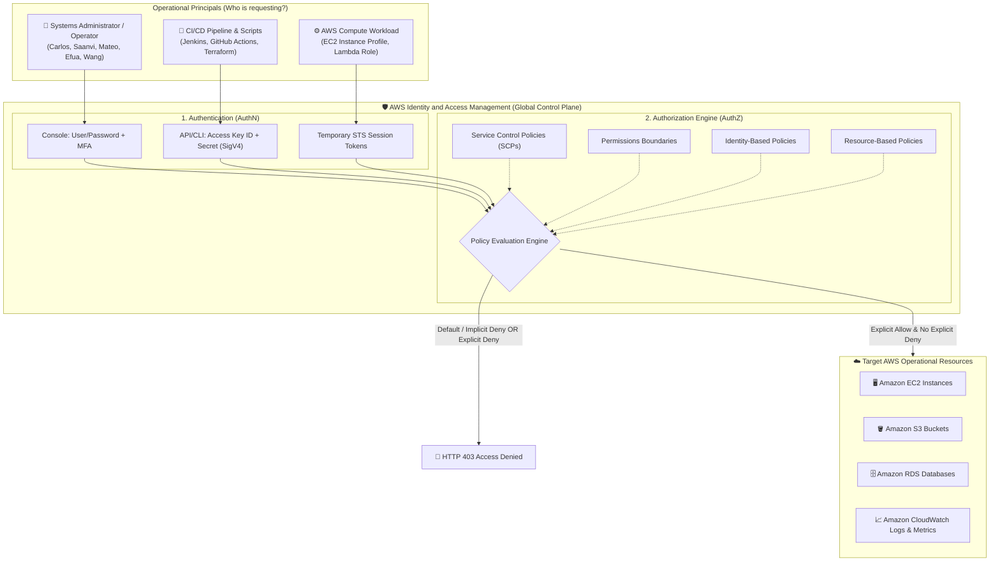
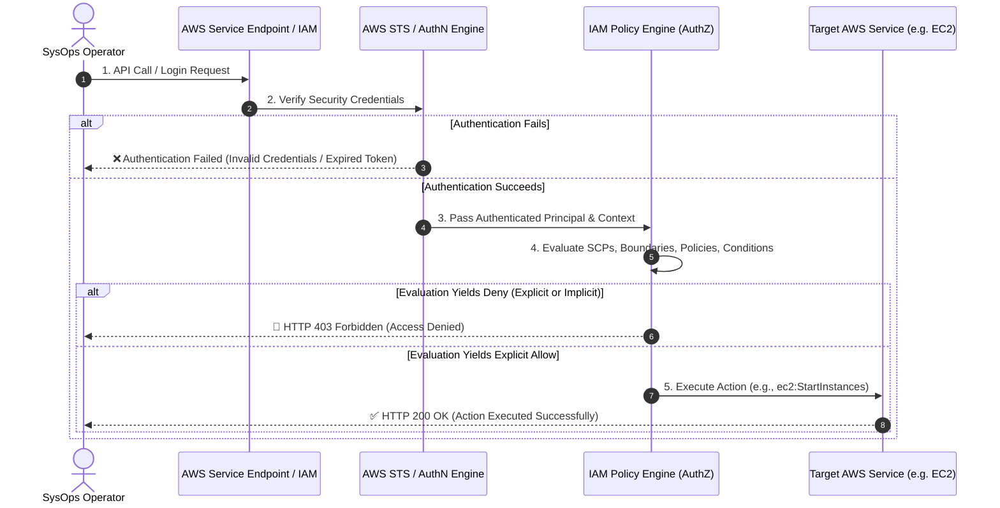
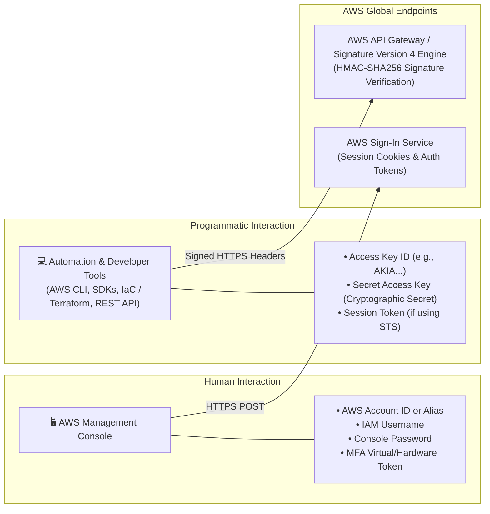
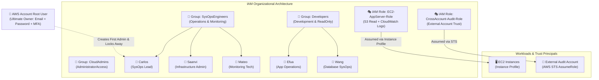
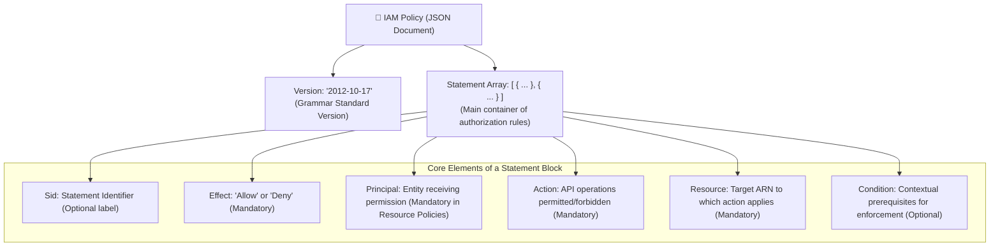
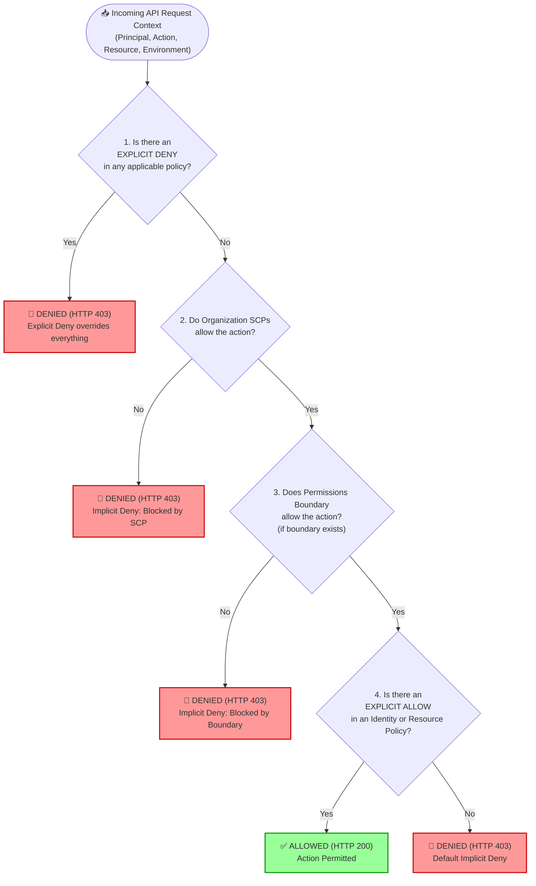
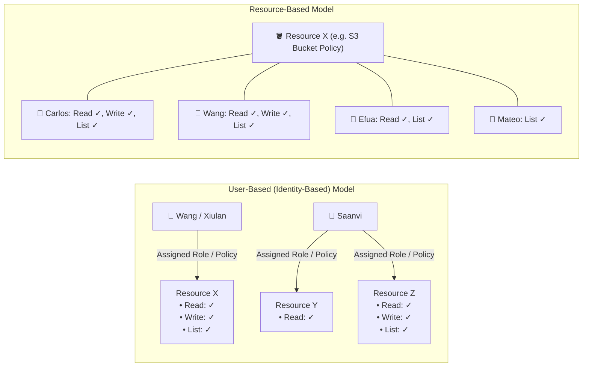
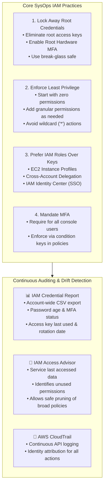

# 🛡️ AWS Identity and Access Management (IAM): Architecture, Security Credentials, & Policy Evaluation Engine

> **Course**: AWS re/Start  
> **Module**: Systems Operations (M08 – Systems Operations on AWS / IAM Review)  
> **Source Document**: `T12-Systems_Operations/T12-0004-RSSYOP_EN-US_SG_M08_AWSIAM.pdf`  
> **Target Audience**: AWS re/Start Learners, Systems Administrators, Cloud Operations Engineers, SysOps Administrators  

---

## 🎯 Module Overview & Systems Operations Context

In enterprise cloud infrastructure, security and operations are inextricably linked. In traditional on-premises data centers, systems administrators rely on physical perimeters, locked server racks, network segmentation firewalls, and active directory domain controllers to enforce security boundaries. In Amazon Web Services (AWS), infrastructure is programmable, multi-tenant, and globally distributed. Identity forms the new operational security perimeter.

**AWS Identity and Access Management (IAM)** serves as the centralized control plane for access management across all AWS services and workloads. For Systems Operations (SysOps) professionals, IAM is the foundational tool used to:
- Establish fine-grained, least-privilege governance across operational environments.
- Authenticate human operators, automated deployment pipelines, and running workloads.
- Authorize administrative actions (such as starting, stopping, patching, or terminating compute infrastructure).
- Monitor, audit, and remediate permission drift and credential hygiene over time.

IAM is a **global service** natively integrated into every AWS API call. IAM requests are processed without regional latency configuration or infrastructure overhead, and the core IAM service is provided at **no additional charge**.



---

## 📌 Learning Objectives

By the end of this module and study guide, systems operations learners will be able to:

- [ ] **Define AWS Identity and Access Management (IAM)** and describe its foundational role in cloud systems operations and security posture.
- [ ] **Differentiate Authentication (AuthN) from Authorization (AuthZ)** within the AWS request handling lifecycle.
- [ ] **Contrast AWS Management Console Access and Programmatic Access**, identifying the underlying credential types and security mechanisms for each.
- [ ] **Classify IAM Entities & Organizational Constructs**, including the AWS Account Root User, IAM Users, IAM User Groups, and IAM Roles.
- [ ] **Explain AWS Security Token Service (STS)** and temporary credentials for cross-account delegation and EC2 instance profiles.
- [ ] **Deconstruct IAM Policy Grammar**, parsing the core JSON building blocks (`Version`, `Statement`, `Sid`, `Effect`, `Principal`, `Action`, `Resource`, `Condition`).
- [ ] **Trace the IAM Policy Evaluation Logic**, diagramming how Explicit Denies, Default (Implicit) Denies, and Explicit Allows determine request outcomes.
- [ ] **Distinguish Identity-Based Policies from Resource-Based Policies**, applying user-centric and resource-centric permission models.
- [ ] **Apply SysOps Security Best Practices**, including least privilege, MFA enforcement, credential rotation, IAM Credential Reports, and IAM Access Advisor.

---

## 🔐 1. Authentication (AuthN) vs. Authorization (AuthZ) Demarcation

Every operational interaction with AWS—whether issuing a command through the AWS Management Console, executing a script via the AWS Command Line Interface (AWS CLI), or running an SDK method—is an HTTPS request evaluated by AWS identity services. This process strictly decouples **identity verification** from **permission resolution**.



### Deep Dive Comparison Matrix

| Operational Dimension | Authentication (AuthN) | Authorization (AuthZ) |
| :--- | :--- | :--- |
| **Core Question Answered** | *"Who are you?"* | *"What are you permitted to do, on which resources, and under what conditions?"* |
| **Primary Mechanism** | Verifying cryptographic signatures, passwords, MFA tokens, or signed digital certificates. | Parsing and evaluating JSON access policies attached to identities or resources. |
| **Timing in Execution Flow** | **Step 1**: Must occur first. Unauthenticated requests are rejected immediately. | **Step 2**: Evaluated only after authentication proves the identity of the principal. |
| **SysOps Credential Artifacts** | • Email + Root Password<br>• IAM Username + Password<br>• Access Key ID + Secret Access Key<br>• MFA One-Time Passcodes (TOTP)<br>• Temporary Session Tokens (AWS STS) | • AWS Managed Policies<br>• Customer Managed Policies<br>• Inline Policies<br>• Service Control Policies (SCPs)<br>• Resource-based Policies (Bucket policies, Trust policies) |
| **Failure Response** | `401 Unauthorized` / Authentication Failure (Invalid login / signature mismatch). | `403 Forbidden` / `AccessDenied` (No matching allow or explicit deny present). |
| **Primary SysOps Risk** | Credential leakage, compromised secrets, phishing, lack of MFA. | Privilege escalation, over-permissive wildcard (`"*"`) policies, misconfigured boundaries. |

> [!NOTE]
> A **Principal** is any person, service, or application that can authenticate and make a request for an action or operation on an AWS resource.

---

## 🔑 2. Access Types: Console vs. Programmatic

AWS accommodates two distinct operational pathways: human-interactive administration through a browser interface and programmatic automation through developer and administrator tools.



### Detailed Breakdown of Access Types

#### 1. AWS Management Console Access (Interactive Web Interface)
- **Primary Use Case**: Manual administration, exploratory configuration, visual monitoring (Amazon CloudWatch dashboards), cost reviews (AWS Cost Explorer), and initial resource provisioning.
- **Credential Requirements**:
  - **Account Identifier**: 12-digit AWS Account ID or friendly Account Alias (e.g., `my-company-sysops`).
  - **IAM Username**: Unique alphanumeric string representing the specific human operator.
  - **Password**: Alphanumeric string governed by an enforced **Account Password Policy** (minimum length, character complexity, expiration period).
  - **Multi-Factor Authentication (MFA)**: A mandatory second layer of defense requiring a time-based one-time password (TOTP) from an authenticator app, FIDO security key, or hardware token.

#### 2. Programmatic Access (APIs, CLI, SDKs)
- **Primary Use Case**: Automated configuration management, continuous integration and continuous deployment (CI/CD) pipelines, infrastructure as code (AWS CloudFormation, Terraform), operational Bash/Python scripts, and direct REST API integration.
- **Credential Requirements**:
  - **Access Key ID**: A 20-character identifier starting with `AKIA...` (for IAM users) or `ASIA...` (for temporary credentials generated by STS).
  - **Secret Access Key**: A 40-character cryptographic secret string.
- **Underlying Security Mechanism (Signature Version 4 - SigV4)**:
  - The Secret Access Key is **never transmitted across the network**.
  - Instead, the client tool (CLI/SDK) computes an HMAC-SHA256 cryptographic signature of the request payload, timestamp, and headers using the Secret Access Key.
  - AWS reconstructs the signature on the receiving end. If the signatures match, authenticity and payload integrity are mathematically proven.

> [!CAUTION]
> **Never commit Access Keys to version control systems!** Hardcoding long-lived access keys in code repositories (like GitHub) is one of the leading causes of security breaches. For automated scripts running on EC2 instances or containers, always use **IAM Roles** instead of long-lived access keys.

---

## 👥 3. IAM Entities and Organizational Constructs

SysOps administrators must organize access hierarchically to maintain accountability, enforce least privilege, and prevent administrative chaos.



### The Four Core Identity Types

```
+---------------------------------------------------------------------------------+
|                               AWS ACCOUNT                                       |
|                                                                                 |
|  +---------------------+                                                        |
|  |   Root User         |  -> Emergency / Break-glass only                       |
|  +---------------------+                                                        |
|                                                                                 |
|  +---------------------------------------------------------------------------+  |
|  |   IAM User Groups                                                         |  |
|  |   +--------------------------+     +--------------------------+           |  |
|  |   | Group: SysOpsEngineers   |     | Group: Developers        |           |  |
|  |   | [Attached Policies]      |     | [Attached Policies]      |           |  |
|  |   |  - AmazonEC2FullAccess   |     |  - AWSCodeCommitPowerUser|           |  |
|  |   |  - CloudWatchFullAccess  |     |  - AmazonS3ReadOnlyAccess|           |  |
|  |   |   +------------------+   |     |   +------------------+   |           |  |
|  |   |   | User: Carlos     |   |     |   | User: Efua       |   |           |  |
|  |   |   | User: Saanvi     |   |     |   | User: Wang       |   |           |  |
|  |   |   | User: Mateo      |   |     |   +------------------+   |           |  |
|  |   |   +------------------+   |                                |           |  |
|  |   +--------------------------+                                |           |  |
|  +---------------------------------------------------------------------------+  |
|                                                                                 |
|  +---------------------------------------------------------------------------+  |
|  |   IAM Roles (No permanent credentials, assumed by services/users)         |  |
|  |   - EC2-SSM-Core-Role                                                     |  |
|  |   - Lambda-DynamoDB-ExecutionRole                                         |  |
|  +---------------------------------------------------------------------------+  |
+---------------------------------------------------------------------------------+
```

### 1. AWS Account Root User
- **Definition**: The identity created when an AWS account is first established, authenticated via the account owner's email address and password.
- **Permissions**: Possesses absolute, irrevocable superuser permissions across all resources within the account. Root permissions **cannot be restricted by IAM policies** (only by AWS Organizations SCPs attached to the parent OU).
- **SysOps Operational Rule**:
  - **Never use root credentials for daily administration or routine operations.**
  - **Immediate Hardening**: Attach hardware or virtual MFA immediately upon account creation.
  - **Lock Credentials**: Do not generate access keys for root. If access keys exist, delete them immediately.
  - **Break-Glass Procedure**: Store root email credentials and MFA backup codes in a physically secure enterprise safe or encrypted vault. Root is reserved exclusively for break-glass emergency recovery and tasks that explicitly require root (e.g., closing an account, modifying support plans, changing root email/billing settings).

### 2. IAM Users
- **Definition**: An entity created within an AWS account to represent an individual person or service requiring long-term interaction with AWS resources.
- **Team Scenario (Carlos, Saanvi, Mateo, Efua, Wang)**:
  - In a standard operations team, each team member is provisioned their own unique IAM user:
    - **Carlos**: Senior SysOps Lead requiring administrative and compute management access.
    - **Saanvi**: Cloud Systems Administrator managing network and storage operations.
    - **Mateo**: Junior Monitoring Tech requiring read-only visibility into CloudWatch metrics.
    - **Efua**: Application Operations Specialist requiring deployment permissions.
    - **Wang**: Database Systems Administrator managing RDS and DynamoDB workloads.
  - **Accountability**: Dedicated usernames ensure auditability in **AWS CloudTrail**. If an unauthorized instance termination occurs, CloudTrail logs capture the exact IAM identity rather than an anonymous shared credential.

### 3. IAM User Groups
- **Definition**: A collection of IAM users used to attach permissions to multiple users simultaneously.
- **Operational Rules & Constraints**:
  - **No Nesting**: IAM groups **cannot contain other groups**. They can contain only users.
  - **Not a Principal**: A group cannot be referenced as a `Principal` in an IAM resource-based policy.
  - **Permission Inheritance**: Users inherit all policies attached to every group to which they belong.
  - **Role-Based Membership**: Users can belong to multiple groups (e.g., Saanvi can be a member of both `SysOpsEngineers` and `DatabaseAdmins`).

### 4. IAM Roles and AWS Security Token Service (STS)
- **Definition**: An IAM identity that can be assumed by anyone who needs it. An IAM role does not have permanent long-term credentials (no static passwords or access keys).
- **Mechanism (AWS STS)**: When an entity assumes a role, the **AWS Security Token Service (STS)** dynamically issues **temporary, short-lived security credentials** (an Access Key ID, a Secret Access Key, and a Session Token) valid from 15 minutes up to 12 hours.
- **Three Ways to Assume a Role**:
  1. **Interactively in the AWS Management Console**: Using the **Switch Role** feature.
  2. **Programmatically with the AWS CLI**: Using `aws sts assume-role`.
  3. **Through SDKs / AWS Services**: Automatically assumed via an **EC2 Instance Profile** or Lambda execution environment.
- **Primary Use Cases**:
  - **Service-Linked Roles & Workload Access**: Granting EC2 instances access to S3 or CloudWatch without baking credentials into virtual machine images.
  - **Cross-Account Access**: Allowing administrators in an Identity Account (Account A) to manage resources in a Production Account (Account B) without creating duplicate IAM users.
  - **Identity Federation & Single Sign-On (SSO)**: Integrating enterprise corporate directories (Active Directory, Okta, Ping Identity) using SAML 2.0 or OIDC.

### Comparison of IAM Identities

| Entity Type | Permanent Credentials? | Can Have Policies Attached? | Primary Purpose | Best Practice Use Case |
| :--- | :--- | :--- | :--- | :--- |
| **Root User** | Yes (Email + Master Password) | No (Has full permissions natively) | Account creation, billing ownership, disaster recovery. | Emergency break-glass; never used for daily tasks. |
| **IAM User** | Yes (Username/Password or static Access Keys) | Yes (Identity-based inline or managed) | Individual human operators needing persistent access. | Named human operators when IAM Identity Center (SSO) is unavailable. |
| **IAM User Group** | No (Cannot log in; holds no credentials) | Yes (Identity-based managed policies) | Organizing users and applying bulk permissions. | Mapping team roles (SysOps, Dev, Audit) to standardized policy sets. |
| **IAM Role** | **No** (Ephemeral tokens generated via STS) | Yes (Identity-based policies + Trust policy) | Delegating temporary access to services, federated users, or cross-account entities. | EC2 workloads, Lambda functions, cross-account delegation, SSO. |

---

## 📜 4. IAM Policy Grammar & Structure

An IAM policy is a formal **JSON (JavaScript Object Notation)** document that explicitly defines authorization rules. Policies do not grant permissions until they are attached to an identity or a resource.



### JSON Element Reference Table

| JSON Element | Required? | Valid Values & Syntax | SysOps Technical Explanation |
| :--- | :--- | :--- | :--- |
| `Version` | Highly Recommended | `"2012-10-17"` | Specifies the policy language grammar version. Always use `"2012-10-17"`. If omitted, AWS defaults to `"2008-10-17"`, which does not support advanced condition evaluation variables. |
| `Statement` | **Yes** | Array of statement objects: `[ { ... } ]` | The core container holding one or more individual permission statements. |
| `Sid` | Optional | Alphanumeric string (e.g., `"AllowEC2OpsOnly"`) | Statement ID. An administrative description used to document the intent of the statement for auditing. |
| `Effect` | **Yes** | `"Allow"` or `"Deny"` | Specifies whether the statement grants access (`Allow`) or explicitly blocks access (`Deny`). |
| `Principal` | Conditional | AWS Account ID, IAM User ARN, Service Principal, or `"*"` | Specifies the entity allowed or denied access. **Required in resource-based policies** (e.g., S3 bucket policies). Omitted in identity-based policies because the identity it is attached to is the implicit principal. |
| `Action` | **Yes** | String or array of strings (`"service:action"`) | Specific API operations to permit or deny. Wildcards (`*`) are supported (e.g., `"ec2:Describe*"`, `"s3:GetObject"`). |
| `Resource` | **Yes** | Amazon Resource Name (ARN) or `"*"` | Specifies the exact AWS resource target. (e.g., `"arn:aws:s3:::production-backup-bucket/*"`). |
| `Condition` | Optional | Condition operators, keys, and values | Dictates the exact environmental circumstances under which the policy statement applies (e.g., source IP, MFA presence, time of day, SSL/TLS encryption). |

### Annotated JSON Policy Example (From Curriculum Slide 9)

The following policy demonstrates conditional SysOps administrative access: it allows EC2 actions across all resources, but strictly requires Multi-Factor Authentication and enforces a corporate source IP address.

```json
{
  "Version": "2012-10-17",
  "Statement": [
    {
      "Sid": "MFA-Access",
      "Effect": "Allow",
      "Action": "ec2:*",
      "Resource": "*",
      "Condition": {
        "BoolIfExists": {
          "aws:MultiFactorAuthPresent": "true"
        },
        "IpAddress": {
          "aws:SourceIp": "1.2.3.4/32"
        }
      }
    }
  ]
}
```

#### Statement Breakdown:
1. `"Sid": "MFA-Access"`: Clearly tags the statement for auditability and compliance reporting.
2. `"Effect": "Allow"`: Grants permission for the specified operations.
3. `"Action": "ec2:*"`: Encompasses all Amazon EC2 API actions (e.g., `RunInstances`, `StopInstances`, `DescribeInstances`).
4. `"Resource": "*"`: Applies to all EC2 resources within the account.
5. `"Condition"`:
   - `"BoolIfExists": { "aws:MultiFactorAuthPresent": "true" }`: Requires that the session was authenticated using Multi-Factor Authentication.
   - `"IpAddress": { "aws:SourceIp": "1.2.3.4/32" }`: Enforces network perimeter security, restricting execution solely to traffic originating from the static corporate gateway IP `1.2.3.4`. Requests originating from any other IP address fail authorization.

---

## ⚖️ 5. IAM Policy Evaluation Logic Engine

Understanding how AWS evaluates multiple overlapping policies is vital for diagnosing permission errors (`AccessDenied`) and preventing unintended security exposures.



### The Fundamental Axioms of IAM Evaluation

1. **Default Deny (Implicit Deny)**: By default, all requests are denied. When an IAM user or role is first created, it possesses zero permissions until an explicit `Allow` policy is attached.
2. **Explicit Allow Required**: To execute an action, at least one applicable policy must explicitly grant permission (`"Effect": "Allow"`).
3. **Explicit Deny Beats Everything**: An explicit `"Effect": "Deny"` in **any** policy overrides all allows, regardless of where or when it is evaluated.
4. **Evaluation Order Independence**: The sequence in which policies are checked does not affect the ultimate outcome. If an explicit deny exists in a group policy, an inline policy granting full access cannot bypass it.

> [!IMPORTANT]
> **Implicit Deny vs. Explicit Deny**:
> - An **Implicit Deny** occurs simply because no policy has granted permission. It can be overridden by adding an `"Effect": "Allow"` statement.
> - An **Explicit Deny** is a specific statement that says `"Effect": "Deny"`. It **cannot** be overridden by any `"Effect": "Allow"`.

---

## 📊 6. Policy Types & Permission Models

AWS categorizes policies based on how they are attached, managed, and structured.

### Policy Type Spectrum (From Curriculum Slide 8)

| Policy Type | Frequency / Usage | Attached To | Format | Supports Boundaries? | Supports Managed? | Supports Inline? |
| :--- | :--- | :--- | :--- | :---: | :---: | :---: |
| **Identity-based Policies** | Most Common | IAM Users, User Groups, IAM Roles | JSON | ✅ Yes | ✅ Yes | ✅ Yes |
| **Resource-based Policies** | Highly Common | Resources (S3 Buckets, KMS Keys, SQS Queues) | JSON | ❌ No | ❌ No | ✅ Yes |
| **Organizations SCPs** | Enterprise Governance | AWS Organizations Root, OUs, Accounts | JSON | ✅ Yes | ❌ No | ❌ No |
| **Access Control Lists (ACLs)** | Legacy / Specialized | S3 Buckets / Objects | **XML / Non-JSON** | ❌ No | ❌ No | ❌ No |

```
+-----------------------------------------------------------------------------------+
|                        AWS MANAGED vs CUSTOMER MANAGED vs INLINE                  |
|                                                                                   |
|  +-------------------------+  +--------------------------+  +------------------+  |
|  |   AWS Managed Policy    |  | Customer Managed Policy  |  |  Inline Policy   |  |
|  +-------------------------+  +--------------------------+  +------------------+  |
|  | Created & maintained by |  | Created & maintained by  |  | Embedded directly|  |
|  | AWS. Read-only to you.  |  | your organization.       |  | in a single IAM  |  |
|  | Updated automatically   |  | Reusable across multiple |  | entity (user/role)| |
|  | by AWS (e.g., new APIs).|  | entities. Versioned.     |  | Strict 1:1 bond. |  |
|  | Ex: AmazonEC2FullAccess |  | Ex: CustomSysOpsEC2Ops   |  | Deleted if entity|  |
|  |     AdministratorAccess |  |                          |  | is deleted.      |  |
|  +-------------------------+  +--------------------------+  +------------------+  |
+-----------------------------------------------------------------------------------+
```

### Identity-Based vs. Resource-Based Permissions (Curriculum Scenario Analysis)

A central theme in Systems Operations is determining whether permissions should be granted by attaching policies to the **operator** or to the **resource**.



#### Detailed Scenario Comparison (Slide 11):

1. **User-Based Permissions (*"What does a particular entity have access to?"*)**:
   - **Wang (Xiulan)** is assigned a role/policy that specifies: Access to **Resource X** with `Read`, `Write`, and `List` permissions.
   - **Saanvi** is assigned a role/policy granting: Access to **Resource Y** with `Read` permission; and Access to **Resource Z** with `Read`, `Write`, and `List` permissions.
   - *Operational Focus*: Centered on the user's job description. When Saanvi changes teams, updating her group or role instantly removes access across all resources.

2. **Resource-Based Permissions (*"Who has access to a particular resource?"*)**:
   - Attached directly to the resource (such as an Amazon S3 Bucket Policy or KMS Key Policy).
   - The resource policy for **Resource X** maintains an internal access control list defining permissions for all operators:
     - **Carlos**: Granted `Read`, `Write`, and `List`.
     - **Wang**: Granted `Read`, `Write`, and `List`.
     - **Efua**: Granted `Read` and `List` (no write capability).
     - **Mateo**: Granted `List` only (read-only enumeration).
   - *Operational Focus*: Centered on data protection. Guarantees that even if an outside user has broad identity permissions, they cannot touch Resource X unless explicitly authorized by the resource's policy.

### Service-Level vs. Resource-Level Permissions

Not all AWS actions can be scoped to specific resource ARNs:
- **Resource-Level Actions**: Operations that can specify individual instance IDs or bucket names. For Amazon EC2, actions like `ec2:StartInstances`, `ec2:StopInstances`, `ec2:RebootInstances`, and `ec2:TerminateInstances` can target specific instance ARNs (`arn:aws:ec2:region:account:instance/i-1234567890abcdef0`).
- **Service-Level Actions**: Operations that cannot target an existing resource because the resource does not exist prior to API execution. For instance, `ec2:RunInstances` cannot specify a pre-existing Instance ID in the `Resource` block because the Instance ID is only generated upon creation. Therefore, policies defining `ec2:RunInstances` must specify `"Resource": "*"`.

---

## 🛠️ 7. SysOps Security Best Practices & Operational Auditing

For systems operations engineers, maintaining security hygiene is an ongoing operational commitment. AWS establishes core operational best practices for IAM:



### 1. Root User Hardening & Daily Operational Delegation
- Never use the root user for routine systems administration tasks.
- Create designated IAM users or IAM Identity Center administrative roles for daily operations.
- Lock root credentials away. If the root password or MFA is ever used, trigger an automated **Amazon EventBridge** alert and **Amazon SNS** notification to the security operations center (SOC).

### 2. Enforcing the Principle of Least Privilege
- Grant only the permissions required to perform a specific operational task.
- Begin with read-only permissions (e.g., `AmazonEC2ReadOnlyAccess`, `CloudWatchReadOnlyAccess`) for tier-1 monitoring teams like Mateo.
- Grant write/modify permissions (`ec2:StartInstances`, `ec2:StopInstances`) only to qualified engineers (Carlos, Saanvi) after peer review or change ticket approval.

### 3. Eliminating Long-Lived Credentials
- Avoid creating static Access Key IDs and Secret Access Keys wherever possible.
- For workloads running on compute resources (EC2, ECS, EKS, Lambda), attach **IAM Roles via Instance Profiles**. Applications using the AWS SDK automatically retrieve rotating temporary credentials from the **Instance Metadata Service (IMDSv2)**.
- For human operators, leverage **AWS IAM Identity Center** (formerly AWS SSO) integrated with corporate identity providers (Active Directory, Azure AD, Okta), eliminating static IAM user passwords entirely.

### 4. Credential Rotation Procedures
- Where programmatic access keys must exist, enforce a mandatory rotation cycle (e.g., every 90 days).
- **Zero-Downtime Key Rotation Lifecycle**:
  1. Generate a second access key (`Key 2`) for the IAM user.
  2. Update all client scripts, configuration files (`~/.aws/credentials`), and deployment variables with `Key 2`.
  3. Validate that operations succeed using `Key 2`.
  4. Deactivate `Key 1` in the IAM console/CLI (`aws iam update-access-key --status Inactive`).
  5. Monitor CloudTrail logs to verify that no automated processes attempt to use `Key 1`.
  6. Permanently delete `Key 1` (`aws iam delete-access-key`).

### 5. Auditing via IAM Credential Report & Access Advisor

#### Generating the IAM Credential Report
The IAM Credential Report provides an account-wide audit of all identities, passwords, access keys, and MFA configurations.

```bash
# 1. Request generation of the credential report
aws iam generate-credential-report

# 2. Retrieve the base64-encoded CSV report and decode it
aws iam get-credential-report --output text --query "Content" | base64 -d > iam_credential_report.csv

# 3. View key security metrics (user, password_enabled, mfa_active, access_key_1_active)
cat iam_credential_report.csv | cut -d, -f1,4,8,9,11
```

SysOps engineers analyze this report to identify:
- Users without active MFA.
- Access keys that have not been rotated in over 90 days.
- Inactive credentials that have not been used for 30+ days (candidates for deactivation and deletion).

#### Pruning Over-Permissive Policies with IAM Access Advisor
The **Access Advisor** tab in the IAM console (and corresponding IAM APIs: `GenerateServiceLastAccessedDetails`, `GetServiceLastAccessedDetails`) provides operational intelligence on when each granted service was last accessed.
- If a SysOps engineer has `AmazonEC2FullAccess` and `AmazonRDSFullAccess`, but Access Advisor reveals that RDS has not been accessed in 180 days, the administrator can safely prune RDS permissions without disrupting operations.

---

## 📝 8. Knowledge Check & Review Questions

Test your understanding of the AWS Identity and Access Management concepts covered in this module.

### Question 1
**True or False**: SysOps professionals can use IAM to configure authorization for users.

> [!NOTE]- Click to reveal Answer & Explanation
> **Answer**: **True**  
> **Explanation**: IAM is explicitly designed to configure both authentication (verifying identity) and authorization (defining permissions). Through IAM JSON policies attached to users, groups, and roles, SysOps administrators configure exactly which resources users can access and what actions they can perform.

---

### Question 2
**True or False**: As a best practice, AWS recommends using the root account for everyday administrative tasks.

> [!NOTE]- Click to reveal Answer & Explanation
> **Answer**: **False**  
> **Explanation**: AWS strongly recommends locking away root user credentials immediately after account creation. Daily administration should be performed by dedicated IAM users or federated roles configured with the principle of least privilege to minimize blast radius and maintain audit accountability.

---

### Question 3
Which of the following options **does NOT** represent an IAM identity?
- A. IAM User
- B. IAM Policy
- C. IAM Role
- D. IAM User Group

> [!NOTE]- Click to reveal Answer & Explanation
> **Answer**: **B. IAM Policy**  
> **Explanation**: An IAM identity is an operational entity used for identification and representation: **IAM Users**, **IAM User Groups**, and **IAM Roles** are identities. An **IAM Policy** is a JSON document that defines permissions; it is not an identity itself, but rather an artifact *attached to* identities or resources.

---

### Question 4
An EC2 instance needs to read and write operational backup files to an Amazon S3 bucket. Which architectural approach represents the AWS security best practice?
- A. Create an IAM user with S3 permissions, generate access keys, and save them in `~/.aws/credentials` on the EC2 instance.
- B. Hardcode the AWS Account Root User access keys in the application's configuration file.
- C. Create an IAM role with an attached policy permitting S3 access, and attach the role to the EC2 instance via an Instance Profile.
- D. Configure an S3 Access Control List (ACL) granting public read and write access to the world.

> [!NOTE]- Click to reveal Answer & Explanation
> **Answer**: **C. Create an IAM role with an attached policy permitting S3 access, and attach the role to the EC2 instance via an Instance Profile.**  
> **Explanation**: Applications running on Amazon EC2 should never use long-lived static credentials. By attaching an IAM role via an Instance Profile, the AWS Security Token Service (STS) automatically supplies rotating temporary credentials via the Instance Metadata Service (IMDSv2), eliminating credential leakage risks.

---

### Question 5
An IAM user belongs to the `SysOpsEngineers` group, which has an attached policy allowing `ec2:*` actions. The user also has an inline policy attached that contains an explicit `"Effect": "Deny"` for `ec2:TerminateInstances`. What happens when the user attempts to terminate an EC2 instance?
- A. The instance is terminated because the group policy grants full access.
- B. The request is denied because an explicit deny overrides any allow.
- C. AWS prompts the user for MFA before terminating the instance.
- D. The termination succeeds only if the user specifies the AWS CLI `--force` flag.

> [!NOTE]- Click to reveal Answer & Explanation
> **Answer**: **B. The request is denied because an explicit deny overrides any allow.**  
> **Explanation**: In the IAM policy evaluation engine, an **Explicit Deny always overrides any Explicit Allow**, regardless of whether the allow is defined in a managed policy, customer policy, or group policy.

---

## 📌 9. Key Module Takeaways & Summary

- **Centralized Control Plane**: IAM centrally manages authentication and authorization across the entire AWS global infrastructure at no additional charge.
- **Demarcation of Concerns**:
  - **Authentication (AuthN)**: Confirms *who* is requesting access (User/Password, MFA, Access Keys, STS temporary tokens).
  - **Authorization (AuthZ)**: Governs *what* actions are permitted on *which* resources (JSON policies evaluated dynamically).
- **Core Identities**:
  - **Root User**: Ultimate owner; lock credentials away; enable hardware MFA; reserve for emergency break-glass.
  - **IAM Users**: Distinct human operators (Carlos, Saanvi, Mateo, Efua, Wang) providing accountability in CloudTrail.
  - **IAM User Groups**: Administrative containers for bulk policy inheritance; cannot be nested and cannot act as principals.
  - **IAM Roles**: Identities with no static credentials; rely on AWS STS temporary tokens for compute workloads, cross-account access, and identity federation.
- **Policy Anatomy & Logic**:
  - Defined in JSON using the `"Version": "2012-10-17"` standard.
  - Core statement elements include `Sid`, `Effect`, `Principal`, `Action`, `Resource`, and `Condition`.
  - **Explicit Deny** beats all allows. If no explicit allow exists, access defaults to an **Implicit Deny**.
- **Permission Models**:
  - **Identity-based policies**: Attached to users, groups, or roles; define what that entity can do across services.
  - **Resource-based policies**: Attached directly to resources (e.g., S3 bucket policies); specify who can access that resource.
- **SysOps Operational Hygiene**:
  - Enforce least privilege and mandate MFA.
  - Prefer temporary credentials (IAM roles and IAM Identity Center) over static long-lived access keys.
  - Regularly audit credentials using the **IAM Credential Report** and trim stale permissions with the **IAM Access Advisor**.
