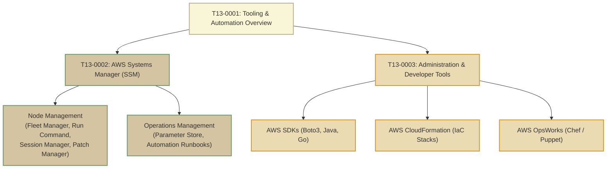

# T13: Tooling and Automation

> **Course**: AWS re/Start Curriculum  
> **Module**: T13 – Tooling and Automation (`M09`)  
> **Total Guides**: 3 Study Guides  
> **Status**: Completed (100%)

---

## Module Overview

The **Tooling and Automation** module explores how cloud systems operations engineers scale their impact by eliminating manual toil, preventing configuration drift, and establishing repeatable infrastructure. The curriculum covers the end-to-end operational spectrum from remote fleet administration via AWS Systems Manager (SSM) to programmatic automation using AWS SDKs (Boto3) and declarative Infrastructure as Code (IaC) with AWS CloudFormation and AWS OpsWorks.

---

## Study Guide Index

| # | Study Guide | Primary Topics Covered |
|---|-------------|------------------------|
| **0001** | [T13-0001-RSTOOL_EN-US_SG_M09_OVERVIEW.md](file:///work/tmp/aws-cf/T13-Tooling_and_Automation/T13-0001-RSTOOL_EN-US_SG_M09_OVERVIEW.md) | Automation business drivers, Cloud Automation Maturity Model, preventing configuration drift, operational playbooks, troubleshooting template |
| **0002** | [T13-0002-RSTOOL_EN-US_SG_M09_AWSSYSTEMSMANAGER.md](file:///work/tmp/aws-cf/T13-Tooling_and_Automation/T13-0002-RSTOOL_EN-US_SG_M09_AWSSYSTEMSMANAGER.md) | AWS Systems Manager hub, SSM Agent architecture, Fleet Manager, Run Command, Session Manager (zero open ports), Patch Manager, Parameter Store |
| **0003** | [T13-0003-RSTOOL_EN-US_SG_M09_ADMINDEVTOOLS.md](file:///work/tmp/aws-cf/T13-Tooling_and_Automation/T13-0003-RSTOOL_EN-US_SG_M09_ADMINDEVTOOLS.md) | AWS SDKs (Boto3 Client vs Resource, retries, pagination), AWS CloudFormation (templates, stacks, drift detection), AWS OpsWorks (Chef/Puppet) |

---

## Tooling Decision Matrix

| Requirement / Scenario | Recommended Service / Tool | Primary Advantage |
|------------------------|---------------------------|-------------------|
| **Remote interactive shell on EC2 without open port 22 or bastion hosts** | **AWS Systems Manager Session Manager** | Fully auditable via CloudTrail & S3, KMS encrypted, IAM controlled |
| **Fleet-wide command execution & software patching** | **AWS Systems Manager Run Command & Patch Manager** | Parallel execution with rate controls, no SSH keys needed |
| **Centralized configuration parameters & encrypted secrets** | **AWS Systems Manager Parameter Store** | Hierarchical key-value store integrated with AWS KMS & IAM |
| **Repeatable, version-controlled cloud infrastructure provisioning** | **AWS CloudFormation** | Declarative YAML/JSON templates, automated rollbacks, drift detection |
| **Programmatic operations, custom monitoring scripts, & event triggers** | **AWS SDKs (e.g. Python Boto3)** | Deep API control, paginators, automated exponential backoff with jitter |
| **Application server configuration using Chef cookbooks or Puppet manifests** | **AWS OpsWorks** | Managed Chef Automate and Puppet Enterprise servers |
