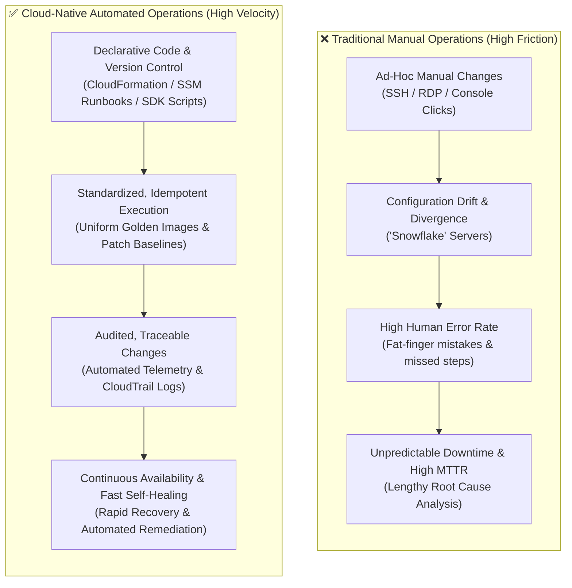
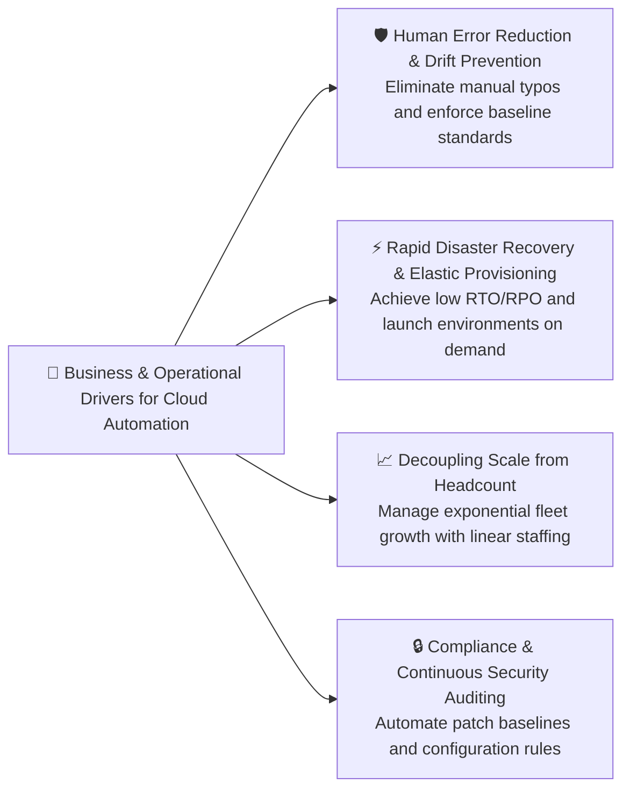
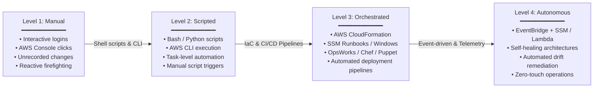
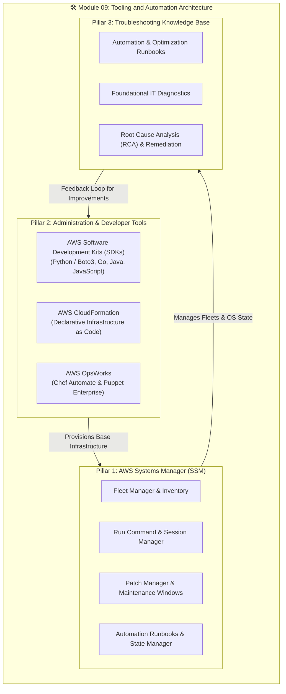
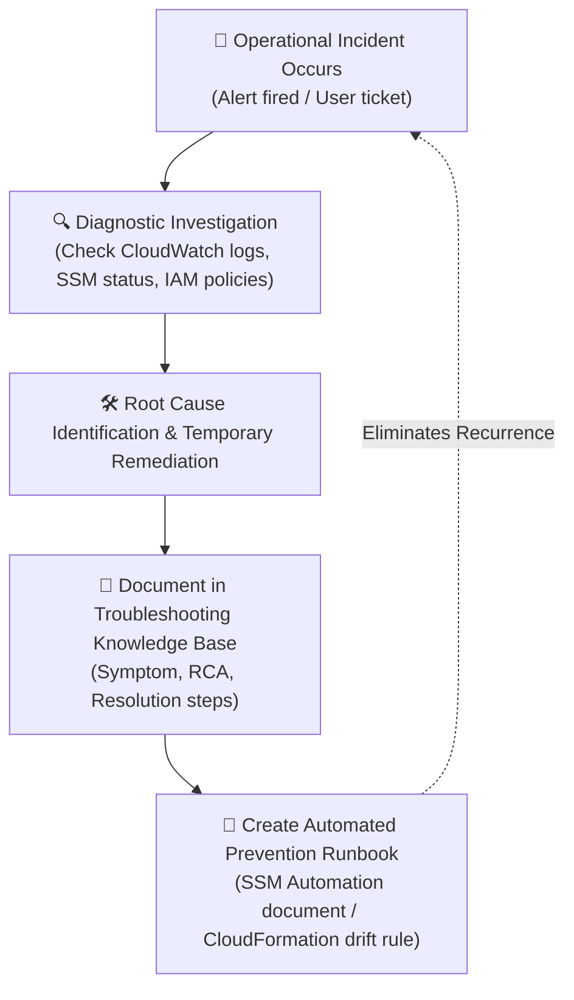

# 🛠️ Module 09: Tooling and Automation Overview – Study Guide

> **Course**: AWS re/Start  
> **Module**: M09 – Tooling and Automation  
> **Source Document**: `T13-0001-RSTOOL_EN-US_SG_M09_OVERVIEW.pdf`  
> **Target Audience**: AWS re/Start Learners / Cloud Practitioners / Systems Operations (SysOps) Administrators / DevOps Engineers  

---

## 🎯 Module Overview & Unit Context

In modern cloud computing and systems operations, manual execution does not scale. As organizations migrate workloads to Amazon Web Services (AWS), infrastructure estates expand from tens of servers to hundreds, thousands, or even tens of thousands of dynamic, ephemeral computing instances, managed databases, and serverless components. Operating at this scale requires a fundamental paradigm shift away from artisanal, manual server administration ("pets") toward declarative, repeatable, and programmatic systems management ("cattle").

**Module 09: Tooling and Automation** bridges the foundational operational responsibilities introduced in systems operations into automated, software-defined execution. Automation is not merely a convenience—it is a critical operational safeguard that ensures consistency, reduces human error, accelerates incident recovery, and enables businesses to scale their infrastructure without a linear increase in administrative headcount.

This study guide establishes the overarching architecture and operational roadmap for Module 09. It explores the business and technical drivers of automation, charts the progression of operational maturity, introduces the AWS tooling ecosystem (including AWS Systems Manager, AWS SDKs, AWS CloudFormation, and AWS OpsWorks), and provides structured guidelines for maintaining an operational **Troubleshooting Knowledge Base**.

---

### 📌 Learning Objectives

- [ ] **Analyze the Strategic Role of Tooling and Automation**: Understand how programmatic automation transforms cloud operations from reactive firefighting into predictable, highly resilient infrastructure management.
- [ ] **Evaluate Business & Operational Drivers for Automation**: Examine how automation eliminates human error, prevents configuration drift, expedites disaster recovery, and decouples operational overhead from workload growth.
- [ ] **Chart the Cloud Automation Maturity Model**: Master the four evolutionary stages of systems operations—*Manual (Ad-hoc)*, *Scripted (Task-based)*, *Orchestrated (Workflow-driven)*, and *Autonomous / Self-Healing (Event-driven)*.
- [ ] **Navigate the Core Tooling Ecosystem of AWS Systems Manager (SSM)**: Understand SSM as a centralized operational hub providing node management, inventory collection, OS patching, remote command execution, and runbook automation.
- [ ] **Differentiate Administration & Developer Toolsets**: Compare the roles, abstractions, and use cases of Software Development Kits (SDKs such as Python/Boto3), Infrastructure as Code (AWS CloudFormation), and Managed Configuration Management (AWS OpsWorks with Chef and Puppet).
- [ ] **Integrate the Troubleshooting Knowledge Base**: Apply standardized runbooks and diagnostic workflows to document, analyze, and resolve operational issues across the **Automation and Optimization** and **Foundational IT** categories.

---

## 🚀 1. The Critical Role of Tooling & Automation in Modern Systems Operations

### The Operational Challenge: Scale, Complexity, and Velocity

Traditional IT operations relied heavily on graphical user interfaces (GUIs), interactive command-line sessions over Secure Shell (SSH) or Remote Desktop Protocol (RDP), and institutional tribal knowledge. While manageable for small, static data centers, this manual approach collapses under the demands of modern cloud architectures:

1. **Volume and Ephemerality**: Cloud resources are constantly created, resized, and terminated by Auto Scaling groups and container orchestrators. Manual configuration of individual instances is impossible when servers exist for only hours or minutes.
2. **Configuration Inconsistency ("Snowflake Servers")**: When multiple administrators make manual changes directly on production servers, subtle configuration differences accumulate over time. These divergent systems—known as *snowflake servers*—are notoriously difficult to troubleshoot and reproduce.
3. **Operational Bottlenecks**: Every manual step represents a human delay. Waiting for an administrator to provision storage, install security patches, or update environment variables slows down development cycles and delays product delivery.



### The Three Core Pillars of Cloud Automation

Automation in AWS systems operations rests on three fundamental pillars:

1. **Consistency and Idempotence**:
   - An automated task is *idempotent* if running it multiple times produces the exact same end state without side effects.
   - Automation guarantees that whether a configuration is applied to one server or ten thousand servers, every machine receives identical settings, file permissions, and software packages.
2. **Velocity and Agility**:
   - Automated provisioning and configuration reduce deployment times from days or weeks to minutes.
   - Teams can spin up identical testing, staging, and production environments on demand, test changes safely, and decommission resources when finished.
3. **Traceability and Auditability**:
   - Automated workflows are defined in code or templates that can be tracked in version control systems (such as Git).
   - Every execution is logged through AWS CloudTrail and Amazon CloudWatch, establishing a clear audit trail of who authorized a change, what parameters were passed, and when it ran.

> [!NOTE]
> **Pets vs. Cattle Architecture**: Traditional sysadmins treated servers like "pets"—giving them unique hostnames, carefully nursing them back to health when sick, and manually tweaking configurations. Cloud automation treats servers like "cattle"—homogeneous, disposable, and numbered rather than named. If a node malfunctions, it is automatically terminated and replaced by a fresh, pre-configured instance.

---

## 💼 2. Why Automate? The Business & Operational Drivers

Organizations do not automate merely because the technology exists; they automate because manual operations impose severe business risks, operational costs, and scalability ceilings.



### 1. Human Error Reduction and Configuration Drift Prevention

Human beings are inherently prone to fatigue, distraction, and inconsistency, especially during stressful production outages or repetitive maintenance cycles. A single mistyped command (`rm -rf /` or an incorrectly applied firewall rule) can cause catastrophic downtime.

#### The Menace of Configuration Drift
**Configuration drift** occurs when the actual runtime configuration of a server or cloud environment gradually diverges from its documented or intended baseline. 

- **How Drift Occurs**:
  - An engineer logs into a server via SSH to apply a temporary hotfix and forgets to update the deployment script.
  - A developer manually modifies a security group in the AWS Management Console during debugging and never documents the open port.
  - Periodic software updates are installed on some nodes while failing silently on others.
- **The Operational Consequence**:
  - Disaster recovery tests fail because the standby environment lacks the unrecorded hotfixes.
  - Auto Scaling groups launch new instances that malfunction because they lack the manual tweaks present on the running instances.
- **How Automation Solves It**:
  - Declarative configuration tools (such as **AWS CloudFormation** and **AWS Systems Manager State Manager**) continuously inspect live infrastructure against the declared template.
  - Tools detect drift automatically and can trigger automated remediation to re-apply the approved baseline without manual intervention.

### 2. Rapid Disaster Recovery and Automated Environment Spinning

In traditional data centers, disaster recovery (DR) was an expensive, slow, and nerve-wracking process involving physical tape backups, secondary cold sites, and manual server rebuilding that took days or weeks.

In the AWS Cloud, infrastructure is software. Automation transforms disaster recovery:
- **Codified Architecture**: Entire VPC topologies, subnets, routing tables, security groups, database clusters, and compute fleets can be defined in a single AWS CloudFormation template or AWS CDK script.
- **Aggressive RTO and RPO**: Automated snapshots, cross-Region replication, and automated orchestration scripts allow teams to bring up a complete secondary production environment in another AWS Region within minutes, drastically reducing **Recovery Time Objective (RTO)** and **Recovery Point Objective (RPO)**.
- **Transient Ephemeral Environments**: Development and QA teams can automatically spin up full-scale staging environments to run automated integration tests, and automatically terminate them immediately afterward, paying only for the exact minutes consumed.

### 3. Scaling Operations Without Linearly Scaling Headcount

The most significant economic constraint of manual administration is that operational overhead scales linearly with server count ($O(N)$). If one system administrator can safely maintain 30 manual servers, managing 300 servers requires 10 administrators, and managing 3,000 servers becomes financially prohibitive.

Cloud automation decouples infrastructure growth from operational headcount:
- A single engineer leveraging **AWS Systems Manager Run Command** can execute an emergency patch or collect inventory across 10,000 EC2 instances simultaneously with a single API call.
- Automated health checks and Auto Scaling policies detect failing instances and replace them automatically at 3:00 AM without waking an on-call engineer.
- By automating low-level repetitive tasks, operational teams can focus on high-value business initiatives, architectural resilience, and proactive performance optimization.

### Comparison: Manual vs. Automated Systems Operations

| Operational Dimension | Manual Operations (Ad-hoc / Traditional) | Automated Operations (AWS Cloud-Native) |
| :--- | :--- | :--- |
| **Provisioning Speed** | Days to weeks (manual hardware racking, OS installations) | Seconds to minutes (CloudFormation, CLI, SDKs) |
| **Error Rate** | High (susceptible to typos, skipped steps, and fatigue) | Minimal (repeatable code execution, automated validation) |
| **Configuration Consistency** | Low (configuration drift, snowflake servers) | High (declarative baselines, State Manager, immutable AMIs) |
| **Access Security** | High risk (shared root/admin passwords, open SSH/RDP ports) | High security (SSM Session Manager, IAM roles, no open inbound ports) |
| **Disaster Recovery (RTO)** | Hours to days (manual rebuilds, static tape restores) | Minutes (automated stack deployment across Regions) |
| **Fleet Scalability** | Linear headcount requirement ($O(N)$ cost curve) | Decoupled scaling (manage $10,000+$ instances with small teams) |
| **Auditability & Compliance** | Poor (manual ticketing logs, missing history) | Comprehensive (CloudTrail API tracking, CloudWatch metrics, AWS Config) |

---

## 📈 3. The Cloud Automation Maturity Model

Organizations do not achieve full cloud automation overnight. They advance along an **Automation Maturity Model**, transitioning from manual administrative habits to fully autonomous, self-healing architectures.



### Stage-by-Stage Breakdown

#### Level 1: Manual (Ad-hoc & Reactive)
- **Characteristics**: System administration relies on the AWS Management Console GUI, manual SSH sessions, and direct interactive terminal commands. Documentation is static (often outdated wikis).
- **Triggers**: Reactive; engineers respond only when an alert fires or an end user reports an outage.
- **Pain Points**: Frequent human errors, severe configuration drift, slow provisioning, and high operational burnout.
- **Next Step**: Capture repetitive terminal commands into reusable shell or Python scripts.

#### Level 2: Scripted (Task-Based Automation)
- **Characteristics**: Repetitive commands are organized into shell scripts (`.sh`, `.ps1`) or Python scripts using the AWS SDK (**Boto3**). Scripts interact directly with the AWS CLI or AWS APIs.
- **Triggers**: Manual execution; an administrator runs `./deploy.sh` or `python patch_fleet.py` from their local laptop or a bastion host.
- **Pain Points**: Scripts are often poorly version-controlled, run with personal IAM credentials, lack centralized error handling, and do not coordinate cross-service dependencies.
- **Next Step**: Move from imperative procedural scripts to declarative Infrastructure as Code (IaC) and centralized configuration management.

#### Level 3: Orchestrated (Workflow & Infrastructure as Code)
- **Characteristics**: Entire environments are provisioned declaratively using **AWS CloudFormation**. Fleets are configured and maintained using **AWS Systems Manager** maintenance windows, patch baselines, and configuration management tools (**AWS OpsWorks**, Chef, Puppet). Changes are vetted through continuous integration/continuous deployment (CI/CD) pipelines.
- **Triggers**: Pipeline triggers, scheduled maintenance windows, or git commits.
- **Pain Points**: Systems still require scheduled maintenance windows or human authorization for recovery; unexpected runtime anomalies still require human investigation.
- **Next Step**: Wire operational telemetry directly into automated remediation loops.

#### Level 4: Autonomous & Self-Healing (Event-Driven & Proactive)
- **Characteristics**: Systems actively monitor their own health and trigger automated remediation without human intervention. Telemetry services (**Amazon CloudWatch**, **AWS Config**) detect anomalies and publish events to **Amazon EventBridge**, which immediately triggers **AWS Systems Manager Automation runbooks** or **AWS Lambda** functions to fix the issue.
- **Triggers**: Real-time operational events, threshold breaches, or detected compliance violations.
- **Operational Reality**: True "zero-touch" operations where humans define policies and review post-incident summaries, while the infrastructure heals itself in real time.

---

## 🗺️ 4. Core Module Roadmap & Key Themes

Module 09 organizes AWS tooling and automation into three interconnected thematic pillars:



---

### Pillar 1: AWS Systems Manager (SSM) – Unified Node & Fleet Management

**AWS Systems Manager (SSM)** is the central operational hub for managing compute nodes (Amazon EC2 instances, on-premises virtual machines, and edge devices) and cloud applications at scale. Rather than managing servers individually through fragmented tools, Systems Manager provides a unified interface to view operational data and automate tasks across your infrastructure.

```mermaid
flowchart LR
    subgraph TargetFleet["Managed Compute Fleet"]
        EC2["Amazon EC2 Instances<br>(Linux / Windows / macOS)"]
        OnPrem["On-Premises Servers<br>(Hybrid Environment)"]
    end

    Agent["SSM Agent<br>(Installed on target node)"] --- EC2
    Agent --- OnPrem

    subgraph SSMCapabilities["AWS Systems Manager Capabilities"]
        direction TB
        RC["⚡ Run Command<br>Execute remote scripts safely without SSH/bastions"]
        PM["🩹 Patch Manager<br>Automated scanning and patching against baselines"]
        MW["⏰ Maintenance Windows<br>Schedule time-bound operational tasks"]
        SM["📐 State Manager<br>Enforce desired OS configurations continuously"]
        AUTO["🔄 Automation Runbooks<br>Multi-step AWS resource remediation workflows"]
        INV["📦 Inventory<br>Gather OS, application, and network metadata"]
        PS["🔑 Parameter Store<br>Secure configuration and secret management"]
    end

    Agent <-->|Outbound HTTPS (Port 443)| SSMCapabilities
```

#### Core Capabilities of AWS Systems Manager:
1. **SSM Agent**:
   - A lightweight software agent installed on EC2 instances or on-premises servers.
   - Communicates with the Systems Manager service over outbound HTTPS (Port 443). **No inbound ports (such as SSH Port 22 or RDP Port 3389) need to be open in security groups**, dramatically reducing the attack surface.
2. **Run Command**:
   - Enables administrators to run administrative scripts (Bash, PowerShell) on one or thousands of instances simultaneously without logging into individual machines.
   - All executions are authorized via IAM and logged to Amazon S3 and AWS CloudTrail for complete auditing.
3. **Patch Manager & Maintenance Windows**:
   - Automates the rollout of operating system security updates and service packs across heterogeneous fleets.
   - Uses *patch baselines* to define rules for approving or rejecting patches (e.g., auto-approve critical security patches 7 days after release).
   - Maintenance windows ensure that patch installation and necessary reboots occur only during authorized off-peak hours.
4. **Automation Documents (Runbooks)**:
   - JSON or YAML documents that define sequences of actions executed across AWS services (e.g., create an AMI, stop an instance, take an EBS snapshot, terminate obsolete resources).
5. **State Manager**:
   - A configuration management service that automates the process of keeping managed nodes in a defined state (e.g., ensuring an anti-virus agent is installed, firewall rules are active, or specific configuration files exist).

---

### Pillar 2: Administration and Developer Tools

Modern systems operators do not rely solely on pre-packaged tools; they leverage code-driven administration utilities to programmatically build, customize, and orchestrate environments.

#### 1. AWS Software Development Kits (SDKs)
AWS SDKs allow developers and SysOps administrators to write custom automation scripts in popular programming languages to interact programmatically with AWS APIs.
- **Supported Languages**: Python, Java, JavaScript/Node.js, Go, .NET, Ruby, PHP, and C++.
- **Spotlight on Python & Boto3**:
  - **Boto3** is the official AWS SDK for Python. It is the primary tool used by SysOps and DevOps engineers for building automated administrative tools, custom health monitors, and serverless automation functions in AWS Lambda.
  - Boto3 provides two levels of abstraction:
    - **Client**: Low-level service access that maps 1-to-1 with underlying AWS REST APIs. Returns raw dictionary responses.
    - **Resource**: Higher-level, object-oriented abstraction that provides intuitive pythonic methods and handles attribute caching.

```python
# Example: Boto3 script to stop EC2 instances tagged for development at off-peak hours
import boto3

ec2 = boto3.resource('ec2')

# Filter running instances with the tag Environment=Development
dev_instances = ec2.instances.filter(
    Filters=[
        {'Name': 'instance-state-name', 'Values': ['running']},
        {'Name': 'tag:Environment', 'Values': ['Development']}
    ]
)

instance_ids = [instance.id for instance in dev_instances]

if instance_ids:
    print(f"Stopping development instances: {instance_ids}")
    ec2.instances.filter(InstanceIds=instance_ids).stop()
else:
    print("No running development instances found.")
```

#### 2. AWS CloudFormation (Infrastructure as Code - IaC)
AWS CloudFormation provides a common language for describing and provisioning all the infrastructure resources in your cloud environment in a declarative manner.
- **Declarative vs. Imperative**: Instead of writing a procedural script that says *"First create a VPC, then wait 10 seconds, then create a subnet, then launch an EC2 instance"*, CloudFormation allows you to write a template that simply declares *"I require a VPC, a public subnet, and an EC2 instance with these parameters"*. CloudFormation calculates dependencies and handles creation order automatically.
- **Core Concepts**:
  - **Template**: A JSON or YAML text file defining desired resources, parameters, mappings, and outputs.
  - **Stack**: A single operational unit of provisioned resources managed collectively. Deleting a stack cleans up all resources defined in its template.
  - **Change Sets**: A preview mechanism showing what changes CloudFormation will make before you execute a stack update, preventing accidental resource replacement.
  - **Drift Detection**: Alerts you when resources managed by a stack have been modified out-of-band outside of CloudFormation.

#### 3. AWS OpsWorks (Managed Chef and Puppet)
For enterprises with existing investments in open-source configuration management frameworks, AWS OpsWorks provides managed server instances of **Chef** and **Puppet**:
- **AWS OpsWorks for Chef Automate**: A fully managed Chef Automate server that provides workflow automation for configuration management, continuous compliance, and package deployment.
- **AWS OpsWorks for Puppet Enterprise**: A fully managed Puppet Enterprise server providing visual orchestration, automated provisioning, and desired-state enforcement using Puppet manifests.
- **AWS OpsWorks Stacks**: An application-centric management service that models applications as layers (database layer, application layer, load balancer layer) and runs Chef recipes during lifecycle events (setup, configure, deploy, undeploy, shutdown).

---

### Comparative Tooling Matrix

The following matrix compares the core administration and automation tools explored across this module:

| Service / Tool | Primary Purpose | Abstraction Level | Execution Model | Typical Use Cases |
| :--- | :--- | :--- | :--- | :--- |
| **AWS Systems Manager (SSM)** | Node and OS management, remote command execution, patch baselines | Node / Fleet level | Declarative baselines & Imperative runbooks | Managing OS updates, running shell scripts across 1,000 instances, inventory auditing, secret storage |
| **AWS CloudFormation** | Infrastructure as Code (IaC) provisioning | Cloud Resource level | Declarative (JSON/YAML templates) | Provisioning VPCs, load balancers, auto-scaling groups, and multi-tier architectures repeatedly |
| **AWS SDKs (Boto3, etc.)** | Programmatic API access and custom automation scripts | Developer / API level | Imperative (Procedural code in Python, Go, Java, etc.) | Custom administrative CLI utilities, serverless Lambda functions, complex conditional workflows |
| **AWS OpsWorks** | Configuration management via managed Chef/Puppet | Application / OS configuration | Declarative manifests and imperative recipes | Enterprise fleet configuration, application lifecycle deployment, enforcing compliance via Chef/Puppet |

---

### Pillar 3: Operational Playbooks & Troubleshooting Knowledge Base Integration

A central project integrated into the Systems Operations curriculum is the creation and maintenance of a **Troubleshooting Knowledge Base**. In production environments, operational issues are inevitable. What distinguishes a mature SysOps organization from an amateur one is how incidents are analyzed, documented, and transformed into automated runbooks.



#### The Two Focus Categories for Module 09:

1. **Automation and Optimization**:
   - Focuses on operational friction, automation failures, resource right-sizing, and cost leakage.
   - *Example Scenarios*:
     - CloudFormation stack rollbacks caused by circular dependencies or insufficient IAM permissions.
     - Systems Manager Patch Manager jobs failing due to missing outbound HTTPS connectivity to SSM endpoints.
     - Boto3 scripts failing due to API rate throttling (`ThrottlingException`) requiring exponential backoff.
     - Orphaned Amazon EBS volumes or unassociated Elastic IP addresses incurring unnecessary charges.
2. **Foundational IT**:
   - Focuses on core infrastructure, OS-level anomalies, connectivity failures, and access control.
   - *Example Scenarios*:
     - EC2 instances showing as "Connection Lost" or failing health checks due to out-of-memory (OOM) kernel panics.
     - Permission denial errors (`AccessDenied`) when interacting with S3 buckets or Systems Manager Parameter Store.
     - Routing and security group misconfigurations blocking communications between application instances and database tiers.

> [!TIP]
> **From Incident to Automation**: Whenever you write an entry in your Troubleshooting Knowledge Base, always ask: *"How can this issue be resolved automatically the next time it happens?"* If an engineer had to manually reboot an instance or clear a disk cache, that solution should immediately be converted into a Systems Manager Run Command or an EventBridge-triggered Lambda function.

---

## 🛠️ 5. Practical Implementation Guide: Troubleshooting Knowledge Base Template

Every SysOps administrator should maintain a standardized runbook format for troubleshooting entries. Below is the official template and worked examples for Module 09.

### Standard Knowledge Base Entry Template

```markdown
### [KB-ID] Title: Brief Description of the Issue
- **Category**: [Automation and Optimization | Foundational IT]
- **Severity**: [Low | Medium | High | Critical]
- **Affected Services**: [e.g., AWS Systems Manager, EC2, IAM, CloudFormation]
- **Date / Author**: [YYYY-MM-DD / Author Name]

#### 1. Issue Description & Symptoms
- What symptom was observed?
- What error messages or CloudWatch alarms were triggered?
- What was the business impact?

#### 2. Diagnostic Steps & Telemetry
- How was the issue investigated?
- Which log files or CLI commands were executed to diagnose the issue?

#### 3. Root Cause Analysis (RCA)
- What was the underlying root cause? (Why did the failure occur?)

#### 4. Remediation (How It Was Resolved)
- Step-by-step actions taken to resolve the incident and restore service.

#### 5. Long-term Prevention & Automation
- What automated guardrail, SSM runbook, or CloudFormation update will prevent this from recurring?
```

---

### Worked Example 1: Automation and Optimization Category

#### [KB-AUTO-001] CloudFormation Stack Creation Rollback: Missing IAM Permissions
- **Category**: Automation and Optimization
- **Severity**: High
- **Affected Services**: AWS CloudFormation, AWS IAM, Amazon EC2
- **Date / Author**: 2026-10-12 / SysOps Team

##### 1. Issue Description & Symptoms
During an automated deployment pipeline run, an AWS CloudFormation stack creation failed with the status `ROLLBACK_IN_PROGRESS` followed by `ROLLBACK_COMPLETE`. All newly provisioned resources were automatically deleted, halting the deployment.

##### 2. Diagnostic Steps & Telemetry
1. Navigated to the AWS CloudFormation console and selected the failed stack.
2. Inspected the **Events** tab to locate the initial failure event prior to the rollback trigger.
3. Observed the error message on resource `AppServerInstance`:
   ```text
   API: ec2:RunInstances Status Code: 403 - You are not authorized to perform this operation. 
   Encoded authorization failure message: [...]
   ```
4. Ran the AWS CLI STS decode command to inspect the failure:
   ```bash
   aws sts decode-authorization-message --encoded-message <ENCODED_STRING>
   ```

##### 3. Root Cause Analysis (RCA)
The IAM role assumed by CloudFormation (or the deployment role) lacked the `iam:PassRole` permission required to attach the instance profile (`AppServerProfile`) to the newly launched Amazon EC2 instance. When CloudFormation attempted to invoke `ec2:RunInstances` with an associated IAM role, the authorization check failed, causing CloudFormation to trigger an automatic stack rollback.

##### 4. Remediation
1. Updated the deployment IAM policy to explicitly grant `iam:PassRole` on the specific instance profile ARN:
   ```json
   {
       "Effect": "Allow",
       "Action": "iam:PassRole",
       "Resource": "arn:aws:iam::123456789012:role/AppServerInstanceRole"
   }
   ```
2. Re-triggered the CloudFormation stack creation. The stack completed with status `CREATE_COMPLETE`.

##### 5. Long-term Prevention & Automation
- Integrated `cfn-lint` and IAM policy validation checks into the pre-deployment CI/CD pipeline to verify IAM policy sufficiency before attempting stack execution.
- Configured CloudFormation change sets to validate permissions during code review stages.

---

### Worked Example 2: Foundational IT Category

#### [KB-FOUND-001] Systems Manager Fleet Manager: EC2 Instance Not Appearing in Managed Instances
- **Category**: Foundational IT
- **Severity**: Medium
- **Affected Services**: AWS Systems Manager, Amazon EC2, VPC Endpoints
- **Date / Author**: 2026-10-12 / SysOps Team

##### 1. Issue Description & Symptoms
A newly launched Amazon EC2 instance running Amazon Linux 2 failed to register in the AWS Systems Manager console under **Managed Instances**. Administrators were unable to run SSM Run Commands or initiate Session Manager sessions to the node.

##### 2. Diagnostic Steps & Telemetry
1. Verified the EC2 instance state in the EC2 Console: Instance status checks were `2/2 passed`.
2. Checked whether an IAM instance profile was attached:
   ```bash
   aws ec2 describe-instances --instance-ids i-0123456789abcdef0 \
     --query "Reservations[].Instances[].IamInstanceProfile"
   ```
   *Result*: Returned `null` (No IAM instance profile was associated).
3. Connected temporarily via EC2 Serial Console and checked SSM Agent service status:
   ```bash
   sudo systemctl status amazon-ssm-agent
   ```
   *Result*: Agent was active and running, but logs indicated:
   `No credentials found to communicate with SSM endpoints`.

##### 3. Root Cause Analysis (RCA)
The instance was launched without attaching an IAM role with the required managed policy (`AmazonSSMManagedInstanceCore`). Without AWS credentials provided via an IAM instance profile, the SSM Agent cannot authenticate with the Systems Manager service APIs.

##### 4. Remediation
1. Created an IAM role named `EC2SSMInstanceRole` with the AWS managed policy `AmazonSSMManagedInstanceCore` attached.
2. Attached the role to the running EC2 instance via the AWS CLI:
   ```bash
   aws ec2 associate-iam-instance-profile \
     --instance-id i-0123456789abcdef0 \
     --iam-instance-profile Name=EC2SSMInstanceRole
   ```
3. Within 60 seconds, restarted the SSM Agent on the instance:
   ```bash
   sudo systemctl restart amazon-ssm-agent
   ```
4. Verified that the instance appeared with `Online` status under Systems Manager Managed Instances.

##### 5. Long-term Prevention & Automation
- Updated the base CloudFormation launch template to make the `IamInstanceProfile` property mandatory for all instance definitions.
- Created an **AWS Config** rule (`ec2-instance-managed-by-systems-manager`) that continuously monitors running instances and triggers an alert if an instance is launched without an attached SSM-enabled IAM role.

---

## 🧠 6. Knowledge Check & Review Questions

Test your understanding of the foundational concepts, tooling architectures, and operational practices presented in this overview.

### Question 1
An administrator needs to execute a Bash maintenance script across 45 Amazon EC2 instances running in private subnets without opening inbound SSH (Port 22) access or routing through a bastion host. Which AWS service and feature should they use?

- A) AWS CloudFormation Stack Sets
- B) AWS OpsWorks for Puppet Enterprise
- C) AWS Systems Manager Run Command
- D) AWS SDK for Python (Boto3) with direct SSH sockets

<details>
<summary>👉 Click to view answer and explanation</summary>

**Correct Answer**: **C) AWS Systems Manager Run Command**

**Explanation**:  
AWS Systems Manager Run Command enables administrators to run scripts safely and securely across EC2 instances without requiring inbound firewall ports (like Port 22 for SSH) to be open. The SSM Agent installed on the instance communicates with the Systems Manager endpoint using outbound HTTPS (Port 443). Neither public IP addresses nor bastion hosts are required. CloudFormation (A) is for provisioning resources; OpsWorks (B) is for Chef/Puppet configuration; and Boto3 with SSH sockets (D) would still require open inbound ports.
</details>

---

### Question 2
An enterprise has reached Level 4 (Autonomous / Self-Healing) of the Cloud Automation Maturity Model. Which operational characteristic would most likely be observed in this organization?

- A) System administrators run centralized shell scripts manually when user tickets are received.
- B) Infrastructure configurations are stored in JSON templates and deployed through CI/CD pipelines during scheduled weekly maintenance windows.
- C) Amazon CloudWatch alarms detect abnormal database connection spikes and trigger an Amazon EventBridge rule that invokes an AWS Systems Manager Automation runbook to remediate the issue without human intervention.
- D) All server patching is scheduled using cron jobs configured independently on each virtual machine.

<details>
<summary>👉 Click to view answer and explanation</summary>

**Correct Answer**: **C) Amazon CloudWatch alarms detect abnormal database connection spikes and trigger an Amazon EventBridge rule that invokes an AWS Systems Manager Automation runbook to remediate the issue without human intervention.**

**Explanation**:  
Level 4 (Autonomous / Self-Healing) is characterized by event-driven, closed-loop automation where monitoring telemetry immediately triggers remediation without waiting for human intervention or scheduled maintenance windows. Option A is Level 2 (Scripted); Option B is Level 3 (Orchestrated); Option D is Level 1 or 2 (Ad-hoc / Scripted).
</details>

---

### Question 3
Which of the following best describes the operational risk known as "configuration drift"?

- A) The failure of a hard drive in an on-premises storage array.
- B) The gradual divergence of live production server settings from the documented or declared template baseline due to manual, unrecorded modifications.
- C) The latency delay experienced when transferring large objects across AWS Regions.
- D) The depreciation of hardware assets over a multi-year fiscal cycle.

<details>
<summary>👉 Click to view answer and explanation</summary>

**Correct Answer**: **B) The gradual divergence of live production server settings from the documented or declared template baseline due to manual, unrecorded modifications.**

**Explanation**:  
Configuration drift occurs when environments slowly diverge from their intended golden state because administrators perform manual, ad-hoc changes (hotfixes, temporary firewall changes) directly on production systems without updating the underlying Infrastructure as Code templates or automated configuration management recipes.
</details>

---

### Question 4
A SysOps administrator wants to write an automated script in Python that retrieves all unattached Amazon EBS volumes and deletes those older than 30 days to optimize storage costs. Which AWS tool should they use to write this script?

- A) AWS CloudFormation
- B) AWS OpsWorks for Chef Automate
- C) AWS Systems Manager State Manager
- D) AWS SDK for Python (Boto3)

<details>
<summary>👉 Click to view answer and explanation</summary>

**Correct Answer**: **D) AWS SDK for Python (Boto3)**

**Explanation**:  
The AWS SDK for Python (Boto3) allows developers and administrators to write custom procedural Python scripts that query AWS services programmatically, apply conditional logic (e.g., inspecting volume attachment state and creation dates), and execute management API calls like `volume.delete()`.
</details>

---

### Question 5
In your Troubleshooting Knowledge Base, an engineer documents an issue where a nightly automated snapshot script failed because the IAM role lacked permissions to call `ec2:CreateSnapshot`. In which category should this entry be filed according to the Module 09 standards?

- A) Automation and Optimization
- B) Foundational IT
- C) Physical Hardware Management
- D) Billing and Account Management

<details>
<summary>👉 Click to view answer and explanation</summary>

**Correct Answer**: **A) Automation and Optimization**

**Explanation**:  
Issues involving automated backup scripts, CloudFormation rollback errors, SSM task failures, and workflow optimizations belong in the **Automation and Optimization** category. General OS-level anomalies, fundamental network routing, and host connectivity issues are categorized under **Foundational IT**.
</details>

---

## 📝 7. Key Takeaways & Summary

- **Automation is Essential for Cloud Scale**: Manual server administration cannot keep pace with the velocity, volume, and ephemerality of modern cloud environments. Tooling and automation replace fragile manual intervention with reliable, repeatable, software-defined execution.
- **The Core Business Drivers**: Automation mitigates costly human error, eliminates configuration drift, accelerates disaster recovery RTO/RPO from days to minutes, and decouples infrastructure expansion from headcount growth.
- **Evolution Through the Maturity Model**: Organizations evolve from *Manual (Level 1)* through *Scripted (Level 2)* and *Orchestrated (Level 3)* to *Autonomous / Self-Healing (Level 4)*, where event-driven telemetry automatically resolves operational anomalies.
- **AWS Systems Manager (SSM) as the Central Node Hub**: SSM provides agent-based, secure management of EC2 and on-premises fleets using Run Command, Patch Manager, Maintenance Windows, State Manager, and Automation runbooks without requiring open inbound SSH/RDP ports.
- **Complementary Developer & Administration Tools**:
  - **AWS SDKs (Boto3)** enable programmatic API automation and custom scripting.
  - **AWS CloudFormation** provides declarative Infrastructure as Code (IaC) to model and provision resource stacks consistently.
  - **AWS OpsWorks** delivers managed Chef and Puppet servers for advanced application and OS configuration management.
- **Institutionalizing Operational Learning**: By documenting incidents in a **Troubleshooting Knowledge Base** across the *Automation and Optimization* and *Foundational IT* categories, SysOps teams turn resolved issues into automated preventive runbooks.

---

### 🔗 Related Documents & Next Steps

Continue your study of Module 09 with the in-depth service study guides:
- [T13-0002: AWS Systems Manager Study Guide](file:///work/tmp/aws-cf/T13-Tooling_and_Automation/T13-0002-RSTOOL_EN-US_SG_M09_AWSSYSTEMSMANAGER.pdf)
- [T13-0003: Administration and Developer Tools Study Guide](file:///work/tmp/aws-cf/T13-Tooling_and_Automation/T13-0003-RSTOOL_EN-US_SG_M09_ADMINDEVTOOLS.pdf)
