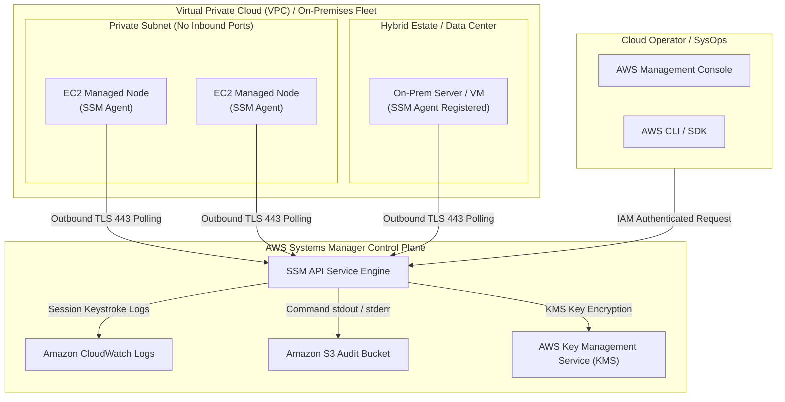
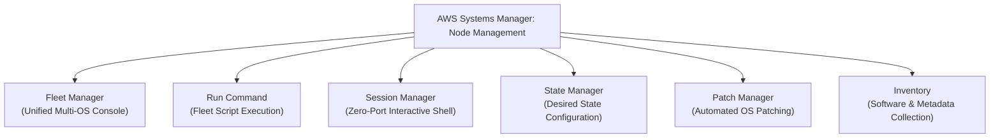
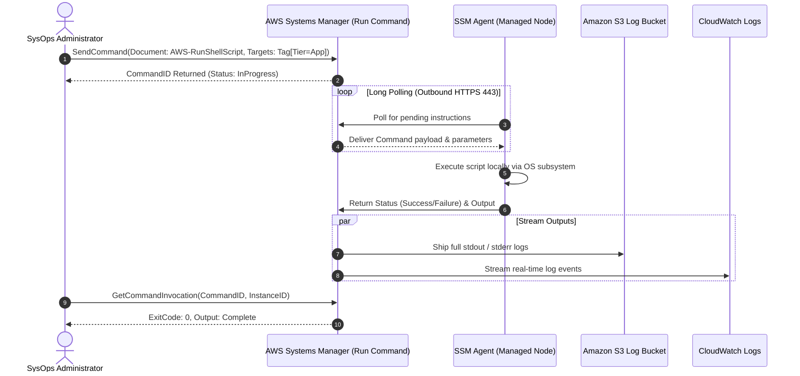
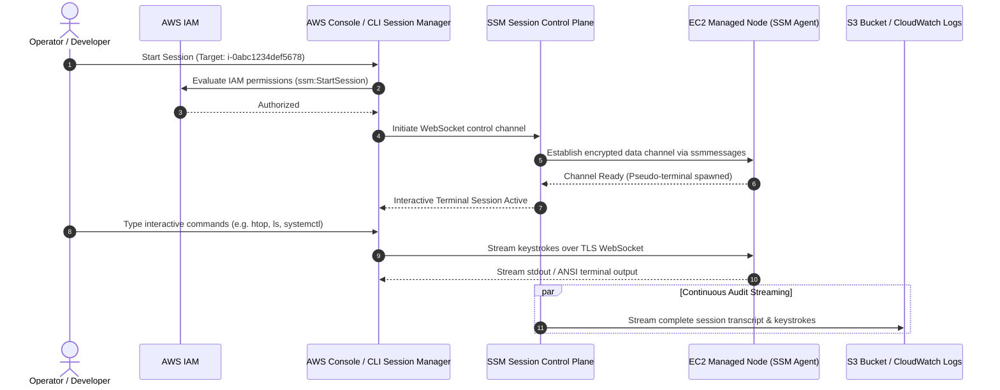
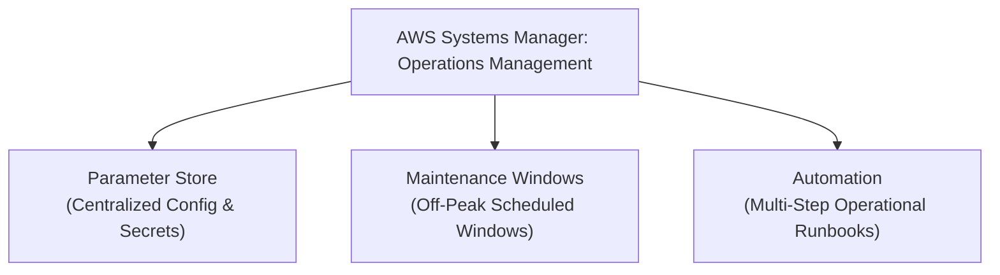
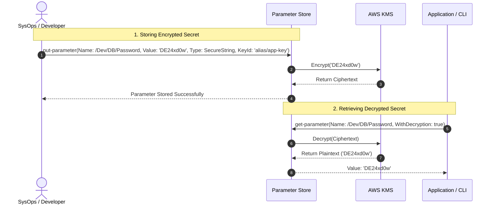

# 🛠️ AWS Systems Manager: Architecture, Node Operations & Hybrid Cloud Automation

> **Course**: AWS re/Start  
> **Module**: Tooling and Automation (M09 – AWS Systems Manager)  
> **Source Document**: `T13-Tooling_and_Automation/T13-0002-RSTOOL_EN-US_SG_M09_AWSSYSTEMSMANAGER.pdf`  
> **Target Audience**: AWS re/Start Learners / Cloud Operations Associates / SysOps Administrators  

---

## 🎯 Executive & Architectural Overview

In traditional data center and early cloud operations, managing fleets of virtual machines and bare-metal servers required cumbersome infrastructure overhead. Administrators relied on **bastion hosts** (jump boxes), public IP allocations, wide-open firewall holes (such as inbound TCP port 22 for SSH or port 3389 for RDP), and static administrative credentials or private key pairs (`.pem` files) scattered across operator workstations. This architecture introduced massive attack surfaces, configuration drift, and compliance audit gaps.

**AWS Systems Manager (SSM)** completely redefines infrastructure operations. It serves as a centralized, secure operations hub for AWS, on-premises data centers, and multi-cloud virtual environments. Instead of opening inbound ports or managing SSH keys, Systems Manager leverages an **outbound-polling agent architecture**, integrating natively with AWS Identity and Access Management (IAM), AWS Key Management Service (AWS KMS), Amazon CloudWatch, and AWS CloudTrail.

```
┌────────────────────────────────────────────────────────────────────────────────────────┐
│                        Traditional vs. AWS Systems Manager Ops                         │
├────────────────────────────────────────────────────────────────────────────────────────┤
│  TRADITIONAL MANAGEMENT               │  AWS SYSTEMS MANAGER (SSM)                     │
│  • Inbound ports open (22, 3389)      │  • ZERO inbound ports open (outbound 443 only) │
│  • Public IPs / Bastions required     │  • No bastions or public IPs necessary         │
│  • Static SSH key pairs & passwords   │  • IAM role-based temporary credentials        │
│  • Manual, ad-hoc patching            │  • Automated patch baselines & maintenance     │
│  • Unaudited terminal access          │  • 100% keystroke & command audit logging      │
│  • Unmanaged configuration drift      │  • Continuous desired-state enforcement (DSC)  │
└────────────────────────────────────────────────────────────────────────────────────────┘
```

Systems Manager groups its rich suite of operational tools into primary functional domains—most notably **Node Management** and **Operations Management**—empowering Cloud Operations Associates to safely automate repetitive administrative tasks at massive scale.

---

## 📌 Learning Objectives

By studying this guide and working through its architectural frameworks, learners will be able to:

- [ ] **Define AWS Systems Manager (SSM)**: Articulate the core mission, hybrid scope, and operational benefits of Systems Manager across AWS and on-premises environments.
- [ ] **Analyze SSM Agent Architecture**: Explain the agent-based outbound communication model, installation across operating systems, and required IAM instance profiles (`AmazonSSMManagedInstanceCore`).
- [ ] **Configure Private VPC Access**: Identify the required AWS PrivateLink VPC endpoints (`ssm`, `ssmmessages`, `ec2messages`, `kms`) for instances operating in isolated private subnets.
- [ ] **Differentiate Systems Manager Document Types**: Deconstruct JSON/YAML SSM Documents across Command, Automation, and Session documents, distinguishing between Amazon-owned, custom, and shared runbooks.
- [ ] **Master Node Management Capabilities**:
  - [ ] **Fleet Manager**: Navigate unified instance consoles across EC2, on-premises, and virtual machines without logging into individual nodes.
  - [ ] **Run Command**: Execute administrative commands remotely across instance fleets without open SSH/RDP ports, tracking exit codes, standard output, and concurrency thresholds.
  - [ ] **Session Manager**: Initiate secure, interactive browser-based and CLI shell sessions with end-to-end encryption, eliminating bastion hosts and tracking full session transcripts.
  - [ ] **State Manager**: Define, schedule, and automate configuration enforcement to prevent and remediate configuration drift.
  - [ ] **Patch Manager**: Configure custom and default patch baselines, approval rules, auto-patching schedules, and compliance auditing.
  - [ ] **Inventory**: Collect, track, and query metadata regarding OS configurations, application packages, network properties, and system services.
- [ ] **Implement Operations Management Features**:
  - [ ] **Parameter Store**: Store and retrieve hierarchical configuration values and secrets (`String`, `StringList`, `SecureString` with AWS KMS encryption).
  - [ ] **Maintenance Windows**: Schedule disruptive tasks (patching, driver updates, runbooks) with defined schedules, durations, targets, and task concurrency controls.
  - [ ] **Automation**: Execute multi-step runbooks for infrastructure tasks like Golden AMI creation, snapshot rotation, and instance remediation.
- [ ] **Evaluate Security & Governance Controls**: Map administrative activity to AWS CloudTrail event histories, S3 bucket storage, and Amazon CloudWatch Logs for regulatory compliance.
- [ ] **Troubleshoot Managed Node Connectivity**: Diagnose and resolve common connectivity barriers, such as offline agents, missing IAM instance profiles, routing failures, and VPC endpoint misconfigurations.

---

## 🏗️ 1. Architecture & The SSM Agent

### 1.1 Outbound-Only Communication Architecture
The cornerstone of AWS Systems Manager security is that **managed nodes never require inbound network access**. The managed node (Amazon EC2 instance, on-premises server, or edge device) runs the lightweight **SSM Agent**. 

The SSM Agent initiates **outbound HTTPS connections over TCP port 443** to the Systems Manager service endpoints. It establishes secure bidirectional channels (via long polling and WebSockets) to query the control plane for queued tasks and return execution output.



> [!IMPORTANT]
> **No Inbound Security Group Rules Required**: You do **not** need to open port 22 (SSH) or port 3389 (RDP) in the instance Security Group. The instance only requires outbound access to the SSM endpoints via an Internet Gateway, a NAT Gateway, or private **VPC Endpoints (AWS PrivateLink)**.

---

### 1.2 SSM Agent Installation and Operating System Support
The SSM Agent is open-source software written in Go and maintained by AWS.
- **Pre-installed Environments**:
  - Amazon Linux, Amazon Linux 2, Amazon Linux 2023
  - Ubuntu Server 16.04, 18.04, 20.04, and 22.04 LTS (official AMIs)
  - CentOS 7.x and Red Hat Enterprise Linux (RHEL) 7.x, 8.x, 9.x (selected official AMIs)
  - macOS 10.14.x through current releases
  - Windows Server 2012 R2 through Windows Server 2022
- **Manual Installation**:
  On non-pre-installed Linux distributions or on-premises servers, the agent can be installed using native package managers (`yum`, `dnf`, `apt`, `snap`, or RPM/Debian packages).

```bash
# Example: Checking SSM Agent status on Amazon Linux 2023
sudo systemctl status amazon-ssm-agent

# Example: Starting and enabling SSM Agent on Ubuntu / Debian
sudo systemctl enable amazon-ssm-agent
sudo systemctl start amazon-ssm-agent
```

---

### 1.3 IAM Role Permissions: `AmazonSSMManagedInstanceCore`
For an EC2 instance to communicate with Systems Manager, it must be granted temporary credentials via an **IAM Instance Profile**. 

AWS provides the AWS-managed policy **`AmazonSSMManagedInstanceCore`**. This policy grants the minimum necessary permissions for the SSM Agent to register, receive commands, establish session channels, and stream operational logs.

```
┌────────────────────────────────────────────────────────────────────────┐
│             Key Permissions in AmazonSSMManagedInstanceCore            │
├────────────────────────────────────────────────────────────────────────┤
│  • ssm:DescribeAssociation                                             │
│  • ssm:GetDeployablePatchSnapshotForInstance                           │
│  • ssm:GetDocument / ssm:DescribeDocument                              │
│  • ssm:GetManifest                                                     │
│  • ssm:GetParameter / ssm:GetParameters                                │
│  • ssm:ListAssociations / ssm:ListInstanceAssociations                 │
│  • ssm:PutInventory / ssm:PutComplianceItems                           │
│  • ssm:UpdateAssociationStatus / ssm:UpdateInstanceInformation         │
│  • ssmmessages:CreateControlChannel / CreateDataChannel                │
│  • ssmmessages:OpenControlChannel / OpenDataChannel                    │
│  • ec2messages:AcknowledgeMessage / DeleteMessage / FailMessage        │
│  • ec2messages:GetEndpoint / GetMessages / SendReply                   │
└────────────────────────────────────────────────────────────────────────┘
```

> [!CAUTION]
> In legacy tutorials, you may see references to `AmazonEC2RoleforSSM`. **This policy is deprecated** and should never be used in modern deployments. Always use **`AmazonSSMManagedInstanceCore`** adhering to the principle of least privilege.

---

### 1.4 Private Subnet Configuration & AWS PrivateLink
When managed nodes reside in private subnets with no internet gateway, no NAT gateway, and no direct outbound route to the internet, they must route traffic to Systems Manager through **Interface VPC Endpoints (AWS PrivateLink)**.

To establish complete Systems Manager functionality without internet routing, configure the following VPC endpoints inside your VPC:

| VPC Endpoint Service Name | Type | Purpose |
| :--- | :--- | :--- |
| `com.amazonaws.<region>.ssm` | Interface | Standard Systems Manager service API calls |
| `com.amazonaws.<region>.ssmmessages` | Interface | WebSocket channels required for **Session Manager** interactive shells |
| `com.amazonaws.<region>.ec2messages` | Interface | Relaying messages between the SSM service engine and the instance |
| `com.amazonaws.<region>.kms` | Interface | Required when using AWS KMS for Session Manager encryption or Parameter Store SecureString |
| `com.amazonaws.<region>.s3` | Gateway / Interface | Required for downloading patch packages from S3 and shipping command logs |

---

### 1.5 Hybrid Activations (On-Premises & Non-AWS Machines)
Systems Manager is not restricted to AWS EC2 instances. You can manage on-premises virtual machines (VMware ESXi, Hyper-V, KVM) and bare-metal servers through **Hybrid Activations**.

1. **Create Activation**: The administrator creates a hybrid activation in the Systems Manager console or CLI, generating an **Activation Code** and an **Activation ID**.
2. **Assign Role**: Systems Manager associates the activation with an IAM service role (typically using `AmazonSSMDirectoryServiceAccess` or a tailored hybrid policy).
3. **Install & Register Agent**: On the on-premises server, the administrator installs the SSM Agent and runs the registration command:
   ```bash
   sudo amazon-ssm-agent -register -code "activation-code" -id "activation-id" -region "us-east-1"
   sudo systemctl start amazon-ssm-agent
   ```
4. **Managed Node Representation**: Once registered, the on-premises machine appears in the Systems Manager console with an ID prefix of `mi-` (Managed Instance), whereas native EC2 instances have an ID prefix of `i-`.

---

## 📄 2. Systems Manager Documents (SSM Documents)

An **SSM Document** defines the exact administrative actions that Systems Manager performs on managed nodes or AWS resources. Documents are written in structured **JSON** or **YAML**.

### 2.1 Document Categories by Ownership

```
┌────────────────────────────────────────────────────────────────────────┐
│                        SSM Document Ownership                          │
├────────────────────────────────────────────────────────────────────────┤
│  1. Amazon-Owned Documents:                                            │
│     Predefined by AWS. Read-only. Examples: AWS-RunShellScript,        │
│     AWS-RunPowerShellScript, AWS-InstallWindowsUpdates.                │
├────────────────────────────────────────────────────────────────────────┤
│  2. Customer-Owned Documents:                                          │
│     Created and authored by your organization. Fully customizable to   │
│     your application deployment and maintenance workflows.             │
├────────────────────────────────────────────────────────────────────────┤
│  3. Shared Documents:                                                  │
│     Custom documents explicitly shared across AWS accounts within an   │
│     AWS Organization or via direct account IDs.                        │
└────────────────────────────────────────────────────────────────────────┘
```

### 2.2 Core Document Types

| Document Type | Primary Consumer | Typical Operations |
| :--- | :--- | :--- |
| **Command (`Command`)** | Run Command, State Manager | Executing scripts, installing software, modifying configuration files on nodes |
| **Automation (`Automation`)** | Systems Manager Automation | Orchestrating AWS API calls (creating AMIs, stopping/starting instances, snapshotting) |
| **Session (`Session`)** | Session Manager | Customizing interactive shell sessions (configuring user accounts, idle timeouts, encryption) |
| **Policy (`Policy`)** | State Manager | Applying compliance policies and configuration enforcement rules |

### 2.3 Anatomy of a Command Document (YAML Example)

```yaml
schemaVersion: "2.2"
description: "Verify Web Server Status and Install Nginx"
parameters:
  MessageText:
    type: "String"
    default: "Deploying standard Nginx web server"
    description: "Informational log message"
mainSteps:
  - action: "aws:runShellScript"
    name: "installAndVerifyNginx"
    inputs:
      runCommand:
        - "echo '{{MessageText}}'"
        - "yum update -y"
        - "amazon-linux-extras install nginx1 -y || yum install nginx -y"
        - "systemctl enable nginx"
        - "systemctl start nginx"
        - "systemctl status nginx --no-pager"
```

---

## 💻 3. Node Management Capabilities

Node Management encompasses the features that allow administrators to inspect, govern, configure, access, and patch the operating systems running across managed instances.



---

### 3.1 Fleet Manager
**Fleet Manager** provides a centralized graphical management console within AWS Systems Manager to view and troubleshoot running instances across AWS and hybrid environments without opening direct terminal connections.

- **Unified Fleet Overview**: View instance operational health, operating system distribution, uptime, agent status, and IP addressing across all EC2 instances, on-premises machines (`mi-*`), and edge devices in a single view.
- **Deep Node Inspection**:
  - **File System Exploration**: Browse directories, view file properties, download logs, and upload configuration files directly from the AWS console.
  - **User & Group Administration**: View local OS users, groups, and permissions without invoking interactive shell tools.
  - **Performance Telemetry**: Inspect real-time CPU utilization, memory consumption, disk capacity, and network I/O.
  - **Windows Registry Exploration**: On Windows Server nodes, securely inspect and modify registry keys and system hive parameters.

---

### 3.2 Run Command
**Run Command** enables administrators to execute predefined or custom commands and scripts asynchronously across large fleets of managed instances without logging into them.

#### Core Operational Mechanics:
1. **Target Selection**:
   - **Tag-based targeting**: Target all instances matching specific tags (e.g., `Environment = Production`, `Role = WebServer`).
   - **Resource Groups**: Target dynamic groups managed by AWS Resource Groups.
   - **Manual selection**: Select explicit instance IDs.
2. **Rate and Safety Controls**:
   - **Rate Control (Max Concurrency)**: Specify how many instances run the command simultaneously (as an absolute count, e.g., `5`, or a percentage, e.g., `25%`). This prevents resource spikes and network saturation.
   - **Error Threshold (Max Errors)**: Specify how many failures are permitted before Systems Manager automatically cancels the command across remaining nodes (e.g., `0` or `10%`).
3. **Execution Output & Audit Logging**:
   - Every execution captures standard output (`stdout`), standard error (`stderr`), and the operating system exit code.
   - Output can be streamed directly to an **Amazon S3 bucket** and **Amazon CloudWatch Logs** for permanent auditing.



#### Predefined Run Command Documents:
- **`AWS-RunShellScript`**: Executes arbitrary bash/sh commands on Linux and macOS instances.
- **`AWS-RunPowerShellScript`**: Executes PowerShell commands and scripts on Windows and Linux instances.
- **`AWS-InstallWindowsUpdates`**: Scans for and installs Windows cumulative updates and security patches, with optional reboot management.
- **`AWS-UpdateSSMAgent`**: Automates updates of the SSM Agent across managed fleets.

---

### 3.3 Session Manager
**Session Manager** provides one-click, secure, auditable terminal access (shell access for Linux/macOS and PowerShell for Windows) to managed nodes directly through the AWS Management Console or the AWS CLI.

#### The Architectural Breakthrough of Session Manager:
- **Zero Inbound Open Ports**: No inbound security group rules needed.
- **No Bastion Hosts**: Bastion instances, associated public Elastic IPs, and ongoing bastion maintenance costs are eliminated entirely.
- **No Private Keys (`.pem` files)**: Eliminates the risks associated with shared SSH private keys, lost keys, or credentials stored insecurely on employee laptops.
- **Strict IAM Authentication**: Access is granted or denied via standard IAM policies, enabling fine-grained controls such as restricting access by instance tags, MFA enforcement, and session duration limits.



#### Advanced Session Manager Features:
1. **AWS CLI Integration**:
   With the **Session Manager Plugin** installed locally, users can run:
   ```bash
   aws ssm start-session --target i-0123456789abcdef0
   ```
2. **Port Forwarding Over Secure WebSocket**:
   Session Manager allows tunneling arbitrary TCP ports without opening firewalls. For example, forward a local port directly to a private Amazon RDS PostgreSQL database or internal web service:
   ```bash
   aws ssm start-session \
       --target i-0123456789abcdef0 \
       --document-name AWS-StartPortForwardingSessionToRemoteHost \
       --parameters '{"host":["database.internal.vpc"],"portNumber":["5432"],"localPortNumber":["5432"]}'
   ```
3. **End-to-End KMS Encryption**:
   Session data transmitted between the operator and the managed node can be encrypted using a customer-managed AWS KMS key.
4. **Comprehensive Logging**:
   Every keystroke, command, and terminal output can be logged directly to Amazon S3 (for immutable compliance storage) and Amazon CloudWatch Logs (for real-time alerting and metrics filters).

---

### 3.4 State Manager
**State Manager** is a scalable desired-state configuration (DSC) engine that automates the process of keeping managed instances in a defined, compliant state.

#### How State Manager Works:
1. **Choose or Create an SSM Document**: Identify the document that defines the desired configuration (e.g., ensuring a security monitoring agent is running, firewall rules are configured, or specific software packages are installed).
2. **Create an Association**: An **association** binds an SSM Document to a target group of instances (defined by tags, resource groups, or instance IDs).
3. **Define Schedule**: Define how often State Manager applies and validates the configuration (e.g., every 30 minutes, daily, or via a custom cron expression).
4. **Detect and Remediate Drift**: If an unauthorized administrator or software update changes a configuration file or stops a mandatory service, State Manager detects the discrepancy during the next scheduled run and automatically reapplies the desired configuration.
5. **Output Delivery**: Execution outputs and compliance reports can be written to an Amazon S3 bucket.

---

### 3.5 Patch Manager
**Patch Manager** automates the rollout of operating system and software security updates across large fleets of Linux and Windows instances.

```
┌────────────────────────────────────────────────────────────────────────┐
│                   Patch Manager 4-Step Operational Flow                │
├────────────────────────────────────────────────────────────────────────┤
│  [Step 1] Create Patch Baseline                                        │
│  Define auto-approval rules, severity thresholds, & CVE cutoffs        │
│                                ↓                                       │
│  [Step 2] Assign to Patch Groups & Maintenance Windows                 │
│  Tag instances with "Patch Group" and attach to scheduled windows       │
│                                ↓                                       │
│  [Step 3] Apply Patches & Manage Reboots                               │
│  Run AWS-RunPatchBaseline: Scan or Install patches with controlled reboot│
│                                ↓                                       │
│  [Step 4] Audit & Enforce Patch Compliance                             │
│  Inspect compliance dashboards, identify non-compliant nodes & CVEs    │
└────────────────────────────────────────────────────────────────────────┘
```

#### Key Components:
- **Patch Baselines**:
  - Define rules for auto-approving patches based on classification (e.g., *Security*, *CriticalUpdates*) and severity (*Critical*, *Important*).
  - Include an **auto-approval delay** (e.g., approve patches only after they have been released for 7 days to avoid zero-day bugs or faulty vendor patches).
  - Explicit **approval lists** (force-install specific patches) and **rejection lists** (block problematic patches).
  - Default baselines are provided for Amazon Linux, RHEL, Ubuntu, CentOS, SUSE, macOS, and Windows Server.
- **Patch Groups**:
  - An instance tag with the reserved key `Patch Group` (e.g., `Patch Group = Production-Linux-Tier`).
  - Allows different groups of nodes to use different baselines and maintenance windows (e.g., dev instances patched on Tuesday; production instances patched on Saturday).
- **Execution Operations**:
  - **Scan**: Discovers missing patches and reports compliance status without modifying the instance.
  - **Install**: Downloads missing approved patches, installs them, and reboots the instance if required.

---

### 3.6 Inventory
**Systems Manager Inventory** collects detailed metadata from managed instances regarding installed software, system configuration, and hardware properties.

#### Collected Metadata Categories:
- **Applications**: Installed software packages, application names, versions, publishers.
- **Files & Directories**: File names, sizes, creation times, modification timestamps, version strings.
- **Network Configurations**: IP addresses, MAC addresses, subnet masks, default gateways, DNS servers, DHCP lease details.
- **Operating System & Kernel**: OS distribution, build number, architecture (`x86_64`, `arm64`), kernel release.
- **Windows Specifics**: Windows services (status, startup type), server roles, registry keys.
- **System Properties & Updates**: BIOS version, CPU count, total physical memory, installed OS updates/KBs.

#### Use Cases:
- **Software Asset & License Tracking**: Identify all nodes running commercial software licenses or deprecated software versions.
- **Vulnerability Management**: Cross-reference installed package versions against newly disclosed Common Vulnerabilities and Exposures (CVEs).
- **Advanced Querying**: Sync inventory data across multiple accounts and regions using **AWS Systems Manager Resource Data Sync** into Amazon S3, allowing SQL querying via **Amazon Athena** and dashboards in **Amazon QuickSight**.

---

## ⚙️ 4. Operations Management Capabilities

Operations Management features automate broader cloud operational workflows, application configuration storage, and scheduling across AWS resources.



---

### 4.1 Parameter Store
**AWS Systems Manager Parameter Store** provides secure, centralized, hierarchical storage for configuration data management and secrets management. It replaces hardcoded configuration files, plaintext database credentials, and API tokens embedded in application source code.

#### Parameter Types:
1. **`String`**: Plain text configuration values (e.g., API endpoints, log levels, AMI IDs, port numbers).
2. **`StringList`**: Comma-separated list of values (e.g., `"subnet-1a,subnet-1b,subnet-1c"`).
3. **`SecureString`**: Sensitive data (passwords, database connection strings, license keys, private certificates). Values are automatically encrypted at rest using an **AWS Key Management Service (AWS KMS)** key.

#### Hierarchical Naming Convention:
Parameters use a forward-slash hierarchical namespace, enabling granular IAM access control and environment isolation:
- `/Dev/App/Database/Username`
- `/Dev/App/Database/Password`
- `/Prod/App/Database/Password`
- `/Global/Network/VpcId`



#### AWS CLI Operations:
```bash
# Store a secure database password
aws ssm put-parameter \
    --name "/Dev/DB/Password" \
    --value "DE24xd0w" \
    --type "SecureString" \
    --description "Development database master password" \
    --overwrite

# Retrieve the parameter with decryption
aws ssm get-parameter \
    --name "/Dev/DB/Password" \
    --with-decryption

# Retrieve all parameters under a hierarchical path
aws ssm get-parameters-by-path \
    --path "/Dev/DB/" \
    --recursive \
    --with-decryption
```

#### Parameter Store Tiers:
| Feature | Standard Tier | Advanced Tier |
| :--- | :--- | :--- |
| **Storage Limit per Parameter** | 4 KB | 8 KB |
| **Total Parameters per Account** | Up to 10,000 | Up to 100,000 |
| **Parameter Policies** | None | Supported (Expiration, ExpirationNotification, NoChangeNotification) |
| **Cost** | No additional charge | Fee per advanced parameter and per API request |

---

### 4.2 Maintenance Windows
**Maintenance Windows** let you define scheduled windows of time to run potentially disruptive administrative and operational tasks across your compute instances without affecting business hours.

#### Key Components of a Maintenance Window:
1. **Schedule**: A recurrence frequency defined via a cron expression, rate expression, or specific date/time (e.g., `cron(0 2 ? * SUN *)` for every Sunday at 02:00 UTC).
2. **Duration**: The total number of hours the window remains open (e.g., 4 hours).
3. **Stop Task Window (Cutoff)**: The number of hours before the end of the maintenance window that Systems Manager stops initiating new tasks (e.g., 1 hour before window ends to ensure running tasks complete cleanly).
4. **Targets**: The target resources (EC2 instances or hybrid machines identified by tags or resource groups).
5. **Tasks**: The workloads executed when the window triggers:
   - **Systems Manager Run Command** (executing shell or PowerShell scripts)
   - **Systems Manager Automation** (executing multi-step AWS workflows)
   - **AWS Step Functions** (orchestrating distributed serverless workflows)
   - **AWS Lambda functions** (executing custom Python or Node.js serverless functions)

---

### 4.3 Systems Manager Automation
**Systems Manager Automation** simplifies common maintenance and deployment tasks by executing predefined or custom runbooks against AWS resources.

#### Typical Use Cases:
- **Golden AMI Creation**: Launch a base instance, execute software installations and security hardening via Run Command, stop the instance, create an AMI, tag the image, and terminate the instance.
- **Automated Incident Remediation**: When Amazon CloudWatch detects high CPU or disk utilization, or AWS GuardDuty detects a compromised host, an Amazon EventBridge rule triggers an SSM Automation runbook to isolate the instance, capture memory forensics, and take EBS snapshots.
- **Fleet-Wide Lifecycle Operations**: Stopping non-production development instances at 19:00 each weekday and restarting them at 07:00.

#### Automation Execution Workflow:
```
┌────────────────────────────────────────────────────────────────────────┐
│             Systems Manager Automation 3-Step Lifecycle                │
├────────────────────────────────────────────────────────────────────────┤
│  1. Create or Select Automation Document:                              │
│     Author or select a runbook containing sequential steps and actions │
│     (e.g., aws:executeAwsApi, aws:runCommand, aws:createImage).        │
│                                ↓                                       │
│  2. Execute the Automation:                                            │
│     Trigger runbook manually via console/CLI or automatically via      │
│     Amazon EventBridge, AWS Config Rules, or Maintenance Windows.       │
│                                ↓                                       │
│  3. Monitor & Verify Results:                                          │
│     Track step execution statuses (Success, Failed, TimedOut) and      │
│     inspect generated artifacts (new AMIs, snapshots, audit logs).     │
└────────────────────────────────────────────────────────────────────────┘
```

---

## 🔒 5. Security, Governance & Compliance Posture

AWS Systems Manager delivers an enterprise-grade security posture aligned with the AWS Well-Architected Framework:

```
┌────────────────────────────────────────────────────────────────────────────────────────┐
│                        Systems Manager Security Pillars                                │
├────────────────────────────────────────────────────────────────────────────────────────┤
│  1. Zero Trust Remote Access:                                                          │
│     Eliminates persistent SSH keys, shared passwords, and open inbound firewall ports. │
├────────────────────────────────────────────────────────────────────────────────────────┤
│  2. IAM Fine-Grained Least Privilege:                                                  │
│     Control who can run specific commands on specific tags (e.g., only Lead DevOps     │
│     engineers can run commands against 'Environment=Production').                      │
├────────────────────────────────────────────────────────────────────────────────────────┤
│  3. Comprehensive Auditability:                                                        │
│     Every API call recorded in AWS CloudTrail. Complete interactive session keystrokes │
│     and script standard outputs streamed to Amazon CloudWatch Logs and S3 buckets.    │
├────────────────────────────────────────────────────────────────────────────────────────┤
│  4. Data Encryption in Transit & at Rest:                                              │
│     All communication channels protected by TLS 1.2/1.3. Session transcripts and       │
│     Parameter Store values encrypted using customer-managed AWS KMS keys.              │
└────────────────────────────────────────────────────────────────────────────────────────┘
```

### Comparative Analysis: Traditional Management vs. Systems Manager

| Operational Feature | Traditional Bastion & SSH/RDP Architecture | AWS Systems Manager Architecture |
| :--- | :--- | :--- |
| **Inbound Network Exposure** | High (TCP ports 22 and 3389 open to internet or corporate CIDRs) | **Zero** (All inbound ports closed; outbound 443 only) |
| **Infrastructure Overhead** | Bastion hosts require patching, scaling, and public IPs | **Serverless** (Fully managed AWS native service) |
| **Credential Management** | Static SSH key pairs (`.pem`) and local passwords | **IAM Temporary Credentials** (No persistent keys) |
| **Multi-Node Operations** | Complex custom bash scripts, SSH loops, or heavy third-party agents | **Run Command** with built-in concurrency & error throttling |
| **Interactive Terminal Auditing** | Difficult (requires terminal screen scrapers or custom bastion loggers) | **Built-in Session Logging** to CloudWatch Logs & S3 |
| **Configuration Drift** | Manual checks or periodic configuration management sweeps | **State Manager** continuous desired-state enforcement |
| **Secrets & Config Storage** | Plaintext config files on disks or environment variables | **Parameter Store** hierarchical secrets with KMS encryption |

---

## 🛠️ 6. Troubleshooting Knowledge Base & Operational Playbooks

When deploying and maintaining Systems Manager in enterprise environments, Cloud Operations Associates frequently encounter the following operational issues:

```
┌────────────────────────────────────────────────────────────────────────┐
│                     Top SSM Operational Failure Modes                  │
├────────────────────────────────────────────────────────────────────────┤
│  [1] Managed Node Not Appearing in Console / Agent Status Offline      │
│  [2] Session Manager Connection Fails (TargetNotConnected)             │
│  [3] Run Command Executions Time Out or Fail                           │
│  [4] Parameter Store Access Denied / Decryption Failure                │
└────────────────────────────────────────────────────────────────────────┘
```

---

### Playbook 1: Managed Node Not Appearing in Console / Agent Offline
- **Symptoms**: Newly launched EC2 instances or on-premises machines do not show up under **Managed Nodes** or Fleet Manager in the Systems Manager console.
- **Root Cause Analysis**:
  1. **Missing IAM Instance Profile**: The EC2 instance does not have an IAM role attached, or the attached role lacks the managed policy `AmazonSSMManagedInstanceCore`.
  2. **SSM Agent Not Running**: The agent is stopped, crashed, or not installed on the operating system.
  3. **No Network Route to Systems Manager**: The instance is in a private subnet with no route to an Internet Gateway or NAT Gateway, and no VPC Interface Endpoints have been configured.
  4. **NTP Clock Drift**: System time on the instance has drifted significantly (> 15 minutes) from UTC, causing AWS SigV4 signature authentication to fail.
- **Remediation Steps**:
  1. Attach an IAM role containing `AmazonSSMManagedInstanceCore` to the EC2 instance via the AWS console or CLI:
     ```bash
     aws ec2 associate-iam-instance-profile \
         --instance-id i-0123456789abcdef0 \
         --iam-instance-profile Name=EC2-SSM-Core-Role
     ```
  2. Connect locally or review system boot logs (`/var/log/cloud-init-output.log` or `/var/log/amazon/ssm/amazon-ssm-agent.log`).
  3. Restart the SSM Agent:
     ```bash
     sudo systemctl restart amazon-ssm-agent
     ```
  4. Verify network connectivity to SSM endpoints:
     ```bash
     curl -v https://ssm.us-east-1.amazonaws.com
     ```

---

### Playbook 2: Session Manager Connection Fails (`TargetNotConnected`)
- **Symptoms**: Running `aws ssm start-session --target <instance-id>` or clicking **Start Session** in the console returns: `An error occurred (TargetNotConnected) when calling the StartSession operation`.
- **Root Cause Analysis**:
  1. The SSM Agent has lost communication with the `ssmmessages` endpoint.
  2. The VPC Interface Endpoint `com.amazonaws.<region>.ssmmessages` is missing in an isolated private VPC.
  3. The Security Group attached to the VPC Interface Endpoint denies inbound HTTPS traffic (TCP 443) from the instance's private IP.
- **Remediation Steps**:
  1. Confirm the instance is listed as **Online** under Systems Manager Managed Nodes.
  2. Ensure the VPC has the `com.amazonaws.<region>.ssmmessages` endpoint provisioned.
  3. Verify that the Security Group assigned to the VPC endpoint allows inbound TCP port 443 from the VPC CIDR or instance security group.

---

### Playbook 3: Run Command Times Out or Returns Non-Zero Exit Code
- **Symptoms**: Command execution status shows `DeliveryTimedOut`, `ExecutionTimedOut`, or `Failed`.
- **Root Cause Analysis**:
  1. **Delivery Timeout**: The instance went offline or was terminated before the SSM Agent could retrieve the queued command.
  2. **Execution Timeout**: The script took longer to complete than the specified `timeoutSeconds` parameter in the SSM Document.
  3. **Insufficient Local Permissions**: The command required root/superuser privileges, but the script failed on a permission-denied error (by default, SSM Agent runs as `root` on Linux and `SYSTEM` on Windows, but invoking commands under specific user profiles can fail if not configured properly).
- **Remediation Steps**:
  1. Review execution details using AWS CLI:
     ```bash
     aws ssm get-command-invocation \
         --command-id "<command-id>" \
         --instance-id "<instance-id>"
     ```
  2. Check `StandardErrorContent` in the output to identify bash/PowerShell script syntax errors.
  3. Adjust the `executionTimeout` parameter in your SSM Document if the operation requires extended duration (such as downloading massive installation media).

---

### Playbook 4: Parameter Store Decryption Denied
- **Symptoms**: An application or CLI command retrieving a `SecureString` parameter receives an `AccessDeniedException` on `kms:Decrypt`.
- **Root Cause Analysis**:
  1. The IAM user or instance role has `ssm:GetParameter` permissions but lacks `kms:Decrypt` permissions on the AWS KMS key used to encrypt the parameter.
  2. The KMS key policy does not allow the IAM principal access.
- **Remediation Steps**:
  1. Update the IAM policy attached to the role to include `kms:Decrypt` for the specific KMS key ARN:
     ```json
     {
       "Effect": "Allow",
       "Action": "kms:Decrypt",
       "Resource": "arn:aws:kms:us-east-1:123456789012:key/your-key-id"
     }
     ```
  2. Ensure the command specifies the `--with-decryption` flag:
     ```bash
     aws ssm get-parameter --name "/Dev/DB/Password" --with-decryption
     ```

---

## 📝 7. Knowledge Check & Exam Preparation

Test your understanding with these comprehensive review questions and scenario-based problems:

### Question 1
**What are some of the primary administrative tasks that AWS Systems Manager automates across fleets?**  
*Answer*: Systems Manager automates software inventory collection, operating system configuration, OS patching, system image (AMI) creation, desired-state enforcement, and remote script execution.

---

### Question 2
**Which Systems Manager capability defines the specific actions, steps, and parameters that Systems Manager performs on your managed instances?**  
*Answer*: **Systems Manager Documents (SSM Documents)**. These define the actions for Run Command (Command documents), State Manager (Command/Policy documents), and Systems Manager Automation (Automation runbooks).

---

### Question 3
**Which Systems Manager capability enables administrators to manage EC2 instances through an interactive browser-based shell in the AWS Management Console without opening inbound ports or managing SSH keys?**  
*Answer*: **Session Manager**.

---

### Question 4 (Scenario-Based)
*A security auditor discovers that developers are connecting to private Amazon EC2 instances via bastion hosts using shared SSH `.pem` private keys. Inbound port 22 is open on the bastion security group. What should the Cloud Operations team implement to align with AWS security best practices while preserving terminal access?*  
- **A)** Restrict inbound port 22 on the bastion host to developers' home IP addresses.  
- **B)** Migrate the bastion host to an Auto Scaling group with rotating SSH key pairs.  
- **C)** Terminate the bastion host, close inbound port 22 in all security groups, attach the `AmazonSSMManagedInstanceCore` policy to the EC2 instances, and instruct developers to use **Session Manager**.  
- **D)** Configure AWS Systems Manager Run Command to run an SSH daemon on a custom port.  

> **Correct Answer: C**  
> *Explanation*: Session Manager completely eliminates the need for bastion hosts, public IP addresses, and open inbound port 22. It uses the outbound SSM Agent channel and validates access using IAM policies.

---

### Question 5 (Scenario-Based)
*A SysOps administrator needs to execute a configuration script across 500 Amazon EC2 instances. To ensure application stability, the script must run on no more than 20 instances at any one time, and execution must halt immediately if more than 5 instances fail. Which Systems Manager feature and settings should be used?*  
- **A)** Fleet Manager with an alarm threshold of 5 instances.  
- **B)** State Manager with a 20-minute association schedule.  
- **C)** Run Command with **Max Concurrency** set to `20` and **Max Errors** set to `5`.  
- **D)** Maintenance Windows with a 20-node resource limit.  

> **Correct Answer: C**  
> *Explanation*: Systems Manager Run Command incorporates rate control settings: **Max Concurrency** restricts the number of simultaneous targets (here set to 20), and **Max Errors** defines the threshold of failures before stopping the entire execution across the remaining fleet.

---

### Question 6 (Scenario-Based)
*An application running on an EC2 instance in a private subnet needs to retrieve an encrypted database password stored in Systems Manager Parameter Store. The instance has an IAM role with `ssm:GetParameter` and `kms:Decrypt`. However, the `aws ssm get-parameter` call hangs and times out. What is the most likely cause?*  
- **A)** The parameter name does not follow hierarchical path syntax.  
- **B)** The instance cannot resolve or reach the Systems Manager and KMS service endpoints because there is no NAT gateway or VPC Interface Endpoints (`ssm` and `kms`) configured.  
- **C)** The SSM Agent cannot run AWS CLI commands locally.  
- **D)** The parameter must be stored in the Advanced tier.  

> **Correct Answer: B**  
> *Explanation*: In an isolated private subnet with no internet gateway or NAT gateway, instances cannot communicate with public AWS service endpoints. The VPC requires Interface Endpoints (AWS PrivateLink) for `ssm` and `kms` to allow traffic to reach those services internally.

---

## 📊 8. Systems Manager Capabilities Summary Matrix

| Capability | Management Domain | Primary Use Case | Key Prerequisite / Mechanism |
| :--- | :--- | :--- | :--- |
| **Fleet Manager** | Node Management | Graphical node inspection, file exploration, user & registry management | SSM Agent online; `AmazonSSMManagedInstanceCore` role |
| **Run Command** | Node Management | Fleet-wide remote script execution without SSH/RDP | SSM Command Documents; rate & error control settings |
| **Session Manager** | Node Management | Interactive shell access, port forwarding, terminal session logging | SSM Agent; `ssmmessages` endpoint; CloudTrail / S3 / CloudWatch |
| **State Manager** | Node Management | Continuous desired-state configuration and drift prevention | SSM Document associations; scheduled recurrence |
| **Patch Manager** | Node Management | Automated OS security updates, patch baselines, compliance tracking | Patch baselines; `Patch Group` tag; Maintenance Windows |
| **Inventory** | Node Management | Collecting software, network, and OS metadata across fleets | SSM Inventory collection schedule; Resource Data Sync to S3 |
| **Parameter Store** | Operations Management | Centralized, hierarchical configuration and secrets store | IAM read permissions; AWS KMS for `SecureString` decryption |
| **Maintenance Windows** | Operations Management | Defining scheduled off-peak windows for disruptive maintenance | Cron/rate schedule; assigned targets and registered tasks |
| **Automation** | Operations Management | Executing multi-step operational runbooks and cloud workflows | SSM Automation Documents; IAM service role |

---

## 🏁 Key Takeaways

1. **Unified Hybrid Operations**: AWS Systems Manager bridges cloud and on-premises environments, allowing single-pane-of-glass management for EC2, virtual machines, and bare metal through the **SSM Agent**.
2. **Zero Inbound Security Model**: Systems Manager eliminates the need for open inbound ports (port 22/3389), bastion hosts, and static SSH private keys. All management traffic flows over outbound TLS connections (port 443).
3. **Documents as the Operational Engine**: Every execution in Run Command, State Manager, and Automation is defined by structured JSON/YAML **SSM Documents**.
4. **Defense-in-Depth & Auditing**: All administrative actions are governed by IAM policies and logged to **AWS CloudTrail**, **Amazon CloudWatch Logs**, and **Amazon S3** for comprehensive compliance visibility.
5. **Separation of Configuration & Code**: **Parameter Store** provides centralized, encrypted (`SecureString` via AWS KMS) hierarchical storage, enabling seamless configuration injection across modern cloud architectures.
