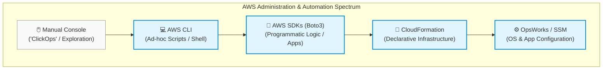
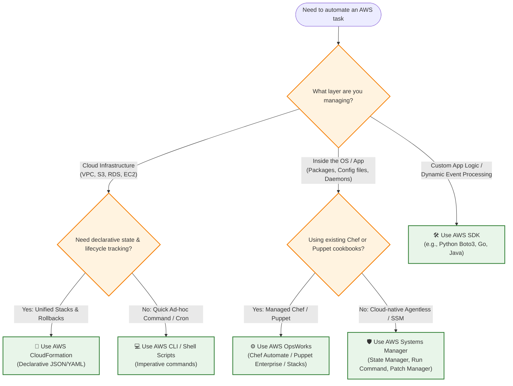
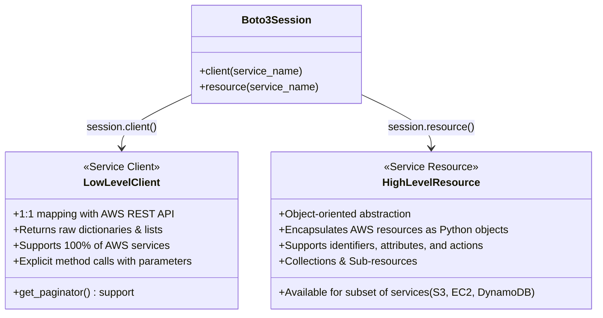
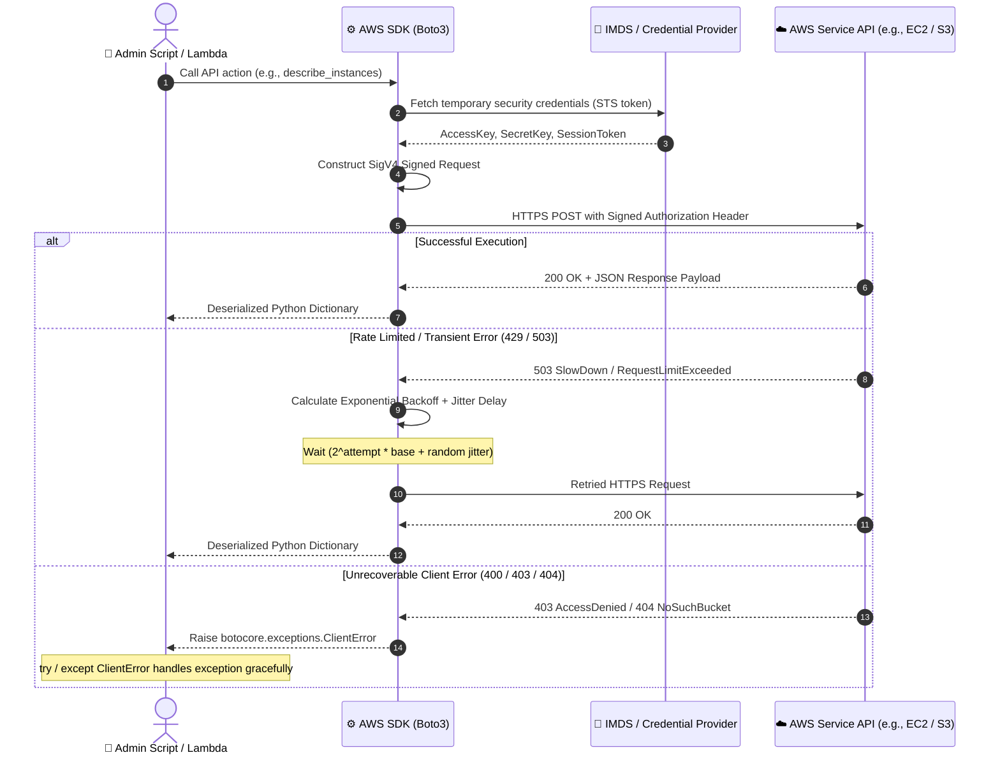
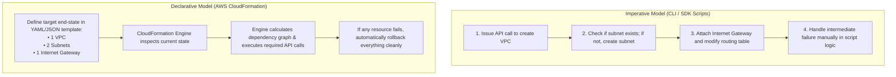
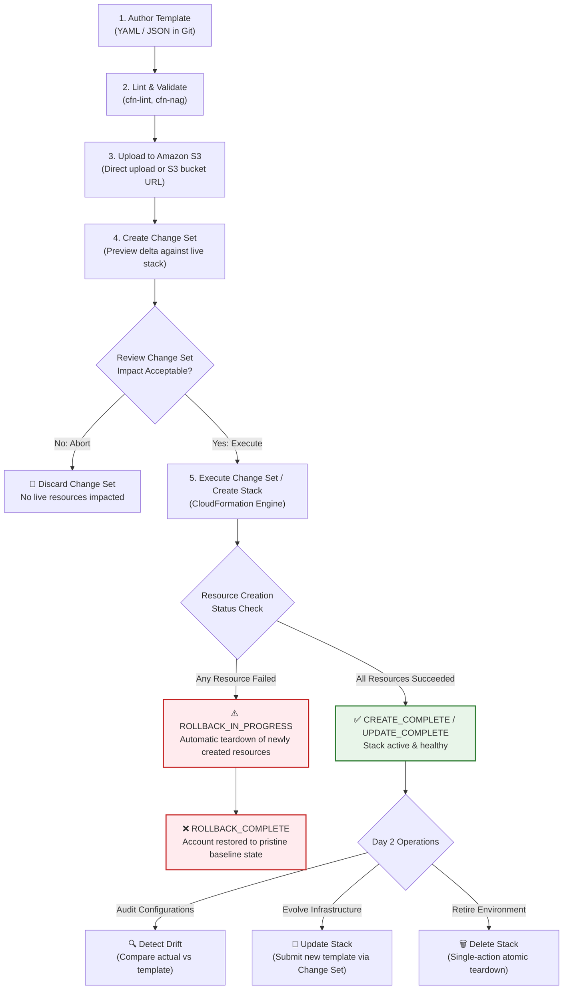
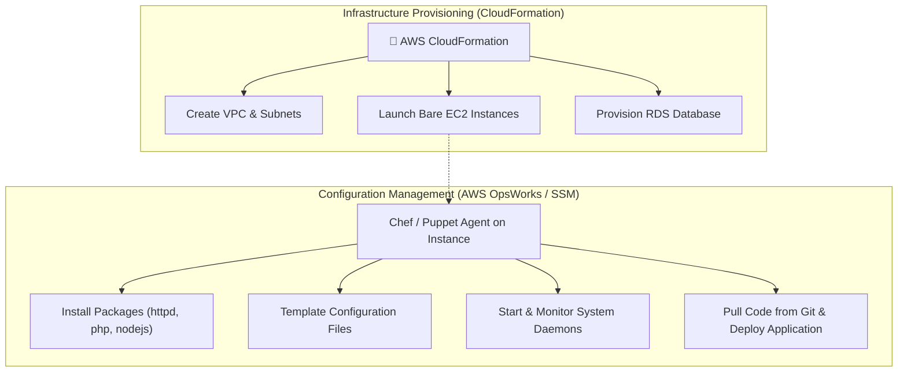
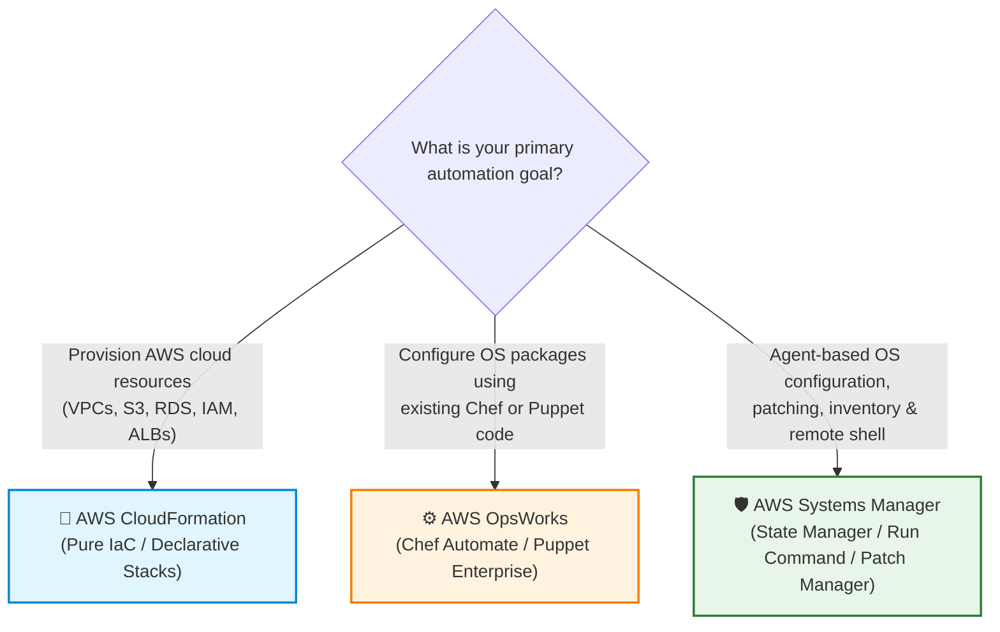

# 🛠️ AWS Administration & Developer Automation Tools: SDKs, CloudFormation, & OpsWorks

> **Course**: AWS re/Start  
> **Module**: Tooling and Automation (Module 09 – Tooling and Automation / Administration Tools)  
> **Source Document**: `T13-Tooling_and_Automation/T13-0003-RSTOOL_EN-US_SG_M09_ADMINDEVTOOLS.pdf`  
> **Target Audience**: AWS re/Start Learners, Systems Administrators, Cloud Operations Engineers, DevOps Engineers  

---

## 🎯 Module Overview & Automation Context

In traditional on-premises data centers, administrative operations are predominantly manual, ticket-driven, and error-prone. Systems administrators manually cable physical servers, install operating systems from ISO images, adjust network switches, and record changes in static configuration spreadsheets. This manual paradigm—frequently referred to as "ClickOps" or bespoke administration—inevitably leads to **configuration drift**, unrepeatable "snowflake" servers, extended provisioning lead times, and disastrous recovery cycles during outages.

In the Amazon Web Services (AWS) cloud, every operational resource—from an Elastic Compute Cloud (EC2) virtual instance to a Virtual Private Cloud (VPC) subnet or a DynamoDB table—is exposed through a uniform, authenticated web service Application Programming Interface (API). Because the entire cloud control plane is software-driven, infrastructure and system administration can be completely programmatic, repeatable, and self-documenting.

This module explores the foundational developer and administrative automation tools provided by AWS:
1. **AWS Software Development Kits (SDKs)**: Enable engineers to integrate AWS service APIs directly into custom software applications and administrative scripts across popular programming languages.
2. **AWS CloudFormation**: The native declarative **Infrastructure as Code (IaC)** engine that provisions and manages complete cloud environments predictably as unified stacks.
3. **AWS OpsWorks**: Managed configuration management services leveraging industry-standard platforms (**Chef** and **Puppet**) to automate operating system configurations, software package lifecycles, and application deployments.



---

### 📌 Learning Objectives

- [ ] **Define the Automation Ecosystem**: Distinguish between imperative scripting (CLI/SDKs), declarative infrastructure provisioning (CloudFormation), and configuration management (OpsWorks / Systems Manager).
- [ ] **Master AWS Software Development Kits (SDKs)**: Identify supported languages, examine the SDK architecture, and evaluate the difference between low-level `client` and high-level `resource` interfaces in Boto3.
- [ ] **Implement Resilient SDK Code**: Apply programmatic error handling using `botocore.exceptions.ClientError`, handle API pagination via `Paginator` objects, and implement exponential backoff with jitter to survive API rate throttling.
- [ ] **Understand Infrastructure as Code (IaC)**: Articulate how declarative templates eliminate snowflake servers, enable GitOps version control, enforce configuration consistency, and provide automated rollback safety.
- [ ] **Deconstruct CloudFormation Anatomy**: Identify all nine top-level template sections, recognize `Resources` as the sole mandatory block, and utilize intrinsic functions (`!Ref`, `!Sub`, `!GetAtt`).
- [ ] **Analyze the CloudFormation Lifecycle**: Navigate stack creation, change sets, drift detection, and stack teardown.
- [ ] **Evaluate AWS OpsWorks Offerings**: Contrast OpsWorks Stacks, OpsWorks for Chef Automate, and OpsWorks for Puppet Enterprise for managing server configurations and application lifecycles.
- [ ] **Execute Architectural Triage**: Select the optimal tool among CLI, SDKs, CloudFormation, Systems Manager, and OpsWorks based on operational use cases and architectural trade-offs.
- [ ] **Diagnose Common Automation Pitfalls**: Troubleshoot CloudFormation `ROLLBACK_IN_PROGRESS` failures, resolve circular resource dependencies, and remediate out-of-band stack drift.

---

## 🧭 Tool Selection Decision Tree

Choosing the right automation tool depends on the abstraction level, operational frequency, statefulness requirements, and whether the task involves provisioning raw cloud resources or configuring the operating system inside compute instances.



---

## 🐍 1. Software Development Kits (SDKs) & Programmatic Administration

### 1.1 SDK Architecture & Supported Languages

The **AWS Software Development Kits (SDKs)** provide language-specific libraries that wrap raw AWS HTTP/HTTPS REST APIs into native classes, methods, and data structures. Instead of manually constructing HTTP requests, calculating Signature Version 4 (SigV4) cryptographic authentication headers, and parsing raw JSON responses, developers interact with clean, idiomatically structured code.

AWS provides officially supported SDKs across a wide array of programming environments:

| Language / Platform | SDK Name / Package | Primary Use Cases |
| :--- | :--- | :--- |
| **Python** | **Boto3** | SysOps automation, data pipelines, AWS Lambda functions, machine learning scripts. |
| **JavaScript / TypeScript** | **AWS SDK for JavaScript (v3)** | Web applications, Node.js backend services, serverless applications. |
| **Java** | **AWS SDK for Java 2.x** | Enterprise backend services, Spring Boot workloads, Android applications. |
| **Go** | **AWS SDK for Go v2** | High-performance microservices, CLI utilities, Kubernetes operators, systems tooling. |
| **.NET (C# / F# / VB)** | **AWS SDK for .NET** | Windows enterprise workloads, ASP.NET Core cloud applications. |
| **C++** | **AWS SDK for C++** | Game engines, high-performance computing (HPC), embedded IoT systems. |
| **PHP** | **AWS SDK for PHP** | Web hosting applications (WordPress, Drupal, Laravel backends). |
| **Ruby** | **AWS SDK for Ruby** | Ruby on Rails web platforms, DevOps orchestration scripts. |
| **Rust / Kotlin / Swift** | AWS SDK for Rust / Kotlin / Swift | Modern systems programming, Android/mobile platforms, Apple ecosystem integration. |

> [!NOTE]
> All AWS SDKs automatically handle low-level network operations, including:
> - **Credential Provider Chain**: Automatically locating credentials from environment variables, AWS shared credentials files (`~/.aws/credentials`), instance profile metadata (IMDSv2), or ECS task roles.
> - **SigV4 Request Signing**: Computing SHA-256 HMAC cryptographic signatures for every outgoing API payload.
> - **Transport Layer Security (TLS)**: Enforcing encrypted communication over HTTPS.
> - **Serialization & Deserialization**: Transforming language objects into JSON/XML payloads and vice versa.

---

### 1.2 Python Boto3: Client vs. Resource Abstraction Models

When developing automation scripts in Python using **Boto3**, engineers encounter two distinct architectural abstractions: **Clients** and **Resources**. Understanding when to employ each is essential for robust systems programming.



#### Detailed Comparison: Client vs. Resource

| Architectural Dimension | Low-Level Client (`boto3.client`) | High-Level Resource (`boto3.resource`) |
| :--- | :--- | :--- |
| **Abstraction Level** | Low-level service interface. Direct 1:1 mapping to AWS API actions. | High-level, object-oriented abstraction modeling cloud entities. |
| **Service Coverage** | **100% of AWS services and API methods**. Receives immediate updates upon new service releases. | **Selective subset** (e.g., EC2, S3, SQS, SNS, DynamoDB, IAM). |
| **Return Data Format** | Standard Python dictionaries (`dict`) and lists (`list`) matching raw JSON API responses. | Resource instances, collections, and custom object attributes. |
| **Data Access** | Key-based dictionary lookup (e.g., `response['Reservations'][0]['Instances']`). | Direct attribute access (e.g., `instance.instance_id`, `instance.state['Name']`). |
| **Action Execution** | Requires passing resource IDs explicitly (e.g., `client.terminate_instances(InstanceIds=[id])`). | Invoked directly on the object instance (e.g., `instance.terminate()`). |
| **Pagination Handling** | Built-in support via client paginators (`client.get_paginator(...)`). | Collections automatically handle multi-page iteration lazily behind the scenes. |
| **Performance Overhead**| Extremely lightweight; minimal memory overhead. | Slight overhead due to object instantiation and attribute population. |

> [!TIP]
> **Best Practice Recommendation**:
> - Use **`boto3.resource`** for straightforward CRUD scripts and object-oriented operations on supported services (such as iterating over all S3 bucket objects or looping through EC2 instances).
> - Use **`boto3.client`** whenever working with services not covered by the resource interface (e.g., Systems Manager, KMS, CloudWatch, Lambda), when strict performance and minimal overhead are needed, or when requiring fine-grained control over API parameters.

---

### 1.3 SDK Programmatic Interaction & Resilience Workflow

When an administrative script communicates with AWS, network partitions, temporary service hiccups, or rate limiting can interrupt execution. Resilient scripts implement defensive programming principles:



#### Key Resilience Pillars in SDK Scripts:

1. **Structured Error Handling with `ClientError`**:
   AWS SDK errors originate from `botocore.exceptions.ClientError`. Inspecting `error['Error']['Code']` reveals the specific AWS service failure (e.g., `InvalidParameterValue`, `NoSuchBucket`, `UnauthorizedOperation`).
2. **API Pagination (`Paginator`)**:
   Most AWS `list_*` and `describe_*` API calls truncate responses at fixed thresholds (often 50 to 1,000 items) and return a `NextToken` or `Marker`. Manually tracking tokens introduces repetitive boilerplate. The SDK `get_paginator()` abstraction automates page traversal cleanly.
3. **Exponential Backoff and Jitter**:
   When API limits are exceeded (`ThrottlingException`), repeated rapid retries exacerbate service strain (the "thundering herd" problem). Exponential backoff multiplies the wait duration after each failure ($t = 2^{\text{attempt}} \times t_{\text{base}}$), while randomized jitter introduces entropy to decorrelate concurrent worker requests.

---

### 1.4 Production-Ready Python Boto3 Implementation

The following production-grade script illustrates defensive administrative programming using Boto3: initializing clients and resources, querying resources with paginators, catching specific `ClientError` exceptions, and implementing custom retry logic with jitter.

```python
"""
AWS Administration Script: Resilient EC2 & S3 Inspection
Demonstrates Boto3 client, resource, pagination, and error handling.
"""

import sys
import time
import random
import logging
from typing import List, Dict, Any
import boto3
from botocore.exceptions import ClientError, BotoCoreError

# Configure structured logging
logging.basicConfig(
    level=logging.INFO,
    format="%(asctime)s [%(levelname)s] %(message)s",
    handlers=[logging.StreamHandler(sys.stdout)]
)
logger = logging.getLogger("AWSAutomation")

def list_running_ec2_instances_with_paginator(region_name: str = "us-east-1") -> List[Dict[str, Any]]:
    """
    Demonstrates low-level Boto3 client with a paginator and robust error handling.
    Retrieves all running EC2 instances across multiple result pages.
    """
    logger.info(f"Initializing EC2 client in region: {region_name}")
    ec2_client = boto3.client("ec2", region_name=region_name)
    running_instances = []

    try:
        # Obtain official paginator for the describe_instances action
        paginator = ec2_client.get_paginator("describe_instances")
        
        # Filter for running instances at the API level to conserve bandwidth
        page_iterator = paginator.paginate(
            Filters=[{"Name": "instance-state-name", "Values": ["running"]}]
        )

        for page in page_iterator:
            for reservation in page.get("Reservations", []):
                for instance in reservation.get("Instances", []):
                    running_instances.append({
                        "InstanceId": instance.get("InstanceId"),
                        "InstanceType": instance.get("InstanceType"),
                        "PrivateIpAddress": instance.get("PrivateIpAddress", "N/A"),
                        "LaunchTime": str(instance.get("LaunchTime")),
                    })

        logger.info(f"Successfully identified {len(running_instances)} running EC2 instances.")
        return running_instances

    except ClientError as err:
        error_code = err.response["Error"]["Code"]
        error_message = err.response["Error"]["Message"]
        logger.error(f"AWS ClientError [{error_code}]: {error_message}")
        if error_code == "UnauthorizedOperation":
            logger.error("Remediation: Verify IAM policy includes ec2:DescribeInstances permissions.")
        raise
    except BotoCoreError as err:
        logger.error(f"Underlying BotoCore transport failure: {str(err)}")
        raise

def upload_file_with_exponential_backoff(
    bucket_name: str, 
    file_key: str, 
    data: bytes, 
    max_retries: int = 5
) -> bool:
    """
    Demonstrates high-level Boto3 S3 Resource with programmatic exponential
    backoff and jitter to protect against transient rate-limiting (429/503).
    """
    s3_resource = boto3.resource("s3")
    bucket = s3_resource.Bucket(bucket_name)

    base_delay = 0.5  # Initial wait time in seconds

    for attempt in range(1, max_retries + 1):
        try:
            logger.info(f"Uploading '{file_key}' to s3://{bucket_name} (Attempt {attempt}/{max_retries})")
            bucket.put_object(Key=file_key, Body=data)
            logger.info(f"Upload completed successfully for '{file_key}'.")
            return True

        except ClientError as err:
            error_code = err.response["Error"]["Code"]
            # Retry only on transient throttling or internal service errors
            if error_code in ["SlowDown", "ThrottlingException", "InternalError"]:
                if attempt == max_retries:
                    logger.error(f"Exhausted all {max_retries} retry attempts due to throttling.")
                    raise
                
                # Exponential backoff: base_delay * 2^(attempt - 1) + randomized jitter
                backoff_time = (base_delay * (2 ** (attempt - 1))) + random.uniform(0.1, 0.5)
                logger.warning(f"Transient error [{error_code}]. Retrying in {backoff_time:.2f}s...")
                time.sleep(backoff_time)
            else:
                logger.error(f"Permanent ClientError encountered [{error_code}]: {err.response['Error']['Message']}")
                raise

    return False

if __name__ == "__main__":
    try:
        instances = list_running_ec2_instances_with_paginator()
        for inst in instances:
            print(f"-> Instance: {inst['InstanceId']} | Type: {inst['InstanceType']} | IP: {inst['PrivateIpAddress']}")
    except Exception as e:
        logger.critical(f"Script execution terminated with error: {e}")
```

---

## 📄 2. Infrastructure as Code (IaC) with AWS CloudFormation

### 2.1 Declarative vs. Imperative Paradigms

Infrastructure management in AWS follows two overarching philosophies:



- **Imperative (How to build)**: The engineer writes procedural steps detailing every exact sequence of actions. If an intermediate command fails (e.g., network timeout during subnet creation), the script halts, leaving partially provisioned, orphaned resources that require manual cleanup.
- **Declarative (What to build)**: The engineer defines the desired end-state specification in a template. AWS CloudFormation determines the correct creation order, manages inter-resource dependencies, validates configurations, and guarantees **atomicity**: either the entire stack is created successfully, or CloudFormation rolls back every provisioned resource to leave the account in a clean state.

---

### 2.2 Core Concepts of CloudFormation

```
+-----------------------------------------------------------------------------------+
|                            AWS CloudFormation Concepts                            |
+-----------------------------------------------------------------------------------+
|  [ Template ]       JSON or YAML file defining AWS resources, parameters,         |
|                     mappings, conditions, and outputs. (Source of Truth)          |
|                           │                                                       |
|                           ▼                                                       |
|  [ Change Set ]     Dry-run calculation comparing the uploaded template against  |
|                     the running stack to preview adds, updates, and deletes.      |
|                           │                                                       |
|                           ▼                                                       |
|  [ Stack ]          The live, running collection of AWS resources managed as a    |
|                     single atomic unit throughout its lifecycle.                  |
|                           │                                                       |
|                           ▼                                                       |
|  [ Drift Detection] Automated auditing tool comparing actual live resource        |
|                     properties against the expected template specification.       |
+-----------------------------------------------------------------------------------+
```

1. **Templates**: Text documents formatted in JSON or YAML. Templates serve as declarative blueprints describing the desired configuration of AWS resources. They can be stored in version control systems (such as Git), subject to code review, and reused across environments.
2. **Stacks**: The live, deployed instances of templates. All resources specified in a template are instantiated, updated, or terminated collectively as a single stack. If a stack contains an EC2 instance, an RDS database, and an ALB, deleting the stack terminates all three resources in the correct dependency order.
3. **Change Sets**: Before modifying a production stack, engineers generate a Change Set. A Change Set inspects the live environment and outputs a preview detailing exactly how the proposed changes will impact running infrastructure:
   - Which resources will be **Added**?
   - Which resources will undergo **In-Place Updates** (no downtime)?
   - Which resources require **Replacement** (e.g., changing an EC2 instance's AMI or changing an RDS DB subnetwork, resulting in new physical resource creation and old resource destruction)?
4. **Stack Drift Detection**: Over time, operators might manually alter configurations directly in the AWS Management Console or via the CLI (e.g., adding an open port `0.0.0.0/0` to a security group). Drift Detection queries the actual live configuration of stack resources, compares it against the template specification, and flags drifted properties (`DRIFTED` vs. `IN_SYNC`).
5. **Custom Resources via AWS Lambda**: When provisioning requires tasks outside native CloudFormation resource types—such as looking up the latest dynamically published AMI ID, creating an external third-party SaaS tenant, or populating initial database tables—CloudFormation can invoke an **AWS Lambda function** as a custom resource (`Custom::MyProvisioner`), awaiting a success callback signal before proceeding.

---

### 2.3 CloudFormation Template Anatomy

A valid CloudFormation template contains up to **nine top-level sections**. Only the **`Resources`** section is strictly mandatory.

```yaml
AWSTemplateFormatVersion: '2010-09-09' # Optional: Specifies the CFN template version
Description: String                    # Optional: Text describing the template's purpose
Metadata: Map                          # Optional: JSON/YAML objects providing arbitrary info
Parameters: Map                        # Optional: Custom runtime inputs passed upon stack creation
Mappings: Map                          # Optional: Static lookup tables (e.g., Region-to-AMI tables)
Conditions: Map                        # Optional: Boolean logic controlling resource provisioning
Transform: List/String                 # Optional: Macros or Serverless Application Model (SAM)
Resources: Map                         # MANDATORY: Declares the actual AWS resources to deploy
Outputs: Map                           # Optional: Values returned and exported for other stacks
```

#### Detailed Breakdown of Template Sections:

| Section Name | Required? | Purpose & Operational Usage |
| :--- | :---: | :--- |
| **`AWSTemplateFormatVersion`** | No | Identifies the template language capabilities. Currently, `'2010-09-09'` is the only valid version. |
| **`Description`** | No | A single- or multi-line string explaining what infrastructure the template provisions. Must immediately follow the format version. |
| **`Parameters`** | No | Enables dynamic runtime input values (e.g., choosing instance size `t3.micro` vs `m5.large`, environment name, or database usernames). Supports data types (`String`, `Number`, `CommaDelimitedList`, AWS-specific types like `AWS::EC2::KeyPair::KeyName`), allowed values, regex constraints, and `NoEcho: true` for passwords. |
| **`Mappings`** | No | Static two-tier key-value lookup tables. Ideal for mapping AWS Regions to specific Region-dependent AMI IDs or instance sizing profiles using the `!FindInMap` intrinsic function. |
| **`Conditions`** | No | Defines boolean rules evaluated at stack creation/update time (e.g., `CreateProdResources: !Equals [!Ref EnvironmentType, "production"]`). Used in the `Resources` section with the `Condition:` property to conditionally provision resources. |
| **`Transform`** | No | Invokes template macros, such as `AWS::Serverless-2016-10-31` for AWS SAM templates, expanding high-level serverless syntax into full CloudFormation resources. |
| **`Resources`** | **YES (Mandatory)** | Declares the actual AWS infrastructure components. Each resource requires a logical ID, a valid AWS resource type (e.g., `AWS::EC2::Instance`, `AWS::S3::Bucket`), and service-specific `Properties`. |
| **`Outputs`** | No | Declares output values that can be viewed in the AWS Console, queried via the CLI, or exported globally to other stacks using `Export: Name:` and imported via `!ImportValue`. |

#### Common CloudFormation Intrinsic Functions:

- **`!Ref`**: References the value of a parameter or the physical ID of a resource.
- **`!GetAtt LogicalID.AttributeName`**: Retrieves a specific runtime attribute of a resource (e.g., `!GetAtt MyALB.DNSName` or `!GetAtt WebInstance.PrivateIp`).
- **`!Sub "String with ${Variable}"`**: Performs variable substitution within strings, resolving parameters, pseudo parameters (e.g., `${AWS::Region}`, `${AWS::AccountId}`), or resource attributes.
- **`!FindInMap [MapName, TopLevelKey, SecondLevelKey]`**: Extracts values from the `Mappings` block.
- **`!Join [delimiter, [list_of_values]]`**: Concatenates an array of strings using a specified separator.
- **`!Select [index, list_of_values]`**: Extracts a single item from a list by zero-based index.

---

### 2.4 CloudFormation Lifecycle & Execution Workflow



---

### 2.5 Business & Operational Benefits of CloudFormation

1. **Reusability and Standardization**:
   A single battle-tested CloudFormation template can provision identical Dev, Test, UAT, and Production environments across multiple AWS Regions, eliminating configuration divergence between testing and production.
2. **Version Control & Auditability (GitOps)**:
   Templates reside in Git repositories. Every change to infrastructure is tracked in commit histories, submitted through pull requests, peer-reviewed by team members, and audited by compliance scanners prior to deployment.
3. **Atomic Deployments & Automated Rollbacks**:
   If an invalid property or resource failure occurs during deployment (e.g., invalid subnet CIDR or database provisioning failure), CloudFormation halts deployment and automatically rolls back all newly created resources to prevent lingering half-configured components.
4. **Simplified Lifecycle & Cost Management**:
   Temporary testing and training environments can be spun up in minutes and completely torn down in a single administrative action (`aws cloudformation delete-stack`), eliminating accidental orphaned resources and unexpected cloud costs.
5. **Cross-Stack Architecture via Exports**:
   Foundational networking infrastructure (VPCs, Subnets, Gateways) can be managed in a core stack that exports subnets and security group IDs, which application stacks import dynamically using `!ImportValue`.

---

### 2.6 Production-Grade CloudFormation Template (YAML)

Below is an enterprise-ready CloudFormation template provisioning a secure, multi-tier network segment, security group, and an EC2 instance with Apache web server configuration:

```yaml
AWSTemplateFormatVersion: '2010-09-09'
Description: >
  AWS re/Start Administration & Automation Module:
  Production-grade template provisioning a VPC, Public Subnet,
  Security Group, and EC2 Web Instance with automated bootstrap.

# ==============================================================================
# PARAMETERS: Dynamic inputs supplied at stack creation
# ==============================================================================
Parameters:
  EnvironmentName:
    Type: String
    Default: Production
    AllowedValues:
      - Development
      - Staging
      - Production
    Description: Deployment target environment name.

  InstanceTypeParameter:
    Type: String
    Default: t3.micro
    AllowedValues:
      - t3.nano
      - t3.micro
      - t3.small
      - t3.medium
    Description: EC2 compute instance size.

  VpcCidrBlock:
    Type: String
    Default: 10.0.0.0/16
    AllowedPattern: '^([0-9]{1,3}\.){3}[0-9]{1,3}/[0-9]{1,2}$'
    Description: CIDR IP range for the Virtual Private Cloud.

  SubnetCidrBlock:
    Type: String
    Default: 10.0.1.0/24
    AllowedPattern: '^([0-9]{1,3}\.){3}[0-9]{1,3}/[0-9]{1,2}$'
    Description: CIDR IP range for the Public Subnet.

# ==============================================================================
# MAPPINGS: Region-specific Amazon Linux 2023 AMI lookup table
# ==============================================================================
Mappings:
  RegionToAmiMap:
    us-east-1:
      AMI: ami-0c101f26f147fa7fd
    us-east-2:
      AMI: ami-0900fe555666598a2
    us-west-2:
      AMI: ami-0075013580f5e0c77
    eu-west-1:
      AMI: ami-0d75513e7706cf2d9

# ==============================================================================
# CONDITIONS: Conditional logic based on parameters
# ==============================================================================
Conditions:
  IsProduction: !Equals [!Ref EnvironmentName, 'Production']

# ==============================================================================
# RESOURCES: The mandatory section declaring AWS infrastructure
# ==============================================================================
Resources:
  # 1. Virtual Private Cloud (VPC)
  AutomationVPC:
    Type: AWS::EC2::VPC
    Properties:
      CidrBlock: !Ref VpcCidrBlock
      EnableDnsHostnames: true
      EnableDnsSupport: true
      Tags:
        - Key: Name
          Value: !Sub "${EnvironmentName}-Automation-VPC"

  # 2. Internet Gateway for external outbound/inbound connectivity
  InternetGateway:
    Type: AWS::EC2::InternetGateway
    Properties:
      Tags:
        - Key: Name
          Value: !Sub "${EnvironmentName}-IGW"

  AttachGateway:
    Type: AWS::EC2::VPCGatewayAttachment
    Properties:
      VpcId: !Ref AutomationVPC
      InternetGatewayId: !Ref InternetGateway

  # 3. Public Subnet
  PublicSubnet:
    Type: AWS::EC2::Subnet
    Properties:
      VpcId: !Ref AutomationVPC
      CidrBlock: !Ref SubnetCidrBlock
      MapPublicIpOnLaunch: true
      AvailabilityZone: !Select [0, !GetAZs '']
      Tags:
        - Key: Name
          Value: !Sub "${EnvironmentName}-Public-Subnet"

  # 4. Route Table and Default Internet Route
  PublicRouteTable:
    Type: AWS::EC2::RouteTable
    Properties:
      VpcId: !Ref AutomationVPC
      Tags:
        - Key: Name
          Value: !Sub "${EnvironmentName}-Public-RT"

  DefaultPublicRoute:
    Type: AWS::EC2::Route
    DependsOn: AttachGateway
    Properties:
      RouteTableId: !Ref PublicRouteTable
      DestinationCidrBlock: 0.0.0.0/0
      GatewayId: !Ref InternetGateway

  SubnetRouteTableAssociation:
    Type: AWS::EC2::SubnetRouteTableAssociation
    Properties:
      SubnetId: !Ref PublicSubnet
      RouteTableId: !Ref PublicRouteTable

  # 5. Security Group enforcing least privilege
  WebServerSecurityGroup:
    Type: AWS::EC2::SecurityGroup
    Properties:
      GroupDescription: Enable HTTP access from anywhere and SSH administration
      VpcId: !Ref AutomationVPC
      SecurityGroupIngress:
        - IpProtocol: tcp
          FromPort: 80
          ToPort: 80
          CidrIp: 0.0.0.0/0
      Tags:
        - Key: Name
          Value: !Sub "${EnvironmentName}-Web-SG"

  # 6. EC2 Compute Instance with UserData bootstrap script
  WebServerInstance:
    Type: AWS::EC2::Instance
    Properties:
      InstanceType: !Ref InstanceTypeParameter
      ImageId: !FindInMap [RegionToAmiMap, !Ref 'AWS::Region', AMI]
      SubnetId: !Ref PublicSubnet
      SecurityGroupIds:
        - !Ref WebServerSecurityGroup
      UserData:
        Fn::Base64: !Sub |
          #!/bin/bash
          yum update -y
          yum install -y httpd
          systemctl start httpd
          systemctl enable httpd
          echo "<h1>Deployed via AWS CloudFormation Stack: ${AWS::StackName}</h1>" > /var/www/html/index.html
          echo "<p>Environment: ${EnvironmentName} | Region: ${AWS::Region}</p>" >> /var/www/html/index.html
      Tags:
        - Key: Name
          Value: !Sub "${EnvironmentName}-WebServer"

# ==============================================================================
# OUTPUTS: Exported values accessible to other stacks or administrators
# ==============================================================================
Outputs:
  VpcIdOutput:
    Description: VPC ID created by this stack
    Value: !Ref AutomationVPC
    Export:
      Name: !Sub "${AWS::StackName}-VpcId"

  WebServerPublicIp:
    Description: Public IPv4 address of the provisioned web server
    Value: !GetAtt WebServerInstance.PublicIp

  WebServerURL:
    Description: HTTP URL to access the deployed web server
    Value: !Sub "http://${WebServerInstance.PublicIp}"
```

---

## ⚙️ 3. Configuration Management with AWS OpsWorks

### 3.1 Understanding Configuration Management

While Infrastructure as Code tools like **AWS CloudFormation** specialize in provisioning cloud-level virtual resources (VPCs, Subnets, Route Tables, Security Groups, EC2 instances), **Configuration Management (CM)** focuses on what happens *inside* the operating system once compute instances are running:
- Installing and upgrading application packages (e.g., Apache, NGINX, Python, Java, PHP runtime).
- Generating and templating configuration files (e.g., `/etc/httpd/conf/httpd.conf`, `/etc/nginx/nginx.conf`).
- Managing system users, groups, and SSH keys.
- Orchestrating multi-node application deployment and continuous compliance.

**AWS OpsWorks** is a managed configuration management service providing managed instances of **Chef** and **Puppet**—two widely adopted open-source automation platforms.



---

### 3.2 The Three Offerings of AWS OpsWorks

AWS OpsWorks provides three primary offerings tailored to operational requirements and legacy automation investments:

```
+-----------------------------------------------------------------------------------------+
|                                  AWS OpsWorks Offerings                                 |
+------------------------------------+----------------------------------------------------+
|  1. AWS OpsWorks for Chef Automate | • Fully managed Chef server running Chef Automate. |
|                                    | • Automated backups, OS patching, maintenance.     |
|                                    | • Workflow automation with Chef InSpec compliance. |
+------------------------------------+----------------------------------------------------+
|  2. AWS OpsWorks for Puppet        | • Fully managed Puppet Enterprise master server.   |
|     Enterprise                     | • Orchestration, provisioning, code compliance.    |
|                                    | • Compatible with existing Puppet manifests.       |
+------------------------------------+----------------------------------------------------+
|  3. AWS OpsWorks Stacks            | • Application management service based on Chef.   |
|                                    | • Organizes architecture into Stacks and Layers.   |
|                                    | • Manages instance scaling, lifecycle, and apps.   |
+------------------------------------+----------------------------------------------------+
```

#### 1. AWS OpsWorks for Chef Automate
- **Architecture**: AWS provisions, manages, and maintains an enterprise Chef Automate server behind the scenes.
- **Features**: Includes Chef Server for configuration management, Chef InSpec for automated compliance scanning, and Chef Workflow.
- **Target Audience**: Organizations with established Chef cookbooks and enterprise operational teams seeking a zero-maintenance Chef control plane.

#### 2. AWS OpsWorks for Puppet Enterprise
- **Architecture**: A fully managed Puppet Enterprise master server.
- **Features**: Manages infrastructure as code using Puppet declarative manifests and modules; automates patching, node provisioning, role-based access control, and reporting.
- **Target Audience**: Enterprises with substantial existing investments in Puppet modules seeking managed master infrastructure.

#### 3. AWS OpsWorks Stacks
- **Architecture**: Models applications hierarchically as **Stacks**, **Layers**, **Instances**, and **Apps**.
- **Layers**: Define roles for groups of instances (e.g., Load Balancer Layer, Rails App Layer, MySQL Database Layer).
- **Recipes & Cookbooks**: Executes Chef recipes automatically at defined **Lifecycle Events**:
  1. `Setup`: Triggered immediately when a new instance boots (installs software packages).
  2. `Configure`: Triggered across all instances in the stack whenever an instance enters or leaves the online state (updates cluster IP mappings, reconfigures load balancers).
  3. `Deploy`: Triggered when a new software application version is released.
  4. `Undeploy`: Triggered when an application is removed.
  5. `Shutdown`: Triggered when an instance is stopping (allows graceful termination of active transactions).
- **Instance Types in Stacks**:
  - *24/7 Instances*: Always online.
  - *Time-based Instances*: Automatically start and terminate on a predetermined schedule (e.g., business hours).
  - *Load-based Instances*: Automatically scale up and down based on CPU or memory thresholds.

---

### 3.3 When to Choose: CloudFormation vs. OpsWorks vs. Systems Manager

In modern AWS cloud operations, administrators must choose the appropriate tool among CloudFormation, OpsWorks, and AWS Systems Manager (SSM).



#### Detailed Comparison:

| Feature / Capability | AWS CloudFormation | AWS OpsWorks | AWS Systems Manager (SSM) |
| :--- | :--- | :--- | :--- |
| **Primary Focus** | Infrastructure provisioning (AWS resource layer). | Operating system & application configuration management. | Hybrid OS operations, fleet management, and operational tasks. |
| **Technology Base** | AWS Native JSON/YAML Declarative Engine. | Chef (Ruby DSL) and Puppet (Puppet DSL). | AWS Native Systems Manager Agent (`amazon-ssm-agent`). |
| **Agent Required?** | **No** (CloudFormation speaks directly to AWS service APIs). | **Yes** (Chef or Puppet agent on managed nodes). | **Yes** (SSM Agent installed on EC2 or on-premises servers). |
| **Configuration Model**| Declarative desired-state cloud templates. | Imperative/Declarative cookbooks, recipes, and manifests. | Declarative State Manager associations; Imperative Run Command. |
| **Best Used For** | Spin up entire cloud infrastructure, VPCs, clusters, and databases. | Organizations with existing Chef or Puppet codebases. | Automated patching, parameter/secret management, session shell access, compliance. |

> [!IMPORTANT]
> **Modern Industry Trend**: For new greenfield AWS deployments, AWS recommends pairing **AWS CloudFormation** (or AWS Cloud Development Kit - CDK) for infrastructure provisioning with **AWS Systems Manager (State Manager & Patch Manager)** for operating system configuration. AWS OpsWorks is primarily utilized by organizations with existing, mature Chef or Puppet ecosystems.

---

## 📊 4. Comparative Decision Matrix: AWS Administration Tools

The table below provides a comprehensive comparison of all primary administration, automation, and management tools within the AWS ecosystem:

| Comparison Metric | AWS Management Console | AWS CLI | AWS SDKs (e.g., Boto3) | AWS CloudFormation | AWS Systems Manager (SSM) | AWS OpsWorks |
| :--- | :--- | :--- | :--- | :--- | :--- | :--- |
| **Primary User** | Cloud beginners, exploratory testers, visual auditors. | SysAdmins, DevOps engineers, shell scripters. | Software developers, automation engineers. | Cloud architects, DevOps engineers, platform teams. | SysOps administrators, security teams, fleet operators. | Configuration managers, Chef/Puppet practitioners. |
| **Execution Paradigm** | Graphical User Interface (GUI / ClickOps). | Imperative command-line invocations. | Programmatic API invocations with custom logic. | Declarative desired-state templates. | Declarative state policies + Imperative ad-hoc tasks. | Declarative/Imperative recipes and manifests. |
| **Execution Layer** | AWS Control Plane APIs. | AWS Control Plane APIs. | AWS Control Plane APIs. | AWS Control Plane APIs (Orchestration Engine). | Inside the OS (via SSM Agent) + AWS Control Plane. | Inside the OS (via Chef/Puppet Agent). |
| **State Management** | None (Immediate stateless API calls). | None (Stateless; script author must track state). | None (Stateless; application must track state). | **Full State Tracking** (Managed via Stacks and Change Sets). | **State Tracking** (State Manager Associations & Compliance). | **State Tracking** (Chef Server / Puppet Master state). |
| **Idempotency** | Manual / None. | Dependent on user script logic. | Dependent on application logic. | **Native & Automatic** (Engine guarantees convergence). | **Native** in State Manager; Script-dependent in Run Command. | **Native** (Chef/Puppet converge to desired state). |
| **Failure Handling** | Immediate browser error dialog. | Returns exit code $\neq 0$; script stops or continues. | Raises language exception (`ClientError`). | **Automated Rollback** (Restores previous stable stack state). | Marks association non-compliant; logs command failure. | Halts recipe execution; logs failure to Chef/Puppet master. |
| **Auditability & Versioning**| Low (CloudTrail logs actions; no template history). | Medium (Shell scripts in Git repositories). | High (Source code stored in Git repositories). | **Highest** (Templates versioned in Git; Change Sets). | High (SSM Documents and Associations in Git). | High (Cookbooks and Manifests in Git). |

---

## 🔍 5. Troubleshooting Knowledge Base: Common IaC & SDK Pitfalls

### Pitfall 1: CloudFormation `ROLLBACK_IN_PROGRESS` and `ROLLBACK_COMPLETE`

```
                                  [ CREATE_IN_PROGRESS ]
                                             │
                       ┌─────────────────────┴─────────────────────┐
                       ▼                                           ▼
             [ Resource Creation ]                       [ Resource Failure ]
             (All resources succeed)                     (e.g., Invalid CIDR, Missing IAM)
                       │                                           │
                       ▼                                           ▼
              [ CREATE_COMPLETE ]                        [ ROLLBACK_IN_PROGRESS ]
                                                                   │
                                                                   ▼
                                                         [ ROLLBACK_COMPLETE ]
                                                       (Stack cannot be updated;
                                                        must be deleted & recreated)
```

- **Symptom**: When creating a new stack, a single resource fails (e.g., `SubnetCidrBlock` overlaps with an existing VPC route). CloudFormation immediately transitions the stack to `ROLLBACK_IN_PROGRESS` and eventually `ROLLBACK_COMPLETE`. In `ROLLBACK_COMPLETE`, the stack cannot be updated—it can only be deleted.
- **Root Cause**: CloudFormation enforces atomicity. If 9 resources succeed and the 10th fails, CloudFormation deletes the 9 successful resources to prevent leaving orphaned, unmanaged infrastructure.
- **Troubleshooting Steps**:
  1. Open the CloudFormation console and navigate to the **Events** tab.
  2. Uncheck the "Hide resolved issues" filter if applicable.
  3. Scroll to the first event displaying `StatusReason` in red. The *first* failed resource event contains the root cause (e.g., `Value of property CidrBlock is invalid`). Subsequent rollback events are merely cascading effects.
  4. Fix the template syntax or parameter input.
  5. Delete the failed stack (`aws cloudformation delete-stack --stack-name <name>`).
  6. Re-run stack creation.

> [!TIP]
> **Debugging Flag**: When creating stacks via the AWS CLI for rapid debugging, supply the `--disable-rollback` flag:
> ```bash
> aws cloudformation create-stack --stack-name DebugStack --template-body file://template.yaml --disable-rollback
> ```
> This keeps successfully created resources alive in `CREATE_FAILED` state, allowing you to SSH into instances, inspect CloudWatch logs, and diagnose failures before tearing down.

---

### Pitfall 2: Circular Dependencies & Inter-Resource Deadlocks

- **Symptom**: CloudFormation fails during stack creation with `Circular dependency between resources: [ResourceA, ResourceB]`.
- **Root Cause**: Resource A references an attribute of Resource B (via `!Ref` or `!GetAtt`), while Resource B simultaneously references Resource A. Because CloudFormation constructs a Directed Acyclic Graph (DAG) to determine provisioning order, mutually dependent resources create an impossible cycle.
  - *Classic Example*: Security Group A allows inbound traffic from Security Group B, while Security Group B allows inbound traffic from Security Group A.
- **Remediation Strategy**: Break the cycle by decoupling the mutual reference into a standalone sub-resource.
  ```yaml
  # Solution: Create Security Groups independently, then declare an external Ingress rule:
  SecurityGroupA:
    Type: AWS::EC2::SecurityGroup
    Properties:
      GroupDescription: SG A
      VpcId: !Ref MyVPC

  SecurityGroupB:
    Type: AWS::EC2::SecurityGroup
    Properties:
      GroupDescription: SG B
      VpcId: !Ref MyVPC

  # Decoupled ingress rule breaks the circular dependency graph
  IngressRuleFromBtoA:
    Type: AWS::EC2::SecurityGroupIngress
    Properties:
      GroupId: !Ref SecurityGroupA
      SourceSecurityGroupId: !Ref SecurityGroupB
      IpProtocol: tcp
      FromPort: 80
      ToPort: 80
  ```

---

### Pitfall 3: API Rate Limiting and "Thundering Herd" Throttling

- **Symptom**: Automation scripts or Lambda functions running Boto3 fail with:
  `botocore.exceptions.ClientError: An error occurred (ThrottlingException) when calling the DescribeInstances operation: Rate exceeded` or HTTP status `429 Too Many Requests`.
- **Root Cause**: AWS applies token-bucket rate limits per account, per region, and per API action to maintain control-plane multi-tenant stability. Spawning dozens of concurrent worker threads or scripts issuing unfiltered API calls exhausts the bucket.
- **Remediation Strategy**:
  1. **Decorrelate Retries with Full Jitter**:
     Standard exponential backoff without jitter causes all failed threads to retry at the exact same millisecond, re-throttling the service repeatedly. Implement randomized jitter:
     $$\text{Sleep Delay} = \text{random}(0, \min(M, t_{\text{base}} \times 2^{\text{attempt}}))$$
  2. **Filter Server-Side**:
     Instead of calling `describe_instances()` and filtering instances in Python, use the API's native `Filters` parameter. This reduces API payload size and execution latency.
  3. **Leverage Standard SDK Retry Modes**:
     Configure Boto3 to use the modern **adaptive** retry mode via `~/.aws/config`:
     ```ini
     [default]
     retry_mode = adaptive
     max_attempts = 10
     ```
     The adaptive mode actively monitors client-side request rates and automatically throttles outgoing traffic to match service capacity.

---

### Pitfall 4: Accidental Resource Replacement & Deletion Surprises

- **Symptom**: Updating a CloudFormation template to rename a database or alter an EC2 subnet causes the existing database or server to be terminated and recreated with empty data.
- **Root Cause**: In CloudFormation, certain resource properties are classified as requiring **Replacement** rather than **In-place Update**. If an immutable property is modified (e.g., `DBInstanceIdentifier` or `AvailabilityZone`), CloudFormation must create a new resource and delete the old one.
- **Remediation Strategy**:
  1. **Always inspect Change Sets before executing updates**: The Change Set explicitly flags whether an update requires `Replacement: True` or `Replacement: Conditional`.
  2. **Set `DeletionPolicy` and `UpdateReplacePolicy`**: Protect stateful resources (RDS, EBS, S3) by setting policies to `Retain` or `Snapshot`:
     ```yaml
     ProductionDatabase:
       Type: AWS::RDS::DBInstance
       DeletionPolicy: Snapshot
       UpdateReplacePolicy: Snapshot
       Properties:
         DBInstanceClass: db.t3.medium
         # ...
     ```

---

### Pitfall 5: Managing and Remediating Stack Drift

- **Symptom**: Running a stack update fails unexpectedly, or resources behave differently from what the template specifies, because an operator made manual changes in the AWS Console.
- **Detection**:
  1. Navigate to the CloudFormation Console.
  2. Select the stack, click **Stack actions**, and choose **Detect drift**.
  3. View the **Drift status** to inspect properties that differ between actual and expected values.
- **Remediation Options**:
  - *Option A (Bring Template into Alignment)*: Update the CloudFormation template to match the manual out-of-band changes, generate a Change Set, and apply the update.
  - *Option B (Bring Live Resource into Alignment)*: Manually revert the out-of-band change in the console/CLI so the live resource matches the original template specification, restoring `IN_SYNC` status.

---

## 📝 6. Knowledge Check & Comprehension Review

Test your mastery of the concepts covered in this module.

### Checkpoint Questions & Answers

#### Question 1
**Which AWS tool can a developer use to write an automated script in Python to access an AWS service?**  
- **A)** AWS CloudFormation  
- **B)** AWS OpsWorks Stacks  
- **C)** AWS SDK for Python (Boto3)  
- **D)** AWS Systems Manager Run Command  

> [!NOTE]
> **Correct Answer: C — AWS SDK for Python (Boto3)**  
> **Explanation**: The AWS SDK for Python (known as Boto3) provides Python developers and systems administrators with the libraries, classes, and APIs needed to access AWS services programmatically and automate administrative tasks.

---

#### Question 2
**In which CloudFormation component would an administrator define the AWS infrastructure resources that they want to provision?**  
- **A)** The Stack  
- **B)** The Change Set  
- **C)** The Template  
- **D)** The Drift Detector  

> [!NOTE]
> **Correct Answer: C — The Template**  
> **Explanation**: The **Template** is the declarative JSON or YAML blueprint where resources, parameters, mappings, and outputs are defined. The **Stack** is the running instance created from that template.

---

#### Question 3
**Which AWS service provides managed instances of Chef and Puppet?**  
- **A)** AWS CloudFormation  
- **B)** AWS OpsWorks  
- **C)** AWS Systems Manager  
- **D)** AWS Elastic Beanstalk  

> [!NOTE]
> **Correct Answer: B — AWS OpsWorks**  
> **Explanation**: AWS OpsWorks is a configuration management service that provides managed instances of Chef and Puppet (OpsWorks for Chef Automate, OpsWorks for Puppet Enterprise, and OpsWorks Stacks).

---

#### Question 4
**A SysOps engineer needs to write a Python Boto3 script to inspect 5,000 EC2 instances. Which approach is the most resilient and scalable?**  
- **A)** Use `boto3.client('ec2').describe_instances()` in a single call without parameters.  
- **B)** Use the client's built-in `get_paginator('describe_instances')` method and iterate across pages.  
- **C)** Use a `while` loop that calls `describe_instances()` without checking for `NextToken`.  
- **D)** Use OpsWorks Stacks to query EC2 metadata via Chef recipes.  

> [!NOTE]
> **Correct Answer: B**  
> **Explanation**: AWS API calls truncate responses after a certain number of results. Using Boto3's `get_paginator('describe_instances')` automatically handles token-based pagination behind the scenes, ensuring all 5,000 instances are retrieved safely without memory exhaustion or infinite loops.

---

#### Question 5
**What is the primary operational benefit of creating a CloudFormation Change Set before updating a production stack?**  
- **A)** It automatically applies the changes immediately without waiting for administrator approval.  
- **B)** It backs up all S3 bucket contents into an alternate AWS Region.  
- **C)** It generates a preview showing which resources will be modified, added, or replaced, preventing unintended outages.  
- **D)** It compiles the YAML template into raw binary machine code for faster execution.  

> [!NOTE]
> **Correct Answer: C**  
> **Explanation**: Change Sets allow engineers to preview the impact of proposed template updates on running infrastructure. Specifically, it highlights whether critical resources (such as databases or servers) will undergo in-place updates or require destructive replacement.

---

### 📌 Key Takeaways & Summary

```
+-----------------------------------------------------------------------------------------+
|                                    Core Module Summary                                  |
+-----------------------------------------------------------------------------------------+
| • AWS SDKs: Enable programmatic access to AWS APIs across 10+ languages (Python Boto3,  |
|   Java, Go, JS, .NET). Boto3 offers low-level clients (1:1 API mapping) and high-level  |
|   resources (object-oriented abstraction). Resilient scripts implement ClientError      |
|   handling, pagination, and exponential backoff with jitter.                            |
|                                                                                         |
| • AWS CloudFormation: Native declarative Infrastructure as Code (IaC) using YAML/JSON.  |
|   Treats environments as unified Stacks. Templates require only the Resources block     |
|   and support parameters, mappings, conditions, and intrinsic functions. Change Sets    |
|   preview impacts; Drift Detection audits manual deviations; rollbacks protect baseline.|
|                                                                                         |
| • AWS OpsWorks: Managed configuration management based on Chef and Puppet. Automates    |
|   in-OS software packages, system configuration, and application deployment. Stacks     |
|   organize instances into Layers managed across 5 lifecycle events.                     |
|                                                                                         |
| • Architectural Synergy: CloudFormation provisions the cloud infrastructure; Systems   |
|   Manager or OpsWorks configures operating systems and applications; SDKs automate      |
|   custom application workflows and dynamic operational tasks.                           |
+-----------------------------------------------------------------------------------------+
```
