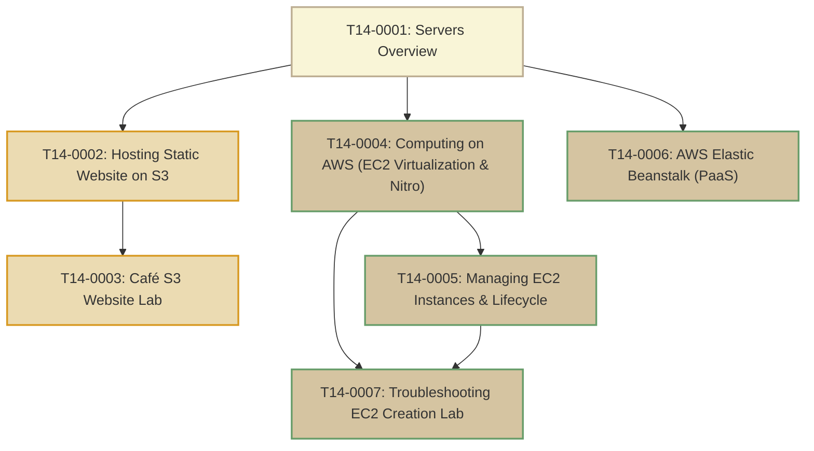

# T14: Servers

> **Course**: AWS re/Start Curriculum  
> **Module**: T14 – Servers (`M10`)  
> **Total Guides**: 7 Study Guides  
> **Status**: Completed (100%)

---

## Module Overview

The **Servers** module dives into core compute architectures across the Amazon Web Services ecosystem. It guides practitioners through the compute continuum: starting from serverless static website hosting on Amazon S3, advancing to Platform as a Service (PaaS) orchestration with AWS Elastic Beanstalk, and deeply mastering Infrastructure as a Service (IaaS) with Amazon Elastic Compute Cloud (Amazon EC2). The module thoroughly examines virtualization mechanics (Xen to AWS Nitro System), instance lifecycle state machines, hardware offloading, and structured hands-on troubleshooting.

---

## Study Guide Index

| # | Study Guide | Primary Topics Covered |
|---|-------------|------------------------|
| **0001** | [T14-0001-RSSERV_EN-US_SG_M10_SERVERSOVERVIEW.md](file:///work/tmp/aws-cf/T14-Servers/T14-0001-RSSERV_EN-US_SG_M10_SERVERSOVERVIEW.md) | Compute continuum, S3 static hosting vs dynamic compute, Xen vs AWS Nitro System, launch parameters, troubleshooting KB integration |
| **0002** | [T14-0002-RSSERV_EN-US_SG_M10_HOSTSTATICWEBSITE.md](file:///work/tmp/aws-cf/T14-Servers/T14-0002-RSSERV_EN-US_SG_M10_HOSTSTATICWEBSITE.md) | Static vs dynamic web architectures, Amazon S3 website hosting feature, Block Public Access configuration, bucket policies, CloudFront OAC |
| **0003** | [T14-0003-RSSERV_EN-US_SG_M10_CAFEWEBSITES3.md](file:///work/tmp/aws-cf/T14-Servers/T14-0003-RSSERV_EN-US_SG_M10_CAFEWEBSITES3.md) | Café business scenario (Sofía & Nikhil), 7-step hands-on S3 website hosting lab, `aws s3 sync` CLI deployment, troubleshooting 403/404 errors |
| **0004** | [T14-0004-RSSERV_EN-US_SG_M10_COMPUTINGONAWS.md](file:///work/tmp/aws-cf/T14-Servers/T14-0004-RSSERV_EN-US_SG_M10_COMPUTINGONAWS.md) | Amazon EC2 virtualization, AWS Nitro cards/security chip/hypervisor, Instance Store vs EBS, instance families, key pairs, Security Groups, IMDSv2 |
| **0005** | [T14-0005-RSSERV_EN-US_SG_M10_MANAGINGAWSINSTANCES.md](file:///work/tmp/aws-cf/T14-Servers/T14-0005-RSSERV_EN-US_SG_M10_MANAGINGAWSINSTANCES.md) | EC2 lifecycle state machine (`pending`, `running`, `stopping`, `stopped`, `terminated`, `rebooting`, `hibernating`), resizing, System vs Instance checks |
| **0006** | [T14-0006-RSSERV_EN-US_SG_M10_AWSELASTICBEANSTALK.md](file:///work/tmp/aws-cf/T14-Servers/T14-0006-RSSERV_EN-US_SG_M10_AWSELASTICBEANSTALK.md) | PaaS application orchestration, Web Server vs Worker tiers, deployment strategies (All-at-once, Rolling, Immutable, Blue/Green), `.ebextensions` |
| **0007** | [T14-0007-RSSERV_EN-US_SG_M10_TROUBLESHOOTINSTANCE.md](file:///work/tmp/aws-cf/T14-Servers/T14-0007-RSSERV_EN-US_SG_M10_TROUBLESHOOTINSTANCE.md) | Café dynamic online ordering on EC2, systematic troubleshooting triage, status checks 0/2 vs 1/2, route tables, cloud-init logs, 8-pillar KB entries |

---

## AWS Compute Paradigms Comparison

| Metric / Attribute | Amazon S3 Static Hosting | AWS Elastic Beanstalk | Amazon EC2 (Nitro IaaS) |
|---|---|---|---|
| **Abstraction Level** | Serverless Object Storage | Platform as a Service (PaaS) | Infrastructure as a Service (IaaS) |
| **Primary Use Case** | HTML, CSS, client-side JS, images | Web & worker multi-tier applications | Full OS access, custom kernels, enterprise workloads |
| **Infrastructure Overhead** | Zero (no OS, no servers, no patches) | Low (AWS provisions & patches runtime) | Full (User manages OS, patching, packages) |
| **Scaling Mechanism** | Native automatic scale | Automated ELB + Auto Scaling Groups | Configurable Auto Scaling Groups |
| **Durability / Resiliency** | 99.999999999% (11 9's) across 3+ AZs | Multi-AZ deployment options | User-architected Multi-AZ deployment |
| **Billing Model** | Per GB stored + GET/PUT requests | Underlying AWS resources only (no fee) | Per-second instance runtime + EBS storage |
