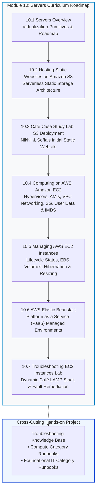
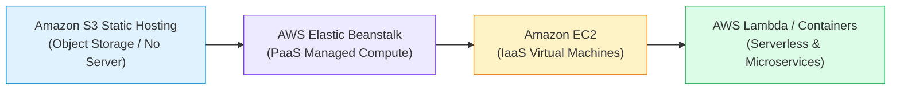
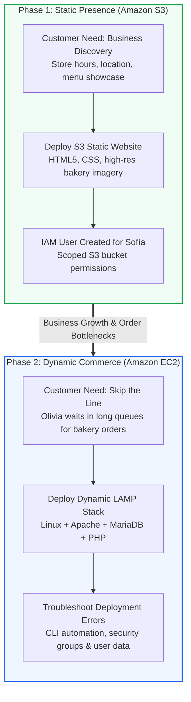
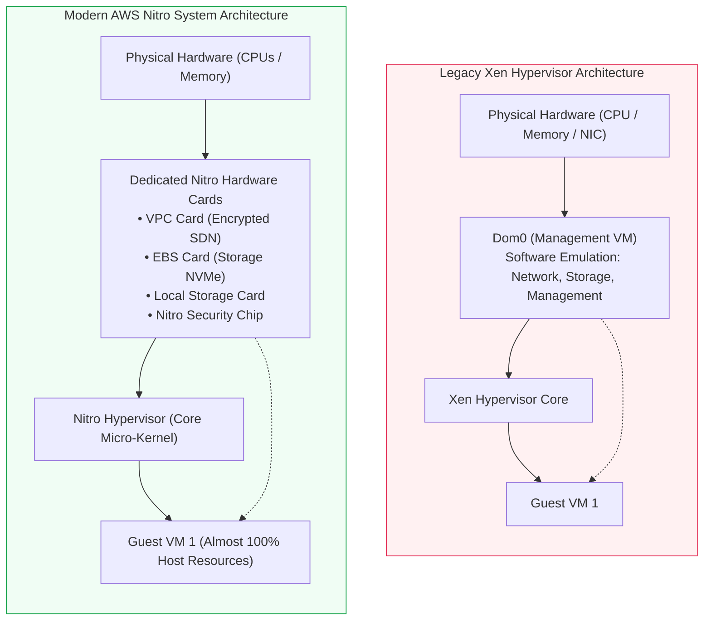
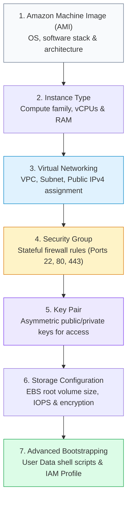
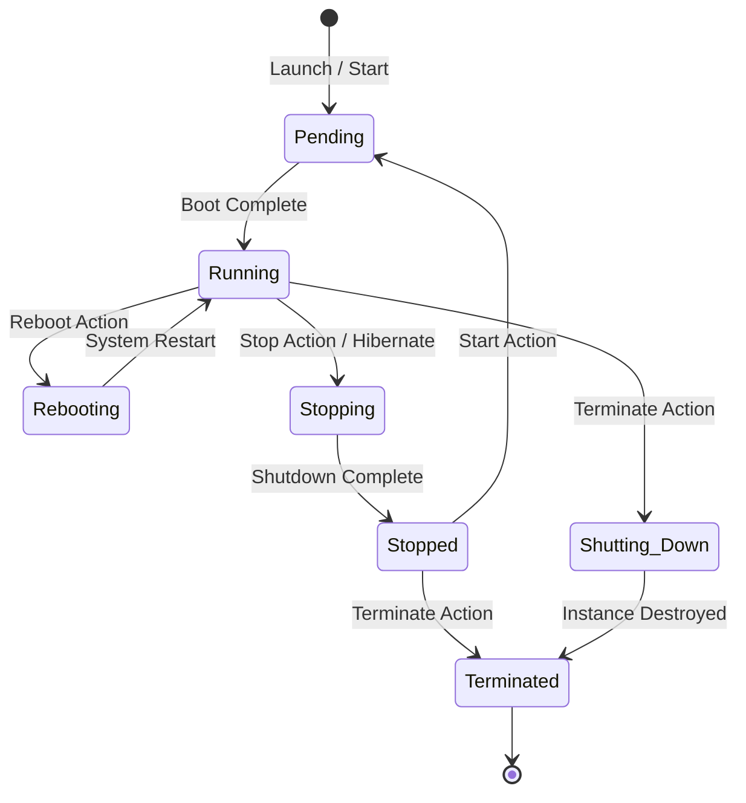

# 🖥️ Module 10: Servers Overview – Study Guide

> **Course**: AWS re/Start  
> **Module**: Servers (Module 10)  
> **Source Document**: `T14-0001-RSSERV_EN-US_SG_M10_SERVERSOVERVIEW.pdf`  
> **Target Audience**: AWS re/Start Learners / Cloud Practitioners / Systems Administrators  

---

## 🎯 Module Overview: Modern Server Architectures & Compute in the Cloud

In classical on-premises enterprise environments, deploying a new server required extensive capacity forecasting, hardware procurement cycles spanning weeks or months, physical racking, power and cooling provisioning, cabling, hypervisor installation, and manual OS configurations. If workload demand spiked, organizations faced downtime or service degradation; if demand slumped, expensive server hardware sat idle in climate-controlled server rooms consuming electrical power.

Cloud computing revolutionized this paradigm by transforming compute into an elastic, utility-style service available via APIs and web management consoles. **Amazon Web Services (AWS)** offers a diverse spectrum of compute solutions ranging from static object storage hosting to managed platforms, virtualized infrastructure, containerized execution, and event-driven serverless engines.

Module 10 (*Servers*) explores the foundational building blocks of cloud compute architectures. Through this module, learners examine how virtual machines are abstracted from physical hardware, how network boundaries and security perimeters isolate compute workloads, how to automate provisioning through bootstrapping, and how to operate and troubleshoot servers at cloud scale.

---

### 📌 Learning Objectives

- [ ] **Describe Cloud Compute Virtualization**: Understand the mechanics of hypervisors, hardware abstraction, and the evolution from legacy Xen virtualization to the high-performance AWS Nitro System.
- [ ] **Distinguish Static vs. Dynamic Computing**: Contrast Amazon Simple Storage Service (Amazon S3) static website hosting with dynamic, server-side processing environments (e.g., LAMP stack on Amazon EC2).
- [ ] **Analyze the Café Business Case Progression**: Trace how the fictional café moves from an initial static brochure website hosted on Amazon S3 to a dynamic online customer ordering platform.
- [ ] **Identify Critical EC2 Launch Parameters**: Configure virtual networking (VPC, public/private subnets, IPv4 addressing), stateful firewall boundaries (Security Groups), and cryptographic identity credentials (SSH/RDP Key Pairs).
- [ ] **Master Instance Bootstrapping and Introspection**: Implement automated bootstrap scripts using Amazon EC2 User Data and query runtime environment attributes using the Instance Metadata Service (IMDSv1 & IMDSv2).
- [ ] **Navigate the EC2 Instance Lifecycle**: Master operational states (`pending`, `running`, `stopping`, `stopped`, `rebooting`, `terminated`), instance hibernation mechanics, and resizing rules.
- [ ] **Evaluate Managed Platform Options**: Explain the value proposition of AWS Elastic Beanstalk as a Platform as a Service (PaaS) to abstract server maintenance while retaining control.
- [ ] **Triage and Diagnose Server Failures**: Differentiate System Status Checks from Instance Status Checks, inspect boot logs, diagnose network isolation issues, and resolve misconfigurations.
- [ ] **Populate the Troubleshooting Knowledge Base**: Document systematic root-cause analyses and resolution runbooks for Compute and Foundational IT categories.

---

## 🗺️ Module Roadmap & Architecture

The following diagram illustrates the structural progression of the **Module 10: Servers** curriculum, tracing the learning path from basic serverless static storage to dynamic compute, lifecycle governance, and enterprise troubleshooting.



---

## ⚡ The Compute Continuum in AWS

AWS provides multiple layers of compute abstraction. Selecting the appropriate model requires evaluating the balance between **operational control** and **management overhead**:



### Compute Abstraction Comparison

| Architectural Model | Service Examples | Abstraction Level | Operating System Access | Scaling & Management | Ideal Workload Profile |
| :--- | :--- | :--- | :--- | :--- | :--- |
| **Static Storage** | Amazon S3 | Storage-native hosting | None (Object level) | Automated, infinite global elasticity | Static client-side assets (HTML/CSS/JS, images), marketing brochures |
| **Platform as a Service (PaaS)** | AWS Elastic Beanstalk | Managed runtime platform | Optional (Direct EC2 SSH access retained) | Automated capacity provisioning, load balancing, auto scaling | Monolithic web apps (PHP, Python, Java, Node.js) requiring rapid launch |
| **Infrastructure as a Service (IaaS)** | Amazon EC2 | Full guest OS virtualization | Full `root` / `Administrator` access | Manual or Auto Scaling Group configuration | Enterprise software, legacy apps, customized kernels, low-level system tuning |
| **Serverless Compute** | AWS Lambda, AWS Fargate | Event-driven function / container | None (Ephemeral container sandboxes) | Instant per-request auto-scaling, sub-second billing | Event processing, microservices, REST APIs, asynchronous background jobs |

---

## 🌐 Theme 1: Amazon S3 Static Hosting vs. Dynamic Server Computing

### 1.1 Fundamentals of Static vs. Dynamic Web Delivery
A website's architecture is categorized by where and how its content is generated:

```
┌────────────────────────────────────────────────────────────────────────────────────────┐
│                                 Web Architecture Spectrum                              │
├────────────────────────────────────────────┬───────────────────────────────────────────┤
│           Static Website Delivery          │           Dynamic Server Computing        │
├────────────────────────────────────────────┼───────────────────────────────────────────┤
│ • Pre-rendered HTML, CSS, client-side JS   │ • Server executes runtime code per request│
│ • No backend database or application logic │ • Connects to databases (MariaDB, MySQL)  │
│ • Client browser parses and renders assets │ • Personalized content, session state     │
│ • Stored directly as objects in S3 buckets │ • Hosted on virtual machines (Amazon EC2) │
└────────────────────────────────────────────┴───────────────────────────────────────────┘
```

### 1.2 Amazon S3 Static Website Hosting Features
Amazon S3 allows an entire storage bucket to be configured as a web server for static content:
- **No Server Management**: No operating system, web daemon (Apache/Nginx), or patch management required.
- **Built-in Scalability**: Handles surges from single visits to millions of concurrent requests seamlessly.
- **Endpoint Structure**: S3 generates an HTTP endpoint using the format:  
  `http://<bucket-name>.s3-website.<region>.amazonaws.com` or `http://<bucket-name>.s3-website-<region>.amazonaws.com`.
- **Public Bucket Policy**: Requires granting public read permissions (`s3:GetObject`) and disabling S3 Block Public Access settings.

> [!NOTE]
> Amazon S3 static website hosting endpoints support **HTTP only**. To deliver content over **HTTPS** (encrypted TLS) with a custom domain name (e.g., `https://example.com`), integrate the S3 bucket with **Amazon CloudFront** and **AWS Certificate Manager (ACM)**.

---

## ☕ Theme 2: Café Case Study – Nikhil & Sofía's Journey

The AWS re/Start curriculum grounds server concepts in a practical business narrative featuring a local café owned by Frank and Martha, with technical staff Sofía and Nikhil.



### 2.1 Phase 1: The Initial Static Brochure Site
- **Business Problem**: The café needs an online presence to showcase artisan products, provide operating hours, display physical location details, and share telephone contact information.
- **Implementation**: Nikhil provisions an Amazon S3 bucket configured for static hosting. He configures an AWS Identity and Access Management (IAM) user for Sofía with scoped S3 access so she can upload HTML, CSS, and image assets.
- **Result**: Zero server operating costs during off-hours, high availability, and zero infrastructure maintenance.

### 2.2 Phase 2: The Online Ordering Evolution
- **Business Problem**: A regular customer (Olivia) experiences long wait times in line to pick up specialty cakes. The café risks losing customer satisfaction without an order-ahead system.
- **Technical Requirement**: A static website cannot process transactions, store state, or update inventory. The café requires a backend application server and database.
- **Architecture**: A **LAMP stack** running on an Amazon EC2 instance:
  - **L** (Linux): Amazon Linux operating system.
  - **A** (Apache): Web daemon listening on port 80/443.
  - **M** (MariaDB): Relational database storing customer orders and inventory tables.
  - **P** (PHP): Server-side scripting generating dynamic responses and querying MariaDB.

---

## ⚙️ Theme 3: Amazon EC2 Virtualization & Hardware Abstraction

Amazon Elastic Compute Cloud (Amazon EC2) provides resizable compute capacity in the cloud. Under the hood, an EC2 instance is a virtual machine (VM) running on a physical host server located inside an AWS Availability Zone (AZ).

### 3.1 The Hypervisor Layer: From Xen to AWS Nitro System
A **hypervisor** (Virtual Machine Monitor) manages physical hardware resources and presents isolated virtual execution environments to guest operating systems.



#### The Architecture Shift
1. **Xen Virtualization (Historical)**:
   - Utilized a privileged management virtual machine called **Domain 0 (Dom0)**.
   - Dom0 ran administrative software, hypervisor monitoring agents, and emulated network and storage devices in software.
   - **Trade-off**: Dom0 consumed significant physical CPU, RAM, and I/O resources, subtracting from capacity available to customer instances.
2. **The AWS Nitro System (Modern Standard)**:
   - Offloads virtually all storage, networking, security, and management overhead to dedicated, specialized PCI-e hardware accelerators (**Nitro Cards**).
   - **Nitro Hypervisor**: A lightweight, minimalist hypervisor that manages only CPU and memory allocation without complex device emulation.
   - **Nitro Security Chip**: Hardware-enforced root of trust that continuously monitors and validates system firmware.
   - **Benefits**: Near-bare-metal performance, predictable I/O latency, hardware-enforced isolation, and near 100% of host CPU/RAM available to customer VMs.

### 3.2 Instance Storage: Instance Store vs. Amazon EBS

EC2 instances utilize two fundamentally different block storage architectures:

```
┌────────────────────────────────────────────────────────────────────────────────────────┐
│                               Block Storage Comparison                                 │
├────────────────────────────────────────────┬───────────────────────────────────────────┤
│          Instance Store (Ephemeral)        │         Amazon EBS (Persistent Network)   │
├────────────────────────────────────────────┼───────────────────────────────────────────┤
│ • Physically attached to host server       │ • Network-attached block storage device   │
│ • Ultra-low latency, high IOPS SSD/NVMe    │ • Persists independently of instance life │
│ • Data lost on STOP, TERMINATE, or failure │ • Survives STOP and START operations      │
│ • Ideal for swap space, buffers, caches    │ • Required for root boot volumes & DBs    │
└────────────────────────────────────────────┴───────────────────────────────────────────┘
```

> [!CAUTION]
> If an instance backed only by an **Instance Store** stops or fails, all data on that drive is lost permanently. Do not store persistent database files or critical application assets on instance store volumes without automated replication.

---

## 🚀 Theme 4: Essential Launch Parameters

Launching an Amazon EC2 instance requires defining critical infrastructure, networking, and security parameters:



### 4.1 Networking Infrastructure: VPC & Subnets
- **Virtual Private Cloud (VPC)**: A logically isolated virtual network dedicated to your AWS account.
- **Subnets**: IP address ranges segmented within specific Availability Zones.
  - **Public Subnet**: Contains a routing table entry pointing to an **Internet Gateway (IGW)** (`0.0.0.0/0 -> igw-xxxx`). Instances inside must have public IPv4 addresses to communicate with the public internet.
  - **Private Subnet**: No direct route to an Internet Gateway. Outbound internet access requires a **NAT Gateway** or NAT instance located in a public subnet.
- **Public IPv4 Addressing**:
  - Automatically assigned ephemeral public IPv4: Released when the instance is stopped.
  - **Elastic IP (EIP)**: Static, persistent public IPv4 allocated to your account that remains associated across stop/start cycles.

### 4.2 Security Groups: Stateful Virtual Firewalls
Security Groups act as virtual firewalls at the Elastic Network Interface (ENI) level, controlling ingress (inbound) and egress (outbound) traffic.

```
┌────────────────────────────────────────────────────────────────────────────────────────┐
│                           Security Group Rule Architecture                             │
├──────────────┬─────────────┬─────────────┬──────────────────┬──────────────────────────┤
│ Direction    │ Protocol    │ Port Range  │ Source / Target  │ Typical Use Case         │
├──────────────┼─────────────┼─────────────┼──────────────────┼──────────────────────────┤
│ Inbound      │ TCP         │ 22          │ Admin IP /32     │ Secure Shell (SSH) Linux │
│ Inbound      │ TCP         │ 3389        │ Admin IP /32     │ Remote Desktop (RDP) Win │
│ Inbound      │ TCP         │ 80          │ 0.0.0.0/0        │ Public HTTP Web Traffic  │
│ Inbound      │ TCP         │ 443         │ 0.0.0.0/0        │ Public HTTPS Web Traffic │
│ Outbound     │ ALL         │ ALL         │ 0.0.0.0/0        │ Default outbound access  │
└──────────────┴─────────────┴─────────────┴──────────────────┴──────────────────────────┘
```

> [!IMPORTANT]
> **Stateful Nature of Security Groups**: If an inbound request is permitted by a Security Group rule, the response traffic is automatically allowed outbound, regardless of outbound rules. Conversely, if an outbound request is initiated, return response traffic is automatically permitted inbound.

### 4.3 Key Pairs: Cryptographic Remote Access
Amazon EC2 uses industry-standard asymmetric public key cryptography:
- **Public Key**: Uploaded to AWS and injected into the instance operating system during initialization (stored in `~/.ssh/authorized_keys` for Linux).
- **Private Key (`.pem` / `.ppk`)**: Downloaded and stored securely by the customer. AWS never retains a copy of the private key.
- **Linux Connection**: Authenticate using SSH:
  ```bash
  chmod 400 my-keypair.pem
  ssh -i my-keypair.pem ec2-user@<public-ip-or-dns>
  ```
- **Windows Connection**: The private key is used to decrypt the auto-generated local `Administrator` password via the EC2 console or API.

---

## 🛠️ Theme 5: User Data Bootstrapping vs. Instance Metadata (IMDS)

Understanding the distinction between User Data and Instance Metadata is essential for systems administration and automated infrastructure deployment:

```
┌────────────────────────────────────────────────────────────────────────────────────────┐
│                              User Data vs. Instance Metadata                           │
├────────────────────────────────────────────┬───────────────────────────────────────────┤
│             Amazon EC2 User Data           │        Instance Metadata Service (IMDS)   │
├────────────────────────────────────────────┼───────────────────────────────────────────┤
│ • Injected at instance launch              │ • Internal data generated by AWS runtime  │
│ • Contains shell scripts or cloud-config   │ • Queried from inside the running VM      │
│ • Runs automatically during boot           │ • Contains instance ID, AMI, IP, role     │
│ • Configures OS, installs packages         │ • Accessed via link-local: 169.254.169.254│
└────────────────────────────────────────────┴───────────────────────────────────────────┘
```

### 5.1 Bootstrapping with User Data
User Data enables automated server bootstrapping without interactive SSH sessions.
- **Execution Mechanism**:
  - **Linux**: Handled by the `cloud-init` package. Runs during the final phase of the initial boot sequence with `root` privileges.
  - **Windows**: Handled by the `EC2Launch` (or `EC2Config` on older AMIs) service.
- **Default Execution Lifecycle**: User data scripts execute **only once** by default during the initial launch boot. They do not re-run on subsequent reboots unless explicitly reconfigured via cloud-init directives.

#### Example: Automated LAMP Stack Bootstrap Script
```bash
#!/bin/bash
# Update system package repositories
yum update -y

# Install Apache Web Server, MariaDB client, and PHP 7.x
yum install -y httpd mariadb php php-mysqlnd

# Start Apache HTTP daemon and enable automatic startup on boot
systemctl start httpd
systemctl enable httpd

# Deploy sample index.html page
echo "<h1>Welcome to the Dynamic Café Server</h1>" > /var/www/html/index.html
```

### 5.2 Instance Metadata Service (IMDS)
The **Instance Metadata Service (IMDS)** provides configuration and runtime information directly to software executing inside an EC2 instance. All metadata requests query the special link-local IPv4 address: `http://169.254.169.254/latest/meta-data/`.

#### Common Metadata Categories
- `instance-id`: Unique physical identifier (e.g., `i-0123456789abcdef0`).
- `instance-type`: Hardware size profile (e.g., `t3.micro`).
- `ami-id`: Base AMI used to initialize the instance.
- `local-ipv4` / `public-ipv4`: Internal private and external public IP assignments.
- `iam/security-credentials/<role-name>`: Temporary STS credentials supplied by an IAM instance profile.

#### IMDSv1 vs. IMDSv2 (Security Hardening)
AWS introduced IMDSv2 to defend against Server-Side Request Forgery (SSRF) vulnerabilities and open reverse proxy misconfigurations.

```bash
# ==========================================
# IMDSv1 (Legacy - Insecure against SSRF)
# Direct HTTP GET request
# ==========================================
curl http://169.254.169.254/latest/meta-data/instance-id

# ==========================================
# IMDSv2 (Modern Best Practice - Session-Oriented)
# Step 1: Request a session token (TTL max 6 hours)
# ==========================================
TOKEN=$(curl -s -X PUT "http://169.254.169.254/latest/api/token" \
  -H "X-aws-ec2-metadata-token-ttl-seconds: 21600")

# Step 2: Query metadata using the acquired token header
INSTANCE_ID=$(curl -s -H "X-aws-ec2-metadata-token: $TOKEN" \
  http://169.254.169.254/latest/meta-data/instance-id)

echo "Current Instance ID is: $INSTANCE_ID"
```

> [!TIP]
> Always enforce IMDSv2 across enterprise environments (`HttpTokens=required`) to prevent malicious actors from extracting IAM role credentials through application-level SSRF vulnerabilities.

---

## 🔄 Theme 6: Managing Instances at Scale

### 6.1 The EC2 Instance Lifecycle

Understanding instance states is vital for cost optimization and capacity planning:



#### Lifecycle State Characteristics

| Instance State | Host Machine | Billing (Compute) | Elastic IP Retained? | Ephemeral Public IP Retained? | Instance Store Data |
| :--- | :--- | :--- | :--- | :--- | :--- |
| **`pending`** | Allocating host | No | Yes | N/A | Initializing |
| **`running`** | Active physical host | **Yes** | Yes | Yes | Retained |
| **`rebooting`** | Remains on **same** host | **Yes** | Yes | **Yes** | **Retained** |
| **`stopping`** | Preparing flush/shutdown | No | Yes | Releasing | Releasing |
| **`stopped`** | Host released | **No** (EBS storage only) | Yes | **Lost / Released** | **Lost** |
| **`terminated`**| Hardware decommissioned | None | Disassociated | Released | Lost |

### 6.2 Instance Hibernation
Hibernation provides near-instant boot resumption for memory-intensive applications:
- **Mechanics**: AWS signals the guest OS to flush physical system memory (RAM) directly to the encrypted Amazon EBS root volume, after which the instance enters the `stopped` state.
- **Resumption**: When started, the instance bypasses full OS bootstrap cycles, restores RAM contents from EBS, and resumes running processes in their exact pre-hibernation state.
- **Prerequisites**:
  - EBS root volume must be encrypted.
  - Root volume must be large enough to accommodate the RAM footprint.
  - Supported OS AMIs and instance families only.

### 6.3 Instance Modification Rules
To scale vertically (e.g., resizing from `t3.micro` to `m5.large`):
1. The instance must be in the **`stopped`** state (cannot modify instance types while `running`).
2. The root device must be an **EBS volume** (Instance Store-backed instances cannot be modified in place).
3. The new instance type must be architecturally compatible (e.g., matching 64-bit x86 vs. ARM Graviton processor architecture, virtualization type HVM, and network drivers).

### 6.4 AWS Systems Manager (SSM) Session Manager
Modern enterprise cloud operations discourage opening inbound SSH (port 22) or RDP (port 3389) ports to the internet.
- **Session Manager Feature**: Enables secure shell and PowerShell access through the AWS Management Console or AWS CLI without opening inbound ports or deploying bastion jump hosts.
- **Requirements**:
  - Amazon SSM Agent installed on the guest OS.
  - An IAM Role attached with `AmazonSSMManagedInstanceCore` permissions.
  - Outbound HTTPS connectivity to Systems Manager endpoints (via NAT Gateway or VPC Endpoints).

---

## 🛠️ Troubleshooting Knowledge Base Project Integration

Throughout the **Module 10: Servers** curriculum, learners maintain a hands-on **Troubleshooting Knowledge Base**. Entries are organized into two primary categories:

```
┌────────────────────────────────────────────────────────────────────────────────────────┐
│                        Troubleshooting Knowledge Base Structure                        │
├────────────────────────────────────────────┬───────────────────────────────────────────┤
│              Compute Category              │          Foundational IT Category         │
├────────────────────────────────────────────┼───────────────────────────────────────────┤
│ • EC2 Status Check Failures                │ • Security Group vs NACL ingress blocks   │
│ • User Data bootstrap execution failures   │ • Private key permission errors (SSH 0400)│
│ • Instance resizing architecture mismatch  │ • Missing Route Table Internet Gateway    │
│ • EBS Volume mount & exhaustion issues     │ • Host DNS resolution / DHCP lease issues │
└────────────────────────────────────────────┴───────────────────────────────────────────┘
```

### 7.1 Compute Category: Triage Runbooks

#### Runbook COMP-01: EC2 Status Check Failures (System vs. Instance)
- **Symptom**: Instance shows `1/2 checks passed` or `0/2 checks passed` in the EC2 Console.
- **Diagnostic Matrix**:
  ```
  Status Check Failure Detection
  ├── System Status Check (0/2 or 1/2)
  │   └── Root Cause: Physical AWS hardware, host rack, loss of host power, network degradation
  │   └── Remediation: Stop and Start instance (forces migration to healthy physical hardware)
  └── Instance Status Check (1/2)
      └── Root Cause: Corrupted OS kernel, file system errors, driver crash, memory exhaustion
      └── Remediation: Inspect Get-Console-Output / System Logs, detach EBS root volume, rescue mount
  ```
- **Resolution Commands**:
  ```bash
  # Check instance status via AWS CLI
  aws ec2 describe-instance-status --instance-id i-0123456789abcdef0

  # Retrieve serial console output to view kernel panic or bootstrap logs
  aws ec2 get-console-output --instance-id i-0123456789abcdef0 --output text
  ```

#### Runbook COMP-02: User Data Script Execution Failures
- **Symptom**: Instance launches and reports `2/2 checks passed`, but the web application (e.g., Apache/PHP) is unreachable or fails to respond.
- **Root Cause**: Syntax error in user data script, failed `yum`/`apt` package mirror resolution, or missing executable permissions.
- **Investigation**:
  Log in to the instance and inspect the cloud-init execution logs:
  ```bash
  # Inspect cloud-init output log for stdout and stderr of user data scripts
  sudo cat /var/log/cloud-init-output.log

  # Review full cloud-init operational execution stages
  sudo cat /var/log/cloud-init.log
  ```
- **Preventative Best Practice**: Always include error handling in user data scripts (`set -e` or redirect output to local logging files: `exec > >(tee /var/log/user-data.log|logger -t user-data -s 2>/dev/console) 2>&1`).

---

### 7.2 Foundational IT Category: Triage Runbooks

#### Runbook FIT-01: SSH Connection Refused vs. Timeout
- **Symptom**: Running `ssh -i key.pem ec2-user@<public-ip>` fails.
- **Diagnostic Triage**:
  - **Case A: `Connection timed out`**:
    - **Cause**: Network packets dropped before reaching the OS.
    - **Check**: Security Group inbound rules (is port 22 open to client IP?), Route Table (is `0.0.0.0/0` routed to an `igw-xxxx`?), or Network ACLs (stateless block).
  - **Case B: `Connection refused`**:
    - **Cause**: Network path is open, but no process is listening on port 22, or firewall software inside the OS (`iptables`/`ufw`) rejected the connection.
    - **Check**: SSH daemon service status (`systemctl status sshd`).
  - **Case C: `Permissions 0644 for 'key.pem' are too open`**:
    - **Cause**: SSH client refuses unencrypted private keys accessible by other users.
    - **Fix**: `chmod 400 key.pem` (read-only for file owner).

#### Runbook FIT-02: Public IP Disappearance Post-Restart
- **Symptom**: Developers access a test server via public IP address. After stopping the instance overnight to save costs, restarting it in the morning results in a completely unreachable URL.
- **Root Cause**: By default, AWS assigns an **ephemeral public IPv4 address** from the AWS dynamic pool. When an instance enters the `stopped` state, this address is released back to the global AWS pool. Upon starting, a new public IP address is assigned.
- **Resolution**:
  1. Allocate an **Elastic IP (EIP)** and associate it with the instance's network interface for persistent addressing.
  2. Map a DNS record via **Amazon Route 53** using an Alias record or CNAME pointing to the public DNS hostname.

---

## 📝 Knowledge Check & Review

Test your understanding of the foundational server concepts covered in this module.

### Question 1
An enterprise launches an Amazon EC2 instance within a custom VPC. The instance is in a running state, has a public IP address assigned, and displays `2/2 status checks passed`. However, administrators cannot connect via SSH from the internet. What is the most probable root cause?
- A) The instance type does not support the AWS Nitro System.
- B) The instance root volume is an Instance Store rather than Amazon EBS.
- C) The VPC route table for the subnet lacks an Internet Gateway route (`0.0.0.0/0 -> igw-xxxx`), or the Security Group lacks an inbound rule for TCP port 22.
- D) The user data script failed during initial boot.

<details>
<summary>👉 View Answer & Explanation</summary>

**Correct Answer**: **C**  
**Explanation**: For an EC2 instance to be reachable over the public internet, three conditions must align:
1. It must have a public IPv4 address.
2. Its subnet route table must direct default outbound traffic (`0.0.0.0/0`) to an Internet Gateway (IGW).
3. Its Security Group must explicitly permit inbound traffic on the desired service port (TCP port 22 for SSH) from the administrator's source IP address.
</details>

---

### Question 2
How does the AWS Nitro System improve compute performance compared to earlier Xen-based virtualization architectures?
- A) It eliminates the need for Amazon EBS volumes by utilizing local tape drives.
- B) It offloads hypervisor functions such as networking, storage I/O, and security monitoring onto dedicated Nitro hardware cards, freeing host CPU and memory for customer workloads.
- C) It converts all dynamic applications into static files hosted on Amazon S3.
- D) It enforces compulsory hibernation across all running EC2 instances.

<details>
<summary>👉 View Answer & Explanation</summary>

**Correct Answer**: **B**  
**Explanation**: The AWS Nitro System re-architects virtualization by moving storage (EBS Card), networking (VPC Card), and management processes away from the host CPU onto specialized hardware cards. This allows the lightweight Nitro Hypervisor to deliver near-bare-metal compute performance with almost 100% of host resources allocated directly to customer instances.
</details>

---

### Question 3
An application running on an EC2 instance needs to discover its own private IP address, instance type, and Availability Zone at runtime. What is the recommended and secure mechanism to retrieve this data?
- A) Hardcode the values into the application's source code before deployment.
- B) Query the AWS Management Console manually using a browser inside the instance.
- C) Query the Instance Metadata Service (IMDSv2) at `http://169.254.169.254/latest/meta-data/` using a session token obtained via an HTTP PUT request.
- D) Inspect the `/var/log/cloud-init-output.log` file.

<details>
<summary>👉 View Answer & Explanation</summary>

**Correct Answer**: **C**  
**Explanation**: The Instance Metadata Service (IMDS) runs on the non-routable link-local address `169.254.169.254`. IMDSv2 requires initiating a session by issuing an HTTP `PUT` request with the `X-aws-ec2-metadata-token-ttl-seconds` header to acquire a session token, which is then passed in subsequent `GET` requests to safely retrieve runtime instance properties.
</details>

---

### Question 4
Why must an Amazon EC2 instance be stopped before modifying its instance type?
- A) Stopping the instance frees the public IP address so AWS can assign a faster one.
- B) Hardware attributes (vCPU, memory, hypervisor bindings) cannot be reconfigured while the guest operating system and CPU cores are actively executing code on a physical host.
- C) Stopping the instance converts it into an Elastic Beanstalk application.
- D) Instance types can only be modified if the instance is terminated and recreated from scratch.

<details>
<summary>👉 View Answer & Explanation</summary>

**Correct Answer**: **B**  
**Explanation**: An EC2 instance type defines the underlying physical hardware allocation (CPU cores, RAM size, network bandwidth, hypervisor profiles). To reallocate these physical resources or migrate the virtual machine to a different host computer family, the guest operating system must be shut down and in the `stopped` state.
</details>

---

## 🔑 Key Takeaways & Summary

1. **Spectrum of Compute**: AWS provides compute options tailored to diverse requirements—from zero-management static hosting on Amazon S3 and managed PaaS on Elastic Beanstalk to complete OS-level control on Amazon EC2 and event-driven serverless architectures.
2. **Virtualization Evolution**: The AWS Nitro System represents the modern virtualization benchmark, offloading network and storage processing to dedicated silicon to maximize compute efficiency and security.
3. **Core Launch Trilogy**: Every successful EC2 launch depends on the coordinated configuration of **Networking** (VPC, subnet, public IP routing), **Security Groups** (stateful port rules), and **Key Pairs** (cryptographic SSH/RDP access).
4. **Bootstrapping vs. Metadata**: Use **User Data** to configure and install software automatically at launch; query **Instance Metadata (IMDSv2)** from inside the instance to inspect runtime environmental details.
5. **Lifecycle Disciplines**: An EC2 reboot maintains host placement and public IP addressing; stopping an instance releases ephemeral public IPs and moves the VM to an unallocated state, enabling hardware resizing.
6. **Knowledge Base Documentation**: Systematic capture of triage workflows in Compute and Foundational IT categories accelerates problem resolution and builds institutional operational excellence.
