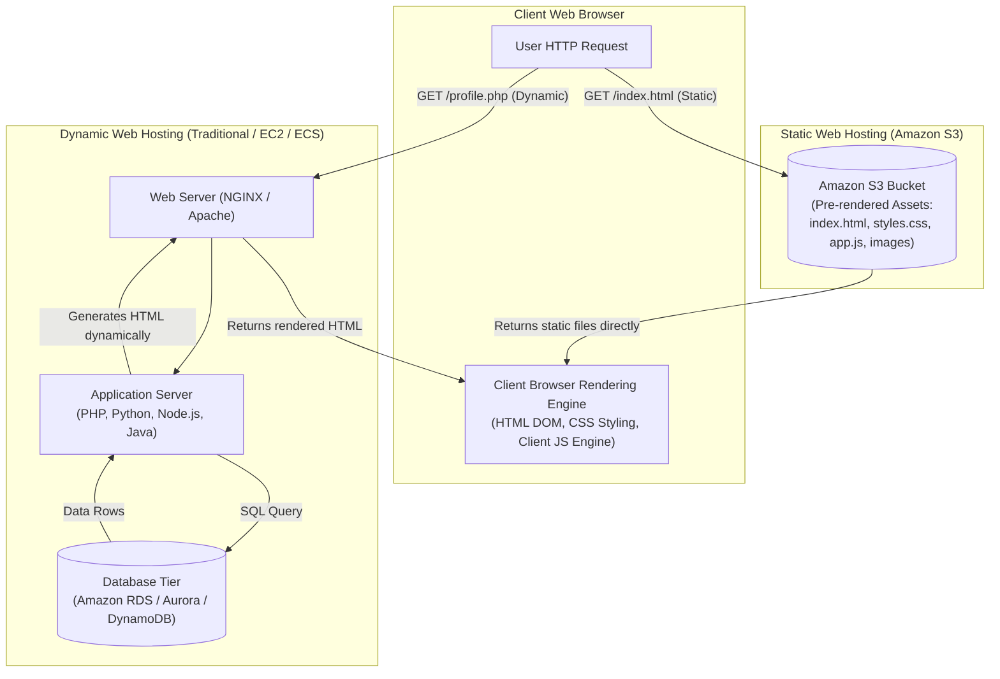
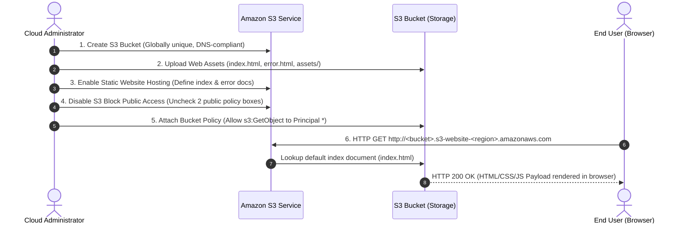
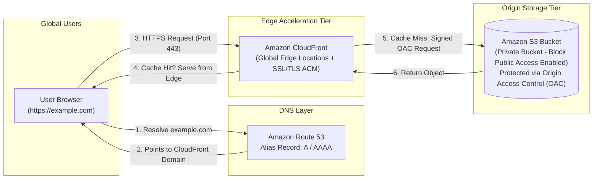
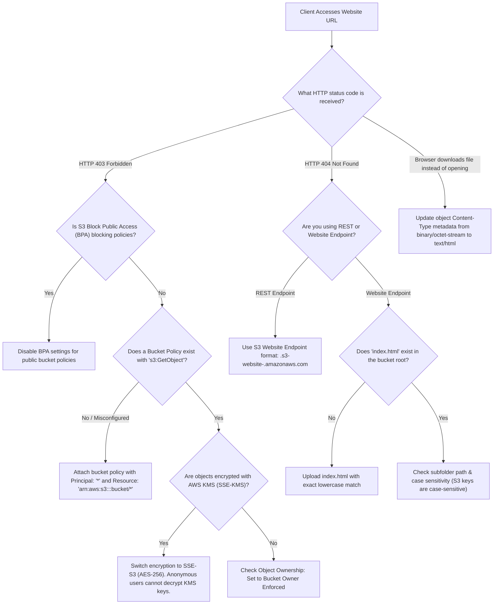

# 🌐 Module 10: Hosting a Static Website on Amazon S3 – Study Guide

> **Course**: AWS re/Start  
> **Module**: M10 – Servers  
> **Source Document**: `T14-0002-RSSERV_EN-US_SG_M10_HOSTSTATICWEBSITE.pdf`  
> **Target Audience**: AWS re/Start Learners, Cloud Practitioners, and Systems Administrators  

---

## 🎯 Module Overview

Hosting web content is one of the most fundamental operations in modern cloud computing. Historically, serving even simple web pages required provisioning, patching, configuring, and managing physical or virtual web servers (such as Apache HTTP Server, NGINX, or Microsoft IIS). This traditional hosting model incurs ongoing administrative overhead, persistent operational expenses, and capacity planning challenges to handle traffic spikes.

**Amazon Simple Storage Service (Amazon S3)** provides a native **Static Website Hosting** feature that allows organizations and developers to host high-performance, cost-effective, and automatically scalable web applications directly from an S3 bucket without managing any underlying server infrastructure.

This study guide explores the fundamental differences between static and dynamic web architectures, dissects how Amazon S3 serves website traffic, provides an end-to-end configuration workflow, details DNS integration with Amazon Route 53 and CDN acceleration with Amazon CloudFront, and presents operational troubleshooting methodologies for real-world deployments.

---

### 📌 Learning Objectives

- [ ] **Distinguish Static vs. Dynamic Websites**: Contrast client-side execution (HTML, CSS, JavaScript) with server-side processing runtimes (PHP, Python, Node.js, Java) and database backends.
- [ ] **Analyze S3 Static Website Hosting Capabilities**: Understand how S3 acts as a serverless web server, including automatic scaling, 11 9s durability, and cost mechanics.
- [ ] **Identify Website Endpoint URL Structures**: Recognize regional endpoint syntax conventions (dash `-` vs. dot `.` separator formats).
- [ ] **Execute the End-to-End Setup Workflow**: Provision a DNS-compliant bucket, upload structured assets, enable website hosting, configure index and error documents, adjust Block Public Access (BPA), and attach a public-read bucket policy.
- [ ] **Differentiate S3 REST API Endpoints from Website Endpoints**: Understand routing behaviors, index document defaults, redirect rules, and error page handling.
- [ ] **Implement Production Enhancements**: Integrate Amazon Route 53 for custom domain mapping (Alias records) and Amazon CloudFront for SSL/TLS (HTTPS) encryption and low-latency global delivery.
- [ ] **Troubleshoot Common S3 Hosting Errors**: Diagnose and remediate HTTP `403 Forbidden` and `404 Not Found` response codes using structured decision logic.

---

## 📚 Key Terminology

| Term | Definition |
| :--- | :--- |
| **Static Website** | A website consisting of fixed files (HTML, CSS, client-side JavaScript, images, and fonts) delivered to the client browser exactly as stored, requiring no server-side compute runtime. |
| **Dynamic Website** | A website that generates web page content dynamically on the server in response to user requests, utilizing server-side application runtimes (e.g., PHP, Python, Java) and databases (e.g., MySQL, PostgreSQL). |
| **S3 Website Endpoint** | A specialized HTTP URL assigned to an S3 bucket configured for website hosting that supports default index documents, custom error pages, and web redirects. |
| **REST API Endpoint** | The standard S3 endpoint format (e.g., `<bucket>.s3.<region>.amazonaws.com`) used for programmatic API operations (GET, PUT, DELETE) rather than browser-based web hosting. |
| **Index Document** | The default web page (typically `index.html`) returned by S3 when a client makes a request to the root directory or a subfolder within the website. |
| **Error Document** | A custom web page (typically `error.html` or `404.html`) returned to the user when an HTTP 4xx or 5xx client/server error occurs. |
| **S3 Block Public Access (BPA)** | A four-part centralized security control at the AWS account and bucket level that prevents accidental exposure of S3 resources to the public internet. |
| **Bucket Policy** | A resource-based JSON policy attached to an S3 bucket that defines explicit access permissions (allow/deny) for actions, principals, and resource ARNs. |
| **Amazon Route 53** | A scalable, highly available cloud Domain Name System (DNS) web service used to route end-user internet traffic to AWS resources and external domains. |
| **Route 53 Alias Record** | A specialized Route 53 DNS record that routes traffic directly to selected AWS resources (such as S3 website endpoints, CloudFront distributions, or ELB load balancers) without incurring additional query fees. |
| **Amazon CloudFront** | A global Content Delivery Network (CDN) service that securely delivers data, videos, applications, and APIs to users worldwide with low latency and high transfer speeds. |
| **Origin Access Control (OAC)** | A secure authorization mechanism enabling Amazon CloudFront distributions to access private Amazon S3 buckets without making the bucket publicly accessible. |

---

## 🏛️ 1. Static vs. Dynamic Websites: Architectural Deep-Dive

Web architectures fall into two primary paradigms based on where processing logic executes: **Static** and **Dynamic**.

### 1.1 Fundamentals: Client-Side vs. Server-Side Execution



#### Static Websites
- **Pre-rendered Content**: Web assets exist as static files stored on disk or object storage.
- **Client-Side Execution**: All processing, styling, and interactivity run strictly in the user's browser.
- **Technologies**: HTML5, CSS3, client-side JavaScript, WebAssembly, pre-compiled static assets, media files (PNG, SVG, MP4).
- **Single-Page Applications (SPAs)**: Frameworks such as React, Vue, Angular, and Next.js (exported as static site) are architecturally static from a hosting standpoint. The S3 bucket serves the compiled JavaScript bundle (`bundle.js`) and root `index.html`; the user's browser downloads the bundle and makes asynchronous REST/GraphQL API calls (via AJAX or Fetch) to cloud backend APIs (such as Amazon API Gateway and AWS Lambda).

#### Dynamic Websites
- **Runtime Compute**: Each incoming HTTP request initiates execution of backend server-side scripts (e.g., PHP scripts, Python Django/Flask, Ruby on Rails, Java Spring Boot).
- **State & Database Access**: The backend server connects to a persistent database (e.g., MySQL, PostgreSQL, MongoDB), queries customer records, computes business logic, handles sessions/cookies, and compiles HTML on the fly.
- **Operational Cost**: Requires dedicated computing instances (Amazon EC2, Amazon ECS containers, or AWS Elastic Beanstalk) that must remain running, patched, scaled, and monitored 24/7.

---

### 1.2 Comprehensive Architectural Comparison

| Dimension | Static Website (Amazon S3) | Dynamic Website (EC2 / Container / Beanstalk) |
| :--- | :--- | :--- |
| **Server Administration** | **Zero**. Fully managed, serverless object storage architecture. | **High**. OS patching, kernel upgrades, web server runtime config, security agents. |
| **Compute Runtime** | None required on the server side. | Dedicated compute required (CPU, memory, storage volumes). |
| **Scalability** | **Virtually unlimited automatic elasticity**. Seamlessly scales from 1 request/day to millions of requests/second without configuration. | **Manual or Auto Scaling**. Requires configuring Auto Scaling groups, launch templates, and target tracking metrics. |
| **Availability & Durability** | **99.999999999% (11 9s)** durability; 99.9% availability SLA backed by redundant physical facilities across multiple AZs. | Depends on multi-AZ configuration, load balancer health checks, and database replication replicas. |
| **Cost Structure** | **Pay-as-you-go micro-pricing**: Fractions of a cent per GB storage (~$0.023/GB/mo) and per thousand GET requests (~$0.0004/1,000 requests). | **Hourly/Monthly runtime compute**: Persistent instance charges (e.g., t3.medium running 24/7), EBS volume storage, database instance licensing. |
| **Security Surface** | **Minimal**. No underlying operating system, no open listening ports (SSH, RDP, HTTP daemon vulnerabilities), no SQL injection at the hosting layer. | **Extensive**. OS hardening, open ports, SSH key management, runtime CVE vulnerability patching, web application firewall (WAF). |
| **Database Integration** | Connects to decoupled cloud APIs (API Gateway, AWS Lambda, DynamoDB) via client-side JavaScript fetch. | Direct server-to-database connections (JDBC, PDO, ORMs) inside private VPC subnets. |
| **Supported Protocols** | Direct S3 endpoint supports **HTTP only**. (HTTPS achieved via Amazon CloudFront). | HTTP and native HTTPS (terminating SSL/TLS on instances or Application Load Balancers). |

---

## 🪣 2. Amazon S3 Static Website Hosting Feature

### 2.1 How Amazon S3 Operates as a Serverless Web Server
Amazon S3 is primarily an object store, designed to store arbitrary data blobs addressable via REST APIs. However, when the **Static Website Hosting** feature is enabled on an S3 bucket:

1. **Web Server Behavior**: S3 simulates traditional HTTP web server software (such as Apache or NGINX). It listens for standard HTTP `GET` and `HEAD` requests.
2. **Index Document Resolution**: When a client requests a URL ending with a trailing slash (e.g., `http://mybucket.s3-website-us-west-2.amazonaws.com/` or `.../about/`), S3 automatically appends and serves the configured index document (e.g., `index.html` or `about/index.html`).
3. **Custom Error Handling**: When a requested object does not exist or access is forbidden, S3 automatically returns the designated error document (e.g., `error.html`) accompanied by the appropriate HTTP status code (`404 Not Found` or `403 Forbidden`).
4. **Redirection Engine**: S3 supports page-level and bucket-level redirect rules, enabling permanent redirects (HTTP 301) to new page URLs or external domains.

---

### 2.2 S3 REST API Endpoint vs. S3 Website Endpoint

Understanding the distinction between an S3 REST API endpoint and an S3 Static Website endpoint is essential for cloud engineers:

| Feature / Behavior | S3 REST API Endpoint | S3 Website Hosting Endpoint |
| :--- | :--- | :--- |
| **Endpoint Format** | `<bucket>.s3.<region>.amazonaws.com` | `<bucket>.s3-website-<region>.amazonaws.com` or `<bucket>.s3-website.<region>.amazonaws.com` |
| **Supported Protocols** | HTTP and **HTTPS** | **HTTP only** (Port 80) |
| **Default Root Index** | Returns an XML bucket listing (or Access Denied) | Automatically returns the configured **Index Document** (e.g., `index.html`) |
| **Subfolder Index** | Returns XML Access Denied / NoSuchKey | Automatically serves subfolder index (e.g., `/photos/` $\rightarrow$ `/photos/index.html`) |
| **Custom Error Pages** | Returns raw S3 XML error message (`<Error><Code>NoSuchKey</Code>...`) | Returns user-friendly formatted **Error Document** (e.g., `error.html`) |
| **URL Redirects** | Does not support web redirection rules | Supports HTTP redirect rules (e.g., 301 Moved Permanently) |
| **Authentication** | Supports IAM, AWS Signature V4, Pre-signed URLs, public access | Requires **anonymous public read** (or CloudFront OAC); does not support query string SigV4 |

> [!WARNING]
> **HTTPS Limitation on Native S3 Website Endpoints**:  
> The native Amazon S3 website endpoint does **not** support SSL/TLS (HTTPS). It only answers on `http://`. Attempting to connect over `https://<bucket>.s3-website-<region>.amazonaws.com` will result in an SSL handshake failure or certificate mismatch. To provide HTTPS with a custom domain, you **must** front the bucket with **Amazon CloudFront** and an **AWS Certificate Manager (ACM)** certificate.

---

### 2.3 Regional Endpoint URL Structures

When you enable static website hosting, Amazon S3 generates a unique, publicly routable website endpoint. Depending on the AWS Region in which your bucket resides, the URL follows one of two formats:

```
Format 1 (Dash Separator - used in older regions such as us-west-2, us-east-1):
http://<bucket-name>.s3-website-<region>.amazonaws.com

Format 2 (Dot Separator - used in newer regions such as eu-central-1, ap-southeast-1):
http://<bucket-name>.s3-website.<region>.amazonaws.com
```

#### Regional URL Examples

```
┌────────────────────────────────────────────────────────────────────────────────────────┐
│ US West (Oregon) - Dash Format:                                                       │
│ http://coffee-shop-portfolio.s3-website-us-west-2.amazonaws.com                        │
├────────────────────────────────────────────────────────────────────────────────────────┤
│ Europe (Frankfurt) - Dot Format:                                                       │
│ http://tech-docs-central.s3-website.eu-central-1.amazonaws.com                         │
└────────────────────────────────────────────────────────────────────────────────────────┘
```

---

## 🛠️ 3. Step-by-Step Configuration Workflow

Hosting a static website on Amazon S3 requires a precise sequence of configuration steps to ensure proper object addressing, public accessibility, and error handling.



---

### Step 1: Create a Globally Unique, DNS-Compliant S3 Bucket

1. Open the **Amazon S3 Console** at `https://console.aws.amazon.com/s3/`.
2. Choose **Create bucket**.
3. **Bucket Name Requirements**:
   - Must be globally unique across all AWS accounts worldwide.
   - Must conform to DNS naming standards: 3 to 63 characters, lowercase letters, numbers, and hyphens (`-`).
   - Do **not** use uppercase letters, underscores (`_`), or trailing hyphens.
   - **Crucial Route 53 Custom Domain Rule**: If you intend to use a custom domain name (e.g., `example.com` or `www.example.com`), the S3 bucket name **must exactly match** the domain name! For example, to serve `www.mycoffee.com`, the bucket name must be `www.mycoffee.com`.
4. Select the target **AWS Region** geographically closest to your audience (e.g., `us-west-2`).

---

### Step 2: Upload Website Assets with Content Hierarchy

Organize and upload your website files so that the S3 folder hierarchy mirrors the intended URL structure of your website:

```
my-static-website/
├── index.html           <-- Root index document (required)
├── error.html           <-- Root error document (recommended)
├── about/
│   └── index.html       <-- Accessible at /about/
├── css/
│   └── styles.css       <-- Stylesheet asset
├── js/
│   └── app.js           <-- Client-side JavaScript bundle
└── images/
    ├── logo.png         <-- Brand graphics
    └── banner.jpg
```

#### Uploading via AWS CLI
You can upload the entire directory structure in one command using the AWS CLI:

```bash
# Synchronize local directory with S3 bucket
aws s3 sync ./my-static-website s3://mybucket --delete
```

> [!TIP]
> **MIME Types & Content-Type Headers**:  
> When uploading files through the AWS CLI or SDK, ensure the `Content-Type` metadata is correctly set (e.g., `text/html` for `.html`, `text/css` for `.css`, `application/javascript` for `.js`). If `Content-Type` defaults to `binary/octet-stream`, web browsers will prompt the user to download the file instead of rendering the web page.

---

### Step 3: Enable Static Website Hosting in Bucket Properties

1. Navigate to the created bucket in the Amazon S3 console.
2. Select the **Properties** tab.
3. Scroll down to the **Static website hosting** section and click **Edit**.
4. Configure the following parameters:
   - **Static website hosting**: Select **Enable**.
   - **Hosting type**: Select **Host a static website**.
   - **Index document**: Specify the default document name (typically `index.html`). Note that the name is case-sensitive!
   - **Error document**: Specify the custom error page (e.g., `error.html`).
   - *(Optional)* **Redirection rules**: Insert XML or JSON routing rules for URL rewrites.
5. Click **Save changes**.
6. Amazon S3 generates and displays your **Bucket website endpoint URL**.

---

### Step 4: Adjust S3 Block Public Access (BPA) Settings

By default, Amazon S3 enables **Block Public Access (BPA)** on all newly created buckets to protect customer data from unauthorized exposure. Because a public static website requires anonymous public read access, you must configure the bucket's BPA settings:

1. In the bucket details view, select the **Permissions** tab.
2. Under **Block public access (bucket settings)**, click **Edit**.
3. Clear (uncheck) the settings that prevent public policies:
   - Clear **Block public access to buckets and objects granted through *new* public bucket or access point policies**.
   - Clear **Block public and cross-account access to buckets and objects through *any* public bucket or access point policies**.
4. Click **Save changes**.
5. Type `confirm` in the confirmation dialog to apply the updated security stance.

> [!CAUTION]
> **Least Privilege Stance**:  
> Only disable Block Public Access on buckets explicitly designated for public website hosting or public asset distribution. Never disable BPA on buckets storing private databases, backups, PII, or confidential enterprise data.

---

### Step 5: Configure Public Read Bucket Policy

Enabling website hosting and adjusting BPA does **not** automatically grant public access to bucket objects. You must explicitly attach a **Bucket Policy** granting anonymous read (`s3:GetObject`) permissions:

1. In the **Permissions** tab, scroll to **Bucket policy** and select **Edit**.
2. Paste the following JSON policy:

```json
{
    "Version": "2012-10-17",
    "Statement": [
        {
            "Sid": "PublicReadGetObject",
            "Effect": "Allow",
            "Principal": "*",
            "Action": "s3:GetObject",
            "Resource": "arn:aws:s3:::mybucket/*"
        }
    ]
}
```

#### JSON Policy Breakdown

| Element | Specified Value | Technical Rationale |
| :--- | :--- | :--- |
| `"Version"` | `"2012-10-17"` | Specifies the current policy language version standard. |
| `"Sid"` | `"PublicReadGetObject"` | A user-defined statement identifier describing the purpose. |
| `"Effect"` | `"Allow"` | Explicitly authorizes the defined action. |
| `"Principal"` | `"*"` | Grants permission to **everyone** (anonymous public internet users). |
| `"Action"` | `"s3:GetObject"` | Restricts permissions strictly to **reading/retrieving** objects. Does not allow `PutObject`, `DeleteObject`, or `ListBucket`. |
| `"Resource"` | `"arn:aws:s3:::mybucket/*"` | Targets **all objects inside the bucket**. Notice the mandatory wildcard `/*` at the end of the ARN! |

> [!IMPORTANT]
> **Resource ARN Wildcard**:  
> Always append `/*` to the bucket ARN (`arn:aws:s3:::<bucket-name>/*`). The action `s3:GetObject` is an **object-level action**. If you specify only the bucket ARN (`arn:aws:s3:::<bucket-name>`), the policy will fail validation or will not grant permission to the files inside.

---

### Step 6: Test Website Endpoint and Inspect HTTP Headers

After saving the bucket policy, verify website accessibility using a standard web browser or the command-line utility `curl`:

```bash
# Test the website endpoint using curl
curl -I http://mybucket.s3-website-us-west-2.amazonaws.com/
```

#### Expected HTTP Response Headers
```http
HTTP/1.1 200 OK
x-amz-id-2: 8y9w4X...EXAMPLE
x-amz-request-id: 3F4A7B8C9D0E...
Date: Mon, 12 Oct 2026 18:25:00 GMT
Last-Modified: Mon, 12 Oct 2026 18:20:10 GMT
ETag: "9b34a67e2a9a7b9d6a3a4b9c1d2e3f4a"
Content-Type: text/html
Content-Length: 1845
Server: AmazonS3
```

- **HTTP Status `200 OK`**: Indicates the request succeeded and S3 successfully returned the index document.
- **`Content-Type: text/html`**: Verifies that the browser will render the page rather than triggering a download.
- **`Server: AmazonS3`**: Confirms that S3 served the object directly.

---

## 🚀 4. Production Best Practices & Enterprise Architectures

While hosting directly from an S3 website endpoint is fast and simple, production enterprise environments require custom domain branding, HTTPS encryption, security isolation, and global edge caching.



---

### 4.1 Custom Domains via Amazon Route 53

Rather than exposing users to lengthy, AWS-branded S3 URLs (e.g., `mybucket.s3-website-us-west-2.amazonaws.com`), you can bind your website to a registered custom domain name (e.g., `example.com`):

1. **Bucket Naming Convention**:
   - The S3 bucket name **must precisely match** the desired domain name (e.g., bucket `example.com` for `http://example.com`).
   - If supporting both apex (`example.com`) and subdomain (`www.example.com`), create **two buckets**:
     - Bucket 1: `example.com` (hosts the actual website content).
     - Bucket 2: `www.example.com` (configured in S3 Static Website Hosting to **Redirect requests** to `example.com`).
2. **Route 53 Alias Record**:
   - In Route 53 Hosted Zones, create an `A` record (and an `AAAA` record for IPv6).
   - Toggle **Alias** to `Yes`.
   - Select **Alias to S3 website endpoint**.
   - Select the appropriate Region; Route 53 automatically populates the target S3 website endpoint.
   - **Advantage of Alias Records**: Unlike standard DNS CNAME records, Alias records can be used at the **zone apex** (`example.com`), and Route 53 does not bill for DNS queries targeting AWS resources.

---

### 4.2 HTTPS Encryption & Global Caching with Amazon CloudFront

To meet modern web security compliance, websites must enforce HTTPS. Amazon CloudFront bridges this gap:

1. **Free SSL/TLS Certificates**: Provision a public SSL certificate using **AWS Certificate Manager (ACM)** in the `us-east-1` (N. Virginia) Region at no cost.
2. **CloudFront Distribution**: Create a CloudFront web distribution pointing to your S3 bucket.
3. **Viewer Protocol Policy**: Set to **Redirect HTTP to HTTPS** to force secure transport.
4. **Edge Caching**: Assets are cached across hundreds of AWS Edge Locations globally, reducing latency to milliseconds and drastically cutting S3 GET request costs.

---

### 4.3 Modern Security: Origin Access Control (OAC) vs. Public S3

In modern cloud security architectures, making the S3 bucket public is considered an anti-pattern. Instead, use **Amazon CloudFront with Origin Access Control (OAC)**:

- **S3 Bucket Remains 100% Private**: S3 Block Public Access is left fully **Enabled**.
- **No Direct S3 Access**: Users cannot bypass CloudFront or access the S3 endpoint directly.
- **Bucket Policy Restricts Access to CloudFront**: The S3 bucket policy allows `s3:GetObject` **only** when the request originates from the specific CloudFront distribution ARN:

```json
{
    "Version": "2012-10-17",
    "Statement": {
        "Sid": "AllowCloudFrontServicePrincipalReadOnly",
        "Effect": "Allow",
        "Principal": {
            "Service": "cloudfront.amazonaws.com"
        },
        "Action": "s3:GetObject",
        "Resource": "arn:aws:s3:::mybucket/*",
        "Condition": {
            "StringEquals": {
                "AWS:SourceArn": "arn:aws:cloudfront::123456789012:distribution/EDFDVBD632BHYS5"
            }
        }
    }
}
```

---

## 🔍 5. Common Pitfalls & Troubleshooting Guide

When deploying static websites on S3, cloud engineers commonly encounter HTTP errors. Use the diagnostic flowchart and troubleshooting matrix below to pinpoint and resolve issues.

### 5.1 Troubleshooting Decision Tree



---

### 5.2 Error Analysis & Remediation Matrix

| Error Scenario | Root Cause | Detailed Diagnostic & Remediation Steps |
| :--- | :--- | :--- |
| **HTTP 403 Forbidden** *(Immediate rejection)* | **Block Public Access Enabled** | The account or bucket has S3 Block Public Access settings enabled that reject public bucket policies. **Fix**: In the bucket Permissions tab, uncheck the public policy blocks and confirm changes. |
| **HTTP 403 Forbidden** *(Access Denied)* | **Missing or Incorrect Bucket Policy** | No bucket policy exists, or the policy ARN lacks the `/*` suffix. S3 requires `arn:aws:s3:::bucket-name/*` because `GetObject` acts on objects, not the bucket. **Fix**: Update the policy resource ARN. |
| **HTTP 403 Forbidden** *(SSE-KMS Key Incompatibility)* | **KMS Encryption Used** | S3 Static Website Hosting endpoints **do not support AWS KMS (SSE-KMS)** encryption because anonymous public users cannot assume IAM permissions to call `kms:Decrypt`. **Fix**: Use default S3-managed encryption (**SSE-S3 / AES-256**), which is transparent and free. |
| **HTTP 404 Not Found** *(Key Does Not Exist)* | **Index Document Missing or Misspelled** | Static website hosting is enabled, but the designated file (e.g., `index.html`) is missing from the bucket root, or the case does not match (e.g., `Index.html` vs. `index.html`). S3 object keys are strictly case-sensitive. |
| **HTTP 404 Not Found** *(Accessing REST Endpoint)* | **Connecting to REST API Endpoint** | Accessing `http://mybucket.s3.amazonaws.com/` instead of the website endpoint. The REST endpoint treats the root URL as a bucket query rather than an index request. **Fix**: Use `http://mybucket.s3-website-<region>.amazonaws.com`. |
| **File Downloads Instead of Rendering** | **Incorrect MIME Type (`Content-Type`)** | The file was uploaded without specifying its MIME type, defaulting to `application/octet-stream`. **Fix**: Edit object metadata in the console or re-upload with `aws s3 cp --content-type "text/html"`. |

---

## 📝 6. Checkpoint & Knowledge Check

Test your understanding of the concepts covered in this module:

### Question 1
**What are the primary architectural benefits of hosting a static website on Amazon S3 compared to deploying it on an Amazon EC2 instance?**

> **Answer**:
> 1. **Zero Infrastructure Management**: No operating systems to patch, web servers to configure, or security updates to apply.
> 2. **Automatic Elastic Scalability**: Automatically handles massive surges in web traffic without requiring Auto Scaling groups or load balancers.
> 3. **High Cost Efficiency**: Only pay for the exact storage consumed and requests processed (pennies per month for modest websites), eliminating idle compute costs.
> 4. **Built-in High Availability & Durability**: Provides 99.999999999% (11 9s) durability across multiple Availability Zones.

---

### Question 2
**What specific configuration steps must be performed on an Amazon S3 bucket to make it serve web pages to the public as a website?**

> **Answer**:
> 1. Enable **Static website hosting** in the bucket properties and specify the **Index document** (and optional Error document).
> 2. Disable or adjust **S3 Block Public Access** settings to allow public bucket policies.
> 3. Attach a JSON **Bucket Policy** granting anonymous public read permissions (`"Effect": "Allow"`, `"Principal": "*"`, `"Action": "s3:GetObject"`, `"Resource": "arn:aws:s3:::<bucket-name>/*"`).

---

### Question 3
**Which AWS service is used to route end users from a custom domain (e.g., `www.example.com`) to an Amazon S3 static website endpoint, and what type of DNS record is recommended?**

> **Answer**:
> **Amazon Route 53** is used. An **Alias record** (A record) should be created pointing directly to the S3 bucket website endpoint. The S3 bucket name must match the custom domain name exactly.

---

### Question 4
**A developer configured an S3 bucket for website hosting and uploaded `index.html`. However, when navigating to the S3 website endpoint in a browser, they receive an `HTTP 403 Forbidden` error. What are the two most probable root causes?**

> **Answer**:
> 1. **S3 Block Public Access is still fully enabled**, preventing public access policies from taking effect.
> 2. **The bucket policy is missing or misconfigured** (e.g., missing `"s3:GetObject"`, missing `"Principal": "*"`, or omitting the `/*` wildcard at the end of the resource ARN).

---

### Question 5
**Can an Amazon S3 static website endpoint natively serve web traffic over HTTPS (SSL/TLS)? If not, how should secure HTTPS access be implemented?**

> **Answer**:
> **No**, native S3 static website endpoints support **HTTP only**. To provide HTTPS encryption, deploy an **Amazon CloudFront** distribution in front of the S3 bucket, associate a free SSL/TLS certificate from **AWS Certificate Manager (ACM)**, and configure CloudFront to redirect HTTP requests to HTTPS.

---

## 🛠️ 7. Hands-on Practice & Self-Coaching Checklist

Use this checklist when building or verifying an Amazon S3 static website deployment:

```
[ ] Pre-Deployment Planning
    [ ] Determine whether the website is strictly static (client-side HTML/CSS/JS) or requires backend server execution.
    [ ] Determine if a custom domain name is needed (if yes, ensure bucket name matches the exact FQDN).
    [ ] Select the target AWS Region.

[ ] Bucket Provisioning & Asset Upload
    [ ] Create the S3 bucket with DNS-compliant naming.
    [ ] Create local index.html and error.html files.
    [ ] Upload all files and folders while maintaining correct directory hierarchy.
    [ ] Verify MIME Content-Type metadata for HTML, CSS, and JS files.

[ ] Static Website Feature Configuration
    [ ] Navigate to Bucket Properties -> Static website hosting -> Edit -> Enable.
    [ ] Set Index document to 'index.html'.
    [ ] Set Error document to 'error.html'.
    [ ] Copy the generated Website Endpoint URL.

[ ] Security & Policy Authorization
    [ ] In Permissions -> Block public access -> Uncheck the two public policy restriction checkboxes -> Save & Confirm.
    [ ] In Permissions -> Bucket policy -> Add the s3:GetObject policy with Principal: '*' and Resource: 'arn:aws:s3:::<bucket-name>/*'.

[ ] Verification & Testing
    [ ] Test the endpoint in an incognito/private browser window.
    [ ] Test subfolder routing (e.g., http://<endpoint>/about/).
    [ ] Test error handling by requesting a non-existent URL (e.g., http://<endpoint>/missing.html) and verify custom error.html renders.
    [ ] Run 'curl -I <endpoint>' to confirm HTTP 200 OK and proper header attributes.
```

---

## 📌 Key Takeaways & Summary

- **Static vs. Dynamic**: Static websites serve pre-rendered HTML, CSS, JavaScript, and multimedia directly to the client browser without needing a server-side execution runtime or database tier.
- **Serverless Simplicity**: Amazon S3 static website hosting eliminates server provisioning, OS patching, runtime maintenance, and capacity planning.
- **Extreme Elasticity & Low Cost**: S3 handles sudden traffic spikes automatically with 99.999999999% data durability, charging only for storage volume and requests.
- **Dual Configuration Mandate**: To make a static website accessible, an S3 bucket requires **both** static website hosting to be enabled **and** public read permissions granted via Block Public Access adjustments and a bucket policy.
- **Custom Domains & HTTPS**: Amazon Route 53 Alias records map custom domain names to S3 buckets, while Amazon CloudFront delivers SSL/TLS (HTTPS) encryption and global edge caching.
- **CloudFront OAC Modern Standard**: For optimal production security, keep S3 buckets completely private and restrict access strictly to CloudFront using Origin Access Control (OAC).
