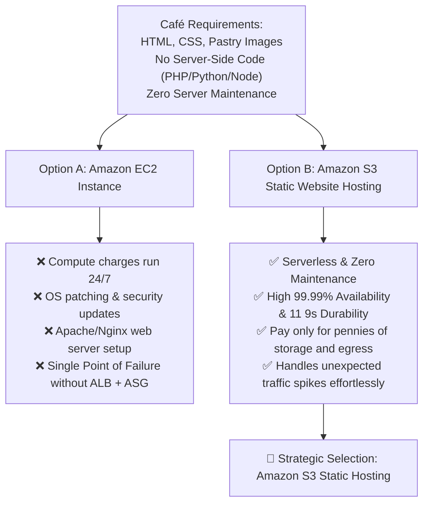
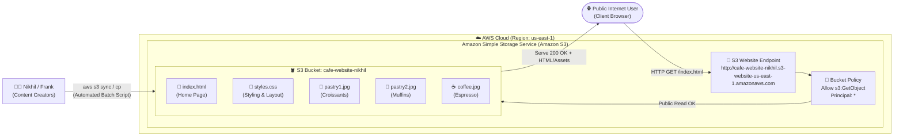
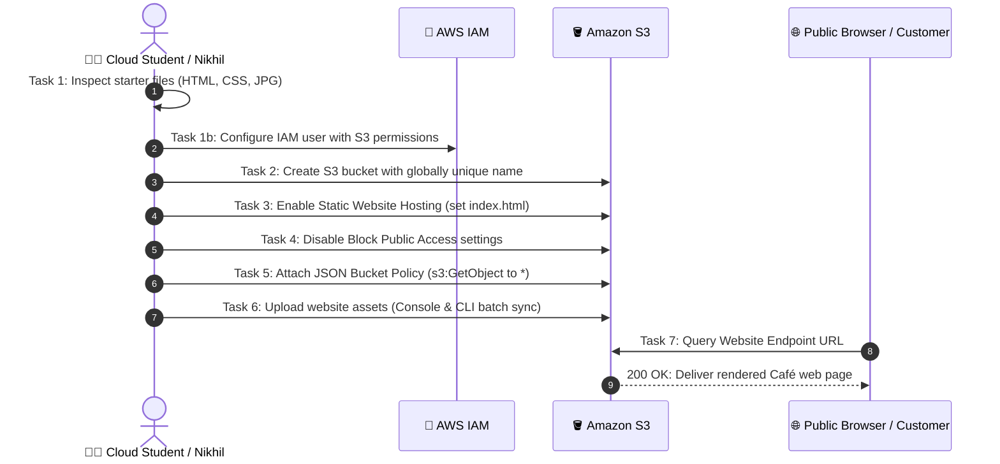
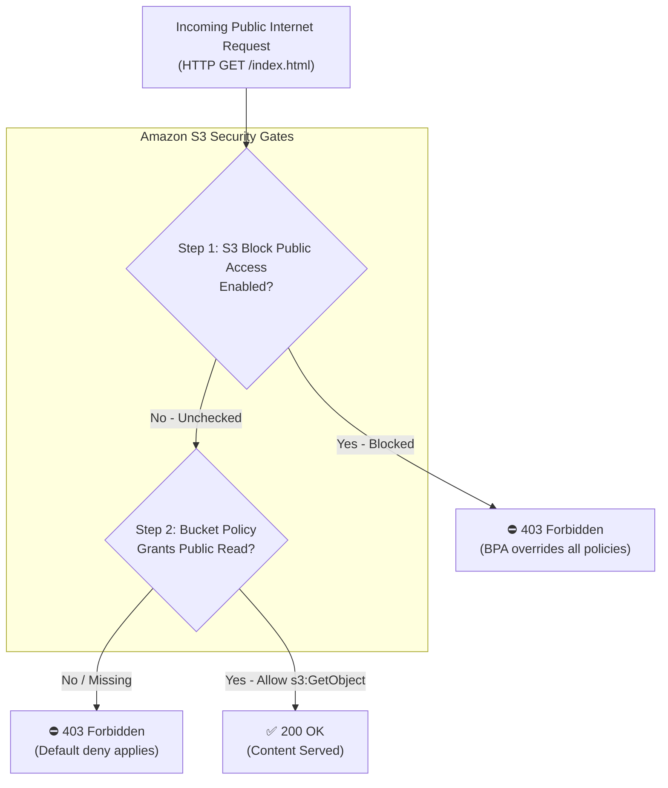
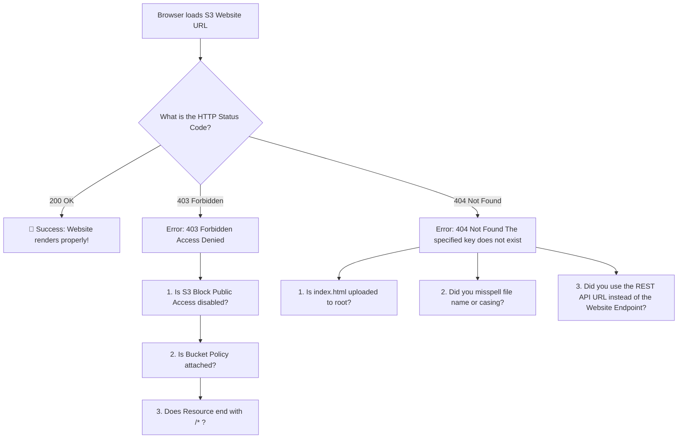
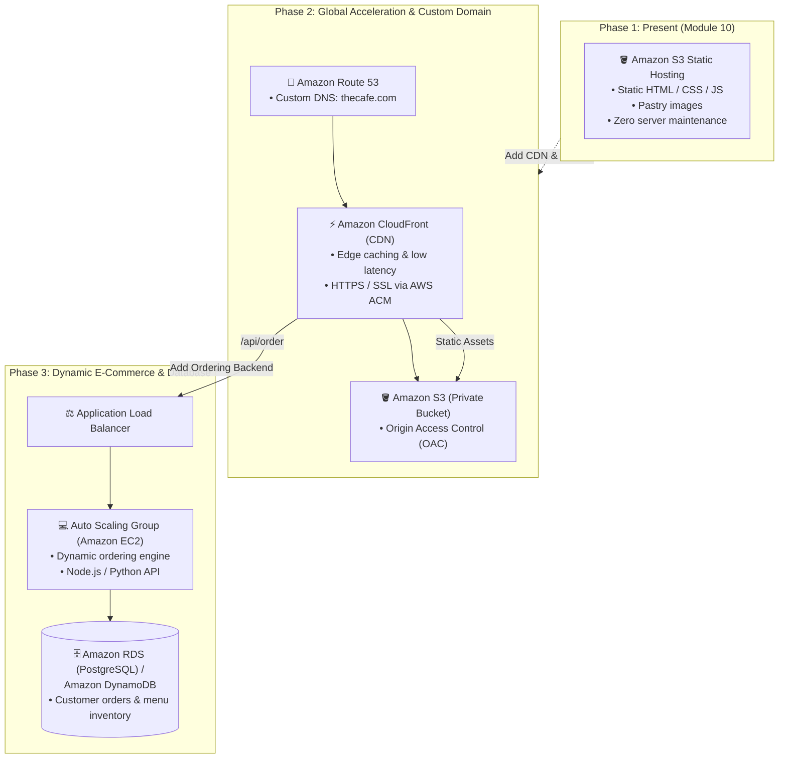

# ☕ Module 10: Lab – Creating a Website on Amazon S3

> **Course**: AWS re/Start  
> **Module**: Servers (Module 10)  
> **Source Document**: `T14-0003-RSSERV_EN-US_SG_M10_CAFEWEBSITES3.pdf`  
> **Target Audience**: AWS re/Start Learners & Cloud Practitioners  

---

## 🎯 Lab Overview & Context

Welcome to the **Creating a Website on Amazon S3** lab guide. In this lab, you step into the shoes of the cloud consulting and technical team supporting a local business: **The Café**. 

The café has reached a pivotal juncture in its business journey. Word-of-mouth advertising is no longer enough to attract new patrons or announce frequent menu changes. The café requires an immediate digital presence on the World Wide Web. However, as a small business, they must balance operational costs, technical complexity, and administrative overhead.

This guide explores the business narrative between founders and technical staff, evaluates architectural decisions between static object storage hosting versus compute-heavy virtual servers, and provides a comprehensive hands-on implementation guide to launch and automate the café's static website using **Amazon Simple Storage Service (Amazon S3)** and the **AWS Command Line Interface (AWS CLI)**.

---

### 📌 Learning Objectives

- [ ] **Analyze Business & Technical Requirements**: Evaluate the café's business needs and justify the selection of Amazon S3 static website hosting over traditional server infrastructure (Amazon EC2).
- [ ] **Provision IAM Security Principals**: Configure AWS Identity and Access Management (IAM) user credentials and policies granting dedicated permissions for S3 storage administration.
- [ ] **Provision & Name S3 Buckets**: Create an Amazon S3 bucket conforming to global DNS naming standards and region constraints.
- [ ] **Enable S3 Static Website Hosting**: Configure bucket website hosting properties, establishing `index.html` as the default root document and an optional custom error document.
- [ ] **Implement Layered Security & Public Read Access**: Safely modify S3 Block Public Access settings and author a resource-based JSON Bucket Policy granting public anonymous `s3:GetObject` permissions.
- [ ] **Deploy & Synchronize Assets via AWS CLI**: Deploy website assets (HTML, CSS, images) using `aws s3 cp` and `aws s3 sync`, and author automated update scripts to handle frequent menu updates.
- [ ] **Validate Website Endpoints & Troubleshoot HTTP Errors**: Access the website using the public S3 website endpoint URL, diagnosing and resolving HTTP 403 (Forbidden) and HTTP 404 (Not Found) errors.
- [ ] **Plan Architecture Evolution**: Map the architectural trajectory from a simple static brochure site to an elastic, dynamic multi-tier e-commerce application.

---

## 🎭 Café Business Case Scenario & Context

### 1. The Discussion: Sofía and Nikhil

```
┌────────────────────────────────────────────────────────────────────────┐
│                        Café Scenario Dialogue                          │
├────────────────────────────────────────────────────────────────────────┤
│ Nikhil: "Sofía, you mentioned that you want a website that will        │
│          promote the café by showing customers images of our           │
│          products and listing the café's business information."        │
│                                                                        │
│ Sofía:  "Yes, the café should have a website. To start, it can be a    │
│          basic website. We need customers to easily find our hours,    │
│          see where we are located, and check our phone number.         │
│          Most importantly, Frank's pastries look incredible, and we    │
│          need high-quality photos showing them off!"                   │
│                                                                        │
│ Nikhil: "I have an idea of how to create and host a basic website.     │
│          We don't need to rent or configure an entire server right     │
│          now. We can deploy directly to Amazon S3."                    │
└────────────────────────────────────────────────────────────────────────┘
```

### 2. Business Requirements Breakdown

The café owners outlined the primary goals and operational parameters for Phase 1:

1. **Promote the Brand & Showcase Products**: Display enticing, high-resolution photographs of baked goods, specialty coffees, and seasonal specials crafted by Frank.
2. **Deliver Essential Business Details**:
   - Physical store address and location directions.
   - Operating hours (weekdays, weekends, and holidays).
   - Direct telephone number and customer contact information.
3. **High Availability & Instant Global Reach**: Ensure customers browsing on desktop or mobile can instantly load the page without latency or downtime.
4. **Frugal & Cost-Effective**: Avoid unneeded operational costs, licensing fees, or idle server compute charges while the business validates online engagement.
5. **Simple Ongoing Content Updates**: Frank regularly introduces new seasonal pastries and menu items. The solution must provide an easy, repeatable method to upload new photos and menu text without risking accidental website outages.

---

### 3. Strategic Architectural Decision: Amazon S3 vs. Amazon EC2

When designing web solutions on AWS, engineers must choose the right tool for the specific workload. Nikhil analyzed two primary architectural approaches:



| Evaluation Dimension | Traditional Web Server (Amazon EC2) | Amazon S3 Static Website Hosting |
| :--- | :--- | :--- |
| **Compute Overhead** | Requires provisioning a virtual machine, OS installation, and web server software (Apache, Nginx). | **Serverless**: No servers, virtual machines, or daemons to install or manage. |
| **Operating System Maintenance** | Ongoing OS patching, security kernel updates, and software vulnerability remediation. | **Zero Maintenance**: Fully managed by AWS; no operating system or web server daemon to patch. |
| **Cost Model** | Hourly/per-second compute charge running continuously 24/7, even during zero-traffic night hours. | **Pay-as-you-go**: Pennies per gigabyte of storage ($0.023/GB) and modest data egress fees. |
| **Scalability & Resilience** | Requires an Application Load Balancer (ALB) and Auto Scaling group (ASG) across multiple AZs to prevent downtime. | **Built-in Redundancy**: Data replicated across at least three Availability Zones automatically. |
| **Use Case Fit** | Dynamic web applications requiring server-side logic (Node.js, Python/Django, PHP, Java). | Client-side presentation files (HTML, CSS, JavaScript, images, audio, video). |

> [!TIP]
> **Frugal Architect Rule**: Never spin up an EC2 instance to serve static assets that can be served directly from object storage (Amazon S3) or a Content Delivery Network (Amazon CloudFront).

---

## 🏛️ High-Level Architecture: Static Website on S3

The architecture for Phase 1 utilizes Amazon S3 as both the storage engine and the web server:



---

## 🛠️ Step-by-Step Technical Hands-On Lab Walkthrough

The hands-on lab takes learners through seven sequential tasks to configure, deploy, secure, and automate the Café static website.



---

### Task 1: Inspecting Lab Environment & Preparing Assets

Before creating resources in AWS, inspect the website files stored locally.

1. **Website Files Inventory**:
   - `index.html`: The single-page website containing the café's introductory text, menu items, operating hours, and location.
   - `style.css`: Cascading Style Sheets defining the visual layout, typography, colors, and responsive grid.
   - `images/`: Directory containing menu photos:
     - `coffee-cup.jpg`: Hot espresso and cappuccino imagery.
     - `pastry-croissant.jpg`: Frank’s fresh morning croissants.
     - `bakery-display.jpg`: Interior view of the café storefront.

2. **IAM Configuration**:
   - In accordance with the principle of least privilege, Nikhil creates a dedicated IAM user (`sofia-web-admin`) or configures an administrative access key with managed policies for Amazon S3:
     - `AmazonS3FullAccess` (for administrative provisioning) or a scoped custom policy allowing bucket configuration and object uploads.

---

### Task 2: Creating an Amazon S3 Bucket with a Globally Unique Name

Amazon S3 bucket names are stored in a global namespace shared across all AWS accounts worldwide.

#### Bucket Naming Rules
- Must be globally unique across all existing bucket names in Amazon S3.
- Must be between 3 and 63 characters long.
- Can consist only of lowercase letters, numbers, dots (`.`), and hyphens (`-`).
- Must begin and end with a letter or number.
- Must **not** be formatted as an IP address (e.g., `192.168.5.4`).
- Must **not** contain uppercase letters or underscores (`_`).

#### Implementation via AWS Management Console
1. Navigate to the **Amazon S3 Console** (`https://console.aws.amazon.com/s3/`).
2. Choose **Create bucket**.
3. Under **Bucket name**, enter a unique name incorporating your initials and date (e.g., `cafe-website-nikhil-2026`).
4. Select the target **AWS Region** (e.g., `us-east-1` (US East, N. Virginia)).
5. Keep other settings at default for now and choose **Create bucket**.

#### Implementation via AWS CLI
```bash
# Set a variable for the bucket name
BUCKET_NAME="cafe-website-nikhil-$(date +%s)"
AWS_REGION="us-east-1"

# Create the bucket (For us-east-1, LocationConstraint is not required)
aws s3 mb s3://${BUCKET_NAME} --region ${AWS_REGION}
```

> [!NOTE]
> If creating a bucket in any region other than `us-east-1` using the AWS CLI `aws s3api create-bucket`, you must pass the `--create-bucket-configuration LocationConstraint=<Region>` parameter. The high-level command `aws s3 mb` handles this automatically.

---

### Task 3: Enabling Static Website Hosting

By default, an S3 bucket functions as an object repository, returning raw metadata or requiring pre-signed URLs or IAM credentials to read objects. To make it behave like an HTTP web server, the **Static Website Hosting** feature must be explicitly enabled.

#### Key Hosting Properties
- **Static website hosting**: Enable.
- **Hosting type**: Host a static website (serves content directly, rather than redirecting requests).
- **Index document**: Specifies the webpage that Amazon S3 returns when a request is made to the root domain or a subfolder (e.g., `index.html`).
- **Error document**: Optional webpage returned when an error occurs (such as an HTTP 404 Not Found error, e.g., `error.html`).

#### AWS Console Configuration
1. In the S3 Console, select your bucket name.
2. Choose the **Properties** tab.
3. Scroll down to the **Static website hosting** container and choose **Edit**.
4. Select **Enable**.
5. Under **Index document**, enter `index.html`.
6. (Optional) Under **Error document**, enter `error.html`.
7. Choose **Save changes**.
8. Note the generated **Bucket website endpoint** at the bottom of the section:
   - Format: `http://<bucket-name>.s3-website-<Region>.amazonaws.com`
   - Example: `http://cafe-website-nikhil-2026.s3-website-us-east-1.amazonaws.com`

#### AWS CLI Configuration
```bash
# Configure static website hosting using aws s3 website
aws s3 website s3://${BUCKET_NAME}/ --index-document index.html --error-document error.html
```

---

### Task 4: Unchecking Block Public Access Settings Safely

By default, Amazon S3 enables **Block Public Access** on all newly created buckets to protect customer data from unintended internet exposure. Because a public commercial website is explicitly meant for unauthenticated worldwide visitors, this security gate must be intentionally adjusted for this specific bucket.



#### The Four S3 Block Public Access Settings

| Setting | Purpose & Impact | Action for Café Website |
| :--- | :--- | :--- |
| **Block public ACLs** | Prevents new access control lists (ACLs) that grant public access from being applied. | **Uncheck** |
| **Ignore public ACLs** | Causes S3 to ignore all public ACLs currently on the bucket/objects. | **Uncheck** |
| **Block public bucket policies** | Rejects bucket policies that allow public read/write access. | **Uncheck** (Must allow public bucket policy) |
| **Restrict public buckets** | Restricts access to public buckets only to AWS services and authorized users. | **Uncheck** (Must allow anonymous public read) |

#### AWS Console Execution
1. Select the **Permissions** tab of the bucket.
2. In the **Block public access (bucket settings)** section, choose **Edit**.
3. Clear (uncheck) **Block *all* public access**.
4. Choose **Save changes**.
5. Type `confirm` in the confirmation dialog and choose **Confirm**.

> [!CAUTION]
> Disabling S3 Block Public Access does **not** automatically make your files public; it merely opens the security gate. Your bucket remains completely private until you explicitly apply a Bucket Policy or Access Control List granting public access. Never disable Block Public Access on buckets containing proprietary or confidential data!

---

### Task 5: Writing and Applying the JSON Bucket Policy

A resource-based **Bucket Policy** is required to grant anonymous read permissions to every web browser accessing the café's static website.

#### Complete Bucket Policy Code (`policy.json`)

```json
{
    "Version": "2012-10-17",
    "Statement": [
        {
            "Sid": "PublicReadGetObjectForCafeWebsite",
            "Effect": "Allow",
            "Principal": "*",
            "Action": "s3:GetObject",
            "Resource": "arn:aws:s3:::YOUR-BUCKET-NAME/*"
        }
    ]
}
```

#### Detailed Element Breakdown

- `"Version": "2012-10-17"`: Specifies the policy language version. Always use `2012-10-17` (do not use the current date).
- `"Sid"`: *Statement ID* – An optional, human-readable identifier for the statement (`PublicReadGetObjectForCafeWebsite`).
- `"Effect": "Allow"`: Explicitly allows the requested action.
- `"Principal": "*"`: Indicates *who* is allowed. The wildcard asterisk (`*`) represents anonymous public access—anyone on the internet.
- `"Action": "s3:GetObject"`: Limits permissions strictly to downloading and viewing objects. Does **not** permit `s3:PutObject` (uploading) or `s3:DeleteObject` (deleting).
- `"Resource": "arn:aws:s3:::YOUR-BUCKET-NAME/*"`: Specifies the Amazon Resource Name (ARN). 
  - The trailing `/*` is critical: it applies the policy to all objects *inside* the bucket, not the bucket container itself.

#### Applying Policy via AWS CLI
```bash
# Substitute your bucket name into a temporary policy file
cat <<EOF > bucket-policy.json
{
    "Version": "2012-10-17",
    "Statement": [
        {
            "Sid": "PublicReadGetObjectForCafeWebsite",
            "Effect": "Allow",
            "Principal": "*",
            "Action": "s3:GetObject",
            "Resource": "arn:aws:s3:::${BUCKET_NAME}/*"
        }
    ]
}
EOF

# Apply the bucket policy
aws s3api put-bucket-policy --bucket ${BUCKET_NAME} --policy file://bucket-policy.json
```

---

### Task 6: Uploading Website Assets & Automating Updates

With the bucket configured and permissions granted, the next step is transferring the files into Amazon S3.

#### Method 1: AWS Management Console (One-Time Upload)
1. Select the **Objects** tab in the S3 bucket.
2. Choose **Upload**.
3. Choose **Add files** and select `index.html` and `style.css`.
4. Choose **Add folder** and upload the `images` directory containing pastry photos.
5. Choose **Upload** at the bottom of the page.

#### Method 2: AWS CLI Synchronization (High Efficiency)
The AWS CLI offers robust commands to copy or synchronize files:

```bash
# Single file upload
aws s3 cp index.html s3://${BUCKET_NAME}/

# Recursive directory upload
aws s3 cp images/ s3://${BUCKET_NAME}/images/ --recursive

# Intelligent sync: only uploads new or modified files
aws s3 sync ./website-assets/ s3://${BUCKET_NAME}/
```

---

### 🚀 Additional Business Need: Automating Frank's Photo Updates

#### The Problem
Frank frequently creates new pastries (e.g., almond croissants, artisan sourdough, seasonal fruit tarts) and takes fresh photos. Manually logging into the AWS Management Console to upload photos is error-prone, time-consuming, and presents a security risk if inexperienced staff accidentally alter bucket settings.

#### The Solution: Automated Sync Script
Nikhil constructs a reusable shell/batch script that Frank or the café staff can run locally whenever files are modified.

#### Linux / macOS Shell Script (`update_website.sh`):
```bash
#!/usr/bin/env bash
# ==============================================================================
# Script Name: update_website.sh
# Purpose: Automate synchronization of Café static assets to Amazon S3
# Author: Nikhil (Café Cloud Administrator)
# ==============================================================================

set -euo pipefail

BUCKET_NAME="cafe-website-nikhil-2026"
LOCAL_DIR="./cafe-assets"

echo "☕ [The Café] Starting website asset synchronization..."
echo "📂 Source Directory : ${LOCAL_DIR}"
echo "🪣 Target S3 Bucket : s3://${BUCKET_NAME}/"

# Check if AWS CLI is installed
if ! command -v aws &> /dev/null; then
    echo "❌ Error: AWS CLI is not installed or not in PATH."
    exit 1
fi

# Run aws s3 sync with delete flag to clean up removed menu items
aws s3 sync "${LOCAL_DIR}" "s3://${BUCKET_NAME}/" \
    --delete \
    --cache-control "max-age=3600"

echo "✅ [The Café] Website synchronization complete!"
echo "🌐 Visit website at: http://${BUCKET_NAME}.s3-website-us-east-1.amazonaws.com"
```

#### Windows Batch File (`update_website.bat`):
```bat
@echo off
REM ==============================================================================
REM Script Name: update_website.bat
REM Purpose: Windows one-click sync for Frank's pastry photo updates
REM ==============================================================================

set BUCKET_NAME=cafe-website-nikhil-2026
set LOCAL_DIR=C:\Users\Frank\Pictures\CafeWebsite

echo [The Cafe] Synchronizing new pastry photos and website assets...
aws s3 sync "%LOCAL_DIR%" "s3://%BUCKET_NAME%/" --delete

if %ERRORLEVEL% EQU 0 (
    echo.
    echo =========================================================
    echo [The Cafe] Successfully updated website on Amazon S3!
    echo =========================================================
) else (
    echo.
    echo [ERROR] Synchronization failed. Check AWS CLI credentials.
)
pause
```

#### Comparison: AWS Console Upload vs. AWS CLI Sync

| Feature | AWS Management Console Upload | AWS CLI `aws s3 sync` |
| :--- | :--- | :--- |
| **User Interface** | Graphical web browser interface. | Command line or automated script. |
| **Automation** | None; manual drag-and-drop required every time. | Easily scheduled via cron, Task Scheduler, or CI/CD pipelines. |
| **Bandwidth Efficiency** | Re-uploads entire selection regardless of change status. | Compares timestamps and file sizes; **only uploads modified/new files**. |
| **Deletions** | Deleted local files must be manually located and deleted in S3. | `--delete` flag automatically cleans up orphaned images on S3. |
| **Human Error Risk** | High (accidental misplacement into wrong subfolder). | Very low (deterministic scripted execution). |

---

### Task 7: Verifying Website Access & Troubleshooting Errors

#### Verifying Website Access
1. Locate your **Bucket website endpoint**:
   - `http://<bucket-name>.s3-website-<Region>.amazonaws.com`
2. Open a web browser in Incognito / Private Browsing mode (to verify unauthenticated public access).
3. Paste the URL into the address bar.
4. Verify that:
   - The café logo, banner, and typography load correctly.
   - Frank's pastry images render without broken links.
   - The store hours, address, and phone number display properly.

---

#### 🔍 Troubleshooting Common HTTP Errors



#### Diagnostic Table

| Symptom / Error Code | Root Cause | Remediation Procedure |
| :--- | :--- | :--- |
| **403 Forbidden** (Access Denied) | **S3 Block Public Access is still enabled.** | Navigate to the bucket's **Permissions** tab. Choose **Edit** on Block Public Access, uncheck all 4 options, and save changes. |
| **403 Forbidden** (Access Denied) | **Bucket Policy is missing or has invalid syntax.** | Ensure a JSON policy granting `s3:GetObject` to Principal `*` is attached. |
| **403 Forbidden** (Access Denied) | **Bucket Policy ARN is missing `/*`.** | Check the `Resource` string. It must be `arn:aws:s3:::bucket-name/*`. Without `/*`, the policy applies only to the bucket container, not the objects. |
| **404 Not Found** (Key does not exist) | **`index.html` not found in root.** | Verify that `index.html` was uploaded to the top-level root directory of the bucket, not nested inside a subfolder. |
| **404 Not Found** (Case sensitivity) | **File naming case mismatch.** | S3 object keys are case-sensitive (`Index.html` $\neq$ `index.html`). Match exact casing. |
| **400 Bad Request** / XML Error Response | **Using the REST API endpoint instead of the Website endpoint.** | S3 provides two endpoints: <br>• **REST API**: `<bucket>.s3.<region>.amazonaws.com` (returns XML or 403 unless signed)<br>• **Website**: `<bucket>.s3-website-<region>.amazonaws.com` (acts as web server) |

---

## 🔮 Looking Ahead: Architectural Evolution of The Café

Hosting the static brochure website on Amazon S3 provides an ideal initial footprint. However, as the café flourishes, Sofía and Nikhil's vision extends to online ordering, real-time inventory tracking, customer rewards, and secure payment processing.

The diagram below maps the three evolutionary phases of the Café's cloud architecture:



### Evolution Milestones
1. **Phase 1: Informational Brochure (Current Lab)**:
   - Amazon S3 static website hosting serves basic contact information, hours, and Frank's pastry images.
2. **Phase 2: CDN Edge Delivery & Secure Custom Domain**:
   - **Amazon CloudFront** caches assets across worldwide Edge Locations for sub-millisecond response times.
   - **AWS Certificate Manager (ACM)** provides free SSL/TLS certificates for `https://thecafe.com`.
   - **Origin Access Control (OAC)** locks down the S3 bucket so it is completely private and accessible *only* via CloudFront.
3. **Phase 3: Dynamic Multi-Tier E-Commerce Platform**:
   - **Amazon EC2 & Elastic Load Balancing**: Scalable backend compute runs business logic for shopping carts and payment processing.
   - **Amazon RDS / Amazon DynamoDB**: Managed relational or NoSQL databases securely persist customer transaction history, user accounts, and real-time bakery inventory.

---

## 🧠 Checkpoint & Review Questions

Test your understanding of the concepts covered in this lab.

### Question 1
**What are the three fundamental steps required to set up a static website on Amazon S3?**

> [!TIP]
> **Answer**:
> 1. **Configure IAM Access / Credentials**: Establish appropriate administrative credentials or an IAM user with permissions to manage Amazon S3.
> 2. **Create and Configure the S3 Bucket**: Provision an S3 bucket with a globally unique name, enable the **Static website hosting** property, and specify the index document (`index.html`).
> 3. **Configure Public Permissions and Upload Assets**: Disable the appropriate S3 Block Public Access settings, attach a resource-based Bucket Policy granting public read access (`s3:GetObject` to `*`), and upload the website assets (HTML, CSS, and images).

---

### Question 2
**Which AWS CLI command uploads a single file to an Amazon S3 bucket, and what command is preferred when managing frequent directory updates?**

> [!TIP]
> **Answer**:
> - To upload a single file, use:  
>   `aws s3 cp <filename> s3://<bucket-name>/`
> - When managing frequent updates across an entire website folder (such as Frank's pastry photo updates), the preferred command is:  
>   `aws s3 sync <local-folder> s3://<bucket-name>/`  
>   The `sync` command compares local files with existing S3 objects and only uploads new or modified files, minimizing transfer time and bandwidth. Adding the `--delete` flag also removes files in S3 that were deleted locally.

---

### Question 3
**How does a public internet client directly access a static website hosted on Amazon S3, and how does this URL differ from standard S3 object URLs?**

> [!TIP]
> **Answer**:
> The client accesses the website using the **Amazon S3 Website Endpoint URL** assigned to the bucket upon enabling static hosting:
> - Format: `http://<bucket-name>.s3-website-<region>.amazonaws.com` (or `http://<bucket-name>.s3-website.<region>.amazonaws.com` depending on the region).
> 
> **Difference from Standard S3 REST URLs**:
> - **REST API Endpoint** (`http://<bucket-name>.s3.<region>.amazonaws.com/<object>`): Treats requests as raw object storage API calls. If the root bucket is requested, it attempts to list bucket contents (returning XML or 403 Forbidden if listing is denied).
> - **Website Endpoint** (`http://<bucket-name>.s3-website-<region>.amazonaws.com`): Emulates a true web server. When a client requests the root URL, it automatically resolves and serves `index.html`. It also supports web redirects and custom error documents (`error.html`).

---

### Question 4 (Scenario Challenge)
**After uploading `index.html` to an S3 bucket with static hosting enabled, a customer navigates to the website endpoint URL and receives an `HTTP 403 Forbidden` error. You verify that S3 Block Public Access is disabled and a Bucket Policy is attached. What syntax detail in the Bucket Policy is the most frequent cause of this issue?**

> [!TIP]
> **Answer**:
> The most frequent cause is omitting `/*` at the end of the bucket ARN in the `Resource` element:
> - **Incorrect**: `"Resource": "arn:aws:s3:::my-cafe-bucket"` (refers only to the bucket container itself).
> - **Correct**: `"Resource": "arn:aws:s3:::my-cafe-bucket/*"` (refers to all objects stored within the bucket).  
> Because `s3:GetObject` is an object-level permission, applying it to the bucket ARN without `/*` results in `403 Forbidden` when attempting to fetch any page or image.

---

## 📌 Key Takeaways & Summary

1. **Simplicity and Frugality**: Amazon S3 static website hosting eliminates the administrative burden, operating system patching, and continuous running costs associated with traditional EC2 web servers.
2. **Global Uniqueness**: Amazon S3 bucket names reside in a single worldwide namespace and must comply with DNS-compliant naming standards.
3. **Layered Public Access Controls**: Exposing a static website requires both disabling S3 Block Public Access and attaching an explicit JSON bucket policy allowing `s3:GetObject` to `*`.
4. **Endpoint Differentiation**: Always provide users with the S3 Website Endpoint (`s3-website-<region>`), not the S3 REST API endpoint.
5. **Scripted Automation**: Combining AWS CLI commands (`aws s3 sync`) into batch or shell scripts allows non-technical team members like Frank to update website content safely, reliably, and instantly.
