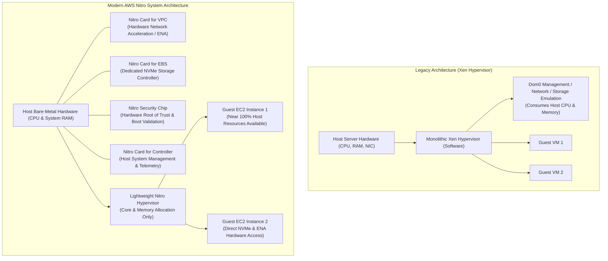
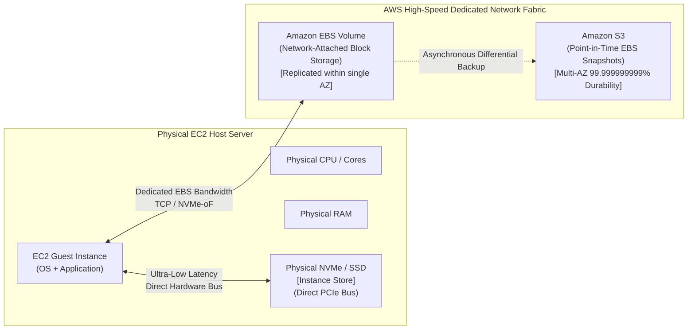
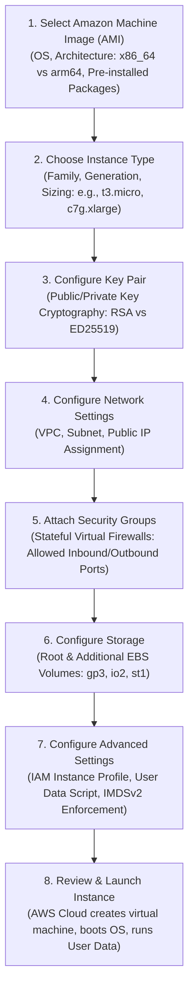
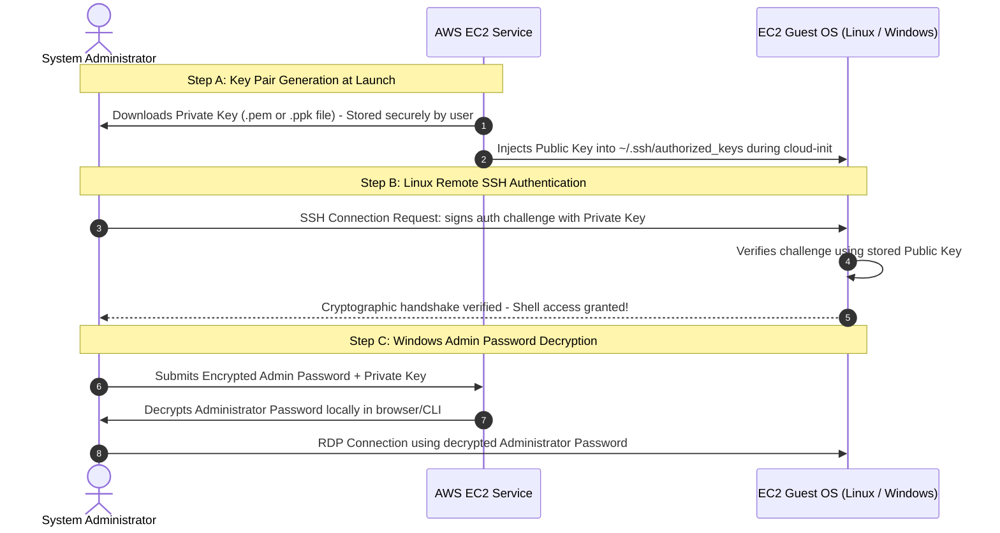
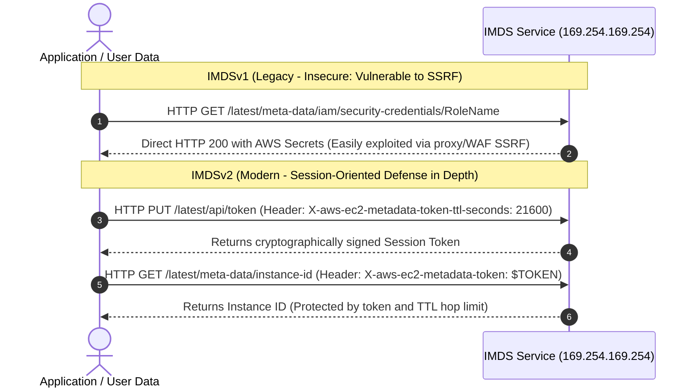
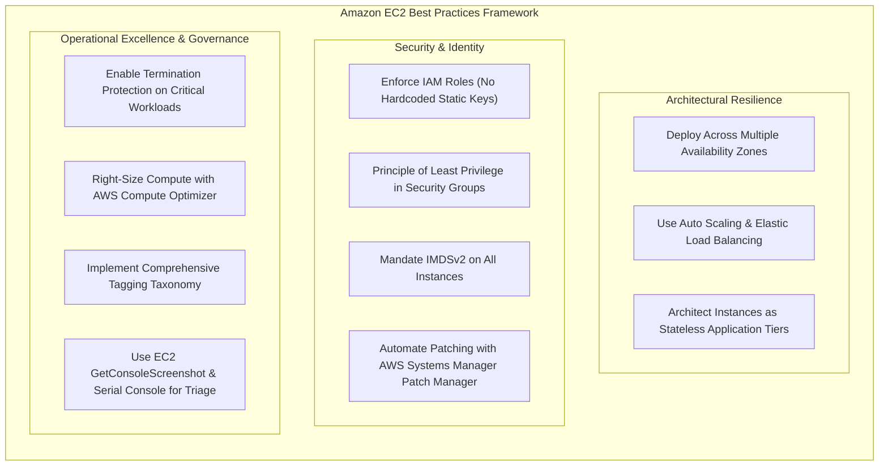
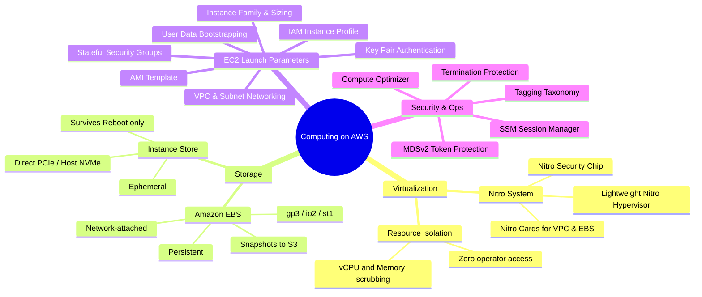

# ⚡ Module 10: Computing on AWS (Amazon EC2) – Study Guide

> **Course**: AWS re/Start  
> **Module**: M10 – Servers  
> **Source Document**: `T14-0004-RSSERV_EN-US_SG_M10_COMPUTINGONAWS.pdf`  
> **Target Audience**: AWS re/Start Learners, Cloud Practitioners, Solutions Architects, and Systems Administrators  

---

## 🎯 Module Overview

Compute resources represent the foundational engine of modern cloud architecture. In traditional on-premises data centers, deploying compute capacity requires long procurement cycles, physical server installation, cabling, hypervisor provisioning, operating system licensing, and ongoing maintenance. 

**Amazon Elastic Compute Cloud (Amazon EC2)** eliminates these physical constraints by providing secure, resizable compute capacity in the cloud. With Amazon EC2, organizations can launch virtual servers—known as **EC2 instances**—on demand within minutes, scale capacity dynamically up or down as business requirements fluctuate, and pay only for the compute hours or seconds consumed.

This study guide provides an architectural exploration of Amazon EC2 virtualization. It covers the evolution from legacy hypervisors to the **AWS Nitro System**, dissects the operational trade-offs between **Instance Store** and **Amazon Elastic Block Store (Amazon EBS)**, details every parameter in the **EC2 Launch Workflow**, examines modern security practices (including **IMDSv2**, **IAM Instance Profiles**, and **Stateful Security Groups**), and provides production-grade best practices for deploying resilient workloads on AWS.

---

### 📌 Learning Objectives

- [ ] **Explain Amazon EC2 Virtualization Architecture**: Describe physical host hardware, hypervisor abstraction layers, the AWS Nitro System architecture, and multi-tenant security isolation.
- [ ] **Compare EC2 Storage Types**: Evaluate the architectural differences, persistence models, performance characteristics, and failure modes of ephemeral **Instance Store** versus network-attached **Amazon EBS**.
- [ ] **Execute the End-to-End EC2 Provisioning Workflow**: Identify and configure the core parameters required to launch an instance: AMI selection, instance type families, key pairs, VPC subnets, security groups, storage volumes, and IAM instance profiles.
- [ ] **Implement Automated Instance Bootstrapping**: Write and deploy **User Data** scripts (shell scripts and cloud-init directives) to automate software installation and service configuration at initial boot.
- [ ] **Query the Instance Metadata Service (IMDS)**: Understand the role of link-local address `169.254.169.254`, query runtime instance attributes, and implement secure token-based **IMDSv2** requests.
- [ ] **Configure Secure Remote Access Mechanisms**: Compare traditional SSH/RDP access against modern keyless options: **EC2 Instance Connect** and **AWS Systems Manager Session Manager**.
- [ ] **Apply EC2 Operational & Security Best Practices**: Implement termination protection, configure source/destination checks for routing appliances, avoid hardcoded credentials via IAM roles, right-size compute with AWS Compute Optimizer, and structure enterprise resource tags.

---

## 📚 Key Terminology

| Term | Definition |
| :--- | :--- |
| **Amazon EC2** | A core AWS web service that provides secure, resizable virtual compute capacity in the cloud. |
| **EC2 Instance** | A virtual compute environment (virtual machine) running on physical host infrastructure in an AWS Availability Zone. |
| **Hypervisor** | A firmware or software layer that creates, manages, and isolates virtual machines by allocating physical CPU, memory, storage, and networking resources. |
| **AWS Nitro System** | The modern underlying platform for AWS EC2 instances, decoupling hypervisor functions into specialized hardware cards, dedicated security chips, and a lightweight hypervisor. |
| **Instance Store** | Temporary, ephemeral block-level storage physically attached to the host server hardware, providing ultra-high I/O performance that does not survive instance stops or terminations. |
| **Amazon EBS** | Persistent, durable, network-attached block storage designed for use with Amazon EC2 instances within a single Availability Zone. |
| **Amazon Machine Image (AMI)** | A packaged template containing an operating system, application server, preinstalled software, block device mapping, and launch permissions required to spin up an instance. |
| **Instance Type** | A predefined hardware profile specifying the ratio of virtual CPU (vCPU), memory (RAM), storage, and networking bandwidth (e.g., `t3.micro`, `c7g.xlarge`). |
| **Key Pair** | A cryptographic public/private key combination used to authenticate and encrypt remote administrative connections (SSH for Linux, password decryption for Windows). |
| **Security Group** | A virtual, stateful firewall applied directly at the instance network interface level that controls inbound and outbound network traffic based on protocols and port ranges. |
| **IAM Instance Profile** | A container used to securely pass an IAM role to an EC2 instance, granting applications temporary security credentials via AWS STS without storing keys on disk. |
| **User Data** | An optional script or set of directives supplied at instance launch to execute automated configuration tasks during the first boot cycle. |
| **Instance Metadata (IMDS)** | Dynamic runtime data about an EC2 instance accessible from within the guest OS via the link-local IP address `169.254.169.254`. |
| **Session Manager** | A fully managed capability of AWS Systems Manager that enables browser-based or CLI remote management of instances without managing SSH keys or opening inbound firewall ports. |

---

## 🏛️ 1. Amazon EC2 Virtualization Architecture

Amazon EC2 instances run inside high-security AWS data centers organized across geographic **Regions** and isolated **Availability Zones (AZs)**. The physical foundations of EC2 rely on enterprise server racks hosting multi-socket processors, vast arrays of error-correcting code (ECC) RAM, and dedicated network fabrics.

### 1.1 Hypervisor Abstraction & The Evolution to AWS Nitro

In traditional virtualization (such as the legacy Xen hypervisor utilized in earlier EC2 generations), the hypervisor software running on the physical host manages everything:
- Allocating CPU cycles and physical RAM slices to guest virtual machines.
- Emulating physical network interface cards (NICs) and handling packet routing.
- Emulating disk controllers and managing network I/O to storage devices.
- Enforcing security boundaries, access monitoring, and host telemetry.

While functional, legacy software hypervisors consume a measurable percentage of the physical host’s CPU and memory resources (referred to as the "virtualization tax" or hypervisor overhead) and require complex context switching between the guest OS and the hypervisor.



### 1.2 The AWS Nitro System Components

The **AWS Nitro System** represents a complete redesign of the EC2 virtualization platform. AWS broke apart the monolithic hypervisor and offloaded networking, storage, security, and management functions to custom-built hardware cards and application-specific integrated circuits (ASICs):

1. **Nitro Cards**:
   - **Nitro Card for VPC**: Provides hardware-accelerated software-defined networking. It offloads Virtual Private Cloud (VPC) packet routing, security group rule evaluation, and network encapsulation (Elastic Network Adapter - ENA), enabling networking speeds up to 400 Gbps with minimal jitter.
   - **Nitro Card for EBS**: A dedicated PCIe controller that connects the instance to network-attached Amazon EBS volumes using standard NVMe protocols without consuming host processor cycles.
   - **Nitro Card for Local Storage**: Manages high-speed direct-attached PCIe NVMe solid-state drives for instances that feature local Instance Store.
   - **Nitro Card for Controller**: Handles instance lifecycle coordination, telemetry collection, and out-of-band management tasks.
2. **Nitro Security Chip**:
   - Embedded directly into the physical motherboard of the host server.
   - Constantly verifies and validates system firmware and UEFI boot processes to maintain a cryptographic **Hardware Root of Trust**.
   - Physically isolates the host flash memory, preventing unauthorized modifications to host firmware.
3. **Nitro Hypervisor**:
   - A minimalist, purpose-built hypervisor based on core Kernel-based Virtual Machine (KVM) technology.
   - Responsible strictly for allocating processor cores and physical memory regions to guest instances.
   - Because all I/O is offloaded to Nitro Cards, the hypervisor provides near bare-metal performance, predictable real-time execution, and virtually eliminates virtualization jitter.
4. **Nitro Enclaves**:
   - Allows users to carve out isolated, hardened compute environments from an EC2 instance with no persistent storage, no interactive administrative shell, and cryptographic attestation for highly sensitive processing (such as cryptographic key management or financial transaction validation).

### 1.3 Multi-Tenant Physical Security and Resource Isolation

In a multi-tenant cloud environment, multiple customer virtual machines reside on the same physical host hardware. AWS enforces multi-tenant security through rigorous isolation mechanisms:

- **Memory Isolation**: Physical RAM addresses are strictly partitioned by the hypervisor and CPU memory management units (MMUs). One virtual machine cannot read, write, or access memory blocks assigned to another instance. Memory pages are scrubbed and zeroed out before being reallocated to another instance.
- **CPU Scheduling**: The Nitro Hypervisor assigns physical cores and hyperthreads directly to virtual CPUs (vCPUs) with strict execution boundaries preventing cross-guest processor cache leakage.
- **Zero Operator Access**: By architectural design, AWS data center operators and engineers have no interactive access (SSH, telnet, root login) to the underlying physical Nitro hosts or hypervisor. There is no software interface for AWS personnel to view customer memory or guest instance data.

---

## 💾 2. EC2 Storage Architectures: Instance Store vs. Amazon EBS

When provisioning an EC2 instance, choosing the appropriate storage architecture is critical for performance, durability, and cost optimization. EC2 provides two primary block-level storage models: **Instance Store** and **Amazon Elastic Block Store (Amazon EBS)**.



### 2.1 Amazon EC2 Instance Store (Ephemeral Storage)

The **Instance Store** consists of physical storage disks (NVMe solid-state drives or legacy spinning magnetic disks) physically installed inside the host server chassis where the EC2 instance is executing.

- **Direct Hardware Attachment**: Because disks communicate directly over the host server’s PCIe bus, Instance Store delivers exceptionally high I/O operations per second (IOPS), massive throughput, and microsecond-level latency.
- **Ephemeral Lifecycle**: 
  - The storage is temporary. Data on an instance store persists during an OS **reboot**.
  - **Data is permanently erased and irrecoverable** when the instance is **stopped**, **terminated**, or if the underlying host hardware experiences an unrecoverable failure.
  - Instances with instance store root volumes cannot be stopped in the traditional sense; they can only be terminated or rebooted (unless using modern EBS-backed root instances with secondary instance store drives).
- **Target Workloads**: Buffers, scratchpads, caching layers, temporary video rendering temporary files, high-throughput in-memory datastores replicated across nodes (such as Elasticsearch, Cassandra, or Hadoop HDFS with application-level data redundancy).

### 2.2 Amazon Elastic Block Store (Amazon EBS)

**Amazon EBS** provides persistent, high-performance, network-attached block-level storage designed for use with EC2 instances. 

- **Network-Attached Persistence**: EBS volumes are provisioned over a dedicated, low-latency storage network fabric. Because an EBS volume is physically independent of the host server hardware, its lifecycle is completely decoupled from the instance:
  - If the EC2 instance is **stopped**, all data on attached EBS volumes remains completely intact.
  - If an EC2 host suffers a physical hardware failure, AWS automatically migrates the instance to healthy host hardware, and the existing EBS volume is seamlessly reattached.
  - An EBS volume can be detached from one instance and attached to another instance in the same Availability Zone.
- **High Availability within an AZ**: Every EBS volume is automatically replicated across multiple physical storage servers within its Availability Zone to protect against single-device failure, offering an annual failure rate (AFR) between 0.1% and 0.2% (or 0.001% for io2 Block Express).
- **Snapshots & Amazon S3 Integration**: Point-in-time snapshots of EBS volumes can be captured and stored in **Amazon S3**. Snapshots are incremental (only changed blocks are written) and achieve S3’s 99.999999999% (11 9s) data durability across multiple Availability Zones.
- **Encryption by Default**: EBS supports transparent AES-256 encryption managed by AWS Key Management Service (AWS KMS). Both data at rest and data in transit between the instance and the EBS volume are encrypted with no host CPU overhead.
- **EBS-Optimized Instances**: Dedicated network capacity reserved exclusively for storage traffic between the EC2 instance and EBS volumes, preventing contention between EBS storage I/O and general VPC networking traffic.

### 2.3 EBS Volume Types Overview

AWS provides multiple EBS volume types optimized for different workload profiles:

1. **General Purpose SSD (`gp3` / `gp2`)**: Balanced price and performance for virtual desktops, dev/test environments, and low-latency interactive applications. `gp3` delivers a baseline performance of 3,000 IOPS and 125 MB/s throughput independently of provisioned storage capacity.
2. **Provisioned IOPS SSD (`io2 Block Express` / `io1`)**: Designed for mission-critical, I/O-intensive transactional database workloads (SAP HANA, Oracle, Microsoft SQL Server) requiring sub-millisecond latencies, up to 256,000 IOPS, and 99.999% volume durability.
3. **Throughput Optimized HDD (`st1`)**: Low-cost magnetic storage optimized for large sequential streaming workloads, big data, data warehousing, and log processing. Cannot be used as an OS boot volume.
4. **Cold HDD (`sc1`)**: Lowest-cost magnetic storage for infrequently accessed sequential workloads and archival data. Cannot be used as an OS boot volume.

### 2.4 Comprehensive Comparison: Instance Store vs. Amazon EBS

| Feature / Dimension | Amazon EC2 Instance Store | Amazon Elastic Block Store (EBS) |
| :--- | :--- | :--- |
| **Physical Location** | Directly attached to physical host chassis | Network-attached via dedicated storage fabric |
| **Data Persistence** | **Ephemeral**: Lost on stop or terminate | **Persistent**: Retained independently of instance state |
| **OS Reboot Behavior** | **Data persists** across soft and hard reboots | **Data persists** across reboots |
| **Instance Stop/Start** | **Data is lost** (Host hardware is deallocated) | **Data is fully preserved** across stop/start cycles |
| **Instance Termination** | **Data is permanently lost** | Preserved if `DeleteOnTermination` is set to `false` |
| **Underlying Hardware Failure** | Data is lost if host hardware fails | Data is preserved; instance can launch on another host |
| **I/O Latency & Throughput** | Lowest possible latency (PCIe NVMe direct bus) | Low network latency; accelerated on EBS-optimized hosts |
| **Backup & Snapshot Support** | No native snapshot mechanism; customer-managed | Native incremental snapshots stored durably in Amazon S3 |
| **Root Device Support** | Supported on older instances; rare in modern setups | Standard default root device for nearly all modern instances |
| **Lifecycle Coupling** | Bound to the lifetime of the underlying instance | Independent lifecycle; can be detached and attached to another EC2 instance |
| **KMS Encryption** | Hardware encryption on select NVMe types | Transparent native AES-256 encryption via AWS KMS |
| **Recommended Use Cases** | In-memory caches, scratch disks, temporary buffers, distributed NoSQL replication | Relational databases, operating system boot disks, enterprise file systems, persistent state |

---

## 🚀 3. Launching an Amazon EC2 Instance: Step-by-Step Parameter Guide

Provisioning an EC2 instance involves configuring a series of interconnected parameters spanning compute, networking, security, storage, and identity.



---

### 3.1 Step 1: Selecting an Amazon Machine Image (AMI)

An **AMI** is a pre-configured template that contains the software configuration (operating system, application server, and initial applications) required to launch an instance.

- **AMI Contents**:
  - **Root Volume Template**: A snapshot of the root device containing the OS (e.g., Amazon Linux 2023, Ubuntu 24.04 LTS, Red Hat Enterprise Linux, Windows Server 2022).
  - **Block Device Mapping**: Directives specifying which storage volumes (EBS volumes or Instance Store volumes) attach to the instance at launch and where they mount in the filesystem hierarchy.
  - **Launch Permissions**: Access controls dictating whether the AMI is private to the owner account, shared with specific AWS account IDs, or public to all AWS customers.
- **Processor Architecture Selection**:
  - `x86_64`: Traditional Intel and AMD 64-bit architectures, broad compatibility with legacy compiled binaries.
  - `arm64`: Powered by **AWS Graviton** processors. Graviton instances (e.g., Graviton2, Graviton3, Graviton4) deliver up to 40% better price-performance compared to comparable x86-based instances for containerized, Linux, and cloud-native workloads.
- **AMI Sources**:
  - **Quick Start AMIs**: Curated by AWS (Amazon Linux 2023, Ubuntu, Debian, SUSE, Windows Server).
  - **AWS Marketplace**: Commercial and open-source AMIs packaged by third-party vendors (e.g., Cisco, Fortinet, Bitnami), often bundled with pre-configured software licensing.
  - **Custom AMIs (My AMIs)**: Created from existing EC2 instances by capturing an EBS snapshot and registering a customized image for golden image pipelines and rapid auto-scaling.
  - **Community AMIs**: Publicly shared AMIs built by the global cloud community.

---

### 3.2 Step 2: Selecting an Instance Type

EC2 instance types represent varying combinations of CPU, memory, storage, and networking capacity. Instance names follow a structured naming taxonomy:

$$\underbrace{\mathbf{t}}_{\text{Family}} \quad \underbrace{\mathbf{3}}_{\text{Generation}} \quad \underbrace{\mathbf{a}}_{\text{Processor Attribute}} \quad . \quad \underbrace{\mathbf{nano}}_{\text{Size}}$$

- **Family Prefix**: Identifies the primary workload optimization.
- **Generation Number**: Indicates the architectural hardware generation (higher numbers represent newer hardware and superior performance).
- **Attributes**: Optional flags indicating underlying hardware (e.g., `a` = AMD processor, `g` = AWS Graviton ARM processor, `i` = Intel processor, `d` = direct-attached NVMe instance store, `n` = enhanced networking).
- **Size**: Dictates the proportion of compute resources allocated (e.g., `nano`, `micro`, `small`, `medium`, `large`, `xlarge`, `2xlarge`, `metal`). Sizing scales linearly: a `2xlarge` generally has double the vCPU and RAM of an `xlarge`.

#### EC2 Instance Family Categories

| Category | Families | Primary Characteristics | Target Workloads |
| :--- | :--- | :--- | :--- |
| **General Purpose** | `M6i`, `M6g`, `M7g`, `T3`, `T4g`, `Mac` | Balanced ratio of vCPU, memory, and network throughput (typically 1:4 vCPU to RAM ratio in M-series). T-series supports burstable CPU. | Web and application servers, dev/test environments, microservices, small databases |
| **Compute Optimized** | `C5`, `C6i`, `C6g`, `C7g` | High ratio of compute performance relative to memory (1:2 vCPU to RAM ratio). High clock speed processors. | High-performance web servers, scientific modeling, batch compute, media transcoders, gaming servers |
| **Memory Optimized** | `R5`, `R6g`, `R7g`, `X2gd`, `z1d` | High memory footprint per vCPU (1:8 vCPU to RAM ratio in R-series, higher in X-series). | In-memory caches (Redis, Memcached), relational databases, real-time big data processing (Spark) |
| **Storage Optimized** | `I3`, `I4i`, `Im4gn`, `D3`, `H1` | High sequential read/write throughput and massive direct-attached NVMe storage. | Distributed file systems, NoSQL databases (Cassandra, MongoDB), data warehouses |
| **Accelerated Computing** | `P4`, `P5`, `G4dn`, `G5`, `Inf2`, `Trn1` | Specialized hardware coprocessors (NVIDIA GPUs, AWS Inferentia, AWS Trainium). | Machine learning training and inference, 3D graphics rendering, video encoding, seismic analysis |
| **HPC Optimized** | `Hpc6a`, `Hpc6id`, `Hpc7g` | Cost-effective high-performance computing clusters with Elastic Fabric Adapter (EFA). | CFD, crash simulations, weather forecasting, molecular dynamics |

---

### 3.3 Step 3: Key Pairs and Cryptographic Authentication

To securely connect to an EC2 instance without exposing credentials to brute-force attacks, AWS utilizes **asymmetric public key cryptography**.



- **Public Key**: Retained by AWS and automatically injected into the guest operating system’s root or default user profile during instance initialization (specifically written to `~/.ssh/authorized_keys` for Linux).
- **Private Key**: Downloaded once by the administrator during key pair creation. AWS never stores or retains the private key. If the private key is lost, traditional SSH access using that key is permanently lost.
- **Key Formats**:
  - `.pem`: Standard Privacy Enhanced Mail format used by OpenSSH and Linux/macOS command line terminals (`chmod 400 key.pem`).
  - `.ppk`: PuTTY Private Key format utilized by legacy PuTTY clients on Windows.
- **Operating System Authentication Behavior**:
  - **Linux AMIs**: Default configurations disable password authentication entirely. Users authenticate over SSH using their private key (`ssh -i mykey.pem ec2-user@<public-ip>`).
  - **Windows Server AMIs**: The operating system generates a random, cryptographically secure Administrator password during the initial boot. The user provides their private key via the AWS Console or CLI to decrypt the Windows password, then connects via **Remote Desktop Protocol (RDP)** on TCP port 3389.

---

### 3.4 Step 4: Network Settings and IP Addressing

When launching an instance, it must be placed within a designated network boundary inside an **Amazon Virtual Private Cloud (VPC)**.

- **VPC & Subnet Placement**:
  - The VPC provides a logically isolated software-defined network.
  - A **Subnet** resides in a specific Availability Zone.
  - **Public Subnet**: Has a route table entry pointing to an **Internet Gateway (IGW)** (`0.0.0.0/0 -> igw-xxxx`). Instances in public subnets with public IP addresses can send and receive internet traffic directly.
  - **Private Subnet**: Does not have a direct route to an Internet Gateway. Instances in private subnets cannot be reached directly from the internet; outbound internet access requires a **NAT Gateway** in a public subnet.
- **IP Addressing Mechanisms**:
  1. **Private IPv4 Address**:
     - Automatically assigned to every instance from the IPv4 CIDR block of the subnet.
     - Remains permanently attached to the instance's network interface (ENI) for its entire lifetime.
     - Used exclusively for communication between instances within the VPC, across peered VPCs, or over VPN/Direct Connect.
  2. **Public IPv4 Address**:
     - Optionally assigned from the dynamic AWS public IP address pool if "Auto-assign public IP" is enabled.
     - Allows direct routing to/from the internet via an Internet Gateway.
     - **Dynamic nature**: If the instance is **stopped and started**, the public IP address is released back to the AWS pool, and a brand-new public IP is assigned. It is preserved across OS reboots.
  3. **Elastic IP Address (EIP)**:
     - A static, persistent public IPv4 address allocated to your AWS account.
     - Can be associated with an instance or network interface and rapidly reassigned to another instance in the event of an outage.
     - Does not change when the instance is stopped and started.

---

### 3.5 Step 5: Security Groups (Stateful Virtual Firewalls)

A **Security Group** acts as a virtual firewall that controls inbound and outbound traffic at the instance network interface level (Elastic Network Interface - ENI).

```mermaid
flowchart LR
    subgraph Internet["Internet / External Clients"]
        ClientReq["Inbound Request\n(Port 80 HTTP)"]
        Attacker["Unauthorized Probe\n(Port 22 SSH)"]
    end

    subgraph SecurityGroup["Security Group Evaluation (Stateful)"]
        InboundTable["Inbound Rules\nAllow TCP 80 from 0.0.0.0/0\nDefault: DENY All Else"]
        StateTracking["Connection State Table\n(Tracks established sessions)"]
        OutboundTable["Outbound Rules\nDefault: ALLOW All (0.0.0.0/0)"]
    end

    subgraph Instance["EC2 Instance"]
        WebSvc["Apache Web Server\n(Port 80)"]
    end

    ClientReq -->|Matches Port 80 Rule| InboundTable
    InboundTable -->|Allowed & Tracked| StateTracking
    StateTracking --> WebSvc
    WebSvc -->|Response Return Packet| StateTracking
    StateTracking -->|Automatically Allowed\n(Bypasses Outbound Rules)| ClientReq

    Attacker -.->|No Matching Inbound Rule| InboundTable
    InboundTable -.->|Dropped Silently| Attacker
```

#### Key Characteristics of Security Groups

- **Instance-Level Enforcement**: Unlike subnet-level Network Access Control Lists (NACLs), security groups filter traffic directly at the virtual network card of each individual instance. Two instances in the exact same subnet can have completely different security group assignments.
- **Stateful Filtering**: Security groups track the state of active network connections. If an inbound request is permitted by an inbound rule, the response traffic is **automatically allowed outbound**, regardless of what outbound rules are configured. Conversely, if an outbound request is initiated from the instance, return traffic for that session is automatically permitted inbound.
- **Default Behavior**:
  - When a new security group is created, all inbound traffic is blocked by default (**Implicit Deny**).
  - All outbound traffic is permitted by default (`0.0.0.0/0`).
- **Rule Composition**: Rules are purely additive (**allow-only**; you cannot create explicit deny rules). Each rule defines:
  - Protocol (TCP, UDP, ICMP).
  - Port Range (e.g., 22, 80, 443, 3306).
  - Source or Destination (IPv4 CIDR `0.0.0.0/0`, specific IP `/32`, IPv6 CIDR `::/0`, or a referenced Security Group ID).
- **Security Group Chaining (Referencing)**: Rather than hardcoding IP addresses, security groups can reference other security groups. For example, a database security group can allow inbound MySQL port 3306 only from instances associated with `sg-webserver`.

```mermaid
flowchart LR
    Client["Client on Internet"] -->|HTTP / HTTPS (80 / 443)| WebSG["Web Tier SG\n(sg-webserver)"]
    WebSG --> AppSG["App Tier SG\n(sg-appserver)\nAllows Port 8080 from sg-webserver"]
    AppSG --> DBSG["Database Tier SG\n(sg-database)\nAllows Port 3306 from sg-appserver"]
```

---

### 3.6 Step 6: Storage Configuration

During launch, administrators specify the disk layout:
- **Root Volume**: The block device containing the boot sector, kernel, and operating system image. Typically configured as a General Purpose SSD (`gp3`) volume.
- **Delete on Termination Attribute**: A boolean attribute (`true`/`false`) assigned to each attached volume. If set to `true` (the default for root volumes), the EBS volume is automatically deleted when the instance is terminated. If set to `false`, the volume persists independently in EBS after instance termination, preventing data loss.
- **Additional EBS Volumes**: Additional data volumes can be formatted, mounted, and encrypted independently.

---

### 3.7 Step 7: Advanced Details – IAM Instance Profiles

Applications executing on EC2 instances frequently require access to other AWS services (such as reading an S3 bucket, sending SQS messages, or writing DynamoDB records).

```mermaid
flowchart LR
    subgraph Antipattern["Anti-Pattern: Hardcoded Credentials"]
        BadDev["Developer"] -->|Embeds Access Key & Secret Key| ConfigFile["~/.aws/credentials on EC2 Disk"]
        ConfigFile -->|Vulnerable to theft, leakage, or disk compromise| CompromisedKey["Compromised Account"]
    end

    subgraph BestPractice["AWS Best Practice: IAM Instance Profile"]
        Role["IAM Role\n(Defines S3 / SQS Permissions)"] --> Profile["IAM Instance Profile\n(EC2 Container for Role)"]
        Profile --> EC2Instance["EC2 Instance"]
        EC2Instance <-->|Requests Temporary Credentials via IMDS| STS["AWS Security Token Service (STS)"]
        STS -->>|Auto-Rotated Short-Lived Tokens| EC2Instance
        EC2Instance -->|Authenticates Securely| S3Bucket["Amazon S3 Bucket"]
    end
```

> [!WARNING]
> **Never embed long-term IAM access keys and secret keys inside EC2 instances or application code.** Long-term keys stored on disk can be leaked via git commits, snapshot sharing, or instance compromises.

**The Solution: IAM Roles and Instance Profiles**:
1. An **IAM Role** is created with the minimum required permissions (e.g., `s3:GetObject` on `arn:aws:s3:::my-company-data/*`).
2. An **IAM Instance Profile** is associated with the EC2 instance at launch (or attached to a running instance at runtime).
3. The guest operating system and the AWS SDK automatically query the **Instance Metadata Service (IMDS)** to retrieve temporary, short-lived security credentials issued by **AWS Security Token Service (STS)**.
4. AWS handles rotation of these temporary credentials automatically without application interruption.

---

### 3.8 Step 8: Advanced Details – User Data Bootstrapping

**User Data** allows administrators to pass commands, initialization scripts, or configuration directives to an EC2 instance to automate post-boot setup.

- **Execution Mechanics**:
  - The script is processed at the very end of the initial boot sequence.
  - On Linux instances, it is executed by the open-source **`cloud-init`** package running under root privileges.
  - On Windows Server instances, it is processed by **`EC2Launch`** (or `EC2Config` on legacy Windows versions) running as `LocalSystem`.
  - **Single Execution by Default**: User data scripts execute **only during the very first boot cycle** when the instance is launched. If the instance is rebooted or stopped and started, user data is not re-executed (unless explicitly configured using custom `cloud-init` MIME scripts).
- **Log Files for Troubleshooting**:
  - Linux `cloud-init` logs: `/var/log/cloud-init-output.log` and `/var/log/cloud-init.log`.
  - Windows logs: `C:\ProgramData\Amazon\EC2-Windows\Launch\Log\UserdataExecution.log`.

#### User Data Formats on Linux

````carousel
```bash
#!/bin/bash
# Shell Script Bootstrapping on Amazon Linux 2023
# Updates repositories, installs Apache HTTP Server, enables service, and serves custom HTML

dnf update -y
dnf install -y httpd
systemctl start httpd
systemctl enable httpd

# Query metadata to build dynamic welcome page
INSTANCE_ID=$(curl -s http://169.254.169.254/latest/meta-data/instance-id)
echo "<h1>Hello from EC2 Instance: $INSTANCE_ID</h1>" > /var/www/html/index.html
```
<!-- slide -->
```yaml
#cloud-config
# Cloud-Init Directives (YAML Format)
repo_update: true
repo_upgrade: all

packages:
  - httpd

runcmd:
  - systemctl start httpd
  - systemctl enable httpd
  - echo "<h1>Provisioned via Cloud-Init YAML</h1>" > /var/www/html/index.html
```
````

---

### 3.9 Step 9: Advanced Details – Instance Metadata Service (IMDS)

**Instance Metadata** represents dynamic, runtime configuration data about an EC2 instance that is accessible from inside the guest operating system via the non-routable link-local IPv4 address **`169.254.169.254`** (or IPv6 address `[fd00:ec2::254]`).

- **Base Metadata URL**: `http://169.254.169.254/latest/meta-data/`
- **User Data URL**: `http://169.254.169.254/latest/user-data/`

#### Key Metadata Categories

| Metadata Path | Description | Example Value Returned |
| :--- | :--- | :--- |
| `/latest/meta-data/instance-id` | Unique identifier of the instance | `i-0123456789abcdef0` |
| `/latest/meta-data/instance-type` | Hardware profile/size | `t3.medium` |
| `/latest/meta-data/ami-id` | Source AMI used to provision | `ami-0c55b159cbfafe1f0` |
| `/latest/meta-data/hostname` | Internal private DNS hostname | `ip-10-0-1-45.ec2.internal` |
| `/latest/meta-data/local-ipv4` | Primary private IPv4 address | `10.0.1.45` |
| `/latest/meta-data/public-ipv4` | Dynamic public IPv4 address (if present) | `54.214.18.99` |
| `/latest/meta-data/placement/availability-zone` | Hosting Availability Zone | `us-west-2a` |
| `/latest/meta-data/iam/security-credentials/<role-name>` | Temporary STS credentials for instance profile | AccessKeyId, SecretAccessKey, Token |

#### IMDSv1 vs. IMDSv2: Security Hardening



> [!IMPORTANT]
> **IMDSv2 is the AWS security best practice.** IMDSv1 relied on straightforward HTTP `GET` requests, leaving instances vulnerable to Server-Side Request Forgery (SSRF) vulnerabilities where web applications could be tricked into exfiltrating IAM credentials. IMDSv2 mandates a session-oriented flow using an HTTP `PUT` request with custom headers to establish a session token.

**IMDSv2 Bash Retrieval Example**:
```bash
# 1. Acquire session token valid for 6 hours (21600 seconds)
TOKEN=$(curl -s -X PUT "http://169.254.169.254/latest/api/token" \
  -H "X-aws-ec2-metadata-token-ttl-seconds: 21600")

# 2. Query instance metadata using the active session token
INSTANCE_ID=$(curl -s -H "X-aws-ec2-metadata-token: $TOKEN" \
  http://169.254.169.254/latest/meta-data/instance-id)

AZ=$(curl -s -H "X-aws-ec2-metadata-token: $TOKEN" \
  http://169.254.169.254/latest/meta-data/placement/availability-zone)

echo "Instance $INSTANCE_ID is running in Availability Zone: $AZ"
```

---

## 💻 4. Programmatic Provisioning: AWS CLI

In production environments, provisioning instances via the AWS Management Console is often replaced by automated deployment using Infrastructure as Code (AWS CloudFormation, Terraform) or the **AWS Command Line Interface (AWS CLI)**.

### 4.1 The `aws ec2 run-instances` Command

```bash
aws ec2 run-instances \
    --image-id ami-01234567890123456 \
    --instance-type t3.micro \
    --key-name ProductionKeyPair \
    --security-group-ids sg-01234567890123456 \
    --subnet-id subnet-01234567890123456 \
    --iam-instance-profile Name=EC2WebServerRole \
    --user-data file://bootstrap-webserver.sh \
    --metadata-options "HttpTokens=required,HttpEndpoint=enabled" \
    --tag-specifications 'ResourceType=instance,Tags=[{Key=Name,Value=Prod-WebServer-01},{Key=Environment,Value=Production}]'
```

### 4.2 Parameter Breakdown

- `--image-id`: The target AMI ID available in the specific AWS Region.
- `--instance-type`: Hardware profile (e.g., `t3.micro`).
- `--key-name`: Name of the registered EC2 Key Pair for SSH authentication.
- `--security-group-ids`: Comma-separated list of security groups attached to the primary network interface.
- `--subnet-id`: Destination subnet (dictates the VPC and Availability Zone placement).
- `--iam-instance-profile`: Associates an IAM role container with the instance for credential-less AWS API calls.
- `--user-data file://...`: Path to the startup shell script.
- `--metadata-options "HttpTokens=required"`: Enforces **IMDSv2**, rejecting all insecure IMDSv1 requests.
- `--tag-specifications`: Applies key-value metadata tags to the instance resource at creation time.

### 4.3 Annotated JSON Output

Upon successful execution, the CLI returns a JSON payload describing the provisioning status:

```json
{
    "Instances": [
        {
            "InstanceId": "i-0447730a050560336",
            "ImageId": "ami-01234567890123456",
            "InstanceType": "t3.micro",
            "State": {
                "Code": 0,
                "Name": "pending"
            },
            "PrivateIpAddress": "10.0.1.35",
            "VpcId": "vpc-0770cfa58dce9000b",
            "SubnetId": "subnet-01234567890123456",
            "PrivateDnsName": "ip-10-0-1-35.us-west-2.compute.internal",
            "SecurityGroups": [
                {
                    "GroupName": "web-tier-security-group",
                    "GroupId": "sg-01234567890123456"
                }
            ],
            "Tags": [
                {
                    "Key": "Name",
                    "Value": "Prod-WebServer-01"
                }
            ]
        }
    ]
}
```

---

## 🛡️ 5. Instance Administration, Remote Access & Best Practices

Managing EC2 instances securely requires choosing modern administration tooling and adhering to AWS Well-Architected Framework guidelines.

### 5.1 Remote Connection Architectures Compared

Historically, managing EC2 instances required opening inbound TCP port 22 (SSH) for Linux or TCP port 3389 (RDP) for Windows, configuring public IP addresses, maintaining bastion jump hosts, and managing cryptographic private keys. Modern AWS architectures provide zero-inbound-port alternatives.

```mermaid
flowchart TD
    subgraph Traditional["1. Traditional SSH / RDP"]
        Admin1["Administrator"] -->|Open Inbound Port 22 / 3389\nPublic IP / Bastion Host Required| Inst1["EC2 Instance (Public Subnet)"]
    end

    subgraph EIC["2. EC2 Instance Connect"]
        Admin2["Administrator (Console / CLI)"] -->|AWS EIC API Pushes Ephemeral Key| Inst2["EC2 Instance"]
        Admin2 -->|Short-Lived SSH Session (Port 22)| Inst2
    end

    subgraph SSM["3. AWS Systems Manager Session Manager (Recommended)"]
        Admin3["Administrator (Console / CLI)"] -->|IAM Authentication Only\nZero Open Ports!| SSM_Service["AWS Systems Manager Service"]
        SSM_Service <-->|Outbound HTTPS (Port 443)\nvia SSM Agent| Inst3["EC2 Instance (Private Subnet)"]
        SSM_Service -.->|Complete Audit Logs| CloudTrail["AWS CloudTrail / CloudWatch Logs"]
    end
```

#### Detailed Comparison of Remote Connection Mechanisms

| Feature / Capability | Traditional SSH / RDP | EC2 Instance Connect | Systems Manager Session Manager |
| :--- | :--- | :--- | :--- |
| **Supported OS** | Linux, Windows, macOS | Amazon Linux 2, AL2023, Ubuntu | Linux, Windows Server, macOS |
| **Inbound Ports Required** | **Yes** (Port 22 SSH / Port 3389 RDP) | **Yes** (Port 22 SSH) | **No (0 Inbound Ports Opened!)** |
| **Public IP Address Required** | Yes (or VPN / Direct Connect / Bastion) | Yes (unless using EIC Endpoint) | **No** (Operates in private subnets via NAT/VPC Endpoints) |
| **SSH Key Management** | **Manual**: Long-term private keys | **Automated**: Ephemeral 60s keys | **None**: No SSH or RDP keys required |
| **Authentication Mechanism** | Local OS key / Password | IAM policy + Temporary SSH Key | IAM policy + AWS STS authentication |
| **Audit Logging** | Local OS auth logs (`/var/log/secure`) | AWS CloudTrail logs connection requests | CloudTrail logs sessions; S3/CloudWatch logs full keystrokes |
| **Console Browser Shell** | No | Yes | Yes |

---

### 5.2 Architectural, Security, and Operational Best Practices



#### 1. Multi-AZ Deployment for High Availability
- Never deploy a production application on a single standalone EC2 instance.
- Distribute instances across at least two Availability Zones behind an **Application Load Balancer (ALB)** paired with an **Auto Scaling group (ASG)**.
- If an entire physical data center or AZ suffers a power, network, or hardware disruption, traffic is automatically routed to instances in surviving zones.

#### 2. Avoid Hardcoded Credentials (Use IAM Instance Profiles)
- Prohibit writing `AWS_ACCESS_KEY_ID` and `AWS_SECRET_ACCESS_KEY` to configuration files, environment variables, or scripts.
- Assign an IAM role via an Instance Profile. Applications automatically retrieve temporary, rotating credentials via IMDS without operational maintenance.

#### 3. Right-Sizing Compute with AWS Compute Optimizer
- Overprovisioned instances waste significant cloud budget, while underprovisioned instances lead to CPU throttling and memory exhaustion.
- **AWS Compute Optimizer** analyzes historical Amazon CloudWatch utilization metrics (CPU utilization, memory usage, network throughput, disk I/O) using machine learning algorithms.
- It provides actionable recommendations to downsize, upsize, or switch instance families (e.g., migrating from x86 `m5.xlarge` to Graviton `m7g.large`), cutting compute costs while ensuring optimal performance.

#### 4. Tagging Strategy for Cost Allocation and Governance
- Tags are key-value metadata pairs attached to AWS resources.
- Essential tagging dimensions:
  - **Ownership/Contact**: `Owner=cloud-core@company.com`
  - **Environment**: `Environment=Production` vs `Staging` vs `Dev`
  - **Cost Center / Billing**: `CostCenter=Engineering-1042`, `Project=CustomerPortal`
  - **Compliance / Data Classification**: `DataClassification=Confidential`
  - **Automation**: `AutoStop=Weekends`, `BackupSchedule=Daily`

#### 5. Termination Protection
- Accidental instance termination can result in catastrophic data or service loss.
- Enabling **Termination Protection** prevents any user or automated API script from terminating the instance via the AWS Console or `aws ec2 terminate-instances` CLI command until termination protection is explicitly disabled.

#### 6. Disabling Source/Destination Checks on Routing Appliances
- By default, every EC2 instance enforces **Source and Destination Checks**. The instance verifies that it is either the source or the destination of any network packet it handles; packets destined for other IP addresses are dropped.
- When launching an instance that acts as a **NAT Instance**, firewall appliance, proxy server, or custom router, you **must disable source/destination checks** so the instance can forward third-party network traffic.

#### 7. Diagnostic Troubleshooting with Console Screenshots and System Logs
- If an instance boots into an unresponsive state, SSH/RDP connections fail, or the OS kernel crashes, administrators cannot connect interactively.
- **Instance Console Screenshot**: Generates a JPEG screen capture of the physical virtual monitor output directly from the hypervisor. This reveals kernel panics, Windows Blue Screen of Death (BSOD) stop errors, or disk repair prompts.
- **EC2 Serial Console**: Provides direct bidirectional serial port access to troubleshoot boot configuration issues, GRUB bootloader parameters, or network misconfigurations without requiring network connectivity.

---

## 📝 6. Checkpoint Review Questions & Answers

### Question 1: What is an Amazon Machine Image (AMI)?
**Answer**:  
An Amazon Machine Image (AMI) is a pre-configured template containing the operating system, initial application software, block device mapping (which defines the default EBS and instance store volumes to attach), and launch permissions required to launch an EC2 instance. An AMI is reusable and repeatable: you can launch hundreds of identical instances from a single AMI across an Availability Zone or Region.

---

### Question 2: What is the primary purpose and lifecycle of the User Data parameter?
**Answer**:  
User Data enables automated instance customization and bootstrapping during the initial boot sequence without requiring interactive login. User data can be supplied as a shell script or cloud-init directives (YAML) on Linux, or PowerShell/batch scripts on Windows.  
**Lifecycle Behavior**: By default, user data runs **only once** during the very first boot cycle when the instance is launched. It does not re-execute during standard reboots or stop/start operations unless specifically configured.

---

### Question 3: An administrator launches a new EC2 instance in a public subnet. The instance starts successfully and displays a public IP address. However, when an administrator attempts to connect via SSH on port 22, the operation times out. What is the most likely root cause?
**Answer**:  
The Security Group assigned to the instance is not configured with an inbound rule allowing TCP traffic on port 22 from the administrator's IP address.  
*Key Diagnostic Distinction*: In AWS networking:
- A **Connection Timed Out** error indicates that traffic is being silently dropped by a firewall (such as a Security Group missing an inbound rule or an Internet Gateway missing from the route table).
- A **Connection Refused** error indicates that traffic successfully reached the instance, but no service is listening on port 22 or the OS host firewall (e.g., `iptables` / `ufw`) actively rejected the packet.

---

### Question 4: Which IP address is queried to access instance metadata and user data from within a running instance?
**Answer**:  
The link-local IPv4 address **`169.254.169.254`** (accessible at `http://169.254.169.254/latest/meta-data/` and `http://169.254.169.254/latest/user-data/`). In modern secure environments, queries should use IMDSv2 by acquiring an authorization session token via an initial HTTP `PUT` request.

---

### Question 5: When should an architect choose an Instance Store volume over an Amazon EBS volume?
**Answer**:  
An architect should choose an Instance Store volume when the workload demands **ultra-low I/O latency, massive IOPS, and maximum sequential throughput** directly across the physical PCIe bus, and the application architecture accommodates **ephemeral data loss**.  
Typical use cases include temporary scratch disks, caching layers (e.g., Redis/Memcached cache nodes), buffers, video processing working directories, or distributed database clusters (such as Cassandra, MongoDB, or Hadoop HDFS) that implement application-level data replication across multiple independent nodes.

---

### Question 6: Why are Security Groups described as "Stateful"?
**Answer**:  
Security Groups are stateful because their underlying connection tracking engine monitors active sessions. If an inbound request is permitted by an inbound firewall rule, the return response traffic is automatically allowed outbound regardless of outbound firewall rules. Likewise, if the instance initiates an outbound connection, return response packets are automatically permitted inbound without requiring corresponding inbound rules.

---

## 📌 Summary of Core Concepts



---
*End of Study Guide. For complete command references and API options, consult the [AWS EC2 User Guide](https://docs.aws.amazon.com/AWSEC2/latest/UserGuide/).*
