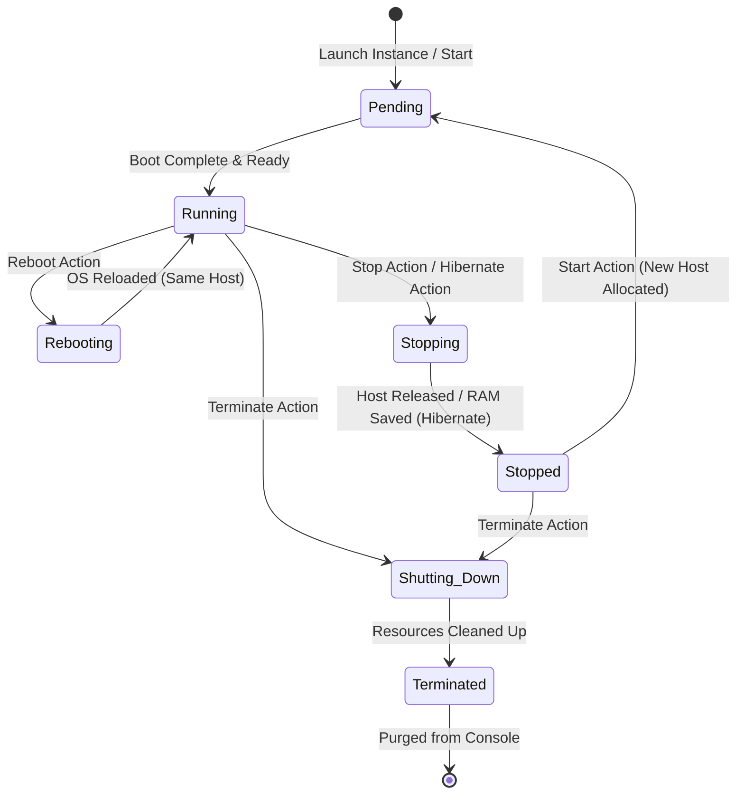
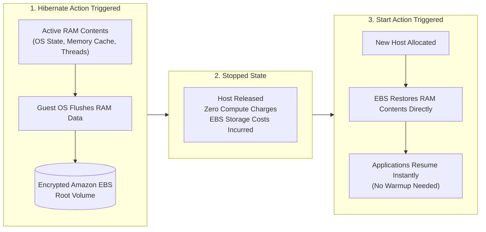
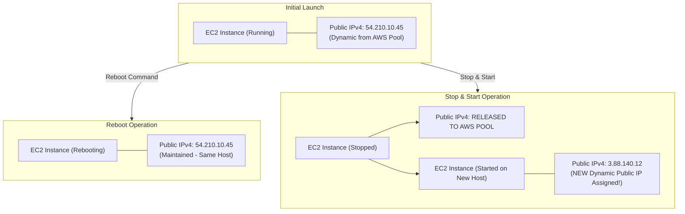
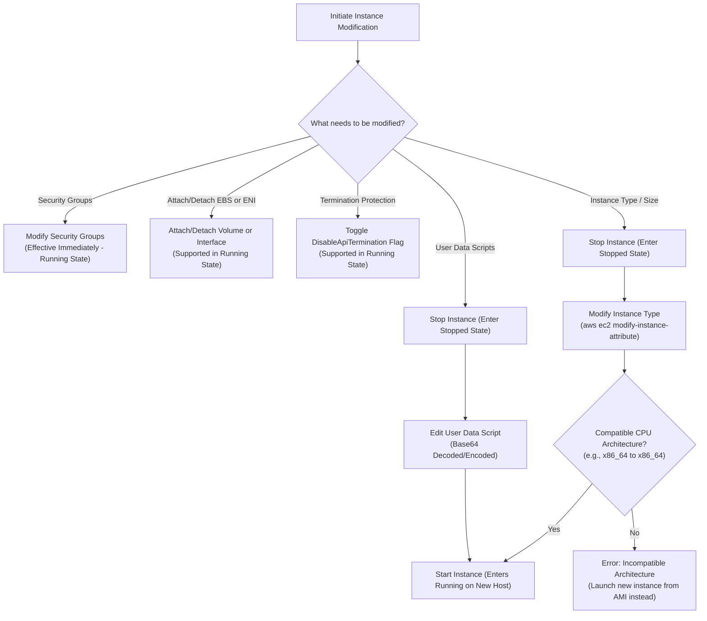
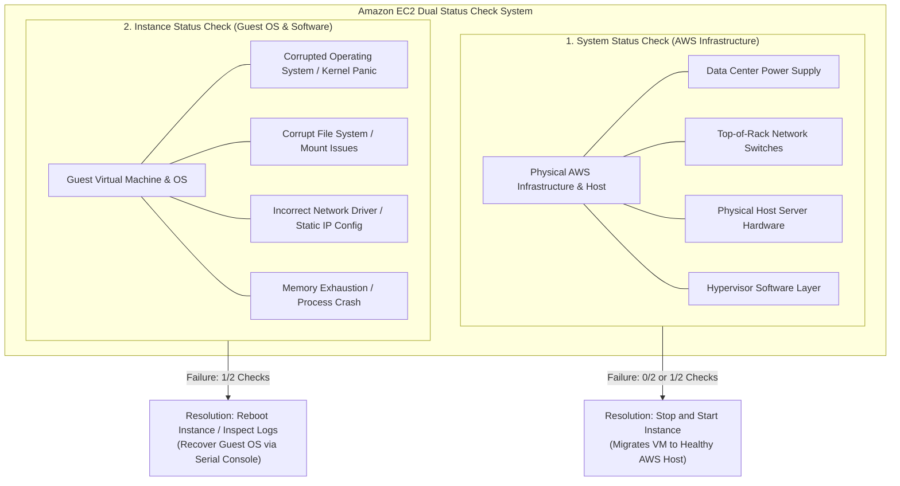
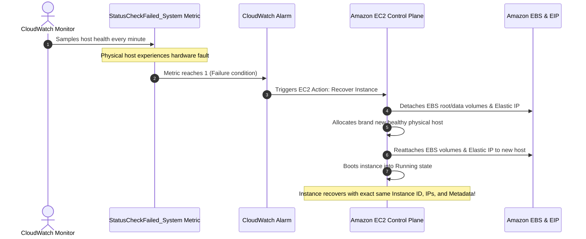
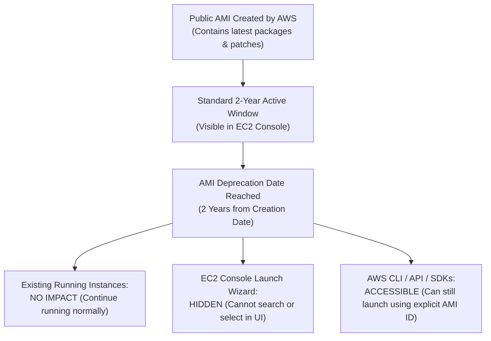

# 🖥️ Module 10: Managing AWS EC2 Instances – Study Guide

> **Course**: AWS re/Start  
> **Module**: M10 – Servers  
> **Source Document**: `T14-0005-RSSERV_EN-US_SG_M10_MANAGINGAWSINSTANCES.pdf`  
> **Target Audience**: AWS re/Start Learners, Cloud Practitioners, and Systems Administrators  

---

## 🎯 Module Overview

Managing virtual compute capacity in the cloud requires an in-depth understanding of compute lifecycle states, hardware allocation mechanisms, and operational modification workflows. In traditional on-premises data centers, physical servers are purchased, provisioned, and treated as long-lived fixtures ("pets"). If a server encounters a hardware defect or capacity limitation, administrators must physically repair or upgrade components on that specific chassis.

In **Amazon Elastic Compute Cloud (Amazon EC2)**, virtual server instances are treated as flexible, decoupled, and ephemeral cloud resources ("cattle"). Cloud administrators have granular control over the lifecycle of an instance—from provisioning, launching, stopping, and hibernating, to resizing compute resources on demand, modifying network configurations, and permanently terminating instances.

This study guide examines the complete Amazon EC2 instance lifecycle state machine, billing implications across various states, the mechanics of instance hibernation, operational procedures for modifying and resizing instances, health monitoring using dual EC2 status checks, automated recovery with Amazon CloudWatch, and modern best practices for fleet maintenance and AMI deprecation management.

---

### 📌 Learning Objectives

- [ ] **Define and Diagram the Amazon EC2 Lifecycle**: Track instance state transitions across `pending`, `running`, `stopping`, `stopped`, `shutting-down`, `terminated`, `rebooting`, and `hibernating`.
- [ ] **Analyze State Characteristics and Billing Rules**: Differentiate how compute hours, root/data EBS storage, public IPv4 addresses, and Elastic IPs are treated across each instance state.
- [ ] **Master Instance Hibernation Mechanics**: Understand how RAM contents are saved to encrypted Amazon EBS root volumes, startup acceleration benefits, and technical prerequisites.
- [ ] **Execute Instance Modification Workflows**: Resize an instance type via the AWS Management Console and AWS CLI, modify security groups dynamically, attach/detach EBS volumes and ENIs, and update instance user data.
- [ ] **Differentiate System vs. Instance Status Checks**: Diagnose underlying AWS hardware/infrastructure impairments versus guest operating system or filesystem failures.
- [ ] **Implement Automated Health Remediation**: Configure Amazon CloudWatch alarms with EC2 actions for automated instance recovery.
- [ ] **Apply Lifecycle Maintenance Best Practices**: Plan OS patching routines using native tools (YUM, Windows Update) and AWS Systems Manager, manage public and custom AMI deprecation schedules, and embrace the ephemeral "cattle, not pets" cloud paradigm.

---

## 📚 Key Terminology

| Term | Definition |
| :--- | :--- |
| **Amazon EC2 Instance Lifecycle** | The sequential progression of operational states an EC2 virtual server undergoes from provisioning and running to stopping, rebooting, or permanent termination. |
| **Pending State** | The initial transitional state where Amazon EC2 allocates underlying physical host hardware, configures hypervisor resources, and boots the virtual machine. |
| **Running State** | The active operational state where the operating system is booted, network interfaces are live, workloads execute, and compute usage charges accumulate. |
| **Stopping / Stopped State** | An operational pause available only to EBS-backed instances where the physical host hardware is released, compute billing ceases, but root and attached EBS volumes persist (incurring standard EBS storage charges). |
| **Hibernating State** | A specialized stop state where the guest OS flushes active instance RAM to the encrypted EBS root volume, enabling rapid resumption of applications and in-memory caches upon restart. |
| **Rebooting State** | A soft or hard restart of the guest operating system executed on the same physical host hardware without releasing public IPv4 addresses or ephemeral instance store data. |
| **Shutting-Down / Terminated State** | The irreversible end-of-life state where virtual resources are permanently decommissioned, compute capacity is released, and attached storage is deleted or detached according to configuration. |
| **Instance Store** | High-performance, temporary block storage located physically on the host computer running the EC2 instance; data is discarded when the instance stops, hibernates, or terminates. |
| **Amazon EBS Volume** | Network-attached, persistent block storage independent of the physical host lifecycle; retains data across instance stops, reboots, and hibernations. |
| **DeleteOnTermination** | An EBS volume attribute specifying whether an attached volume is automatically deleted (default `true` for root volumes) or preserved (default `false` for data volumes) when the instance terminates. |
| **System Status Check** | An automated AWS infrastructure check verifying the physical hardware, power, network connectivity, and hypervisor hosting the instance. |
| **Instance Status Check** | An internal monitoring check verifying that the guest operating system is reachable, the kernel is responsive, and network/filesystem configurations are valid. |
| **Termination Protection** | A configuration flag (`DisableApiTermination`) that prevents accidental deletion of an EC2 instance via the AWS Management Console, CLI, or API. |
| **AWS Systems Manager (SSM)** | An operations management service that automates software patching, inventory collection, and system maintenance across fleets of EC2 instances. |

---

## 🔄 1. The Amazon EC2 Instance Lifecycle & State Machine

Every EC2 instance transitions through discrete states throughout its lifespan. Understanding these states is vital for cost optimization, application availability, and disaster recovery.



---

### 1.1 Comprehensive Lifecycle State Breakdown

#### 1. Pending
- **Trigger**: Launching a new instance from an Amazon Machine Image (AMI) or starting a previously stopped instance.
- **Physical Mechanics**: Amazon EC2 identifies an available physical host computer within the selected Availability Zone (AZ) that matches the instance type's hardware specification (CPU architecture, memory, physical NICs).
- **Network Initialization**: The hypervisor assigns a Private IPv4 address from the subnet's CIDR block. If enabled (e.g., in a public subnet), a new Public IPv4 address is dynamically allocated from the AWS public pool.
- **Billing**: Compute usage charges do **not** accrue while the instance is pending.

#### 2. Running
- **Trigger**: Completion of initial boot and initialization routines.
- **Physical Mechanics**: The instance is live and operating on the designated physical host. Inbound and outbound network traffic flows according to attached Security Groups and Network ACLs.
- **Connectivity**: Cloud administrators can establish remote management sessions via AWS Systems Manager Session Manager, SSH (Linux, port 22), or RDP (Windows, port 3389).
- **Billing**: Compute usage is billed on a per-second basis (minimum 60 seconds) for Linux, Windows, and macOS instances. Attached EBS volumes, provisioned IOPS, and data transfer out are billed concurrently.

#### 3. Rebooting
- **Trigger**: Initiated by an administrator via the AWS Management Console, AWS CLI (`aws ec2 reboot-instances`), or AWS SDKs.
- **Physical Mechanics**: The guest operating system restarts. Crucially, the instance **remains on the exact same physical host computer**.
- **Network & Storage Persistence**: 
  - The instance **retains its assigned Public IPv4 address**, Private IPv4 address, and Public DNS hostname.
  - Ephemeral **instance store volumes retain all data**.
- **Best Practice Alert**: AWS strongly recommends initiating reboots through the EC2 API or Console rather than issuing OS-level commands (`sudo reboot` or `shutdown -r now`) to allow AWS monitoring systems to synchronize state seamlessly.

#### 4. Stopping and Stopped
- **Trigger**: Initiated via the AWS Console, CLI (`aws ec2 stop-instances`), or OS shutdown command.
- **Storage Requirement**: **Only instances with Amazon EBS root volumes can be stopped.** Instances launched with instance store root volumes cannot be stopped; they can only be running, rebooting, or terminated.
- **Transition (`stopping`)**: The operating system performs an orderly shutdown.
- **Final State (`stopped`)**: 
  - The virtual machine shuts down completely.
  - **The underlying physical host hardware is released** back into the AWS shared pool.
  - **Compute billing stops entirely.**
  - **The dynamically assigned Public IPv4 address is released** back into the AWS public pool (unless an Elastic IP is associated).
  - The Private IPv4 address is retained.
  - The root EBS volume and all attached EBS volumes persist, continuing to accrue standard EBS storage fees ($/GB-month).

> [!NOTE]
> **Host Migration on Restart**:  
> When a stopped instance is started again (`stopped` $\rightarrow$ `pending` $\rightarrow$ `running`), AWS provisions a **new physical host computer** from available capacity in the Availability Zone. This operation resolves underlying hardware faults, but it also means the instance will receive a **new dynamic Public IPv4 address**.

#### 5. Hibernating
- **Trigger**: Initiated by issuing a stop command with the hibernation flag enabled (`aws ec2 stop-instances --hibernate`).
- **Physical Mechanics**: The operating system saves all contents of volatile system memory (RAM) directly onto the encrypted EBS root volume before shutting down.
- **Billing**: While preparing to hibernate (in the `stopping` state), compute usage charges continue to accrue. Once fully `stopped`, compute charges pause.
- **Resume Speed**: When started, the instance skips operating system initialization scripts and application cache warm-up, loading the exact RAM image back into memory.

#### 6. Shutting-Down and Terminated
- **Trigger**: Initiated via the AWS Console, CLI (`aws ec2 terminate-instances`), Auto Scaling scale-in event, or spot instance interruption.
- **Transition (`shutting-down`)**: The OS completes final shutdown tasks; network interfaces and volumes prepare for detachment.
- **Final State (`terminated`)**:
  - The instance is permanently deleted and cannot be started or recovered.
  - The instance ID remains visible in the EC2 Console for a short duration (typically 1 to 2 hours) before being permanently purged.
  - **Data Disposition**:
    - Ephemeral **instance store volumes are immediately scrubbed and deleted**.
    - EBS volumes configured with `DeleteOnTermination = true` (default for root volumes) are **automatically deleted**.
    - EBS volumes configured with `DeleteOnTermination = false` (default for attached secondary EBS volumes) **remain intact** in the AWS account as independent volumes.
    - Any associated Elastic IP address is disassociated and remains in the account (incurring idle charges if not attached to another running instance or released).

---

## ❄️ 2. EC2 Instance Hibernation Deep-Dive

Instance hibernation offers a high-performance alternative to traditional cold reboots for workloads with lengthy boot times, heavy memory footprints, or extensive initialization sequences (such as machine learning inference models, in-memory caches, and complex enterprise Java/Node.js application servers).



---

### 2.1 Hibernation Mechanics and Restoration Process

When hibernation is triggered:
1. **Memory Serialization**: The EC2 hibernation agent signals the operating system kernel to freeze running threads and serialize RAM contents directly into a dedicated hibernation file on the EBS root volume.
2. **Resource Release**: Once memory is persisted to storage, the instance transitions through `stopping` to `stopped`. The underlying host hardware, CPU, and physical memory are released.
3. **Resumption**:
   - The instance enters `pending` and binds to a healthy physical host.
   - The EBS root volume is mounted, and the stored RAM image is loaded back into system memory.
   - Applications, background services, network sockets, and in-flight processes resume from their exact pre-hibernation state.
   - **Persistent Attributes**: The instance retains its **Instance ID**, **Private IP address**, and any attached **Elastic IP addresses**.

---

### 2.2 Hibernation Prerequisites and Limitations

To enable hibernation on an EC2 instance, strict architectural requirements must be met at the time of launch:

| Requirement / Attribute | Specification & Constraint |
| :--- | :--- |
| **Launch-Time Activation** | **Must be enabled during instance launch.** Hibernation cannot be enabled on an existing or stopped instance retroactively. |
| **Root Volume Type** | Must be an **Amazon EBS volume** (instance store root devices are unsupported). |
| **Root Volume Encryption** | The root EBS volume **must be encrypted** (using AWS KMS or AWS managed keys) to safeguard memory contents stored at rest. |
| **Root Volume Sizing** | The root EBS volume must have sufficient free disk space to accommodate the full RAM contents in addition to the operating system and applications. |
| **Supported OS Families** | Amazon Linux 2, Amazon Linux 2023, Ubuntu, Red Hat Enterprise Linux (RHEL), CentOS, SUSE Linux, and Windows Server (2012 R2 through 2022). |
| **Maximum RAM Limits** | - **Linux**: Up to **150 GB** of RAM.<br/>- **Windows**: Up to **16 GB** of RAM. |
| **Purchasing Options** | Supported on **On-Demand Instances** and **Reserved Instances** (Spot Instances support interruption hibernation via separate Spot configurations). |

> [!WARNING]
> **Ephemeral Storage Data Loss**:  
> Although instance hibernation preserves RAM contents on the root EBS volume, any data stored on **instance store (ephemeral) volumes is wiped and lost** during hibernation. Always persist critical application state to Amazon EBS or Amazon S3.

---

## 📊 3. Instance State Characteristics & Transition Matrix

The table below contrasts resource persistence, addressing, and billing implications across all operational EC2 states:

| Instance State | Compute Usage Billing | EBS Storage Billing | Public IPv4 Address | Private IPv4 Address | Elastic IP (EIP) | Instance Store Data | Underlying Host |
| :--- | :--- | :--- | :--- | :--- | :--- | :--- | :--- |
| **Pending** | No | Yes (EBS pricing) | Assigned (if enabled) | Assigned | Associated | Initializing | Allocating |
| **Running** | **Yes** (Per-second) | Yes (EBS pricing) | Retained & Active | Retained | Associated | **Preserved** | Active Host |
| **Rebooting** | **Yes** (No interruption) | Yes (EBS pricing) | **Retained** | **Retained** | **Associated** | **Preserved** | **Same Host** |
| **Stopping** | Yes (briefly) | Yes (EBS pricing) | Releasing | Retained | Associated | Discarded | Releasing |
| **Stopped** | **No** ($0 compute) | **Yes** (EBS pricing) | **Released to Pool** | Retained | Associated | **Discarded** | **Released** |
| **Hibernating** | No (once stopped) | **Yes** (EBS pricing) | Released to Pool | Retained | Associated | Discarded | Released |
| **Shutting-Down**| No | No (transitioning) | Released | Released | Disassociated | Discarded | Deallocating |
| **Terminated** | **No** | Deleted (if `DeleteOnTermination=true`) | Released | Released | Disassociated (remains in account) | **Discarded** | **Released** |

---

### 3.1 The Public IPv4 Address Lifecycle Trap

One of the most frequent operational surprises for junior cloud engineers involves dynamic public IPv4 addressing:



> [!CAUTION]
> **Dynamic IP Address Loss**:  
> When an instance is stopped and started, AWS assigns a brand new Public IPv4 address. Any external clients, DNS records, or firewall allowlists referencing the old IP address will immediately fail.  
> **Solution**: To maintain a persistent, unchanging public IP address across stop/start cycles, associate an **Elastic IP address (EIP)** or register the instance behind an **Application Load Balancer (ALB)** with an **Amazon Route 53** domain name.

---

## 🛠️ 4. Modifying and Resizing EC2 Instances

Modern cloud architectures demand agility. As workloads grow or experience varying resource utilization patterns, cloud administrators must modify instance sizing, storage, security boundaries, and startup metadata.



---

### 4.1 Resizing an Instance (Changing Instance Type)

Workloads commonly experience:
- **Overutilization**: Sustained 100% CPU utilization, memory exhaustion (out-of-memory kernel panics), or disk I/O bottlenecks (e.g., `t3.micro` under heavy production traffic).
- **Underutilization**: Over-provisioned instances consuming budget while idling at 2% CPU (e.g., `c5.4xlarge` hosting an internal dev tool).

#### Three-Step Resizing Workflow
1. **Stop the Instance**: Ensure the instance is in the `stopped` state.
2. **Modify the Instance Type**: Select a new instance type with compatible architecture.
3. **Start the Instance**: Boot the instance on a new physical host matching the new hardware profile.

#### Compatibility Rules for Resizing
- **EBS Root Volume Required**: Only EBS-backed instances can be resized in-place. Instance store-backed instances must be re-launched from an AMI.
- **Processor Architecture Match**: You cannot switch across incompatible architectures in-place. An instance running on 64-bit x86 (Intel/AMD) can only resize to another 64-bit x86 instance type (e.g., `t3.micro` to `m5.large`). To migrate to ARM64 (AWS Graviton, such as `m7g.large`), you must create an AMI and compile/launch a new Graviton-compatible instance.
- **Virtualization Type**: Both old and new instance types must support the same virtualization mode (modern instances use HVM).
- **Enhanced Networking & NVMe Support**: Upgrading from older generation instances (e.g., `t2`, `m3`) to newer Nitro-based instances (e.g., `t3`, `m5`, `c6i`) requires the guest OS to have installed NVMe drivers and ENA (Elastic Network Adapter) drivers.

#### Modifying Instance Type via AWS CLI
```bash
# Step 1: Stop the instance
aws ec2 stop-instances \
    --instance-ids i-0a1b2c3d4e5f67890

# Wait until the instance reaches the 'stopped' state
aws ec2 wait instance-stopped \
    --instance-ids i-0a1b2c3d4e5f67890

# Step 2: Modify the instance type attribute
aws ec2 modify-instance-attribute \
    --instance-id i-0a1b2c3d4e5f67890 \
    --instance-type "{\"Value\": \"m5.large\"}"

# Step 3: Start the newly sized instance
aws ec2 start-instances \
    --instance-ids i-0a1b2c3d4e5f67890
```

---

### 4.2 Dynamic Live Modifications (Running State)

Unlike physical servers, many EC2 modifications do **not** require stopping the server:

#### 1. Modifying Security Groups on the Fly
- **Immediate Effect**: You can add, remove, or replace Security Groups attached to a running instance at any time. Changes take effect within milliseconds.
- **Stateful Connection Tracking**: Existing open connections are tracked statefully. If a rule allowing inbound traffic on port 443 is removed, active sessions may persist until closed, but no new connections on port 443 will be accepted.

```bash
# Modify security groups associated with an instance
aws ec2 modify-instance-attribute \
    --instance-id i-0a1b2c3d4e5f67890 \
    --groups sg-0123456789abcdef0 sg-0fedcba9876543210
```

#### 2. Attaching and Detaching Elastic Network Interfaces (ENIs)
- Additional network interfaces (secondary ENIs) can be attached or detached dynamically while the instance is running ("hot plugging").
- Useful for dual-homed appliances, network monitoring, or moving an internal management IP between instances.

#### 3. Managing Storage Volumes (Amazon EBS Elastic Volumes)
- **Attach/Detach Data Volumes**: Secondary EBS volumes can be hot-attached to a running instance without disruption.
- **Elastic Volumes Modification**: You can expand volume size, change volume type (e.g., `gp2` to `gp3`), or adjust provisioned IOPS/throughput on live, attached EBS volumes with zero downtime.

#### 4. Termination Protection
- The `DisableApiTermination` flag protects mission-critical instances against accidental deletion from the AWS Console, CLI, or automated scripts.
- Can be toggled on or off at any time while the instance is running or stopped.

```bash
# Enable termination protection
aws ec2 modify-instance-attribute \
    --instance-id i-0a1b2c3d4e5f67890 \
    --disable-api-termination "{\"Value\": true}"
```

---

### 4.3 Modifying EC2 User Data

**User Data** scripts run automatically during the initial launch phase of an instance (via `cloud-init` on Linux or `EC2Launch` on Windows) to install software, clone repositories, and apply configurations.

If an error exists in the user data script or configuration updates are required:
1. The instance **must be stopped**.
2. Update the user data via the console or CLI:
   ```bash
   aws ec2 modify-instance-attribute \
       --instance-id i-0a1b2c3d4e5f67890 \
       --user-data "file://bootstrap-update.sh"
   ```
3. Restart the instance.

> [!IMPORTANT]
> **User Data Execution Rules**:  
> By default, `cloud-init` executes user data scripts **only once** during the first initial boot cycle. Modifying user data on a stopped instance and starting it will **not** automatically re-run the script unless the user data contains specific `cloud-config` directives (e.g., `scripts-user: [always]`) or the cloud-init cache in `/var/lib/cloud/instances/` is cleared.

---

## 🩺 5. EC2 Instance Status Checks and Automated Monitoring

Amazon EC2 performs continuous, automated status checks every minute to identify hardware, software, and network impairments. Status checks are visible in the EC2 Console as **Status check: 2/2 checks passed**.



---

### 5.1 System Status Check vs. Instance Status Check

| Evaluation Criterion | System Status Check | Instance Status Check |
| :--- | :--- | :--- |
| **Monitored Scope** | Underlying AWS hardware, data center facilities, and hypervisor. | Inside the guest operating system and virtual machine software layer. |
| **Typical Causes of Failure** | - Loss of physical network connectivity to the host.<br/>- Physical host hardware failure (CPU/motherboard/memory fault).<br/>- Loss of power to the physical rack.<br/>- Hypervisor software errors on the physical host. | - Operating system kernel crash or kernel panic.<br/>- Corrupt filesystem metadata preventing boot.<br/>- Exhausted system memory (OOM killer termination).<br/>- Incompatible driver installation.<br/>- Corrupted network configuration (e.g., misconfigured `/etc/fstab` or network interfaces). |
| **Administrator Responsibility** | **AWS Responsibility** (under the AWS Shared Responsibility Model). | **Customer Responsibility** (managing guest OS and applications). |
| **Primary Remediation** | **Stop and start the instance**. This forces AWS to release the impaired physical host and launch the instance on a healthy physical host. | **Reboot the instance** or connect via EC2 Serial Console / EC2 Instance Connect to fix filesystem, configuration, or software issues. |
| **Console Indicator** | `System reachability check failed` | `Instance reachability check failed` |

---

### 5.2 Automated Recovery with CloudWatch Alarms

Rather than waiting for human operators to detect a failed System Status Check, administrators can configure **Amazon CloudWatch Alarms** with native EC2 recovery actions.



#### Key Capabilities of Instance Recovery
- **Preserved Properties**: When an instance is automatically recovered:
  - It retains its original **Instance ID**.
  - It retains its original **Private IP address** and **Elastic IP address**.
  - It retains all attached EBS volumes and metadata.
- **Hardware Relocation**: The instance is seamlessly re-instantiated on healthy host hardware without manual re-provisioning.

---

## 🔄 6. Instance Maintenance, Patching & Lifecycle Management

Under the **AWS Shared Responsibility Model**, AWS manages the physical data center, server hardware, virtualization layer, and host networking. The **customer is responsible** for configuring, maintaining, updating, and patching the guest operating system and applications installed on EC2 instances.

---

### 6.1 OS and Application Patching Strategies

Instances that run long-term workloads (e.g., development bastions, relational database servers) require regular security patches to protect against Common Vulnerabilities and Exposures (CVEs).

#### Patching Toolchains
- **Linux Package Managers**:
  - **YUM / DNF**: Standard package management on Amazon Linux, RHEL, and CentOS.
  - AWS maintains high-availability, local software repositories within each AWS Region for Amazon Linux, ensuring lightning-fast updates without incurring external internet data egress fees:
    ```bash
    # Apply all critical security updates on Amazon Linux
    sudo yum update --security -y
    ```
  - **APT**: Package manager for Ubuntu and Debian instances (`sudo apt update && sudo apt upgrade -y`).
- **Microsoft Windows Update**:
  - Windows Server instances can download and apply security patches via native Windows Update.
  - Administrators can enforce automated installation or configure maintenance windows to prevent unexpected reboots during business hours.
- **AWS Systems Manager (SSM) Patch Manager**:
  - The enterprise gold standard for fleet management. Automates the patching of hybrid fleets of Linux and Windows instances at scale based on defined **Patch Baselines** and maintenance schedules.

---

### 6.2 Amazon Machine Image (AMI) Deprecation

AWS regularly releases updated public AMIs containing the latest security patches, kernel updates, and AWS CLI tools. To prevent customers from launching outdated, insecure images, AWS enforces an automated **AMI Deprecation Policy**.



#### Rules of AMI Deprecation
1. **Default Deprecation Timeline**: Public AMIs have a default deprecation date set to **2 years from their creation date**.
2. **Impact on Running Instances**: Deprecating an AMI has **zero operational effect** on existing instances launched from that AMI. They continue to run, reboot, stop, and start without disruption.
3. **Console Visibility**: Deprecated AMIs are excluded from search results in the AWS Management Console launch wizard to steer users toward updated, patched base images.
4. **Programmatic Access**: If automation scripts or Infrastructure as Code (Terraform, CloudFormation) explicitly reference a deprecated AMI ID, AWS **permits new instance launches** via the AWS CLI, EC2 API, or SDKs.
5. **Custom AMI Deprecation**: Organizations can enforce their own governance by setting deprecation dates on custom internal AMIs using `aws ec2 enable-image-deprecation`.

---

## 🏗️ 7. Architectural Best Practices: Pets vs. Cattle & Ephemeral Design

A core tenet of cloud architecture is treating compute capacity as disposable, interchangeable, and ephemeral.

```mermaid
flowchart TD
    subgraph PetsModel["Traditional Data Center: The 'Pets' Model"]
        P1["Unique Physical Server"] --> P2["Manually Configured & Patched"]
        P2 --> P3["Hardware Fault Occurs"]
        P3 --> P4["Emergency Downtime & Manual Hardware Repair"]
    end

    subgraph CattleModel["Cloud Native Architecture: The 'Cattle' Model"]
        C1["Standardized Launch Template & Golden AMI"] --> C2["Fleet of Identical EC2 Instances"]
        C2 --> C3["Instance Becomes Impaired or Outdated"]
        C3 --> C4["Terminate Impaired Instance Immediately"]
        C4 --> C5["Auto Scaling Spawns Healthy Replacement in Seconds"]
    end
```



---

### 7.1 Why Instances Must Be Designed for Quick Buildup and Teardown

Designing instances to be built up, torn down, and replaced rapidly provides massive architectural advantages across five major dimensions:

1. **Automatic Scaling (Dynamic Elasticity)**:
   - Application demand fluctuates dynamically. Applications must bootstrap automatically using User Data or pre-baked AMIs so new instances become productive within minutes of launching.
2. **Cost Optimization**:
   - Workloads that do not run 24/7 (such as nightly batch jobs, test environments, or analytical data pipelines) can be torn down completely when idle, dropping compute spend to zero.
3. **Downgrading & Right-Sizing**:
   - Cloud flexibility allows engineers to downgrade instance sizing (e.g., from `t2.xlarge` to `t2.large`) or transition from dedicated hosts to shared multi-tenant instances when workloads stabilize.
4. **Repairing Impaired Instances**:
   - Rather than spending hours troubleshooting an unresponsive operating system or corrupted kernel, engineers can terminate the faulty instance and let an Auto Scaling group provision a fresh, healthy replica.
5. **Upgrading Infrastructure**:
   - Operating system upgrades, major runtime updates, and hardware migrations (e.g., moving to AWS Graviton processors) are achieved by deploying a new AMI across the fleet rather than performing in-place upgrades.

---

## ❓ 8. Checkpoint & Review Questions with Detailed Explanations

### Question 1
**Scenario**: An engineer installs updates on an EC2 instance and reboots it. Once the instance is in a running state, users can successfully access their application on the instance. At the end of the day, the engineer stops the instance. The next day, the engineer uses the console to start the instance, but users cannot access their application. The console shows that the instance is in a running state. What is the most likely cause of the problem?

> **Answer & Explanation**:  
> When the engineer **rebooted** the instance, it remained on the same physical host and **retained its assigned Public IPv4 address**.  
> However, when the engineer **stopped** the instance at the end of the day, the dynamic Public IPv4 address was released back into the AWS public pool. When the instance was **started** the following morning, AWS provisioned a new physical host and assigned a **brand new Public IPv4 address**.  
> Users attempting to connect using the previous day's IP address were unable to reach the application.  
> **Remediation**: Allocate and associate an **Elastic IP address (EIP)** to the instance, or place the instance behind an **Application Load Balancer** with a static DNS record in Amazon Route 53.

---

### Question 2
**Question**: Why must an Amazon EC2 instance have an Amazon EBS root volume in order to support instance hibernation?

> **Answer & Explanation**:  
> Ephemeral instance store volumes are tied directly to the physical host and lose all data when an instance is powered off. In contrast, **Amazon EBS volumes are network-attached, durable storage devices that persist independently of the host computer**.  
> During hibernation, the operating system flushes the entire contents of volatile system memory (RAM) directly into an encrypted hibernation file on the root device volume. When the instance is started again, EC2 provisions a host, mounts the persistent EBS root volume, and reads the saved RAM contents back into system memory. This persistence mechanism requires an EBS root volume.

---

### Question 3
**Question**: Which specific conditions must be satisfied before you can successfully modify the instance type (size) of an existing EC2 instance?

> **Answer & Explanation**:  
> To modify the instance type of an existing instance:
> 1. **The instance must be in the `stopped` state.** You cannot change the instance type of a running or rebooting instance.
> 2. **The root device must be an Amazon EBS volume.** Instances backed by instance store root volumes cannot be stopped or resized in place.
> 3. **The target instance type must be compatible with the instance's existing configuration**, specifically:
>    - **Processor Architecture**: A 64-bit x86 instance can only be resized to another 64-bit x86 instance type (not ARM64 Graviton).
>    - **Virtualization Type**: Must support HVM virtualization.
>    - **Driver Compatibility**: Transitioning to Nitro-based instance types requires that the operating system has installed Elastic Network Adapter (ENA) and NVMe storage drivers.

---

### Question 4
**Scenario**: You observe that an EC2 instance is showing a status check failure of `1/2 checks passed`. The specific alert states: `System reachability check failed`. What does this indicate, and what is the standard operational procedure to resolve it?

> **Answer & Explanation**:  
> A failure of the **System Status Check** indicates an issue with the **underlying AWS infrastructure** (such as a physical host hardware malfunction, physical power loss, or network switch impairment).  
> **Resolution Procedure**:  
> 1. Issue a **Stop** command on the affected instance.
> 2. Once the instance reaches the `stopped` state, issue a **Start** command.  
> Starting the instance causes Amazon EC2 to allocate a **new, healthy physical host computer** in the Availability Zone, restoring availability while preserving the instance's EBS storage and configuration. Alternatively, configure a **CloudWatch Auto Recovery** alarm to automate this process.

---

### Question 5
**Question**: What is the purpose of the EC2 **Termination Protection** attribute, and how does it interact with the `DeleteOnTermination` volume setting?

> **Answer & Explanation**:  
> - **Termination Protection (`DisableApiTermination`)**: Prevents an instance from being accidentally terminated via the AWS Management Console, CLI, or API. If a user attempts to terminate a protected instance, the request is rejected until an administrator explicitly disables the flag.  
> - **`DeleteOnTermination` Volume Setting**: Controls what happens to an attached EBS volume **when the instance is actually terminated**. If set to `true` (default for root volumes), the volume is deleted upon instance termination; if set to `false` (default for attached data volumes), the volume persists as a detached, standalone EBS volume.  
> Termination protection prevents the instance deletion event itself, whereas `DeleteOnTermination` dictates storage retention after termination occurs.

---

### Question 6
**Question**: Can you modify an EC2 instance's Security Group assignments while the instance is actively running? When do the changes take effect?

> **Answer & Explanation**:  
> **Yes.** You can add, remove, or replace Security Groups associated with an instance while it remains in the `running` state.  
> The modifications take effect **immediately**. Security Groups are stateful; new rules immediately allow or restrict traffic, while established sessions are tracked according to connection state rules.

---

## 📖 Module Summary & Quick Reference

```
                             AMAZON EC2 INSTANCE LIFECYCLE
+-----------------------------------------------------------------------------------------+
|  State        | Compute Billed | Host Status | Public IP Retained | Storage Behavior    |
+---------------+----------------+-------------+--------------------+---------------------+
|  Pending      | No             | Allocating  | No                 | EBS provisioning    |
|  Running      | Yes (sec/hr)   | Active      | Yes                | Read/Write active   |
|  Rebooting    | Yes            | Same Host   | Yes (Maintained!)  | Ephemeral preserved |
|  Stopping     | Briefly        | Releasing   | Released to pool   | Orderly OS shutdown |
|  Stopped      | No             | Released    | Released to pool   | EBS persists ($/GB) |
|  Hibernating  | No (stopped)   | Released    | Released to pool   | RAM saved to EBS    |
|  Terminated   | No             | Released    | Released           | Ephemeral deleted   |
+-----------------------------------------------------------------------------------------+
```

- **Stop vs. Reboot**: Reboot stays on the same physical host and keeps its public IP. Stop releases the host and loses its public IP (unless Elastic IP is used).
- **Hibernation**: Flushes RAM to encrypted root EBS volume. Fast startup. Max RAM: 150 GB (Linux), 16 GB (Windows).
- **Resizing**: Must stop instance $\rightarrow$ change instance type $\rightarrow$ start instance. Requires EBS root volume and architecture compatibility.
- **Dual Checks**: System check = AWS hardware/host. Instance check = Guest OS/kernel/filesystem.
- **Architectural Mindset**: Treat instances as ephemeral cattle, not pets. Automate recovery, design for rapid relaunch, and leverage AWS Systems Manager for ongoing maintenance.
