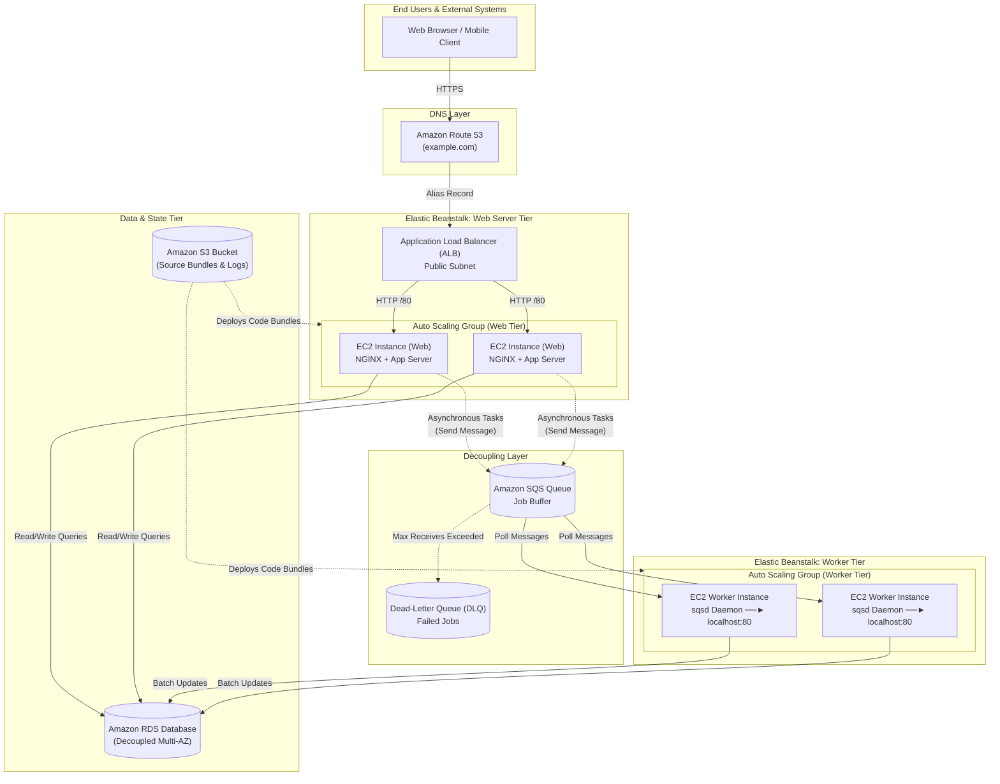
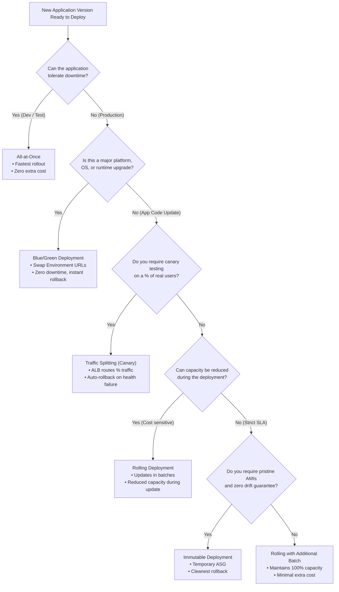
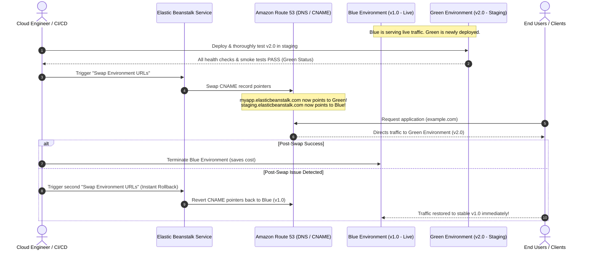
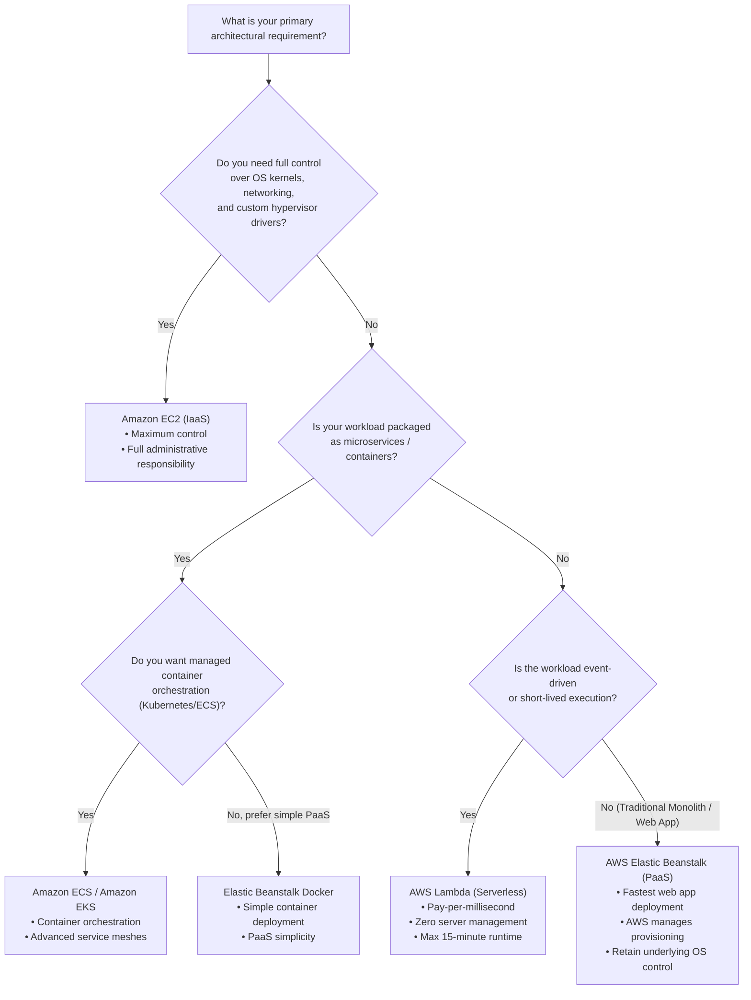

# 🚀 Module 10: AWS Elastic Beanstalk – Study Guide

> **Course**: AWS re/Start  
> **Module**: M10 – Servers  
> **Source Document**: `T14-0006-RSSERV_EN-US_SG_M10_AWSELASTICBEANSTALK.pdf`  
> **Target Audience**: AWS re/Start Learners, Cloud Practitioners, DevOps Engineers, and Solutions Architects  

---

## 🎯 Module Overview

Modern cloud application development requires a balance between speed to market and infrastructure control. In a traditional **Infrastructure as a Service (IaaS)** paradigm—such as deploying directly on Amazon Elastic Compute Cloud (Amazon EC2)—engineers must manually provision virtual machines, configure operating systems, install application runtimes, set up web servers, manage networking, configure Elastic Load Balancing (ELB), establish Amazon EC2 Auto Scaling policies, and configure health monitoring. While this provides complete architectural granular control, it introduces significant operational overhead and shifts developer focus away from writing high-value business logic.

**AWS Elastic Beanstalk** resolves this tension by providing an easy-to-use, robust **Platform as a Service (PaaS)** on top of proven AWS infrastructure. With Elastic Beanstalk, developers simply upload their application source code or container images, and the service automatically orchestrates the end-to-end provisioning, load balancing, automatic scaling, and health monitoring. Crucially, unlike proprietary black-box PaaS solutions, Elastic Beanstalk gives engineers complete ownership and transparency over the underlying AWS resources, allowing teams to seamlessly inspect, modify, or take over infrastructure components whenever required.

This study guide examines the core architecture, building blocks, environment tiers, advanced deployment strategies, configuration mechanisms (`.ebextensions`), enhanced health monitoring, and architectural decision frameworks for AWS Elastic Beanstalk.

---

### 📌 Learning Objectives

- [ ] **Define AWS Elastic Beanstalk and the PaaS Model**: Understand how Platform as a Service minimizes operational complexity while maintaining granular AWS resource control.
- [ ] **Identify Supported Platforms and Runtimes**: Recognize supported programming languages (Java, .NET, Node.js, PHP, Python, Ruby, Go), web/application servers (Apache, NGINX, IIS, Tomcat, Passenger, Puma), and Docker containers.
- [ ] **Distinguish Core Structural Components**: Contrast Applications, Application Versions, Environments, and Environment Configurations.
- [ ] **Differentiate Environment Tiers**: Compare the architecture and use cases of the **Web Server Tier** (HTTP/HTTPS load balancing) versus the **Worker Tier** (Amazon SQS queue-driven background processing).
- [ ] **Analyze Deployment Strategies**: Evaluate the trade-offs of All-at-Once, Rolling, Rolling with Additional Batch, Immutable, Traffic Splitting (Canary), and Blue/Green deployments in terms of cost, speed, and downtime.
- [ ] **Master Configuration with `.ebextensions`**: Understand how YAML/JSON configuration files customize OS packages, file creation, environment variables, and AWS resources.
- [ ] **Implement Database and State Best Practices**: Understand the critical risks of coupling an Amazon RDS instance directly to an Elastic Beanstalk environment versus external decoupled RDS architectures.
- [ ] **Evaluate Monitoring and Enhanced Health Reporting**: Interpret health status color codes (Green, Yellow, Red, Grey) and diagnostic metrics.
- [ ] **Select the Optimal Compute Solution**: Apply architectural decision matrices to choose between Elastic Beanstalk, Raw EC2, Amazon ECS/EKS, and AWS Lambda.

---

## 📚 Key Terminology

| Term | Definition |
| :--- | :--- |
| **Platform as a Service (PaaS)** | A cloud computing model where the cloud provider delivers hardware, networking, OS, and runtime stacks, enabling developers to build, run, and manage applications without infrastructure management overhead. |
| **AWS Elastic Beanstalk** | An orchestration PaaS service that automates the deployment, scaling, load balancing, and health monitoring of web applications and services on AWS. |
| **Application** | A logical container in Elastic Beanstalk that houses components including environments, application versions, and saved environment configurations. |
| **Application Version** | A specific, labeled iteration of deployable application code, packaged as a zip or WAR archive and stored in an Amazon S3 bucket. |
| **Environment** | A running deployment of an application version executing on a provisioned collection of AWS resources (EC2 instances, load balancers, security groups). |
| **Web Server Tier** | An Elastic Beanstalk environment designed to serve incoming HTTP/HTTPS client traffic using an Elastic Load Balancer and an Auto Scaling group of EC2 instances. |
| **Worker Tier** | An Elastic Beanstalk environment designed for asynchronous, background processing tasks that reads messages from an Amazon SQS queue via an internal daemon (`sqsd`). |
| **`.ebextensions`** | A directory of hidden configuration files (`.config`) placed in the application source bundle root to customize the runtime environment, OS packages, files, commands, and AWS resources. |
| **Enhanced Health Reporting** | A monitoring feature that evaluates comprehensive instance- and environment-level signals (HTTP status codes, latency, daemon state, CPU/disk load) to assign real-time health statuses. |
| **Blue/Green Deployment** | A release strategy where two identical environments exist concurrently: one serving live production traffic (Blue) and the other hosting the new application version (Green), switched seamlessly via Route 53 or URL swap. |
| **Swap Environment URLs** | A native Elastic Beanstalk feature that swaps CNAME DNS records between two active environments, enabling instant, zero-downtime Blue/Green traffic cutover. |
| **Immutable Deployment** | A deployment strategy that provisions a completely fresh, temporary Auto Scaling group of instances with the new application version before safely replacing the old instances. |

---

## 🏛️ 1. What is AWS Elastic Beanstalk?

### 1.1 The PaaS Paradigm: Shifting the Shared Responsibility Line

In cloud architecture, compute hosting exists on a spectrum from bare metal to serverless function execution:

```
[IaaS: EC2]  ──────────►  [PaaS: Elastic Beanstalk]  ──────────►  [Serverless: AWS Lambda]
Maximum Control              Balanced Control & Speed               Zero Infrastructure Management
Maximum Operational Burden   AWS Manages Plumbing                   Code-Only Execution Blocks
```

- **Infrastructure as a Service (IaaS - Amazon EC2)**: The user is responsible for provisioning the OS, applying security patches, configuring firewalls, setting up reverse proxies (NGINX/Apache), configuring load balancers, tuning Auto Scaling triggers, and wiring monitoring alarms.
- **Platform as a Service (PaaS - Elastic Beanstalk)**: AWS abstracts the infrastructure plumbing. Developers focus entirely on writing application code. Elastic Beanstalk automatically provisions, configures, and manages the underlying components.
- **Retained Control Advantage**: Unlike conventional black-box PaaS platforms (where underlying instances are inaccessible), Elastic Beanstalk preserves full root access (`sudo`/SSH/AWS Systems Manager Session Manager) to the underlying EC2 instances. You retain total authority to modify configuration files, inspect log files, adjust security groups, or attach custom IAM roles.

---

### 1.2 Core Capabilities & Automated Orchestration

When code is uploaded, Elastic Beanstalk automatically provisions and manages:

1. **Capacity Provisioning**: Selects and launches Amazon EC2 instances based on user-defined instance types (e.g., `t3.micro`, `c5.large`, or GPU instances).
2. **Load Balancing**: Deploys and configures Elastic Load Balancing (Application Load Balancer, Network Load Balancer, or Classic Load Balancer) to distribute incoming traffic.
3. **Auto Scaling**: Configures an Amazon EC2 Auto Scaling group with scaling triggers based on CPU utilization, network I/O, or request counts to match traffic demand.
4. **Health Monitoring**: Periodically executes health checks against application endpoints to automatically detect and replace failing instances.
5. **Operating System & Runtime Maintenance**: Automatically applies managed platform updates and security patches to the underlying Amazon Linux or Windows Server AMIs.

> [!NOTE]
> **Pricing Model**: There is **no additional charge** for AWS Elastic Beanstalk itself. Users pay exclusively for the underlying AWS resources created and consumed by the application (such as EC2 instances, Elastic Load Balancers, S3 storage, EBS volumes, and data transfer).

---

### 1.3 Supported Platforms, Languages, and Web Stacks

Elastic Beanstalk supports a comprehensive matrix of modern runtime platforms:

| Platform Category | Supported Technologies & Runtimes | Underlying Web / App Servers |
| :--- | :--- | :--- |
| **Programming Languages** | Python, Node.js, Java, PHP, Ruby, Go, .NET Core | Gunicorn, Express/PM2, Apache Tomcat, Apache HTTP / PHP-FPM, Puma / Passenger |
| **Enterprise Windows** | .NET on Windows Server | Microsoft Internet Information Services (IIS) |
| **Containerized Stacks** | Docker, Multi-Container Docker (powered by Amazon ECS) | NGINX reverse proxy, custom containers |
| **Packaged Web Stacks** | Java SE, Java with Tomcat, Corretto | Apache HTTP Server, NGINX reverse proxy |

---

## 🏗️ 2. Core Architecture & Building Blocks

An Elastic Beanstalk deployment follows a clean hierarchical structure:

```
Application (Logical Container)
 ├── Application Versions (v1.0, v1.1, v2.0 in Amazon S3)
 ├── Saved Configurations (Templates)
 └── Environments
      ├── Environment A: Development (Single Instance)
      ├── Environment B: Staging (Load-Balanced, Web Server Tier)
      └── Environment C: Production (Load-Balanced, Web Server Tier + Worker Tier)
```

### 2.1 The Four Building Blocks

1. **Application**: The high-level logical folder representing the software project (e.g., `MyEcommerceApp`).
2. **Application Version**: A specific deployable build artifact packaged as a `.zip` (Node.js, Python, PHP) or `.war` (Java) archive and uploaded to Amazon S3. Each version is immutable and version-tagged.
3. **Environment**: A running instance of the application containing provisioned AWS resources. Environments can be created and terminated independently.
4. **Environment Configuration**: A collection of parameter settings that define how an environment and its resources behave (instance types, environment variables, scaling triggers, VPC subnets).

---

### 2.2 Environment Tiers: Web Server Tier vs. Worker Tier

Elastic Beanstalk offers two specialized environment tiers tailored to different architectural workloads.

#### Web Server Tier
- **Purpose**: Handles synchronous, real-time client HTTP/HTTPS requests (web apps, APIs, REST services).
- **Architecture**:
  - Incoming requests arrive at an **Elastic Load Balancer** (typically an Application Load Balancer).
  - The ALB distributes requests across an **Auto Scaling group** of EC2 instances running web servers (e.g., NGINX reverse proxy forwarding to Node.js/Gunicorn).
  - Integrates with Amazon Route 53 for custom domain routing.

#### Worker Tier
- **Purpose**: Handles asynchronous, compute-intensive, or long-running background tasks (video encoding, report generation, batch email delivery, database synchronization).
- **Architecture**:
  - Decoupled from the public internet. No public load balancer is provisioned.
  - An **Amazon SQS (Simple Queue Service)** queue acts as the buffer for incoming jobs.
  - Worker EC2 instances run a specialized AWS-managed daemon called **`sqsd` (SQS Daemon)**.
  - The `sqsd` daemon polls the SQS queue, retrieves messages, and translates each message into an HTTP `POST` request sent to `http://localhost:80/` (or a configured port/path) on the local application server.
  - If the application server returns an HTTP `200 OK`, `sqsd` acknowledges and deletes the message from the queue. If it returns an error or times out, the message becomes visible again in SQS or moves to a Dead-Letter Queue (DLQ).

---

### 2.3 Comprehensive Elastic Beanstalk Dual-Tier Architecture



---

## 🔄 3. Elastic Beanstalk Deployment Strategies

Selecting the correct deployment strategy is one of the most critical operational decisions in Elastic Beanstalk. The decision depends on requirements for availability, deployment speed, rollback ease, and infrastructure cost.

### 3.1 Detailed Deployment Mechanics

#### 1. All-at-Once
- **Mechanism**: Deploys the new application version to all instances simultaneously.
- **Characteristics**:
  - Fastest deployment speed.
  - **Incurs application downtime**: all instances are updated concurrently, taking the service temporarily offline.
  - No additional AWS resources or costs are incurred.
  - **Rollback**: Requires a full re-deployment of the prior version (with downtime).
  - **Ideal for**: Development, testing, or maintenance windows where downtime is acceptable.

#### 2. Rolling
- **Mechanism**: Deploys the new version in batches (e.g., 25% or 50% at a time). While one batch updates, the remaining instances handle incoming traffic.
- **Characteristics**:
  - **Zero complete downtime**.
  - **Reduced capacity**: During the update, the available capacity decreases by the batch size, which can degrade performance under heavy traffic.
  - Both old and new versions handle traffic simultaneously during the deployment window.
  - No additional infrastructure costs.
  - **Ideal for**: Non-critical production applications with spare capacity headroom.

#### 3. Rolling with Additional Batch
- **Mechanism**: Provisions an extra batch of new instances *before* taking any existing instances out of service. Updates occur in rolling batches, maintaining 100% of the baseline operational capacity throughout the process.
- **Characteristics**:
  - **Zero downtime and maintains 100% operational capacity**.
  - Moderate deployment duration.
  - Incurs a small, temporary additional cost for the extra instances during the rollout.
  - At completion, the extra instances are terminated, restoring original fleet size.
  - **Ideal for**: High-availability production workloads that cannot afford degraded capacity during business hours.

#### 4. Immutable
- **Mechanism**: Creates an entirely separate, temporary Auto Scaling group alongside the existing one. Launches a single instance of the new version to verify health. If successful, launches the remaining instances in the temporary ASG, shifts traffic over, and terminates the original ASG.
- **Characteristics**:
  - **Zero downtime and pristine isolation**.
  - High safety: Protects against configuration drift because new instances boot from clean baseline AMIs.
  - **Cleanest rollback**: If health checks fail at any point, the temporary ASG is simply terminated with zero impact on the healthy running environment.
  - Incurs temporary 2x capacity cost during the deployment.
  - Slowest in-place deployment method.
  - **Ideal for**: Mission-critical production applications requiring guaranteed rollback reliability and zero configuration drift.

#### 5. Traffic Splitting (Canary)
- **Mechanism**: Deploys the new version to a separate, temporary Auto Scaling group and uses the Application Load Balancer to route a small, predefined percentage of incoming user traffic (e.g., 10%) to the new version for an evaluation period (e.g., 15 minutes).
- **Characteristics**:
  - Evaluates real-world production traffic and error rates before full commitment.
  - Automatic rollback if enhanced health reports errors during the evaluation window.
  - If healthy, all remaining traffic is routed to the new version, and the old fleet is terminated.
  - **Ideal for**: Production releases where risk mitigation and real-user verification are essential.

#### 6. Blue/Green Deployment (Environment Swap)
- **Mechanism**: Creates a completely separate, independent Elastic Beanstalk environment (Green) running the new version. Once the Green environment is verified, an **Environment URL Swap** is performed. Elastic Beanstalk swaps the CNAME DNS records in Route 53.
- **Characteristics**:
  - Complete isolation: Database migrations, major platform version updates (e.g., Node 16 to Node 20, or Python 3.9 to 3.11) can be tested thoroughly in staging.
  - Near-instantaneous cutover with zero downtime.
  - Instant rollback: If an issue is discovered after cutover, simply perform another URL swap to revert traffic to Blue.
  - Higher cost: Both complete environments exist simultaneously until the old environment is terminated.
  - **Ideal for**: Major version upgrades, database schema changes, and high-stakes production deployments.

---

### 3.2 Deployment Strategies Comparison Matrix

| Strategy | Downtime | Deployment Speed | Rollback Time | Capacity Maintained | Extra Instance Cost | Best Use Case |
| :--- | :--- | :--- | :--- | :--- | :--- | :--- |
| **All-at-Once** | **Yes** (Brief) | Fastest | Slow (Re-deploy) | 0% during update | None | Development / Dev/Test |
| **Rolling** | **No** | Moderate | Moderate | Reduced by batch size | None | Low-budget production |
| **Rolling + Addl Batch** | **No** | Moderate | Moderate | **100% capacity** | Minor / Temporary | Production (consistent SLA) |
| **Immutable** | **No** | Slow | **Fast & Clean** | **100% capacity** | Temporary 2x peak | Mission-critical production |
| **Traffic Splitting** | **No** | Slow | **Fast & Automated**| **100% capacity** | Temporary 2x peak | Canary testing in production |
| **Blue/Green** | **No** | Independent | **Instantaneous** | **100% capacity** | 2x Full Environment | Major platform/OS upgrades |

---

### 3.3 Deployment Strategy Decision Flowchart



---

### 3.4 Blue/Green Environment URL Swap Sequence



---

## ⚙️ 4. Configuration & Customization (`.ebextensions`)

Elastic Beanstalk offers rich automation through custom configuration files placed inside the application source package.

### 4.1 The `.ebextensions/` Framework

To customize the environment, create a hidden folder named `.ebextensions` in the root directory of your project code:

```
my-application-root/
 ├── .ebextensions/
 │    ├── 01_packages.config
 │    ├── 02_environment.config
 │    └── 03_cronjob.config
 ├── app.py (or index.js, application.py, etc.)
 ├── requirements.txt (or package.json)
 └── Procfile
```

#### Key Rules & Execution Logic
- Configuration files must end with the `.config` extension.
- They can be formatted in standard **YAML** or **JSON**.
- Files are executed in **alphabetical / lexicographical order** (e.g., `01_...config` executes before `02_...config`).
- Configurations allow you to install Linux packages, write configuration files, run shell commands, configure daemons, and set environment variables.

---

### 4.2 Core Sections in a `.config` File

| Section | Description & Purpose |
| :--- | :--- |
| `packages` | Installs OS packages via package managers (e.g., `yum`, `apt`, `rpm`). |
| `groups` / `users` | Creates Linux user groups and user accounts on the host. |
| `sources` | Downloads and unpacks an archive file from an external URL onto the instance. |
| `files` | Creates files directly on the instance filesystem with specific contents, permissions, and ownership. |
| `commands` | Executes shell commands **before** the application source code is unpacked and installed. |
| `container_commands` | Executes shell commands **after** the application code is unpacked and staged, but **before** it is launched. |
| `services` | Defines which system services (`systemd`/`init`) should be started, stopped, or restarted. |
| `option_settings` | Configures Elastic Beanstalk namespace settings (e.g., environment variables, VPC subnets, instance sizes). |

#### Example: `.ebextensions/01_app_setup.config`

```yaml
packages:
  yum:
    git: []
    postgresql-devel: []
    htop: []

files:
  "/etc/nginx/conf.d/proxy_timeout.conf":
    mode: "000644"
    owner: root
    group: root
    content: |
      proxy_connect_timeout 300s;
      proxy_read_timeout 300s;

container_commands:
  01_migrate_db:
    command: "python manage.py migrate --noinput"
    leader_only: true
  02_collect_static:
    command: "python manage.py collectstatic --noinput"

option_settings:
  aws:elasticbeanstalk:application:environment:
    APP_ENV: "production"
    LOG_LEVEL: "INFO"
  aws:autoscaling:asg:
    MinSize: "2"
    MaxSize: "8"
```

> [!TIP]
> **What is `leader_only: true`?**  
> In an Auto Scaling group of multiple instances, running database schema migrations simultaneously from every instance causes database deadlocks and corrupted migration states. Specifying `leader_only: true` in `container_commands` instructs Elastic Beanstalk to elect exactly **one** instance as the leader to execute the command, while all other instances skip it.

---

### 4.3 Database Architecture: Coupled RDS vs. Decoupled External RDS

Elastic Beanstalk provides the ability to launch an Amazon Relational Database Service (Amazon RDS) instance directly within the environment configuration. However, doing so carries a significant architectural risk.

```
┌────────────────────────────────────────────────────────────────────────┐
│ ❌ ANTI-PATTERN: Coupled RDS (Inside Elastic Beanstalk Environment)     │
│                                                                        │
│  Elastic Beanstalk Environment                                         │
│  ┌─────────────────────────┐      ┌─────────────────────────┐          │
│  │ EC2 Web Fleet (ASG)     │ ───► │ Amazon RDS Instance     │          │
│  └─────────────────────────┘      └─────────────────────────┘          │
│  ⚠️ DANGER: If the environment is terminated, the RDS database is     │
│             DELETED along with all production data!                    │
└────────────────────────────────────────────────────────────────────────┘

┌────────────────────────────────────────────────────────────────────────┐
│  RECOMMENDED ARCHITECTURE: Decoupled External Amazon RDS               │
│                                                                        │
│  Elastic Beanstalk Environment (Stateless Compute)                     │
│  ┌─────────────────────────┐                                           │
│  │ EC2 Web Fleet (ASG)     │                                           │
│  └────────────┬────────────┘                                           │
│               │ (Connection string via Environment Variables)          │
│               ▼                                                        │
│  Independent Amazon RDS Instance (VPC Multi-AZ)                        │
│  ┌─────────────────────────┐                                           │
│  │ Amazon RDS / Aurora     │ (Lifecycles are completely decoupled;     │
│  └─────────────────────────┘  EB environments can be rebuilt freely)   │
└────────────────────────────────────────────────────────────────────────┘
```

> [!CAUTION]
> **Production Safety Rule: Never couple Amazon RDS in production environments!**  
> When an RDS database is created *inside* an Elastic Beanstalk environment, the database shares the lifecycle of the environment. If an administrator deletes the environment, or if you perform a Blue/Green environment swap and terminate the old environment, **the RDS database and all of its data are permanently terminated**.  
> **Production Best Practice**: Always provision your Amazon RDS or Amazon Aurora database externally (independent CloudFormation/Terraform). Inject the database endpoint, port, and credentials into Elastic Beanstalk using environment variables or AWS Systems Manager Parameter Store.

---

## 📊 5. Monitoring & Enhanced Health Reporting

Elastic Beanstalk continuously assesses the health of your environment to identify performance bottlenecks and automate recovery.

### 5.1 Basic Health vs. Enhanced Health Reporting

- **Basic Health Reporting**: Relies solely on Elastic Load Balancing (ELB) health checks. If an EC2 instance passes the basic HTTP health ping, Elastic Beanstalk reports it as healthy. Basic reporting cannot see inside the operating system, does not monitor application logs, and misses partial failures.
- **Enhanced Health Reporting**: Deploys an internal health agent onto each EC2 instance that captures operating system metrics (CPU load, available memory, disk space), web server access logs, and HTTP status code breakdowns. Enhanced health is evaluated every **10 seconds**.

### 5.2 Enhanced Health Status Color Indicators

| Status Color | Health State | Description & Diagnostic Condition | Action Required |
| :--- | :--- | :--- | :--- |
| 🟢 **Green** | **OK** | All instances pass health checks. Application latency is within normal thresholds. Minimal 4xx/5xx errors. | None. Normal healthy operations. |
| 🟡 **Yellow** | **Warning** | One or more instances are experiencing moderate issues (e.g., elevated HTTP 4xx error rates, moderate CPU throttling, or an active rolling deployment). | Inspect application logs and request spikes. |
| 🔴 **Red** | **Degraded / Severe** | Critical issues detected: High rate of HTTP 5xx errors, application server crash, ELB failing consecutive health checks, or disk full. | Immediate triage required. Check logs via `eb logs` or CloudWatch. |
| ⚪ **Grey** | **Suspended / Unknown** | Health agent is not reporting, environment is initializing, or status is temporarily undetermined. | Allow initialization to complete or verify security group outbound rules. |

---

## ⚖️ 6. Decision Matrix: Elastic Beanstalk vs. Alternatives

Choosing the optimal AWS compute platform requires balancing operational control, developer velocity, and architectural overhead.



### Comparative Architectural Matrix

| Dimension | AWS Elastic Beanstalk | Amazon EC2 | Amazon ECS / EKS | AWS Lambda |
| :--- | :--- | :--- | :--- | :--- |
| **Compute Model** | Platform as a Service (PaaS) | Infrastructure as a Service (IaaS) | Container Orchestration (CaaS) | Function as a Service (Serverless) |
| **Management Effort** | Low (AWS automates plumbing) | High (Manual OS, patches, scaling) | Moderate to High (Cluster management) | Minimal (No server management) |
| **Scaling Mechanism** | Automatic via EC2 Auto Scaling | Manual or custom Auto Scaling policies | Task / Pod autoscalers (KEDA, HPA) | Instantaneous per-event auto-scaling |
| **Underlying Access** | Full SSH / SSM Session Manager root access | Full root access | Container shell / node access | No underlying OS access |
| **Execution Limits** | No timeout limit | No timeout limit | No timeout limit | **15 minutes max per invocation** |
| **Pricing Model** | Pay only for underlying resources | Hourly/per-second per instance | Hourly per EC2 node or Fargate vCPU | Per invocation and execution duration (ms) |
| **Ideal Workloads** | Web apps, APIs, background workers | Custom software, legacy apps, custom drivers | Microservice architectures, hybrid clouds | Event-driven processing, REST micro-APIs |

---

## 🛠️ 7. Hands-on Workflow & CLI Operations

### 7.1 Deployment Interfaces
Elastic Beanstalk supports multiple operational interfaces:
1. **AWS Management Console**: Web UI for point-and-click deployment, metric graphing, and environment variable configuration.
2. **AWS Command Line Interface (AWS CLI)**: Scriptable via `aws elasticbeanstalk ...` commands.
3. **AWS Elastic Beanstalk CLI (`eb`)**: A specialized, developer-focused command-line tool optimized for rapid code deployment.
4. **IDE Toolkits**: Direct integration within Microsoft Visual Studio, Eclipse, and JetBrains IDEs.

### 7.2 Essential EB CLI Command Reference

```bash
# 1. Initialize an Elastic Beanstalk application in the current directory
eb init -p python-3.9 my-python-app --region us-east-1

# 2. Create and launch a new load-balanced environment
eb create my-prod-env --cname myapp-prod --instance-type t3.medium

# 3. View real-time status and health of the current environment
eb status

# 4. Open the live environment URL in the default web browser
eb open

# 5. Deploy new local code changes to the active environment
eb deploy

# 6. Retrieve tail logs (last 100 lines) from all EC2 instances
eb logs

# 7. SSH / connect to the underlying EC2 instance
eb ssh

# 8. Swap CNAME URLs between two environments (Blue/Green cutover)
eb swap my-prod-env -n my-green-env

# 9. Terminate the environment and clean up all provisioned AWS resources
eb terminate my-prod-env
```

---

## 📝 8. Checkpoint Questions & Practice Scenarios

### Official Slide Checkpoint Questions

#### Question 1: What is the cost of using Elastic Beanstalk?
> **Answer**: There is **no cost** to use the Elastic Beanstalk service itself. You pay exclusively for the underlying AWS resources (Amazon EC2 instances, Elastic Load Balancers, Amazon S3 storage, Amazon RDS databases) that are created and running to support your application.

#### Question 2: What is a benefit of using Elastic Beanstalk?
> **Answer**: Key benefits include:
> - **Increased developer productivity**: Developers can focus on writing application code rather than configuring networks, load balancers, and servers.
> - **Built-in scalability**: Automatically handles traffic fluctuations using adjustable Amazon EC2 Auto Scaling and Elastic Load Balancing.
> - **Reduced management complexity**: Automates infrastructure provisioning, OS patching, runtime updates, and health monitoring, while preserving full administrative control over the underlying AWS resources.

#### Question 3: Which options can a developer choose when using Elastic Beanstalk to deploy an application?
> **Answer**: A developer can customize:
> - EC2 instance types and purchase options (On-Demand, Spot).
> - Platform runtimes, programming languages, and operating systems.
> - Database options (engine, version, storage).
> - Amazon EC2 Auto Scaling policies (minimum/maximum instance counts, CPU thresholds).
> - Elastic Load Balancer configurations (ALB, NLB, listener ports, SSL/TLS certificates).
> - Environment variables, custom configuration scripts via `.ebextensions`, and log streaming destinations.

---

### Real-World Practice Exam Scenarios

#### Scenario 1: Preventing Production Database Data Loss
**Situation**: A development team deployed a high-traffic production web application using Elastic Beanstalk and configured the database inside the Elastic Beanstalk environment configuration. The team wants to execute a Blue/Green environment deployment for an upcoming major OS upgrade.  
**Problem**: What will happen if they terminate the old Blue environment after swapping URLs?  
**Remediation**: The internal Amazon RDS database will be **permanently deleted** when the Blue environment is terminated, resulting in total loss of production data.  
**Best Practice Solution**: Decouple the database from Elastic Beanstalk. Launch an independent Amazon RDS instance in the VPC, export a database snapshot, restore to the external RDS, and configure both Blue and Green environments to connect to the external RDS endpoint via environment variables.

---

#### Scenario 2: Zero-Downtime Deployment with Zero Capacity Degradation
**Situation**: An e-commerce platform hosted on Elastic Beanstalk must deploy an urgent hotfix during peak shopping hours. The company policy mandates zero downtime and guarantees that the application must operate at 100% capacity throughout the entire deployment window without risking failed rollbacks.  
**Evaluation of Options**:
- *All-at-Once*: Unacceptable; causes complete service downtime.
- *Rolling*: Unacceptable; temporarily reduces available capacity during batch updates.
- *Rolling with Additional Batch*: Acceptable; launches an extra batch first, maintaining 100% capacity throughout.
- *Immutable*: Highly recommended; creates a fresh temporary Auto Scaling group, validates health, swaps traffic with zero capacity loss, and guarantees clean instant rollback if issues arise.

---

#### Scenario 3: Decoupling Asynchronous Workloads
**Situation**: An online image gallery application allows users to upload high-resolution images. When a user uploads an image, the server creates multiple thumbnails and applies watermarks. Under heavy upload volume, the web server becomes unresponsive to browsing users.  
**Architectural Recommendation**: Refactor the application into a **dual-tier Elastic Beanstalk architecture**:
1. Configure the **Web Server Tier** to handle user uploads, save the raw images into an Amazon S3 bucket, and publish a processing job message into an **Amazon SQS queue**.
2. Configure an Elastic Beanstalk **Worker Tier** that automatically polls the SQS queue via the `sqsd` daemon, performs thumbnail generation and watermarking asynchronously, and writes the output back to S3.
3. This guarantees the Web Server Tier remains responsive to incoming HTTP requests regardless of background processing spikes.

---

## 📌 Summary & Key Takeaways

```
┌─────────────────────────────────────────────────────────────────────────┐
│                      AWS ELASTIC BEANSTALK CHEAT SHEET                  │
├─────────────────────────┬───────────────────────────────────────────────┤
│ Concept                 │ Summary                                       │
├─────────────────────────┼───────────────────────────────────────────────┤
│ Service Model           │ Platform as a Service (PaaS)                  │
│ Pricing                 │ Zero service fee; pay for underlying AWS resources │
│ Supported Runtimes      │ Java, .NET, Node.js, PHP, Python, Ruby, Go,   │
│                         │ Docker containers                             │
│ Primary Components      │ Application, Application Version, Environment │
│ Environment Tiers       │ Web Server Tier (ALB) vs. Worker Tier (SQS)   │
│ Configuration Tool      │ `.ebextensions/*.config` (YAML / JSON)        │
│ Deployment Types        │ All-at-Once, Rolling, Rolling + Addl Batch,   │
│                         │ Immutable, Traffic Splitting, Blue/Green      │
│ Database Rule           │ Decouple Amazon RDS for production workloads   │
│ Health Reporting        │ Enhanced Health (Green, Yellow, Red, Grey)    │
│ Infrastructure Access   │ Retains full root SSH / Systems Manager access │
└─────────────────────────┴───────────────────────────────────────────────┘
```

- **PaaS Agility with IaaS Control**: Elastic Beanstalk eliminates the burden of provisioning and configuring infrastructure stacks while ensuring you never lose access to the underlying EC2 instances.
- **Architectural Flexibility**: Use the Web Server Tier for synchronous user-facing HTTP workloads and the Worker Tier for asynchronous background queue processing.
- **Deployment Safety**: Use **Rolling with Additional Batch** or **Immutable** deployments for zero-downtime releases, and **Blue/Green** (URL swap) for major platform and framework upgrades.
- **Maintain Decoupled State**: Keep persistent databases (Amazon RDS) external to the Elastic Beanstalk lifecycle to prevent accidental data destruction during environment teardowns.
