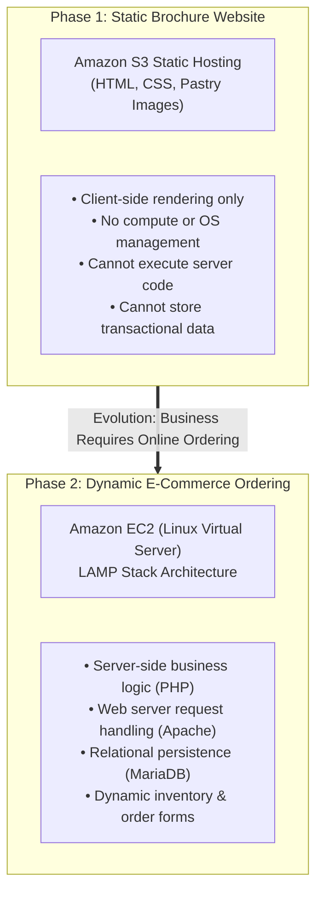
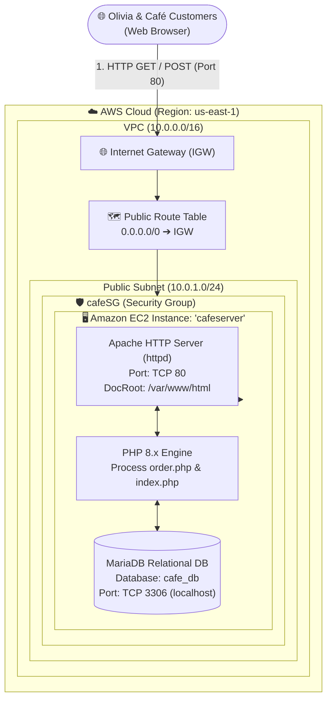
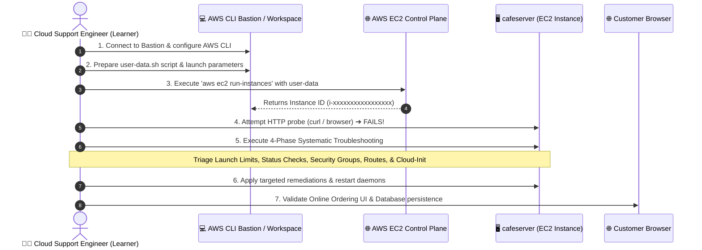
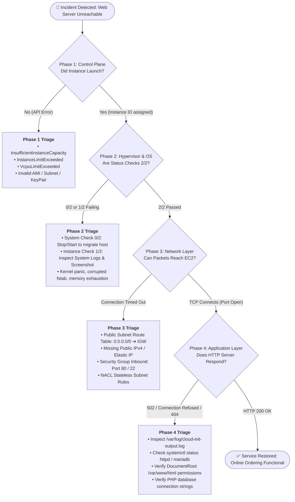
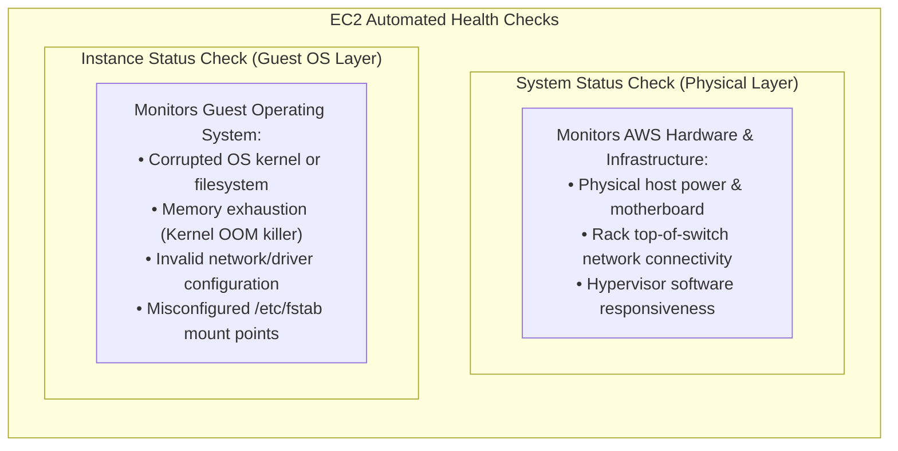
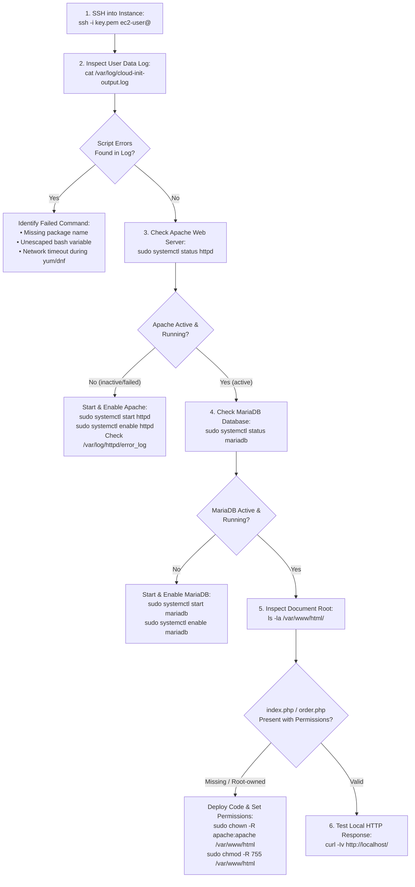

# 🔧 Module 10: Lab – Troubleshooting the Creation of an EC2 Instance

> **Course**: AWS re/Start  
> **Module**: Servers (Module 10)  
> **Source Document**: `T14-0007-RSSERV_EN-US_SG_M10_TROUBLESHOOTINSTANCE.pdf`  
> **Target Audience**: AWS re/Start Learners & Cloud Practitioners  

---

## 🎯 Lab Overview & Context

Welcome to the **Troubleshooting the Creation of an EC2 Instance** lab guide. In this lab, you step into the shoes of the cloud consulting and technical team supporting a local business: **The Café**.

Having previously launched a successful static promotional website hosted on Amazon Simple Storage Service (Amazon S3), the café faces a new operational challenge. Customers visiting the physical shop often encounter long queues, and business growth demands a modern digital customer experience: **online ordering ahead for in-store pickup**.

To accommodate server-side business logic, dynamic inventory processing, and relational order persistence, the technical team must transition the café's architecture from static cloud storage to a dynamic, multi-tier web application running on an **Amazon Elastic Compute Cloud (Amazon EC2)** Linux virtual server powered by a **LAMP** (Linux, Apache, MariaDB, PHP) stack.

However, moving from static hosting to dynamic compute introduces realistic operational hurdles. When deploying the server and application stack via automated scripts, the deployment fails, generating cryptic errors. As cloud support engineers, learners must apply a systematic troubleshooting lifecycle to diagnose, isolate, and remediate errors spanning launch limits, status check failures, network misconfigurations, and cloud-init bootstrap scripts.

---

### 📌 Learning Objectives

- [ ] **Analyze Dynamic Architectural Requirements**: Contrast static web hosting on Amazon S3 with dynamic multi-tier application hosting on Amazon EC2, articulating why online ordering requires server-side processing and database persistence.
- [ ] **Execute EC2 Provisioning via AWS CLI**: Configure the AWS CLI environment and launch an EC2 instance using `aws ec2 run-instances` with automated bootstrapping via User Data.
- [ ] **Apply the Systematic Cloud Troubleshooting Lifecycle**: Implement a disciplined 4-phase diagnostic methodology (*Launch Diagnostics $\rightarrow$ Boot & Status Checks $\rightarrow$ Network Reachability $\rightarrow$ Application Debugging*) to isolate faults.
- [ ] **Diagnose and Resolve EC2 Launch Failures**: Identify and mitigate provisioning exceptions including `InsufficientInstanceCapacity`, `InstanceLimitExceeded`, and `VcpuLimitExceeded`.
- [ ] **Differentiate System vs. Instance Status Checks**: Analyze `StatusCheckFailed_System` (0/2) and `StatusCheckFailed_Instance` (1/2) metrics, utilizing EC2 Console Screenshots and System Logs to identify hypervisor versus operating system faults.
- [ ] **Remediate Multi-Layer Network Obstacles**: Audit and correct VPC route tables (missing Internet Gateway route `0.0.0.0/0`), public IP assignment, and Security Group ingress rules (HTTP port 80 and SSH port 22).
- [ ] **Debug Linux User Data & Application Services**: Inspect `/var/log/cloud-init-output.log`, evaluate systemd service states (`systemctl status httpd`, `systemctl status mariadb`), and verify web root content and database connectivity.
- [ ] **Integrate Findings into a Standard 8-Pillar Knowledge Base**: Document resolved issues into formal SysOps Knowledge Base entries across Compute, Foundational IT, and Networking categories.

---

## 🎭 Café Business Case Scenario & Technical Architecture

### 1. Business Need: Online Ordering Ahead

```
┌────────────────────────────────────────────────────────────────────────┐
│                        Café Scenario Dialogue                          │
├────────────────────────────────────────────────────────────────────────┤
│ Nikhil: "Yesterday, Olivia was in the café to get a cake. She had to  │
│          wait for a while because there was a line of customers ahead  │
│          of her. What if we could let customers place an order ahead   │
│          of time so that they could pick up their order without        │
│          waiting?"                                                     │
│                                                                        │
│ Sofía:  "Yes, that’s a great idea! We should update our website to     │
│          offer customers the ability to place an online order. Let’s   │
│          talk to Frank and Martha about it."                           │
└────────────────────────────────────────────────────────────────────────┘
```

#### Executive Approval & Stakeholder Buy-in
Nikhil shared with Sofía that a regular customer, **Olivia**, experienced noticeable delays waiting in line just to purchase a pre-made cake. Nikhil proposed giving patrons the convenience of ordering ahead of time online so that orders can be packaged and ready for immediate counter pickup.

Sofía enthusiastically supported the proposal. When Nikhil and Sofía pitched the online ordering concept to the owners (**Frank and Martha**), the founders recognized the direct business impact: shorter in-store queues, higher customer satisfaction, and increased sales volume during rush hours. Frank and Martha formally authorized the development and rollout of the online ordering system.

---

### 2. Architectural Shift: Static Object Storage vs. Dynamic Multi-Tier Compute

When Nikhil and Sofía consulted with their senior cloud advisor, **Mateo**, he explained that the technical requirements of the website had fundamentally changed:



#### Why Amazon S3 Is Insufficient for Online Ordering
- **No Server-Side Code Execution**: Amazon S3 is an object storage service designed to serve static files (HTML, CSS, client-side JS, images). It does not provide an operating system runtime, application container, or server-side interpreter (such as PHP, Python, or Node.js) to compute order totals, process business logic, or handle authentication.
- **No Transactional Database Persistence**: S3 cannot execute relational database transactions (SQL queries, order records, customer information tables). Online orders require atomic, consistent, isolated, and durable (ACID) data storage.
- **Dynamic Content Generation**: Customer orders require custom confirmation numbers, dynamic cart calculation, and live inventory decrementing, all of which require compute processing.

#### The LAMP Stack Recommendation
Mateo recommended deploying a **LAMP** stack on Amazon EC2. LAMP is an open-source, industry-standard web platform consisting of four integrated layers:

| Layer | Technology | Role in Café Application |
| :--- | :--- | :--- |
| **L** | **Linux** (Amazon Linux 2 / AL2023) | Secure, stable enterprise operating system kernel and runtime environment. |
| **A** | **Apache HTTP Server** (`httpd`) | High-performance open-source web server daemon listening on TCP port 80 for incoming HTTP requests. |
| **M** | **MariaDB** / MySQL (`mariadb-server`) | Relational Database Management System (RDBMS) hosting the `cafe_db` database to store pastry orders, customer details, and order statuses. |
| **P** | **PHP** (Hypertext Preprocessor) | Server-side scripting language that handles form submissions, executes business logic, communicates with MariaDB, and dynamically renders HTML. |

---

### 3. Solution Deployment Obstacle & Dialogue

```
┌────────────────────────────────────────────────────────────────────────┐
│                        Deployment Issue Dialogue                       │
├────────────────────────────────────────────────────────────────────────┤
│ Sofía:  "I ran into some problems deploying the LAMP stack and the     │
│          updated application. I used a user data script so that the    │
│          deployment would be repeatable, but something went wrong."   │
│                                                                        │
│ Nikhil: "OK, let’s troubleshoot it together."                          │
└────────────────────────────────────────────────────────────────────────┘
```

Sofía packaged the updated dynamic application code and authored a bash **User Data** bootstrap script to automate the installation of Apache, MariaDB, and PHP during instance boot. However, upon launching the instance, the deployment failed: the website was completely unreachable, and errors surfaced across the provisioning pipeline.

Nikhil and Sofía agreed to collaborate, systematically isolating each layer of the cloud infrastructure to restore service.

---

### 4. Café Application Target Architecture

The target production architecture hosts the dynamic café ordering application inside a Virtual Private Cloud (VPC):



---

## 🛠️ Lab Tasks Overview & Provisioning Workflow

The hands-on lab places learners in the roles of Nikhil and Sofía to execute and troubleshoot the deployment:



### High-Level Lab Execution Phases:
1. **Connect & Configure Management Environment**: Connect to an administrative Amazon EC2 instance or AWS Cloud9 workspace configured with the AWS Command Line Interface (AWS CLI). Verify caller identity using `aws sts get-caller-identity`.
2. **Launch EC2 Instance via AWS CLI**: Launch the `cafeserver` instance in a public subnet using `aws ec2 run-instances`, passing the bootstrap User Data script via `--user-data file://userdata.sh`.
3. **Observe Deployment & Provisioning Failures**: Observe that the web application fails to respond over public HTTP.
4. **Execute Systematic Troubleshooting**: Isolate failure points across EC2 capacity, status checks, network routing, firewall rules, and cloud-init script execution.
5. **Verify Website & Ordering Functionality**: Access the application via public DNS/IP, submit a test bakery order for Olivia, and verify relational persistence in MariaDB.

---

## 🔬 Systematic Cloud Troubleshooting Deep Dive

Troubleshooting complex cloud workloads requires moving from random guesses to a structured, repeatable engineering methodology. When an EC2 instance hosting a web application fails, issues can stem from four distinct architectural layers:



---

### 1. Phase 1: Launch Failure Diagnostics (AWS Control Plane)

Before an EC2 instance enters the `pending` or `running` state, the AWS EC2 API control plane validates provisioning requests against physical hardware availability and account quotas.

#### A. InsufficientInstanceCapacity
- **Error Code**: `InsufficientInstanceCapacity`
- **Symptom**: The AWS CLI returns `Server.InsufficientInstanceCapacity: There is not enough capacity to fulfill your request.`
- **Root Cause**: AWS does not currently have sufficient physical host servers with available compute/memory in the requested Availability Zone (AZ) for the specified instance type (e.g., `t3.micro` or `c5.large`).
- **Remediation Strategy**:
  1. **Change Availability Zone**: Specify a different subnet located in an alternate AZ (e.g., move from `us-east-1a` to `us-east-1b`).
  2. **Change Instance Type or Family**: Modify the request to use a comparable instance size (e.g., switch from `t3.micro` to `t3.small` or `t2.micro`).
  3. **Remove Specific Placement Constraints**: Avoid pinning instances to specific host groups unless required.
  4. **Retry Provisioning**: Capacity is dynamic; retrying after several minutes often succeeds as other tenants terminate instances.

#### B. InstanceLimitExceeded & VcpuLimitExceeded
- **Error Codes**: `InstanceLimitExceeded` / `VcpuLimitExceeded`
- **Symptom**: The CLI reports `Client.VcpuLimitExceeded: You have requested more vCPU capacity than your current vCPU limit of 32 allows for the instance bucket.`
- **Root Cause**: The AWS account has reached its regional Service Quota for concurrent running on-demand EC2 virtual CPUs (vCPUs) or standard instance counts.
- **Remediation Strategy**:
  1. Inspect active running instances and terminate orphaned or obsolete instances:
     ```bash
     aws ec2 describe-instances \
       --filters "Name=instance-state-name,Values=running" \
       --query "Reservations[*].Instances[*].[InstanceId,InstanceType,State.Name]" \
       --output table
     ```
  2. Request an immediate Service Quota increase using the AWS CLI or AWS Management Console:
     ```bash
     aws service-quotas request-service-quota-increase \
       --service-code ec2 \
       --quota-code L-1216C47A \
       --desired-value 64
     ```

#### C. Invalid AMI ID or Architecture Mismatch
- **Error Code**: `InvalidAMIID.NotFound` / `InvalidParameterValue`
- **Root Cause**: AMI IDs are region-specific. Using an AMI ID from `us-west-2` while executing commands in `us-east-1` causes an instant launch failure. Furthermore, attempting to run an `x86_64` AMI on an `arm64` (Graviton) instance type triggers parameter incompatibility.

---

### 2. Phase 2: Boot & Status Check Failures (Hypervisor & Operating System)

AWS monitors every EC2 instance using two independent, automated status checks:

```
┌────────────────────────────────────────────────────────────────────────┐
│                   EC2 Status Check Evaluation Matrix                   │
├────────────────────────────────────────────────────────────────────────┤
│ Status Indicator   │ Meaning                  │ Typical Remediation    │
├────────────────────┼──────────────────────────┼────────────────────────┤
│ 2/2 checks passed  │ System & Instance healthy │ Inspect network/apps   │
│ 1/2 checks passed  │ System OK, Instance FAIL │ Guest OS / Kernel fix  │
│ 0/2 checks passed  │ Underlying AWS Host FAIL │ Stop & Start instance  │
└────────────────────────────────────────────────────────────────────────┘
```



#### A. System Status Check Failure (`StatusCheckFailed_System`)
- **Indication**: `0/2 checks passed` (System check failed).
- **Underlying Cause**: Physical hardware failure, network outage affecting the hypervisor rack, or hypervisor software crash.
- **Remediation**:
  - **Stop and Start the Instance**: Stopping an EBS-backed instance releases the physical host reservation. Starting the instance directs AWS to provision the virtual machine on a completely different, healthy physical server rack:
    ```bash
    # Stop the affected instance
    aws ec2 stop-instances --instance-ids i-0a1b2c3d4e5f67890

    # Wait for the instance to transition to stopped
    aws ec2 wait instance-stopped --instance-ids i-0a1b2c3d4e5f67890

    # Start the instance on a new physical hypervisor
    aws ec2 start-instances --instance-ids i-0a1b2c3d4e5f67890
    ```
  > [!NOTE]
  > Do **not** simply *reboot* the instance for a System Status Check failure. A reboot keeps the virtual machine pinned to the same failing physical server. Only a **Stop/Start** cycle migrates the instance to new hardware.

#### B. Instance Status Check Failure (`StatusCheckFailed_Instance`)
- **Indication**: `1/2 checks passed` (System check OK, Instance check failed).
- **Underlying Cause**: The hypervisor is healthy, but the guest operating system has crashed, kernel panicked, corrupted its root filesystem, or run out of memory.
- **Diagnostic Tools**:
  1. **EC2 Get Console Screenshot**: Capture an image of the virtual display to view console kernel panics or boot halts:
     ```bash
     aws ec2 get-console-screenshot \
       --instance-id i-0a1b2c3d4e5f67890 \
       --output text > console_screenshot.jpg
     ```
  2. **EC2 Get Console Output (System Log)**: Retrieve the serial console boot logs to identify kernel panics or drive mounting failures:
     ```bash
     aws ec2 get-console-output \
       --instance-id i-0a1b2c3d4e5f67890 \
       --output text | tail -n 50
     ```
  3. **Rescue Instance Volume Attachment**: If the OS refuses to boot due to an invalid `/etc/fstab` file:
     - Stop the damaged instance.
     - Detach the root EBS volume (`/dev/xvda`).
     - Attach the volume to a healthy "rescue" EC2 instance as a secondary disk (`/dev/xvdf`).
     - Mount the secondary disk, correct `/etc/fstab`, unmount, reattach as root to the original instance, and boot.

---

### 3. Phase 3: Network Reachability & Connection Failures

Even if status checks report `2/2 passed`, clients may experience connection timeouts (`Connection timed out` or `ERR_CONNECTION_TIMED_OUT`). In AWS networking, client packets traverse multiple routing and firewall checkpoints:

```mermaid
flowchart LR
    ClientBrowser(["Client Browser"]) -->|"1. Inbound Packet"| IGW["Internet Gateway"]
    IGW -->|"2. Route Check"| VPC_RT["VPC Route Table<br/>0.0.0.0/0 ➔ IGW"]
    VPC_RT -->|"3. Subnet ACL"| SubnetNACL["Network ACL<br/>Rule 100: Allow Port 80"]
    SubnetNACL -->|"4. Virtual Firewall"| SecGroup["Security Group (cafeSG)<br/>Inbound: Port 80 (HTTP)"]
    SecGroup -->|"5. Destination"| EC2Interface["EC2 Elastic Network Interface (eth0)"]
```



#### Diagnostic Breakdown of Network Checkpoints:

#### Checkpoint 1: VPC Route Table Default Route
- **Failure Symptom**: Complete silence. Packets reach the edge of AWS but cannot be routed to or from the subnet.
- **Root Cause**: The subnet route table lacks an explicit default route pointing outbound Internet traffic (`0.0.0.0/0`) to an attached Internet Gateway (`igw-xxxxxxxx`).
- **Remediation**:
  ```bash
  # Check existing routes for the route table
  aws ec2 describe-route-tables \
    --route-table-ids rtb-0123456789abcdef0 \
    --query "RouteTables[*].Routes"

  # Create the missing default internet route
  aws ec2 create-route \
    --route-table-id rtb-0123456789abcdef0 \
    --destination-cidr-block 0.0.0.0/0 \
    --gateway-id igw-0987654321fedcba0
  ```

#### Checkpoint 2: Public IPv4 Address Assignment
- **Failure Symptom**: The instance has only a private IP (e.g., `10.0.1.25`) and no public IPv4 address, making it unreachable from the public internet.
- **Root Cause**: The subnet has `MapPublicIpOnLaunch` set to `false`, and the CLI launch command did not specify `--associate-public-ip-address`.
- **Remediation**:
  - Allocate and associate an **Elastic IP (EIP)** to the running instance:
    ```bash
    # Allocate an Elastic IP address
    ALLOC_ID=$(aws ec2 allocate-address --domain vpc --query 'AllocationId' --output text)

    # Associate Elastic IP with the cafeserver instance
    aws ec2 associate-address --instance-id i-0a1b2c3d4e5f67890 --allocation-id $ALLOC_ID
    ```
  - Enable auto-assign public IP on the public subnet for future launches:
    ```bash
    aws ec2 modify-subnet-attribute \
      --subnet-id subnet-0123456789abcdef0 \
      --map-public-ip-on-launch
    ```

#### Checkpoint 3: Security Group Ingress Filtering (`cafeSG`)
- **Failure Symptom**: `curl: (28) Failed to connect to 54.x.x.x port 80: Connection timed out`.
- **Root Cause**: Security Groups act as stateful firewalls at the virtual network interface layer. By default, a new security group denies all inbound traffic. If TCP port 80 (HTTP) or port 22 (SSH) is not explicitly allowed, all connection attempts are dropped silently.
- **Remediation**:
  ```bash
  # Authorize inbound HTTP traffic on port 80 from anywhere
  aws ec2 authorize-security-group-ingress \
    --group-id sg-0123456789cafe001 \
    --protocol tcp \
    --port 80 \
    --cidr 0.0.0.0/0

  # Authorize inbound SSH traffic on port 22 for administrative debugging
  aws ec2 authorize-security-group-ingress \
    --group-id sg-0123456789cafe001 \
    --protocol tcp \
    --port 22 \
    --cidr 0.0.0.0/0
  ```

---

### 4. Phase 4: Application & User Data Debugging

If the instance is running (`2/2 status checks`) and the security group allows port 80, but accessing `http://<public-ip>` results in `HTTP 502 Bad Gateway`, `Connection refused`, or the default Apache test page, the failure lies within the guest operating system and the **User Data** bootstrap execution.

#### Understanding Cloud-Init & User Data
When an EC2 Linux instance launches, the `cloud-init` daemon executes user data scripts during the initial boot cycle as the `root` user. 

```
┌────────────────────────────────────────────────────────────────────────┐
│                   Cloud-Init Diagnostic Log Hierarchy                  │
├────────────────────────────────────────────────────────────────────────┤
│ Log File Path                    │ Content & Diagnostic Scope         │
├──────────────────────────────────┼────────────────────────────────────┤
│ /var/log/cloud-init.log          │ High-level cloud-init module steps │
│ /var/log/cloud-init-output.log   │ Verbatim stdout and stderr output  │
│                                  │ of your bash script (CRITICAL)     │
└──────────────────────────────────┴────────────────────────────────────┘
```

#### Step-by-Step Application Debugging Runbook:



#### Common User Data Failure Scenarios:

1. **Missing Shebang (`#!/bin/bash`)**:
   - If user data scripts do not begin with `#!/bin/bash` as the very first line, `cloud-init` cannot determine the interpreter and will refuse to execute the script as executable code.
2. **Failure to Enable Services on Boot**:
   - Running `systemctl start httpd` without `systemctl enable httpd` means that if the instance ever reboots, the web server fails to restart automatically.
3. **File Ownership & SELinux Restrictions**:
   - Files created inside `/var/www/html` during user data execution may default to `root:root` permissions with restrictive umask (`600`). The Apache daemon (`apache` user) cannot read the files, resulting in `HTTP 403 Forbidden`.
   - **Remediation**:
     ```bash
     sudo chown -R apache:apache /var/www/html
     sudo chmod -R 755 /var/www/html
     ```
4. **Database Socket & User Grant Issues**:
   - If MariaDB is started but the schema creation script fails due to invalid SQL syntax or unquoted passwords, PHP will throw fatal database connection exceptions (`PDOException: SQLSTATE[HY000] [2002] Connection refused`).

---

## 🏛️ Troubleshooting Knowledge Base (KB) Project Integration

In enterprise Systems Operations, resolving an outage is incomplete until the engineering team documents the incident in the organization's **Troubleshooting Knowledge Base**. Capturing root-cause analyses and validated runbooks transforms isolated troubleshooting efforts into permanent institutional intelligence.

Below are four formal Knowledge Base entries documenting the primary failure categories encountered during the Café online ordering system deployment, formatted in accordance with the standard **8-Pillar Knowledge Base Schema**.

---

### Knowledge Base Entry: KB-CMP-001

| Pillar # | Pillar Name | Engineering Record |
| :---: | :--- | :--- |
| **1** | **Issue Number** | `KB-CMP-001` |
| **2** | **Category & AWS Service** | **Compute**: Amazon EC2 / Hypervisor Infrastructure |
| **3** | **Issue Description** | EC2 Instance Fails System Status Check (`0/2 Checks Passed`) After Initial Provisioning |
| **4** | **Symptoms & Observable Indicators** | - AWS Management Console reports Status Check: `0/2 checks passed` or `System check failed`.<br/>- CloudWatch metric `StatusCheckFailed_System = 1`.<br/>- SSH and HTTP connections fail completely with immediate connection drop or network reset.<br/>- AWS CLI output for `describe-instance-status` shows `SystemStatus: { Status: "impaired" }`. |
| **5** | **Root Cause Analysis (RCA)** | Physical server hardware fault, hypervisor network packet loss, or loss of system power on the underlying AWS physical host rack in Availability Zone `us-east-1a`. |
| **6** | **Resolution Procedures** | 1. Execute a **Stop/Start** sequence via AWS CLI to trigger hypervisor reallocation:<br/>`aws ec2 stop-instances --instance-ids i-0a1b2c3d4e5f67890`<br/>2. Wait for state confirmation:<br/>`aws ec2 wait instance-stopped --instance-ids i-0a1b2c3d4e5f67890`<br/>3. Start instance on new physical hardware:<br/>`aws ec2 start-instances --instance-ids i-0a1b2c3d4e5f67890`<br/>4. Verify health checks return to `2/2 passed`:<br/>`aws ec2 describe-instance-status --instance-ids i-0a1b2c3d4e5f67890` |
| **7** | **Helpful Tools & Diagnostic Resources** | - AWS CLI: `aws ec2 describe-instance-status`<br/>- Amazon CloudWatch Alarm: `AWS/EC2 StatusCheckFailed_System`<br/>- AWS Documentation: *Troubleshooting instances with failed status checks* |
| **8** | **Prevention & Guardrail Comments** | - Configure an **Amazon CloudWatch Alarm** with an EC2 Recover action (`arn:aws:automate:us-east-1:ec2:recover`) to automatically reboot/migrate the instance upon system check failure.<br/>- Deploy compute workloads across multiple Availability Zones behind an Application Load Balancer to prevent single host dependencies. |

---

### Knowledge Base Entry: KB-CMP-002

| Pillar # | Pillar Name | Engineering Record |
| :---: | :--- | :--- |
| **1** | **Issue Number** | `KB-CMP-002` |
| **2** | **Category & AWS Service** | **Compute**: Amazon EC2 / AWS Control Plane Quotas |
| **3** | **Issue Description** | Provisioning Failure via AWS CLI: `InsufficientInstanceCapacity` and `VcpuLimitExceeded` |
| **4** | **Symptoms & Observable Indicators** | - `aws ec2 run-instances` exits with non-zero exit code.<br/>- Error message: `An error occurred (InsufficientInstanceCapacity) when calling the RunInstances operation: We currently do not have sufficient t3.micro capacity in the Availability Zone you requested.`<br/>- Alternate error: `Client.VcpuLimitExceeded: You have requested more vCPU capacity than your current vCPU limit allows.` |
| **5** | **Root Cause Analysis (RCA)** | 1. Temporary physical capacity depletion for the requested instance type in the targeted AZ.<br/>2. Account-level Service Quota exceeded for On-Demand standard vCPU limits. |
| **6** | **Resolution Procedures** | **For InsufficientInstanceCapacity**:<br/>1. Modify target subnet to an alternate Availability Zone (e.g., from Subnet A to Subnet B).<br/>2. Change instance type to equivalent family (e.g., `--instance-type t3.small` or `t2.micro`).<br/><br/>**For VcpuLimitExceeded**:<br/>1. Audit running instances and terminate orphaned test workloads:<br/>`aws ec2 describe-instances --filters "Name=instance-state-name,Values=running"`<br/>2. Request quota increase via AWS CLI:<br/>`aws service-quotas request-service-quota-increase --service-code ec2 --quota-code L-1216C47A --desired-value 64` |
| **7** | **Helpful Tools & Diagnostic Resources** | - AWS Service Quotas Console & CLI: `aws service-quotas list-service-quotas --service-code ec2`<br/>- AWS Health Dashboard for regional capacity alerts. |
| **8** | **Prevention & Guardrail Comments** | - Implement AWS Compute Optimizer and automated cleanup scripts for development sandboxes.<br/>- Use Amazon EC2 Auto Scaling with multiple instance type overrides (Attribute-based instance type selection) so launches dynamically fall back to available hardware. |

---

### Knowledge Base Entry: KB-NET-001

| Pillar # | Pillar Name | Engineering Record |
| :---: | :--- | :--- |
| **1** | **Issue Number** | `KB-NET-001` |
| **2** | **Category & AWS Service** | **Networking**: Amazon VPC / Route Tables & Security Groups |
| **3** | **Issue Description** | External Clients Cannot Connect to Public EC2 Web Server (`Connection Timed Out`) |
| **4** | **Symptoms & Observable Indicators** | - Web browser displays `ERR_CONNECTION_TIMED_OUT`.<br/>- Terminal diagnostic command: `curl -m 10 -Iv http://<public-ip>` hangs and exits with `curl: (28) Connection timed out`.<br/>- Instance status check reports healthy `2/2 passed`. |
| **5** | **Root Cause Analysis (RCA)** | 1. Route Table associated with the public subnet lacks a default route (`0.0.0.0/0`) directed to the Internet Gateway (`igw-xxxxxxxx`).<br/>2. Security Group (`cafeSG`) lacks an inbound rule permitting TCP traffic on destination port 80. |
| **6** | **Resolution Procedures** | 1. Verify and add missing default Internet route to the public subnet route table:<br/>`aws ec2 create-route --route-table-id rtb-0123456789cafe --destination-cidr-block 0.0.0.0/0 --gateway-id igw-0123456789cafe`<br/>2. Add inbound HTTP rule to the instance's Security Group:<br/>`aws ec2 authorize-security-group-ingress --group-id sg-0123456789cafe --protocol tcp --port 80 --cidr 0.0.0.0/0`<br/>3. Validate external TCP port reachability using netcat:<br/>`nc -zv <public-ip> 80` |
| **7** | **Helpful Tools & Diagnostic Resources** | - AWS VPC Reachability Analyzer.<br/>- Terminal tools: `traceroute`, `curl -Iv`, `netcat` (`nc -zv`), `nmap`.<br/>- VPC Flow Logs to inspect `REJECT` actions at ENI level. |
| **8** | **Prevention & Guardrail Comments** | - Establish **AWS Config Rules**: `vpc-default-route-table-check` and `restricted-common-ports`.<br/>- Manage all network routing and security group definitions via Infrastructure as Code (AWS CloudFormation / Terraform) to avoid manual configuration drift. |

---

### Knowledge Base Entry: KB-FIT-001

| Pillar # | Pillar Name | Engineering Record |
| :---: | :--- | :--- |
| **1** | **Issue Number** | `KB-FIT-001` |
| **2** | **Category & AWS Service** | **Foundational IT**: Linux Administration & Web Application Stacks (LAMP) |
| **3** | **Issue Description** | EC2 User Data Script Execution Failure; Apache Web Server Fails to Start or Serve Application |
| **4** | **Symptoms & Observable Indicators** | - EC2 instance launches with `2/2 checks passed` and open security group, but HTTP requests return `HTTP 502 Bad Gateway` or connection refused.<br/>- Document root `/var/www/html` is empty or missing `index.php`.<br/>- System log shows non-zero exit code for `cloud-init`. |
| **5** | **Root Cause Analysis (RCA)** | 1. User Data bash script contained a syntax error or missing shebang line (`#!/bin/bash`).<br/>2. Apache HTTP Server (`httpd`) failed to start because MariaDB was not initialized prior to application installation.<br/>3. File permissions in `/var/www/html` were restricted to root, preventing Apache from reading assets. |
| **6** | **Resolution Procedures** | 1. SSH into the instance and review the cloud-init output log:<br/>`cat /var/log/cloud-init-output.log`<br/>2. Inspect Apache and MariaDB service statuses:<br/>`sudo systemctl status httpd`<br/>`sudo systemctl status mariadb`<br/>3. Start, enable, and verify both services:<br/>`sudo systemctl enable --now mariadb`<br/>`sudo systemctl enable --now httpd`<br/>4. Ensure correct file ownership and permissions for the web root:<br/>`sudo chown -R apache:apache /var/www/html`<br/>`sudo chmod -R 755 /var/www/html`<br/>5. Test application execution locally:<br/>`curl -Iv http://localhost/index.php` |
| **7** | **Helpful Tools & Diagnostic Resources** | - Linux System Logs: `/var/log/cloud-init-output.log`, `/var/log/httpd/error_log`, `/var/log/messages`.<br/>- Systemd Service Manager: `systemctl`, `journalctl -u httpd -e`.<br/>- PHP CLI Lint: `php -l /var/www/html/index.php`. |
| **8** | **Prevention & Guardrail Comments** | - Always test User Data scripts locally in a test VM or sandbox instance using `bash -n script.sh` to validate syntax prior to automated deployment.<br/>- Add robust error handling (`set -euo pipefail`) and explicit status logging (`echo "Step X complete" >> /var/log/bootstrap.log`) to all User Data scripts. |

---

## 🧩 Checkpoint & Review Questions with In-Depth Explanations

### Question 1: What are the technologies used in a LAMP stack?
- **Answer**:
  - **Linux**: The underlying open-source operating system providing kernel scheduling, process isolation, and security.
  - **Apache HTTP Server**: The open-source web server daemon that handles HTTP/HTTPS network traffic on TCP ports 80 and 443.
  - **MariaDB** (or MySQL): The relational database management system (RDBMS) that stores structured application data, tables, and transactional records.
  - **PHP**: The server-side scripting language interpreter that executes dynamic business logic, parses database responses, and dynamically generates HTML for client browsers.

### Question 2: Which port number must be opened to allow HTTP traffic from and to a client?
- **Answer**:
  - **TCP Port 80** must be open in the instance's Security Group and Subnet Network ACLs for standard unencrypted **HTTP** traffic.
  - *(Best Practice Note)*: For production environments, **TCP Port 443** must also be opened to support encrypted **HTTPS** traffic secured by SSL/TLS certificates.

### Question 3: Which AWS CLI command do you use to launch an EC2 instance?
- **Answer**:
  - The command is `aws ec2 run-instances`.
  - A comprehensive invocation including User Data and Security Group parameters:
    ```bash
    aws ec2 run-instances \
      --image-id ami-0c55b159cbfafe1f0 \
      --instance-type t3.micro \
      --key-name CafeKeyPair \
      --security-group-ids sg-0123456789cafe001 \
      --subnet-id subnet-0123456789cafe001 \
      --associate-public-ip-address \
      --user-data file://userdata.sh \
      --tag-specifications 'ResourceType=instance,Tags=[{Key=Name,Value=cafeserver}]'
    ```

### Question 4: How does an engineer differentiate between a System Status Check failure and an Instance Status Check failure?
- **Answer**:
  - **System Status Check** (`StatusCheckFailed_System` / `0/2 passed`): Indicates an issue with the physical AWS hardware, infrastructure network, or hypervisor host. It is resolved by **stopping and starting** the instance, which moves it to healthy physical infrastructure.
  - **Instance Status Check** (`StatusCheckFailed_Instance` / `1/2 passed`): Indicates that the physical host is fine, but the guest operating system has crashed, corrupted its filesystem, encountered a kernel panic, or run out of memory. It is diagnosed by inspecting the EC2 Console Screenshot and System Log (`aws ec2 get-console-output`), and resolved by rebooting, fixing system configurations, or mounting the EBS volume to a rescue instance.

### Question 5: Why is `/var/log/cloud-init-output.log` the single most critical log file when troubleshooting EC2 bootstrap failures?
- **Answer**:
  - When an EC2 instance launches, `cloud-init` captures both standard output (`stdout`) and standard error (`stderr`) from user data shell scripts and writes them directly to `/var/log/cloud-init-output.log`.
  - If a package installation fails (e.g., `yum install -y httpd` fails due to repository timeouts), a syntax error aborts the script, or file permission commands fail, the exact error messages and exit codes are recorded verbatim in this log, providing immediate root-cause isolation.

---

## 📌 Summary & Key Takeaways

```
┌────────────────────────────────────────────────────────────────────────┐
│                        Key Architectural Takeaways                     │
├────────────────────────────────────────────────────────────────────────┤
│ 1. Dynamic Business Demands Compute: Online ordering requires state,   │
│    database queries, and server-side code that S3 cannot deliver.      │
│ 2. Troubleshoot by Layer: Follow the 4-phase sequence: Control Plane   │
│    (Launch) ➔ Hypervisor/OS (Status Checks) ➔ Network (Routes & SGs)   │
│    ➔ Application (Cloud-Init & Services).                              │
│ 3. 0/2 vs 1/2 Checks Dictate Action: 0/2 requires Stop/Start to move   │
│    hosts; 1/2 requires OS/filesystem diagnosis via System Logs.        │
│ 4. Network Security is Multi-Layered: An open Security Group is        │
│    useless without an Internet Gateway route in the VPC Route Table.   │
│ 5. Institutionalize Operational Knowledge: Every resolved failure      │
│    must be preserved in a standardized 8-Pillar Knowledge Base.        │
└────────────────────────────────────────────────────────────────────────┘
```

By systematically isolating issues across the cloud stack, Nikhil and Sofía successfully launched the dynamic `cafeserver` instance, restored the LAMP services, and delivered an online ordering experience that eliminates customer wait times at the café.
