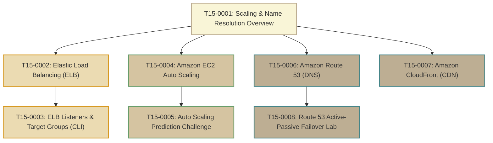

# T15: Scaling and Name Resolution

> **Course**: AWS re/Start Curriculum  
> **Module**: T15 – Scaling and Name Resolution (`M11`)  
> **Total Guides**: 8 Study Guides  
> **Status**: Completed (100%)

---

## Module Overview

The **Scaling and Name Resolution** module addresses the architectural triad of enterprise cloud elasticity, load balancing, and resilient global DNS routing:
1. **Elastic Load Balancing (ELB)**: Decoupling client access from compute targets and distributing traffic across multiple Availability Zones.
2. **Amazon EC2 Auto Scaling**: Automatically adjusting compute capacity dynamically, on a schedule, or predictively using machine learning models.
3. **Amazon Route 53 & Amazon CloudFront**: Providing low-latency authoritative domain resolution, active-passive disaster recovery failover routing, and edge-cached content acceleration worldwide.

---

## Study Guide Index

| # | Study Guide | Primary Topics Covered |
|---|-------------|------------------------|
| **0001** | [T15-0001-RSSCAL_EN-US_SG_M11_SCALENAMERESOVERVIEW.md](file:///work/tmp/aws-cf/T15-Scaling_and_Name_Resolution/T15-0001-RSSCAL_EN-US_SG_M11_SCALENAMERESOVERVIEW.md) | Interlocking architecture of elasticity and DNS, high-availability blueprint, troubleshooting KB runbooks (Compute, Automation, Networking) |
| **0002** | [T15-0002-RSSCAL_EN-US_SG_M11_ELASTICLOADBALANCING.md](file:///work/tmp/aws-cf/T15-Scaling_and_Name_Resolution/T15-0002-RSSCAL_EN-US_SG_M11_ELASTICLOADBALANCING.md) | Vertical vs horizontal scaling, ELB reverse proxy architecture, health checks, connection draining, deep comparison of ALB, NLB, GWLB, CLB |
| **0003** | [T15-0003-RSSCAL_EN-US_SG_M11_ELBLOADBALANCELISTENERS.md](file:///work/tmp/aws-cf/T15-Scaling_and_Name_Resolution/T15-0003-RSSCAL_EN-US_SG_M11_ELBLOADBALANCELISTENERS.md) | Listeners, priority-based listener rules, target group types, AWS CLI provisioning sequence, diagnosing HTTP 502/503/504 errors |
| **0004** | [T15-0004-RSSCAL_EN-US_SG_M11_AMAZONEC2AUTOSCALING.md](file:///work/tmp/aws-cf/T15-Scaling_and_Name_Resolution/T15-0004-RSSCAL_EN-US_SG_M11_AMAZONEC2AUTOSCALING.md) | Auto Scaling Groups (Min, Desired, Max), Launch Templates vs Configurations, Target Tracking vs Step vs Scheduled, lifecycle hooks, termination policies |
| **0005** | [T15-0005-RSSCAL_EN-US_SG_M11_AUTOSCALINGPREDICTION.md](file:///work/tmp/aws-cf/T15-Scaling_and_Name_Resolution/T15-0005-RSSCAL_EN-US_SG_M11_AUTOSCALINGPREDICTION.md) | Step scaling thresholds math challenge, instance warmup mechanics, preventing alarm thrashing, strict capacity boundary clamping |
| **0006** | [T15-0006-RSSCAL_EN-US_SG_M11_AMAZONROUTE53.md](file:///work/tmp/aws-cf/T15-Scaling_and_Name_Resolution/T15-0006-RSSCAL_EN-US_SG_M11_AMAZONROUTE53.md) | DNS Port 53 namespace, Public vs Private Hosted Zones, Alias vs CNAME, 7 routing policies (Simple, Weighted, Latency, Failover, Geo, Geoproximity, Multi-value) |
| **0007** | [T15-0007-RSSCAL_EN-US_SG_M11_AMAZONCLOUDFRONT.md](file:///work/tmp/aws-cf/T15-Scaling_and_Name_Resolution/T15-0007-RSSCAL_EN-US_SG_M11_AMAZONCLOUDFRONT.md) | Global CDN edge locations & regional caches, TTL caching policies, cache invalidation, Origin Access Control (OAC), Origin Groups automated failover |
| **0008** | [T15-0008-RSSCAL_EN-US_SG_M11_CAFEFAILOVERROUTE53.md](file:///work/tmp/aws-cf/T15-Scaling_and_Name_Resolution/T15-0008-RSSCAL_EN-US_SG_M11_CAFEFAILOVERROUTE53.md) | Café business scenario outage recovery, Route 53 health checking, primary EC2 to secondary S3 backup failover, automated DNS pivot & failback |

---

## Route 53 Routing Policies At-a-Glance

| Routing Policy | Core Use Case | Health Check Aware? |
|---|---|---|
| **Simple** | Single resource, or random round-robin of multiple IP values for a single domain | No |
| **Weighted** | A/B testing, blue/green canary deployments, gradual traffic shifting (e.g. 80/20) | Yes |
| **Latency-Based (LBR)** | Directing end users to the lowest-latency AWS Region | Yes |
| **Failover** | Active-Passive disaster recovery between primary dynamic compute and backup/S3 | Yes |
| **Geolocation** | Routing traffic based on user's geographic origin (country, continent, US state) | Yes |
| **Geoproximity** | Routing traffic based on physical resource location with adjustable bias values | Yes (Traffic Flow) |
| **Multi-Value Answer** | Returning up to 8 healthy IP addresses for client-side DNS load balancing | Yes |
