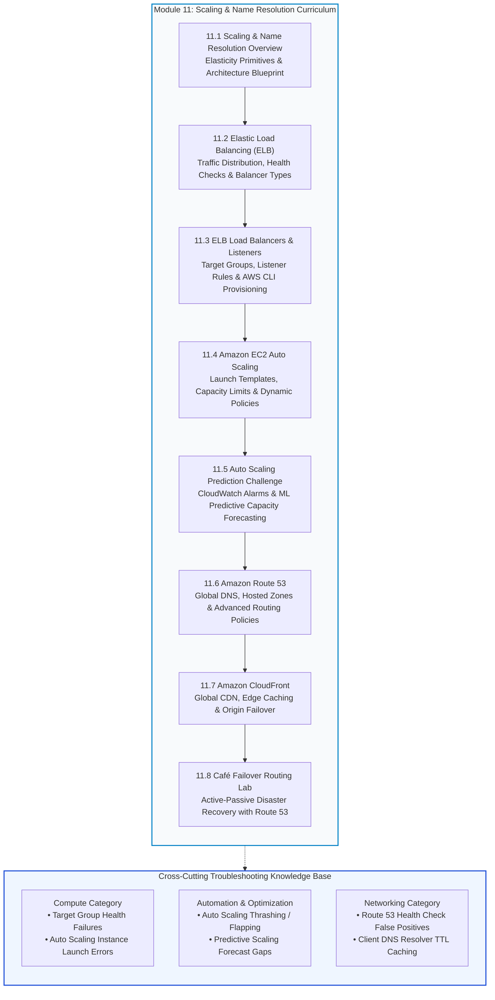
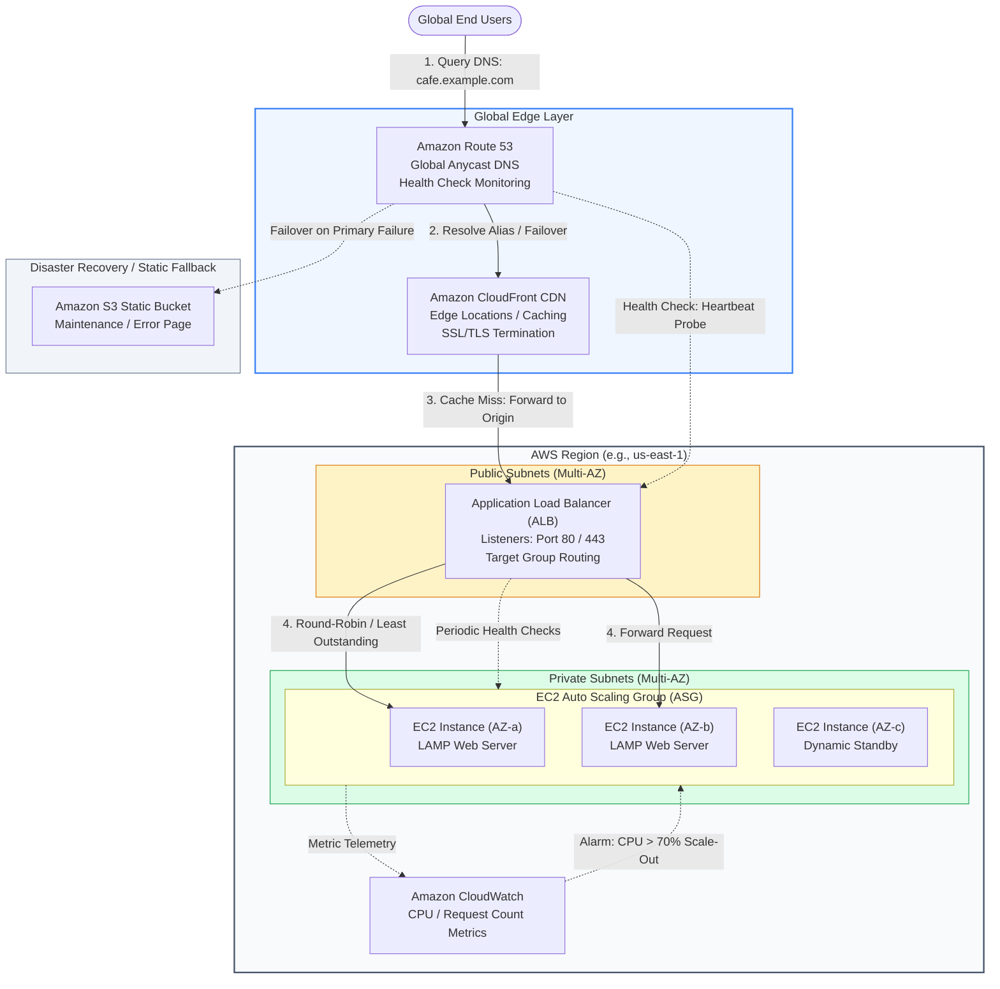
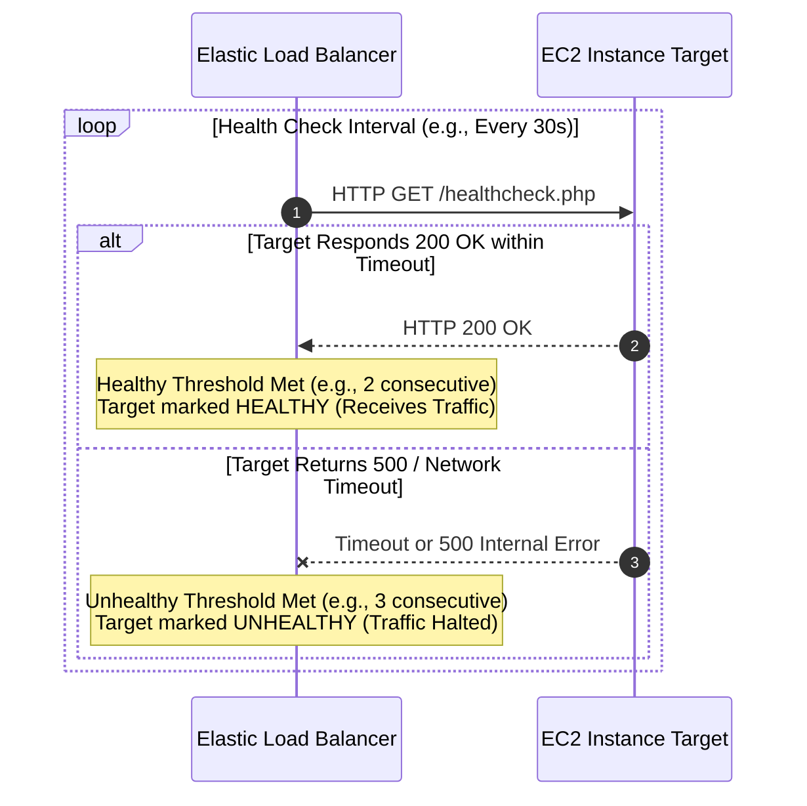
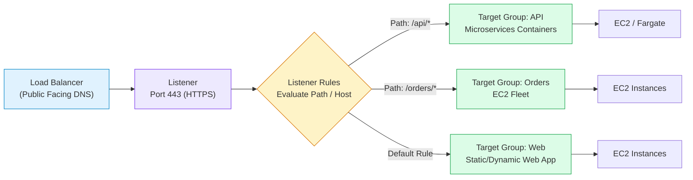
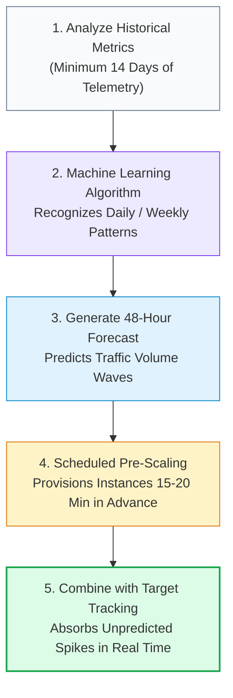
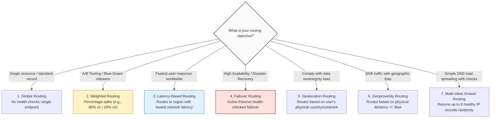
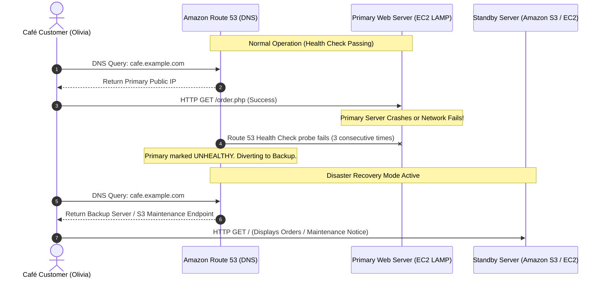

# ⚖️ Module 11: Scaling and Name Resolution Overview – Study Guide

> **Course**: AWS re/Start  
> **Module**: Scaling and Name Resolution (Module 11)  
> **Source Document**: `T15-0001-RSSCAL_EN-US_SG_M11_SCALENAMERESOVERVIEW.pdf`  
> **Target Audience**: AWS re/Start Learners / Cloud Practitioners / Solutions Architects / SysOps Administrators  

---

## 🎯 Unit Overview: The Interlocking Architecture of Elasticity and Global DNS Resolution

In traditional on-premises data centers, maintaining continuous uptime during unexpected traffic surges or infrastructure failures required massive overprovisioning. Enterprise architects routinely purchased and deployed redundant physical servers, hardware load balancers, and external DNS appliances that operated at only 15–20% capacity during normal business hours. When traffic exceeded the physical capacity of those servers, applications crashed, resulting in degraded user experience, transactional loss, and reputational damage.

Cloud computing resolves this vulnerability through **dynamic elasticity** and **decoupled name resolution**. By decoupling the entry point of network requests from the underlying compute fleet, cloud architectures dynamically absorb fluctuating demand, automatically isolate faulty compute instances, and redirect user traffic across geographic regions with zero human intervention.

```
┌─────────────────────────────────────────────────────────────────────────────────────────┐
│              The Resilient Cloud Delivery Triangle: Elasticity & Routing                │
├────────────────────────────────┬───────────────────────────┬────────────────────────────┤
│     Traffic Distribution       │     Elastic Capacity      │      Global Resolution     │
├────────────────────────────────┼───────────────────────────┼────────────────────────────┤
│ • Elastic Load Balancing (ELB) │ • Amazon EC2 Auto Scaling │ • Amazon Route 53          │
│ • Health checks & target pools │ • Horizontal scale-out/in │ • 100% SLA Global Anycast  │
│ • SSL/TLS termination          │ • Launch Templates        │ • Health-checked failover  │
│ • Path- & host-based routing   │ • Predictive ML forecasts │ • Edge routing (CloudFront)│
└────────────────────────────────┴───────────────────────────┴────────────────────────────┘
```

**Module 11: Scaling and Name Resolution** explores the interconnected mechanisms that ensure modern web applications remain highly available, fault-tolerant, and performant at any scale. The module synthesizes four critical building blocks:
1. **Elastic Load Balancing (ELB)** distributes incoming client requests across fleets of healthy instances.
2. **Amazon EC2 Auto Scaling** dynamically adds or removes compute capacity to match actual workload demand.
3. **Amazon Route 53** translates domain names to IP addresses while executing automated DNS-level failover.
4. **Amazon CloudFront** accelerates content delivery globally via edge caching and origin failover.

---

### 📌 Learning Objectives

- [ ] **Describe Elastic Load Balancing (ELB) Features**: Identify how ELB automatically distributes incoming application traffic across multiple targets (Amazon EC2 instances, containers, and IP addresses) across multiple Availability Zones.
- [ ] **Differentiate the Types of ELB Load Balancers**: Compare Application Load Balancers (ALB), Network Load Balancers (NLB), Gateway Load Balancers (GLB), and legacy Classic Load Balancers (CLB).
- [ ] **Configure ELB Load Balancers and Listeners**: Define listeners, target groups, routing rules (path-based and host-based), and demonstrate configuration via the AWS Command Line Interface (AWS CLI).
- [ ] **Master Amazon EC2 Auto Scaling Primitives**: Contrast modern Launch Templates with legacy Launch Configurations, configure scaling policies, and set minimum, desired, and maximum capacity limits.
- [ ] **Implement Dynamic and Predictive Auto Scaling**: Differentiate target tracking, step scaling, scheduled scaling, and machine-learning-driven predictive scaling.
- [ ] **Explain Amazon Route 53 DNS & Hosted Zones**: Describe public and private hosted zones, alias records, domain registration, and anycast DNS architectures.
- [ ] **Evaluate Route 53 Routing Policies**: Differentiate Simple, Weighted, Latency-based, Failover, Geolocation, Geoproximity, and Multi-value answer routing policies.
- [ ] **Understand Amazon CloudFront Edge Delivery**: Explain how global edge locations, Regional Edge Caches, TTL caching, Origin Shield, and origin groups accelerate delivery and enhance fault tolerance.
- [ ] **Implement DNS Failover in the Café Project**: Analyze Frank and Sofía's business availability challenges and configure active-passive Route 53 DNS failover.
- [ ] **Document Troubleshooting Runbooks**: Populate the Troubleshooting Knowledge Base across the **Compute**, **Automation and Optimization**, and **Networking** categories.

---

## 🗺️ Module 11 Curriculum Roadmap

The following diagram outlines the structural progression of the **Module 11: Scaling and Name Resolution** curriculum:



---

## 🏛️ High Availability Architecture Blueprint

The diagram below illustrates the unified end-to-end architecture combining **Amazon Route 53**, **Amazon CloudFront**, **Elastic Load Balancing (ALB)**, and **Amazon EC2 Auto Scaling** deployed across multiple Availability Zones:



---

## ⚖️ Theme 1: Elastic Load Balancing (ELB) Fundamentals

### 1.1 What is Elastic Load Balancing?
**Elastic Load Balancing (ELB)** automatically distributes incoming application traffic across multiple targets—such as Amazon EC2 instances, containerized workloads (Amazon ECS / EKS), IP addresses, and AWS Lambda functions. 

ELB scales its own request-handling capacity automatically in response to incoming traffic volume, ensuring applications maintain high performance and low latency.

#### Key Architectural Capabilities
- **High Availability & Fault Isolation**: An ELB is deployed across multiple Availability Zones (AZs). If an entire AZ experiences an outage, ELB routes traffic away from impaired zones to healthy targets in surviving AZs.
- **Continuous Health Checks**: ELB monitors the operational health of registered targets. Only targets that respond successfully to configured health check probes receive incoming traffic.
- **SSL/TLS Offloading**: ELB manages encryption and decryption at the load balancer level, relieving backend EC2 instances of CPU-intensive cryptographic handshakes.
- **Cross-Zone Load Balancing**: Balances traffic evenly across all registered targets in all enabled Availability Zones, preventing hotspotting if one zone has fewer instances.

---

### 1.2 ELB Health Check Lifecycle
Health checks are periodic HTTP/HTTPS or TCP probes sent from the load balancer to registered targets to determine their availability.



#### Health Check Parameters
| Parameter | Description | Typical Production Value |
| :--- | :--- | :--- |
| **Health Check Protocol** | The protocol used to ping targets (`HTTP`, `HTTPS`, or `TCP`). | `HTTP` |
| **Health Check Port** | The port destination on targets for health verification. | `traffic-port` or port `80` |
| **Health Check Path** | The specific URL endpoint probed (e.g., `/index.html`, `/health`). | `/health.php` |
| **Response Timeout** | Time ELB waits for a response before counting the check as failed. | `5 seconds` |
| **Check Interval** | Frequency of health check pings per target. | `30 seconds` |
| **Healthy Threshold** | Consecutive successful checks required to mark an unhealthy target healthy. | `2 consecutive successes` |
| **Unhealthy Threshold** | Consecutive failed checks required to mark a healthy target unhealthy. | `3 consecutive failures` |
| **Deregistration Delay** | Time ELB allows in-flight requests to complete before terminating connections. | `300 seconds` (Connection Draining) |

---

### 1.3 Comparing the Four ELB Load Balancer Types

AWS provides four distinct categories of load balancers:

```
┌────────────────────────────────────────────────────────────────────────────────────────┐
│                              ELB Load Balancer Taxonomy                                │
├──────────────────────────┬──────────────────────────┬──────────────────────────────────┤
│ Application (ALB)        │ Network (NLB)            │ Gateway (GLB)                    │
│ Layer 7: HTTP / HTTPS    │ Layer 4: TCP / UDP / TLS │ Layer 3: IP Packet Inspection    │
│ Advanced content routing │ Ultra-high throughput    │ 3rd-party security appliances    │
└──────────────────────────┴──────────────────────────┴──────────────────────────────────┘
                 │
                 ▼ Legacy: Classic Load Balancer (CLB) - Layer 4/7 (Not recommended)
```

| Dimension | Application Load Balancer (ALB) | Network Load Balancer (NLB) | Gateway Load Balancer (GLB) | Classic Load Balancer (CLB) |
| :--- | :--- | :--- | :--- | :--- |
| **OSI Layer** | **Layer 7** (Application) | **Layer 4** (Transport) | **Layer 3 Gateway** + Layer 4 | Layer 4 & Layer 7 (Legacy) |
| **Protocols** | HTTP, HTTPS, gRPC, WebSockets | TCP, UDP, TLS | IP (GENEVE encapsulation) | HTTP, HTTPS, TCP, SSL |
| **Performance / Scale** | High; evaluated by Request Metrics | **Millions of requests/sec**; ultra-low latency (<1 ms) | Scales transparently across virtual appliances | Standard |
| **IP Addressing** | Dynamic DNS; multiple IP addresses per AZ | **Static IP per AZ**; Elastic IP support | Dynamic ENIs in VPC | Dynamic DNS |
| **Routing Decisions** | Path, Host, Query, HTTP Headers, Methods | Source/destination IP and port only | Transparent packet forwarding via GENEVE | Basic port/round-robin |
| **Target Types** | Instance ID, IP address, Lambda, ALB | Instance ID, IP address, ALB | IP address, Instance ID | EC2-Classic / Instance ID |
| **Common Use Cases** | Microservices, containerized web apps, REST APIs | Real-time gaming, financial exchanges, IoT streams | Firewalls, Intrusion Detection/Prevention (IDS/IPS) | Legacy EC2-Classic migrations |

> [!NOTE]
> Classic Load Balancer (CLB) is a legacy service. For modern cloud workloads, AWS strongly recommends **Application Load Balancer** for HTTP/HTTPS applications and **Network Load Balancer** for ultra-high-throughput TCP/UDP workloads.

---

## 🎛️ Theme 2: ELB Load Balancers, Listeners, and Target Groups

### 2.1 The Architectural Trio: Balancers, Listeners, and Target Groups
An Elastic Load Balancing architecture operates via three interrelated structural components:



1. **Load Balancer**: The single entry point exposed to clients via a DNS name. It receives client connections and forwards them to listeners.
2. **Listener**: A process that checks for connection requests using the configured protocol and port (e.g., HTTP on port 80, HTTPS on port 443).
3. **Target Group**: A logical grouping of backend targets (EC2 instances, containers, or IP addresses) that receive traffic routed by listener rules. Each target group defines its own independent health check parameters.

---

### 2.2 Content-Based Routing Rules (ALB)
ALB listeners evaluate rules sequentially by priority. Rules support complex conditions and actions:
- **Host-Based Routing**: Route requests based on the domain name in the HTTP `Host` header (e.g., `orders.cafe.com` routes to Target Group A; `menu.cafe.com` routes to Target Group B).
- **Path-Based Routing**: Route requests based on the URL path pattern (e.g., `/images/*` routes to an S3-backed target; `/checkout/*` routes to a high-capacity EC2 group).
- **HTTP Header & Method Routing**: Route requests based on standard or custom HTTP headers (e.g., `User-Agent: Mobile`) or methods (`GET` vs. `POST`).
- **Query Parameter Routing**: Route requests based on key-value query strings (e.g., `?version=v2`).
- **Redirect Actions**: Automatically redirect non-secure `HTTP:80` requests to encrypted `HTTPS:443`.
- **Fixed Response Actions**: Return immediate custom HTTP status codes and responses (e.g., `503 Service Unavailable` or custom HTML error pages) directly from the ALB without hitting backend servers.

---

### 2.3 Provisioning an Application Load Balancer via AWS CLI

The following AWS CLI commands demonstrate configuring an ALB, Target Group, and Listener:

```bash
# 1. Create a Target Group for HTTP traffic on port 80
aws elbv2 create-target-group \
    --name cafe-web-tg \
    --protocol HTTP \
    --port 80 \
    --vpc-id vpc-0123456789abcdef0 \
    --health-check-protocol HTTP \
    --health-check-path /healthcheck.php \
    --health-check-interval-seconds 30 \
    --healthy-threshold-count 2 \
    --unhealthy-threshold-count 3

# 2. Register EC2 instances with the Target Group
aws elbv2 register-targets \
    --target-group-arn arn:aws:elasticloadbalancing:us-east-1:123456789012:targetgroup/cafe-web-tg/abcdef123456 \
    --targets Id=i-0a1b2c3d4e5f6g7h8 Id=i-0z9y8x7w6v5u4t3s2

# 3. Create an Internet-Facing Application Load Balancer across two public subnets
aws elbv2 create-load-balancer \
    --name cafe-alb \
    --subnets subnet-0111111111111111a subnet-0222222222222222b \
    --security-groups sg-0123456789abcdef0 \
    --scheme internet-facing \
    --type application \
    --ip-address-type ipv4

# 4. Create an HTTP Listener that forwards traffic to the Target Group
aws elbv2 create-listener \
    --load-balancer-arn arn:aws:elasticloadbalancing:us-east-1:123456789012:loadbalancer/app/cafe-alb/50dc6c495c0c9188 \
    --protocol HTTP \
    --port 80 \
    --default-actions Type=forward,TargetGroupArn=arn:aws:elasticloadbalancing:us-east-1:123456789012:targetgroup/cafe-web-tg/abcdef123456
```

---

## 📈 Theme 3: Amazon EC2 Auto Scaling

### 3.1 Availability & Elasticity Principles
**Amazon EC2 Auto Scaling** ensures that the application runs the optimal number of EC2 instances to handle workload demands.

#### Core Value Propositions
- **Fault Tolerance & Self-Healing**: If an instance fails an EC2 status check or an ELB health check, Auto Scaling terminates the unhealthy instance and launches a replacement automatically.
- **Cost Optimization**: During periods of low traffic (e.g., night hours), Auto Scaling removes excess compute instances, eliminating unnecessary infrastructure expenditure.
- **Dynamic Availability**: During traffic surges (e.g., flash sales, news coverage), Auto Scaling provisions new instances seamlessly before application responsiveness degrades.

---

### 3.2 Launch Templates vs. Launch Configurations
An Auto Scaling Group (ASG) requires a blueprint defining *how* to launch EC2 instances.

```
┌────────────────────────────────────────────────────────────────────────────────────────┐
│                        Launch Templates vs. Launch Configurations                      │
├────────────────────────────────────────────┬───────────────────────────────────────────┤
│          Launch Templates (Current)        │       Launch Configurations (Legacy)      │
├────────────────────────────────────────────┼───────────────────────────────────────────┤
│ • Full versioning and inheritance          │ • No versioning; immutable once created   │
│ • Mix On-Demand and Spot instances in 1 ASG│ • Single purchase option per ASG          │
│ • Multiple instance types allowed          │ • Only one instance type supported        │
│ • Supports modern AWS Nitro & IMDSv2 tags  │ • Limited feature support                 │
│ • Strongly recommended by AWS              │ • Deprecated by AWS                       │
└────────────────────────────────────────────┴───────────────────────────────────────────┘
```

> [!IMPORTANT]
> **AWS Architectural Standard**: Launch Configurations are deprecated and do not support new EC2 features (such as mixing instance types, multiple launch template versions, or Spot Allocation strategies). Always configure new Auto Scaling Groups using **Launch Templates**.

---

### 3.3 Auto Scaling Group Capacity Parameters
An Auto Scaling Group operates within three foundational capacity boundaries:

```mermaid
flowchart LR
    MIN["Minimum Capacity: 2<br/>Baseline Availability Guarantee"]
    DES["Desired Capacity: 4<br/>Current Active Running Fleet"]
    MAX["Maximum Capacity: 8<br/>Budget Ceiling Protection"]

    MIN <=.->|ASG scales down to floor| DES
    DES <=.->|ASG scales up to ceiling| MAX

    style MIN fill:#e0f2fe,stroke:#0284c7,stroke-width:1px
    style DES fill:#dcfce7,stroke:#16a34a,stroke-width:2px
    style MAX fill:#fee2e2,stroke:#ef4444,stroke-width:1px
```

1. **Minimum Size (`Min`)**: The lowest number of instances the group will ever run, even under zero traffic load. Guarantees base availability.
2. **Desired Capacity (`Desired`)**: The actual number of instances currently running. Auto Scaling automatically adjusts this value up or down when scaling policies trigger.
3. **Maximum Size (`Max`)**: The upper ceiling of running instances. Acts as an emergency cost-control barrier to prevent uncontrolled expenditure during distributed denial-of-service (DDoS) spikes.

---

### 3.4 Dynamic Scaling Policy Types

Auto Scaling adjusts desired capacity through three dynamic scaling policies:

```
┌────────────────────────────────────────────────────────────────────────────────────────┐
│                                Dynamic Scaling Policy Types                            │
├──────────────────────┬──────────────────────────────────┬──────────────────────────────┤
│ Target Tracking      │ Step Scaling                     │ Simple Scaling               │
├──────────────────────┼──────────────────────────────────┼──────────────────────────────┤
│ • Like a thermostat  │ • Multi-stage response           │ • Single metric threshold    │
│ • Keeps metric at target│ • Aggressive scaling based on size│ • Standard cool-down delay   │
│ • e.g., CPU = 50%    │ • e.g., CPU 70% +1; CPU 90% +3   │ • Legacy mechanism           │
└──────────────────────┴──────────────────────────────────┴──────────────────────────────┘
```

1. **Target Tracking Scaling**: Configured like a room thermostat. You specify an ideal metric target (e.g., `Average CPU Utilization = 50%` or `Application Load Balancer Request Count per Target = 1000`). Auto Scaling automatically calculates and applies the exact number of scale-out or scale-in events required to keep the metric at that target.
2. **Step Scaling**: Increases or decreases capacity based on graduated step adjustments linked to the magnitude of CloudWatch alarm breaches. For example:
   - Alarm: CPU between 60% and 75% $\rightarrow$ Add 1 instance.
   - Alarm: CPU between 75% and 90% $\rightarrow$ Add 2 instances.
   - Alarm: CPU > 90% $\rightarrow$ Add 4 instances.
3. **Simple Scaling**: Waits for a single CloudWatch alarm threshold, executes a scaling adjustment, and halts further scaling actions until a specified **cool-down period** expires.

---

## 🔮 Theme 4: Predictive Scaling

### 4.1 Machine Learning Demand Forecasting
Dynamic scaling reacts to real-time events, which means newly launched EC2 instances require several minutes to boot, run user data scripts, pass health checks, and register with target groups (**initialization lag**). During sudden, massive spikes, this lag can result in dropped requests.

**Predictive Scaling** resolves initialization lag by combining **machine learning algorithms** with historical CloudWatch telemetry to forecast future capacity demands and provision instances *before* traffic arrives.



### 4.2 Scaling Strategy Comparison Matrix

| Scaling Approach | Proactive vs. Reactive | Implementation Mechanism | Latency / Lead Time | Best Suited For |
| :--- | :--- | :--- | :--- | :--- |
| **Manual Scaling** | Manual | Operator updates Desired Capacity via Console or CLI | Slow (Dependent on human intervention) | Testing, initial deployment, scheduled maintenance |
| **Scheduled Scaling** | Proactive | Date/time cron expressions (e.g., scale at 08:00 AM every Monday) | Zero latency (Instances ready on schedule) | Known cyclical events (e.g., standard retail hours, payroll runs) |
| **Dynamic (Target Tracking)** | Reactive | CloudWatch metric thresholds and feedback loops | 3–7 minutes (Instance launch & warm-up time) | Random, erratic, or unpredictable traffic bursts |
| **Predictive Scaling** | **Proactive (ML)** | Statistical algorithms modeling historical demand trends | **Zero latency** (Instances pre-warmed prior to surge) | Daily/weekly recurring patterns with rapid morning spikes |

> [!TIP]
> **Best Practice Synergy**: The optimal enterprise architecture pairs **Predictive Scaling** with **Target Tracking Scaling**. Predictive scaling pre-warms instances ahead of regular daily traffic waves, while target tracking reacts dynamically to absorb unexpected anomalies.

---

## 🌐 Theme 5: Amazon Route 53 Global DNS

### 5.1 Cloud DNS Primitives & 100% SLA
**Amazon Route 53** is a highly available and scalable cloud Domain Name System (DNS) web service operating on UDP/TCP port 53. Route 53 connects user requests to infrastructure running in AWS (such as Amazon EC2 instances, Elastic Load Balancers, or Amazon S3 buckets) as well as infrastructure outside of AWS.

- **Global Anycast Network**: Route 53 routes queries to the nearest DNS endpoint worldwide, delivering high-speed name resolution.
- **100% Availability SLA**: Route 53 is designed with redundant, geographically dispersed anycast DNS servers backed by a 100% service level agreement.
- **Hosted Zones**: A hosted zone is a container for DNS records that define how traffic is routed for a specific domain name:
  - **Public Hosted Zone**: Contains records that route traffic across the public internet (e.g., `cafe.example.com`).
  - **Private Hosted Zone**: Contains records that resolve traffic only within specified Virtual Private Clouds (VPCs), protecting internal database and service hostnames from public internet exposure.

---

### 5.2 Alias Records vs. CNAME Records
A standard DNS canonical name (**CNAME**) maps a hostname to another hostname. However, the Internet Engineering Task Force (IETF) DNS standard (RFC 1034) prohibits CNAME records at the **zone apex** (root domain, e.g., `example.com` without `www`).

AWS solves this limitation through **Amazon Route 53 Alias Records**:

```
┌────────────────────────────────────────────────────────────────────────────────────────┐
│                              CNAME vs. Route 53 Alias Records                          │
├────────────────────────────────────────────┬───────────────────────────────────────────┤
│             Standard CNAME Record          │          Route 53 Alias Record            │
├────────────────────────────────────────────┼───────────────────────────────────────────┤
│ • Points any hostname to another hostname  │ • Route 53-specific virtual pointer       │
│ • CANNOT be used at the Zone Apex (`@`)   │ • CAN be used at the Zone Apex (`@`)      │
│ • Requires recursive DNS lookup overhead   │ • Native direct response without extra hop│
│ • Billed for standard DNS queries          │ • Free queries when pointing to AWS assets│
│ • No health-checking awareness             │ • Evaluates target health automatically   │
└────────────────────────────────────────────┴───────────────────────────────────────────┘
```

---

### 5.3 Route 53 Routing Policies Overview

Route 53 provides seven distinct routing policies to determine how DNS queries are answered:



#### Routing Policies Detailed Comparison

| Routing Policy | Primary Architecture | Health Checks Supported? | Typical Use Case |
| :--- | :--- | :--- | :--- |
| **Simple Routing** | Single record mapping to one or multiple static values. | No (Returns all IPs in random order) | Default configuration for single web servers. |
| **Weighted Routing** | Traffic allocated across resources based on assigned relative integer weights (e.g., 70% to Fleet A, 30% to Fleet B). | Yes | Blue/green deployments, canary testing, phased application upgrades. |
| **Latency-Based Routing** | Resolves queries to the AWS Region providing the lowest round-trip latency to the requesting user. | Yes | Global multi-region web applications seeking optimal performance. |
| **Failover Routing** | Active-passive configuration; queries route to primary until health check fails, then divert to secondary standby. | **Yes (Mandatory)** | **Disaster recovery (DR)**, maintenance page fallbacks. |
| **Geolocation Routing** | Maps traffic based on the geographic location of the DNS resolver (country, continent, or US state). | Yes | Language localization, licensing restrictions, regulatory data compliance. |
| **Geoproximity Routing** | Routes traffic based on the physical distance between user and resources, adjustable via Route 53 Traffic Flow **bias**. | Yes | Sophisticated geographic traffic shaping and data center shifting. |
| **Multi-Value Answer Routing** | Returns up to 8 randomly selected healthy IP address records for a single name query. | Yes | Simple DNS-level client load distribution with health checking. |

---

## ⚡ Theme 6: Amazon CloudFront Content Delivery

### 6.1 Content Delivery Network (CDN) Architecture
**Amazon CloudFront** is a global Content Delivery Network (CDN) service that securely delivers data, videos, applications, and APIs to users worldwide with low latency and high transfer speeds.

CloudFront integrates with AWS edge infrastructure:
- **Edge Locations**: A worldwide network of hundreds of data centers that cache copies of content closer to end users.
- **Regional Edge Caches**: Mid-tier caching layers positioned between edge locations and origins, providing larger cache storage to prevent requests from traversing back to the origin server.
- **Origins**: The authoritative source location of the original web content. Supported origins include **Amazon S3 buckets**, **Application Load Balancers**, **Amazon EC2 instances**, or **custom on-premises web servers**.

```mermaid
flowchart LR
    User["End User Browser"]
    Edge["CloudFront Edge Location<br/>(Local Cache)"]
    Origin["Origin Server<br/>(ALB / S3 Bucket)"]

    User -->|1. Request /logo.png| Edge
    alt Cache Hit (Object in Local Cache)
        Edge -->>User|2a. Immediate Delivery (<10 ms)|
    else Cache Miss (Object Not Cached)
        Edge -->|2b. Forward Request| Origin
        Origin -->>Edge|3. Return Object & Cache-Control TTL|
        Edge -->>User|4. Return Object & Store in Cache|
    end

    style User fill:#f8fafc,stroke:#64748b,stroke-width:1px
    style Edge fill:#e0f2fe,stroke:#0284c7,stroke-width:2px
    style Origin fill:#dcfce7,stroke:#16a34a,stroke-width:1px
```

### 6.2 CloudFront Origin Groups and Origin Failover
To achieve multi-tier high availability, CloudFront supports **Origin Groups** with automated origin failover:
- **Primary Origin**: The main production server (e.g., an Application Load Balancer fronting dynamic EC2 instances).
- **Secondary Origin**: A backup destination (e.g., an Amazon S3 static website bucket hosting a static maintenance notice).
- **Failover Criteria**: If the primary origin returns specific HTTP error response codes (such as `500 Internal Server Error`, `502 Bad Gateway`, `503 Service Unavailable`, or `504 Gateway Timeout`), CloudFront automatically redirects the request to the secondary origin.

---

## ☕ Theme 7: Café Project Scenario – DNS Failover Routing

### 7.1 Business Context: Frank, Sofía, and Martha's Dilemma
In the ongoing AWS re/Start café narrative:
- **The Incident**: Frank informs Sofía that the café's online ordering website went down two days ago. Customers could not place orders for specialty cakes and morning pastries for most of the day, resulting in lost revenue and customer frustration.
- **The Diagnosis**: Sofía notes that identifying and remediating the root cause on the single EC2 server took hours. The café cannot afford another single-point-of-failure outage.
- **The Solution**: Technical advisor Mateo recommends implementing **Amazon Route 53 Failover Routing** to create a highly available, self-healing architecture.



### 7.2 Implementation Steps for Route 53 Active-Passive Failover
1. **Deploy the Primary and Secondary Endpoints**:
   - Primary: The dynamic EC2 LAMP stack or ALB in the primary Availability Zone.
   - Secondary: A standby EC2 instance in a different AZ or an Amazon S3 bucket configured for static website hosting with a branded maintenance and manual order intake page.
2. **Create a Route 53 Health Check**:
   - Target: Public IP or DNS of the primary web server.
   - Path: `/healthcheck.php` (returning HTTP 200 OK).
   - Frequency: Standard (every 30 seconds) with an unhealthy threshold of 3 consecutive failures.
3. **Configure DNS Failover Records in Route 53 Hosted Zone**:
   - **Primary Record**:
     - Name: `cafe.example.com`
     - Type: `A` or `Alias A`
     - Routing Policy: `Failover`
     - Failover Record Type: `Primary`
     - Health Check: Associated with the primary health check created above.
   - **Secondary Record**:
     - Name: `cafe.example.com`
     - Type: `A` or `Alias A`
     - Routing Policy: `Failover`
     - Failover Record Type: `Secondary`
     - Health Check: None (or secondary health check).

---

## 🛠️ Troubleshooting Knowledge Base Integration

As directed by the module curriculum, learners must maintain systematic problem resolution runbooks across three primary categories: **Compute**, **Automation and Optimization**, and **Networking**.

```
┌────────────────────────────────────────────────────────────────────────────────────────┐
│                        Troubleshooting Knowledge Base Categories                       │
├──────────────────────────┬──────────────────────────────┬──────────────────────────────┤
│ Compute                  │ Automation & Optimization    │ Networking                   │
├──────────────────────────┼──────────────────────────────┼──────────────────────────────┤
│ • COMP-03: ASG Launch Fail│ • AUTO-01: Scaling Thrashing │ • NET-01: R53 Failover Flap  │
│ • COMP-04: TG Health Fail│ • AUTO-02: Predictive Gaps   │ • NET-02: DNS Resolver TTL   │
└──────────────────────────┴──────────────────────────────┴──────────────────────────────┘
```

---

### 8.1 Compute Category: Triage Runbooks

#### Runbook COMP-03: EC2 Auto Scaling Group Instance Launch Failures
- **Symptom**: Auto Scaling Group shows activity status `Failed` with error message `Launching a new EC2 instance failed`.
- **Diagnostic Triage**:
  ```
  ASG Instance Launch Failure Matrix
  ├── Subnet IP Address Exhaustion
  │   └── Error: "Insufficient free IP addresses in subnet"
  │   └── Fix: Add secondary CIDR block to VPC or associate additional subnets across other AZs.
  ├── EC2 Service Quota Limit Exceeded
  │   └── Error: "InstanceLimitExceeded: You have reached your quota for running On-Demand instances"
  │   └── Fix: Request an Amazon EC2 service quota increase via Service Quotas console.
  ├── Security Group or Subnet Deleted/Invalid
  │   └── Error: "Security group 'sg-xxxx' does not exist in VPC"
  │   └── Fix: Update the ASG Launch Template to reference active Security Group and Subnet IDs.
  └── Key Pair Not Found
      └── Error: "The key pair 'dev-key' does not exist"
      └── Fix: Update the Launch Template with a valid EC2 Key Pair.
  ```
- **CLI Diagnostic Verification**:
  ```bash
  # Inspect recent ASG activity log errors
  aws autoscaling describe-scaling-activities \
      --auto-scaling-group-name cafe-asg \
      --max-items 5
  ```

#### Runbook COMP-04: Target Group Health Check Failures
- **Symptom**: Registered EC2 targets in an ALB Target Group report status `unhealthy` with HTTP `404 Not Found` or `Connection timed out`.
- **Diagnostic Triage**:
  1. **Security Group Misconfiguration**: The EC2 instance security group must explicitly permit inbound traffic on the service port (e.g., TCP port 80) from the **Security Group ID of the Application Load Balancer**.
  2. **Invalid Health Check Path**: If the health check path is configured for `/healthcheck.php`, ensure the file physically exists in the web server root (`/var/www/html/healthcheck.php`) and returns an HTTP `200 OK` status.
  3. **Web Server Service State**: Verify that the Apache or Nginx service is running inside the instance (`sudo systemctl status httpd`).

---

### 8.2 Automation and Optimization Category: Triage Runbooks

#### Runbook AUTO-01: Auto Scaling "Flapping" / Capacity Thrashing
- **Symptom**: An Auto Scaling Group rapidly adds instances and then immediately terminates them in an alternating cycle, causing high latency, instability, and elevated costs.
- **Root Cause**:
  - **Inadequate Cool-Down Period**: The default cool-down period (or instance warm-up time) is set too short. Newly launched instances take 3 minutes to initialize, but a CloudWatch alarm triggers additional scale-out actions every 60 seconds.
  - **Overly Sensitive Step Scaling Thresholds**: Scale-in and scale-out thresholds are configured too close to each other (e.g., scale-out at >55% CPU; scale-in at <50% CPU). Adding a single instance immediately pushes CPU below 50%, initiating instant termination.
- **Remediation**:
  1. Increase the **Default Cool-Down Period** to 300 seconds (5 minutes) for simple scaling policies.
  2. For Target Tracking policies, define a wider **Instance Warm-Up Time** to ensure metric calculations ignore warming instances.
  3. Separate the scale-out and scale-in metric thresholds with a wider deadband gap (e.g., scale-out at >70% CPU; scale-in at <30% CPU).

#### Runbook AUTO-02: Predictive Scaling Forecast Deviations & Traffic Anomaly Lag
- **Symptom**: Application experiences high response latency during an unexpected traffic spike because Predictive Scaling failed to provision instances in advance.
- **Root Cause**:
  - Predictive Scaling requires at least **14 days of historical CloudWatch metric data** to build high-accuracy seasonal and daily forecast models.
  - Unanticipated, non-cyclical events (such as viral social media mentions or unscheduled marketing campaigns) cannot be anticipated by predictive models.
- **Remediation**:
  1. Always pair **Predictive Scaling** with an active **Target Tracking Dynamic Scaling Policy**. While predictive scaling handles regular daily patterns, target tracking responds dynamically to non-cyclical spikes.
  2. For scheduled marketing launches or sales events, configure explicit **Scheduled Scaling Actions** to pre-scale the ASG desired capacity.

---

### 8.3 Networking Category: Triage Runbooks

#### Runbook NET-01: Route 53 DNS Failover Flapping & False Positives
- **Symptom**: Route 53 repeatedly switches DNS traffic back and forth between the primary and secondary endpoints, even though the primary server appears operational.
- **Root Cause**:
  - Route 53 health checkers reside in multiple AWS regions globally. If the primary web server or its Internet Gateway experiences temporary packet loss on a single transit route, health check probes may time out.
  - An aggressive **Failure Threshold** (e.g., 1 failed check) triggers premature failover on transient network hiccups.
- **Remediation**:
  1. Increase the Route 53 Health Check **Failure Threshold** to `3 consecutive checks`.
  2. Use **Route 53 Calculated Health Checks** to combine multiple health signals (e.g., endpoint status + CloudWatch alarm on 5xx error rate).
  3. Ensure the primary server's security group allows inbound traffic from all Route 53 health checker IP ranges.

#### Runbook NET-02: Client DNS Resolver Caching Delaying Failover
- **Symptom**: Route 53 marks the primary server unhealthy and updates DNS records to point to the secondary server, but many users continue sending requests to the failed primary server for several minutes.
- **Root Cause**:
  - The **Time-To-Live (TTL)** on the Route 53 DNS record was configured with a high value (e.g., 3600 seconds = 1 hour). Intermediate internet service provider (ISP) recursive DNS resolvers cache the old record until the TTL expires.
- **Remediation**:
  1. For critical endpoints utilizing Route 53 Failover Routing, configure a short TTL—typically **60 seconds** (or 300 seconds maximum).
  2. When using **Amazon CloudFront** in front of the application, configure origin failover in CloudFront origin groups so failover occurs immediately at the edge without waiting for client DNS cache expiration.

---

## 📝 Knowledge Check & Review

Test your understanding of the scaling, load balancing, and name resolution principles covered in Module 11.

---

### Question 1
An organization hosts a dynamic e-commerce web application using an Application Load Balancer and an Auto Scaling Group. During peak flash sales, the fleet experiences rapid traffic spikes, but newly launched EC2 instances take 4 minutes to bootstrap and configure their software, during which users experience timeouts. Which architecture strategy eliminates this initialization lag for predictable recurring traffic waves?
- A) Convert the Application Load Balancer into a Classic Load Balancer.
- B) Implement Predictive Scaling combined with Target Tracking, allowing machine learning to pre-warm instances prior to anticipated traffic waves.
- C) Increase the health check interval from 30 seconds to 300 seconds.
- D) Change the Route 53 DNS record from an Alias record to a standard CNAME record.

<details>
<summary>👉 View Answer & Explanation</summary>

**Correct Answer**: **B**  
**Explanation**: Predictive Scaling uses machine learning to forecast capacity requirements based on historical data and schedules proactive scaling actions *before* traffic waves arrive. This pre-warms instances ahead of time, eliminating the 4-minute bootstrapping initialization delay. Pairing it with Target Tracking allows the group to react dynamically to any unexpected surges beyond the forecast.
</details>

---

### Question 2
A Solutions Architect needs to route user traffic for `shop.example.com` to two distinct backend EC2 target groups based on the request URL path: requests for `/items/*` must route to Target Group A, while requests for `/checkout/*` must route to Target Group B. Which AWS service and configuration fulfills this requirement?
- A) Network Load Balancer with TCP port listeners.
- B) Gateway Load Balancer with GENEVE packet forwarding.
- C) Application Load Balancer with path-based listener rules.
- D) Route 53 Weighted Routing with equal weights.

<details>
<summary>👉 View Answer & Explanation</summary>

**Correct Answer**: **C**  
**Explanation**: Application Load Balancers operate at OSI Layer 7 (Application Layer) and support advanced content-based routing, including path-based routing (e.g., `/items/*` vs. `/checkout/*`), host-based routing, and HTTP header routing. Network Load Balancers operate at Layer 4 and cannot inspect URL paths.
</details>

---

### Question 3
An architect is designing an active-passive disaster recovery strategy for a business website. The primary website runs on EC2 instances behind an ALB. If the primary site experiences an outage, traffic must automatically divert to a static backup website hosted on Amazon S3. What Route 53 configuration should be implemented?
- A) Simple routing policy with multiple IP addresses.
- B) Failover routing policy with an active primary health check pointing to the ALB and a secondary record pointing to the S3 static website endpoint.
- C) Geolocation routing policy mapping all traffic to the nearest S3 bucket.
- D) Latency-based routing policy with zero delay.

<details>
<summary>👉 View Answer & Explanation</summary>

**Correct Answer**: **B**  
**Explanation**: Route 53 Failover Routing is specifically designed for active-passive disaster recovery. The primary record is associated with a health check monitoring the primary ALB endpoint. When Route 53 detects that the primary endpoint is unhealthy, it automatically resolves DNS queries to the secondary standby record (the S3 static website).
</details>

---

### Question 4
Why does AWS strongly recommend using Launch Templates rather than Launch Configurations for Amazon EC2 Auto Scaling Groups?
- A) Launch Configurations only work with on-premises servers.
- B) Launch Templates support versioning, mixing On-Demand and Spot instances, specifying multiple instance types, and modern EC2 features, whereas Launch Configurations are deprecated and immutable.
- C) Launch Configurations require Amazon Route 53 to operate.
- D) Launch Templates automatically convert dynamic PHP code into static S3 objects.

<details>
<summary>👉 View Answer & Explanation</summary>

**Correct Answer**: **B**  
**Explanation**: Launch Templates are the modern AWS standard for configuring EC2 launches. They support versioning (allowing rollback and parameter updates), multi-instance type specifications, Spot and On-Demand allocation strategies within a single Auto Scaling Group, and modern features like IMDSv2 and Nitro hardware settings. Launch Configurations are deprecated and immutable.
</details>

---

### Question 5
What is the primary architectural advantage of using an Amazon Route 53 Alias record instead of a standard DNS CNAME record when routing traffic to an AWS Elastic Load Balancer?
- A) Alias records only support private IP addresses.
- B) Alias records can be created at the zone apex (e.g., `example.com`), provide native health check integration, and AWS does not charge for queries to AWS resources.
- C) CNAME records allow unlimited subdomains whereas Alias records do not.
- D) Alias records bypass DNS caches worldwide and never expire.

<details>
<summary>👉 View Answer & Explanation</summary>

**Correct Answer**: **B**  
**Explanation**: Standard DNS RFC specifications prohibit CNAME records at the zone apex (`example.com`). Route 53 Alias records resolve this by providing a proprietary virtual pointer that is permitted at the zone apex, automatically updates when the underlying AWS resource IP changes, evaluates resource health, and incurs zero query fees when pointing to supported AWS resources like ELB and CloudFront.
</details>

---

## 🔑 Key Takeaways & Architectural Summary

1. **The Synergy of Scalability**: True cloud elasticity requires coordination between **traffic distribution** (ELB), **compute fleet scaling** (EC2 Auto Scaling), and **intelligent name resolution** (Route 53).
2. **Layer 7 vs. Layer 4 Load Balancing**: Use **Application Load Balancers (ALB)** for HTTP/HTTPS applications requiring path-, host-, and header-based routing; use **Network Load Balancers (NLB)** for extreme performance, static IP requirements, and non-HTTP TCP/UDP protocols.
3. **Modern Auto Scaling Blueprint**: Always configure Auto Scaling Groups using **Launch Templates** rather than legacy Launch Configurations to take advantage of versioning, mixed purchase options (Spot + On-Demand), and multiple instance types.
4. **Proactive vs. Reactive Scaling**: Combine **Predictive Scaling** (machine learning models anticipating recurring daily/weekly curves) with **Target Tracking Dynamic Scaling** (reactive thermostat feedback) to eliminate instance boot initialization lag while remaining resilient against unanticipated surges.
5. **Route 53 Intelligence**: Route 53 provides 100% SLA global DNS resolution with sophisticated traffic management policies, including **Failover Routing** for disaster recovery, **Latency Routing** for multi-region performance, and **Alias Records** for apex domain mapping.
6. **Edge Acceleration**: Deploy **Amazon CloudFront** in front of web tiers to cache static and dynamic assets at global edge locations, shield origin servers from DDoS surges, and provide sub-second origin failover via Origin Groups.
7. **Operational Excellence**: Maintaining comprehensive runbooks in the **Troubleshooting Knowledge Base** across Compute, Automation, and Networking accelerates incident triage and ensures self-healing cloud architectures operate reliably at scale.
