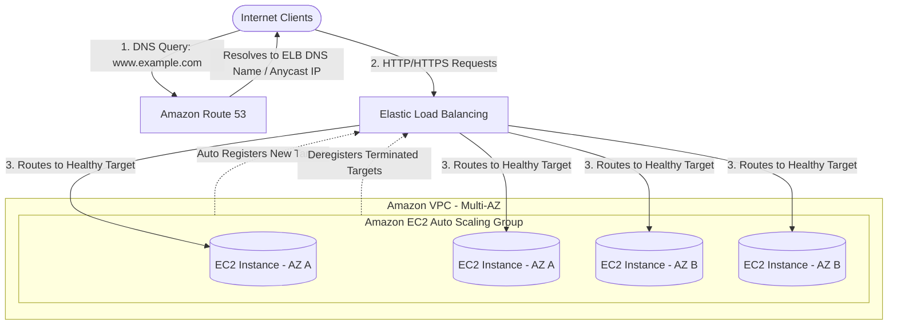
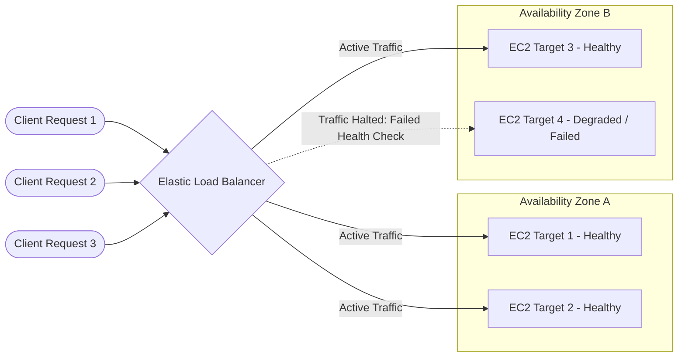
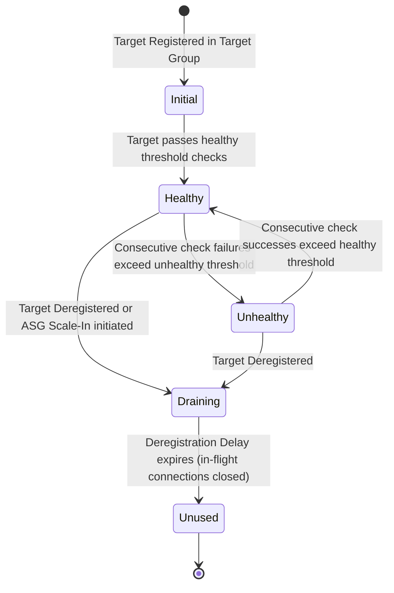
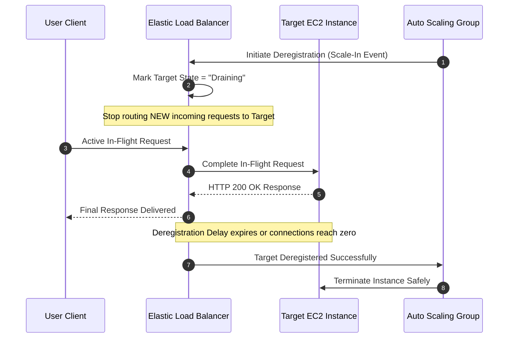
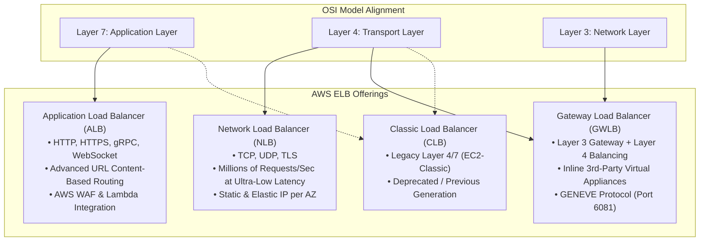
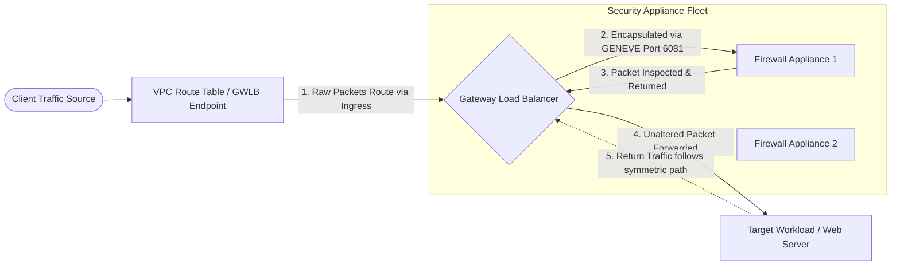
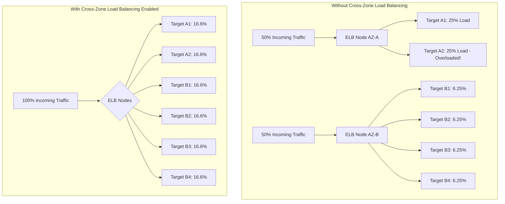
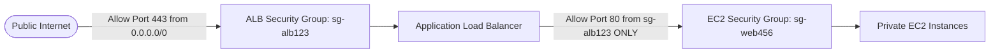
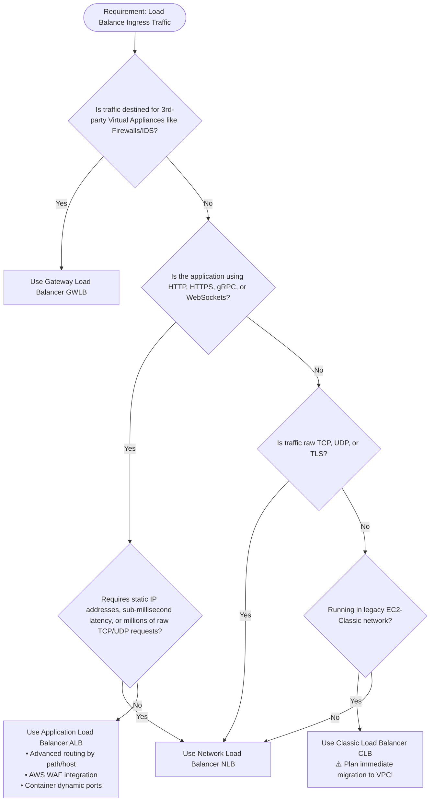

# ⚖️ Module 11: Elastic Load Balancing (ELB) – Study Guide

> **Course**: AWS re/Start  
> **Module**: Scaling and Name Resolution  
> **Source Document**: `T15-0002-RSSCAL_EN-US_SG_M11_ELASTICLOADBALANCING.pdf`  
> **Target Audience**: AWS re/Start Learners, Cloud Practitioners, Solutions Architects, and SysOps Engineers  

---

## 🎯 Module Overview

Modern production applications must serve hundreds of thousands—often millions—of concurrent client requests with high availability, low latency, and fault tolerance. In traditional, on-premises data center architectures, accommodating workload fluctuations required purchasing and configuring excess physical servers that sat idle for most of the year. Furthermore, directing incoming client requests to these servers required complex network routing, manual DNS updates, or expensive hardware load balancers that often represented single points of failure.

In the AWS Cloud, computing capacity is programmatic and decoupled. To achieve seamless scalability, elasticity, and high availability, AWS provides **Elastic Load Balancing (ELB)**. ELB automatically distributes incoming application traffic across multiple targets—such as Amazon EC2 instances, containers (Amazon ECS/EKS), IP addresses, and AWS Lambda functions—across one or multiple Availability Zones (AZs). Operating in close coordination with **Amazon Route 53** and **Amazon EC2 Auto Scaling**, ELB abstracts backend server lifecycles, dynamically adjusts to traffic demand, eliminates single points of failure, and provides robust health monitoring, SSL/TLS termination, and Layer 4 through Layer 7 traffic routing.

This study guide provides an architectural deep dive into the principles of cloud scaling, the operational mechanics of ELB, a comparative analysis of the four load balancer offerings (**ALB**, **NLB**, **GWLB**, and **CLB**), high availability and security architectures, and observability best practices.

---

### 📌 Learning Objectives

- [ ] **Analyze the Core Concepts of Scaling**: Differentiate between vertical scaling (*scaling up/down*) and horizontal scaling (*scaling out/in*), and evaluate how cloud elasticity overcomes on-premises physical hardware constraints.
- [ ] **Define Elastic Load Balancing (ELB)**: Describe how ELB acts as a managed reverse proxy and single point of DNS entry, decoupling client requests from backend compute instances.
- [ ] **Explain Load Balancer Operational Mechanics**: Understand listeners, listener rules, target groups, automated health checks (ping paths, intervals, thresholds), and connection draining (deregistration delay).
- [ ] **Compare the Four ELB Load Balancer Types**:
  - **Application Load Balancer (ALB)**: Layer 7 HTTP/HTTPS/gRPC routing, path/host-based rules, dynamic port mapping, and AWS WAF integration.
  - **Network Load Balancer (NLB)**: Layer 4 ultra-high performance, sub-millisecond latencies, millions of requests per second, and static/Elastic IP allocation.
  - **Gateway Load Balancer (GWLB)**: Layer 3/4 gateway for transparent third-party virtual appliance scaling and inspection using the GENEVE protocol.
  - **Classic Load Balancer (CLB)**: Legacy generation for previous-era EC2-Classic environments.
- [ ] **Evaluate Network Topologies & High Availability**: Distinguish between internet-facing and internal load balancers, and configure Cross-Zone Load Balancing for even traffic distribution across Availability Zones.
- [ ] **Implement Security & Encryption Best Practices**: Architect SSL/TLS offloading with AWS Certificate Manager (ACM), configure security group chains, and enforce defense-in-depth perimeter protection.
- [ ] **Monitor & Audit Load Balancer Health**: Interpret CloudWatch metrics (`RequestCount`, `TargetResponseTime`, `HealthyHostCount`, `UnHealthyHostCount`), configure access logs in Amazon S3, and implement deletion protection.

---

## 📚 Key Terminology

| Term | Definition |
| :--- | :--- |
| **Elastic Load Balancing (ELB)** | A fully managed AWS service that automatically distributes incoming application traffic across multiple targets across one or more Availability Zones. |
| **Horizontal Scaling (Scale Out / Scale In)** | Adding or removing compute instances/nodes to expand or shrink total workload processing capacity dynamically. |
| **Vertical Scaling (Scale Up / Scale Down)** | Increasing or decreasing the hardware specifications (CPU, RAM, storage, network bandwidth) of an individual compute instance. |
| **Listener** | A process running on a load balancer that checks for incoming connection requests using a configured protocol and port. |
| **Listener Rule** | A conditional configuration on a listener that evaluates incoming request attributes (path, host header, query strings) and routes traffic to a target group. |
| **Target Group** | A logical grouping of backend compute targets (EC2 instances, IP addresses, containers, Lambda functions) evaluated together for routing and health checks. |
| **Health Check** | Periodic automated probe (ping, HTTP request, TCP handshake) sent by the load balancer to determine target availability and operational health. |
| **Deregistration Delay / Connection Draining** | A configurable period during which a deregistered or unhealthy target stops receiving new connections while existing in-flight connections finish processing cleanly. |
| **Application Load Balancer (ALB)** | A Layer 7 load balancer optimized for HTTP, HTTPS, and gRPC traffic with advanced content-based routing and container support. |
| **Network Load Balancer (NLB)** | A Layer 4 load balancer engineered for extreme performance, ultra-low latency, spiky workloads, and static IP / Elastic IP management. |
| **Gateway Load Balancer (GWLB)** | A specialized Layer 3 gateway and Layer 4 load balancer used to deploy, scale, and manage inline third-party virtual network appliances (firewalls, IDS/IPS). |
| **Classic Load Balancer (CLB)** | The legacy first-generation load balancer that operates across Layer 4 and Layer 7, primarily used in legacy EC2-Classic networks. |
| **Cross-Zone Load Balancing** | A load balancer setting that distributes incoming traffic evenly across all registered targets across all enabled Availability Zones, regardless of zone target density. |
| **SSL/TLS Termination** | Decrypting incoming encrypted traffic at the load balancer level before passing plaintext or re-encrypted requests to backend servers, offloading CPU processing. |
| **AWS Certificate Manager (ACM)** | A managed service for provisioning, managing, and deploying public and private SSL/TLS certificates directly to AWS resources like ELB and CloudFront. |
| **GENEVE Protocol** | Generic Network Virtualization Encapsulation; a tunneling protocol running on UDP port 6081 used by Gateway Load Balancer to preserve raw packet headers. |

---

## 📈 1. The Core Concept of Scaling

### 1.1 What is Scaling?

In computing, **scaling** is the ability to adjust compute capacity to accommodate fluctuating workload demands. As application adoption grows, user traffic spikes, or batch data processing queues expand, systems must absorb the load without degradation in latency, availability, or throughput. Conversely, when traffic subsides, systems must contract capacity to prevent wasted infrastructure expenditure.

```
                  ┌─────────────────────────────────────────┐
                  │           Traffic Demand Spikes         │
                  └────────────────────┬────────────────────┘
                                       │
                ┌──────────────────────┴──────────────────────┐
                ▼                                             ▼
     [ Vertical Scaling ]                          [ Horizontal Scaling ]
       Scale Up / Scale Down                         Scale Out / Scale In
   "Make the single box bigger"                  "Add more identical boxes"
   (e.g., t3.micro -> m5.4xlarge)                (e.g., 2 instances -> 10 instances)
```

---

### 1.2 Vertical Scaling vs. Horizontal Scaling

Cloud engineers classify scaling into two distinct architectures:

```
Vertical Scaling (Scale Up):
┌───────────┐         ┌─────────────────────┐
│  t3.micro │  ====>  │     m5.4xlarge      │  (Requires instance stop/resize; hard physical limit)
│ 1 vCPU/1GB│         │    16 vCPU/64GB     │
└───────────┘         └─────────────────────┘

Horizontal Scaling (Scale Out):
┌───────────┐         ┌───────────┐ ┌───────────┐ ┌───────────┐
│  Instance │  ====>  │ Instance  │ │ Instance  │ │ Instance  │  (Zero downtime; infinite elasticity)
└───────────┘         └───────────┘ └───────────┘ └───────────┘
```

| Dimension | Vertical Scaling (Scale Up / Down) | Horizontal Scaling (Scale Out / In) |
| :--- | :--- | :--- |
| **Mechanism** | Upgrading or downgrading the instance size, CPU cores, RAM, or I/O capacity. | Provisioning or terminating additional compute instances across a pool. |
| **Disruption & Downtime** | Typically requires stopping the instance to modify its instance type, causing service disruption. | Zero downtime; new instances are added transparently behind a load balancer. |
| **Hardware Ceilings** | Strictly bounded by the largest hardware specification available from the vendor/hypervisor. | Practically unlimited; capacity scales linearly by provisioning hundreds or thousands of nodes. |
| **Fault Tolerance** | Low. A single failure on the oversized instance halts the entire application. | High. If an individual instance fails, the remaining fleet continues servicing traffic. |
| **Cost Efficiency** | Diminishing returns. High-end server instances carry disproportionately high hourly costs. | Granular elasticity. You pay only for standard compute units while demand exists. |
| **Cloud Best Practice** | Appropriate for non-distributed monolithic relational databases. | The gold standard for resilient, cloud-native web architectures and microservices. |

---

### 1.3 On-Premises Hardware Limits vs. Cloud Elasticity

The necessity for cloud scaling is clearly illustrated by comparing traditional physical data center operations with AWS Cloud elasticity.

#### The Traditional Data Center Dilemma: The Tax Season Surge
Consider a commercial tax preparation enterprise operating in the United States:
- **Traffic Pattern**: The application experiences a predictable, massive seasonal surge. User traffic begins increasing in mid-January, builds steadily through February and March, and reaches an astronomical peak immediately prior to the **April 15** tax filing deadline.
- **On-Premises Procurement**: In a physical data center, system capacity is hard-bound by physical hardware:
  - System architects must procure, rack, cable, and configure enough physical servers to withstand the absolute peak surge on April 15.
  - Hardware procurement lead times often require 3 to 6 months of advance ordering.
  - Significant Capital Expenditure (**CapEx**) is committed to enterprise hardware that operates at 95% utilization for only two weeks.
- **The Waste Phase (April 16 to January)**: For the remaining eight and a half months of the year, over 80% of the purchased physical servers sit idle in server racks, consuming electricity, floor space, cooling, and maintenance contracts while generating zero business value.

```
Capacity
  ▲
  │                     Peak Demand (April 15)
  │                            ▲
  │                          /   \
  │                         /     \
  │       Physical Server  /       \      Idle Servers (Wasted CapEx)
  │ ═════ Hardware Limit ═/═════════\══════════════════════════════════
  │                      /           \
  │                     /             \
  │                    /               \
  │   Baseline        /                 \__________________________
  │ ──Demand─────────/
  └──────────────────┬─────────────────┬───────────────────────────► Time
                    Jan               Apr                         Dec
```

#### The AWS Elasticity Solution
In the AWS Cloud, computing capacity is treated as programmatic software resources rather than static hardware assets:
1. **Pay-As-You-Go Elasticity**: Organizations do not pre-purchase idle physical infrastructure. They provision compute instances when demand rises and decommission them immediately when traffic subsides.
2. **Dynamic Fleet Expansion**: Using **Amazon CloudWatch** metrics (such as aggregate CPU utilization, request count per target, or memory pressure), AWS automatically triggers scaling policies to scale out new EC2 instances in minutes.
3. **Scheduled & Predictive Scaling**: Known cyclic deadlines (such as April 15, Black Friday, or monthly payroll runs) can be scheduled in advance, allowing fleets to warm up prior to expected traffic spikes.
4. **Automated Scale-In**: When tax day concludes, the Auto Scaling group automatically terminates superfluous EC2 instances, returning the fleet to its baseline capacity and eliminating unnecessary operational expenditure (**OpEx**).

---

### 1.4 The Triad of AWS Cloud Scaling

Achieving seamless, highly available scaling requires three interdependent AWS services operating in harmony:



1. **Amazon Route 53**: A highly available and scalable cloud Domain Name System (DNS) web service. It translates human-readable domain names (e.g., `www.example.com`) into load balancer DNS CNAME records or Alias A records.
2. **Elastic Load Balancing (ELB)**: The intelligent traffic distribution layer that sits between the clients and compute instances. It accepts client connections, terminates SSL/TLS, executes health checks, and distributes requests evenly across all operational instances.
3. **Amazon EC2 Auto Scaling**: The automated capacity management engine. It monitors fleet performance and dynamically launches or terminates EC2 instances inside an Auto Scaling group based on load. Any new instances launched are automatically registered with ELB; any instances marked for termination are cleanly drained and deregistered.

---

## ⚖️ 2. What is Elastic Load Balancing (ELB)?

### 2.1 Fundamental Architecture and Purpose

**Elastic Load Balancing (ELB)** is a managed AWS service that serves as the single point of contact for clients. Instead of exposing individual backend EC2 instances directly to the internet, clients communicate exclusively with the load balancer. The load balancer then transparently routes incoming requests to backend targets across one or more Availability Zones.



---

### 2.2 Core Architectural Benefits of ELB

1. **Secure Access via a Single Point of Contact**:
   - Rather than allocating public IP addresses to every web server and managing security group rules on dozens of individual instances, only the ELB is exposed to public client traffic.
   - Backend EC2 instances remain securely isolated within private subnets, accepting incoming traffic strictly from the load balancer's security group.
2. **Decoupling Application Tiers**:
   - ELB allows engineers to build modular, decoupled multi-tier architectures.
   - An internet-facing load balancer handles external client traffic and routes to web tier instances. An internal (private) load balancer sits between the web tier and application/business logic tiers, completely shielding internal systems from the external internet.
3. **High Availability and Fault Tolerance**:
   - ELB natively distributes workloads across multiple Availability Zones within an AWS Region.
   - If an entire data center facility or Availability Zone encounters an unexpected failure, ELB immediately routes traffic away from the impaired zone to healthy instances in surviving zones with zero configuration changes.
4. **Automated Elasticity and Scalability**:
   - ELB scales its own request handling capacity automatically in response to incoming traffic volumes.
   - When coupled with Auto Scaling groups, ELB instantly absorbs incoming traffic surges by routing across freshly launched instances as soon as they pass health checks.

> [!IMPORTANT]
> Elastic Load Balancers scale automatically to handle incoming traffic patterns. However, for known sudden, extreme traffic spikes (e.g., ticket sales or flash sales starting at an exact second), an ALB can be pre-warmed via AWS Support, or an NLB can be deployed to handle millions of requests instantly without pre-warming.

---

## 🔍 3. How ELB Works: Listeners, Target Groups, and Health Management

### 3.1 Listeners and Listener Rules

A **Listener** is a process configured on the load balancer that continuously listens for connection requests matching a specified protocol and port:
- **Protocol**: HTTP, HTTPS, TCP, UDP, TLS, or GENEVE.
- **Port**: Standard ports (e.g., 80 for HTTP, 443 for HTTPS) or custom application ports (e.g., 8080, 8443).
- **Default Action**: Every listener must define a default action (e.g., forward traffic to a designated target group, return a fixed HTTP 404 response, or redirect HTTP to HTTPS).

In an **Application Load Balancer (ALB)**, listeners evaluate **Listener Rules** in priority order:
- **Conditions**: Rules evaluate client request headers, hostnames (host-based routing), URL path patterns (path-based routing), HTTP query parameters, client source IP CIDRs, or HTTP request methods.
- **Actions**: If conditions match, the listener can forward traffic to a target group, authenticate via Amazon Cognito / OpenID Connect (OIDC), redirect the request (e.g., HTTP 301/302), or return a custom fixed response (e.g., custom JSON or HTML payload without touching backend servers).

---

### 3.2 Target Groups and Target Registration

In AWS ELB Version 2 (ALB, NLB, GWLB), targets are not attached directly to the load balancer. Instead, they are registered within **Target Groups**:
- **Target Group Purpose**: A target group serves as a logical grouping of targets that receive traffic routed by one or more listener rules.
- **Supported Target Types**:
  1. `instance`: Target EC2 instances specified by their Instance ID.
  2. `ip`: Targets specified by private IPv4/IPv6 addresses (enables routing to on-premises servers via AWS Direct Connect or AWS Site-to-Site VPN, or to Amazon ECS tasks using `awsvpc` network mode).
  3. `lambda`: Invokes an AWS Lambda function directly in response to an HTTP/HTTPS request (ALB only).
  4. `alb`: Routes traffic from an NLB listener directly to an Application Load Balancer target (NLB only).
- **Dynamic Port Mapping**: A single EC2 instance can host multiple containerized tasks (such as Docker containers orchestrated by Amazon ECS) listening on different dynamic host ports. The instance can be registered multiple times in the same target group across unique port numbers.

---

### 3.3 Health Checks Deep Dive

To prevent client requests from routing to degraded, hung, or crashed servers, ELB performs active **Health Checks**:
- The load balancer periodically transmits a probe (HTTP GET, TCP handshake) to every registered target on a defined health check port and path.
- If a target returns an unexpected response code (or fails to respond before the timeout threshold), the load balancer increments its unhealthy counter.



#### Health Check Configuration Parameters
| Parameter | Description | Typical Web Default |
| :--- | :--- | :--- |
| **Protocol** | Protocol used to connect to the target (HTTP, HTTPS, TCP). | `HTTP` |
| **Port** | Port used to connect to the target. Can be `traffic-port` or a dedicated health port. | `traffic-port` (e.g., 80) |
| **Path** | The specific endpoint path requested on the target (ALB/HTTP only). | `/` or `/healthz` |
| **Success Codes** | HTTP status codes that signify a successful check. | `200` or `200-299` |
| **Health Check Interval** | Time interval (in seconds) between consecutive health check probes. | `30 seconds` (range: 5–300s) |
| **Timeout** | Time to wait for a response before considering the probe a failure. | `5 seconds` (range: 2–120s) |
| **Healthy Threshold** | Number of consecutive successful checks required to transition to `Healthy`. | `5` (range: 2–10) |
| **Unhealthy Threshold** | Number of consecutive failed checks required to transition to `Unhealthy`. | `2` (range: 2–10) |

> [!TIP]
> Always configure a dedicated, lightweight health check endpoint (such as `/healthz` or `/status`) that checks application readiness without executing heavy database queries. Avoid heavy database-driven queries on health check paths, as dozens of health probes per minute across multiple AZs can inadvertently overwhelm your database.

---

### 3.4 Target Deregistration & Connection Draining

When an EC2 instance must be updated, patched, terminated by an Auto Scaling group, or removed from service, simply dropping network connections abruptly breaks active user sessions and causes HTTP 502/504 errors.

To prevent this, ELB implements **Connection Draining** (known as **Deregistration Delay** in ALB and NLB):
1. **Deregistration Triggered**: A target is marked for deregistration (either manually, via deployment script, or through an Auto Scaling scale-in event).
2. **Halt New Traffic**: The load balancer immediately stops sending new connection requests to the target.
3. **In-Flight Grace Period**: The load balancer maintains existing open connections, allowing active HTTP transactions, database writes, or file uploads to complete cleanly.
4. **Final Disconnection**: Once all in-flight requests finish, or when the configured **Deregistration Delay timeout** expires (default: **300 seconds**, configurable between 0 and 3,600 seconds), the load balancer severs remaining sockets and safely completes target removal.



---

## 🚀 4. The Four ELB Load Balancer Types: Deep Comparative Analysis

AWS ELB provides four distinct load balancer options, each engineered for specific operational layers, networking protocols, and architectural use cases.



---

### 4.1 Application Load Balancer (ALB) – Layer 7

An **Application Load Balancer (ALB)** functions at the application layer (**Layer 7**) of the OSI model. It inspects application-layer payloads, parses HTTP headers, and makes intelligent routing decisions based on the content of the request.

#### Key Architectural Capabilities
- **Path-Based Routing**: Directs requests based on the URL path. For example, requests for `example.com/api/*` route to an API microservice target group, while `example.com/images/*` route to a static media target group.
- **Host-Based Routing**: Directs requests based on the HTTP `Host` header, allowing a single load balancer to manage multiple domains (e.g., `orders.example.com` and `support.example.com`).
- **HTTP Header & Query String Routing**: Routes traffic based on specific client header values (e.g., routing `User-Agent: Mobile` to a mobile-optimized target group) or URL parameters (e.g., `?version=v2`).
- **Modern Web Protocols**: Native support for **HTTP/2**, **WebSockets** (bidirectional persistent communication), and **gRPC** (high-performance RPC protocol using HTTP/2 framing).
- **Dynamic Host Port Mapping**: Integrates seamlessly with Amazon Elastic Container Service (ECS). Multiple container instances running on the same EC2 host on dynamically assigned ports can be registered with the same ALB target group.
- **AWS WAF (Web Application Firewall) Integration**: Can be associated directly with AWS WAF Web ACLs to inspect incoming HTTP payloads for SQL injection, Cross-Site Scripting (XSS), rate-limiting attacks, and geographic IP blocks.
- **User Authentication Offloading**: Authenticates users at the load balancer level via **Amazon Cognito** or third-party Identity Providers (IdPs) supporting **OpenID Connect (OIDC)** before requests ever reach application servers.
- **Redirects and Fixed Responses**: Enables automated HTTP-to-HTTPS redirects (e.g., port 80 to 443 with HTTP 301 Moved Permanently) and custom fixed responses (e.g., HTTP 503 maintenance page or 200 health check response) directly on the listener without consuming backend compute.

---

### 4.2 Network Load Balancer (NLB) – Layer 4

A **Network Load Balancer (NLB)** operates at the transport layer (**Layer 4**) of the OSI model. It routes connections based purely on IP protocol and port data without inspecting application-layer packet contents.

#### Key Architectural Capabilities
- **Extreme Throughput and Ultra-Low Latency**: Capable of processing **millions of requests per second** while maintaining sustained sub-millisecond latencies.
- **Spiky, Volatile Traffic Patterns**: Engineered to absorb sudden, violent traffic spikes without requiring manual pre-warming or scaling delays.
- **Static IP & Elastic IP Allocation**: Each Availability Zone enabled on an NLB is assigned a single **static IP address**. Administrators can also associate an **Elastic IP (EIP)** per Availability Zone. This is essential for enterprise client environments with rigid corporate firewall rules that require whitelisting specific, unchanging destination IP addresses.
- **Source IP Preservation**: Natively preserves the client's source IP address in the IP packet header, passing it directly to backend EC2 instances without requiring proxy protocol headers.
- **Protocol Flexibility**: Supports raw **TCP**, **UDP**, and **TLS** listeners.
- **AWS PrivateLink Integration**: Acts as the service provider front-end for AWS PrivateLink VPC endpoint services, allowing secure, private VPC-to-VPC access across accounts without internet traversal.

---

### 4.3 Gateway Load Balancer (GWLB) – Layer 3 & Layer 4

A **Gateway Load Balancer (GWLB)** combines a transparent Layer 3 network gateway with a Layer 4 load balancer. It is purpose-built to deploy, scale, and manage fleets of third-party **virtual network appliances**—such as Next-Generation Firewalls (NGFW), Intrusion Detection and Prevention Systems (IDS/IPS), and Deep Packet Inspection (DPI) appliances.



#### Key Architectural Capabilities
- **Transparent Insertion**: Sits in the network path as an inline "bump-in-the-wire." It is completely invisible to both the original traffic source and the final destination. The IP source and destination headers remain 100% unaltered.
- **GENEVE Protocol Encapsulation**: Uses the **Generic Network Virtualization Encapsulation (GENEVE)** protocol on **UDP port 6081**. GWLB encapsulates original Layer 3 IP packets inside GENEVE envelopes containing metadata and forwards them to virtual appliances for inspection.
- **High Availability for Virtual Appliances**: Automatically routes around failed or unresponsive third-party firewall appliances, scaling appliance fleets up or down in response to overall network throughput.
- **Cross-VPC Inspection**: Integrates with **VPC Ingress Routing** and **Gateway Load Balancer Endpoints (GWLBE)** to centralize security inspection fleets within a dedicated Security Inspection VPC.

---

### 4.4 Classic Load Balancer (CLB) – Legacy Generation

The **Classic Load Balancer (CLB)** was the original load balancer introduced with the launch of Amazon EC2.
- **Dual-Layer Operation**: Operates at both Layer 4 (TCP, SSL) and basic Layer 7 (HTTP, HTTPS).
- **Architecture**: Requires registering EC2 instances directly to the load balancer rather than using modular target groups.
- **Legacy EC2-Classic**: Originally designed for the deprecated **EC2-Classic** network platform (where instances ran on a flat network outside a Virtual Private Cloud).
- **Retirement Status**: AWS has retired the EC2-Classic platform. AWS accounts created after December 4, 2013 do not support EC2-Classic. AWS strongly urges all organizations running CLBs to migrate to modern **ALB** (for HTTP/HTTPS web applications) or **NLB** (for TCP/TLS performance).

---

## 📊 5. Comprehensive ELB Comparison Matrix

| Architectural Dimension | Application Load Balancer (ALB) | Network Load Balancer (NLB) | Gateway Load Balancer (GWLB) | Classic Load Balancer (CLB) |
| :--- | :--- | :--- | :--- | :--- |
| **OSI Layer** | **Layer 7** (Application) | **Layer 4** (Transport) | **Layer 3 Gateway + Layer 4** | **Layer 4 / 7** (Basic) |
| **Supported Protocols** | HTTP, HTTPS, gRPC, WebSocket | TCP, UDP, TLS | IP (All Layer 3 protocols) | HTTP, HTTPS, TCP, SSL |
| **Performance Profile** | High throughput (millions of HTTP requests) | **Extreme performance** (tens of millions/sec) | Scales appliance throughput | Standard performance |
| **Latency** | Single-digit milliseconds | **Sub-millisecond (ultra-low)** | Low latency | Moderate latency |
| **Static / Elastic IP per AZ** | ❌ No (DNS name only; dynamic IPs) | ✅ **Yes** (Static IP or Elastic IP per AZ) | ❌ No (GWLB Endpoints used) | ❌ No (DNS name only) |
| **Routing Granularity** | Path, host, query string, headers, method | Protocol and destination port | Layer 3 IP routing to appliances | Host or port only |
| **Target Types** | EC2, IP, Lambda, ECS dynamic ports | EC2, IP, ALB | Third-party Virtual Appliances | EC2 instances only |
| **AWS WAF Support** | ✅ **Native direct integration** | ❌ No (must route through ALB) | ❌ No | ❌ No |
| **Authentication Offload** | ✅ **Amazon Cognito & OIDC / SAML** | ❌ No | ❌ No | ❌ No |
| **Cross-Zone Balancing** | Enabled by default (no charge) | Optional (disabled by default) | Optional (disabled by default) | Optional (disabled by default) |
| **Client Source IP** | Preserved via `X-Forwarded-For` header | **Preserved natively in IP header** | **Preserved via GENEVE headers** | Preserved via `X-Forwarded-For` |
| **SSL/TLS Termination** | ✅ Yes (ACM integration + SNI) | ✅ Yes (TLS termination with ACM) | ❌ No (passes raw packets) | ✅ Yes (ACM integration, single cert) |
| **Primary Use Cases** | Microservices, web apps, containers, REST APIs | Gaming, financial streaming, IoT, static IP whitelisting | Next-Gen Firewalls, IDS/IPS, DPI inspection | Legacy workloads migrating to VPC |
| **Pricing Model** | Hourly charge + **LCU** (Load Balancer Capacity Units) | Hourly charge + **NLCU** (Network LCUs) | Hourly charge + **GWLCU** | Hourly charge + Data processed (GB) |

---

## 🛡️ 6. High Availability & Security Architecture

### 6.1 Internet-Facing vs. Internal Load Balancers

When deploying an ELB in an Amazon VPC, architects must choose the appropriate scheme based on accessibility:

```
                    INTERNET CLIENTS
                           │
                           ▼
          [ Internet-Facing ALB (Public Subnet) ]
              • Public DNS resolves to Public IPs
              • Directs traffic from external internet
                           │
                           ▼
          [ Web Tier EC2 Fleet (Private Subnet) ]
                           │
                           ▼
             [ Internal ALB (Private Subnet) ]
              • Private DNS resolves to Private IPs
              • Completely shielded from the Internet
                           │
                           ▼
          [ App Tier EC2 Fleet (Private Subnet) ]
                           │
                           ▼
          [ Amazon RDS Database (Private Subnet) ]
```

1. **Internet-Facing Load Balancers**:
   - Deployed across **public subnets** (subnets with a route table pointing to an Internet Gateway).
   - The load balancer nodes receive public IPv4/IPv6 addresses.
   - Its public DNS name resolves publicly over the internet, allowing external internet clients to establish connections.
2. **Internal Load Balancers**:
   - Deployed across **private subnets** with no direct route to an Internet Gateway.
   - The load balancer nodes are assigned private IP addresses from the VPC CIDR block.
   - Its DNS name resolves strictly to private IP addresses.
   - Ideal for securing internal service-to-service communications, application business logic layers, and internal microservice APIs.

---

### 6.2 Cross-Zone Load Balancing

By default, an ELB distributes incoming client traffic evenly across all enabled **Availability Zones**:
- **Without Cross-Zone Load Balancing**:
  - If 50% of client traffic arrives at the load balancer node in AZ A (which has 2 instances), each instance in AZ A receives **25%** of the total load.
  - If 50% of client traffic arrives at the load balancer node in AZ B (which has 8 instances), each instance in AZ B receives only **6.25%** of the total load.
  - Instances in AZ A can become overwhelmed and crash, while instances in AZ B sit relatively idle!
- **With Cross-Zone Load Balancing Enabled**:
  - The load balancer distributes traffic evenly across **all backend targets** across all enabled Availability Zones.
  - With 10 total instances across two zones, every single instance receives exactly **10%** of total traffic, completely eliminating zone skew.



> [!NOTE]
> On **Application Load Balancers (ALB)**, Cross-Zone Load Balancing is **enabled by default** and incurs no inter-AZ data transfer fees. On **Network Load Balancers (NLB)**, it is **disabled by default**, and enabling it may incur regional inter-AZ data transfer charges.

---

### 6.3 SSL/TLS Termination and Offloading

Securing web applications requires encrypting traffic in transit using SSL/TLS (HTTPS). However, establishing cryptographic handshakes and decrypting high-volume traffic consumes substantial CPU compute cycles.

**SSL/TLS Termination** on ELB solves this operational challenge:
- **Centralized Certificate Management**: Public SSL/TLS certificates can be requested and provisioned for free using **AWS Certificate Manager (ACM)** and attached directly to the load balancer listener.
- **Cryptographic Offload**: The load balancer decrypts incoming HTTPS traffic from internet clients at the edge, relieving backend EC2 instances of SSL handshake overhead.
- **Server Name Indication (SNI)**: ALB supports SNI, allowing administrators to bind multiple SSL/TLS certificates to a single listener. The load balancer inspects the client's requested hostname (TLS handshake extension) and automatically presents the correct certificate for that specific domain.
- **Backend Re-Encryption**: For high-compliance environments (e.g., PCI-DSS, HIPAA), the load balancer can terminate public client TLS, inspect the payload, and re-encrypt traffic using an internal certificate before forwarding to backend targets.

---

### 6.4 Security Group Chaining (Defense-in-Depth)

A fundamental cloud security best practice is enforcing **least privilege** through security group chaining:



1. **ALB Security Group (`sg-alb123`)**:
   - Inbound Rule: Allow TCP port 443 (HTTPS) from CIDR `0.0.0.0/0` (anywhere).
   - Inbound Rule: Allow TCP port 80 (HTTP) from CIDR `0.0.0.0/0` (for HTTP-to-HTTPS redirect).
2. **EC2 Backend Security Group (`sg-web456`)**:
   - Inbound Rule: Allow TCP port 80 (or custom application port) **only from source Security Group ID `sg-alb123`**.
   - **Crucial Rule**: Do NOT allow direct ingress from `0.0.0.0/0`! This ensures that malicious actors cannot bypass the load balancer, web application firewall (WAF), and access logs to access backend servers directly.

---

## 📊 7. Monitoring, Metrics, and Observability

ELB provides rich native observability tools to monitor infrastructure health, debug latency anomalies, and maintain compliance.

### 7.1 Amazon CloudWatch Metrics

ELB automatically publishes real-time metrics to Amazon CloudWatch at 1-minute intervals:

| CloudWatch Metric | Description | Operational Significance |
| :--- | :--- | :--- |
| **`HealthyHostCount`** | Number of targets currently reporting healthy status. | Alerts when healthy capacity drops below required minimum thresholds. |
| **`UnHealthyHostCount`** | Number of targets failing health check evaluations. | Primary trigger for automated instance replacement and incident alarms. |
| **`TargetResponseTime`** | Latency (in seconds) taken by target instances to respond to requests. | Detects application performance degradation, database bottlenecks, or thread exhaustion. |
| **`RequestCount`** | Total number of requests processed by the load balancer. | Used to calculate overall system load and feed Auto Scaling tracking policies. |
| **`HTTPCode_Target_4XX_Count`** | Number of 4XX client error codes returned by backend targets. | Identifies bad client requests, broken links, or API authorization failures. |
| **`HTTPCode_Target_5XX_Count`** | Number of 5XX server error codes generated by backend application code. | Critical alarm indicating backend application crashes or database connection drops. |
| **`HTTPCode_ELB_5XX_Count`** | Number of 5XX errors generated directly by the load balancer itself (e.g., 502 Bad Gateway, 504 Gateway Timeout). | Indicates target connectivity loss, misconfigured listener rules, or timeout threshold breaches. |

---

### 7.2 Access Logs and Request Tracing

1. **Access Logs**:
   - ELB can capture detailed access logs and deliver them in compressed (`.gz`) format to an **Amazon S3** bucket.
   - Log entries capture client IP addresses, timestamps, request paths, ciphers, latencies, target IPs, and HTTP response codes.
   - Essential for security audits, forensic investigations, compliance reporting, and querying via **Amazon Athena**.
2. **Request Tracing (`X-Amzn-Trace-Id`)**:
   - When an HTTP request passes through an ALB, the load balancer automatically injects an `X-Amzn-Trace-Id` HTTP header.
   - Downstream services (such as container tasks or backend APIs) forward this trace header, enabling end-to-end distributed tracing across microservices via **AWS X-Ray**.
3. **Deletion Protection**:
   - Load balancers support an explicit **Deletion Protection** toggle.
   - When enabled, it prevents the load balancer from being deleted accidentally via the AWS Console, CLI, or automation scripts.

---

## 💡 8. Architectural Best Practices & Decision Framework

When selecting the appropriate load balancing solution, apply the following architectural decision workflow:



---

## ❓ 9. Review Questions & Knowledge Check

### Checkpoint Questions (from Curriculum)

#### Question 1: Which ELB load balancer would be appropriate for a website?
**Answer**:  
An **Application Load Balancer (ALB)** is the optimal choice.  
**Rationale**:  
Websites communicate using the HTTP and HTTPS protocols at Layer 7 of the OSI model. An ALB is purpose-built for Layer 7 traffic and provides essential web application capabilities, including path-based routing (e.g., `/products` vs. `/api`), host-based routing across multiple domains, native AWS WAF security integration, dynamic container port allocation, and automated SSL/TLS offloading. While the legacy Classic Load Balancer (CLB) also supports web protocols, it lacks modern Layer 7 features and is not recommended for modern architectures.

---

#### Question 2: A developer must select a load balancer to handle traffic to a new application. The application could potentially receive hundreds of thousands of requests per second. Often, the requests will come in sudden bursts. Why is the Network Load Balancer a good choice?
**Answer**:  
The **Network Load Balancer (NLB)** is engineered specifically to process **millions of requests per second** while maintaining ultra-low, sub-millisecond latencies.  
**Rationale**:  
An NLB functions at Layer 4 (Transport Layer) and does not inspect application-layer payloads. It is highly optimized to handle sudden, volatile, and spiky traffic patterns instantly without requiring the time-consuming pre-warming procedures often necessary for Layer 7 load balancers. Furthermore, NLB assigns a single static IP address (or Elastic IP) per Availability Zone, simplifying client network routing and firewall administration.

---

#### Question 3: Which services support the implementation of scaling in the AWS Cloud?
**Answer**:  
**Amazon Route 53**, **Elastic Load Balancing (ELB)**, and **Amazon EC2 Auto Scaling**.  
**Rationale**:  
These three services form the foundational cloud scaling triad:
1. **Amazon Route 53** translates domain names to load balancer endpoints and can perform DNS failover and latency-based routing.
2. **Elastic Load Balancing (ELB)** receives incoming traffic and distributes it evenly across healthy backend targets across multiple Availability Zones.
3. **Amazon EC2 Auto Scaling** automatically adds (scales out) or removes (scales in) EC2 instances according to demand, automatically registering new targets with the ELB and deregistering terminated targets.

---

### Additional Scenario-Based Knowledge Check

#### Question 4: An e-commerce platform's backend instances are located in two Availability Zones: 2 instances in AZ-A and 8 instances in AZ-B. Under heavy holiday traffic, instances in AZ-A are crashing from CPU exhaustion, while instances in AZ-B are running at 15% CPU utilization. What feature should the solutions architect enable on the load balancer to resolve this issue?
- A) Connection Draining
- B) Cross-Zone Load Balancing
- C) Server Name Indication (SNI)
- D) Sticky Sessions (Session Affinity)

**Correct Answer**: **B) Cross-Zone Load Balancing**  
**Detailed Explanation**:  
Without Cross-Zone Load Balancing, incoming traffic is split 50/50 between the two Availability Zones. The 2 instances in AZ-A each handle 25% of the total incoming load, while the 8 instances in AZ-B each handle only 6.25% of the load. Enabling **Cross-Zone Load Balancing** ensures that the load balancer distributes incoming requests evenly across all 10 individual target instances regardless of their zone location, resulting in each instance receiving an equal 10% share of traffic.

---

#### Question 5: A company is migrating its microservices to Docker containers on Amazon ECS. Multiple tasks of the same microservice must run on each EC2 container instance, with Docker dynamically assigning unique host ports to each container. Which load balancer type natively supports dynamic host port mapping?
- A) Network Load Balancer (NLB) only
- B) Classic Load Balancer (CLB)
- C) Application Load Balancer (ALB)
- D) Gateway Load Balancer (GWLB)

**Correct Answer**: **C) Application Load Balancer (ALB)**  
**Detailed Explanation**:  
ALB natively integrates with Amazon ECS dynamic host port mapping. When an ECS task definition specifies a host port of `0`, the Docker daemon assigns an ephemeral host port from the container instance. ECS automatically registers the EC2 instance ID and the dynamically generated port with the ALB's target group, allowing multiple containers from the same service to coexist on a single host.

---

#### Question 6: A financial services firm requires all external partner connections to connect to an unchanging, static public IP address for firewall whitelisting. The backend workload runs on EC2 instances across three Availability Zones. Which load balancer configuration meets this requirement?
- A) Deploy an Application Load Balancer and assign an Elastic IP to its DNS name.
- B) Deploy a Network Load Balancer and allocate an Elastic IP to each enabled Availability Zone.
- C) Deploy a Classic Load Balancer and associate an Elastic IP directly to its listener.
- D) Deploy a Gateway Load Balancer with an internet-facing endpoint.

**Correct Answer**: **B) Deploy a Network Load Balancer and allocate an Elastic IP to each enabled Availability Zone.**  
**Detailed Explanation**:  
Application Load Balancers and Classic Load Balancers do not provide static IP addresses; their underlying IP addresses scale and change dynamically, requiring clients to connect via their Amazon DNS name. Only a **Network Load Balancer (NLB)** allows administrators to associate static Elastic IP (EIP) addresses to the load balancer per Availability Zone, satisfying partner firewall whitelisting requirements.

---

## 🎯 Summary & Key Takeaways

1. **Scaling Paradigms**: Horizontal scaling (*scaling out/in*) is the cornerstone of cloud resilience, replacing rigid, capital-intensive on-premises physical hardware with programmatic, on-demand compute elasticity.
2. **The Role of ELB**: Elastic Load Balancing acts as a highly available reverse proxy, decoupling clients from backend server IPs and spreading traffic across multiple targets and Availability Zones.
3. **The Four ELB Types**:
   - **ALB (Layer 7)**: Advanced content/path/host routing, HTTP/HTTPS/gRPC, containers, and WAF integration.
   - **NLB (Layer 4)**: Extreme performance, millions of requests/sec, ultra-low latency, and static/Elastic IPs.
   - **GWLB (Layer 3/4)**: Inline scaling and transparent inspection for 3rd-party security appliances via GENEVE.
   - **CLB (Legacy)**: Deprecated original generation for legacy EC2-Classic networks.
4. **Health & Connection Lifecycle**: ELB continuously probes target health, routing only to healthy targets, and leverages **Connection Draining / Deregistration Delay** to allow in-flight transactions to conclude cleanly before target termination.
5. **Security & Resiliency**: Enforce defense-in-depth by placing instances in private subnets, chaining security groups, offloading SSL/TLS with ACM certificates, and enabling Cross-Zone Load Balancing for balanced utilization.
