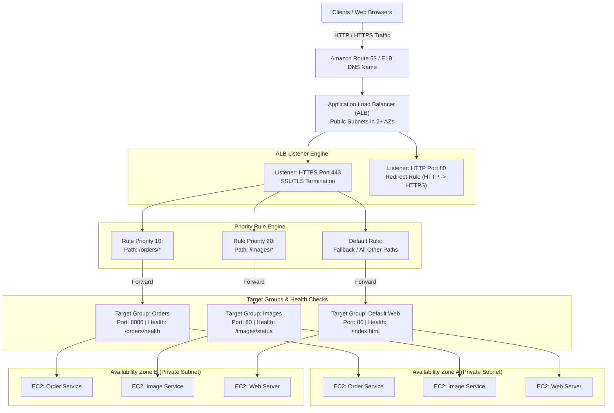
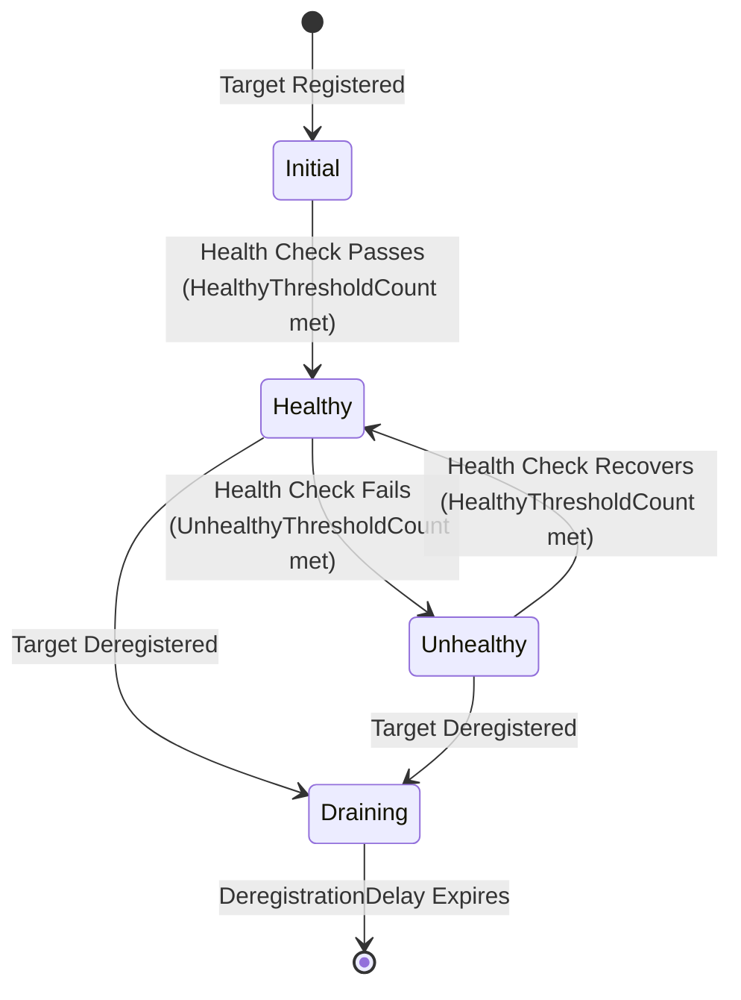
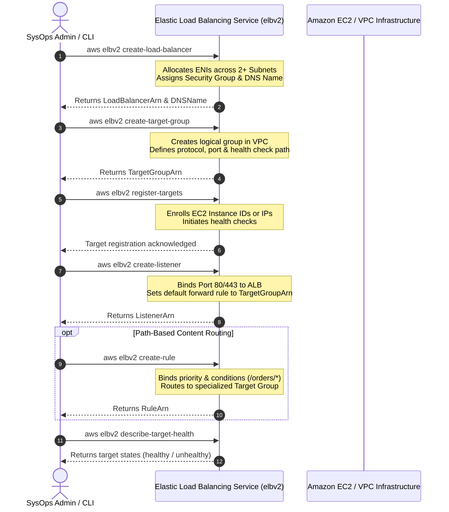
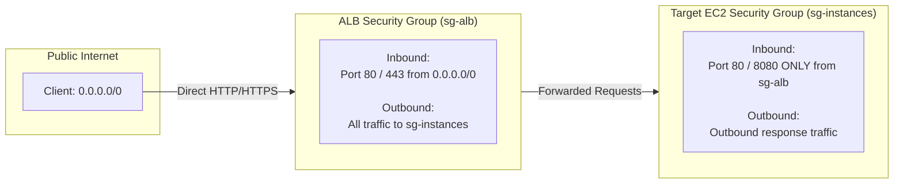

# ⚖️ Module 11: Elastic Load Balancing – Load Balancers and Listeners

> **Course**: AWS re/Start  
> **Module**: Scaling and Name Resolution  
> **Source Document**: `T15-0003-RSSCAL_EN-US_SG_M11_ELBLOADBALANCELISTENERS.pdf`  
> **Target Audience**: AWS re/Start Learners, Solutions Architects, and SysOps Administrators  

---

## 🎯 Module Overview

Elastic Load Balancing (ELB) automatically distributes incoming application traffic across multiple compute targets—such as Amazon Elastic Compute Cloud (Amazon EC2) instances, containers (Amazon ECS / EKS), and IP addresses—in one or more Availability Zones. Operating as the single point of contact for clients, a load balancer increases the availability, fault tolerance, and elasticity of your applications.

To unlock the full power of modern application architectures, AWS separates load balancing operations into modular, decoupled primitives: **Load Balancers**, **Listeners**, **Listener Rules**, and **Target Groups**. This modularity empowers developers and administrators to implement advanced content-based routing (such as routing traffic based on URL path, host headers, HTTP headers, or query parameters), perform seamless blue/green deployments, terminate SSL/TLS encryption, and isolate backend microservices.

This study guide provides an in-depth exploration of the Elastic Load Balancing architecture, covers the complete step-by-step provisioning workflow using the AWS Command Line Interface (`aws elbv2`), and details production-grade troubleshooting methodologies for common HTTP errors (such as 502 Bad Gateway, 503 Service Unavailable, and 504 Gateway Timeout) and health check failures.

---

### 📌 Learning Objectives

- [ ] **Explain Elastic Load Balancing Architecture**: Identify the core components of ELB, including load balancers, listeners, listener rules, target groups, and registered targets.
- [ ] **Differentiate Listeners and Listener Rules**: Understand protocol and port bindings, rule priority evaluation order, rule conditions, and routing actions (forward, redirect, fixed-response).
- [ ] **Configure Target Groups and Health Checks**: Define target types (instance, IP, Lambda), configure health check protocols, paths, intervals, thresholds, and success matchers.
- [ ] **Provision ELB via the AWS CLI (`elbv2`)**: Execute the 5-step command-line provisioning workflow to create an Application Load Balancer (ALB), target groups, target registrations, listeners, and path-based routing rules.
- [ ] **Verify Target Health**: Query registered target states (`healthy`, `unhealthy`, `initial`, `draining`, `unused`) using `describe-target-health`.
- [ ] **Troubleshoot ELB Deployments**: Diagnose and remediate HTTP 502, 503, and 504 errors, security group misconfigurations, and backend health check failures using structured decision logic.

---

## 📚 Key Terminology

| Term | Definition |
| :--- | :--- |
| **Application Load Balancer (ALB)** | A Layer 7 (HTTP/HTTPS) load balancer designed for advanced request-level routing, microservices, containerized workloads, and WebSocket traffic. |
| **Listener** | A process that checks for incoming connection requests from clients based on configured protocol and port, evaluating attached rules to route traffic. |
| **Listener Rule** | A priority-based directive attached to a listener that determines how traffic matching specific conditions (e.g., path pattern, host header) is processed. |
| **Default Rule** | The fallback rule on a listener evaluated last (lowest priority) when no other rule conditions are met; it cannot have conditions and cannot be deleted. |
| **Target Group** | A logical grouping of backend compute resources (EC2 instances, IP addresses, or Lambda functions) that receive traffic routed by one or more load balancer rules. |
| **Registered Target** | An individual compute resource (e.g., instance ID `i-12345678` or private IP address) enrolled within a target group to serve application requests. |
| **Health Check** | An active polling mechanism where the load balancer periodically sends ping requests (e.g., HTTP `GET /health`) to targets to verify their operational status. |
| **Content-Based Routing** | The ability of an ALB to inspect HTTP request attributes (URL path, hostname, HTTP headers, methods, query strings) and direct traffic to specialized target groups. |
| **Deregistration Delay (Connection Draining)** | The amount of time ELB keeps existing connections open to an in-flight target while preventing new requests from being routed to it during removal or maintenance. |
| **AWS CLI (`elbv2`)** | The command-line service identifier used in the AWS CLI to manage modern Elastic Load Balancing resources (ALB, NLB, GLB). |

---

## 🏛️ 1. Architecture of Elastic Load Balancing (ELB)

### 1.1 Structural Topology

In an AWS environment, a load balancer serves as the single point of entry for client requests. It abstracts backend infrastructure, absorbs traffic surges, and shields private instances from direct internet exposure.



---

### 1.2 Listeners: Ports, Protocols, and Processing

A **listener** is an active process configured on the load balancer that continuously monitors for incoming client connection requests.

- **Port and Protocol**: When creating a listener, you configure the frontend protocol (e.g., `HTTP`, `HTTPS`) and port (e.g., `80`, `443`, or custom application ports).
- **Scale and Limits**: Each load balancer requires at least one listener to accept traffic and can support up to **50 listeners**.
- **SSL/TLS Termination**: For secure communication, HTTPS listeners terminate TLS certificates provided by AWS Certificate Manager (ACM) or IAM, decrypting incoming traffic before forwarding it to backend targets. This unloads intensive cryptographic operations from your EC2 instances.
- **Client IP Preservation**: When an ALB terminates an HTTP/HTTPS connection, the backend target sees the private IP address of the load balancer node. To identify original client information, the ALB automatically appends standard HTTP headers:
  - `X-Forwarded-For`: Contains the original client IP address.
  - `X-Forwarded-Proto`: Identifies the protocol used by the client (`http` or `https`).
  - `X-Forwarded-Port`: Identifies the destination port used by the client.

---

### 1.3 Listener Rules and Routing Engine

Rules define how the listener evaluates incoming HTTP requests and determines what action to execute.

#### Rule Priority and Evaluation Logic
1. Rules are evaluated sequentially in order of **numerical priority**, starting with the lowest integer (highest priority, e.g., 1, 10, 20).
2. As soon as all conditions of a rule evaluate to true, the action associated with that rule is executed immediately, and rule processing halts.
3. Every listener possesses a mandatory **Default Rule**. The default rule has no conditions and is evaluated last (lowest priority) if no prior rule conditions match. The default rule cannot be deleted.

#### Supported Rule Conditions
An Application Load Balancer can evaluate rich Layer 7 attributes:

| Condition Type | Description | Example Pattern |
| :--- | :--- | :--- |
| **Path Pattern** | Matches the URL path of the request. Supports wildcards (`*`, `?`). Case-sensitive. | `/orders/*`, `/images/*.png`, `/api/v2/*` |
| **Host Header** | Matches the domain name specified in the HTTP `Host` header. | `api.example.com`, `orders.example.com` |
| **HTTP Request Method** | Matches the standard HTTP verb of the incoming request. | `GET`, `POST`, `PUT`, `DELETE`, `HEAD` |
| **HTTP Headers** | Matches custom or standard HTTP request headers and values. | `User-Agent: *Mobile*`, `X-Custom-Auth: Valid` |
| **Query Parameters** | Matches key-value pairs or single keys in the query string. | `version=v2`, `debug=true` |
| **Source IP / CIDR** | Matches the IPv4/IPv6 client IP address making the connection. | `192.0.2.0/24`, `2001:db8::/32` |

#### Supported Rule Actions
When a rule matches, the ALB can execute several action types:
1. **Forward**: Route the request to one or more Target Groups. When routing to multiple target groups, weighted routing can be applied (e.g., 90% traffic to `v1-tg`, 10% to `v2-tg` for canary testing).
2. **Redirect**: Return an HTTP redirect response (`301 Moved Permanently` or `302 Found`). Commonly used to redirect unencrypted HTTP traffic on port 80 to HTTPS on port 443.
3. **Fixed Response**: Drop backend communication entirely and return a custom HTTP status code (e.g., `404 Not Found`, `503 Service Unavailable`, or `200 OK`) and a custom HTML/JSON body directly from the load balancer.
4. **Authenticate**: Integrate with Amazon Cognito or OpenID Connect (OIDC) compliant identity providers before routing traffic to backend targets.

---

### 1.4 Target Groups: Dynamic Backend Organization

A **target group** organizes backend resources into manageable logical pools.

- **Target Types**:
  - `instance`: Targets are specified by EC2 instance IDs (e.g., `i-0123456789abcdef0`). Traffic is directed to primary network interfaces.
  - `ip`: Targets are specified by IP addresses (IPv4 or IPv6). Enables load balancing to on-premises servers via AWS Direct Connect/VPN, AWS Fargate tasks, or EC2 instances with secondary ENIs.
  - `lambda`: Directs incoming HTTP requests to an AWS Lambda function, transforming JSON payloads into function invocations.
  - `alb`: Enables forwarding from an Application Load Balancer to another internal Application Load Balancer.
- **Many-to-Many Relationships**: An individual EC2 instance can be registered to multiple target groups simultaneously on the same or different ports.
- **Deregistration Delay**: When a target is deregistered, ELB transitions it to a `draining` state. Existing in-flight requests are allowed to complete gracefully within a configurable timeout (default: 300 seconds; range: 0–3600 seconds) before the target is severed.

---

### 1.5 Target Group Health Check Mechanics

Load balancers preserve high availability by routing traffic **only** to healthy targets.



#### Health Check Configuration Parameters

| Parameter | AWS CLI Parameter | Default Value | Description |
| :--- | :--- | :--- | :--- |
| **Protocol** | `--health-check-protocol` | `HTTP` | Protocol used by the load balancer to send health check requests (`HTTP` or `HTTPS`). |
| **Port** | `--health-check-port` | `traffic-port` | Destination port on the targets. `traffic-port` directs health checks to the port the target receives application traffic on. |
| **Path** | `--health-check-path` | `/` | The destination ping URL path queried on the target (e.g., `/health`, `/api/healthz`). |
| **Interval** | `--health-check-interval-seconds` | `30` | The approximate time interval between health check pings per target (range: 5–300 seconds). |
| **Timeout** | `--health-check-timeout-seconds` | `5` | The duration during which no response from the target means a failed health check (range: 2–120 seconds). |
| **Healthy Threshold** | `--healthy-threshold-count` | `5` | The number of consecutive successful health checks required before marking an unhealthy target as healthy (range: 2–10). |
| **Unhealthy Threshold** | `--unhealthy-threshold-count` | `2` | The number of consecutive failed health checks required before marking a target as unhealthy (range: 2–10). |
| **Matcher / Success Codes** | `--matcher HttpCode=...` | `200` | The acceptable HTTP response codes from the target (e.g., `200`, `200-299`, `200,302`). |

> [!IMPORTANT]
> Target group health checks are independent for each target group. If an EC2 instance is registered in two distinct target groups (e.g., `/web` and `/api`), each target group independently monitors its own health check path and status.

---

## 🛠️ 2. Step-by-Step Configuration with the AWS CLI (`elbv2`)

The modern Elastic Load Balancing service uses the AWS CLI service namespace `elbv2` (Elastic Load Balancing Version 2).

### 2.1 Workflow Overview



---

### 2.2 Step 1: Create the Application Load Balancer

#### Prerequisites
1. **AWS CLI Verification**: Verify that the AWS CLI is installed and configured with appropriate IAM credentials:
   ```bash
   aws elbv2 help
   ```
2. **Multi-AZ Subnets**: Identify at least **two public subnets** residing in different Availability Zones within your target VPC.
3. **Security Group Setup**: Create or identify an ALB security group allowing inbound HTTP/HTTPS traffic from client sources (e.g., `0.0.0.0/0`).

#### Command Execution
```bash
aws elbv2 create-load-balancer \
    --name my-load-balancer \
    --subnets subnet-0123456789abcdef0 subnet-0fedcba9876543210 \
    --security-groups sg-0123456789abcdef0 \
    --scheme internet-facing \
    --type application \
    --ip-address-type ipv4
```

#### JSON Output
```json
{
    "LoadBalancers": [
        {
            "LoadBalancerArn": "arn:aws:elasticloadbalancing:us-east-1:123456789012:loadbalancer/app/my-load-balancer/1234567890123456",
            "DNSName": "my-load-balancer-1234567890123456.us-east-1.elb.amazonaws.com",
            "CanonicalHostedZoneId": "Z35SXDOTRQ7X7K",
            "CreatedTime": "2026-10-13T02:00:00.000Z",
            "LoadBalancerName": "my-load-balancer",
            "Scheme": "internet-facing",
            "VpcId": "vpc-0123456789abcdef0",
            "State": {
                "Code": "provisioning"
            },
            "Type": "application",
            "AvailabilityZones": [
                {
                    "ZoneName": "us-east-1a",
                    "SubnetId": "subnet-0123456789abcdef0"
                },
                {
                    "ZoneName": "us-east-1b",
                    "SubnetId": "subnet-0fedcba9876543210"
                }
            ],
            "SecurityGroups": [
                "sg-0123456789abcdef0"
            ],
            "IpAddressType": "ipv4"
        }
    ]
}
```

> [!NOTE]
> Save the `LoadBalancerArn` from the JSON response. It is required when creating listeners in Step 4.

---

### 2.3 Step 2: Create a Target Group

Create a target group within the same VPC where your backend EC2 instances or container hosts reside.

#### Command Execution
```bash
aws elbv2 create-target-group \
    --name my-targets \
    --protocol HTTP \
    --port 80 \
    --vpc-id vpc-0123456789abcdef0 \
    --target-type instance \
    --ip-address-type ipv4 \
    --health-check-protocol HTTP \
    --health-check-port 80 \
    --health-check-path /health \
    --health-check-interval-seconds 30 \
    --health-check-timeout-seconds 5 \
    --healthy-threshold-count 3 \
    --unhealthy-threshold-count 2 \
    --matcher HttpCode=200
```

#### JSON Output
```json
{
    "TargetGroups": [
        {
            "TargetGroupArn": "arn:aws:elasticloadbalancing:us-east-1:123456789012:targetgroup/my-targets/1234567890123456",
            "TargetGroupName": "my-targets",
            "Protocol": "HTTP",
            "Port": 80,
            "VpcId": "vpc-0123456789abcdef0",
            "HealthCheckProtocol": "HTTP",
            "HealthCheckPort": "80",
            "HealthCheckEnabled": true,
            "HealthCheckIntervalSeconds": 30,
            "HealthCheckTimeoutSeconds": 5,
            "HealthyThresholdCount": 3,
            "UnhealthyThresholdCount": 2,
            "HealthCheckPath": "/health",
            "Matcher": {
                "HttpCode": "200"
            },
            "TargetType": "instance",
            "IpAddressType": "ipv4"
        }
    ]
}
```

> [!TIP]
> The target group IP address type (`ipv4` vs. `ipv6`) controls how the load balancer contacts backend targets. IPv4 target groups support both `instance` and `ip` targets, while IPv6 target groups strictly support `ip` targets.

---

### 2.4 Step 3: Register Targets with the Target Group

Register backend EC2 instances into the target group using their instance IDs.

#### Command Execution
```bash
aws elbv2 register-targets \
    --target-group-arn arn:aws:elasticloadbalancing:us-east-1:123456789012:targetgroup/my-targets/1234567890123456 \
    --targets Id=i-0123456789abcdef0,Port=80 Id=i-0fedcba9876543210,Port=80
```

> [!NOTE]
> The `register-targets` command returns no stdout output upon successful execution.

---

### 2.5 Step 4: Create a Listener with Default Action

Create a listener on port 80 that directs all traffic to the target group created in Step 2.

#### Command Execution
```bash
aws elbv2 create-listener \
    --load-balancer-arn arn:aws:elasticloadbalancing:us-east-1:123456789012:loadbalancer/app/my-load-balancer/1234567890123456 \
    --protocol HTTP \
    --port 80 \
    --default-actions Type=forward,TargetGroupArn=arn:aws:elasticloadbalancing:us-east-1:123456789012:targetgroup/my-targets/1234567890123456
```

#### JSON Output
```json
{
    "Listeners": [
        {
            "ListenerArn": "arn:aws:elasticloadbalancing:us-east-1:123456789012:listener/app/my-load-balancer/1234567890123456/14f6f490e5f8bdbf",
            "LoadBalancerArn": "arn:aws:elasticloadbalancing:us-east-1:123456789012:loadbalancer/app/my-load-balancer/1234567890123456",
            "Port": 80,
            "Protocol": "HTTP",
            "DefaultActions": [
                {
                    "Type": "forward",
                    "TargetGroupArn": "arn:aws:elasticloadbalancing:us-east-1:123456789012:targetgroup/my-targets/1234567890123456"
                }
            ]
        }
    ]
}
```

---

### 2.6 Step 4a (Advanced): Create Content-Based Listener Rules

To route requests dynamically based on URL path patterns (e.g., sending `/orders/*` to a dedicated `orders-tg`), create a priority rule.

#### Command Execution
```bash
# 1. Create a specialized target group for orders
aws elbv2 create-target-group \
    --name orders-targets \
    --protocol HTTP \
    --port 8080 \
    --vpc-id vpc-0123456789abcdef0 \
    --health-check-path /orders/health

# 2. Add a path-based routing rule to the listener
aws elbv2 create-rule \
    --listener-arn arn:aws:elasticloadbalancing:us-east-1:123456789012:listener/app/my-load-balancer/1234567890123456/14f6f490e5f8bdbf \
    --priority 10 \
    --conditions Field=path-pattern,Values='/orders/*' \
    --actions Type=forward,TargetGroupArn=arn:aws:elasticloadbalancing:us-east-1:123456789012:targetgroup/orders-targets/abcdef1234567890
```

#### Command Execution (HTTP to HTTPS Redirect Rule)
To redirect all unencrypted HTTP traffic to secure HTTPS on port 443:
```bash
aws elbv2 create-listener \
    --load-balancer-arn arn:aws:elasticloadbalancing:us-east-1:123456789012:loadbalancer/app/my-load-balancer/1234567890123456 \
    --protocol HTTP \
    --port 80 \
    --default-actions Type=redirect,RedirectConfig="{Protocol=HTTPS,Port=443,StatusCode=HTTP_301}"
```

---

### 2.7 Step 5: Verify Backend Target Health

Verify that the registered targets have passed health checks and are ready to receive production traffic.

#### Command Execution
```bash
aws elbv2 describe-target-health \
    --target-group-arn arn:aws:elasticloadbalancing:us-east-1:123456789012:targetgroup/my-targets/1234567890123456
```

#### JSON Output
```json
{
    "TargetHealthDescriptions": [
        {
            "Target": {
                "Id": "i-0123456789abcdef0",
                "Port": 80
            },
            "HealthCheckPort": "80",
            "TargetHealth": {
                "State": "healthy"
            }
        },
        {
            "Target": {
                "Id": "i-0fedcba9876543210",
                "Port": 80
            },
            "HealthCheckPort": "80",
            "TargetHealth": {
                "State": "healthy"
            }
        }
    ]
}
```

#### Possible Target Health States

| State | Explanation | Action Required |
| :--- | :--- | :--- |
| `initial` | The target is currently in the process of registering and undergoing its first round of health checks. | Wait for the `HealthyThresholdCount` consecutive checks to complete. |
| `healthy` | The target responded with the configured HTTP matcher code within the timeout window. | None; the target actively receives load balancer traffic. |
| `unhealthy` | The target failed consecutive health checks or connection timed out. | Inspect application logs, web server status, and security groups. |
| `unused` | The target group is not associated with any active listener rule, or the target's AZ is not enabled on the ALB. | Verify listener rules or ensure the target's AZ is registered on the ALB. |
| `draining` | The target is deregistering, but existing in-flight connections are being serviced. | Target will transition to deregistered once the timeout finishes. |

---

## 🔍 3. Troubleshooting ELB Deployments

When managing production ELB deployments, administrators frequently encounter HTTP 5xx errors or targets failing health checks. Understanding the exact boundary where an error originates is essential for rapid incident remediation.

### 3.1 Troubleshooting Decision Flowchart

```mermaid
flowchart TD
    Start["HTTP Error Reported by Client"] --> CheckStatus{"What is the HTTP Status Code?"}

    CheckStatus -->|502 Bad Gateway| Err502["HTTP 502 Bad Gateway"]
    CheckStatus -->|503 Service Unavailable| Err503["HTTP 503 Service Unavailable"]
    CheckStatus -->|504 Gateway Timeout| Err504["HTTP 504 Gateway Timeout"]
    CheckStatus -->|Health Check Failing| ErrHC["Target State: unhealthy"]

    Err502 --> D502{"Is target resetting connection or returning malformed headers?"}
    D502 -->|Target Closed TCP Connection| Fix502A["Check Web Server Keep-Alive:<br/>Backend Keep-Alive must exceed ALB Idle Timeout (60s+)."]
    D502 -->|Target Returned Invalid HTTP Body| Fix502B["Inspect target application error logs.<br/>Look for crashed workers or truncated headers."]

    Err503 --> D503{"Are targets registered and passing health checks?"}
    D503 -->|Zero Targets Registered| Fix503A["Register EC2 instances or check Auto Scaling Group attachments."]
    D503 -->|All Targets unhealthy| Fix503B["Diagnose Health Check Failures (see below)."]

    Err504 --> D504{"Where is the request hanging?"}
    D504 -->|Backend took > 60s to respond| Fix504A["Optimize long-running queries or increase ALB Idle Timeout."]
    D504 -->|No network ACK from target| Fix504B["Check Target Security Group:<br/>Ensure it allows inbound traffic from the ALB Security Group."]

    ErrHC --> DHC{"Check Target Health Description Reason"}
    DHC -->|Client.Timeout / Connection Refused| FixHCA["Verify Web Server service (systemctl status nginx/httpd).<br/>Confirm service is listening on 0.0.0.0, not 127.0.0.1."]
    DHC -->|HealthCheck.Failed (HTTP 404/500)| FixHCB["Update Health Check Path to a valid static endpoint.<br/>Ensure path returns HTTP 200 OK."]
    DHC -->|Connection Dropped / Timeout| FixHCC["Check Security Group Inbound Rules:<br/>Allow ALB Security Group ID on HealthCheckPort."]
```

---

### 3.2 Deep-Dive: Root Cause Analysis Matrix

#### HTTP 502: Bad Gateway
The load balancer received an invalid response or an unexpected TCP connection reset from the backend target while attempting to forward the request.

- **Root Cause 1: Backend Keep-Alive Timeout Too Low**: Modern ALBs maintain persistent HTTP connections with backend targets. If the backend web server (e.g., Apache, NGINX, Node.js) has a `keepalive_timeout` that is **lower** than the ALB idle timeout (default 60 seconds), the web server may terminate the TCP socket right as the ALB sends a new request, resulting in a TCP reset (`RST`) packet.
  - *Remediation*: Configure your backend web server keep-alive timeout to **65 seconds or higher** (greater than the ALB idle timeout).
- **Root Cause 2: Target Returned Malformed HTTP Response**: The backend application crashed midway through streaming headers, returned an invalid HTTP response syntax, or exceeded header size limits.
  - *Remediation*: Check `/var/log/nginx/error.log` or application backtraces for unhandled runtime exceptions.

#### HTTP 503: Service Unavailable
The load balancer has no targets capable of processing the incoming request.

- **Root Cause 1: No Healthy Targets in Target Group**: All registered targets in the associated target group failed health checks and transitioned to the `unhealthy` state.
  - *Remediation*: Review target health reasons via `aws elbv2 describe-target-health`. Fix underlying health check failures.
- **Root Cause 2: Target Group Has No Registered Targets**: The target group was provisioned, but no EC2 instances or containers were enrolled, or an Auto Scaling Group scaled down to 0 instances.
  - *Remediation*: Verify Auto Scaling Group desired capacity or manually register instances.
- **Root Cause 3: Surge Queue Full**: In high-throughput bursts, backend instances cannot accept new connections fast enough.

#### HTTP 504: Gateway Timeout
The load balancer initiated a connection to the backend target, but the target did not complete the response before the **Idle Timeout** expired.

- **Root Cause 1: Slow Database Query or Application Bottleneck**: The backend application is processing a heavy computation or blocked on a slow external dependency (such as an unindexed relational database query).
  - *Remediation*: Optimize backend application performance, add caching (Amazon ElastiCache), or increase the load balancer idle timeout attribute if long processing times are anticipated:
    ```bash
    aws elbv2 modify-load-balancer-attributes \
        --load-balancer-arn <load-balancer-arn> \
        --attributes Key=idle_timeout.timeout_seconds,Value=120
    ```
- **Root Cause 2: Security Group Silently Dropping Traffic**: The backend instance's security group does not permit inbound traffic from the load balancer, causing SYN packets to time out without a response.
  - *Remediation*: Authorize traffic from the ALB security group on the target security group.

---

### 3.3 Security Group Architecture for ELB

A common misconfiguration is opening backend EC2 instances directly to the internet (`0.0.0.0/0`) or neglecting to allow the ALB's security group.



> [!CAUTION]
> **Never** expose backend application instances directly to the public internet on application ports. Configure the Target Security Group to **reference the ALB Security Group ID** as its inbound source rather than an IP CIDR range. This guarantees that only requests passing through the load balancer are accepted.

---

## 📊 4. Elastic Load Balancing Type Comparison

AWS offers four distinct load balancer offerings under the Elastic Load Balancing family. Choosing the correct type is fundamental to cloud design.

| Feature / Metric | Application Load Balancer (ALB) | Network Load Balancer (NLB) | Gateway Load Balancer (GLB) | Classic Load Balancer (CLB) |
| :--- | :--- | :--- | :--- | :--- |
| **OSI Layer** | **Layer 7** (Application) | **Layer 4** (Transport) | **Layer 3 / 4** (Network) | Layer 4 and Layer 7 |
| **Supported Protocols** | HTTP, HTTPS, gRPC, WebSocket | TCP, UDP, TLS | IP (GENEVE encapsulation) | HTTP, HTTPS, TCP, SSL |
| **Throughput / Latency** | High throughput, sub-100ms latency | Millions of RPS, ultra-low latency (single-digit ms) | High throughput inline appliance routing | Legacy throughput |
| **IP Address Support** | Dynamic DNS Name (changing public IPs) | Static IP per AZ / Elastic IP | Private Gateway Endpoint | Dynamic DNS Name |
| **Routing Capabilities** | Content-based (path, host, headers, query) | Flow hash (IP, port, protocol) | Route-table based inline traffic inspection | Basic round-robin |
| **Target Types** | EC2, ECS, IP, Lambda, ALB | EC2, ECS, IP, ALB | EC2, 3rd-party appliances | EC2-Classic, EC2-VPC |
| **Current Status** | **Recommended** for modern web/microservices | **Recommended** for gaming, VoIP, extreme performance | **Recommended** for firewalls, IDS/IPS | **Retired / Legacy** |

---

## 📝 5. Checkpoint Questions & Answers

### Question 1
**Scenario**: A website is experiencing severe latency and degraded performance under heavy load. The website serves multiple functional endpoints, including `example.com/login`, `example.com/products`, and `example.com/orders`. Currently, the entire monolithic web application is hosted on a single Amazon EC2 instance.  
**Prompt**: How could you use an Elastic Load Balancer to improve the performance, reliability, and cost-efficiency of this website?

> **Answer & Detailed Explanation**:
> 1. **Microservice Decomposition with Path-Based Routing**: By deploying an **Application Load Balancer (ALB)**, you can define **listener rules** based on **path patterns** (`/login/*`, `/products/*`, `/orders/*`).
> 2. **Dedicated Target Groups**: Each functional path is mapped to a dedicated target group backed by independent pools of EC2 instances (or containerized tasks).
> 3. **Targeted Independent Auto Scaling**: If order activity surges during a flash sale, the Auto Scaling group associated with the `/orders/*` target group can scale out automatically to absorb demand without needing to provision expensive, unneeded capacity for `/login` or `/products`.
> 4. **Cost Optimization & Fault Isolation**: Scaling only the bottlenecked component minimizes infrastructure expenses. Furthermore, if a bug crashes the order processing service, the login and product browsing services remain fully operational and unaffected.

---

### Question 2
**Prompt**: Do health checks apply to the load balancer itself or to the backend target servers?

> **Answer & Detailed Explanation**:
> **Health checks apply directly to the backend target servers (registered targets within a target group), not the load balancer itself.**
>
> - The load balancer actively performs health checks by sending periodic HTTP/HTTPS or TCP probe requests to each registered target using the path, port, and interval specified in the target group configuration.
> - If a target fails to respond with a healthy status code (e.g., HTTP 200) for `UnhealthyThresholdCount` consecutive checks, the load balancer marks the target as `unhealthy` and stops routing user traffic to it.
> - Once the failed target recovers and responds successfully for `HealthyThresholdCount` consecutive checks, the load balancer marks it as `healthy` and resumes routing traffic to it.
> - The load balancer's own health and availability are managed transparently by AWS across multiple Availability Zones.

---

### Question 3
**Scenario**: An administrator deploys an Application Load Balancer and creates a target group containing two EC2 instances running Apache web server on port 80. The security group on the EC2 instances allows inbound port 80 from `0.0.0.0/0`. However, when querying `aws elbv2 describe-target-health`, both instances report `Target.FailedHealthCheck` with HTTP status code `404 Not Found`.  
**Prompt**: What is the root cause of this health check failure, and how should it be resolved?

> **Answer & Detailed Explanation**:
> - **Root Cause**: The target group was configured with a default health check path of `/`, or a custom path (e.g., `/health`), but the web server does not have an `index.html` or `/health` document in its web root (`/var/www/html/`). Consequently, Apache returns an HTTP `404 Not Found` response code. Because the default target group health check matcher expects an HTTP `200 OK`, the load balancer classifies the targets as unhealthy.
> - **Remediation**:
>   1. Create a valid health check file on the EC2 instances (e.g., `echo "OK" > /var/www/html/health.html`).
>   2. Update the target group health check path using the AWS CLI:
>      ```bash
>      aws elbv2 modify-target-group \
>          --target-group-arn <target-group-arn> \
>          --health-check-path /health.html \
>          --matcher HttpCode=200
>      ```
>   3. Alternatively, update the matcher to accept `200,404` (though creating an explicit health endpoint is the recommended best practice).

---

## 📌 Key Takeaways & Study Summary

- **Single Point of Contact**: The load balancer serves as the unified entry point for clients, abstracting dynamic server fleets and providing automatic fault tolerance across multiple Availability Zones.
- **Decoupled Architecture**: ELB separates configuration into **Load Balancers** (network endpoint), **Listeners** (port/protocol listener), **Rules** (routing conditions/priorities), and **Target Groups** (backend destination pools).
- **Layer 7 Content-Based Routing**: Application Load Balancers evaluate HTTP request attributes—including path patterns, hostnames, HTTP methods, headers, and query strings—enabling microservices architectures and granular traffic routing.
- **Priority-Based Rule Processing**: Rules evaluate in strict numeric priority order (lowest number first). The default rule acts as an unconditioned fallback evaluated last.
- **AWS CLI Command Suite**:
  - `aws elbv2 create-load-balancer`: Allocates load balancer ENIs and DNS name.
  - `aws elbv2 create-target-group`: Defines backend targets, protocol, and health checks.
  - `aws elbv2 register-targets`: Associates compute instances with target groups.
  - `aws elbv2 create-listener`: Binds listening ports and default actions.
  - `aws elbv2 create-rule`: Configures content-based routing conditions.
  - `aws elbv2 describe-target-health`: Inspects live operational status of backend targets.
- **Structured Troubleshooting**:
  - **HTTP 502 Bad Gateway**: Check backend web server keep-alive timeouts (must be $\ge 65\text{s}$) or application crashes.
  - **HTTP 503 Service Unavailable**: Verify healthy target count and ensure target group has registered targets.
  - **HTTP 504 Gateway Timeout**: Investigate slow backend queries or security group rules dropping traffic.
  - **Security Group Isolation**: Always restrict backend target security groups to accept traffic exclusively from the ALB security group ID.
