# ⚖️ Amazon EC2 Auto Scaling – Comprehensive Study Guide

> **Course**: AWS re/Start  
> **Module**: M11 – Scaling and Name Resolution  
> **Source Document**: `T15-0004-RSSCAL_EN-US_SG_M11_AMAZONEC2AUTOSCALING.pdf`  
> **Target Audience**: AWS re/Start Learners, Cloud Practitioners, Solutions Architects, and Systems Operations Administrators  

---

## 🎯 Module Overview

In traditional on-premises data centers, capacity planning is an unforgiving balancing act. Systems engineers must procure and provision hardware capable of sustaining peak seasonal traffic (such as Black Friday or annual tax deadlines). For the remainder of the year, that expensive compute infrastructure sits idle, consuming power, rack space, and capital expenditure. Conversely, under-provisioning compute capacity inevitably results in resource exhaustion, sluggish response times, degraded customer experience, or catastrophic system outages.

**Amazon EC2 Auto Scaling** resolves this fundamental operational dilemma by providing **automated cloud elasticity**. By dynamically adjusting the number of Amazon Elastic Compute Cloud (Amazon EC2) instances in response to real-time workload fluctuations, Amazon EC2 Auto Scaling ensures that applications maintain high availability, fault tolerance, and optimal performance while strictly minimizing infrastructure costs.

This study guide provides an exhaustive architectural and operational exploration of Amazon EC2 Auto Scaling. It breaks down the three foundational components of Auto Scaling (*Where*, *What*, and *When*), contrasts modern Launch Templates with legacy Launch Configurations, details all scaling policy variants (Manual, Scheduled, Dynamic, and Predictive), unpacks thrashing mitigation mechanisms, analyzes lifecycle hooks and termination logic, and establishes enterprise production best practices.

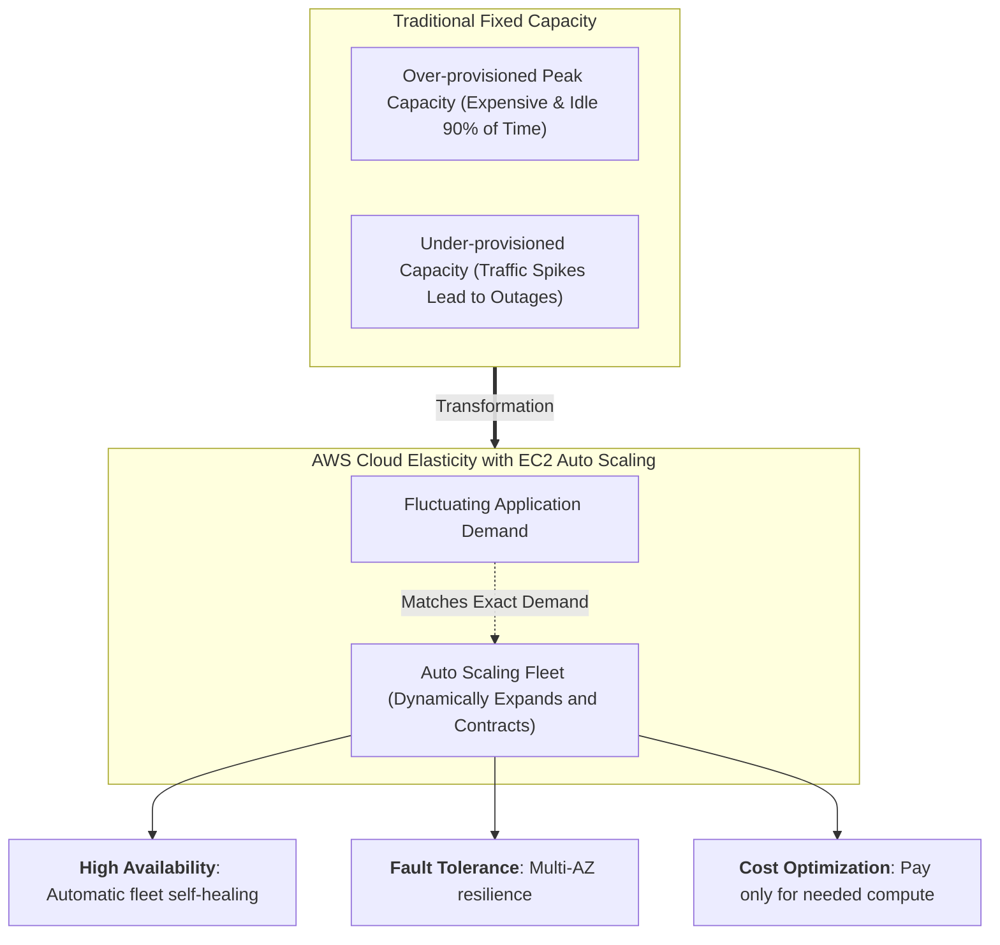

---

## 📌 Learning Objectives

By thoroughly reviewing this study guide and completing the checkpoint exercises, learners will be able to:

- [ ] **Define Amazon EC2 Auto Scaling**: Articulate the core value proposition of automated elasticity, high availability, fault tolerance, and operational cost optimization.
- [ ] **Analyze the Three Core Components**: Deconstruct the architectural trio of Auto Scaling Groups (*Where*), Launch Templates (*What*), and Scaling Policies (*When*).
- [ ] **Contrast Launch Templates and Launch Configurations**: Compare modern Launch Templates (versioning, parameter inheritance, Graviton, mixed instance types) against deprecated Launch Configurations.
- [ ] **Differentiate Scaling Policies**: Evaluate and select appropriate scaling strategies across Manual, Scheduled, Dynamic (Target Tracking, Step, Simple), and Machine Learning-based Predictive Scaling.
- [ ] **Mitigate Fleet Thrashing**: Implement alarm sustain periods, cooldown periods, and instance warmup periods to stabilize scaling events and avoid rapid oscillation.
- [ ] **Implement Lifecycle Hooks**: Orchestrate custom automation during instance launch (`autoscaling:EC2_INSTANCE_LAUNCHING`) and termination (`autoscaling:EC2_INSTANCE_TERMINATING`).
- [ ] **Master Termination Policies**: Predict and configure scale-in instance termination behavior across Multi-AZ balancing, `Default`, `OldestInstance`, `NewestInstance`, `OldestLaunchTemplate`, and `ClosestToNextInstanceHour`.
- [ ] **Configure Health Check Strategies**: Differentiate EC2 status checks from Elastic Load Balancing (ELB) health checks to ensure robust self-healing and zero traffic loss.
- [ ] **Deploy Steady-State Groups**: Build single-instance self-healing groups (`min=1, max=1, desired=1`) for stateful or single-node utility appliances such as NAT instances.
- [ ] **Apply Operational Best Practices**: Enforce 1-minute detailed CloudWatch monitoring, activate group metric aggregation, and recognize CPU credit starvation risks on burstable instance families (T2/T3).

---

## 📚 Key Terminology

| Term | Technical Definition |
| :--- | :--- |
| **Auto Scaling Group (ASG)** | A logical collection of Amazon EC2 instances that share similar characteristics and are treated as a single administrative unit for scaling and fleet management. |
| **Launch Template (LT)** | An Amazon EC2 capability that specifies instance configuration parameters (AMI, instance type, key pairs, security groups, block devices, IAM roles, user data) supporting versioning and inheritance. |
| **Launch Configuration (LC)** | The legacy predecessor to launch templates. Launch configurations are immutable and do not support template versioning or advanced EC2 features. |
| **Desired Capacity** | The target number of running EC2 instances that the Auto Scaling group actively attempts to maintain under current operating conditions. |
| **Minimum Size (`Min`)** | The lower boundary limit of EC2 instances that an Auto Scaling group is permitted to maintain, even during aggressive scale-in events. |
| **Maximum Size (`Max`)** | The absolute ceiling of EC2 instances that an Auto Scaling group is permitted to provision, preventing runaway cloud expenditures. |
| **Scale-Out** | The automated or manual process of adding compute instances to an Auto Scaling group to satisfy rising demand. |
| **Scale-In** | The automated or manual process of gracefully removing and terminating compute instances from an Auto Scaling group when demand subsides. |
| **Target Tracking Scaling** | A dynamic scaling policy that automatically adjusts capacity to maintain a designated CloudWatch metric (e.g., average CPU utilization) at a specified target value. |
| **Step Scaling** | A dynamic scaling policy that adjusts capacity based on a tiered set of adjustments (steps) proportional to the magnitude of a CloudWatch alarm breach. |
| **Simple Scaling** | A legacy dynamic scaling policy that changes group capacity by a single fixed or percentage value in response to a single CloudWatch alarm breach. |
| **Predictive Scaling** | An automated scaling feature that uses machine learning algorithms to analyze historical traffic patterns and forecast capacity needs up to 48 hours in advance. |
| **Cooldown Period** | A configurable time window following a scaling activity during which the Auto Scaling group blocks further scaling activities to allow newly launched instances to stabilize. |
| **Instance Warmup Period** | The elapsed time (in seconds) required for a newly launched instance to initialize and start serving traffic before contributing to group aggregate metrics. |
| **Lifecycle Hook** | A capability allowing custom automation scripts or Lambda functions to pause an instance during launch or termination before it transitions to `InService` or `Terminated`. |
| **Termination Policy** | A predefined or custom set of rules used by Amazon EC2 Auto Scaling to select specific instances for termination during a scale-in event. |
| **Steady-State Group** | An Auto Scaling group configured with identical minimum, maximum, and desired capacity values (e.g., `1:1:1`) to ensure automated replacement of a single critical instance. |
| **Thrashing** | An unstable system condition where instances are repeatedly launched and terminated in rapid succession due to volatile metric spikes, causing resource waste. |
| **EC2 Status Check** | Built-in hypervisor and operating system checks performed by AWS to determine if an instance is reachable and functional at the hardware and kernel level. |
| **ELB Health Check** | Application-layer health checks conducted by an Elastic Load Balancer (e.g., HTTP `200 OK` ping) to determine if an instance can successfully process client requests. |

---

## 🏗️ 1. The Three Core Components of Auto Scaling

Amazon EC2 Auto Scaling operates on three foundational architectural pillars answering three fundamental infrastructure questions: **Where**, **What**, and **When**.

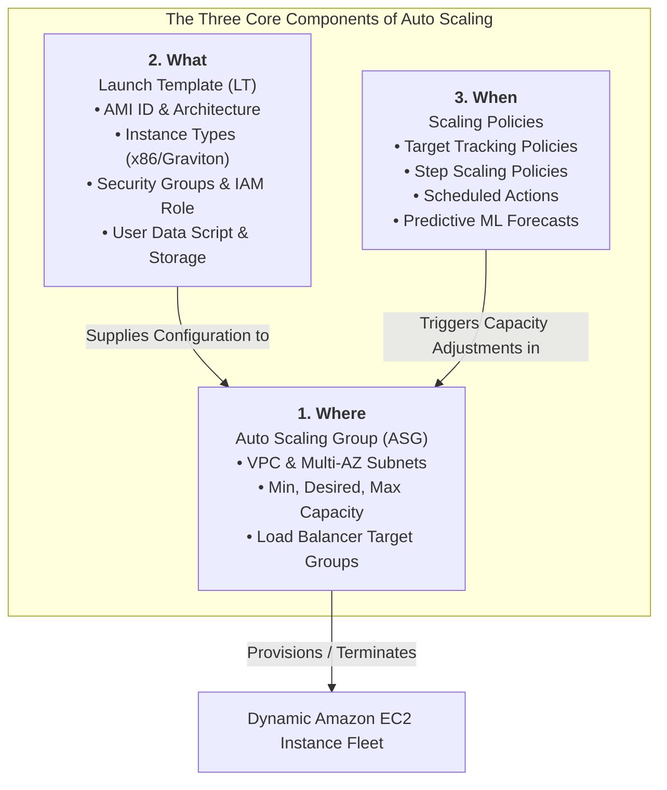

### 1.1 Component 1: Where – The Auto Scaling Group (ASG)

The **Auto Scaling Group** defines the network perimeter, availability boundaries, and capacity limits of your compute tier:

- **Virtual Private Cloud (VPC) & Subnets**: An ASG is assigned to a specific VPC and should span **multiple subnets across diverse Availability Zones (Multi-AZ)**. This architecture ensures high availability; if an entire physical Availability Zone suffers a power or network failure, the ASG automatically redistributes capacity to surviving AZs.
- **Capacity Limits**:
  - **Minimum Size (`Min`)**: Ensures an absolute baseline of compute capacity is always running.
  - **Desired Capacity**: The actual operational capacity. When you create an ASG or when scaling policies fire, this value changes to reflect current demand.
  - **Maximum Size (`Max`)**: Acts as a hard budgetary and resource circuit-breaker, ensuring the ASG cannot scale out beyond organizational limits.
- **Load Balancer Integration**: An ASG can automatically register newly launched EC2 instances with one or more Elastic Load Balancing (ELB) target groups and deregister terminating instances.

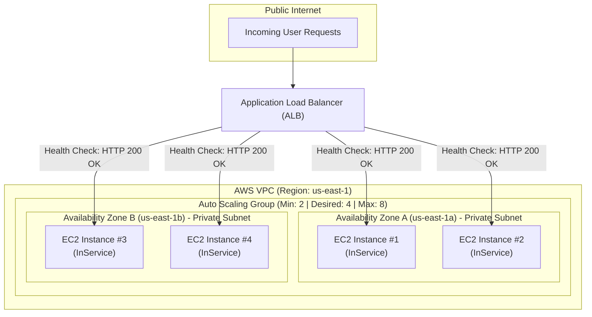

---

### 1.2 Component 2: What – Launch Template vs. Launch Configuration

To launch an Amazon EC2 instance, the Auto Scaling group must know *what* hardware, software, and networking parameters to provision. AWS historically supported two mechanisms: **Launch Configurations** and **Launch Templates**. 

> [!WARNING]
> **Legacy Notice**: AWS has officially deprecated Launch Configurations. AWS strongly recommends that all new and existing Auto Scaling groups standardize exclusively on **Launch Templates**. Launch Configurations do not receive new EC2 feature updates.

#### Architectural Comparison: Launch Templates vs. Launch Configurations

| Feature / Capability | Launch Template (Recommended) | Launch Configuration (Legacy) | Architectural Significance |
| :--- | :--- | :--- | :--- |
| **Versioning & Iteration** | **Full Native Support** (v1, v2, Default, Latest) | **Not Supported** (Immutable) | Launch templates allow granular version tracking, parameter diffs, and instant rollback without recreating the ASG. |
| **Parameter Inheritance** | **Supported** (Create child version extending parent) | **Not Supported** | Allows defining base corporate AMI/security standards while child versions override specific application parameters. |
| **Mixed Instance Types** | **Supported** (Multiple instance families & sizes) | **Not Supported** (Single instance type only) | Enables combining different instance families (e.g., `m5.large`, `m5a.large`) to mitigate regional capacity constraints. |
| **Spot & On-Demand Mix** | **Supported** (Percentage allocation & Spot pools) | **Not Supported** (Strictly On-Demand or strictly Spot) | Drastically reduces compute costs by blending baseline On-Demand instances with deeply discounted Spot instances. |
| **AWS Graviton Support** | **Full Support** (ARM64 architecture) | Limited / Incompatible with modern features | Enables modern cost-efficient ARM-based AWS Graviton2/3/4 compute instances. |
| **T2/T3 Unlimited Burst** | **Supported** | Not Supported | Allows configuring burstable instances for continuous high CPU workloads without credit throttling. |
| **Template Reusability** | **Multi-Purpose** (ASG, standalone EC2, Spot Fleet, Batch) | **Single-Purpose** (ASG only) | A single launch template can be shared across multiple deployment automation pipelines. |

#### Launch Template Configuration Parameters

When defining a Launch Template for an Auto Scaling group, the following core parameters are specified:

1. **Amazon Machine Image (AMI) ID**: The operating system image, pre-installed runtimes, and application binaries (e.g., Amazon Linux 2023, Ubuntu 22.04 LTS, custom hardened corporate AMI).
2. **Instance Type**: Compute family, vCPU, memory, and networking capacity (e.g., `t3.medium`, `c6g.xlarge`).
3. **Key Pair**: The SSH/RDP cryptographic key pair for secure remote administrative access.
4. **Security Groups**: Virtual firewalls controlling inbound and outbound network traffic at the instance elastic network interface (ENI) level.
5. **Storage (Block Device Mappings)**: Amazon Elastic Block Store (Amazon EBS) root and secondary volumes, specifying volume types (gp3, io2), size, IOPS, throughput, and KMS encryption keys.
6. **IAM Instance Profile**: The AWS Identity and Access Management (IAM) role attached to the instance, granting temporary credentials via the EC2 Instance Metadata Service (IMDSv2) to access S3, DynamoDB, Systems Manager, etc.
7. **User Data**: A shell script or cloud-init configuration executed once during initial instance boot to configure software, clone repositories, or pull environment variables.
8. **Resource Tags**: Key-value metadata applied automatically to newly provisioned instances and attached EBS volumes for cost allocation and operational filtering.

> [!NOTE]
> When creating a launch template in the EC2 console, almost all fields are optional. However, when a launch template is attached to an **Auto Scaling group**, the **AMI ID** and **Instance Type** are mandatory requirements. If an AMI ID is omitted from the launch template, the ASG will fail to launch instances.

---

### 1.3 Component 3: When – Scaling Policies

Scaling policies determine the precise operational conditions under which an Auto Scaling group adjusts its desired capacity. While a Launch Template defines *what* is launched, scaling policies govern *when* and *how many* instances are provisioned or terminated.

---

## 📈 2. Scaling Options & Policies: Deep-Dive Analysis

Amazon EC2 Auto Scaling provides four distinct categories of scaling: **Manual**, **Scheduled**, **Dynamic**, and **Predictive**.

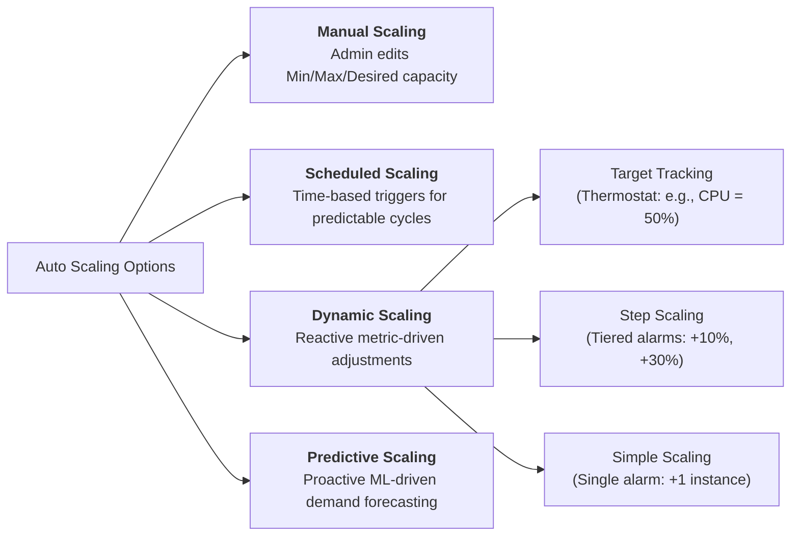

---

### 2.1 Manual Scaling

**Manual Scaling** is the simplest and most direct method of scaling an Auto Scaling group:
- **Operational Mechanism**: An administrator directly updates the `Desired Capacity`, `Min`, or `Max` values of the ASG via the AWS Management Console, AWS CLI (`aws autoscaling set-desired-capacity`), or AWS SDKs.
- **Execution**: The ASG immediately initiates launch or termination activities to match the updated desired capacity.
- **Typical Use Cases**:
  - Emergency capacity overrides during unexpected application incidents.
  - One-time administrative maintenance or testing.
  - Rapid canary rollback (e.g., launching an instance for diagnostic inspection, then terminating it).

---

### 2.2 Scheduled Scaling

**Scheduled Scaling** allows organizations to scale compute capacity in anticipation of predictable, recurring traffic patterns.

- **Operational Mechanism**: Administrators create **Scheduled Actions** that instruct Amazon EC2 Auto Scaling to update the group's `Desired Capacity`, `Min`, and `Max` sizes at a specific calendar date and time or according to a recurring cron schedule.
- **Predictable Workload Case Study**:
  - Many corporate enterprise applications experience heavy utilization during business hours (Monday through Friday, 08:00 to 18:00) and minimal activity during nights and weekends.
  - Retail applications frequently experience surge traffic on payday weekends, Black Friday, or Cyber Monday.
  - By configuring scheduled scaling, compute capacity is pre-warmed *before* users log in, eliminating the latency overhead of reactive scaling.

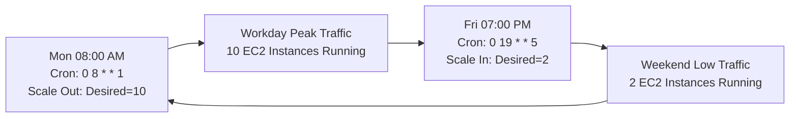

---

### 2.3 Dynamic Scaling

Dynamic scaling automatically adjusts the capacity of the Auto Scaling group in response to real-time CloudWatch metrics and workload demand changes.

#### 1. Target Tracking Scaling (Recommended Default)
- **Concept**: Operates exactly like a **home thermostat**. The administrator selects an target metric value (e.g., "maintain average CPU utilization at 50%"), and Amazon EC2 Auto Scaling continuously calculates and applies capacity adjustments to keep the metric as close to the target as possible.
- **Predefined Metrics**:
  - `ASGAverageCPUUtilization`: Average CPU utilization across all instances in the group.
  - `ASGAverageNetworkIn`: Average inbound network bytes across the group.
  - `ASGAverageNetworkOut`: Average outbound network bytes across the group.
  - `ALBRequestCountPerTarget`: Number of HTTP/HTTPS requests processed per target instance attached to an Application Load Balancer target group.
- **Proportional Scaling**: Because Target Tracking automatically computes the proportional mathematical difference between the current metric and the target, it can add or remove multiple instances simultaneously to rapidly stabilize load.

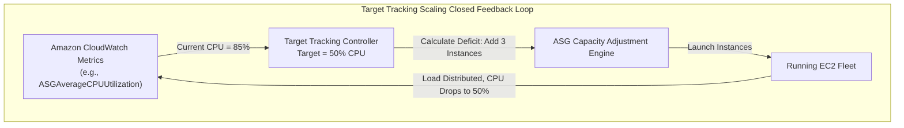

#### 2. Step Scaling
- **Concept**: Adjusts capacity based on a series of tiered adjustments (**step adjustments**) that vary depending on the severity of a CloudWatch alarm breach.
- **No Cooldown Blocking**: Step scaling policies do **not** use the default cooldown period. As soon as an alarm enters a more severe breach band, the next step adjustment is evaluated immediately without waiting.
- **Instance Warmup**: Step scaling utilizes an **Instance Warmup Period**. Newly launched instances are granted warmup time before their metrics are factored into group aggregate metrics.
- **Example Step Scaling Configuration**:
  - CPU Utilization between 60% and 70%: Add 1 instance (+10%).
  - CPU Utilization between 70% and 85%: Add 2 instances (+25%).
  - CPU Utilization greater than 85%: Add 4 instances (+50%).

#### 3. Simple Scaling
- **Concept**: The original dynamic scaling model in AWS. When a single CloudWatch alarm breaches a specified threshold, the policy applies a single fixed adjustment (e.g., "Add 2 instances" or "Remove 1 instance").
- **Strict Cooldown Enforcement**: After a simple scaling policy executes, the group enters a mandatory **cooldown period** (default: 300 seconds). During this cooldown, all further scaling activities initiated by simple scaling policies are suspended.

#### Comprehensive Comparison of Dynamic Scaling Policies

| Characteristic | Target Tracking Scaling | Step Scaling | Simple Scaling |
| :--- | :--- | :--- | :--- |
| **Operational Model** | Desired target value (Thermostat) | Tiered step adjustments by alarm severity | Single threshold breach trigger |
| **Configuration Complexity** | **Lowest** (AWS generates CloudWatch alarms automatically) | Medium (Requires configuring multi-tier CloudWatch alarms) | Low (Single CloudWatch alarm trigger) |
| **Response to Sudden Surges** | Rapid & Proportional | Rapid (Escalates across steps without waiting) | Slow (Stuck waiting for cooldown before next adjustment) |
| **Cooldown Period Used?** | No (Uses internal smoothing algorithms) | **No** (Cooldown disabled) | **Yes** (Strictly obeys default or custom cooldown) |
| **Instance Warmup Used?** | Yes | **Yes** (Configurable in seconds) | No (Relies entirely on cooldown) |
| **AWS Recommendation** | **Primary Choice** for metrics that scale with fleet size | **Recommended Choice** when Target Tracking cannot be used | **Legacy** (Avoid for new workloads) |

---

### 2.4 Predictive Scaling

**Predictive Scaling** utilizes advanced machine learning (ML) models trained on historical cloud telemetry to forecast future application demand and schedule capacity changes in advance.

- **How it Works**:
  - The ML model ingests historical CloudWatch metrics from your Auto Scaling group.
  - A minimum of **24 hours of historical data** is required to begin generating forecasts.
  - Every 24 hours, the algorithm re-evaluates the historical data and produces an updated load and capacity forecast for the upcoming **48 hours**.
- **Proactive vs. Reactive**: Standard dynamic scaling is reactive—it must detect elevated CPU or network traffic before launching instances, leaving a window of high load during instance boot. Predictive scaling is proactive—it initializes instances *before* the anticipated spike occurs.
- **Combining Predictive and Dynamic Scaling**:
  - In enterprise production environments, AWS recommends pairing **Predictive Scaling** with **Target Tracking Dynamic Scaling**.
  - Predictive scaling sets the proactive baseline `Min` capacity ahead of daily traffic waves.
  - Dynamic target tracking handles unexpected, unforecasted micro-bursts of traffic on top of that baseline.

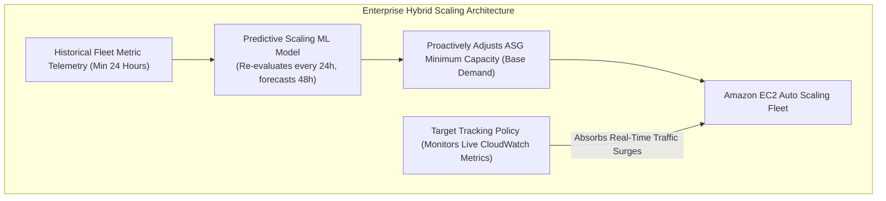

---

## ⏱️ 3. Cooldown Periods, Warmup Periods & Thrashing Prevention

In dynamic scaling systems, failure to account for latency in instance booting and metric aggregation can lead to a pathological state known as **thrashing**.

### 3.1 Understanding Thrashing

> [!CAUTION]
> **What is Thrashing?**  
> In distributed infrastructure, thrashing is a destabilizing condition where compute instances are launched and terminated in rapid, violent succession.  
> 
> *Scenario*: A sudden 3-minute traffic spike pushes CPU to 90%. A scaling rule immediately provisions 4 new instances. Before the new instances finish booting and accepting traffic, the spike subsides and CPU plunges to 10%. A scale-in rule immediately terminates the instances. Seconds later, another micro-burst hits, restarting the cycle.  
> 
> Thrashing results in severe application instability, dropped network sessions, corrupted cache layers, and astronomical cloud billing waste.

### 3.2 Architectural Defenses Against Thrashing

AWS provides three primary mechanisms to neutralize thrashing:

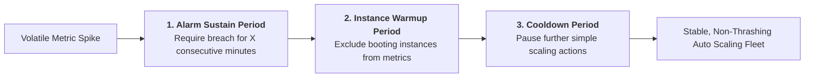

#### 1. Alarm Sustain Period
- Instead of triggering scaling on a single transient 1-minute data point, configure CloudWatch alarms to trigger only when a metric breaches the threshold for a sustained duration (e.g., average CPU > 85% for 3 consecutive evaluation periods of 5 minutes).
- Transient spikes (e.g., a batch cron job running for 90 seconds) do not trigger unnecessary scale-out actions.

#### 2. Default Cooldown Period
- A configurable parameter on the Auto Scaling group (default is **300 seconds / 5 minutes**).
- After a **Simple Scaling** event completes, the ASG enters cooldown and blocks further scaling actions until the timer expires.
- Allows newly provisioned instances sufficient time to load application dependencies, initialize databases, and start handling incoming HTTP requests.
- **Exceptions to Cooldown**:
  - Unhealthy instance replacements: If an instance fails a health check, the ASG **does not wait** for the cooldown period—it replaces the failed instance immediately.
  - Step scaling and Target Tracking policies bypass the simple cooldown period, using warmup periods and mathematical dampening algorithms instead.

#### 3. Instance Warmup Period
- Used with **Step Scaling** and **Target Tracking** policies.
- Specifies the exact number of seconds (e.g., 300 seconds) required for an instance to complete its OS boot and application startup.
- **Metric Exclusion**: While an instance is warming up, its metric data is **not counted** toward the aggregated metrics of the Auto Scaling group.
- **Capacity Factoring**: When evaluating scale-out alarms, AWS treats warming instances as pending capacity, preventing the alarm engine from launching duplicate instances while the first batch is still booting.

---

## 🎣 4. Lifecycle Hooks & State Transitions

By default, when an Auto Scaling group launches an instance, it transitions directly from `Pending` to `InService`. When terminating, it transitions from `Terminating` to `Terminated`. **Lifecycle Hooks** allow system administrators to intercept these lifecycle transitions, pausing the instance in a wait state to execute custom operational workflows.

### 4.1 Supported Lifecycle Hook Types

1. **Scale-Out Lifecycle Hook (`autoscaling:EC2_INSTANCE_LAUNCHING`)**:
   - Pauses the instance in the `Pending:Wait` state before it is registered with the load balancer or placed `InService`.
   - **Use Cases**:
     - Downloading massive configuration files or machine learning weights from Amazon S3.
     - Running security vulnerability scans or CIS compliance hardening scripts.
     - Joining an Active Directory domain or registering with an external configuration management tool (Puppet, Chef, Ansible).
     - Notifying external monitoring systems via Amazon SNS or Amazon EventBridge.

2. **Scale-In Lifecycle Hook (`autoscaling:EC2_INSTANCE_TERMINATING`)**:
   - Pauses the instance in the `Terminating:Wait` state before the operating system is halted and the underlying EBS volumes are deleted.
   - **Use Cases**:
     - Gracefully draining active WebSocket connections or long-running database transactions.
     - Extracting application audit logs, crash dumps, or diagnostic files and uploading them to an Amazon S3 bucket.
     - Deregistering the instance from external service discovery registries or license management servers.

### 4.2 Lifecycle State Transitions Flowchart

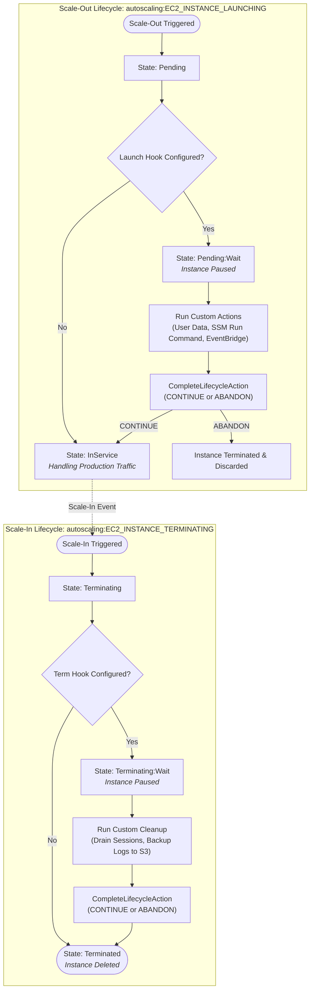

### 4.3 Lifecycle Hook Operational Mechanics

- **Heartbeat Timeout**: The default pause duration is **3,600 seconds (1 hour)**. If no signal is received within this window, the action times out and executes the default result (`ABANDON` or `CONTINUE`).
- **Heartbeat Extension**: Custom automation can extend the pause window by sending a heartbeat signal (`aws autoscaling record-lifecycle-action-heartbeat`), allowing long-running tasks extra time to finish.
- **Completing the Action**: Once the custom script completes, it signals the ASG using `aws autoscaling complete-lifecycle-action --lifecycle-action-result CONTINUE`.

---

## 🛑 5. Termination Policies: Scale-In Decision Logic

When an Auto Scaling group scales in, it must choose which specific EC2 instances to terminate. Amazon EC2 Auto Scaling evaluates termination using structured **Termination Policies**.

### 5.1 Multi-AZ Balancing: The Overriding Priority

Regardless of which specific termination policy is selected, Amazon EC2 Auto Scaling prioritizes maintaining high availability across Availability Zones:

> [!IMPORTANT]
> **The Multi-AZ Balancing Rule**:  
> Before evaluating instance-level attributes, Amazon EC2 Auto Scaling identifies **which Availability Zone has the largest number of instances**. It then confines instance termination exclusively to instances located within that specific Availability Zone.

If an ASG has 3 instances in AZ-A, 2 instances in AZ-B, and 2 instances in AZ-C, any scale-in event **must** terminate an instance from **AZ-A**, ensuring that the remaining fleet remains evenly balanced across all configured zones.

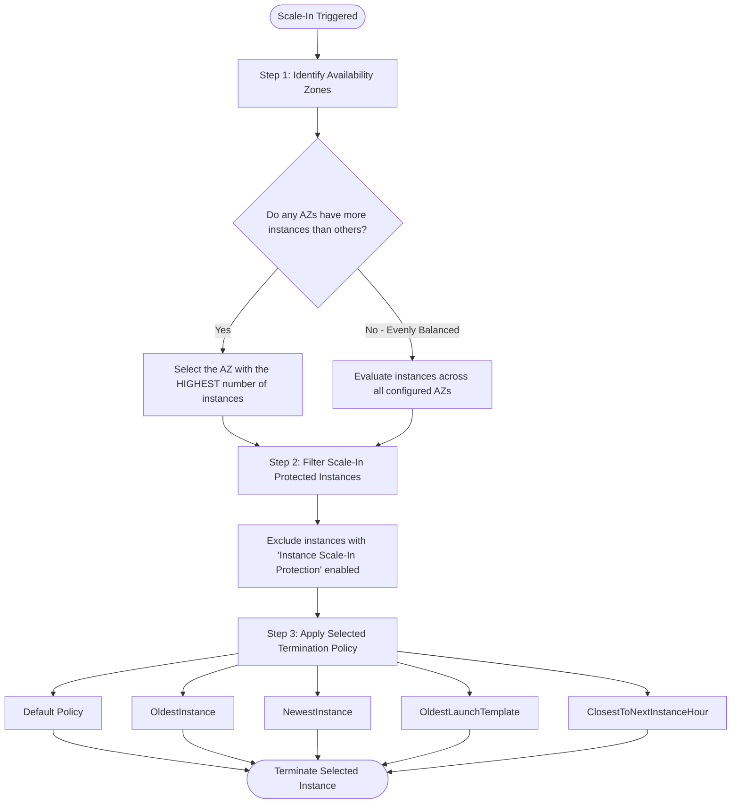

---

### 5.2 Predefined Termination Policies Detailed

| Termination Policy | Selection Logic & Mechanics | Primary Use Case & Operational Scenario |
| :--- | :--- | :--- |
| **`Default`** | 1. Select AZ with most instances.<br/>2. Terminate instance with oldest launch template/configuration.<br/>3. If tied, terminate instance closest to next billing hour. | General-purpose workloads. Balances Multi-AZ redundancy, gradually phases out older template versions, and optimizes billing. |
| **`OldestInstance`** | Terminates the oldest running instance in the selected Availability Zone. | **Rolling hardware/instance refresh**. Ideal when migrating to newer EC2 instance families (e.g., migrating `c5` instances to `c6g` Graviton). |
| **`NewestInstance`** | Terminates the most recently launched instance in the selected Availability Zone. | **Canary testing & rollout validation**. If a newly deployed launch template is suspected of errors, scaling in immediately destroys the new servers. |
| **`OldestLaunchTemplate`** | Terminates instances that were launched using the oldest version of the launch template. | **Configuration phasing**. Useful when rolling out a new software version across an ASG to systematically retire legacy configurations. |
| **`ClosestToNextInstanceHour`** | Terminates instances that are closest to their next billable hour boundary without crossing it. | **Cost minimization**. Maximizes the compute value received per instance before incurring another billing cycle. |

---

### 5.3 Instance Scale-In Protection

An administrator can enable **Instance Scale-In Protection** at the group level or on individual instances:
- When enabled on an instance, Amazon EC2 Auto Scaling will **never terminate** that instance during a scale-in event.
- **Critical Use Cases**:
  - Processing long-running batch jobs, video transcoding queues, or distributed calculations that must not be interrupted mid-flight.
  - Instances hosting sticky sessions or persistent state.
- **Crucial Caveat**: Scale-in protection protects an instance from *scale-in events only*. It does **not** protect an instance from failing health check replacements, Spot instance interruptions, or manual termination via the EC2 console/CLI.

---

## 🩺 6. Auto Scaling Health Checks & Self-Healing Architecture

A primary architectural benefit of Amazon EC2 Auto Scaling is **automated fleet self-healing**. When an instance fails, the ASG terminates it and provisions a replacement without human intervention.

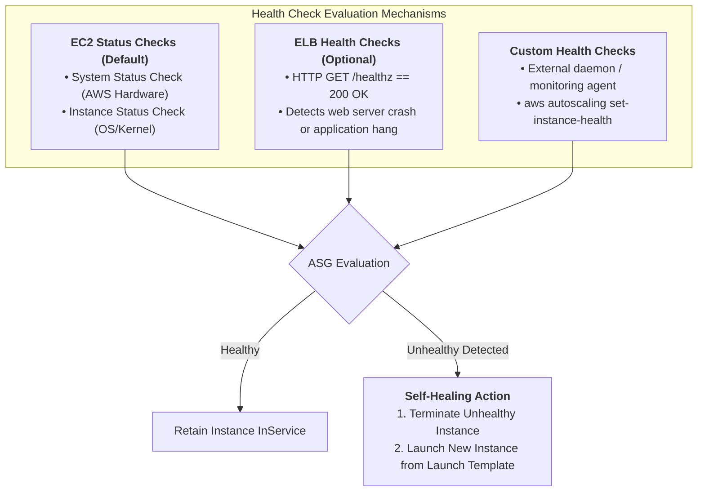

### 6.1 EC2 Status Checks vs. ELB Health Checks

| Dimension | Amazon EC2 Status Checks (Default) | Elastic Load Balancing (ELB) Health Checks |
| :--- | :--- | :--- |
| **Evaluation Scope** | Hypervisor hardware, network reachability, OS kernel, corrupted file systems, exhausted memory. | Application layer responsiveness (e.g., HTTP `200 OK` on `/health` endpoint). |
| **Blind Spot** | **Cannot detect web application failures**. If NGINX or Apache crashes while the Linux OS kernel is running, EC2 marks the instance as "Healthy". | Dependent on load balancer traffic path. Only monitors instances registered with the target group. |
| **Recovery Trigger** | Hypervisor failure, ARP failure, kernel panic. | Web application 5xx errors, application deadlock, connection timeout. |
| **Production Best Practice** | Baseline check; insufficient for web tiers. | **Always enable ELB health checks** for web and API applications behind an Application Load Balancer. |

> [!IMPORTANT]
> If an Auto Scaling group is attached to an Elastic Load Balancer but **ELB health checks are not enabled** on the ASG, the ASG will only monitor EC2 status checks. If the application server crashes and returns HTTP `500 Internal Server Error`, the load balancer stops routing traffic to it, but the ASG **will not replace it**, leaving your fleet with degraded capacity!

### 6.2 The Steady-State Group Pattern (`1:1:1`)

An Auto Scaling group does not have to scale to large numbers of servers. A common cloud architectural pattern is the **Steady-State Group**:
- **Configuration**: Set `Minimum = 1`, `Desired = 1`, and `Maximum = 1`.
- **Architectural Purpose**: Ensures that exactly **one** healthy instance of a critical service is always running. If the underlying hardware fails or the instance crashes, the ASG automatically terminates the failed node and launches a brand new instance from the launch template.
- **Enterprise Use Cases**:
  - Legacy NAT instances in private VPC subnets (where AWS Managed NAT Gateways cannot be used).
  - Bastion hosts (jump boxes) for secure administrative access.
  - Single-node queue processing daemons or batch monitoring agents.

> [!NOTE]
> **Downtime Caveat**: While a steady-state group provides automated recovery, it is **not zero-downtime high availability**. There is a noticeable outage window (typically 2 to 5 minutes) while the unhealthy instance is terminated, the replacement EC2 instance initializes, runs its user data script, and boots into service.

---

## ⚙️ 7. Operational Best Practices & Optimization

Implementing Amazon EC2 Auto Scaling in production environments requires adherence to proven AWS Well-Architected operational guidelines:

### 7.1 Enable Detailed 1-Minute CloudWatch Monitoring
- **Default Monitoring**: Standard EC2 CloudWatch metrics are collected at **5-minute intervals**.
- **The Risk**: In a volatile traffic surge, relying on 5-minute metric updates means your Auto Scaling policies are making decisions based on stale data, delaying scale-out responses by up to 10–15 minutes.
- **Best Practice**: Enable **Detailed Monitoring (1-minute intervals)** in the Launch Template. This incurs a nominal CloudWatch fee but provides immediate responsiveness to traffic spikes.

### 7.2 Turn On Auto Scaling Group Metrics Collection
- Standard EC2 metrics track individual instance telemetry. To visualize and forecast capacity, you must explicitly enable **Group Metrics Collection** on the ASG.
- Group metrics aggregate fleet-wide data: `GroupMinSize`, `GroupMaxSize`, `GroupDesiredCapacity`, `GroupInServiceInstances`, `GroupPendingInstances`, and `GroupTerminatingInstances`.
- **Mandatory for Predictive Scaling**: Predictive scaling capacity forecast graphs require ASG group metrics to function.

### 7.3 Avoid Burstable Performance Instances (T2/T3) Under Sustained Load
- **The Credit Trap**: Burstable instance families (such as `t2.micro` or `t3.medium`) provide a baseline level of CPU performance and accumulate CPU credits when idle. During bursts, they consume credits.
- **The Failure Mode**: Under sustained high traffic, burstable instances exhaust their credit balances. Once depleted, CPU performance is throttled down to the baseline (e.g., 20% CPU). 
- Because CPU utilization may appear pegged at 100% of the throttled baseline, the ASG may attempt to scale out aggressively, launching more burstable instances that also rapidly exhaust credits.
- **Best Practice**: For compute tiers governed by Auto Scaling, use general-purpose or compute-optimized non-burstable instance families (e.g., `m6i`, `m7g`, `c6i`, `c7g`). If using T3, configure **T3 Unlimited mode** with strict CloudWatch billing alarms.

---

## ❓ 8. Checkpoint & Review Questions

Test your mastery of Amazon EC2 Auto Scaling principles with these scenario-based review questions.

---

### Question 1
**Scenario**: Systems engineers have developed an updated application configuration and packaged it into a new AMI. They update their Auto Scaling group's launch template. The team wants to verify the new server configuration in production under light traffic, but wants to guarantee that if the new configuration exhibits bugs or failures, it can be removed immediately from the auto scaling group during a scale-in event.  
**Which termination policy best achieves this objective?**  
- A. `OldestInstance`  
- B. `NewestInstance`  
- C. `OldestLaunchTemplate`  
- D. `ClosestToNextInstanceHour`  

**Correct Answer**: **B. `NewestInstance`**  
**Detailed Explanation**: Newly launched EC2 servers created after the launch template update will have the newest configuration. Because they are the newest instances in the group, selecting the `NewestInstance` termination policy guarantees that they will be the very first servers selected for termination during a scale-in event.

---

### Question 2
**Scenario**: Continuing from Question 1, how can the engineers deliberately force a new server with the updated configuration to be created immediately in the Auto Scaling group? Furthermore, if testing reveals issues, how can they force that updated server to be removed?  
**Operational Steps**:  
1. **To Force Creation**: The engineers can manually increase the `Desired Capacity` or `Minimum Size` of the Auto Scaling group (e.g., increasing `Desired Capacity` from 2 to 3). The ASG will immediately reference the latest launch template version and provision a new instance.
2. **To Force Removal**: The engineers can decrease the `Desired Capacity` or `Minimum Size` back to its original value (e.g., from 3 back to 2). Because the termination policy was set to `NewestInstance`, the ASG will selectively target and terminate the newly launched test instance.

---

### Question 3
**Scenario**: Continuing with the same scenario, the engineers discover that all newly created servers in the Auto Scaling group fail during application initialization due to a corrupt software package in the new AMI.  
**What corrective action should the engineers take immediately?**  
**Corrective Action**:  
The engineers must update the Auto Scaling group's **Launch Template** configuration. Specifically, they must create a new version of the launch template (or change the default version) pointing back to the **previous known-good AMI**. Updating the ASG to reference the restored launch template version ensures that all subsequent instance launches use the stable, functioning image.

---

### Question 4
**Scenario**: An architectural audit reveals that an Auto Scaling group experiences frequent thrashing, rapidly launching and terminating instances during volatile 2-minute metric spikes.  
**What are three architectural methods to prevent thrashing during scale-in and scale-out events?**  
**Three Mitigation Methods**:  
1. **Configure an Alarm Sustain Period**: Require CloudWatch metric alarms to persist for a defined duration (e.g., 3 consecutive evaluation periods of 5 minutes) before triggering a scaling action, filtering out transient spikes.
2. **Configure a Cooldown Period**: Implement a cooldown period (e.g., 300 seconds) for simple scaling policies to suspend further scaling activities until newly launched or terminated instances take full effect.
3. **Configure an Instance Warmup Period**: For step scaling and target tracking policies, define a warmup period so newly launched instances have sufficient time to boot and initialize before their metrics are included in group aggregate metrics.

---

### Question 5
**Scenario**: A web application is deployed across an Auto Scaling group behind an Application Load Balancer. The Apache web server process crashes on two EC2 instances, returning HTTP `502 Bad Gateway` to users. However, the Linux OS kernel remains operational, and ping requests succeed. The Auto Scaling group does not terminate or replace the instances.  
**What is the root cause of this failure, and how should it be resolved?**  
**Root Cause & Resolution**:  
- **Root Cause**: The Auto Scaling group is configured to use only default **Amazon EC2 status checks**. Because the hypervisor and OS kernel are running, EC2 marks the instances as healthy, unaware that the web service has crashed.
- **Resolution**: Configure the Auto Scaling group to use **ELB Health Checks**. When the Application Load Balancer detects failing HTTP health checks, it reports the target as unhealthy, prompting the ASG to automatically terminate and replace the failed instances.

---

## 📋 9. Summary & Quick-Reference Sheet

```
+---------------------------------------------------------------------------------------------------+
|                                 AMAZON EC2 AUTO SCALING CHEAT SHEET                               |
+---------------------------------------------------------------------------------------------------+
| THREE CORE COMPONENTS:                                                                            |
|   1. WHERE -> Auto Scaling Group (VPC, Multi-AZ Subnets, Min/Desired/Max capacity, Target Groups) |
|   2. WHAT  -> Launch Template (AMI, Instance Type, Key Pair, Security Groups, IAM Role, User Data) |
|   3. WHEN  -> Scaling Policies (Target Tracking, Step Scaling, Simple Scaling, Scheduled, ML)     |
+---------------------------------------------------------------------------------------------------+
| SCALING POLICY COMPARISON:                                                                        |
|   * Target Tracking : Recommended default. Acts like thermostat (e.g., maintain CPU at 50%).      |
|   * Step Scaling    : Proportional adjustments based on alarm breach magnitude. No cooldown wait. |
|   * Simple Scaling  : Legacy. Single alarm adjustment. Enforces strict cooldown period.           |
|   * Scheduled       : Time-based cron triggers. Prewarms capacity for known recurring cycles.     |
|   * Predictive      : Machine learning forecast (24h data -> 48h forecast). Pairs with dynamic.   |
+---------------------------------------------------------------------------------------------------+
| PREVENTING THRASHING:                                                                             |
|   * Alarm Sustain Period : Filter transient spikes by requiring sustained metric breaches.        |
|   * Cooldown Period      : Default 300s window pausing simple scaling after capacity adjustments. |
|   * Warmup Period        : Time for new instances to boot before counting in aggregate metrics.   |
+---------------------------------------------------------------------------------------------------+
| LIFECYCLE HOOKS:                                                                                  |
|   * autoscaling:EC2_INSTANCE_LAUNCHING   -> Pauses in Pending:Wait (run scripts/scans)            |
|   * autoscaling:EC2_INSTANCE_TERMINATING -> Pauses in Terminating:Wait (drain sessions/save logs) |
+---------------------------------------------------------------------------------------------------+
| TERMINATION POLICIES (SCALE-IN):                                                                  |
|   * Priority Rule        -> Always balances instances across Availability Zones first!            |
|   * Default              -> AZ with most instances -> Oldest Launch Template -> Next Bill Hour.   |
|   * OldestInstance       -> Gradual fleet migration to new instance families.                     |
|   * NewestInstance       -> Canary testing / rapid removal of experimental deployments.           |
|   * OldestLaunchTemplate -> Retires instances running deprecated configuration versions.          |
+---------------------------------------------------------------------------------------------------+
| PRODUCTION BEST PRACTICES:                                                                        |
|   [✓] Always prefer Launch Templates over deprecated Launch Configurations.                       |
|   [✓] Distribute ASG across at least 2-3 Availability Zones for Multi-AZ fault tolerance.         |
|   [✓] Enable ELB Health Checks for applications fronted by load balancers.                        |
|   [✓] Enable 1-minute detailed CloudWatch monitoring for rapid scaling responsiveness.            |
|   [✓] Avoid burstable instances (T2/T3) under sustained load to prevent CPU credit starvation.    |
+---------------------------------------------------------------------------------------------------+
```
