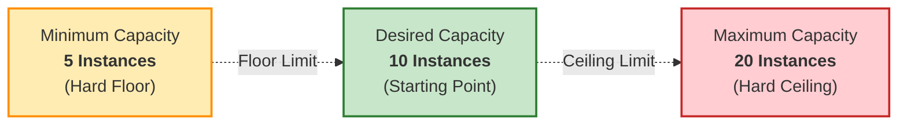
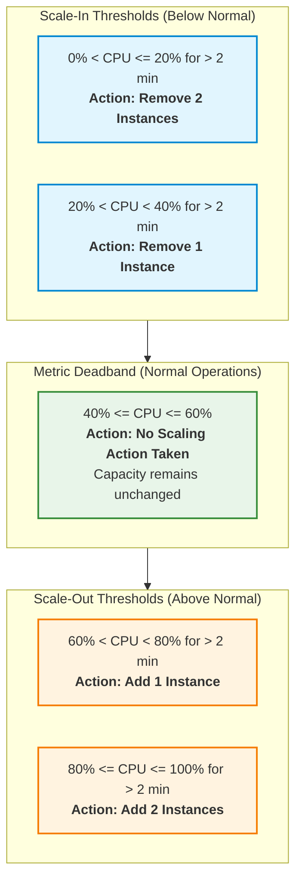
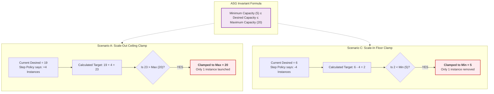
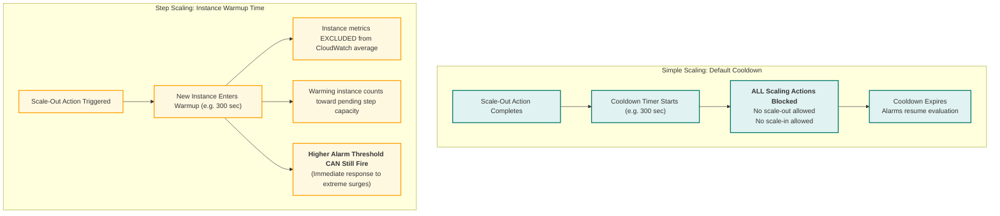
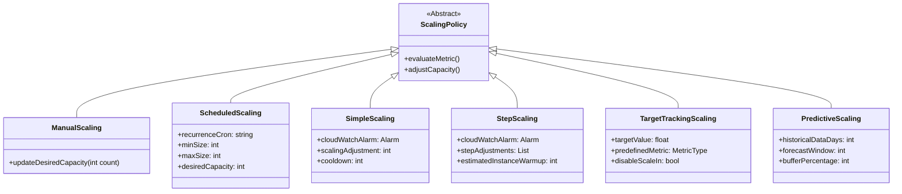

# 📈 Module 11: Amazon EC2 Auto Scaling Prediction Challenge – Study Guide

> **Course**: AWS re/Start  
> **Module**: Scaling and Name Resolution (M11)  
> **Source Document**: `T15-0005-RSSCAL_EN-US_SG_M11_AUTOSCALINGPREDICTION.pdf`  
> **Target Audience**: AWS re/Start Learners, Cloud Practitioners, Solutions Architects, and Systems Operations Administrators  

---

## 🎯 Module Overview

In elastic cloud architectures, provisioning virtual compute capacity must dynamically align with unpredictable application traffic. **Amazon EC2 Auto Scaling** monitors workloads and adjusts compute capacity automatically to maintain steady, predictable performance at the lowest possible operational cost.

However, configuring automatic scaling policies requires deep comprehension of how scaling algorithms, CloudWatch metric alarms, cooldown periods, and instance warm-up timers interact in real time. Misconfigured scaling policies can cause **thrashing** (rapid, uncontrolled alternating scaling out and scaling in), excessive compute expenses, or critical application throttling during demand surges.

This study guide explores the **Auto Scaling Prediction Challenge**, evaluating step scaling behavior across changing CPU utilization conditions. We analyze the mathematical and operational mechanics governing group size adjustments, examine instance warm-up delays, demonstrate boundary condition enforcement (`Min <= Desired <= Max`), contrast modern scaling algorithms, and walk through full scenario predictions.

---

### 📌 Learning Objectives

- [ ] **Analyze Auto Scaling Group Core Parameters**: Understand the functional roles and constraints of Minimum Capacity, Desired Capacity, and Maximum Capacity.
- [ ] **Deconstruct Step Scaling Policies**: Map CloudWatch metric thresholds and step adjustment ranges to deterministic capacity changes.
- [ ] **Trace Instance Warmup Mechanics**: Understand why newly launched instances require warm-up periods and how warm-up states prevent false metric aggregation and duplicate scale-out events.
- [ ] **Evaluate Multi-Condition Traffic Scenarios**: Deterministically predict group size changes across escalating traffic surges, deadband stabilization, and demand drops.
- [ ] **Enforce Boundary Conditions**: Prove how Auto Scaling Groups strictly clamp desired capacity between minimum and maximum boundaries regardless of step adjustment magnitudes.
- [ ] **Contrast Cooldowns vs. Warm-Up Times**: Differentiate legacy simple scaling cooldown timers from modern step scaling instance warm-up periods.
- [ ] **Compare Auto Scaling Algorithms**: Evaluate the strengths, limitations, and architectural use cases for Target Tracking, Step Scaling, Simple Scaling, and Predictive Scaling.

---

## 📚 Key Terminology

| Term | Definition |
| :--- | :--- |
| **Auto Scaling Group (ASG)** | A logical collection of Amazon EC2 instances managed as a single unit with shared configuration, scaling policies, and health check monitoring. |
| **Minimum Capacity (`Min`)** | The lower boundary limit of instances that an ASG will never scale below, ensuring a baseline availability floor even under zero load. |
| **Desired Capacity (`Desired`)** | The exact number of running EC2 instances the ASG actively maintains at any given moment; dynamically adjusted by scaling policies. |
| **Maximum Capacity (`Max`)** | The upper ceiling limit of instances that an ASG will never exceed under any circumstances, providing a hard safeguard against runaway cloud costs. |
| **Step Scaling Policy** | A dynamic scaling policy that adjusts capacity based on predefined step adjustment intervals corresponding to the magnitude of a CloudWatch metric alarm breach. |
| **Metric Deadband** | The comfortable operational zone between the scale-in threshold and scale-out threshold where no scaling alarms fire and capacity remains unchanged. |
| **Instance Warmup Period** | The designated duration (in seconds) after a new instance enters the `InService` state during which its metrics are excluded from aggregate CloudWatch statistics, and it is counted toward pending scaling adjustments. |
| **Default Cooldown** | A configurable delay (in seconds) used primarily in Simple Scaling that blocks all subsequent scaling activities until previous scaling actions complete and stabilize. |
| **Target Tracking Policy** | A dynamic policy where you specify a target metric value (e.g., 50% CPU), and ASG automatically calculates the required capacity and creates backing CloudWatch alarms. |
| **Predictive Scaling** | A machine-learning-driven scaling mechanism that analyzes historical metric patterns to forecast demand and schedule capacity increases prior to traffic spikes. |
| **Instance Thrashing** | An unstable system condition where rapid, alternating scale-out and scale-in events occur in close succession due to overly aggressive policies or inadequate cooldown periods. |

---

## 🏗️ 1. The Auto Scaling Prediction Challenge Scenario

### Baseline Auto Scaling Group Configuration

In this challenge scenario, an application tier is deployed inside an Auto Scaling Group across multiple Availability Zones with the following parameters:

```
┌────────────────────────────────────────────────────────┐
│         Auto Scaling Group Baseline Parameters         │
├────────────────────────────────────────────────────────┤
│  • Maximum Capacity: 20 instances  (Hard Ceiling)      │
│  • Desired Capacity: 10 instances  (Initial Baseline)  │
│  • Minimum Capacity:  5 instances  (Availability Floor)│
│  • Instance Warmup:  5 minutes     (300 seconds)       │
│  • Alarm Evaluation: > 2 minutes   (Evaluation Period) │
│  • Metric: Average CPU Utilization Across All Instances│
└────────────────────────────────────────────────────────┘
```



### The Metric: Average CPU Utilization
The metric evaluated is the **Average CPU Utilization** across all instances currently counted by the Auto Scaling Group:
$$\text{Average CPU} = \frac{\sum_{i=1}^{N} \text{CPU}_i}{N}$$
Where $N$ is the number of active, fully warmed-up instances contributing to CloudWatch metrics.

> [!IMPORTANT]
> Instances that are currently in the **Instance Warmup Period** (5 minutes in this scenario) are **excluded** from the aggregate CloudWatch metric calculations. This prevents newly booted instances (which frequently experience temporary CPU spikes during OS startup, package initialization, and application cache warm-up) from distorting the group's true metric average.

---

## ⚖️ 2. Step Scaling Policy & Alarm Definitions

Step scaling allows cloud architects to define proportional scaling actions: mild metric breaches cause minor capacity adjustments, whereas severe spikes trigger aggressive scaling.

### Step Scaling Policy Matrix

```
Scale-In Steps               Deadband                  Scale-Out Steps
0% ──────── 20% ──────── 40% ════════════ 60% ──────── 80% ──────── 100%
  [Remove 2]   [Remove 1]     (Stable)      [Add 1]     [Add 2]
```



### Detailed Alarm Rules

| Direction | CPU Range | Evaluation Period | Action | Operational Rationale |
| :--- | :--- | :--- | :--- | :--- |
| **Scale-In Step 2** | `0% - 20%` | $> 2\text{ minutes}$ | **Remove 2 instances** | Severe underutilization; aggressive cost reduction. |
| **Scale-In Step 1** | `20% - 40%` | $> 2\text{ minutes}$ | **Remove 1 instance** | Moderate underutilization; gradual reduction. |
| **Deadband** | `40% - 60%` | Continuous | **No Action (0)** | Optimal utilization zone; stability maintained. |
| **Scale-Out Step 1** | `60% - 80%` | $> 2\text{ minutes}$ | **Add 1 instance** | Moderate load surge; incremental scale-out. |
| **Scale-Out Step 2** | `80% - 100%` | $> 2\text{ minutes}$ | **Add 2 instances** | High load surge; aggressive capacity expansion. |

---

## 🔍 3. Step-by-Step Condition Analysis (Slide Deck Scenarios)

Let us examine the exact sequence of events presented in the curriculum scenario, tracing instance state transitions, warmup timer mechanics, and group size updates at each phase.

```mermaid
flowchart TD
    Start(["Initial Baseline: 10 Instances<br/>(Avg CPU: 50%)"]) --> C1

    subgraph Phase1["Condition #1 (T = 0 to 2 min)"]
        C1["CPU at 63-70% for > 2 min<br/>Scale-Out Step 1 fires"]
        C1_act["Action: Add 1 instance<br/>New Desired = 11<br/>Instance #11 begins 5-min warmup"]
        C1 --> C1_act
    end

    subgraph Phase2["Condition #2 (T = 4 min)"]
        C2["CPU remains at 60-80%<br/>2 min since Condition #1"]
        C2_eval{"Is Instance #11 still warming up?<br/>(Elapsed: 2 min < 5 min)"}
        C2_act["Action: No instances added<br/>Desired remains 11<br/>Warmup prevents duplicate addition"]
        C1_act --> C2 --> C2_eval -->|"YES"| C2_act
    end

    subgraph Phase3["Condition #3 (T = 5 min)"]
        C3["CPU spikes to 85% (>80%)<br/>Scale-Out Step 2 fires (+2 needed)"]
        C3_eval{"Instance #11 already warming up.<br/>Additional needed: 2 - 1 = 1"}
        C3_act["Action: Add 1 instance<br/>New Desired = 12<br/>Instance #12 begins 5-min warmup"]
        C2_act --> C3 --> C3_eval --> C3_act
    end

    subgraph Phase4["Condition #4 (T = 10 min)"]
        C4["Instance #11 fully warmed up<br/>Instance #12 still warming up<br/>CPU drops to ~53% for 3 min"]
        C4_eval{"53% is inside Deadband (40-60%)"}
        C4_act["Action: No alarms triggered<br/>Desired remains 12"]
        C3_act --> C4 --> C4_eval --> C4_act
    end

    subgraph Phase5["Condition #5 (T = 15 min)"]
        C5["All 12 instances active<br/>CPU drops to steady 32% for > 2 min"]
        C5_eval{"32% triggers Scale-In Step 1 (20-40%)"}
        C5_act["Action: Remove 1 instance<br/>New Desired = 11"]
        C4_act --> C5 --> C5_eval --> C5_act
    end

    subgraph Phase6["Condition #6 (T = 18 min)"]
        C6["CPU drops further to ~17% for > 2 min"]
        C6_eval{"17% triggers Scale-In Step 2 (0-20%)"}
        C6_act["Action: Remove 2 instances<br/>New Desired = 9"]
        C5_act --> C6 --> C6_eval --> C6_act
    end

    classDef normal fill:#f5f5f5,stroke:#616161,stroke-width:1px;
    classDef action fill:#e3f2fd,stroke:#1565c0,stroke-width:2px;
    classDef decision fill:#fff9c4,stroke:#fbc02d,stroke-width:2px;

    class C1,C2,C3,C4,C5,C6 normal;
    class C1_act,C2_act,C3_act,C4_act,C5_act,C6_act action;
    class C2_eval,C3_eval,C4_eval,C5_eval,C6_eval decision;
```



---

### Condition #1: Initial Traffic Influx (63% – 70% CPU)

* **Condition Description**: Average CPU utilization has been between 63% and 70% for more than 2 minutes. The instance warmup period is set to 5 minutes (300 seconds).
* **Alarm Triggered**: Scale-Out Step 1 (`60% < CPU < 80%` for $> 2\text{ minutes}$).
* **Policy Instruction**: Add 1 instance.
* **Auto Scaling Calculation**:
  $$\text{New Desired Capacity} = \text{Current Desired} + 1 = 10 + 1 = 11$$
* **Warmup Impact**:
  - Auto Scaling launches 1 new EC2 instance (Instance #11).
  - Instance #11 enters the **warmup state** (5 minutes).
  - During this 5-minute period, Instance #11's CPU metrics are **not** aggregated into the group's CloudWatch CPU metric.
* **Prediction Result**: **Add 1 instance** (Group size: **11**).

---

### Condition #2: Sustained Load During Warmup (60% – 80% CPU)

* **Condition Description**: The CPU pressure continues holding at 60%–80%. Exactly 2 minutes have elapsed since Condition #1 occurred.
* **Alarm Triggered**: Scale-Out Step 1 alarm breaches again (`60% < CPU < 80%` for $> 2\text{ minutes}$).
* **Evaluation by Auto Scaling**:
  - The step scaling policy calls for $+1$ instance relative to the pre-scale baseline for this tier.
  - However, Instance #11 was launched only 2 minutes ago and has $5 - 2 = 3\text{ minutes}$ remaining in its warmup period.
  - In Amazon EC2 Step Scaling, **instances that are currently warming up are counted toward the pending capacity** for that step adjustment.
  - Because 1 instance is already in progress to satisfy the $+1$ requirement for the 60%–80% range, the policy determines that no additional capacity is needed.
* **Prediction Result**: **No instances added or removed** (Group size remains **11**).

> [!NOTE]
> This behavior prevents **over-provisioning**. If ASG added an instance every 2 minutes while instances take 5 minutes to boot, the system would launch multiple redundant instances before the first instance even had an opportunity to take traffic and alleviate the load.

---

### Condition #3: Traffic Spike Across Higher Threshold (85% CPU)

* **Condition Description**: It is still less than 5 minutes since Condition #1 occurred (e.g., 3.5 minutes elapsed). However, sudden traffic surges cause average CPU utilization to spike to **85%**.
* **Alarm Triggered**: Scale-Out Step 2 (`80% < CPU < 100%` for $> 2\text{ minutes}$).
* **Policy Instruction**: Add 2 instances relative to baseline.
* **Evaluation by Auto Scaling**:
  - The higher threshold requires an overall addition of $+2$ instances from baseline ($10 \rightarrow 12$).
  - Auto Scaling inspects the group and observes that **1 instance (Instance #11) is already warming up**.
  - To reach the $+2$ target dictated by the 85% tier, Auto Scaling calculates:
    $$\text{Additional Instances to Launch} = (\text{Step Adjustment Required}) - (\text{Instances Warming Up}) = 2 - 1 = 1$$
  - Exactly **1 additional instance** (Instance #12) is launched.
* **Prediction Result**: **Add 1 instance** (Group size: **12**).

---

### Condition #4: Traffic Subsiding into the Deadband (~53% CPU)

* **Condition Description**: More time passes. Instance #11 has fully warmed up ($> 5\text{ minutes}$) and is handling active HTTP/app traffic. Instance #12 is still in its warm-up phase. Average CPU utilization drops to approximately **53%** for the last 3 minutes.
* **Alarm Status**:
  - Is CPU $> 60\%$? **No** (Scale-out alarms are `OK`).
  - Is CPU $< 40\%$? **No** (Scale-in alarms are `OK`).
  - Utilization resides comfortably within the **40% – 60% deadband**.
* **Auto Scaling Result**:
  - No alarms are in the `ALARM` state.
  - No scaling policies are invoked.
* **Prediction Result**: **No change** (Group size remains **12**).

---

### Condition #5: Moderate Drop in Traffic (Steady 32% CPU)

* **Condition Description**: Application demand declines. All 12 instances are now fully warmed up. Average CPU utilization drops below the 40% threshold to a steady **32%** for more than 2 minutes.
* **Alarm Triggered**: Scale-In Step 1 (`20% < CPU < 40%` for $> 2\text{ minutes}$).
* **Policy Instruction**: Remove 1 instance.
* **Auto Scaling Calculation**:
  $$\text{New Desired Capacity} = \text{Current Desired} - 1 = 12 - 1 = 11$$
* **Termination Selection**:
  - ASG evaluates its configured **Termination Policy** (e.g., balance across AZs first, then select instance closest to next billing hour or using oldest launch template).
  - 1 instance is transitioned to `Terminating` and shut down.
* **Prediction Result**: **Remove 1 instance** (Group size: **11**).

---

### Condition #6: Further Traffic Drop into Lowest Tier (~17% CPU)

* **Condition Description**: Traffic drops dramatically late at night. CPU utilization drops to approximately **17%** for more than 2 minutes.
* **Alarm Triggered**: Scale-In Step 2 (`0% < CPU < 20%` for $> 2\text{ minutes}$).
* **Policy Instruction**: Remove 2 instances.
* **Auto Scaling Calculation**:
  $$\text{New Desired Capacity} = \text{Current Desired} - 2 = 11 - 2 = 9$$
* **Boundary Check**:
  - Does $9 \ge \text{Minimum Capacity (5)}$? **Yes**.
  - ASG safely terminates 2 instances.
* **Prediction Result**: **Remove 2 instances** (Group size: **9**).

---

## 📊 Summary of Challenge Conditions 1–6

| Step | CPU Range | Elapsed Time Context | Active Alarm | Warming Up | Scaling Action | New Desired | Running State |
| :---: | :---: | :---: | :---: | :---: | :---: | :---: | :---: |
| **Start** | 50% | Initial state | None | 0 | Baseline | **10** | 10 active |
| **#1** | 63%–70% | $> 2\text{ min}$ sustained | Scale-Out Step 1 (+1) | 0 | **+1** instance | **11** | 10 active, 1 warming up |
| **#2** | 60%–80% | $2\text{ min}$ after #1 | Scale-Out Step 1 (+1) | 1 (Inst #11) | **0** (blocked by warmup) | **11** | 10 active, 1 warming up |
| **#3** | 85% | $< 5\text{ min}$ after #1 | Scale-Out Step 2 (+2) | 1 (Inst #11) | **+1** instance ($2 - 1$) | **12** | 10 active, 2 warming up |
| **#4** | 53% | $> 5\text{ min}$ after #1 | Deadband (None) | 1 (Inst #12) | **0** (no breach) | **12** | 11 active, 1 warming up |
| **#5** | 32% | $> 2\text{ min}$ sustained | Scale-In Step 1 (-1) | 0 | **-1** instance | **11** | 11 active |
| **#6** | 17% | $> 2\text{ min}$ sustained | Scale-In Step 2 (-2) | 0 | **-2** instances | **9** | 9 active |

---

## 🛑 4. Boundary Condition Enforcement (`Min <= Desired <= Max`)

A primary duty of Amazon EC2 Auto Scaling is guaranteeing that the group size **never breaches architectural boundaries**, regardless of the magnitude of any scale-out or scale-in step calculation.



### Scenario A: Massive Traffic Spike Near Maximum Capacity
* **Initial State**: Desired = 18, Min = 5, Max = 20.
* **Trigger Event**: Flash-sale traffic surge causes average CPU to hit 92% (> 80%).
* **Scale-Out Policy**: Step adjustment requires adding $+4$ instances.
* **Raw Calculation**: $18 + 4 = 22$ instances.
* **Boundary Enforcement**:
  $$\text{Target Desired} = \min(\text{Calculated Desired}, \text{Maximum Capacity}) = \min(22, 20) = 20$$
* **Operational Result**: ASG launches only **2 instances**, reaching the maximum ceiling of **20**. An alert event is generated in CloudWatch / EventBridge noting that capacity was capped at maximum.

### Scenario B: Traffic Normalizes in the Deadband (55% CPU)
* **Initial State**: Desired = 20, Min = 5, Max = 20.
* **Trigger Event**: With 20 instances handling the workload, CPU utilization normalizes to 55%.
* **Deadband Rule**: 55% is within the $[40\%, 60\%]$ range.
* **Operational Result**: No scaling alarms fire. The group remains stable at 20 instances until traffic drops below 40%.

### Scenario C: Massive Demand Drop Near Minimum Floor
* **Initial State**: Desired = 6, Min = 5, Max = 20.
* **Trigger Event**: Middle-of-the-night traffic slump causes CPU utilization to crash to 8% ($< 20\%$).
* **Scale-In Policy**: Step adjustment requires removing $-4$ instances.
* **Raw Calculation**: $6 - 4 = 2$ instances.
* **Boundary Enforcement**:
  $$\text{Target Desired} = \max(\text{Calculated Desired}, \text{Minimum Capacity}) = \max(2, 5) = 5$$
* **Operational Result**: ASG terminates only **1 instance**, preserving the minimum availability floor of **5 instances**. Even if an alarm requests removing 100 instances, the group will never drop below 5.

---

## ⏱️ 5. Cooldown Periods vs. Instance Warmup Times

Understanding the operational differences between **Cooldowns** and **Warm-Up Times** is critical for AWS certification and production reliability.



### Architectural Comparison

| Feature | Default Cooldown (`DefaultCooldown`) | Instance Warmup (`EstimatedInstanceWarmup`) |
| :--- | :--- | :--- |
| **Primary Policy Type** | **Simple Scaling** policies | **Step Scaling** and **Target Tracking** policies |
| **Lockout Scope** | **Global pause**: Blocks all scaling actions (both in and out) for the group. | **Targeted scope**: Does not block higher alarm steps if load increases. |
| **Metric Filtering** | Does not alter metric aggregation during cooldown. | **Excludes** warming instances from aggregate CloudWatch metric calculations. |
| **Response to Extreme Spikes** | **Blind**: Cannot react to sudden 95% CPU spikes while cooldown timer is running. | **Responsive**: Immediately adds more capacity if a higher step alarm fires. |
| **Scale-In Behavior** | Scales in, then enforces cooldown before any other action can occur. | Step scaling uses a scale-in cooldown to prevent premature termination. |

> [!TIP]
> **Best Practice Recommendation**: AWS strongly recommends using **Target Tracking** and **Step Scaling** over Simple Scaling for dynamic workloads. Simple scaling often leads to slower response times during severe traffic spikes due to rigid cooldown lockouts.

---

## 🔄 6. Comparison of Scaling Algorithms

Amazon EC2 Auto Scaling provides multiple scaling algorithms to balance application responsiveness, complexity, and operational cost.



### Comprehensive Comparison Matrix

| Scaling Type | How It Works | Key Parameters | Best Used For | Drawbacks |
| :--- | :--- | :--- | :--- | :--- |
| **Target Tracking** | Functions like a home thermostat. You define a metric target (e.g., 50% CPU), and ASG automatically scales up or down to keep the metric near that value. | Metric type (CPU, ALB Request Count, Network In/Out), Target Value. | Most dynamic workloads; standard web applications and APIs. | Requires metrics that vary linearly with instance count; cannot customize multi-tier steps. |
| **Step Scaling** | Adjusts capacity based on step bands depending on the severity of alarm breaches. Includes instance warmup. | Lower/Upper step bounds, Step adjustments (+/- instances or %), Warmup time. | Workloads with variable, spike-prone traffic or non-linear scaling needs. | Requires authoring and managing multiple CloudWatch alarms manually. |
| **Simple Scaling** | Single adjustment based on a single alarm threshold. Uses a rigid cooldown period. | CloudWatch Alarm, Adjustment value, Cooldown period (seconds). | Legacy architectures or simple single-threshold scaling. | Inflexible during sudden surges; cooldown blocks all scaling actions. |
| **Predictive Scaling** | Analyzes historical CloudWatch metric patterns using machine learning to forecast future demand and schedule capacity ahead of time. | Metric specification, Forecast horizon, Scheduling buffer. | Predictable cyclical workloads (e.g., daily business hour spikes, weekly processing). | Ineffective for unpredictable or sporadic traffic spikes (must be paired with dynamic scaling). |
| **Scheduled Scaling** | Adjusts minimum, maximum, and desired capacity at specific dates/times using cron expressions. | Recurrence (Cron), Timezone, Min, Desired, Max. | Anticipated regular events (e.g., opening of registration at 9:00 AM on Monday). | Static; cannot adapt if traffic occurs outside the scheduled window. |

---

## 🧮 7. Scenario Prediction Calculation Reference

Use this reference table to compute exact capacity adjustments for step scaling policies.

### Scenario Prediction Matrix Table

| Initial Desired | Metric Breach | Active Policy Tier | Raw Adjustment | Warmup Deductions | Enforced Desired | Capacity Bounds (`Min=5`, `Max=20`) |
| :---: | :---: | :---: | :---: | :---: | :---: | :---: |
| **10** | CPU = 68% | Scale-Out Step 1 | $+1$ | 0 in warmup | **11** | $5 \le 11 \le 20$ (Valid) |
| **11** | CPU = 72% (after 2 min) | Scale-Out Step 1 | $+1$ | 1 in warmup | **11** | $5 \le 11 \le 20$ (No action) |
| **11** | CPU = 88% | Scale-Out Step 2 | $+2$ | 1 in warmup | **12** | $5 \le 12 \le 20$ (Valid) |
| **12** | CPU = 52% | Deadband | $0$ | None | **12** | $5 \le 12 \le 20$ (Deadband) |
| **12** | CPU = 34% | Scale-In Step 1 | $-1$ | None | **11** | $5 \le 11 \le 20$ (Valid) |
| **11** | CPU = 16% | Scale-In Step 2 | $-2$ | None | **9** | $5 \le 9 \le 20$ (Valid) |
| **19** | CPU = 85% | Scale-Out Step 2 | $+2$ | None | **20** | Capped at **Max (20)** |
| **6** | CPU = 12% | Scale-In Step 2 | $-2$ | None | **5** | Clamped at **Min (5)** |

---

## 📝 8. Challenge Questions with Full Worked Solutions

Test your comprehension of Auto Scaling mechanics with these scenario-based challenge questions.

### Challenge 1: The Multiple Alarm Overlap
> **Question**:  
> An Auto Scaling Group has a Desired Capacity of 10. A Step Scaling policy defines:
> - Tier 1: Add 2 instances when CPU $> 70\%$
> - Tier 2: Add 5 instances when CPU $> 85\%$  
> 
> At $T=0$, CPU hits 75%, launching 2 instances (Warmup = 300s).  
> At $T=120\text{s}$, CPU jumps to 90%.  
> **How many additional instances are launched at $T=120\text{s}$, and what is the new Desired Capacity?**

<details>
<summary>👉 View Worked Solution</summary>

1. **At $T=0$**: Tier 1 alarm triggers.
   - Required adjustment: $+2$ instances.
   - New Desired = $10 + 2 = 12$.
   - 2 instances begin 300-second warmup.
2. **At $T=120\text{s}$**: Tier 2 alarm triggers ($90\% > 85\%$).
   - Tier 2 requires a total addition of $+5$ instances relative to the initial baseline ($10 \rightarrow 15$).
   - Auto Scaling checks how many instances are currently warming up: 2 instances are warming up.
   - Formula:
     $$\text{Additional Instances} = \text{Tier 2 Target} - \text{Warming Instances} = 5 - 2 = 3$$
3. **Outcome**:
   - ASG launches **3 additional instances**.
   - **New Desired Capacity = 15 instances** (10 running baseline + 2 warming from Tier 1 + 3 new warming from Tier 2).
</details>

---

### Challenge 2: The Scale-In Boundary Floor
> **Question**:  
> An ASG has `Min = 4`, `Desired = 6`, `Max = 15`.  
> A sudden drop in users causes CPU utilization to drop to 10%, triggering a Step Scale-In rule that specifies **"Remove 4 instances when CPU < 20%"**.  
> **What is the final Desired Capacity, and how many instances are actually terminated?**

<details>
<summary>👉 View Worked Solution</summary>

1. **Raw Step Calculation**:
   $$\text{Target} = \text{Current Desired} - 4 = 6 - 4 = 2$$
2. **Boundary Enforcement Evaluation**:
   - Minimum capacity is configured to **4**.
   - The ASG invariant rule states: $\text{Desired} \ge \text{Min}$.
   - Since $2 < 4$, the ASG clamps the desired capacity to the minimum floor:
     $$\text{Enforced Desired} = \max(2, 4) = 4$$
3. **Outcome**:
   - Exactly **2 instances are terminated** (not 4).
   - **Final Desired Capacity = 4 instances**.
</details>

---

### Challenge 3: Cooldown Deadlock vs. Step Responsiveness
> **Question**:  
> Compare how a **Simple Scaling** policy and a **Step Scaling** policy would behave in the following scenario:  
> - At $T=0$, CPU breaches 70% threshold. Both policies trigger an initial scale-out of $+1$ instance.  
> - At $T=60\text{s}$, unexpected load causes CPU to surge to 98%.  
> - Cooldown / Warmup is set to 300 seconds.

<details>
<summary>👉 View Worked Solution</summary>

* **Simple Scaling Behavior**:
  - At $T=0$, scale-out of $+1$ is executed. The 300-second **Default Cooldown timer starts**.
  - At $T=60\text{s}$ (CPU at 98%), the CloudWatch alarm fires, but **Simple Scaling ignores the alarm entirely** because the group is in cooldown.
  - The application may suffer severe latency, throttling, or downtime until the full 300-second cooldown expires.
* **Step Scaling Behavior**:
  - At $T=0$, Step 1 scale-out of $+1$ is executed. Instance enters warmup.
  - At $T=60\text{s}$ (CPU at 98%), the higher Step 2 alarm fires. Step scaling **is NOT blocked by cooldown** for higher tiers.
  - It immediately calculates the additional capacity required for the 98% tier and launches additional instances immediately, protecting application uptime.
</details>

---

## 💡 9. Exam Preparation & Key Takeaways

> [!IMPORTANT]
> ### Crucial Takeaways for AWS Certification & Production
> 1. **Default Invariant**: In an Auto Scaling Group, the relationship $\text{Min} \le \text{Desired} \le \text{Max}$ is **never violated**. Scaling actions will clamp to `Max` on scale-out and clamp to `Min` on scale-in.
> 2. **Instance Warmup**: In Step Scaling and Target Tracking, warming instances are **excluded from aggregate metric calculations** to prevent startup spikes from falsely skewing averages.
> 3. **Step Scaling Avoids Redundancy**: Instances in warmup **count as part of capacity** toward satisfying the step adjustment, preventing redundant scale-outs during boot periods.
> 4. **Target Tracking Preference**: Target Tracking is the AWS-recommended default dynamic policy for metrics that scale linearly (CPU, Request Count per Target), because AWS handles the alarm configuration and step calculations automatically.
> 5. **Predictive Scaling Synergy**: For recurring cyclic patterns, combine **Predictive Scaling** (to pre-warm capacity) with **Dynamic Scaling** (Step or Target Tracking to handle unexpected deviations).
