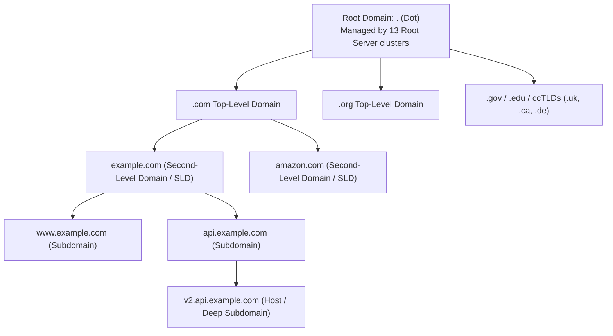
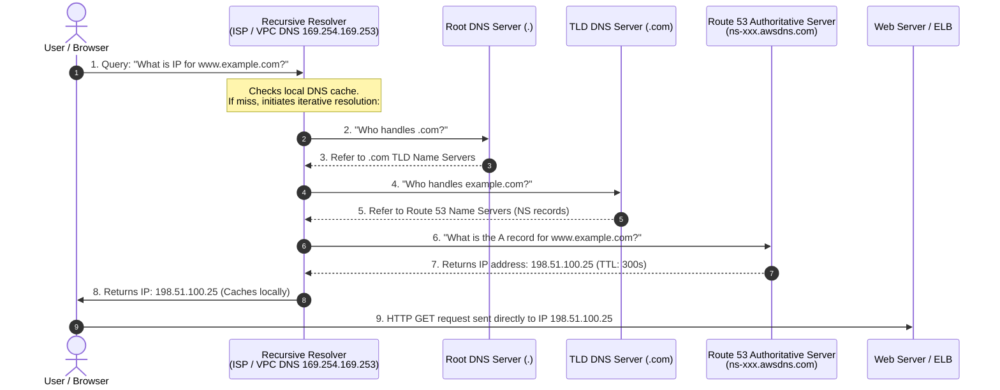
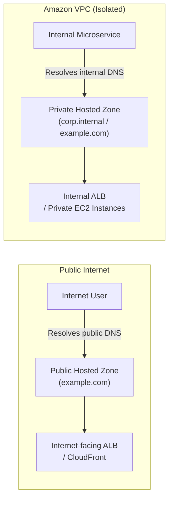
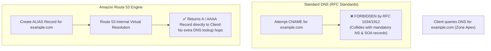
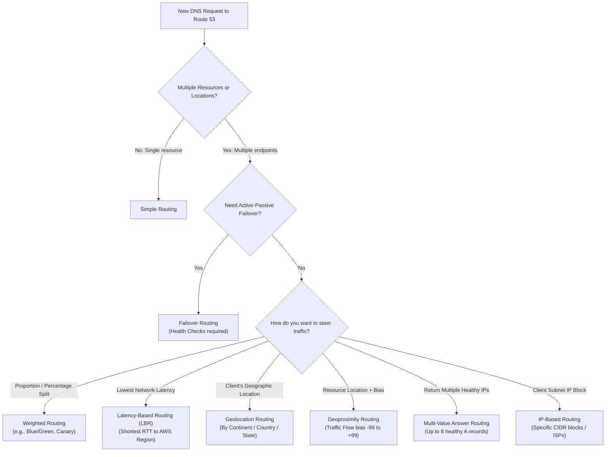
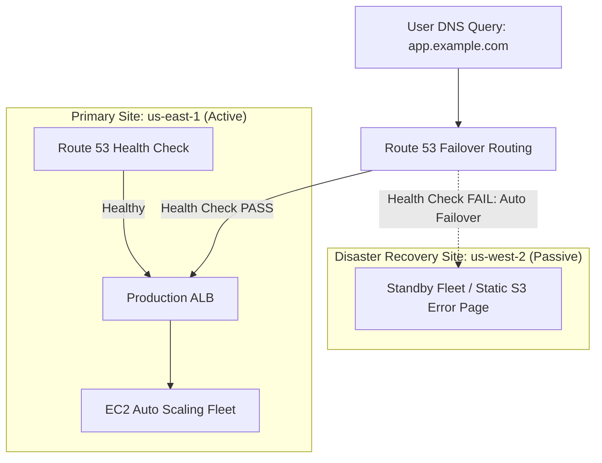
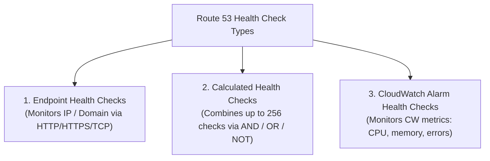
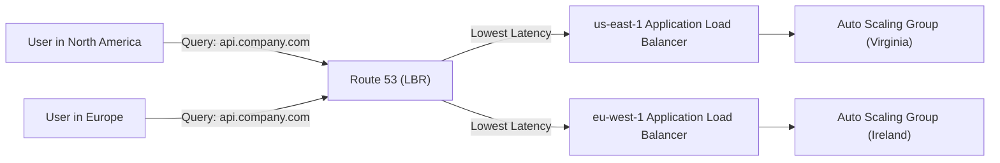

# 🌐 Amazon Route 53: Scalable DNS, Domain Registration & Traffic Routing

> **Course**: AWS re/Start  
> **Module**: Scaling and Name Resolution – M11 Amazon Route 53  
> **Source Document**: `T15-0006-RSSCAL_EN-US_SG_M11_AMAZONROUTE53.pdf`  
> **Target Audience**: AWS re/Start Learners / Cloud Practitioners / Solutions Architects  

---

## 🎯 Module Overview

Elastic Load Balancing (ELB) and Amazon EC2 Auto Scaling provide automated horizontal elasticity and high availability within a single AWS Region. However, modern enterprise cloud architectures frequently require distributing traffic across multiple geographic AWS Regions, connecting internet users with minimum latency, or executing automated disaster recovery (DR) across isolated failure domains.

**Amazon Route 53** is AWS's highly available, scalable, cloud-native Domain Name System (DNS) web service, domain registrar, and health-checking service. Route 53 operates on an Anycast network of global edge locations and is backed by a **100% availability Service Level Agreement (SLA)**—the only AWS service with this guarantee. It provides the crucial name resolution and traffic steering mechanisms needed to build low-latency, globally fault-tolerant cloud architectures.

```
┌──────────────────────────────────────────────────────────────────────────────────┐
│                             Amazon Route 53 Core Roles                           │
├──────────────────────────────────────────────────────────────────────────────────┤
│  1. Domain Registration    - Purchase, transfer, and manage top-level domains    │
│  2. Authoritative DNS      - Translate human-readable domain names to IP address │
│  3. Health Checking        - Continuously monitor application endpoints & alarms │
│  4. Global Traffic Routing - Route users via Latency, Geolocation, Failover, etc │
└──────────────────────────────────────────────────────────────────────────────────┘
```

---

### 📌 Learning Objectives

- [ ] **Define DNS Fundamentals**: Understand how the Domain Name System functions, identify port 53 protocol mechanics, and navigate the hierarchical domain namespace (Root, TLD, SLD, Subdomains).
- [ ] **Distinguish Core DNS Record Types**: Differentiate A, AAAA, CNAME, MX, TXT, NS, SOA, SRV, and PTR record types and their operational use cases.
- [ ] **Articulate Amazon Route 53 Architecture**: Describe Route 53's role as a global authoritative DNS service, registrar, and health monitor with a 100% availability SLA.
- [ ] **Compare Hosted Zone Architectures**: Contrast Public Hosted Zones with Private Hosted Zones, and design split-view (split-horizon) DNS for internal and external VPC routing.
- [ ] **Evaluate Alias Records vs Standard CNAME Records**: Understand why RFC standards forbid CNAME records at the Zone Apex, and how Route 53 Alias records resolve this while providing native AWS integration and free internal queries.
- [ ] **Master the Eight Route 53 Routing Policies**: Analyze and deploy Simple, Weighted, Latency-Based (LBR), Failover, Geolocation, Geoproximity, Multi-Value Answer, and IP-Based routing policies.
- [ ] **Implement Automated DNS Failover**: Configure Route 53 health checks (Endpoint, Calculated, CloudWatch Alarms) to drive active-passive disaster recovery.
- [ ] **Execute Real-World Traffic Strategies**: Design Blue/Green deployment cutovers using weighted routing and multi-region low-latency application delivery.

---

## 🏛️ 1. Domain Name System (DNS) Fundamentals

### What is DNS?
The **Domain Name System (DNS)** is the foundational naming database of the Internet. Computers, servers, smartphones, and network appliances communicate using numeric Internet Protocol (IP) addresses (such as `198.51.100.1` for IPv4 or `2001:db8::1` for IPv6). Because numeric IP addresses are difficult for humans to remember, DNS translates human-friendly alphanumeric domain names (such as `www.example.com`) into computer-routable IP addresses.

### Why the Name "Route 53"?
The service name **Amazon Route 53** is a direct reference to two concepts:
1. **Route**: Symbolizes the service's capability to route traffic across global networks and cloud resources (similar to historic highways like US Route 66).
2. **53**: Refers to **TCP and UDP Port 53**, the well-known standard network port designated by IANA for all DNS queries and zone transfers.

---

### The Hierarchical Domain Namespace

Domain names are structured in an inverted tree hierarchy, parsed from right to left:



1. **Root Domain (`.`)**: The highest level of the hierarchy, represented by a trailing dot (`example.com.`). It is coordinated globally by ICANN and operated across 13 root server clusters.
2. **Top-Level Domain (TLD)**: The last segment of a domain name. Managed by registry operators:
   - *Generic TLDs (gTLDs)*: `.com`, `.net`, `.org`, `.edu`, `.io`.
   - *Country Code TLDs (ccTLDs)*: `.us`, `.uk`, `.de`, `.jp`, `.ca`.
3. **Second-Level Domain (SLD)**: The name registered by an organization or individual directly under a TLD (e.g., `example` in `example.com`, `aws` in `aws.amazon.com`).
4. **Subdomain**: Optional prefix added to the SLD to organize logical functional areas (e.g., `api`, `portal`, `staging`).
5. **Zone Apex (Root Domain / Naked Domain)**: The domain name without any subdomain prefix (e.g., `example.com` rather than `www.example.com`).

---

### DNS Resolution Walkthrough: Recursive vs Authoritative

When an end user enters `https://www.example.com` into their browser, an iterative name resolution process takes place:



- **Recursive Resolver**: The DNS server that receives the client's request and performs the legwork of querying root, TLD, and authoritative servers on behalf of the client (e.g., local ISP DNS, Google 8.8.8.8, Cloudflare 1.1.1.1, or the AWS VPC DNS resolver at the VPC network CIDR + 2 / `169.254.169.253`).
- **Authoritative DNS Server**: The definitive source of truth that contains the actual DNS resource records configured by the domain owner (e.g., Amazon Route 53 name servers).
- **TTL (Time to Live)**: The number of seconds a recursive resolver and client cache can hold a DNS record before querying the authoritative name server again.

---

### Essential DNS Record Types

| Record Type | Name | Purpose | Example Value | AWS Common Use Case |
| :--- | :--- | :--- | :--- | :--- |
| **A** | Address Record | Maps a hostname to an **IPv4** address (32-bit) | `198.51.100.1` | Points custom domain to an EC2 elastic IP or web server |
| **AAAA** | IPv6 Address Record | Maps a hostname to an **IPv6** address (128-bit) | `2001:0db8:85a3::8a2e:0370:7334` | Directs dual-stack client traffic to IPv6 endpoints |
| **CNAME** | Canonical Name | Points a hostname (alias) to another hostname | `app.example.com -> lb.elb.amazonaws.com` | Aliasing subdomains (Note: **Cannot** be placed at Zone Apex) |
| **MX** | Mail Exchange | Directs inbound email to designated mail servers | `10 mail.example.com.` (with priority) | Configuring Amazon WorkMail, Amazon SES, or Google Workspace |
| **TXT** | Text Record | Arbitrary text used for domain verification & security | `"v=spf1 include:amazonses.com ~all"` | SPF, DKIM, DMARC email authentication & SSL verification |
| **NS** | Name Server | Delegates a DNS zone to specific authoritative servers | `ns-123.awsdns-15.com.` | Assigned by Route 53 to delegate domain hosted zones |
| **SOA** | Start of Authority | Metadata about the DNS zone (primary NS, admin email, refresh intervals) | `ns-123.awsdns-15.com. hostmaster...` | Automatically generated upon Route 53 hosted zone creation |
| **PTR** | Pointer Record | Reverse DNS lookup (maps an IP address back to hostname) | `1.100.51.198.in-addr.arpa -> mail.example.com` | Anti-spam verification on mail servers |
| **SRV** | Service Record | Identifies hostname and port for specific services | `0 5 5060 sipserver.example.com` | Microservices discovery, VoIP SIP, Windows Active Directory |

---

## 🌐 2. What is Amazon Route 53?

Amazon Route 53 is a cloud-based Domain Name System (DNS) service designed to provide high availability, low latency, and cost-effective traffic management.

### Architectural Hallmarks of Route 53

```
┌────────────────────────────────────────────────────────────────────────┐
│                   Route 53 Global Architecture Pillars                 │
├────────────────────────────────────────────────────────────────────────┤
│  • 100% Availability SLA: Backed by globally distributed Anycast edge   │
│    locations ensuring uninterrupted name resolution.                   │
│  • Fully Managed & Serverless: No DNS servers to patch or maintain.    │
│  • Ultra-Fast Anycast Network: Queries are automatically routed to the  │
│    topographically closest DNS edge server.                            │
│  • Deep AWS Ecosystem Integration: First-class native integration with  │
│    ELB, CloudFront, S3 Website endpoints, API Gateway, and VPCs.       │
└────────────────────────────────────────────────────────────────────────┘
```

### The Three Functional Pillars

1. **Domain Name Registration (Domain Registrar)**:
   - Purchase and register new top-level domains (e.g., `.com`, `.net`, `.org`, `.co.uk`).
   - Transfer existing domain registrations from other registrars (e.g., GoDaddy, Namecheap) to AWS.
   - Automatically provisions and associates Route 53 Hosted Zones for newly purchased domains.
2. **Authoritative DNS Routing**:
   - Manages Public and Private Hosted Zones.
   - Translates human-readable domain names into IP addresses or AWS resource targets.
   - Supports advanced routing policies (latency, geolocation, weighted round-robin, failover).
3. **Health Checking & Endpoint Monitoring**:
   - Continuously probes application endpoints across the internet.
   - Integrates with Amazon CloudWatch alarms.
   - Automatically initiates DNS failover when monitored endpoints become unhealthy.

---

## 🗂️ 3. Route 53 Hosted Zones

A **Hosted Zone** is a container that holds records, and records contain information about how you want to route traffic for a specific domain (such as `example.com`) and all of its subdomains (such as `dev.example.com`).



### Public vs Private Hosted Zones Comparison

| Feature | Public Hosted Zone | Private Hosted Zone |
| :--- | :--- | :--- |
| **Network Reachability** | Accessible from anywhere on the public internet | Accessible only from specified Amazon VPCs |
| **Use Case** | Routing public web, mobile, and API traffic | Internal microservice discovery, internal backends, databases |
| **DNS Server Delegation** | Handled via global internet registrar NS records | Handled internally by the Amazon VPC Resolver (`VPC_CIDR + 2`) |
| **VPC Prerequisites** | None | VPC attributes `enableDnsHostnames` and `enableDnsSupport` set to `true` |
| **Cross-VPC Association** | N/A | Can be associated with multiple VPCs across accounts and Regions |
| **Security Surface** | Publicly discoverable | Completely hidden from external port scanning or DNS enumeration |

### Split-View (Split-Horizon) DNS
Route 53 allows organizations to create **both** a Public Hosted Zone and a Private Hosted Zone with the exact same domain name (e.g., `example.com`):
- Internal employees or EC2 instances inside your VPC resolve `portal.example.com` to private RFC 1918 IPs (e.g., `10.0.4.50`).
- External internet users querying `portal.example.com` resolve the record via the Public Hosted Zone to a public IP or CloudFront endpoint.

---

## 🔗 4. Route 53 Alias Records vs Standard DNS CNAME Records

When connecting a custom domain to AWS infrastructure (such as an Application Load Balancer or Amazon CloudFront distribution), AWS assigns a default DNS hostname (e.g., `my-alb-123456789.us-east-1.elb.amazonaws.com`). 

To map friendly domain names to these resources, you must understand the distinction between **CNAME Records** and **Route 53 Alias Records**.

### The Zone Apex (Root Domain) Problem
According to DNS internet standards (RFC 1034 / RFC 1912), a **CNAME record cannot coexist with any other record for the same hostname**. Because a root domain (Zone Apex, e.g., `example.com`) must always contain mandatory **NS** and **SOA** records, **you cannot legally create a standard CNAME record for a root domain**. 

Amazon Route 53 solves this limitation using **Alias Records**.



### Deep Dive Comparison: Alias Record vs CNAME Record

| Feature | Standard CNAME Record | Route 53 Alias Record |
| :--- | :--- | :--- |
| **Definition** | Standard DNS record pointing one hostname to another | Proprietary AWS extension recognized by Route 53 authoritative servers |
| **Zone Apex (`example.com`)** | ❌ **No**. Forbidden by DNS specifications | ✅ **Yes**. Seamlessly works at Zone Apex and subdomains |
| **Target Endpoints** | Any hostname on the internet or intranet | Selected AWS resources (ELB, CloudFront, S3 website, API Gateway, VPC Endpoints, or records in same zone) |
| **DNS Query Pricing** | Standard Route 53 query charges apply | **Free of charge** when querying supported AWS resources |
| **DNS Lookup Overhead** | Requires 2 separate DNS round-trips (hostname $\rightarrow$ alias hostname $\rightarrow$ IP) | Single round-trip (Route 53 returns final IP address directly) |
| **Native Health Checking** | Can only monitor target if configured separately | Native health check inherited directly from target AWS resource |
| **Dynamic IP Tracking** | Relies on external resolver following CNAME chain | Route 53 automatically tracks dynamic IP address changes of AWS load balancers |

> [!TIP]
> **Best Practice**: Always use **Route 53 Alias records** instead of CNAME records whenever routing to AWS resources. They eliminate query latency, cost zero dollars per query, automatically adjust when AWS rotates underlying load balancer IP addresses, and work seamlessly at the Zone Apex.

---

## 🧭 5. The Route 53 Routing Policies: Comprehensive Deep Dive

A routing policy determines how Amazon Route 53 responds to DNS queries. Route 53 offers eight distinct routing policies to satisfy diverse technical and business requirements.



---

### 1. Simple Routing Policy
- **Mechanism**: Routes traffic to a single resource (e.g., an EC2 public IP or ALB) or returns multiple IP addresses in a random round-robin order.
- **Key Characteristics**:
  - Does **not** support health check filtering. If one IP in a simple record fails, Route 53 still returns it to clients.
  - Returns all specified IP addresses to the client's resolver in random order.
- **When to Use**: Basic websites or APIs running on a single server, or where client-side load balancing is sufficient without AWS health checks.

---

### 2. Weighted Routing Policy
- **Mechanism**: Distributes traffic across multiple resources in proportions that you specify using integer weights (from `0` to `255`).
- **Mathematical Formula**:
  $$\text{Percentage of Traffic to Resource } i = \left(\frac{\text{Weight}_i}{\sum_{k=1}^n \text{Weight}_k}\right) \times 100\%$$
- **Real-World Scenarios**:
  - **A/B Testing**: Direct 10% of users to new interface Variant B (weight = 10) and 90% to existing Variant A (weight = 90).
  - **Blue/Green Deployment**:
    1. Deploy new Green environment alongside production Blue environment.
    2. Set Blue weight to 100, Green weight to 0.
    3. Shift to Blue: 90 / Green: 10, monitor CloudWatch error rates and application logs.
    4. Gradually shift to Blue: 50 / Green: 50 $\rightarrow$ Blue: 0 / Green: 100.
    5. If defects arise at any step, instantly roll back by setting Blue weight back to 100.
  - Setting a weight to `0` stops routing traffic to that endpoint (while preserving the record).

```
┌────────────────────────────────────────────────────────┐
│      Weighted Routing Example: Blue/Green Migration     │
├────────────────────────────────────────────────────────┤
│  Blue Environment  (Weight: 70)  ──► Receives 70% traffic│
│  Green Environment (Weight: 30)  ──► Receives 30% traffic│
│  Total Weight = 70 + 30 = 100                          │
└────────────────────────────────────────────────────────┘
```

---

### 3. Latency-Based Routing (LBR)
- **Mechanism**: Directs DNS queries to the AWS Region that provides the lowest network latency (fastest round-trip time) for the querying user.
- **How AWS Calculates Latency**:
  - AWS continuously monitors and measures global network latency between worldwide internet networks and every AWS Region.
  - Route 53 uses these global latency measurements to determine which Region responds quickest to the user's recursive resolver network.
- **Scenario Analysis**:
  - An organization deploys identical web applications behind ALBs in **US East (N. Virginia)** and **Asia Pacific (Sydney)**.
  - A user in **Canada** sends a query $\rightarrow$ Route 53 directs to **US East** (lowest latency).
  - A user in **New Zealand** sends a query $\rightarrow$ Route 53 directs to **Sydney** (lowest latency).
  - A user in **Barcelona, Spain** queries the domain $\rightarrow$ Route 53 evaluates real-time network routes and sends them to the lowest-latency Region (typically US East or a European Region if available).

> [!NOTE]
> Latency-based routing is calculated based on latency to the **recursive resolver**, not the client's physical machine (unless the resolver supports EDNS0 Client Subnet / ECS).

---

### 4. Failover Routing Policy
- **Mechanism**: Configures an **Active-Passive** disaster recovery architecture.
- **Record Structure**:
  - **Primary Record**: Points to the primary production environment and is linked to a Route 53 Health Check.
  - **Secondary Record**: Points to the disaster recovery environment (e.g., a warm standby in another Region, or a static maintenance page hosted on Amazon S3).
- **Execution Flow**:
  1. Route 53 continuously performs health checks on the primary resource.
  2. While healthy, 100% of DNS queries resolve to the Primary record.
  3. If the primary health check fails, Route 53 automatically stops serving the Primary record and routes 100% of queries to the Secondary record.



---

### 5. Geolocation Routing Policy
- **Mechanism**: Directs traffic based on the geographic location of the user (determined by the IP address of the DNS resolver).
- **Location Hierarchy & Granularity**:
  1. **Continent** (e.g., North America, Europe, Asia)
  2. **Country** (e.g., United States, United Kingdom, Japan)
  3. **Subdivision / US State** (e.g., California, New York)
  4. **Default Record**: Catch-all record returned if the query originates from an IP not mapped to any specific continent, country, or state.
- **Primary Use Cases**:
  - **Language & Cultural Localization**: Automatically directing Japanese visitors to `ja.example.com` and German visitors to `de.example.com`.
  - **Regulatory & Data Sovereignty**: Complying with GDPR by ensuring European users are directed to European data centers.
  - **Licensing Restrictions**: Restricting digital media streaming to authorized geographic territories.

> [!IMPORTANT]
> Always configure a **Default Record** when using Geolocation routing. If a query arrives from an unmapped IP address and no default record exists, Route 53 will return `NXDOMAIN` (No Such Domain).

---

### 6. Geoproximity Routing Policy
- **Mechanism**: Routes traffic based on the physical geographic location of your **AWS resources** (by AWS Region) or on-premises servers (specified by latitude and longitude).
- **The "Bias" Parameter**:
  - Geoproximity allows you to expand or shrink the geographic service zone around a resource by setting a **Bias** value between **-99 and +99**.
  - A **positive bias (+1 to +99)** expands the geographic area, directing more traffic to that resource from surrounding zones.
  - A **negative bias (-1 to -99)** shrinks the geographic area, shedding traffic to neighboring resources.
- **Requirement**: Geoproximity routing requires using **Route 53 Traffic Flow** (a visual policy management tool).

```
┌────────────────────────────────────────────────────────┐
│             Geoproximity Bias Visualization            │
├────────────────────────────────────────────────────────┤
│  Region: us-east-1 (Bias: +50)  ──► Expands coverage   │
│  Region: us-west-2 (Bias: -30)  ──► Contracts coverage │
│  Traffic shifts eastward dynamically based on bias.    │
└────────────────────────────────────────────────────────┘
```

---

### 7. Multi-Value Answer Routing Policy
- **Mechanism**: Responds to DNS queries with up to **eight randomly selected healthy records** from a pool of multiple healthy resources.
- **Multi-Value vs Simple Routing**:
  - Simple routing with multiple IP values returns all IPs without checking if they are alive.
  - Multi-Value Answer routing links **Route 53 Health Checks** to every record. If an endpoint fails its health check, Route 53 removes it from DNS answers.
- **Multi-Value vs Elastic Load Balancing**:
  - Multi-Value routing operates at the **DNS layer** and costs significantly less than an ELB, but it does **not** provide granular TCP connection termination, SSL offloading, sticky sessions, or path-based routing.
  - ELB operates at Layer 4/Layer 7 and performs active connection-level load balancing.

---

### 8. IP-Based Routing Policy
- **Mechanism**: Steers DNS traffic based on the client's subnet Classless Inter-Domain Routing (CIDR) block.
- **Configuration**: Domain owners map specific CIDR blocks (e.g., `198.51.100.0/24`) to target resource record sets.
- **Primary Use Cases**:
  - Directing traffic from specific corporate office branch networks directly to designated internal proxy appliances.
  - Telecommunication carriers routing users based on cellular ASN/IP pools (e.g., zero-rated media streaming).
  - Optimizing ISP-specific peering arrangements.

---

### 📊 Summary Comparison: The Eight Routing Policies

| Routing Policy | Primary Driver / Mechanism | Health Check Support | Multi-Region Use Case | Ideal Application |
| :--- | :--- | :---: | :---: | :--- |
| **Simple** | Single endpoint or random round-robin list | ❌ No | Limited | Single static server or dev environment |
| **Weighted** | User-defined integer proportions (0–255) | ✅ Yes | ✅ Yes | Blue/Green deployments, Canary tests |
| **Latency-Based** | Lowest network round-trip time (RTT) | ✅ Yes | ✅ Yes | Global multi-region low-latency performance |
| **Failover** | Active-Passive health check status | ✅ Yes | ✅ Yes | Automated disaster recovery, maintenance pages |
| **Geolocation** | Client resolver geographic territory | ✅ Yes | ✅ Yes | Content localization, GDPR/sovereignty compliance |
| **Geoproximity** | Physical resource location + Bias (-99 to +99) | ✅ Yes | ✅ Yes | Dynamic load shifting across Regions (Traffic Flow) |
| **Multi-Value** | Returns up to 8 healthy records randomly | ✅ Yes | ✅ Yes | Resilient DNS-level client load distribution |
| **IP-Based** | Client CIDR subnet match | ✅ Yes | ✅ Yes | ISP peering optimization, branch office steering |

---

## 💓 6. Route 53 Health Checks & DNS Failover

Route 53 Health Checks monitor the health of specified endpoints and orchestrate automated DNS failover without manual intervention.

### Health Check Categories



1. **Endpoint Monitoring**:
   - Route 53 global health checkers send probes directly to an IP address or domain name.
   - Supports **HTTP**, **HTTPS**, and **TCP** protocols.
   - Can validate HTTP status codes (2xx and 3xx are considered healthy) and inspect response body content (string matching up to the first 5,120 bytes).
   - **Request Intervals**:
     - *Standard Interval*: Probes every 30 seconds (default).
     - *Fast Interval*: Probes every 10 seconds (incurs additional cost, but reduces failover latency).
   - **Failure Threshold**: Number of consecutive failed checks (default: 3) required to transition an endpoint from healthy to unhealthy.
2. **Calculated Health Checks**:
   - Evaluates the status of up to 256 child health checks using Boolean logic.
   - Example: Mark a web application healthy only if `API_Health_Check` AND `Database_Health_Check` are both reporting healthy.
3. **CloudWatch Alarm Health Checks**:
   - Monitors custom metrics, system health, or business KPIs in Amazon CloudWatch.
   - Example: Fail over traffic if an EC2 fleet's CPU utilization exceeds 95% or if Amazon RDS database connections drop to 0.

> [!CAUTION]
> **DNS Caching & TTL Impact**: When configuring active-passive DNS failover, always set a **low TTL** (e.g., 60 seconds) on the record set. If TTL is set to 86,400 seconds (24 hours), client browsers and ISP resolvers will continue sending traffic to the failed primary server for up to a full day!

---

## 🚀 7. Architecture Walkthroughs & Real-World Use Cases

### Walkthrough 1: Blue/Green Deployment with Weighted Routing

A blue/green deployment technique reduces deployment risk by running two identical production environments:
- **Blue Environment**: Currently active live production version.
- **Green Environment**: New version deployed with updated application code or infrastructure.

```
Step 1: Deploy Green Environment in parallel with Blue.
        Blue Weight: 100 (100% traffic)  |  Green Weight: 0 (0% traffic)

Step 2: Smoke test Green environment directly via internal staging DNS.

Step 3: Begin gradual canary traffic migration:
        Blue Weight: 90 (90% traffic)    |  Green Weight: 10 (10% traffic)
        Monitor Amazon CloudWatch Logs and Error Alarms.

Step 4: Shift full traffic if metrics remain clean:
        Blue Weight: 0 (0% traffic)      |  Green Weight: 100 (100% traffic)

Step 5: Decommission Blue environment after DNS TTL expiration window (1–7 days).
```

---

### Walkthrough 2: Multi-Region Active-Active with Latency-Based Routing



---

## 🛠️ 8. Hands-on Demonstration & CLI Walkthrough

### Routing Traffic to an Amazon EC2 Instance

In this walkthrough, we register an A record in a Route 53 Public Hosted Zone pointing directly to a public EC2 web server.

#### Step 1: Create a Hosted Zone via AWS CLI
```bash
aws route53 create-hosted-zone \
    --name "example.com" \
    --caller-reference "deployment-$(date +%s)" \
    --hosted-zone-config Comment="Production public zone",PrivateZone=false
```

#### Step 2: Create a Route 53 Health Check
```bash
aws route53 create-health-check \
    --caller-reference "web-health-$(date +%s)" \
    --health-check-config '{
        "IPAddress": "198.51.100.10",
        "Port": 80,
        "Type": "HTTP",
        "ResourcePath": "/health",
        "RequestInterval": 30,
        "FailureThreshold": 3
    }'
```

#### Step 3: Create Resource Record Set (Upsert A Record)
Create a file named `dns-record.json`:
```json
{
  "Comment": "Routing traffic to production EC2 instance",
  "Changes": [
    {
      "Action": "UPSERT",
      "ResourceRecordSet": {
        "Name": "www.example.com",
        "Type": "A",
        "TTL": 300,
        "ResourceRecords": [
          {
            "Value": "198.51.100.10"
          }
        ]
      }
    }
  ]
}
```

Apply the record change:
```bash
aws route53 change-resource-record-sets \
    --hosted-zone-id "Z1234567890EXAMPLE" \
    --change-batch file://dns-record.json
```

#### Step 4: Verify DNS Resolution
```bash
# Query the Route 53 authoritative name server
dig @ns-123.awsdns-15.com www.example.com +short
```

---

## 🧠 9. Knowledge Check & Certification Exam Prep

### Slide Checkpoint Questions & Answers

#### Question 1
**A solutions architect wants to ensure that users are routed to the closest Region based on their location. Which Route 53 routing policy would make this arrangement happen?**
> **Answer**: **Geolocation routing policy**.  
> **Rationale**: Geolocation routing lets you route traffic based on the geographic location of your users (continent, country, or state). If you need to route strictly based on the physical territory of the user, geolocation routing is the designated policy.

#### Question 2
**After configuring Route 53 to route users to the closest Region, customers are complaining about a slow response. Which routing policy would select routes based on the lowest latency?**
> **Answer**: **Latency-Based Routing (LBR)**.  
> **Rationale**: Geographic proximity does not always equal network proximity. Internet routing topologies, peering agreements, and undersea cables mean the geographically closest Region may have higher network round-trip time. Latency-Based Routing selects routes based on actual network round-trip latency data.

#### Question 3
**What is an example of an AWS infrastructure component that Route 53 can connect user requests to?**
> **Answer**: **Elastic Load Balancing (ELB) load balancers, Amazon EC2 instances, Amazon CloudFront distributions, Amazon S3 static website buckets, or Amazon API Gateway**.  
> **Rationale**: Route 53 can route traffic to both public and private AWS endpoints using standard DNS records or native Route 53 Alias records, as well as to on-premises resources outside AWS.

---

### Additional Certification Practice Scenarios

#### Scenario A
*An enterprise hosts its primary ecommerce application behind an Application Load Balancer in `us-east-1`. The team wants users visiting `example.com` (Zone Apex) to be seamlessly directed to this load balancer without paying for DNS queries. How should this be configured?*
- [ ] A. Create a CNAME record for `example.com` pointing to the ALB DNS name.
- [x] B. Create an Alias A record for `example.com` targeting the ALB.
- [ ] C. Create an MX record pointing to the ALB IP address.
- [ ] D. Assign an Elastic IP to the ALB and create an A record.
> **Correct Answer: B**  
> *Explanation: DNS RFC specifications forbid CNAME records at the Zone Apex. Route 53 Alias records can be created at the Zone Apex, resolve directly to the ALB, automatically track IP changes, and are free of DNS query charges.*

#### Scenario B
*An administrator is configuring active-passive disaster recovery using Route 53 Failover routing. During testing, when the primary server goes offline, external users continue hitting the failed primary server for several hours. What is the most likely cause?*
- [ ] A. Route 53 health checks only run once per hour.
- [ ] B. The secondary record was configured as an AAAA record.
- [x] C. The DNS TTL on the primary record was set to a high value (e.g., 86,400 seconds).
- [ ] D. Route 53 requires manual intervention to approve failovers.
> **Correct Answer: C**  
> *Explanation: DNS records are cached by recursive resolvers and browsers according to their TTL. If TTL is set to a high value, resolvers will serve cached responses until the TTL expires, delaying failover.*

---

## 📝 10. Key Takeaways & Quick Reference

- **Port 53 & Architecture**: Operates on TCP/UDP Port 53; globally distributed Anycast network backed by a **100% availability SLA**.
- **Three Core Pillars**: Domain Registrar (buying/transferring domains), Authoritative DNS (resolving names), and Health Checking (endpoint monitoring & automated failover).
- **Public vs Private Zones**: Public hosted zones are visible on the public internet; Private hosted zones provide secure name resolution inside specified VPCs without internet exposure.
- **Alias vs CNAME**: Alias records support the Zone Apex (`example.com`), provide free queries to AWS resources, and dynamically track IP updates of ALBs, CloudFront, and S3.
- **The Routing Policies**:
  - *Simple*: Single resource or unmonitored multi-IP round-robin.
  - *Weighted*: Percentage traffic splits for Blue/Green deployments and canary testing.
  - *Latency-Based*: Directs requests to the AWS Region with lowest network latency.
  - *Failover*: Active-Passive disaster recovery triggered by Route 53 health checks.
  - *Geolocation*: Geographic routing by Continent, Country, or US State.
  - *Geoproximity*: Physical resource location with dynamic Bias adjustments (-99 to +99).
  - *Multi-Value*: Returns up to 8 healthy IP addresses with active health-check filtering.
  - *IP-Based*: Subnet CIDR-based steering for corporate branches and telecom ISPs.
- **Health Checks**: Endpoint, Calculated, and CloudWatch Alarm checks drive automated DNS-level high availability and disaster recovery.
