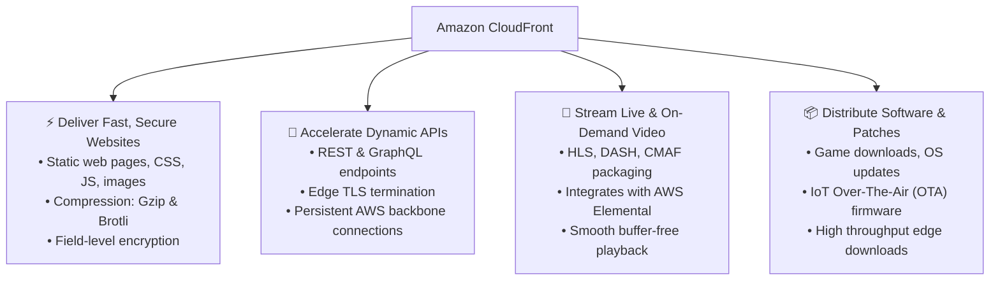
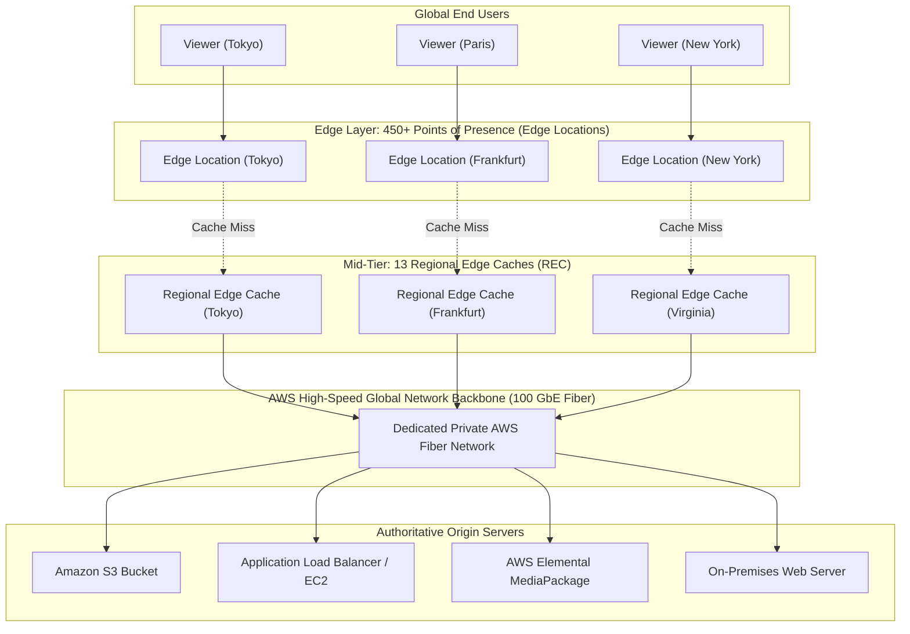
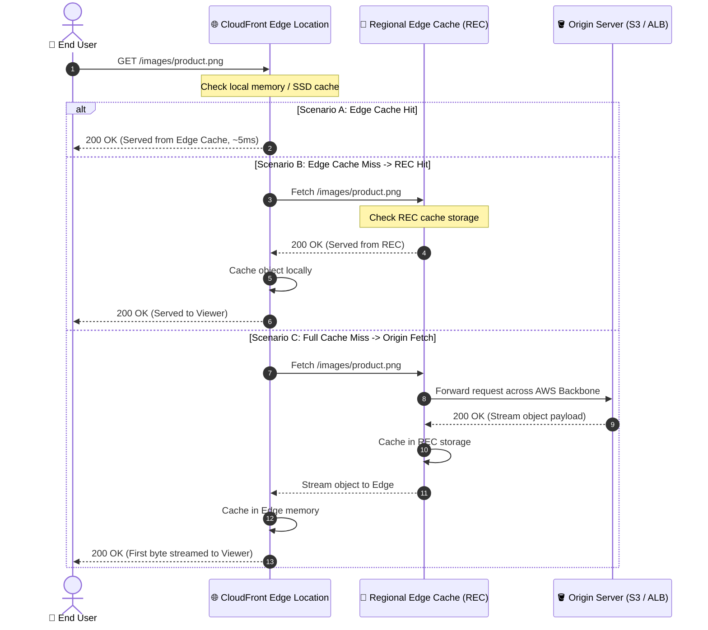
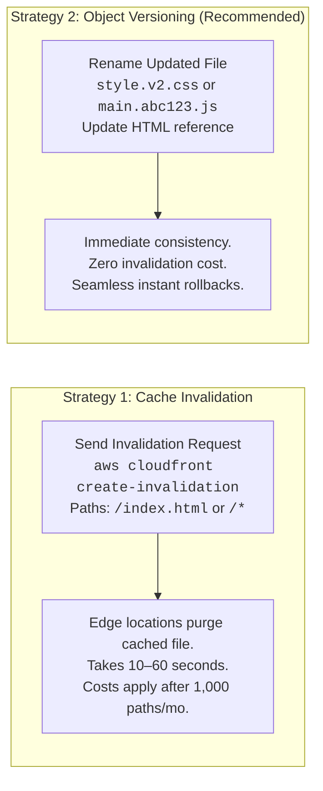
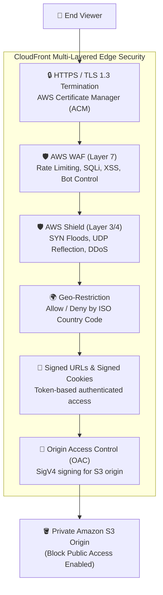
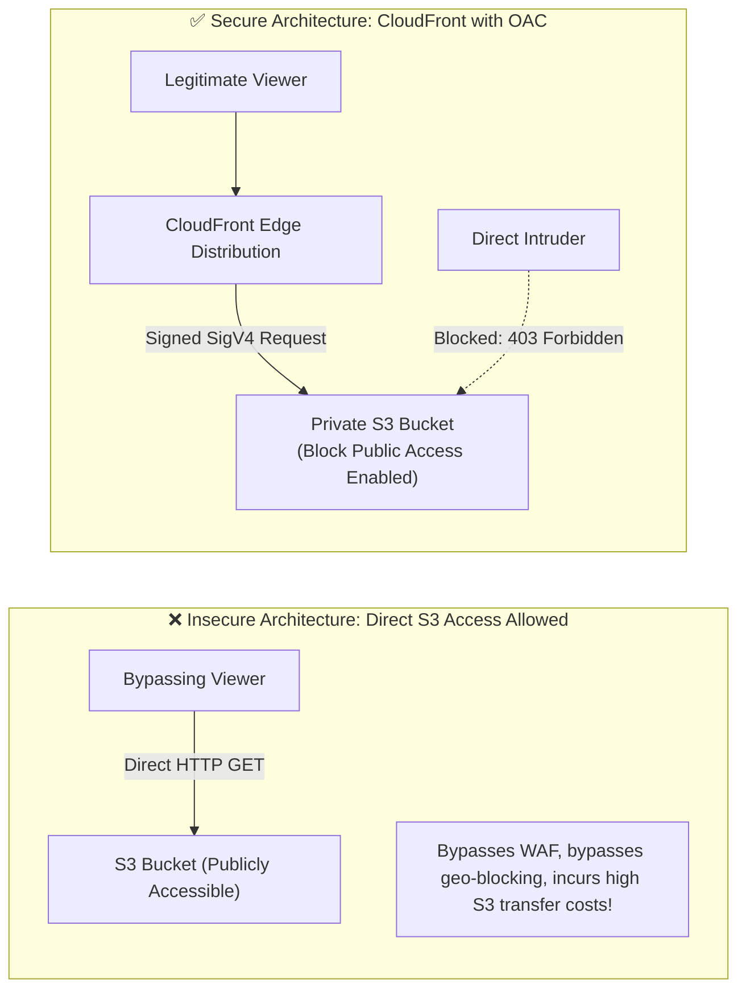
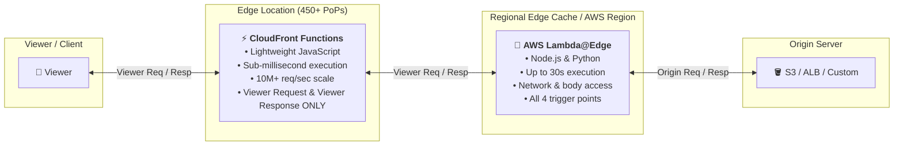

# 🌐 Module 11: Amazon CloudFront – Study Guide

> **Course**: AWS re/Start  
> **Module**: Scaling and Name Resolution (Module 11)  
> **Source Document**: `T15-0007-RSSCAL_EN-US_SG_M11_AMAZONCLOUDFRONT.pdf`  
> **Target Audience**: AWS re/Start Learners & Cloud Practitioners  

---

## 🎯 Module Overview

Modern web applications, media streaming platforms, software distributions, and enterprise APIs serve users dispersed across the globe. When client requests must traverse multiple internet routing hops to reach a centralized origin data center or single-region cloud deployment, users experience high network latency, packet loss, and sluggish load times. Furthermore, centralized origins face severe scalability constraints and heightened exposure to distributed denial-of-service (DDoS) attacks.

**Amazon CloudFront** is a fast, highly secure, and programmable Content Delivery Network (CDN) service that accelerates the delivery of static and dynamic web content (such as `.html`, `.css`, `.js`, media files, and APIs) to end users worldwide. CloudFront securely routes user traffic through the low-latency AWS global network backbone to a globally distributed network of Points of Presence (Edge Locations and Regional Edge Caches).

This comprehensive study guide explores the architectural principles of Amazon CloudFront, its global infrastructure topology, request routing and caching mechanics, security controls (including Origin Access Control, AWS WAF, and SSL/TLS termination), automated origin failover with origin groups, and edge compute execution models (CloudFront Functions vs. AWS Lambda@Edge).

---

### 📌 Learning Objectives

- [ ] **Define Amazon CloudFront**: Explain how a Content Delivery Network (CDN) accelerates the global delivery of static and dynamic web assets.
- [ ] **Analyze Global Infrastructure Topology**: Contrast Points of Presence (Edge Locations) and Regional Edge Caches (RECs) and explain how the AWS private network backbone reduces latency.
- [ ] **Trace Content Delivery Request Flows**: Map the step-by-step lifecycle of viewer requests across Anycast DNS, latency-based routing, cache hits, and cache misses.
- [ ] **Configure Caching & Invalidation Policies**: Evaluate Time-to-Live (TTL) parameters, HTTP cache headers (`Cache-Control`), cache invalidation methods, and object versioning best practices.
- [ ] **Implement Multi-Layered Edge Security**: Formulate end-to-end security architectures incorporating HTTPS enforcement, AWS Certificate Manager (ACM), AWS WAF, AWS Shield, Geo-restrictions, and Signed URLs/Cookies.
- [ ] **Secure S3 Origins with OAC**: Configure Origin Access Control (OAC) and S3 bucket policies to eliminate direct public access to origin storage buckets.
- [ ] **Design High-Availability Resilient Architectures**: Configure Origin Groups and automated failover policies between primary and secondary origins.
- [ ] **Evaluate Edge Compute Solutions**: Compare CloudFront Functions and AWS Lambda@Edge across execution location, runtime environments, latency, and valid event triggers.
- [ ] **Calculate & Optimize CloudFront Costs**: Identify the core pricing dimensions (Traffic Distribution/Price Classes, Request counts, and Data Transfer Out) and leverage zero-cost AWS-to-CloudFront data egress.

---

## 📚 Key Terminology

| Term | Definition |
| :--- | :--- |
| **Content Delivery Network (CDN)** | A globally distributed network of proxy servers that cache content closer to end users to improve access speed and availability. |
| **Point of Presence (PoP) / Edge Location** | A geographically distributed data center where CloudFront caches copies of content closest to end viewers to provide minimal latency. |
| **Regional Edge Cache (REC)** | A mid-tier caching facility deployed between Edge Locations and origin servers with a larger cache capacity to keep less-frequently requested content cached near viewers. |
| **Origin Server** | The authoritative source location of original files, such as an Amazon S3 bucket, AWS Elemental MediaPackage channel, Application Load Balancer, Amazon EC2 instance, or custom on-premises web server. |
| **CloudFront Distribution** | A configured entry point in CloudFront that links domain names (e.g., `d1234.cloudfront.net` or a custom alias) to one or more origins and behaviors. |
| **Cache Hit** | A request where the requested object is already stored in the local Edge Location cache and is immediately served to the client without querying the origin. |
| **Cache Miss** | A request where the requested object is not in the Edge Location cache, prompting CloudFront to retrieve it from a Regional Edge Cache or the origin server. |
| **Time-to-Live (TTL)** | The duration for which an object remains in the CloudFront edge cache before CloudFront sends a conditional request to the origin to determine if the object has been updated. |
| **Cache Invalidation** | An explicit administrative operation that removes specified cached objects from all CloudFront edge locations before their TTL expires. |
| **Origin Access Control (OAC)** | The modern, secure AWS authentication mechanism used to restrict Amazon S3 bucket access exclusively to designated CloudFront distributions using AWS Signature Version 4 (SigV4). |
| **Origin Access Identity (OAI)** | The legacy virtual identity mechanism used to restrict S3 bucket access to CloudFront (superseded by OAC). |
| **Origin Group** | A CloudFront configuration comprising a primary origin and a secondary origin designed to execute automated failover when specific HTTP error codes are returned. |
| **Edge Compute** | The execution of custom code at edge locations directly in the request/response path (CloudFront Functions or AWS Lambda@Edge) without maintaining dedicated servers. |

---

## 🌐 1. What is Amazon CloudFront?

### Overview & Core Purpose
**Amazon CloudFront** is a global Content Delivery Network (CDN) service that securely delivers data, videos, applications, and APIs to users worldwide with low latency and high transfer speeds.

Without a CDN, every user request must travel over public internet backbones directly to the origin server, regardless of geographic distance:

```
[User in Sydney] ------ 14,000 km over public internet -------> [Origin Server in us-east-1 (N. Virginia)]
(High latency, packet loss, bandwidth bottlenecks, heavy server load)
```

With Amazon CloudFront, content is cached locally at edge locations around the world:

```
[User in Sydney] ------ 5 ms latency ------> [CloudFront Edge PoP in Sydney] (Cache Hit: Served Immediately!)
                                                      │
                                                      │ (Cache Miss: AWS Dedicated 100 GbE Backbone)
                                                      ▼
                                           [Origin in us-east-1]
```

### Static vs. Dynamic Content Acceleration
CloudFront accelerates two distinct classifications of web content:

1. **Static Content Delivery**:
   - Objects that do not change dynamically per request (e.g., HTML files, CSS stylesheets, client-side JavaScript, images, audio, video files, software installers).
   - Stored in CloudFront edge caches and served directly from memory/disk at edge locations.
2. **Dynamic Content & API Delivery**:
   - Personalized, transactional, or time-sensitive data that cannot be cached (e.g., shopping cart updates, real-time banking balances, authenticated API responses).
   - Even though dynamic content is not cached, CloudFront accelerates delivery by:
     - Terminating TCP and TLS connections at the nearest Edge Location (minimizing round-trip handshake latency).
     - Maintaining persistent, optimized network connections across the dedicated AWS private fiber backbone to the origin.
     - Employing network-layer routing optimizations (Anycast DNS and BGP route optimization).

---

### Key Features & Benefits

| Feature Pillar | Architectural Benefit | Technical Capabilities |
| :--- | :--- | :--- |
| **Security** | Comprehensive perimeter defense | • Automatic mitigation against Layer 3 and Layer 4 DDoS attacks (AWS Shield Standard).<br/>• Full TLS 1.3 encryption and HTTPS enforcement.<br/>• Granular application layer (Layer 7) filtering via AWS WAF.<br/>• Industry compliance certifications: PCI-DSS, HIPAA, ISO/IEC, SOC. |
| **Availability** | Resilient fault tolerance | • Automated Origin Failover using Origin Groups.<br/>• Multi-tiered global caching hierarchy absorbing traffic spikes.<br/>• Dynamic routing around internet congestion. |
| **Edge Computing** | Ultra-low latency edge processing | • CloudFront Functions: Sub-millisecond JavaScript execution for header manipulation, URL rewrites, and token validation.<br/>• AWS Lambda@Edge: Complex compute in Node.js/Python with network and origin access. |
| **Real-time Observability**| Deep operational visibility | • Six automated Amazon CloudWatch operational metrics per distribution.<br/>• Real-time logs published within seconds to Amazon Kinesis Data Streams.<br/>• Standard access logs delivered to Amazon S3. |
| **Continuous Deployment**| Safe release management | • Native Blue/Green deployments using CloudFront staging distributions.<br/>• Gradual traffic shifting (canary deployments) using session cookies or weighted percentages without DNS changes. |
| **Cost-Effectiveness** | Pay-as-you-go economics | • Zero upfront fees, long-term commitments, or fixed platform costs.<br/>• **100% free data transfer out** from AWS origins (Amazon S3, EC2, ALB) to CloudFront.<br/>• CloudFront Security Savings Bundle discounts for committed monthly usage. |

---

### Enterprise Use Cases



1. **Fast, Secure Websites**: Compress text payloads with Brotli and Gzip on-the-fly, terminate TLS within single-digit milliseconds of the user, and deliver static website assets from edge memory.
2. **Dynamic Web Applications & APIs**: Accelerate dynamic POST/PUT/PATCH API calls by reusing pre-warmed TCP/TLS connections across the AWS backbone directly to application load balancers.
3. **Live and On-Demand Video Streaming**: Serve HTTP Live Streaming (HLS), Dynamic Adaptive Streaming over HTTP (DASH), and Common Media Application Format (CMAF) streams via edge caches, scaling seamlessly to millions of concurrent viewers without overwhelming origin encoders.
4. **Software, Game Patches, and IoT Firmware Updates**: Distribute multi-gigabyte software installers and IoT over-the-air (OTA) updates globally with high throughput, shielding origin repositories from massive release-day traffic spikes.

---

## 🌍 2. Global Infrastructure Topology

CloudFront's global architecture relies on a multi-tier hierarchy designed to balance rapid content delivery with high cache retention rates.



### 1. Points of Presence (PoPs) / Edge Locations
- **Scale**: Over **450+ Points of Presence** across 90+ major metropolitan cities in 48+ countries worldwide.
- **Function**: Edge Locations terminate viewer connections, inspect request headers, enforce security policies (WAF/Shield), and serve frequently requested content directly from local memory/SSD caches with ultra-low latency.

### 2. Regional Edge Caches (RECs)
- **Scale**: **13 Regional Edge Caches** strategically distributed across the world.
- **Function**:
  - RECs reside between Edge Locations and origin servers.
  - They feature significantly larger cache storage capacities than standard Edge Locations.
  - When an object becomes less popular and expires or gets evicted from a local Edge Location, it often remains cached in the Regional Edge Cache.
  - Subsequent requests from any nearby Edge Location fetch the object from the REC rather than traversing all the way back to the origin, substantially reducing origin load.
- **Target Assets for RECs**:
  - User-generated content (e.g., uploaded photos, personal profile videos).
  - Long-tail e-commerce media (e.g., product images for catalog items viewed infrequently).
  - Historical news articles and media archives that experience sporadic traffic bursts.

### 3. The AWS Global Network Backbone
- All CloudFront Edge Locations and Regional Edge Caches are interconnected with AWS Regions via a **private, fully redundant, 100 GbE parallel fiber network** circling the globe.
- Origin fetch requests never traverse the unreliable public internet; once a request hits a CloudFront Edge Location, all subsequent communication occurs over the private, secure AWS backbone.

### 4. Supported Origin Servers
CloudFront can retrieve content from diverse origin types:
- **Amazon S3**: Object storage containing static website files, documents, or media assets.
- **AWS Elemental MediaPackage / MediaStore**: Video streaming origins generating live and on-demand video streams.
- **Custom HTTP/HTTPS Origins**:
  - AWS Compute: Application Load Balancers (ALB), Network Load Balancers (NLB), Amazon EC2 instances, AWS Elastic Beanstalk.
  - On-Premises: Physical web servers running Apache, Nginx, or enterprise application servers in a customer-owned corporate data center.

---

## ⚡ 3. How CloudFront Delivers Content (Mechanics & Request Flow)

### Anycast DNS & Latency-Based Routing
When an end user navigates to a CloudFront-managed domain (e.g., `https://assets.example.com/logo.png`), CloudFront uses **Anycast DNS** and automated latency-based routing to resolve the domain to the IP address of the Edge Location closest to the user in network latency hops.

---

### Step-by-Step Request Flow & Cache Mechanics



#### Detailed Execution Steps:
1. **User Request**: The user enters a URL or the browser requests an embedded asset.
2. **DNS Routing**: Route 53 / Anycast DNS routes the request to the lowest-latency CloudFront Edge Location.
3. **Local Cache Inspection**:
   - **Cache Hit**: If the asset is present in the Edge Location cache and its TTL has not expired, CloudFront delivers it immediately to the viewer.
   - **Cache Miss**: If the asset is absent or expired, the Edge Location forwards the request to the nearest Regional Edge Cache.
4. **REC Inspection**:
   - If present in the REC, it is returned to the Edge Location, stored in edge cache, and delivered to the user.
   - If absent in the REC, the request is forwarded across the private AWS backbone to the configured Origin Server.
5. **Origin Processing & Streaming**:
   - The origin processes the request and returns the object payload along with HTTP response headers (such as `ETag`, `Cache-Control`, and `Content-Type`).
   - As soon as the first byte arrives from the origin, CloudFront immediately begins streaming the payload to the user while simultaneously storing the object in the REC and Edge Location caches for future viewers.

---

### Time-to-Live (TTL) & Cache Expiration Controls

CloudFront determines how long an object remains valid in edge caches using **Time-to-Live (TTL)** rules. When a cached object's TTL expires, CloudFront does not immediately discard it; instead, it sends a **conditional request** (using `If-Modified-Since` or `If-None-Match` headers) to the origin:
- If the origin returns `304 Not Modified`, CloudFront updates the TTL and continues serving the cached copy without re-downloading the file.
- If the origin returns `200 OK`, CloudFront replaces the cached copy with the updated version.

#### TTL Parameters in CloudFront Cache Behaviors:
- **Minimum TTL**: The minimum duration (in seconds) that an object is cached, regardless of what the origin's `Cache-Control` header specifies.
- **Maximum TTL**: The maximum duration (in seconds) that an object is cached, capping any long `Cache-Control` header from the origin.
- **Default TTL**: The caching duration applied when the origin response does not include `Cache-Control` or `Expires` headers (default is 86,400 seconds / 24 hours).

#### Origin HTTP Response Headers:
- `Cache-Control: max-age=<seconds>`: Instructs both the viewer browser and CloudFront how long to cache the object.
- `Cache-Control: s-maxage=<seconds>`: Overrides `max-age` specifically for shared proxy caches like CloudFront, leaving browser cache duration unaffected.
- `Cache-Control: no-cache` / `no-store`: Instructs CloudFront never to cache the response (essential for dynamic, sensitive user data).

---

### Cache Invalidation vs. Object Versioning

When application assets (such as CSS files, logos, or JavaScript bundles) are updated on the origin, administrators have two ways to ensure users receive the new version:



| Dimension | Cache Invalidation (`/*` or specific paths) | Object Versioning (`app.v2.js` / query string) |
| :--- | :--- | :--- |
| **Mechanism** | Sends API request to purge specific paths (`/images/logo.png`) or wildcards (`/assets/*`). | Embeds version numbers or build hashes in filenames or query parameters. |
| **Propagation Time** | Takes between 10 to 60 seconds to purge across 450+ edge locations. | **Instantaneous**: New requests fetch the new unique filename immediately. |
| **Cost** | **First 1,000 invalidation paths per month are free**; $0.005 per path thereafter. | **100% Free**: No invalidation API calls required. |
| **Rollback Capability** | Difficult to roll back without another full invalidation and re-upload. | **Instantaneous**: Revert HTML reference back to `app.v1.js`. |
| **Best Practice** | Use for emergency hotfixes, breaking policy changes, or static entry points (`/index.html`). | **AWS Recommended Best Practice** for all static assets and code deployments. |

> [!TIP]
> **Best Practice Hybrid Approach**: Use **Object Versioning** (e.g., `bundle.a8f2c.js`, `styles.98b1.css`) for all static assets with a 1-year TTL (`Cache-Control: max-age=31536000`), and use short TTLs or targeted invalidation only for the root document (`index.html`).

---

## 🛡️ 4. Security & Content Protection

Amazon CloudFront is an integral component of the AWS edge security perimeter, protecting origins against attacks and unauthorized distribution.



---

### 1. HTTPS Enforcement & SSL/TLS Termination
- **Edge Termination**: CloudFront terminates SSL/TLS connections at the nearest Edge Location, eliminating costly multi-hop TLS handshake delays.
- **Viewer Protocol Policy**:
  - `Redirect HTTP to HTTPS`: Automatically redirects unsecured `http://` requests to `https://`.
  - `HTTPS Only`: Rejects insecure HTTP requests with a `403 Forbidden` response.
- **AWS Certificate Manager (ACM) Integration**:
  - CloudFront allows you to attach custom SSL/TLS certificates (e.g., `cdn.mycompany.com`) at zero cost via AWS Certificate Manager.
  - **Critical Architectural Requirement**: Custom certificates used for CloudFront distributions **MUST be created or imported into the `us-east-1` (N. Virginia) AWS Region**, because CloudFront is a global service managed out of N. Virginia.
- **SNI (Server Name Indication)**: CloudFront supports SNI custom SSL by default at no extra charge, allowing multiple domains to share IP addresses securely.

---

### 2. Restricting S3 Origins: Origin Access Control (OAC) vs. Origin Access Identity (OAI)

When hosting static assets in Amazon S3 behind CloudFront, direct public access to the S3 bucket must be disabled. This ensures all requests pass through CloudFront's security inspections (WAF, SSL, Geo-restrictions).



#### Why OAC Supersedes Legacy OAI:
- **Origin Access Identity (OAI)** was the original legacy method. It lacked support for:
  - AWS KMS server-side encryption (`SSE-KMS`).
  - HTTP methods like `PUT`, `POST`, and `DELETE` with dynamic payload signing.
  - AWS Regions launched after 2022.
- **Origin Access Control (OAC)** is the current modern standard:
  - Supports **AWS Signature Version 4 (SigV4)** signing.
  - Supports **SSE-KMS** encrypted S3 buckets.
  - Operates across all AWS Regions globally.
  - Provides granular IAM condition checks (`AWS:SourceArn` matching the CloudFront distribution ARN).

#### Sample S3 Bucket Policy for Origin Access Control:
```json
{
  "Version": "2012-10-17",
  "Statement": {
    "Sid": "AllowCloudFrontServicePrincipalReadOnly",
    "Effect": "Allow",
    "Principal": {
      "Service": "cloudfront.amazonaws.com"
    },
    "Action": "s3:GetObject",
    "Resource": "arn:aws:s3:::my-secure-bucket/*",
    "Condition": {
      "StringEquals": {
        "AWS:SourceArn": "arn:aws:cloudfront::123456789012:distribution/EDFDVBD632BHDS5"
      }
    }
  }
}
```

> [!IMPORTANT]
> To fully secure the S3 origin, **Amazon S3 Block Public Access** must be enabled on the bucket, and all individual public read permissions must be revoked.

---

### 3. DDoS Mitigation & Application Layer Defense
- **AWS Shield Standard**: Automatically enabled for all CloudFront distributions at no extra charge. Defends against network and transport layer (Layer 3 / Layer 4) attacks such as SYN floods, UDP reflection attacks, and HTTP slowloris attacks.
- **AWS Shield Advanced**: Optional paid tier providing 24/7 access to the AWS Shield Response Team (SRT), financial DDoS cost protection against scaling spikes, and advanced real-time attack telemetry.
- **AWS WAF (Web Application Firewall)**:
  - Integrates natively at CloudFront Edge Locations to inspect incoming HTTP/HTTPS traffic before it reaches origin servers.
  - Allows deployment of AWS Managed Rules (OWASP Top 10, SQL Injection, Cross-Site Scripting, Known Bad Inputs).
  - Enables custom rate-limiting rules (e.g., block client IP addresses submitting more than 1,000 requests per 5-minute interval).

---

### 4. Geo-Restriction (Geoblocking)
CloudFront allows content distributors to restrict content access based on the geographic location of viewers using a third-party GeoIP database:
- **Allow List (Whitelist)**: Only viewers in specified countries can download content; all other countries receive an HTTP `403 Forbidden`.
- **Block List (Blacklist)**: Viewers in specified countries are denied access; all other countries are permitted.
- **Use Cases**: Complying with digital media copyright licensing territories, gaming regulatory restrictions, or international export compliance laws.

---

### 5. Private Content: Signed URLs vs. Signed Cookies

For premium, paid, or user-authenticated content (such as subscription video courses or digital software purchases), CloudFront supports cryptographic signing.

```mermaid
flowchart TD
    User["Authenticated User"] -->|1. Login & Request Access| App["Backend Application Server"]
    App -->|2. Verify User Auth & Generate Signature| KeyGroup["Private Key / Trusted Key Group"]
    App -->>|3. Issue Signed URL / Signed Cookie| User
    User -->|4. Request Content with Signature| CF["CloudFront Edge Location"]
    CF -->|5. Validate Signature against Public Key| Validate{Valid & Not Expired?}
    Validate -->>|Yes| Serve["200 OK: Serve Premium Media"]
    Validate -->>|No| Deny["403 Forbidden"]
```

| Criteria | Signed URLs | Signed Cookies |
| :--- | :--- | :--- |
| **Access Scope** | Provides access to a **single, specific file** (e.g., `https://cdn.example.com/ebooks/cloud-guide.pdf?Policy=...`). | Provides access to **multiple files or an entire path prefix** (e.g., `/subscribers/*`). |
| **Client Requirement** | Client browser/player does not need to support HTTP cookies. | Client application must support HTTP cookies. |
| **URL Appearance** | URLs contain query string parameters with cryptographic hashes and expiration timestamps. | URLs remain clean and standard (no query strings required). |
| **Typical Use Cases** | • Individual file downloads.<br/>• Paid digital media files.<br/>• Applications where viewers cannot store cookies (e.g., custom mobile media players). | • Accessing an entire library of restricted subscription media.<br/>• HTTP Live Streaming (HLS) / DASH video streams with hundreds of small `.ts` video segments.<br/>• Protecting an entire private web portal. |

---

## 🚀 5. Advanced Architectures & Edge Compute

### 1. Origin Groups & Automated Origin Failover
To achieve maximum availability and disaster resilience, CloudFront supports **Origin Groups**, which configure automated high-availability failover between a primary origin and a secondary origin.

```mermaid
flowchart TD
    Viewer["👤 End User"] --> CF["CloudFront Edge Location<br/><b>Origin Group Configured</b>"]
    
    CF -->|1. Primary Request| Primary["Primary Origin<br/>(Application Load Balancer / EC2)"]
    
    Primary -.->|Returns 500 / 502 / 503 / 504 / 403 / 404| CF
    
    CF -->|2. Automated Instant Failover| Secondary["Secondary Origin<br/>(Static S3 Bucket Maintenance Site)"]
    
    Secondary -->>|3. 200 OK: Seamless Content Delivery| CF
    CF -->>|4. Response delivered to User| Viewer
```

#### How Origin Failover Operates:
1. CloudFront directs viewer requests to the **Primary Origin** (e.g., dynamic backend running on Amazon EC2 behind an ALB).
2. If the primary origin fails to respond (connection timeout) or returns configured HTTP error status codes (`403`, `404`, `500`, `502`, `503`, or `504`), CloudFront **automatically re-routes the request to the Secondary Origin** (e.g., a static S3 bucket displaying a maintenance page or serving cached read-only content).
3. The end viewer receives valid content seamlessly without encountering a broken error screen.

---

### 2. Edge Compute: CloudFront Functions vs. AWS Lambda@Edge

CloudFront offers two complementary serverless execution environments that run custom code at the network edge directly in the request/response lifecycle.



#### Comprehensive Feature Comparison:

| Feature / Dimension | CloudFront Functions | AWS Lambda@Edge |
| :--- | :--- | :--- |
| **Execution Environment** | Lightweight V8-based JavaScript runtime | Full Node.js and Python runtimes |
| **Execution Location** | Executed directly at **450+ Edge Locations** (closest to viewer) | Executed at **13 Regional Edge Caches** |
| **Execution Duration** | **Sub-millisecond** (< 1 millisecond) | Up to **5 seconds** (Viewer triggers) or **30 seconds** (Origin triggers) |
| **Memory Allocation** | Fixed at **2 MB** | **128 MB up to 10,000 MB** (configurable) |
| **Maximum Request Scale** | Millions of requests per second (10M+ req/s) | Thousands of requests per second (up to ~10,000 req/s) |
| **Supported Event Triggers**| • **Viewer Request**<br/>• **Viewer Response** | • **Viewer Request**<br/>• **Viewer Response**<br/>• **Origin Request**<br/>• **Origin Response** |
| **Network & Internet Access**| **No** (isolated sandbox; cannot make HTTP requests) | **Yes** (can call third-party APIs, AWS SDK, databases) |
| **Access to Request Body** | **No** (inspects headers, cookies, query strings, URI) | **Yes** (can read, transform, or write request/response body) |
| **Pricing Profile** | **1/6th the cost of Lambda@Edge** ($0.10 per 1M invocations; included in Free Tier) | Standard Lambda pricing by memory and duration ($0.60 per 1M invocations + compute time) |
| **Primary Use Cases** | • URL rewrites and redirects (`/en/` $\rightarrow$ `/en-us/`)<br/>• Header manipulation (adding HSTS, CORS headers)<br/>• Cache key normalization<br/>• Lightweight JWT token verification | • Complex viewer authentication & authorization<br/>• Server-Side Rendering (SSR) at the edge<br/>• Origin request routing & dynamic origin selection<br/>• Real-time image resizing and compression on origin fetch |

---

### 3. Continuous Deployment (Blue/Green Staging)
CloudFront supports native **continuous deployment** workflows:
- Deploy two identical distribution configurations: **Production** and **Staging**.
- Route a small, controlled percentage of live production traffic (e.g., 10%) to the staging distribution using **weighted routing** or **session header/cookie matching**.
- Validate new origin configurations, cache policies, or edge functions with live traffic without making any DNS changes.
- Promote the staging configuration to production instantaneously with zero downtime.

---

## 💰 6. Cost Estimation & Pricing Dimensions

Amazon CloudFront has no upfront commitments, setup fees, or minimum monthly charges. Billing is strictly pay-as-you-go based on actual usage.

```
┌────────────────────────────────────────────────────────────────────────┐
│                   CloudFront Core Cost Dimensions                      │
├────────────────────────────────────────────────────────────────────────┤
│ 1. Traffic Distribution (Geographic Region & Price Classes)            │
│ 2. Number & Type of Requests (HTTP vs. HTTPS; GET vs. POST/PUT)        │
│ 3. Data Transfer Out (Egress to the Internet from Edge Locations)      │
└────────────────────────────────────────────────────────────────────────┘
```

### 1. Traffic Distribution & Price Classes
Request and data transfer rates vary based on the geographic region of the Edge Location serving the content (e.g., data transfer in North America and Europe costs less per GB than in South America or Australia due to regional bandwidth costs).

To control costs, CloudFront provides **Price Classes**:
- **Price Class All (Best Performance)**: Uses all edge locations globally across every continent. Best performance for global audiences.
- **Price Class 200**: Excludes the most expensive geographic regions (excludes South America, Australia, New Zealand, etc.); uses North America, Europe, Asia, Africa, and the Middle East.
- **Price Class 100 (Lowest Cost)**: Restricts delivery to the lowest-cost regions only (**North America and Europe**). Viewers outside these regions are routed to North American or European edge locations, resulting in slightly higher latency for distant viewers.

### 2. Request Charges
- Billed per 10,000 requests.
- **HTTPS requests** carry a slightly higher price than unencrypted HTTP requests due to TLS cryptographic processing overhead.
- State-changing requests (POST, PUT, PATCH, DELETE) carry charges for both requests and data transferred back to origins.

### 3. Data Transfer Out (DTO)
- Billed per GB transferred from CloudFront edge locations out to the internet.
- Tiered volume pricing: The higher the aggregate monthly data volume transferred, the lower the per-GB rate.

### 4. The AWS Origin Cost Advantage
- **Free Origin-to-Edge Data Transfer**: Data transferred from AWS services (such as Amazon S3, Amazon EC2, Application Load Balancers, or AWS Lambda) into CloudFront is **100% free of charge**.
- Direct internet egress from an S3 bucket or EC2 instance incurs standard AWS internet egress fees ($0.09/GB). Placing CloudFront in front of S3 eliminates S3 egress fees and replaces them with CloudFront's lower tiered data transfer rates, delivering immediate cost savings for high-traffic assets.

---

## 📝 7. Review & Knowledge Check

### Checkpoint Questions & Detailed Answers

#### Question 1: Where does Amazon CloudFront serve popular or frequently accessed content from?
> **Answer**:  
> **An Edge Location (Point of Presence / PoP)**. CloudFront caches copies of popular static content in memory and high-speed storage at edge locations physically located close to viewers worldwide, drastically reducing latency and transit hops.

---

#### Question 2: What are the primary architectural benefits of utilizing Amazon CloudFront?
> **Answer**:  
> - **Security**: Integrated Layer 3/4 DDoS protection (AWS Shield), Layer 7 filtering (AWS WAF), and SSL/TLS termination.  
> - **Availability & Resiliency**: Automated origin failover via Origin Groups and global traffic distribution.  
> - **Edge Computing**: Programmable customization using CloudFront Functions and Lambda@Edge without server infrastructure.  
> - **Real-Time Metrics & Observability**: Native integration with CloudWatch metrics and real-time streaming access logs.  
> - **Continuous Deployment**: Native blue/green canary testing without DNS changes.  
> - **Cost-Effectiveness**: Pay-as-you-go pricing, free origin fetches from AWS services, and volume discount tiers.

---

#### Question 3: How are monthly costs for Amazon CloudFront determined?
> **Answer**:  
> CloudFront costs are determined primarily by three factors:  
> 1. **Traffic Distribution / Geographic Region**: The physical location of edge locations serving requests (managed via Price Classes).  
> 2. **Request Counts and Protocols**: The number of requests and their protocol (HTTP vs. HTTPS) and HTTP method.  
> 3. **Data Transfer Out (DTO)**: The total volume of data (in GB/TB) delivered from CloudFront edge locations to viewer clients on the internet.

---

#### Question 4: An organization hosts an internal static web portal in an Amazon S3 bucket. How can an administrator ensure that end users can ONLY access the content through CloudFront and CANNOT access the S3 bucket directly?
> **Answer**:  
> 1. Enable **Origin Access Control (OAC)** on the CloudFront distribution origin settings.  
> 2. Enable **Amazon S3 Block Public Access** on the S3 bucket to disallow all public ACLs and public policies.  
> 3. Attach an **S3 Bucket Policy** granting `s3:GetObject` permission strictly to the `cloudfront.amazonaws.com` service principal, constrained by a condition matching the specific CloudFront distribution ARN (`AWS:SourceArn: arn:aws:cloudfront::<account-id>:distribution/<dist-id>`).

---

#### Question 5: When should a cloud architect select CloudFront Functions instead of AWS Lambda@Edge?
> **Answer**:  
> CloudFront Functions should be selected when the task involves **lightweight, sub-millisecond execution** for **URL rewrites, HTTP redirect generation, header manipulation, or simple token validation** at the **Viewer Request** or **Viewer Response** trigger points. Because CloudFront Functions run at every Edge Location at one-sixth the cost of Lambda@Edge, they are ideal for high-volume, low-latency micro-tasks that do not require network access, request body parsing, or third-party API calls.

---

## 💡 8. Key Takeaways & Summary

- **Global Content Acceleration**: CloudFront is a globally distributed CDN that dramatically cuts latency for static assets (HTML, CSS, JS, images, video) and dynamic API endpoints by terminating connections at over 450+ Points of Presence and routing traffic across the private AWS backbone.
- **Hierarchical Caching Topology**: Requests route to the nearest **Edge Location**, fall back to regional mid-tier **Regional Edge Caches (RECs)** for less-popular content, and only fetch from authoritative **Origin Servers** (S3, ALB, EC2, on-prem) on a full cache miss.
- **Intelligent Edge Security**: Enforces HTTPS with TLS 1.3, blocks malicious bots and OWASP vulnerabilities with **AWS WAF**, mitigates volumetric DDoS attacks with **AWS Shield**, and enforces granular geo-blocking.
- **Origin Protection with OAC**: **Origin Access Control (OAC)** provides secure SigV4 authentication between CloudFront and private Amazon S3 buckets, supporting modern SSE-KMS encryption and eliminating direct S3 internet exposure.
- **Resilient High Availability**: **Origin Groups** enable automated, seamless failover to secondary origins (e.g., static S3 maintenance buckets) when primary application origins encounter server errors or timeouts.
- **Flexible Edge Programmability**: Use **CloudFront Functions** for sub-millisecond URL rewrites and header logic at edge locations, and use **AWS Lambda@Edge** for heavy compute, body inspection, and external network communication at Regional Edge Caches.
- **Cost Optimization**: Take advantage of **free data egress between AWS origins and CloudFront**, configure **Price Classes** to restrict delivery to low-cost regions, and utilize **Object Versioning** to eliminate manual cache invalidation fees.
