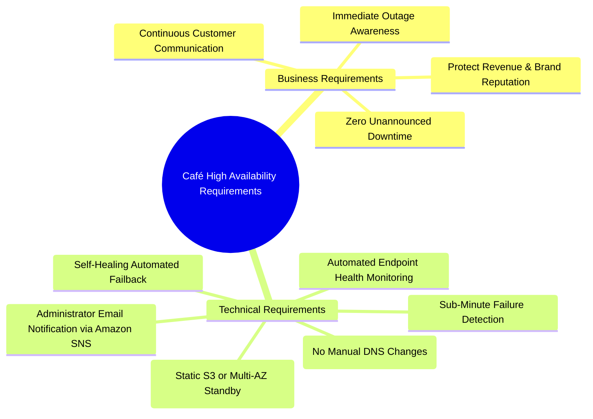
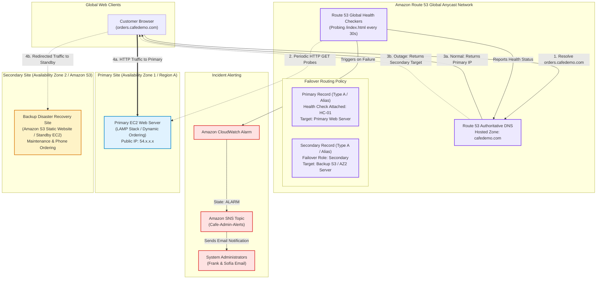
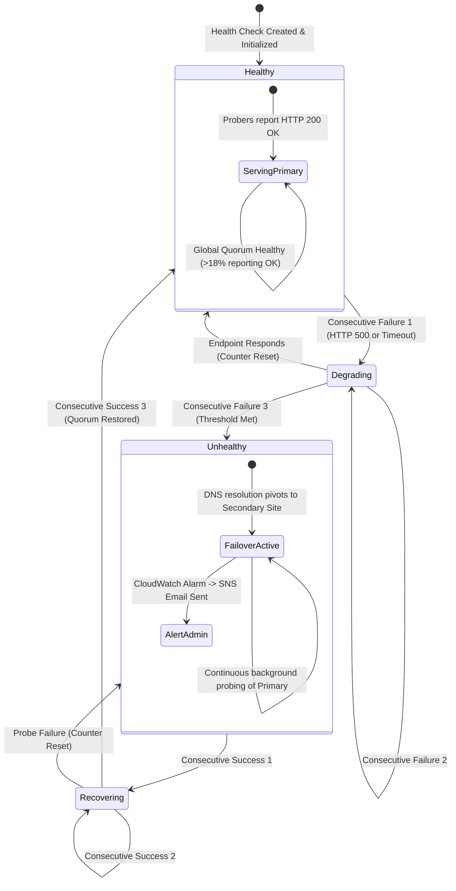
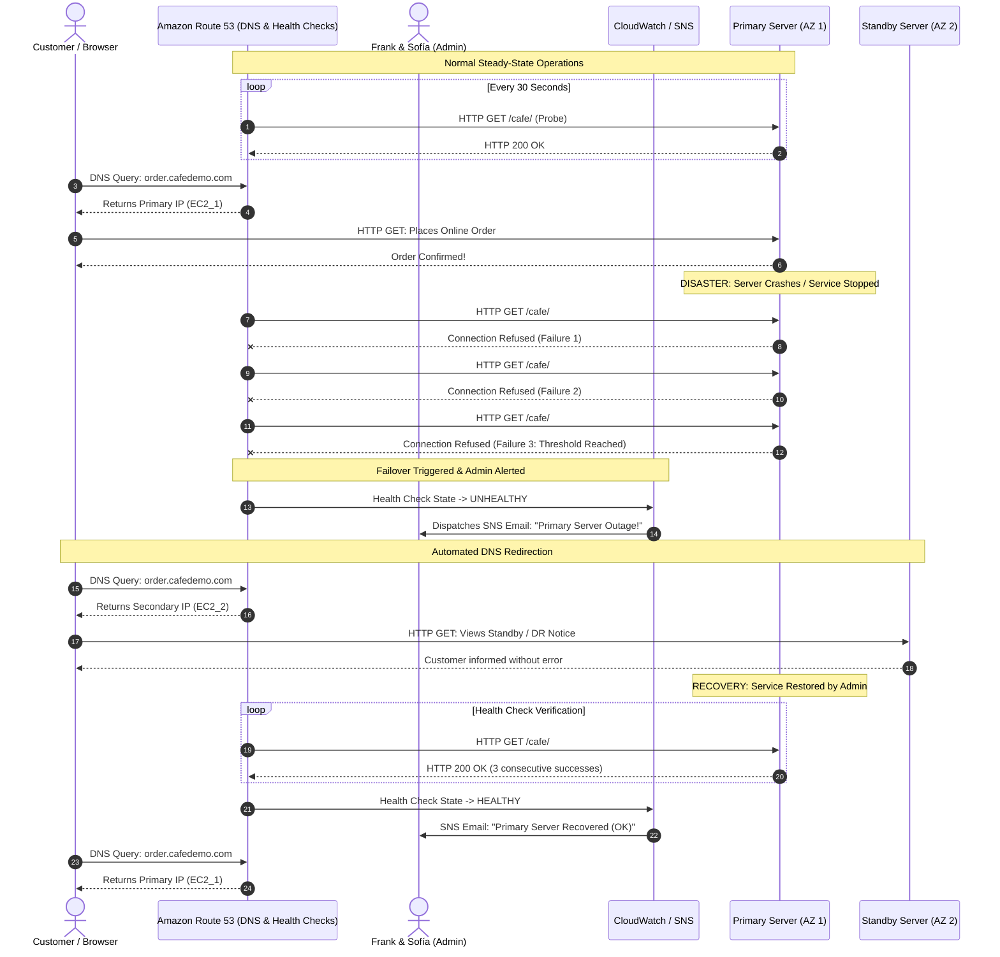

# ⚖️ Amazon Route 53 Failover Routing – Café High Availability Lab & Architecture Deep-Dive

> **Course**: AWS re/Start  
> **Module**: Scaling and Name Resolution (Module 11)  
> **Source Document**: `T15-0008-RSSCAL_EN-US_SG_M11_CAFEFAILOVERROUTE53.pdf`  
> **Target Audience**: AWS re/Start Learners / Cloud Practitioners / Solutions Architects / SysOps Administrators  

---

## 🎯 Lab Overview & Executive Summary

In a modern digital retail business, high availability (HA) is not a luxury—it is a baseline prerequisite for business continuity, customer trust, and revenue generation. When a customer attempts to place an online order and encounters a timeout or connection failure, they rarely wait; they turn to competitors. 

The Frank & Sofía Café launched an online ordering web portal that proved extraordinarily popular. However, their initial infrastructure was built on a fragile single-instance deployment. A recent infrastructure failure crippled the café's ordering system for an entire day, causing lost revenue, operational confusion, and customer dissatisfaction.

This lab and architecture guide addresses that operational single point of failure (SPOF) by implementing **Amazon Route 53 Active-Passive Failover Routing**. By pairing **automated Route 53 Health Checks** with **Failover Routing Policies**, students establish a resilient disaster recovery architecture:
- Traffic is normally routed to a fully dynamic **Primary Site** (hosted on Amazon EC2 / ALB).
- If the primary web server or Availability Zone fails, Route 53 automatically detects the outage and redirects incoming client queries to a **Secondary / Disaster Recovery Site** (such as a static maintenance and backup ordering portal hosted on Amazon S3 or a standby EC2 instance in a secondary Availability Zone).
- In parallel, Route 53 triggers an **Amazon Simple Notification Service (Amazon SNS)** email alert to system administrators, ensuring immediate incident awareness while customer disruption is mitigated.

```
┌────────────────────────────────────────────────────────────────────────────────────────┐
│               Route 53 Active-Passive Disaster Recovery Value Proposition               │
├───────────────────────────────────┬────────────────────────────────────────────────────┤
│ Traditional Single-Point Architecture │ Route 53 Automated Failover Architecture          │
├───────────────────────────────────┼────────────────────────────────────────────────────┤
│ • Manual outage discovery via customers │ • Automated global health probing (every 10-30s) │
│ • Multi-hour mean time to detect (MTTD) │ • Sub-minute incident detection and notification  │
│ • Manual DNS IP address modifications  │ • Automated DNS record pivot via Failover Policy   │
│ • Complete downtime & 100% order loss   │ • Graceful degradation: DR backup ordering/notice  │
│ • Administrator stress & revenue loss  │ • 100% DNS SLA with zero human intervention needed│
└───────────────────────────────────┴────────────────────────────────────────────────────┘
```

---

## 📌 Learning Objectives

By thoroughly reviewing this guide and completing the hands-on lab exercises, learners will be able to:

- [ ] **Analyze Business Outage Post-Mortems**: Deconstruct the café business incident, calculate downtime impact, and translate availability requirements into cloud architectural designs.
- [ ] **Explain Amazon Route 53 Core Capabilities**: Understand Route 53's role as a highly available, scalable Domain Name System (DNS) service backed by a 100% availability Service Level Agreement (SLA).
- [ ] **Configure Route 53 Health Checks**: Provision automated endpoint health checks specifying monitoring protocol (HTTP), domain/IP addresses, probe intervals (Standard 30s vs. Fast 10s), failure thresholds, and string matching.
- [ ] **Integrate CloudWatch and SNS Alerting**: Bind Route 53 health check status changes to Amazon CloudWatch alarms and Amazon SNS topics to dispatch instant email notifications upon health degradation.
- [ ] **Differentiate DNS Routing Policies**: Contrast Simple, Weighted, Latency, Geolocation, Geoproximity, Multi-value, and Failover routing policies.
- [ ] **Implement Active-Passive Failover Records**: Construct paired DNS records in a Route 53 Hosted Zone sharing identical record names and types (e.g., Type `A`), designating one as `Primary` (associated with the Health Check) and the other as `Secondary`.
- [ ] **Simulate Real-World Failures & Validate DNS Pivot**: Induce service downtime by terminating services or altering firewall/security group rules, observing health check failure transitions, and validating DNS resolution switching.
- [ ] **Demonstrate Automated Failback**: Restore primary service health and observe Route 53 automatically restoring production traffic to the primary infrastructure without administrative intervention.
- [ ] **Account for DNS Caching & TTL Dynamics**: Formulate architectural mitigation strategies for client-side and recursive resolver DNS caching delays during failover events.

---

## 📚 Key Terminology

| Term | Technical Definition |
| :--- | :--- |
| **Amazon Route 53** | A highly available and scalable cloud Domain Name System (DNS) web service designed to route end-user requests to internet applications running on AWS or on-premises. |
| **Active-Passive Failover** | An architectural availability pattern where a primary resource serves 100% of production traffic under normal conditions, while a standby (secondary) resource remains idle or minimal until the primary fails. |
| **Active-Active Failover** | An architecture where all provisioned endpoints actively serve user traffic concurrently. If one endpoint fails, traffic is redistributed among the surviving healthy endpoints. |
| **Route 53 Health Check** | A globally distributed probing mechanism that monitors the health and performance of specified web endpoints, CloudWatch alarms, or other health checks. |
| **Health Check Probers** | Global AWS-managed fleets of servers across worldwide edge locations that send HTTP, HTTPS, or TCP requests to verify endpoint reachability and valid status codes (HTTP 2xx/3xx). |
| **Failover Routing Policy** | A Route 53 DNS routing policy configured to route traffic to a primary resource when healthy, and automatically failover to a designated secondary resource when unhealthy. |
| **Hosted Zone** | A container for DNS records that defines how traffic is routed for a specific domain name (e.g., `cafe.example.com`). Can be public or private. |
| **Alias Record** | An AWS-specific DNS extension that routes traffic directly to AWS resources (such as CloudFront distributions, Elastic Load Balancers, or S3 website endpoints) without incurring DNS query charges. |
| **Time to Live (TTL)** | The duration (in seconds) that a DNS resolver or client is instructed to cache a DNS response before querying authoritative name servers again. |
| **Mean Time to Detect (MTTD)** | The average time required for monitoring infrastructure to recognize that a component, instance, or application is degraded or offline. |
| **Recovery Time Objective (RTO)** | The maximum acceptable duration of time an application can remain offline following a disaster or infrastructure failure before business operations are restored. |

---

## ☕ Café Business Scenario & Incident Post-Mortem

### 1. Dialogue Transcript: The Incident Debrief

The café team gathered for a post-mortem review following an operational crisis:

> **Frank**: *"Our website went down 2 days ago, and customers couldn't place any orders for most of the day. The customers were frustrated, and we lost some business revenue."*
>
> **Sofía**: *"Yes, it took us a while to find the cause of the problem and correct it. We really need a solution that ensures that our website is always available and accessible to our customers."*
>
> **Mateo**: *"Sofía, you can use Amazon Route 53 to solve your availability problem. Route 53 offers the ability to fail over to a second server running your website when the first server experiences problems."*
>
> **Sofía**: *"Sounds like that's exactly the service that we need. Can you tell me more?"*

---

### 2. Incident Post-Mortem & Root Cause Analysis (RCA)

```
┌────────────────────────────────────────────────────────────────────────────────────────┐
│                        INCIDENT REPORT: CAFÉ ONLINE ORDERING OUTAGE                    │
├─────────────────────────┬──────────────────────────────────────────────────────────────┤
│ Incident Date           │ 2 Days Prior to Sprint Review                                │
│ Severity                │ Severity 1 (Critical Business Impact – Outage)              │
│ Total Impact Duration   │ ~7 Hours, 45 Minutes                                         │
│ Financial Impact        │ ~65% reduction in daily sales; lost customer lifetime value  │
│ Customer Impact         │ Widespread order placement failures; walk-in customer anger  │
└─────────────────────────┴──────────────────────────────────────────────────────────────┘
```

#### Incident Sequence of Events:
1. **08:15 AM**: A fatal web server software deadlock occurred on the single EC2 instance running Apache and PHP.
2. **09:40 AM**: First customer complained at the café counter that the online ordering URL was timing out with `HTTP 504 Gateway Timeout` / `Connection Refused`.
3. **11:00 AM**: Frank realized that online lunch pre-orders had dropped to zero. He alerted Sofía.
4. **12:30 PM**: Sofía investigated, attempted remote SSH access, found the instance unresponsive, and began diagnosing memory starvation.
5. **04:00 PM**: Service was manually restored after rebooting the instance and repairing corrupted database locks.

#### Architectural Root Cause:
- **Single Point of Failure (SPOF)**: The entire café online ordering architecture depended on a single Amazon EC2 instance deployed in a single Availability Zone (AZ).
- **Zero Automated Monitoring**: The café possessed no external synthetic monitoring or automated health checks. System administrators only learned of the downtime through irate walk-in customers.
- **Manual Intervention Requirement**: Remediating the incident required human diagnosis, command-line access, and manual rebooting during peak business hours.

---

### 3. Business & Technical Requirements

To permanently prevent recurrence, Sofía and Mateo established the following architectural requirements:



1. **Continuous Availability (High Availability)**: Customers must always reach a functional web page when navigating to the café domain.
2. **Automated Health Probing**: The system must continuously check the HTTP endpoint health every few seconds from multiple locations worldwide.
3. **Automated Redirection (Failover)**: If the primary dynamic web server ceases responding, DNS resolution must immediately shift to a secondary standby endpoint without manual administrator intervention.
4. **Disaster Recovery Degradation Path**:
   - If dynamic ordering is unavailable, customers must be presented with an informative backup maintenance portal (hosted cheaply on Amazon S3) providing the café's physical phone number, temporary operating hours, and manual ordering instructions.
5. **Instant Administrator Alerting**: When health check failures occur, an email alert must be instantly dispatched to administrators.
6. **Zero-Touch Failback**: When the primary application resumes healthy operation, traffic must automatically revert to the primary environment.

---

## 🏛️ Technical Architecture: High Availability Active-Passive Failover

### 1. Amazon Route 53 Architecture Overview

Amazon Route 53 is an enterprise-grade DNS service built on AWS's globally distributed network of Domain Name System servers. Route 53 uses **Anycast DNS routing**, meaning client queries are automatically directed to the nearest Route 53 edge location worldwide for optimal latency and 100% service availability.

In an **Active-Passive Failover** pattern, Route 53 maintains two records with identical names (e.g., `order.cafedemo.com`) and record types (`A` or `AAAA`):
- **Primary Failover Record**: Points to the dynamic production environment (Amazon EC2 instance or ALB in Availability Zone 1 / Primary Region). Associated with a **Route 53 Health Check**.
- **Secondary Failover Record**: Points to the standby environment (Amazon S3 static website hosting bucket or Standby EC2 instance in Availability Zone 2 / Secondary Region). Not associated with a health check, or associated with a secondary health check.

---

### 2. End-to-End System Architecture Diagram



---

### 3. Disaster Recovery Pattern Comparison

To appreciate the design decisions for the café, consider how Active-Passive Failover compares to alternative disaster recovery strategies:

| Strategy | Architecture Model | Typical RTO | Typical RPO | Relative Cost | Café Suitability |
| :--- | :--- | :--- | :--- | :--- | :--- |
| **Backup & Restore** | Cold data backups in S3; manual infrastructure rebuild upon failure. | 6–24 hours | 12–24 hours | Extremely Low ($) | ❌ Inadequate; causes extended business outages. |
| **Pilot Light** | Core data replicated; minimal compute running; scaled out during disaster. | 10–30 mins | 5–15 mins | Low–Moderate ($$) | ⚠️ Suitable for enterprise, but overkill for simple café site. |
| **Warm Standby (Active-Passive)** | Scaled-down or secondary instance running continuously; instant DNS pivot. | < 2 mins | < 1 min | Moderate ($$$) | ✅ **Ideal**; guarantees sub-2-minute automatic recovery. |
| **S3 Static Failover (Active-Passive)** | Primary dynamic EC2; secondary static maintenance & telephone portal in S3. | < 1 min | 0 mins | Minimal ($) | ✅ **Highly Cost-Effective**; near-zero idle cost for secondary. |
| **Active-Active (Multi-Region)** | Fully functional dynamic applications running concurrently across regions with weighted routing. | < 10 secs | Real-time | High ($$$$) | ❌ Unnecessary complexity and cost for a local café business. |

---

## 🔍 Amazon Route 53 Health Checks Deep-Dive

### 1. Anatomy of an Endpoint Health Check

Route 53 health checks operate by dispatching synthetic network requests from a globally distributed fleet of probers located across multiple AWS regions (Northern Virginia, Oregon, Ireland, Tokyo, São Paulo, Singapore, Sydney, Frankfurt).

```
┌────────────────────────────────────────────────────────────────────────────────────────┐
│                        ROUTE 53 HEALTH CHECK CONFIGURATION PARAMETERS                  │
├─────────────────────────┬──────────────────────────────────────────────────────────────┤
│ Parameter               │ Architectural Description & Recommended Value                │
├─────────────────────────┼──────────────────────────────────────────────────────────────┤
│ **Protocol**            │ HTTP, HTTPS, or TCP. (Selected: HTTP on Port 80)             │
│ **Endpoint Target**     │ IP Address or Domain Name (FQDN) of the monitored target     │
│ **Path**                │ Specific request URI (e.g., `/index.html` or `/health.php`)  │
│ **Request Interval**    │ Standard (30 seconds) or Fast (10 seconds)                   │
│ **Failure Threshold**   │ Number of consecutive failed probes required (1 to 10; default: 3) │
│ **String Matching**     │ Optional regex search within the first 5,120 bytes of body   │
│ **Inverted Health**     │ Inverts logic (considers target healthy when probe fails)     │
│ **CloudWatch Alarm**    │ Direct integration to emit SNS notifications when unhealthy   │
└─────────────────────────┴──────────────────────────────────────────────────────────────┘
```

> [!NOTE]
> **Health Check Success Criteria for HTTP/HTTPS**:
> A health check probe is deemed **successful** if and only if:
> 1. A TCP connection is successfully established with the target within 4 seconds.
> 2. The endpoint responds with an HTTP status code between `200` and `399` within 2 seconds of connection.
> 3. If **String Matching** is enabled, the specified text string appears within the first 5,120 bytes of the response body.

---

### 2. Standard vs. Fast Interval Comparison

Route 53 allows selecting between **Standard** and **Fast** monitoring intervals. Understanding this trade-off is critical for sizing MTTD against monitoring costs:

| Dimension | Standard Interval (30 Seconds) | Fast Interval (10 Seconds) |
| :--- | :--- | :--- |
| **Probe Frequency** | Each prober sends a request every 30 seconds | Each prober sends a request every 10 seconds |
| **Number of Probers** | ~15 probers globally | ~15 probers globally |
| **Average Probes / Sec** | ~0.5 requests per second hitting web server | ~1.5 requests per second hitting web server |
| **Detection Time (Threshold = 3)** | ~60 to 90 seconds | ~18 to 30 seconds |
| **Relative AWS Cost** | Baseline cost ($0.50/month per AWS endpoint) | Additional charge ($1.00/month per endpoint) |
| **Target Use Case** | General web applications, e-commerce, café websites | High-frequency trading, real-time gaming, mission-critical APIs |

---

### 3. Health Status Aggregation and Quorum Logic

Route 53 does not rely on a single prober to determine an endpoint's status. Network latency, BGP route flaps, or localized ISP issues could cause a single prober in Tokyo to fail even though the server in Oregon is functioning perfectly.

To eliminate false positives:
1. Each of the ~15 global probers evaluates the endpoint independently.
2. Route 53 aggregates the health reports across all global probers.
3. If **more than 18%** of the probers report healthy status, Route 53 considers the endpoint healthy overall.
4. If healthy probers fall below the required quorum (i.e., the failure threshold is breached across >82% of probers), Route 53 marks the health check as **Unhealthy**.



---

## 🛠️ Hands-On Lab Walkthrough Step-by-Step

This section provides the complete step-by-step procedure to implement, verify, test, and troubleshoot the Amazon Route 53 Active-Passive Failover architecture.

### Lab Topology & Initial State
- **Primary Web Server**: Amazon EC2 Instance running LAMP stack in **Availability Zone 1** (e.g., `us-west-2a`), hosting the interactive Café ordering web app (`http://<Primary-EC2-Public-IP>/cafe/`).
- **Secondary Web Server / S3 DR Site**: Amazon EC2 Standby Instance in **Availability Zone 2** (e.g., `us-west-2b`) OR an Amazon S3 Static Website Bucket in a secondary region, displaying a backup maintenance notice with contact details.
- **Route 53 Public Hosted Zone**: Designated domain or subdomain (e.g., `cafe.example.com`).

---

### Task 1: Inspecting Primary and Secondary Environments

1. Sign in to the **AWS Management Console** and navigate to the **Amazon EC2 Console**.
2. In the navigation pane, choose **Instances**.
3. Locate the two provisioned instances:
   - `Cafe-Web-Server-1` (Running in Availability Zone `a`)
   - `Cafe-Web-Server-2` / `Cafe-Backup-Server` (Running in Availability Zone `b`)
4. Select `Cafe-Web-Server-1` and copy its **Public IPv4 address**.
5. Open a new browser tab and navigate to `http://<Cafe-Web-Server-1-IP>/cafe/`.
   - **Verification**: Confirm that the dynamic café website loads, showing the ordering menu, coffee items, and checkout interface.
6. Return to the EC2 console, select `Cafe-Web-Server-2`, and copy its **Public IPv4 address** (or navigate to the S3 bucket static website endpoint if using S3).
7. In another browser tab, navigate to `http://<Cafe-Web-Server-2-IP>/cafe/`.
   - **Verification**: Confirm that the secondary website loads with a visual indicator (e.g., "Café Standby Server - AZ 2" or static maintenance notice).

> [!TIP]
> Make note of both public IP addresses or endpoint URLs in a scratchpad text file for reference during DNS record creation.

---

### Task 2: Creating and Configuring Route 53 Health Check

In this task, you configure a global health check to monitor the health of `Cafe-Web-Server-1` and bind it to an SNS notification.

```
┌────────────────────────────────────────────────────────────────────────────────────────┐
│                          TASK 2 CONFIGURATION PARAMETER MATRIX                         │
├─────────────────────────┬──────────────────────────────────────────────────────────────┤
│ Field                   │ Input Value                                                  │
├─────────────────────────┼──────────────────────────────────────────────────────────────┤
│ Health check name       │ `Cafe-Primary-HealthCheck`                                   │
│ What to monitor         │ **Endpoint**                                                 │
│ Monitor endpoint by     │ **IP address**                                               │
│ Protocol                │ **HTTP**                                                     │
│ IP address              │ `<Public IPv4 of Cafe-Web-Server-1>`                         │
│ Port                    │ `80`                                                         │
│ Path                    │ `/cafe/index.php` (or `/cafe/` or `/`)                       │
│ Request interval        │ **Standard (30 seconds)**                                    │
│ Failure threshold       │ `3`                                                          │
│ Create alarm            │ **Yes**                                                      │
│ Send notification to    │ **Existing SNS Topic** or **New SNS Topic** (`CafeAdminAlerts`) │
│ Email recipient         │ Your administrator email address                             │
└─────────────────────────┴──────────────────────────────────────────────────────────────┘
```

#### Step-by-Step Execution:
1. In the AWS Management Console search bar, enter `Route 53` and choose **Route 53**.
2. In the left navigation pane, choose **Health checks**.
3. Choose **Create health check**.
4. In **Step 1: Configure health check**:
   - **Name**: Enter `Cafe-Primary-HealthCheck`.
   - **What to monitor**: Select **Endpoint**.
   - **Specify endpoint by**: Select **IP address**.
   - **Protocol**: Select **HTTP**.
   - **IP address**: Paste the public IPv4 address of `Cafe-Web-Server-1`.
   - **Port**: Enter `80`.
   - **Path**: Enter `/cafe/` (or the specific application health path).
5. Choose **Advanced configuration**:
   - **Request interval**: Choose **Standard (30 seconds)** (or Fast if testing immediate failover).
   - **Failure threshold**: Leave set to `3`.
   - **Health checker regions**: Accept default (global distribution).
6. Choose **Next**.
7. In **Step 2: Get notified when health check fails**:
   - Under **Create alarm**, toggle or select **Yes**.
   - **Send notification to**: Select **New SNS topic**.
   - **Topic name**: Enter `CafeAdminAlerts`.
   - **Recipient email address**: Enter your personal email address.
8. Choose **Create health check**.
9. **Email Confirmation**: Open your email inbox, find the AWS Notification subscription confirmation email, and click **Confirm subscription**.

> [!IMPORTANT]
> The SNS alert will NOT deliver incident notifications until you confirm the subscription link received in your inbox!

---

### Task 3: Configuring Route 53 Public Hosted Zone & Primary Failover Record

Now create the **Primary Failover Record** in Route 53, linking it to the health check created in Task 2.

#### Step-by-Step Execution:
1. In the Route 53 navigation pane, choose **Hosted zones**.
2. Select your designated hosted zone (e.g., `cafedemo.com` or the student domain provided in the lab environment).
3. Choose **Create record**.
4. Configure the primary record:
   - **Record name**: Enter a prefix such as `order` (resulting in `order.cafedemo.com`) or leave blank for apex domain.
   - **Record type**: Choose **A – Routes traffic to an IPv4 address and some AWS resources**.
   - **Value**: Enter the public IPv4 address of `Cafe-Web-Server-1`.
   - **TTL (Seconds)**: Set to `60` seconds (low TTL minimizes caching delays during testing).
   - **Routing policy**: Select **Failover** from the dropdown.
   - **Failover record type**: Choose **Primary**.
   - **Health check ID**: Select the health check created in Task 2 (`Cafe-Primary-HealthCheck`).
   - **Record ID**: Enter `Primary-Cafe-Web-Server-1`.
5. Choose **Create records**.

```
┌────────────────────────────────────────────────────────────────────────────────────────┐
│                          PRIMARY FAILOVER RECORD SPECIFICATION                         │
├─────────────────────────┬──────────────────────────────────────────────────────────────┤
│ Record Name             │ `order.cafedemo.com`                                         │
│ Type                    │ `A`                                                          │
│ Value                   │ `<Public IPv4 of Cafe-Web-Server-1>`                         │
│ TTL                     │ `60 seconds`                                                 │
│ Routing Policy          │ **Failover**                                                 │
│ Failover Role           │ **Primary**                                                  │
│ Health Check            │ Associated (`Cafe-Primary-HealthCheck`)                      │
│ Record ID               │ `Primary-Cafe-Web-Server-1`                                  │
└─────────────────────────┴──────────────────────────────────────────────────────────────┘
```

---

### Task 4: Configuring the Secondary Failover Record

Next, create the corresponding **Secondary Failover Record** under the exact same domain name.

#### Step-by-Step Execution:
1. In the same hosted zone, choose **Create record** again.
2. Configure the secondary record:
   - **Record name**: Enter the EXACT same prefix as Task 3 (e.g., `order`).
   - **Record type**: Must match the primary record type (**A**).
   - **Value**: Enter the public IPv4 address of `Cafe-Web-Server-2` (or choose **Alias** to point to the secondary S3 website endpoint).
   - **TTL (Seconds)**: Set to `60` seconds.
   - **Routing policy**: Select **Failover**.
   - **Failover record type**: Choose **Secondary**.
   - **Health check ID**: Leave empty (or associate with a secondary health check if active standby is monitored).
   - **Record ID**: Enter `Secondary-Cafe-Backup-Server`.
3. Choose **Create records**.

> [!WARNING]
> Both Primary and Secondary records MUST share the identical record name (e.g., `order.cafedemo.com`) and record type (`A`). If their names differ, Route 53 cannot execute failover logic!

---

### Task 5: Testing Automated Failover by Simulating Outage

To verify that Route 53 automatically detects a disaster and reroutes traffic, simulate a complete outage on `Cafe-Web-Server-1`.

#### Step-by-Step Execution:
1. Open a terminal or browser and perform an initial DNS resolution check:
   ```bash
   dig +short order.cafedemo.com
   # Or using nslookup
   nslookup order.cafedemo.com
   ```
   *Expected Result*: Returns the IP address of `Cafe-Web-Server-1`.
2. Browse to `http://order.cafedemo.com/cafe/` and verify you see the primary café site.
3. Choose one of two methods to induce failure:
   - **Method A: Stopping the Apache Web Service via SSH/Session Manager**:
     Connect to `Cafe-Web-Server-1` and run:
     ```bash
     sudo systemctl stop httpd
     # Or if Ubuntu/Debian:
     sudo systemctl stop apache2
     ```
   - **Method B: Altering Security Group Rules (Simulating Network / Host Loss)**:
     1. In the EC2 Console, select `Cafe-Web-Server-1`.
     2. In the **Security** tab, choose the security group.
     3. Choose **Edit inbound rules**.
     4. Delete the inbound rule for **HTTP (Port 80)** or change the source IP to a non-existent IP.
     5. Save rules.

---

### Task 6: Observing Health Check Degradation and DNS Failover Transition

1. Navigate to the **Route 53 Console** > **Health checks**.
2. Select `Cafe-Primary-HealthCheck`.
3. In the lower pane, choose the **Health checkers** tab.
4. Watch the status as probers attempt to query the endpoint:
   - You will see global probers begin reporting `Failure: Connection refused` or `Failure: Connection timed out`.
   - Once 3 consecutive probe intervals elapse (~60–90 seconds for Standard, ~30 seconds for Fast), the overall status transitions to **Unhealthy** (red icon).
5. **Check Alerting**: Check your administrator email inbox. Confirm receipt of an automated alert from **Amazon CloudWatch / SNS**:
   > *"You are receiving this email because your Amazon CloudWatch Alarm "CafeAdminAlerts" in Region us-east-1 entered the ALARM state..."*
6. **Verify DNS Pivot**: In your terminal or command prompt, query the DNS record again:
   ```bash
   dig +short order.cafedemo.com
   ```
   *Expected Result*: Route 53 now returns the IP address of `Cafe-Web-Server-2` (Secondary)!
7. Open a browser in **Incognito / Private Browsing mode** (to bypass browser HTTP caching) and navigate to `http://order.cafedemo.com/cafe/`:
   *Expected Result*: The browser displays the standby secondary café page or S3 disaster recovery notice.

---

### Task 7: Simulating Recovery and Verifying Automated Failback

1. Restore the primary web server:
   - If using Method A:
     ```bash
     sudo systemctl start httpd
     ```
   - If using Method B: Restore the Inbound Rule allowing **HTTP Port 80** from `0.0.0.0/0`.
2. Return to the Route 53 **Health checks** console.
3. Observe the probers: Within 3 successful intervals, the health check status transitions from **Unhealthy** back to **Healthy** (green checkmark).
4. Check your email: An SNS notification arrives indicating the CloudWatch alarm has returned to state `OK`.
5. Execute DNS query:
   ```bash
   dig +short order.cafedemo.com
   ```
   *Expected Result*: The DNS response automatically pivots back to `Cafe-Web-Server-1`!
6. Refresh the browser: The primary interactive online ordering website is once again accessible to customers.

---

### 4. End-to-End Lab Sequence Diagram



---

## ⚙️ Production Engineering Considerations & Best Practices

### 1. The DNS Caching & Resolver TTL Latency Challenge

One of the most critical concepts in DNS-based disaster recovery is understanding **DNS Caching Latency**:

```
Client Outage Duration = Detection Time (Health Check) + DNS TTL Caching Delay
```

- When Route 53 updates its authoritative answer to point to the secondary server, client devices and Intermediate Recursive Resolvers (ISP resolvers, Google `8.8.8.8`, Cloudflare `1.1.1.1`) cache the old primary record until the **TTL** expires.
- **Production Best Practice**: Set the TTL on Failover DNS records to **60 seconds** or lower (e.g., 10–30 seconds for critical services).
- **Resolver Non-Compliance Warning**: Some legacy corporate recursive DNS resolvers ignore low TTLs and cache records for a minimum of 5 to 15 minutes. To mitigate this risk, modern web applications often implement client-side retry logic or pair Route 53 with **AWS Global Accelerator** for instant Anycast IP-level traffic shifting.

---

### 2. S3 Static Website Hosting as the Ultimate Secondary Standby

While the lab demonstrates failover between two EC2 instances across Availability Zones, an enterprise architecture pattern for e-commerce and retail sites is using an **Amazon S3 Static Website Bucket** as the secondary disaster recovery site:

```
┌────────────────────────────────────────────────────────────────────────────────────────┐
│               Primary (Dynamic EC2 / ALB)  ──Failover──>  Secondary (Amazon S3 Static) │
├────────────────────────────────────────────┬───────────────────────────────────────────┤
│ • Full relational database transactions    │ • Zero compute servers running in DR      │
│ • Interactive menu ordering & login        │ • Static HTML/CSS maintenance dashboard   │
│ • Higher operational running cost          │ • Phone orders, operating hours, PDF menu │
│ • Target of automated health checking      │ • Costs < $0.50/month idle storage        │
└────────────────────────────────────────────┴───────────────────────────────────────────┘
```

#### S3 Secondary Requirements:
1. The S3 bucket name must **match the domain name exactly** (e.g., bucket name `order.cafedemo.com`).
2. S3 Static Website Hosting must be enabled with `index.html` configured.
3. The Route 53 Secondary record is configured as an **Alias Record** pointing directly to the S3 website endpoint.

---

### 3. Route 53 Health Checker IP Whitelisting

If your primary web server is behind an AWS Security Group or Network Access Control List (NACL):
- You must allow inbound HTTP (Port 80) or HTTPS (Port 443) traffic from the **Route 53 health checker IP ranges**.
- AWS publishes these IP ranges in `ip-ranges.json` under the service name `ROUTE53_HEALTHCHECKS`.
- If an administrator accidentally restricts the security group to internal office IPs only, Route 53 health checkers will be blocked, falsely marking the healthy server as **Unhealthy** and triggering unwanted failover!

---

### 4. Health Check Endpoint Design: Dedicated vs. Shallow Paths

```
┌────────────────────────────────────────────────────────────────────────────────────────┐
│                        Health Check Endpoint Architecture Patterns                     │
├─────────────────────────┬──────────────────────────────────────────────────────────────┤
│ Endpoint Pattern        │ Description & Trade-offs                                     │
├─────────────────────────┼──────────────────────────────────────────────────────────────┤
│ **Shallow Check**       │ Probes `/index.html` or static asset. Verifies web server    │
│ (`/index.html`)         │ is running, but cannot detect database or backend failures.  │
├─────────────────────────┼──────────────────────────────────────────────────────────────┤
│ **Deep Check**          │ Probes custom script (`/health.php`) that tests DB queries,   │
│ (`/health.php`)         │ disk space, and cache. Risk: DB slowdown can cascade to      │
│                         │ false-positive failover across all servers.                  │
├─────────────────────────┼──────────────────────────────────────────────────────────────┤
│ **Best Practice**       │ Probes a lightweight `/health` script validating process     │
│                         │ viability, while DB failover is handled independently by     │
│                         │ Amazon RDS Multi-AZ.                                         │
└─────────────────────────┴──────────────────────────────────────────────────────────────┘
```

---

## ❓ Checkpoint Questions & Practice Knowledge Checks

### Lab Slide Checkpoint Questions (With Full Rationales)

#### Question 1
**Which Route 53 feature monitors a web server and can send a notification to an administrator when the health status of the server changes?**
- **Correct Answer**: **A Route 53 health check** (integrated with Amazon CloudWatch and Amazon SNS).
- **Technical Rationale**: Route 53 health checks continuously probe endpoints via synthetic requests. By linking a health check to a CloudWatch alarm and an Amazon Simple Notification Service (SNS) topic, administrators automatically receive real-time email or SMS notifications when an endpoint transitions between healthy and unhealthy states.

---

#### Question 2
**Which Route 53 routing policy should you use to configure active-passive failover?**
- **Correct Answer**: **A failover routing policy** (Failover routing).
- **Technical Rationale**: Failover routing is specifically engineered for active-passive disaster recovery. It routes traffic to the primary resource as long as that resource's health check remains healthy, and automatically pivots traffic to the secondary resource when the health check fails. In contrast, Weighted routing distributes traffic by percentage, and Latency routing directs traffic to the lowest-latency region.

---

#### Question 3
**Which type of Domain Name System (DNS) record do you create in Route 53 to route traffic to an IP address?**
- **Correct Answer**: **A type A DNS record** (Address record).
- **Technical Rationale**: In standard DNS specifications (RFC 1035), an **A record** maps a host name to a 32-bit IPv4 address (e.g., `192.0.2.1`). An `AAAA` record maps to an IPv6 address, a `CNAME` record maps a domain name to another domain name, and an `MX` record maps mail servers.

---

### Advanced Architectural Exam-Style Review Questions

#### Scenario Question 4
*A Solutions Architect is designing a disaster recovery architecture for an e-commerce website. The primary application runs on an Amazon EC2 instance behind an Application Load Balancer in `us-east-1`. During an outage, the company wants Route 53 to redirect users to a static "Maintenance in Progress" page hosted in an Amazon S3 bucket in `us-west-2`. How should the architect configure Route 53?*

1. Create a Weighted routing policy with 100% weight for the ALB and 0% weight for S3.
2. Create an Active-Active Multi-Value routing policy with health checks attached to both records.
3. Create a Failover routing policy. Configure the Primary record as an Alias pointing to the ALB with "Evaluate Target Health" enabled, and configure the Secondary record as an Alias pointing to the S3 website endpoint.
4. Create a Latency-based routing policy with an inverted health check pointing to the ALB.

> **Correct Answer**: **3**  
> **Explanation**: Option 3 correctly implements active-passive failover. By using an Alias record pointing to an Application Load Balancer and enabling **Evaluate Target Health**, Route 53 automatically evaluates the health of the ALB target group without needing an explicit external IP health check. The Secondary record points directly to the static S3 bucket.

---

#### Scenario Question 5
*During failover testing, an engineer stops the Apache web service on the primary EC2 instance. The Route 53 health check transitions to unhealthy within 90 seconds. However, several test client laptops continue attempting to connect to the failed primary server for up to two minutes. What is the most likely cause of this behavior?*

1. Route 53 health check probers take 5 minutes to propagate status to authoritative name servers.
2. The client operating systems and recursive DNS resolvers cached the primary A record in accordance with the record's 120-second TTL.
3. The secondary EC2 instance security group is blocking client ICMP pings.
4. Route 53 failover routing policy requires manual administrator approval before redirecting traffic.

> **Correct Answer**: **2**  
> **Explanation**: DNS records are cached by client resolvers according to their Time to Live (TTL). If the TTL was set to 120 seconds, clients that resolved the primary IP address immediately prior to the failure will continue sending traffic to the failed IP until their local cache expires. This is why low TTL values (e.g., 60 seconds or less) are essential for failover records.

---

## 📋 Comprehensive Summary & Key Takeaways

```
┌────────────────────────────────────────────────────────────────────────────────────────┐
│                       KEY TAKEAWAY ARCHITECTURAL CHEAT SHEET                           │
├─────────────────────────┬──────────────────────────────────────────────────────────────┤
│ Primary Resource        │ Dynamic workload; active 100% of time; Health Check attached │
│ Secondary Resource      │ Standby / DR workload; receives traffic only during outage   │
│ Route 53 SLA            │ 100% availability backed by AWS Anycast global DNS network    │
│ Health Check Threshold  │ Default: 3 consecutive failures (Standard: 90s, Fast: 30s)   │
│ DNS TTL Rule of Thumb   │ Keep TTL <= 60s on failover records to minimize cache delay  │
│ Alerting Flow           │ Health Check -> CloudWatch Alarm -> Amazon SNS -> Email      │
│ Failback Automation     │ Automatic: 3 consecutive healthy probes restores primary     │
└─────────────────────────┴──────────────────────────────────────────────────────────────┘
```

1. **Availability Vulnerability**: Single-instance, single-AZ web deployments inevitably suffer outages. Active-passive failover provides high availability without requiring expensive multi-region active-active database clustering.
2. **Route 53 Global Reach**: Amazon Route 53 is an authoritative DNS service that delivers 100% SLA uptime, automated health probing, and sophisticated routing policies.
3. **Health Check Probers**: Global probers evaluate endpoints over HTTP/HTTPS/TCP and aggregate reports to prevent localized false alarms.
4. **Automated Pivot & Recovery**: When health checks degrade, Route 53 automatically pivots DNS resolution to the designated secondary standby resource and reverts to primary upon recovery, requiring zero manual human intervention.
5. **Business Protection**: For the Frank & Sofía Café, implementing Route 53 active-passive failover guarantees that even during infrastructure crashes, customers are never greeted with a broken connection, preserving customer trust and business continuity.
