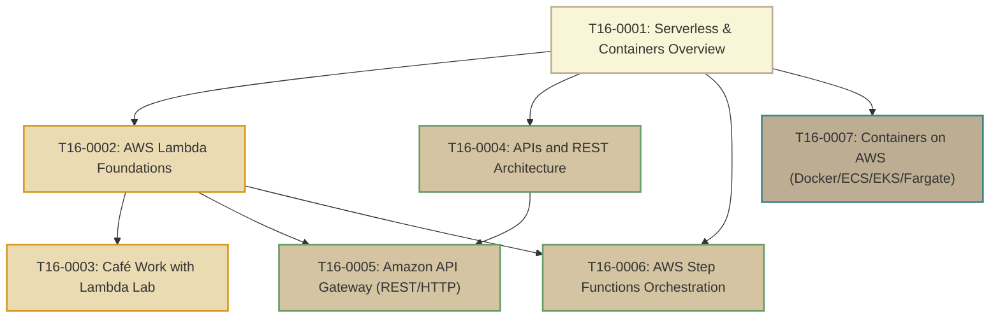

# T16: Serverless and Containers

> **Course**: AWS re/Start Curriculum  
> **Module**: T16 – Serverless and Containers (`M12`)  
> **Total Guides**: 7 Study Guides  
> **Status**: Completed (100%)

---

## Module Overview

The **Serverless and Containers** module details the paradigm shift from managing virtual servers to deploying event-driven serverless architectures and containerized microservices. The curriculum progresses through:
1. **AWS Lambda**: Running code in response to events without provisioning or managing infrastructure.
2. **APIs and REST**: The six core constraints of RESTful design, HTTP methods, and status codes.
3. **Amazon API Gateway**: Creating, publishing, monitoring, and securing serverless REST, HTTP, and WebSocket APIs at scale.
4. **AWS Step Functions**: Serverless visual workflow orchestration and resilient state machine error handling.
5. **Containers on AWS**: Docker packaging, Amazon Elastic Container Registry (ECR), orchestration with Amazon ECS and Amazon EKS, and serverless compute via AWS Fargate.

---

## Study Guide Index

| # | Study Guide | Primary Topics Covered |
|---|-------------|------------------------|
| **0001** | [T16-0001-RSSECO_EN-US_SG_M12_SERVERLESSCONTAINERS.md](file:///work/tmp/aws-cf/T16-Serverless_and_Containers/T16-0001-RSSECO_EN-US_SG_M12_SERVERLESSCONTAINERS.md) | Modern application architecture shift, roadmap across Lambda, API Gateway, Step Functions, ECS/EKS/Fargate, troubleshooting KB runbooks |
| **0002** | [T16-0002-RSSECO_EN-US_SG_M12_AWSLAMBDA.md](file:///work/tmp/aws-cf/T16-Serverless_and_Containers/T16-0002-RSSECO_EN-US_SG_M12_AWSLAMBDA.md) | Firecracker microVMs, Init/Invoke/Shutdown lifecycle, cold starts, Provisioned Concurrency, invocation models (Sync, Async, ESM), Hyperplane ENI |
| **0003** | [T16-0003-RSSECO_EN-US_SG_M12_CAFEWORKWITHLAMBDA.md](file:///work/tmp/aws-cf/T16-Serverless_and_Containers/T16-0003-RSSECO_EN-US_SG_M12_CAFEWORKWITHLAMBDA.md) | Café automated sales reporting lab, EventBridge triggers, PyMySQL on EC2, CloudWatch Logs `REPORT` analysis, S3 word count challenge activity |
| **0004** | [T16-0004-RSSECO_EN-US_SG_M12_APISREST.md](file:///work/tmp/aws-cf/T16-Serverless_and_Containers/T16-0004-RSSECO_EN-US_SG_M12_APISREST.md) | Roy Fielding REST constraints, HTTP verbs & CRUD mappings, URI plural noun conventions, status code taxonomy (2xx/3xx/4xx/5xx), idempotency |
| **0005** | [T16-0005-RSSECO_EN-US_SG_M12_AMAZONAPIGATEWAY.md](file:///work/tmp/aws-cf/T16-Serverless_and_Containers/T16-0005-RSSECO_EN-US_SG_M12_AMAZONAPIGATEWAY.md) | REST vs HTTP vs WebSocket APIs, Lambda Proxy integration, Edge/Regional/Private endpoints, Cognito / Lambda authorizers, Token Bucket throttling |
| **0006** | [T16-0006-RSSECO_EN-US_SG_M12_AWSSTEPFUNCTIONS.md](file:///work/tmp/aws-cf/T16-Serverless_and_Containers/T16-0006-RSSECO_EN-US_SG_M12_AWSSTEPFUNCTIONS.md) | Orchestration vs Choreography, Standard vs Express Workflows, Amazon States Language (ASL), Task/Choice/Parallel/Map states, exponential retry/catch |
| **0007** | [T16-0007-RSSECO_EN-US_SG_M12_CONTAINERSAWS.md](file:///work/tmp/aws-cf/T16-Serverless_and_Containers/T16-0007-RSSECO_EN-US_SG_M12_CONTAINERSAWS.md) | VMs vs Containers, Dockerfile/Image/Container primitives, Linux cgroups & namespaces, Amazon ECR scanning, Amazon ECS, Amazon EKS, AWS Fargate |

---

## Compute Abstraction Comparison

| Characteristic | Amazon EC2 (IaaS) | AWS Elastic Beanstalk (PaaS) | Amazon ECS / EKS with Fargate | AWS Lambda (Serverless) |
|---|---|---|---|---|
| **Packaging** | AMI (OS + Apps) | Source code bundle | Docker / OCI container image | Function code / Container image |
| **Scaling Unit** | Instance | Instance | Task / Pod | Individual request / invocation |
| **Scaling Speed** | Minutes | Minutes | Seconds | Milliseconds |
| **Billing Granularity** | Per-second (1 min min) | Per-second (resources) | Per-second (vCPU + RAM) | Per-millisecond |
| **OS Management** | 100% User | AWS managed runtime | Zero (AWS managed microVM) | Zero (AWS managed microVM) |
| **Max Execution** | Unlimited | Unlimited | Unlimited | 15 minutes (900s) |
