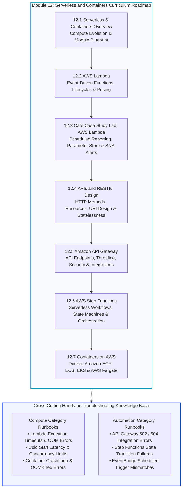
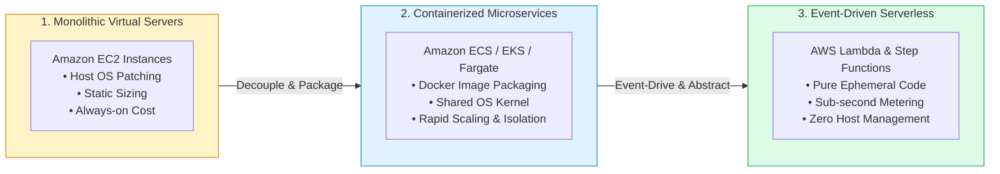
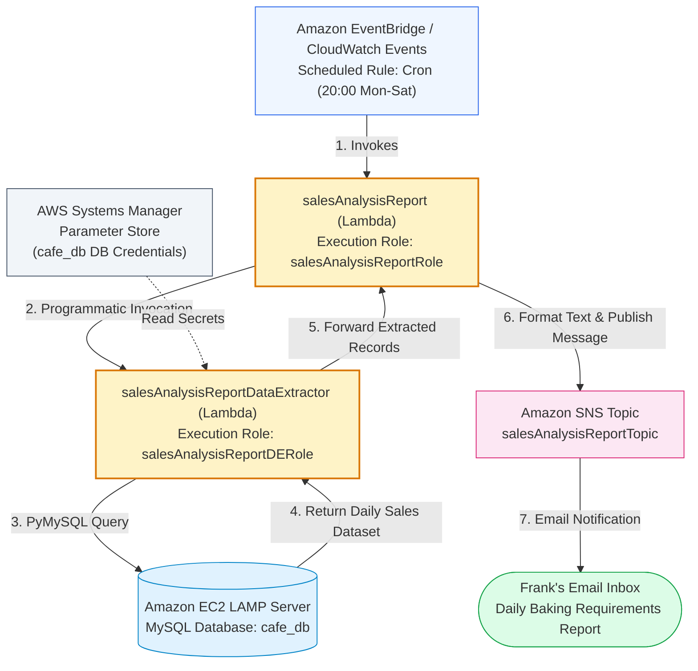
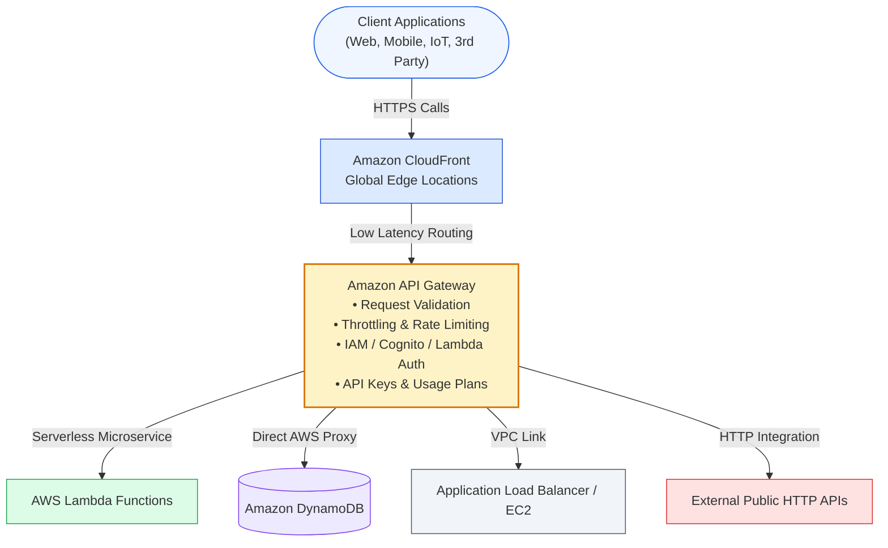
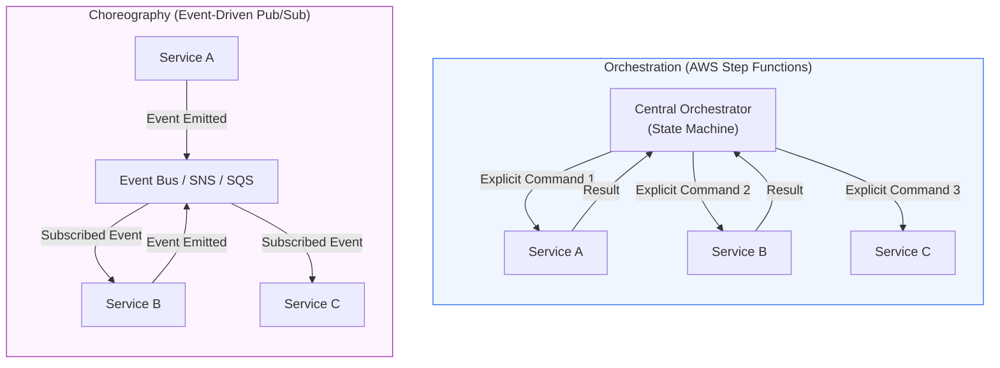
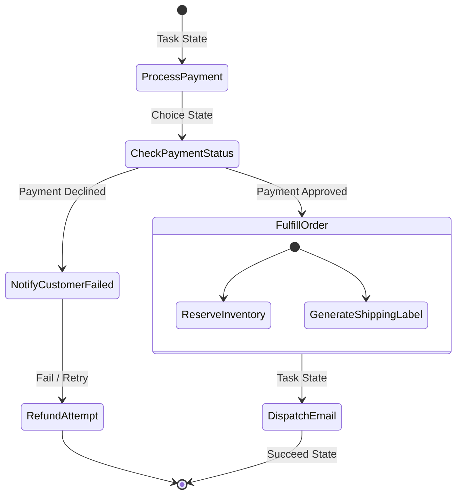
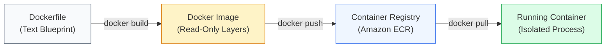
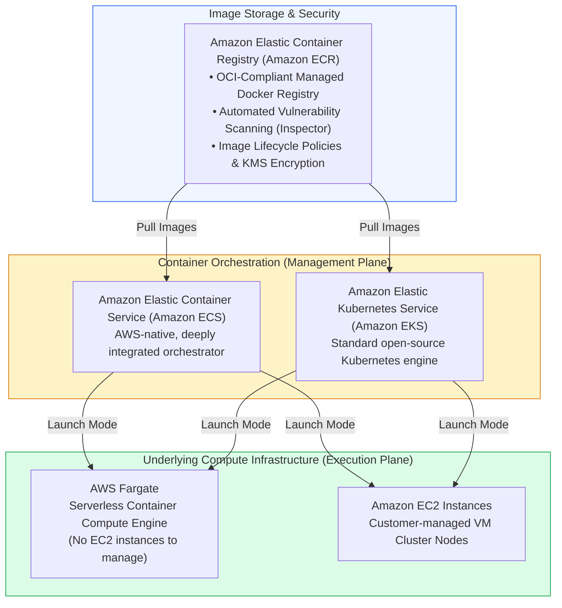

# ⚡ Module 12: Serverless and Containers Overview – Study Guide

> **Course**: AWS re/Start  
> **Module**: Serverless and Containers (Module 12)  
> **Source Document**: `T16-0001-RSSECO_EN-US_SG_M12_SERVERLESSCONTAINERS.pdf`  
> **Target Audience**: AWS re/Start Learners / Cloud Practitioners / Solutions Architects / DevOps Engineers  

---

## 🎯 Unit Overview: The Modern Application Architecture Shift

In traditional enterprise computing, delivering application workloads required deploying and maintaining monolithic systems on physical servers or long-lived virtual machines. System administrators spent substantial operational effort patching host operating systems, managing kernel updates, configuring hypervisors, and sizing static infrastructure for peak usage spikes that occurred only intermittently. Compute capacity remained idle during off-peak periods, generating unnecessary infrastructure costs, while monolithic applications struggled with brittle release cycles and tightly coupled component failures.

The evolution of cloud architectures has fundamentally transformed application development from host-centric operations into modular, ephemeral compute abstractions. Modern cloud applications decouple software into lightweight, independently scalable components using two primary architectural paradigms: **Containers** and **Serverless Computing**.

```
┌──────────────────────────────────────────────────────────────────────────────────────────────────┐
│                     The Evolution of Application Architectures & Compute                          │
├──────────────────────────────┬──────────────────────────────────┬────────────────────────────────┤
│   Monolithic Virtual Hosts   │      Containerized Packaging     │      Serverless Event-Driven   │
├──────────────────────────────┼──────────────────────────────────┼────────────────────────────────┤
│ • Long-running EC2 instances │ • Docker lightweight packaging   │ • AWS Lambda functions         │
│ • OS patching & maintenance  │ • Shared OS kernel / namespaces  │ • Zero server management       │
│ • Coarse-grained scaling     │ • Microservice modularity        │ • Sub-millisecond execution    │
│ • Continuous idle billing    │ • Amazon ECS, EKS & AWS Fargate  │ • Event-driven pay-per-use     │
│ • High operational overhead  │ • Rapid portability & density    │ • Amazon API Gateway & Step Fn │
└──────────────────────────────┴──────────────────────────────────┴────────────────────────────────┘
```

**Module 12: Serverless and Containers** explores the full continuum of modern cloud compute abstractions:
1. **AWS Lambda**: Executes code directly in response to events without provisioning or managing infrastructure.
2. **Café Case Study Automation**: Demonstrates how real-world businesses leverage serverless automation to pull relational database analytics and dispatch operational notifications via Amazon SNS.
3. **Application Programming Interfaces (APIs) & REST**: Establishes programmatic communication standards between loosely coupled systems using HTTP verbs, statelessness, and structured resources.
4. **Amazon API Gateway**: Provides a secure, scalable front door for REST, HTTP, and WebSocket APIs with built-in throttling, authentication, and backend integrations.
5. **AWS Step Functions**: Coordinates distributed microservices and serverless components into resilient visual workflows and state machines.
6. **Containers on AWS**: Packages applications with complete dependencies into portable Docker images executed across Amazon ECR, Amazon ECS, Amazon EKS, and serverless AWS Fargate.

---

### 📌 Learning Objectives

- [ ] **Define Serverless Computing and AWS Lambda Primitives**: Explain the core tenets of serverless architecture (no server management, automated continuous scaling, pay-for-value execution, and built-in high availability) and inspect AWS Lambda execution models, lifecycle phases, and pricing.
- [ ] **Analyze the Café Serverless Automation Implementation**: Trace how Nikhil and Sofía design an automated daily sales analysis workflow triggering Lambda from CloudWatch Events, querying MySQL on Amazon EC2 via Systems Manager Parameter Store credentials, and publishing alerts via Amazon SNS.
- [ ] **Explain API Architectures and RESTful Design Principles**: Describe how APIs provide programmatic interfaces between software systems, and detail the architectural constraints of Representational State Transfer (REST) including statelessness, resource URIs, HTTP methods, and status codes.
- [ ] **Evaluate Amazon API Gateway Capabilities**: Articulate how Amazon API Gateway acts as a fully managed reverse proxy handling client scaling, request validation, IAM/Cognito authentication, stage deployments, throttling, and backend integration.
- [ ] **Orchestrate Workflows with AWS Step Functions**: Differentiate orchestration from choreography, understand the Amazon States Language (ASL), state machine execution states, error retry/catch handling, and evaluate Standard vs. Express Workflows.
- [ ] **Master Container Technologies & Docker Fundamentals**: Contrast hardware-level hypervisor virtualization with OS-level container isolation, explain Dockerfiles, images, containers, and registries, and evaluate environmental consistency benefits.
- [ ] **Survey AWS Container Ecosystem Services**: Differentiate the container registry (Amazon ECR), container orchestration platforms (Amazon ECS and Amazon EKS), and serverless container compute engines (AWS Fargate).
- [ ] **Document Incident Runbooks in the Troubleshooting Knowledge Base**: Formulate systematic diagnostic runbooks and resolution procedures for the **Compute** and **Automation** categories.

---

## 🗺️ Module 12 Curriculum Roadmap

The diagram below outlines the structural sequence of the **Module 12: Serverless and Containers** curriculum, illustrating how foundational serverless execution links into API presentation, visual workflow orchestration, and container packaging:



---

## 🏗️ Modern Application Evolution: Compute Abstraction Continuum

The architectural trajectory of enterprise computing has systematically moved higher up the abstraction ladder, shifting undifferentiated infrastructure management to AWS:



### Compute Abstraction Comparison

| Characteristic | Virtual Machines (Amazon EC2) | Managed Containers (Amazon ECS / EKS on EC2) | Serverless Containers (AWS Fargate) | Serverless Functions (AWS Lambda) |
| :--- | :--- | :--- | :--- | :--- |
| **Abstraction Level** | Hardware virtualization (Hypervisor / Xen / Nitro) | Container daemon on managed VM fleet | Ephemeral container execution environment | Ephemeral event-driven code execution sandbox |
| **OS Management** | Customer manages OS, security patches, drivers | Customer manages cluster node host OS; AWS manages container agent | AWS manages underlying host OS and hypervisor completely | AWS manages OS, runtime platform, patch cycles, and scaling |
| **Scaling Velocity** | Minutes (EC2 bootstrapping, Auto Scaling Groups) | Seconds to minutes (Task launching or EC2 cluster auto scaling) | Seconds (Task provisioning directly on Fargate capacity) | Milliseconds (Instant concurrency scaling per incoming request) |
| **Billing Model** | Per-second running instance billing (whether idle or busy) | Per-second EC2 instance billing for cluster instances | Per-second vCPU and memory consumption of running tasks | Per-millisecond execution duration + total number of requests |
| **Maximum Execution Duration** | Unlimited (Persistent virtual servers) | Unlimited (Persistent container processes) | Unlimited (Persistent or batch container tasks) | 15 minutes (900 seconds) per function invocation |
| **Best Used For** | Legacy software, kernel-level drivers, specialized hardware | Complex microservices requiring host-level control, specialized networking | Microservices, enterprise web applications, containerized APIs | Event processing, real-time file ETL, webhook processing, REST backends |

---

## ⚡ Theme 1: AWS Lambda – Event-Driven Serverless Compute

### 1.1 What is Serverless Computing?
Serverless computing does not mean servers no longer exist; rather, it means **developers and systems administrators do not configure, manage, patch, or scale physical or virtual servers**. In the serverless model:
- **Zero Server Administration**: You never log in via SSH or RDP to update an OS or apply security hotfixes.
- **Auto-Scaling with Demand**: Compute automatically scales from zero requests up to thousands of concurrent requests and back down to zero.
- **Pay for Value (No Idle Charges)**: You are never billed for idle standby time; charges accrue strictly when code executes.
- **Built-in High Availability**: Serverless services automatically span multiple Availability Zones (AZs) within an AWS Region.

```
Traditional Deployment vs. Serverless Deployment:
┌──────────────────────────────────────────────┬──────────────────────────────────────────────┐
│ Traditional Server Operations (EC2)          │ Serverless Operations (AWS Lambda)           │
├──────────────────────────────────────────────┼──────────────────────────────────────────────┤
│ 1. Provision virtual machine instance        │ 1. Write business logic code                 │
│ 2. Install & patch operating system (OS)     │ 2. Configure runtime & memory                │
│ 3. Install runtime & web server frameworks   │ 3. Select trigger event source               │
│ 4. Configure auto-scaling groups & ELB       │ 4. AWS handles all provisioning & scaling    │
│ 5. Monitor host health & replace failures    │ 5. Pay only for exact milliseconds executed  │
└──────────────────────────────────────────────┴──────────────────────────────────────────────┘
```

### 1.2 Core Capabilities and Execution Model of AWS Lambda
**AWS Lambda** is a fully managed event-driven compute engine that executes application code in isolated runtime environments without provisioning servers.

#### Execution Characteristics:
- **Supported Runtimes**: Native support for Python, Node.js, Java, Go, Ruby, .NET (C#), and custom runtimes via the Lambda Runtime API (allowing Rust, C++, PHP, and bash).
- **Resource Allocation**: Memory is configurable from **128 MB to 10,240 MB (10 GB)** in 1 MB increments. CPU power scales proportionately with allocated memory (at 1,769 MB of memory, a Lambda function receives the equivalent of 1 full vCPU).
- **Execution Timeout**: Configurable from 1 second up to a hard ceiling of **15 minutes (900 seconds)**. Tasks exceeding 15 minutes must run on containers or AWS Step Functions state machines.
- **Ephemeral Storage**: Default 512 MB `/tmp` scratch disk space, configurable up to 10,240 MB (10 GB).

```mermaid
sequenceDiagram
    autonumber
    actor Client as Event Source (S3, API GW, DynamoDB)
    participant Lambda as AWS Lambda Service
    participant Sandbox as Execution Environment (MicroVM)
    participant Backend as External Resources (RDS, DynamoDB, SNS)

    Client->>Lambda: Dispatches Event Payload
    alt Cold Start (No Idle Sandbox Available)
        Lambda->>Sandbox: Download Code / Image Layer
        Lambda->>Sandbox: Initialize Runtime & Extensions
        Lambda->>Sandbox: Run Global / Static Code
    else Warm Start (Reusing Existing Sandbox)
        Note over Sandbox: Skips Init; Sandbox immediately active
    end
    Lambda->>Sandbox: Invokes Handler Function(event, context)
    Sandbox->>Backend: Queries DB / Publishes Message
    Sandbox-->>Lambda: Returns Response Payload
    Lambda-->>Client: Delivers Execution Result
```

### 1.3 The AWS Lambda Lifecycle Phases
AWS Lambda manages the execution environment through three discrete lifecycle phases:
1. **Init Phase**:
   - Downloads the deployment package or container image.
   - Starts the runtime environment and initializes extensions.
   - Executes initialization code (static imports, database client initialization outside the handler).
   - *Cold Start Latency*: Occurs during this phase when a new execution environment must be spun up.
2. **Invoke Phase**:
   - Lambda passes the invocation `event` and `context` objects to the registered function handler.
   - The handler runs to completion, times out, or throws an unhandled error.
3. **Shutdown Phase**:
   - If the function receives no new events for a period, Lambda terminates the runtime and cleans up the sandbox environment.

> [!TIP]
> **Optimizing Lambda Performance & Cold Starts**:  
> Initialize database connection pools, AWS SDK clients, and heavy third-party libraries **outside** the handler function in the global execution scope. When Lambda reuses a "warm" execution sandbox for subsequent invocations, these client connections persist, avoiding costly repeated handshakes.

### 1.4 Invocation Models
AWS Lambda supports three fundamental invocation models:

| Invocation Model | Invocation Type | Example Event Sources | Error & Retry Handling |
| :--- | :--- | :--- | :--- |
| **Synchronous** | `RequestResponse` | Amazon API Gateway, Application Load Balancer, AWS SDK | Client waits for return payload; errors returned directly to caller; caller manages retries. |
| **Asynchronous** | `Event` | Amazon S3, Amazon SNS, Amazon EventBridge | Lambda immediately returns HTTP 202 Accepted. Automatically retries twice on failure; can route failures to Dead Letter Queues (DLQ) or Lambda Destinations. |
| **Event Source Mapping (Polled)** | Polling mechanism | Amazon Kinesis, Amazon DynamoDB Streams, Amazon SQS | Lambda polls the stream or queue on the developer's behalf, batches records, and sends them to the function handler. |

---

## ☕ Theme 2: Café Case Study – Working with AWS Lambda

### 2.1 The Business Scenario
In the ongoing narrative of the Frank & Martha Café, business operations have expanded significantly. While their static website on Amazon S3 and dynamic ordering system hosted on Amazon EC2 handle customer orders, manual administrative tasks create operational bottlenecks:
- **Sofía's Challenge**: Sofía needs to generate an automated daily sales analysis report each evening after closing to project the next day's baking requirements (quantities of croissants, artisan breads, and pastries).
- **Frank's Requirement**: Frank needs the sales summary delivered directly to his email inbox so the bakery team can review ingredient needs before starting baking shifts early the next morning.
- **Nikhil's Cloud Solution**: Rather than provisioning another dedicated EC2 server that remains idle 99% of the day, Nikhil designs an **event-driven, automated serverless workflow** combining Amazon EventBridge, AWS Lambda, AWS Systems Manager Parameter Store, and Amazon SNS.



### 2.2 Architectural Flow & Components

1. **Scheduled Trigger (Amazon EventBridge)**: A scheduled CloudWatch Event rule triggers the primary coordinator function `salesAnalysisReport` at 20:00 every Monday through Saturday.
2. **Coordinator Function (`salesAnalysisReport`)**: Coordinates report generation and invokes the worker function `salesAnalysisReportDataExtractor`.
3. **Data Extractor Function (`salesAnalysisReportDataExtractor`)**: Retrieves database credentials securely from **AWS Systems Manager Parameter Store**, establishes a secure connection to the `cafe_db` database on the EC2 LAMP instance using the Python `PyMySQL` library, and executes the daily aggregation SQL query.
4. **IAM Role Governance**: Both Lambda functions are bound by least-privilege IAM roles (`salesAnalysisReportRole` and `salesAnalysisReportDERole`) restricting permissions strictly to required AWS APIs.
5. **Notification Dispatch (Amazon Simple Notification Service - SNS)**: The primary function receives query results, formats a structured email summary ("Tomorrow's Baking Forecast"), and publishes it to the `salesAnalysisReportTopic` SNS topic.
6. **Consumer Notification**: Amazon SNS fans out the report to Frank's verified email subscription.

### 2.3 Challenge Activity: S3-Triggered Word Counter
The hands-on lab extends the learner's serverless competencies through an automated text-processing microservice:
- **Event Source**: File upload (`s3:ObjectCreated:*`) to an Amazon S3 bucket.
- **Lambda Function**: Written in Python, triggered automatically upon new `.txt` object creation.
- **Function Logic**: Extracts bucket name and object key from the event payload, streams the object via the AWS SDK (`boto3`), counts total words, and constructs an informational payload:
  `The word count in the file <textFileName> is nnn.`
- **Destination**: Publishes the result with the subject line `Word Count Result` to an Amazon SNS topic for email/SMS delivery.

---

## 🌐 Theme 3: Application Programming Interfaces (APIs) & RESTful Design

### 3.1 What is an API?
An **Application Programming Interface (API)** is a software intermediary that enables two separate computer applications to communicate programmatically without direct user intervention via a graphical user interface (GUI).
- **Decoupling**: Consumers interact strictly with the interface contract, allowing backend engineering teams to modify underlying databases or server architectures without breaking client applications.
- **Standardization**: Enforces strict protocols, data formatting rules, and validation checks for cross-platform integration across web browsers, mobile apps, and IoT devices.

### 3.2 Core Architectural Principles of REST
**Representational State Transfer (REST)** is an architectural style designed for distributed, loosely coupled hypermedia systems communicating over HTTP. To be considered RESTful, an API must adhere to six fundamental design constraints:

```
┌────────────────────────────────────────────────────────────────────────────────────────┐
│                        Six Architectural Constraints of REST                           │
├───────────────────────────────┬────────────────────────────────────────────────────────┤
│ 1. Uniform Interface          │ Standardized URIs, HTTP methods, and resource schemas  │
│ 2. Statelessness              │ Every request contains all context needed to execute   │
│ 3. Cacheability               │ Responses explicitly declare if they are cacheable     │
│ 4. Client-Server Architecture │ Client UI and server storage are strictly decoupled    │
│ 5. Layered System             │ Intermediaries (proxies, gateways, CDNs) are invisible │
│ 6. Code on Demand (Optional)  │ Servers can deliver executable scripts to clients       │
└───────────────────────────────┴────────────────────────────────────────────────────────┘
```

#### Detailed Breakdown of REST Constraints:
1. **Uniform Interface**: Resources are uniquely identified via Uniform Resource Identifiers (URIs), and representations (such as JSON or XML) are manipulated via standard HTTP methods.
2. **Statelessness**: The server never stores client session state between requests. Every individual request must carry all authentication tokens, parameter context, and payload data necessary for the server to process it. This enables frictionless horizontal scaling across server fleets.
3. **Cacheability**: Responses must define whether they are cacheable by client browsers or intermediate CDN edge servers (e.g., using `Cache-Control` headers) to minimize latency and server load.
4. **Client-Server Separation**: The user interface concerns are separated from data storage and business logic concerns, enabling independent evolutionary lifecycles.
5. **Layered System**: A client cannot tell whether it is communicating directly with the end server or passing through load balancers, API gateways, security firewalls, or caching layers.
6. **Code on Demand (Optional)**: Servers can optionally extend client capabilities by transmitting executable logic (such as client-side JavaScript or Java applets).

### 3.3 HTTP Request Anatomy & Methods

```
HTTP Request Anatomy:
┌────────────────────────────────────────────────────────────────────────────────────────┐
│ POST /api/v1/orders HTTP/1.1                                       <-- Request Line    │
│ Host: api.cafe.example.com                                         <-- Host Header     │
│ Authorization: Bearer eyJhbGciOi...                                <-- Auth Header     │
│ Content-Type: application/json                                     <-- Content Header  │
│                                                                                        │
│ {                                                                  <-- Request Body    │
│   "customer_id": 4182,                                             │                   │
│   "items": [{"item_id": "croissant-01", "quantity": 3}],           │                   │
│   "pickup_time": "2026-10-14T08:30:00Z"                            │                   │
│ }                                                                  <-- Payload         │
└────────────────────────────────────────────────────────────────────────────────────────┘
```

| HTTP Method | CRUD Operation | Idempotent? | Description & URI Example |
| :--- | :--- | :--- | :--- |
| **`GET`** | Read / Retrieve | **Yes** | Retrieves representation of resource without side effects. (`GET /orders/105`) |
| **`POST`** | Create | **No** | Submits new data to create a subordinate resource. (`POST /orders`) |
| **`PUT`** | Update / Replace | **Yes** | Replaces target resource completely with supplied payload. (`PUT /orders/105`) |
| **`PATCH`** | Partial Update | **No** | Modifies specific attributes of existing resource. (`PATCH /orders/105`) |
| **`DELETE`** | Delete | **Yes** | Removes specified resource permanently. (`DELETE /orders/105`) |

> [!NOTE]
> **Idempotence Explained**: An HTTP method is **idempotent** if making identical requests multiple times produces the exact same outcome on the server as making a single request. `GET`, `PUT`, and `DELETE` are idempotent; `POST` is not idempotent because repeating it creates multiple distinct records.

---

## 🚪 Theme 4: Amazon API Gateway

### 4.1 What is Amazon API Gateway?
**Amazon API Gateway** is an enterprise-scale, fully managed service that allows developers to create, publish, maintain, monitor, and secure REST, HTTP, and WebSocket APIs at any volume.

API Gateway acts as the secure entry point ("front door") for applications, decoupling client applications (mobile devices, web browsers, third-party systems) from backend infrastructure:



### 4.2 Key Architectural Benefits of API Gateway
1. **Performance at Any Scale**: Integrated natively with Amazon CloudFront edge locations to provide minimal latency worldwide for API calls and responses.
2. **Resilience & Throttling (Traffic Shaping)**: Protects downstream backend services from traffic spikes using a token bucket algorithm with configurable **Rate** (requests per second) and **Burst** limits.
3. **Flexible Access Control & Security**:
   - **AWS IAM**: Authorize callers within an AWS organization using IAM roles and signature version 4 (SigV4).
   - **Amazon Cognito User Pools**: Authenticate end users using OpenID Connect (OIDC) or OAuth 2.0 JWT tokens.
   - **Lambda Authorizers**: Custom token-based or request-parameter-based authorization functions executing bespoke security logic.
4. **Lifecycle and Stage Management**: Enables multiple stages (e.g., `dev`, `test`, `v1`, `v2`, `prod`) to operate simultaneously, supporting rollback and canary releases without downtime.
5. **Monitoring & Tracing**: Native metrics exported directly to Amazon CloudWatch (latency, 4xx errors, 5xx errors, request count) and end-to-end request tracing via AWS X-Ray.

### 4.3 API Gateway API Types Comparison

| API Type | Protocol | Key Characteristics & Optimizations | Best Workload Profile |
| :--- | :--- | :--- | :--- |
| **HTTP APIs** | HTTP/1.1, HTTP/2 | High performance, lightweight, simplified features, **up to 71% cheaper** than REST APIs, native OIDC/OAuth2 authorization. | Serverless proxy to AWS Lambda or HTTP backends where advanced transformation isn't required. |
| **REST APIs** | HTTP/1.1 | Feature-rich: API Keys, per-client Usage Plans, request/response data mapping templates, caching, WAF integration. | Enterprise APIs requiring monetization, fine-grained validation, XML-to-JSON transforms, or API key management. |
| **WebSocket APIs** | WebSocket | Stateful, bidirectional, full-duplex communication over persistent TCP connections. | Real-time chat applications, live financial dashboards, multiplayer games, collaborative editing tools. |

---

## 🔄 Theme 5: AWS Step Functions – Serverless Visual Workflows

### 5.1 What is AWS Step Functions?
**AWS Step Functions** is a serverless visual orchestration service that coordinates distributed microservices, AWS Lambda functions, and AWS cloud services into automated multi-step workflows.

In distributed cloud architectures, applications comprise numerous independent components. Step Functions centrally manages execution flow, records state transitions, and retains an immutable event history so applications recover automatically from failures.

### 5.2 Orchestration vs. Choreography



- **Choreography (Decoupled Pub/Sub)**: Components publish events to message brokers (Amazon EventBridge, Amazon SNS, Amazon SQS) without knowing who consumes them. Best for completely autonomous, loosely coupled event streaming.
- **Orchestration (Centralized Control)**: A central state machine controls the sequence, manages step timeouts, executes conditional branching, and directly tracks data passed between steps. Best for multi-step transactional business processes (e.g., payment, order fulfillment, refund processing).

### 5.3 Amazon States Language (ASL) & State Types
Step Functions state machines are defined declaratively using **Amazon States Language (ASL)**, a structured JSON-based schema:

```
Common Step Functions State Types:
┌──────────────┬────────────────────────────────────────────────────────────────────────┐
│ State Type   │ Function & Operational Behavior                                        │
├──────────────┼────────────────────────────────────────────────────────────────────────┤
│ Task         │ Executes a unit of work (invokes Lambda, calls DynamoDB, runs ECS task)│
│ Choice       │ Evaluates branch conditions (if/else branching based on JSON fields)   │
│ Pass         │ Passes input directly to output or injects fixed mock data             │
│ Wait         │ Pauses execution for a specified duration or until a timestamp         │
│ Parallel     │ Executes multiple independent workflow branches concurrently           │
│ Map          │ Iterates through an array and executes steps for each element          │
│ Succeed      │ Terminates execution successfully                                      │
│ Fail         │ Terminates execution with an explicit error code and message           │
└──────────────┴────────────────────────────────────────────────────────────────────────┘
```



### 5.4 Standard vs. Express Workflows

| Attribute | Standard Workflows | Express Workflows |
| :--- | :--- | :--- |
| **Maximum Duration** | Up to **1 year** | Up to **5 minutes** |
| **Execution Rate** | Up to 2,000 executions per second | Up to 100,000+ executions per second |
| **Execution Model** | **Exactly-once** execution | **At-least-once** (asynchronous) or **At-most-once** (synchronous) |
| **Pricing Model** | Charged per **state transition** ($0.025 per 1,000 transitions) | Charged per **execution count and duration/memory** |
| **Audit & Visual History**| Full visual execution history maintained in console for 90 days | Execution logs sent to Amazon CloudWatch Logs |
| **Best Used For** | Long-running processes, financial transactions, human-in-the-loop approvals | High-frequency microservice orchestration, IoT telemetry, real-time streaming |

---

## 📦 Theme 6: Containers on AWS

### 6.1 Container Fundamentals: Process Isolation vs. Virtual Machines
Before containers, applications were coupled directly to the underlying physical server or virtual machine operating system. Moving an application between development, testing, and production routinely triggered software bugs caused by mismatched operating system libraries, conflicting package versions, and dissimilar system configurations ("It worked on my machine!").

A **container** packages application code alongside all of its libraries, system binaries, runtimes, and dependencies into an immutable, portable artifact.

```
Virtual Machines (Hardware Virtualization) vs. Containers (OS-Level Virtualization):
┌──────────────────────────────────────────────┬──────────────────────────────────────────────┐
│ Virtual Machines (Amazon EC2)                │ Containers (Docker / Fargate)                │
├──────────────────────────────────────────────┼──────────────────────────────────────────────┤
│ ┌──────────────────────────────────────────┐ │ ┌──────────────────────────────────────────┐ │
│ │ App 1          │ App 2          │ App 3  │ │ │ App 1          │ App 2          │ App 3  │ │
│ ├────────────────┼────────────────┼────────┤ │ ├────────────────┼────────────────┼────────┤ │
│ │ Bins / Libs    │ Bins / Libs    │ Libs   │ │ │ Bins / Libs    │ Bins / Libs    │ Libs   │ │
│ ├────────────────┼────────────────┼────────┤ │ ├────────────────┴────────────────┴────────┤ │
│ │ Guest OS       │ Guest OS       │ Guest  │ │ │ Container Runtime Engine (Docker/containerd)│
│ ├────────────────┴────────────────┴────────┤ │ ├──────────────────────────────────────────┤ │
│ │ Hypervisor (Type 1 or Type 2 / Nitro)    │ │ │ Host Operating System (Linux Kernel)     │ │
│ ├──────────────────────────────────────────┤ │ ├──────────────────────────────────────────┤ │
│ │ Physical Hardware Server (Bare Metal)    │ │ │ Physical Hardware Server (Bare Metal)    │ │
│ └──────────────────────────────────────────┘ │ └──────────────────────────────────────────┘ │
└──────────────────────────────────────────────┴──────────────────────────────────────────────┘
```

#### Key Distinctions:
- **Virtual Machines**: Virtualize the underlying physical hardware. Each VM contains a complete, independent **Guest Operating System** (including its own kernel, system drivers, and background services), which consumes gigabytes of storage and requires several minutes to boot.
- **Containers**: Share the **Host Operating System kernel**. Using Linux kernel primitives (**namespaces** for boundary isolation and **control groups / cgroups** for resource metering), containers isolate processes without booting a separate OS. Containers boot in milliseconds and occupy megabytes rather than gigabytes.

### 6.2 Docker Primitives & Workflow
**Docker** is the open-source software platform that popularized modern container adoption by providing standardized tools to build, package, and run containers.



1. **Dockerfile**: A plain-text configuration file containing ordered instructions (`FROM`, `COPY`, `RUN`, `ENV`, `EXPOSE`, `CMD`) that specify how to build the container image.
2. **Docker Image**: An immutable, read-only template built from stacked union filesystem layers. Once built, an image never changes; updates generate a new tagged version.
3. **Container**: A running, executable instance of an image with a thin, writable top layer. Multiple containers can run concurrently from the same underlying image.
4. **Registry**: A central storage system for sharing and versioning images (e.g., Docker Hub or Amazon ECR).

### 6.3 The AWS Container Ecosystem
AWS provides a comprehensive suite of purpose-built services spanning the container lifecycle:



#### Detailed Service Breakdown:
- **Amazon Elastic Container Registry (Amazon ECR)**: Fully managed, highly available Docker container registry. Eliminates the need to operate private registry clusters. Integrates natively with IAM, automatically scans images for software vulnerabilities using Amazon Inspector, and supports replication across AWS Regions.
- **Amazon Elastic Container Service (Amazon ECS)**: Highly scalable, fast container management service built natively for AWS. Simplifies container orchestration using AWS-native concepts:
  - *Task Definition*: JSON blueprint defining container images, CPU/memory allocations, port mappings, environment variables, and IAM roles.
  - *Task*: Running instantiation of a task definition.
  - *Service*: Maintains a specified number of running tasks simultaneously across Availability Zones and connects them to Elastic Load Balancers.
  - *Cluster*: Logical grouping of tasks or services.
- **Amazon Elastic Kubernetes Service (Amazon EKS)**: Managed Kubernetes service that makes it easy to run Kubernetes on AWS without installing or operating the Kubernetes control plane. Delivers 100% upstream Kubernetes compatibility.
- **AWS Fargate**: Serverless compute engine for containers compatible with both Amazon ECS and Amazon EKS. With Fargate, you do not provision, configure, or scale virtual machines for clusters; you define your application requirements at the task level, and Fargate runs the container in a dedicated, isolated execution sandbox.

---

## 🛠️ Troubleshooting Knowledge Base: Serverless & Automation Runbooks

As required by the curriculum, learners maintain diagnostic runbooks across the **Compute** and **Automation** categories:

```
┌────────────────────────────────────────────────────────────────────────────────────────┐
│             Troubleshooting Knowledge Base Matrix: Module 12 Integrations              │
├────────────────────┬───────────────────────────────────┬───────────────────────────────┤
│ Failure Category   │ Fault Condition                   │ Root Cause & Resolution       │
├────────────────────┼───────────────────────────────────┼───────────────────────────────┤
│ Compute (Lambda)   │ Task timed out after 15.00 seconds│ Subnet routing / VPC endpoint │
│ Compute (Lambda)   │ MemorySize Limit Exceeded (OOM)   │ Memory allocation / Profiling │
│ Automation (APIGW) │ HTTP 502 Bad Gateway              │ Malformed response / Auth err │
│ Automation (StepFn)│ States.TaskFailed / Permissions   │ IAM Role execution policies   │
│ Compute (Container)│ Container CrashLoop (Exit 137)    │ Task definition cgroup limit  │
└────────────────────┴───────────────────────────────────┴───────────────────────────────┘
```

### Runbook 1: AWS Lambda Execution Timeout & VPC Network Isolation
- **Symptom**: CloudWatch Logs report `Task timed out after 15.00 seconds` or `Function failed to complete within allocated timeout`.
- **Primary Root Causes**:
  1. The function's configured execution timeout is set too low (e.g., default 3 seconds) for the requested workload or network query.
  2. The Lambda function is associated with a private VPC subnet but cannot reach internet-based endpoints or AWS service APIs because the subnet lacks a **NAT Gateway** or required **VPC Endpoints** (PrivateLink).
- **Remediation Steps**:
  1. In the Lambda Console, navigate to **Configuration** $\rightarrow$ **General configuration** and increase the timeout value (up to 900s).
  2. If the function resides inside a VPC:
     - Verify that private subnets route `0.0.0.0/0` traffic through a NAT Gateway in a public subnet.
     - Alternatively, configure an interface VPC Endpoint for the target service (e.g., `com.amazonaws.region.ssm` or `com.amazonaws.region.sns`) to route traffic privately without requiring public internet egress.

### Runbook 2: Amazon API Gateway HTTP 502 Bad Gateway
- **Symptom**: Calling an API Gateway endpoint returns `HTTP 502 Bad Gateway` with payload `{"message": "Internal server error"}`.
- **Primary Root Causes**:
  1. The backend Lambda function crashed before returning a response, or the Lambda function's IAM execution role lacks permissions.
  2. When using **Lambda Proxy Integration**, API Gateway requires the Lambda function to return a specific JSON object structure containing `statusCode`, `headers`, and a stringified `body`. If the function returns a raw dictionary or string, API Gateway cannot parse it and fails with 502.
- **Remediation Steps**:
  1. Inspect the Lambda CloudWatch Log stream (`/aws/lambda/<function-name>`) for unhandled exceptions or syntax errors.
  2. Ensure the Lambda return value strictly complies with proxy integration specifications:
     ```python
     return {
         "statusCode": 200,
         "headers": {
             "Content-Type": "application/json",
             "Access-Control-Allow-Origin": "*"
         },
         "body": json.dumps({"status": "success", "data": result})
     }
     ```
  3. Verify API Gateway execution logs in CloudWatch Logs (`API-Gateway-Execution-Logs_<api-id>/<stage>`) to view the exact gateway mapping error.

### Runbook 3: Container Exit Code 137 (OOMKilled) in Amazon ECS
- **Symptom**: An ECS task continuously restarts, entering a `CrashLoopBackOff` or `STOPPED` state with reason `Essential container in task exited with code 137`.
- **Primary Root Causes**:
  - Linux Exit Code 137 indicates the container process was terminated by the Linux kernel **Out-of-Memory (OOM) Killer** (`SIGKILL` / signal 9 + 128 = 137) because the container exceeded its configured hard memory limit (`memory` parameter in ECS Task Definition).
- **Remediation Steps**:
  1. Open Amazon CloudWatch Container Insights or CloudWatch Metrics for the ECS Service and inspect `MemoryUtilization`.
  2. Update the ECS Task Definition revision to increase the container memory allocation (`memoryReservation` for soft limit, `memory` for hard limit) or increase the task-level vCPU/memory settings if using AWS Fargate.
  3. Profile the application codebase for memory leaks, unclosed database cursors, or unconstrained in-memory batch caching.

---

## ❓ Knowledge Check & Self-Assessment

Test your understanding of the concepts covered throughout Module 12:

### Question 1
A solutions architect is designing an event-driven thumbnail generation architecture. When users upload high-resolution images to an Amazon S3 bucket, a thumbnail must be generated within 5 seconds and saved to a target bucket. Traffic fluctuates between 0 uploads overnight and 2,000 simultaneous uploads during promotional campaigns. Which architecture is the most cost-effective and operationally efficient?
- A) Run an Amazon EC2 Auto Scaling group of t3.medium instances that constantly poll the S3 bucket using a cron script.
- B) Configure an Amazon S3 event notification to invoke an AWS Lambda function directly whenever an image is uploaded.
- C) Deploy an Amazon ECS cluster running on Spot EC2 instances with a dedicated Network Load Balancer.
- D) Create an AWS Step Functions workflow that initiates an Amazon EMR cluster for each uploaded image.

<details>
<summary>👉 View Answer & Explanation</summary>

**Correct Answer**: **B**  
**Explanation**: AWS Lambda natively integrates with Amazon S3 via asynchronous event notifications (`s3:ObjectCreated:*`). It automatically scales execution sandboxes from zero to thousands of concurrent invocations to meet sudden traffic surges without requiring polling infrastructure. Because billing is metered per millisecond only during thumbnail generation, you pay zero dollars during idle periods, making it the most cost-effective and operationally simple architecture.
</details>

---

### Question 2
In the Café Case Study lab, why did Nikhil recommend using AWS Systems Manager Parameter Store to store database connection parameters for the Lambda functions, rather than hardcoding them into the Python script?
- A) Lambda functions cannot execute Python code containing string variables.
- B) Hardcoding credentials exposes sensitive database passwords in source code and version control; Parameter Store enables centralized, encrypted secret storage and seamless credential rotation without modifying function code.
- C) Amazon EC2 instances reject database queries unless the credentials originate from Parameter Store.
- D) AWS Systems Manager Parameter Store compiles Python scripts into C binaries to reduce cold start times.

<details>
<summary>👉 View Answer & Explanation</summary>

**Correct Answer**: **B**  
**Explanation**: Hardcoding credentials into application source code violates security best practices, as credentials risk accidental leakage via source control, deployment logs, or console viewing. Systems Manager Parameter Store separates configuration data and secrets from code, supports encryption via AWS KMS, provides fine-grained IAM access control, and allows administrators to rotate database passwords without redeploying the Lambda function code.
</details>

---

### Question 3
An application developer needs to create a REST API where clients can submit orders. According to RESTful design principles and HTTP protocol standards, which HTTP method and URI combination should the client use to submit a new order?
- A) `GET /orders/new`
- B) `PUT /orders/all`
- C) `POST /orders`
- D) `DELETE /create-order`

<details>
<summary>👉 View Answer & Explanation</summary>

**Correct Answer**: **C**  
**Explanation**: In RESTful API design, resources are identified by nouns (e.g., `/orders`), and operations are specified by HTTP methods. `POST` is the standard HTTP method used to create a new subordinate resource within a collection. `GET` must be safe and idempotent (read-only), while `PUT` is used to replace or update an existing resource at a specific identifier (`PUT /orders/123`).
</details>

---

### Question 4
An enterprise requires a serverless workflow to coordinate an order processing pipeline that involves inventory checks, credit card payment processing, fraud detection, and shipment preparation. If credit card payment fails, the workflow must retry the payment three times with exponential backoff before sending an alert to a customer support queue. Which service should be used to manage this stateful sequence?
- A) Amazon Simple Queue Service (SQS)
- B) AWS Step Functions
- C) Amazon Elastic Container Service (ECS)
- D) Amazon API Gateway

<details>
<summary>👉 View Answer & Explanation</summary>

**Correct Answer**: **B**  
**Explanation**: AWS Step Functions is purpose-built for coordinating distributed microservices and multi-step tasks into resilient visual workflows. It provides built-in support for declarative error handling, conditional branching, and exponential backoff retry policies (`Retry` and `Catch` blocks in Amazon States Language) without requiring custom retry logic inside application code.
</details>

---

### Question 5
A company wants to migrate an existing monolithic on-premises application packaged in Docker containers to AWS. The operations team has no prior Kubernetes experience and explicitly wants to avoid the operational burden of managing, patching, and scaling underlying virtual machine instances or cluster nodes. Which combination of AWS services should the company select?
- A) Amazon EKS running on Amazon EC2 instances
- B) Amazon ECS using the AWS Fargate launch type
- C) Amazon EC2 instances running Docker Engine manually
- D) AWS Elastic Beanstalk with dedicated Windows Server instances

<details>
<summary>👉 View Answer & Explanation</summary>

**Correct Answer**: **B**  
**Explanation**: Amazon ECS provides a simple, AWS-native container orchestrator with an intuitive learning curve, avoiding Kubernetes complexity. Pairing ECS with the **AWS Fargate** launch type creates a completely serverless container environment where AWS manages the underlying compute infrastructure, patching, and scaling, eliminating all cluster node operational overhead.
</details>

---

## 🔑 Key Takeaways & Architectural Summary

1. **The Modern Compute Shift**: Modern cloud computing moves away from long-running, statically sized virtual machines toward modular microservices and ephemeral, event-driven execution models.
2. **Tenets of Serverless**: Serverless architectures eliminate host operating system maintenance, provide automated high availability across multiple Availability Zones, scale dynamically from zero to thousands of concurrent requests, and meter billing strictly per unit of work executed.
3. **AWS Lambda Execution & Lifecycle**: Lambda functions run within isolated runtime microVMs. Optimizing cold start latency requires placing heavy client instantiations (SDKs, database connection pools) outside the event handler in the global scope.
4. **Programmatic Communication via REST**: RESTful architectures provide stateless, loosely coupled communication over HTTP. Resources are addressed via clean URI nouns (`/orders`), while operations are governed by standard HTTP verbs (`GET`, `POST`, `PUT`, `DELETE`).
5. **Amazon API Gateway as the Front Door**: API Gateway decouples clients from backend microservices, handling cross-cutting concerns including authentication (IAM, Cognito, Lambda authorizers), traffic throttling, stage lifecycle versioning, and CloudWatch telemetry.
6. **Orchestration with AWS Step Functions**: Use Step Functions state machines to orchestrate complex multi-step workflows, manage state persistence, and implement declarative error retries and fallbacks, separating business workflow logic from component implementations.
7. **Containers & Docker Standardization**: Containers isolate processes using Linux kernel namespaces and cgroups, packaging application code with all dependencies into immutable images to guarantee environmental consistency from developer workstations to production clouds.
8. **AWS Container Stack Selection**:
   - Store images securely in **Amazon ECR**.
   - Manage containers using **Amazon ECS** (AWS-native simplicity) or **Amazon EKS** (standard Kubernetes portability).
   - Execute containers serverlessly using **AWS Fargate** to eliminate virtual machine management.
9. **Troubleshooting Hygiene**: Proactively document and triage common failure modes in the **Troubleshooting Knowledge Base**—including Lambda timeouts, API Gateway 502 integration mismatches, and container memory limits (Exit Code 137)—to ensure operational excellence across serverless and containerized workloads.
