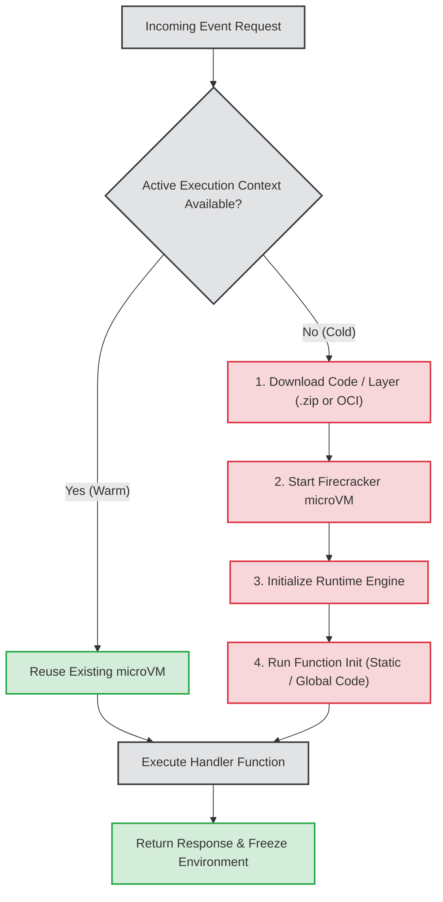
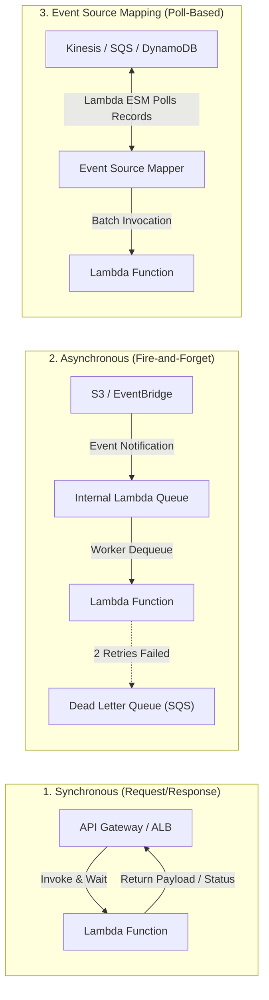
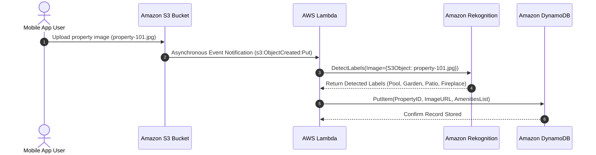
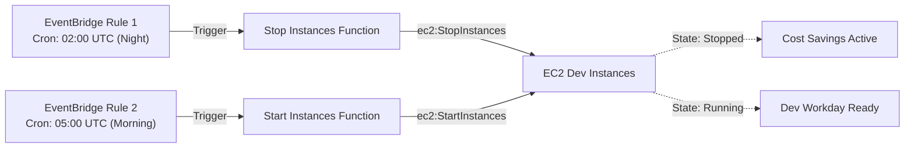

# ⚡ Module 12: AWS Lambda – Study Guide

> **Course**: AWS re/Start  
> **Module**: Serverless and Containers  
> **Source Document**: `T16-0002-RSSECO_EN-US_SG_M12_AWSLAMBDA.pdf`  
> **Target Audience**: AWS re/Start Learners, Cloud Practitioners, Solutions Architects, and DevOps/SysOps Engineers  

---

## 🎯 Module Overview

In modern cloud computing, agility, operational efficiency, and rapid innovation are paramount. Organizations increasingly strive to minimize time spent managing underlying infrastructure and focus resources on business logic and customer value. While virtual machines like **Amazon EC2** offer deep administrative control and container orchestrators like **Amazon ECS** and **Amazon EKS** provide portable application runtimes, both require provisioning, capacity planning, OS patching, and scaling configuration.

**Serverless computing** eliminates this infrastructure management overhead. At the center of the AWS serverless ecosystem is **AWS Lambda**, a fully managed, event-driven compute service that runs application code in response to events and triggers. With Lambda, there are no physical or virtual servers to provision, configure, patch, or scale. Developers write code, package it, and define triggers. AWS Lambda manages high availability, fault tolerance across multiple Availability Zones (AZs), automated horizontal scaling up to thousands of concurrent requests per second, and precise sub-second pay-for-use metering.

This comprehensive study guide explores the core principles of serverless computing, the internal architecture and execution model of AWS Lambda (including Firecracker microVMs, cold/warm start lifecycles, and memory-to-CPU scaling), invocation models (synchronous, asynchronous, and poll-based event source mapping), IAM and VPC security architectures, Lambda Layers, deployment options, real-world automated workflows, and monitoring best practices.

---

### 📌 Learning Objectives

- [ ] **Define Serverless Computing**: Understand the serverless operational paradigm and compare serverless computing with traditional virtual machine and containerized deployment models.
- [ ] **Explain AWS Lambda Core Principles**: Describe how AWS Lambda functions execute event-driven code in response to triggers with zero server management and high availability across Availability Zones.
- [ ] **Examine Supported Runtimes & Packaging**: Identify supported managed runtimes (Python, Node.js, Java, Go, Ruby, .NET), custom runtimes via the Lambda Runtime API, and container images up to 10 GB.
- [ ] **Analyze the Lambda Execution Model**: Understand Firecracker microVM virtualization, execution lifecycle phases (*Init*, *Invoke*, *Shutdown*), cold starts vs. warm starts, and execution context reuse.
- [ ] **Evaluate Resource Sizing & Quotas**: Configure memory allocation (128 MB to 10,240 MB) and understand how CPU, network, and disk scale proportionally, along with ephemeral `/tmp` storage (512 MB to 10 GB) and the 15-minute maximum execution timeout.
- [ ] **Master Invocation Models**:
  - **Synchronous**: Immediate request/response pattern (e.g., API Gateway, Application Load Balancer).
  - **Asynchronous**: Built-in queuing, two automatic retries, and failure routing with Dead Letter Queues (DLQs) and Lambda Destinations.
  - **Poll-Based / Event Source Mapping**: Batching records from streaming and queuing services (e.g., Kinesis, DynamoDB Streams, SQS).
- [ ] **Implement Security & VPC Architectures**:
  - Differentiate between **Execution Roles** (IAM role granting the function access to AWS resources) and **Resource-Based Policies** (granting external triggers permission to invoke the function).
  - Architect VPC integration using Hyperplane Elastic Network Interfaces (ENIs) for private subnet connectivity.
- [ ] **Leverage Lambda Layers**: Decouple libraries, dependencies, and custom runtimes to keep deployment packages small and share common code across functions.
- [ ] **Architect Event-Driven Automation Workflows**: Design end-to-end automated pipelines, including S3 image processing with Amazon Rekognition and automated EC2 instance stop/start scheduling with Amazon EventBridge.
- [ ] **Monitor & Optimize Serverless Applications**: Utilize Amazon CloudWatch metrics, log groups, and AWS X-Ray distributed tracing for observability and performance optimization.

---

## 📚 Key Terminology

| Term | Definition |
| :--- | :--- |
| **Serverless Computing** | A cloud execution model where cloud providers automatically manage the provisioning, scaling, patching, and maintenance of server infrastructure, billing only for resources consumed during execution. |
| **AWS Lambda** | A serverless, event-driven compute service that executes code in response to events and automatically manages underlying compute resources across multiple Availability Zones. |
| **Lambda Function** | The fundamental deployment unit in AWS Lambda containing application code, configuration parameters, handler entry points, and resource requirements. |
| **Event Source / Trigger** | An AWS service or custom client application that invokes a Lambda function in response to events or state changes. |
| **Function Handler** | The entry-point method or function in your code that Lambda executes when the function is invoked. |
| **Execution Context** | The isolated runtime environment (microVM container) created to run a Lambda function, including memory, environment variables, dependencies, and `/tmp` storage. |
| **Cold Start** | The initial latency overhead incurred when Lambda initializes a new execution environment (downloading code, starting the microVM, initializing the runtime and external dependencies). |
| **Warm Start** | An execution invocation that reuses an existing, pre-initialized execution environment, eliminating initialization latency. |
| **Provisioned Concurrency** | A feature that initializes a requested number of execution environments in advance, guaranteeing zero cold starts for latency-sensitive applications. |
| **Firecracker** | An open-source, minimalist virtualization technology created by AWS that leverages Linux KVM to spawn secure, lightweight microVMs in milliseconds. |
| **Lambda Layer** | A `.zip` archive containing supplementary code, libraries, data, custom runtimes, or configuration files that can be shared across multiple Lambda functions. |
| **Event Source Mapping (ESM)** | An internal Lambda polling mechanism that reads records from streaming (Kinesis, DynamoDB) or queuing (SQS) services and invokes functions in batches. |
| **Dead Letter Queue (DLQ)** | An Amazon SQS queue or Amazon SNS topic configured to receive discarded events that fail all retry attempts during asynchronous invocation. |
| **Lambda Destinations** | A routing configuration for asynchronous invocations and stream mappings that routes invocation records to SQS, SNS, EventBridge, or another Lambda function on success or failure. |
| **Execution Role** | An IAM identity-based role assumed by Lambda (`lambda.amazonaws.com`) granting the function permissions to interact with other AWS services. |
| **Resource-Based Policy** | A JSON policy attached directly to a Lambda function granting permissions to specific AWS services or external accounts to invoke the function. |
| **Hyperplane ENI** | A shared, multi-tenant network virtualization interface managed by AWS that provides high-throughput, low-latency connectivity from Lambda functions to customer VPC subnets. |

---

## ☁️ 1. What is Serverless Computing?

### 1.1 The Evolution of Compute

The history of enterprise compute is a continuous progression toward higher abstraction, shifting operational responsibility from organizations to cloud service providers.

```
┌─────────────────┐       ┌─────────────────┐       ┌─────────────────┐       ┌─────────────────┐
│ Physical Server │  ──►  │ Virtual Machine │  ──►  │   Containers    │  ──►  │   Serverless    │
│  (On-Premises)  │       │  (Amazon EC2)   │       │(Amazon ECS/EKS) │       │  (AWS Lambda)   │
└─────────────────┘       └─────────────────┘       └─────────────────┘       └─────────────────┘
  • Buy hardware            • Provision OS            • Package image           • Write code only
  • Power & cooling         • Patch & maintain        • Container daemon        • Zero server ops
  • Capacity planning       • Auto Scaling groups     • Pod / Task scaling      • Auto event scale
  • Idle capital waste      • Pay hourly/seconds      • Cluster management      • Pay per 1 ms run
```

1. **On-Premises Hardware**: Required purchasing physical servers sized for peak load. Infrastructure sat idle during off-peak periods, and procurement took weeks or months.
2. **Virtual Machines (Amazon EC2)**: Introduced programmatic elasticity and self-service infrastructure. However, administrators still manage operating system installations, security patches, network firewalls, and Auto Scaling group parameters.
3. **Containers (Amazon ECS / EKS)**: Standardized application packaging and dependency management. While AWS Fargate removes server management for containers, teams must still configure task definitions, port mappings, CPU/memory limits, scaling policies, and health check routes.
4. **Serverless (AWS Lambda)**: Eliminates all infrastructure operational overhead. Developers supply business logic; the cloud platform manages provisioning, multi-AZ deployment, autoscaling from zero to tens of thousands of requests, fault tolerance, and OS maintenance.

---

### 1.2 The Four Tenets of Serverless

Any architecture or service adhering to the AWS Serverless paradigm must meet four core characteristics:

1. **No Servers to Manage**: There are no physical machines, virtual instances, container hosts, or operating systems to configure, patch, or maintain.
2. **Continuous, Automatic Scaling**: The system scales dynamically in direct response to incoming demand—from 0 requests to tens of thousands of simultaneous executions per second—without manual intervention or scaling group tuning.
3. **Pay-for-Value Execution**: Cost is tied directly to usage and execution duration. If an application is idle, charges are zero. There is no idle capacity cost.
4. **Built-in High Availability & Fault Tolerance**: By default, serverless services run across multiple Availability Zones within an AWS Region, providing out-of-the-box redundancy and resilience without multi-zone cluster configuration.

---

### 1.3 Traditional vs. Serverless Operational Models

```
Traditional / Virtual Machine Model:
┌────────────────────────────────────────────────────────┐
│                   Application Code                     │
├────────────────────────────────────────────────────────┤
│           Application Runtime / Web Server             │  ◄── CUSTOMER MANAGES
├────────────────────────────────────────────────────────┤      (High operational overhead,
│              Operating System & Patching               │       manual scaling rules,
├────────────────────────────────────────────────────────┤       idle cost accrual)
│           Virtual Hardware & Scaling Policies          │
└────────────────────────────────────────────────────────┘

Serverless Model (AWS Lambda):
┌────────────────────────────────────────────────────────┐
│                   Application Code                     │  ◄── CUSTOMER MANAGES (Business Logic)
├════════════════════════════════════════════════════════┤
│           Application Runtime & Security               │
├────────────────────────────────────────────────────────┤  ◄── AWS MANAGES
│            Operating System & MicroVM OS               │      (Automated scaling, patching,
├────────────────────────────────────────────────────────┤       multi-AZ high availability,
│       Physical Infrastructure & Fleet Management       │       zero idle cost)
└────────────────────────────────────────────────────────┘
```

#### Detailed Operations Comparison Matrix

| Operational Dimension | Traditional EC2 Virtual Machines | Containerized ECS / EKS | Serverless (AWS Lambda) |
| :--- | :--- | :--- | :--- |
| **Server Provisioning** | Manual or template-based (AMI, CloudFormation) | Cluster setup, host instance provisioning | Completely automated; zero provisioning |
| **OS Maintenance & Patching** | Customer is 100% responsible | Customer manages OS (EC2) or base image (Fargate) | Managed 100% by AWS |
| **Scaling Mechanism** | Auto Scaling Groups based on CloudWatch metrics | Task/Pod autoscalers (HPA, ECS Target Tracking) | Instantaneous, automatic per-event scaling |
| **Scale-to-Zero** | No (minimum instance count must run) | No (Fargate requires minimum task count > 0) | Yes (scales to absolute zero; zero cost when idle) |
| **High Availability** | Customer configures multi-AZ ASGs and ELBs | Customer configures multi-AZ task placement | Built-in multi-AZ redundancy by default |
| **Billing Model** | Per-second/hour for running instance capacity | Per-vCPU/RAM per hour/second | Per-millisecond execution duration + request count |
| **Execution Window** | Unconstrained (can run 24/7 indefinitely) | Unconstrained (long-running services) | Maximum 15 minutes (900 seconds) per invocation |

---

## ⚡ 2. What is AWS Lambda?

### 2.1 Overview & Value Proposition

**AWS Lambda** is a fully managed, serverless compute service that runs code in response to events. You upload your application code, configure execution properties (such as memory allocation and timeouts), and connect event sources. Lambda handles all computing resources, server administration, runtime maintenance, operating system patching, and scaling.

> [!NOTE]
> **Sub-Second Metering**: AWS Lambda charges for execution time billed in **1-millisecond increments**, making it cost-effective for microservices, scheduled batch jobs, and event-driven automation. If your function executes in 28 milliseconds, you pay for exactly 28 milliseconds of compute time.

### 2.2 Event-Driven Architecture Fundamentals

In an event-driven architecture (EDA), services communicate through the generation and consumption of events. An **event** is a state change or an update—such as a user uploading a photo, a record being inserted into a database, or a timer firing.

```
┌────────────────────────────────┐
│          Event Source          │
│ (S3, API Gateway, EventBridge) │
└───────────────┬────────────────┘
                │ Emits Event JSON
                ▼
┌────────────────────────────────┐
│           AWS Lambda           │
│   (Executes handler function)  │
└───────────────┬────────────────┘
                │ Performs Actions / Returns Result
                ▼
┌────────────────────────────────┐
│       Downstream Targets       │
│  (DynamoDB, SQS, SES, Client)  │
└────────────────────────────────┘
```

1. **Event Source**: Generates an event formatted as a JSON payload describing what occurred.
2. **Lambda Service**: Receives the event, provisions or selects an execution environment, passes the event JSON to your function handler, and executes your code.
3. **Downstream Targets**: The function transforms data, stores state, or calls other AWS APIs and external endpoints.

---

### 2.3 Supported Runtimes & Deployment Options

AWS Lambda gives developers freedom to select runtime environments and packaging options:

```
┌────────────────────────────────────────────────────────────────────────┐
│                     AWS Lambda Deployment Options                      │
├───────────────────────────────────┬────────────────────────────────────┤
│       Standard .ZIP Archive       │       OCI Container Image          │
│   (Managed or Custom Runtimes)    │    (Docker / Podman via Amazon ECR)│
├───────────────────────────────────┼────────────────────────────────────┤
│ • Max 50 MB (direct upload / zip) │ • Up to 10 GB container image      │
│ • Max 250 MB (unzipped package)   │ • Leverages Docker build workflows │
│ • Fast cold-start initialization  │ • Custom tooling & large binaries  │
└───────────────────────────────────┴────────────────────────────────────┘
```

#### 1. Managed Runtimes
AWS provides and regularly patches official runtimes for major languages:
- **Python** (e.g., Python 3.9, 3.10, 3.11, 3.12)
- **Node.js** (e.g., Node.js 18.x, 20.x, 22.x)
- **Java** (e.g., Java 11, 17, 21)
- **.NET** (e.g., .NET 6, .NET 8)
- **Ruby** (e.g., Ruby 3.2, 3.3)
- **Custom / Compiled via OS-only** (Amazon Linux 2023 / AL2 runtimes for Go and Rust)

#### 2. Custom Runtimes via Lambda Runtime API
For languages not natively supported (such as Rust, C++, PHP, Haskell, or specific versions of Perl), developers can build a **Custom Runtime**. Custom runtimes implement the **Lambda Runtime API**, an HTTP interface where a lightweight bootstrap script polls for invocation events, executes code, and posts results or errors back to the Lambda API endpoint.

#### 3. Container Images (OCI Compatible)
Developers can package Lambda functions as Open Container Initiative (OCI) container images up to **10 GB** in size.
- Images are stored in **Amazon Elastic Container Registry (Amazon ECR)**.
- Can be based on AWS-provided base images or custom Linux container images that include the **Lambda Runtime Interface Client (RIC)**.
- Ideal for machine learning inference (e.g., loading NumPy, SciPy, PyTorch, or TensorFlow models), heavy external libraries, or unified corporate container CI/CD pipelines.

---

### 2.4 AWS Lambda Layers

A **Lambda Layer** is a `.zip` archive containing supplementary libraries, shared helper utilities, custom runtimes, or configuration files.

```
┌────────────────────────────────────────────────────────┐
│                Lambda Function Package                 │
│         (Contains only handler & business logic)       │
└───────────────────────────┬────────────────────────────┘
                            │ Mounts at /opt
                            ▼
┌────────────────────────────────────────────────────────┐
│                   Lambda Layers (1 - 5)                │
│  ┌──────────────────────┐    ┌──────────────────────┐  │
│  │ Layer 1: SDKs & Libs │    │ Layer 2: Auth Models │  │
│  └──────────────────────┘    └──────────────────────┘  │
└────────────────────────────────────────────────────────┘
```

#### Key Capabilities of Layers:
- **Separation of Concerns**: Keep deployment packages lean and focused exclusively on application logic.
- **Shared Code & Centralized Updates**: Share corporate utility packages, database drivers, or telemetry collectors across hundreds of functions without redeploying code.
- **Quota Rules**:
  - A function can include up to **5 layers** simultaneously.
  - The total unzipped size of the function plus all attached layers cannot exceed the unzipped limit of **250 MB**.
  - Layer contents are extracted into the `/opt` directory within the function's execution environment at runtime.

---

## 🏗️ 3. Lambda Execution Model & Internal Architecture

### 3.1 MicroVM Virtualization: AWS Firecracker

Underneath the managed abstraction, AWS Lambda executes code within lightweight, highly isolated virtual machines powered by **AWS Firecracker**.

- **Firecracker** is an open-source Virtual Machine Monitor (VMM) built by AWS in Rust that utilizes the Linux Kernel-based Virtual Machine (**KVM**).
- Traditional virtual machines take tens of seconds to boot and consume hundreds of megabytes of overhead. Firecracker microVMs initialize in **under 5 milliseconds** with less than 5 MB of memory overhead.
- Firecracker guarantees multi-tenant security isolation while providing the startup performance of containerized workloads.

---

### 3.2 The Execution Lifecycle

Every Lambda execution follows a formal three-phase lifecycle:

```
┌─────────────────────────────────────────────────────────────────────────────┐
│                         Lambda Execution Lifecycle                          │
├───────────────────────┬─────────────────────────────┬───────────────────────┤
│      1. INIT PHASE    │      2. INVOKE PHASE        │   3. SHUTDOWN PHASE   │
├───────────────────────┼─────────────────────────────┼───────────────────────┤
│ • Extension Init      │ • Receives event payload    │ • Extension Shutdown  │
│ • Runtime Init        │ • Executes function handler │ • Runtime Teardown    │
│ • Function Init       │ • Returns response or error │ • microVM Termination │
│   (Code outside def)  │                             │                       │
└───────────────────────┴─────────────────────────────┴───────────────────────┘
```

1. **Init Phase**:
   - **Extension Init**: Starts any registered internal and external Lambda extensions.
   - **Runtime Init**: Boots the language runtime (Node.js, Python VM, JVM).
   - **Function Init**: Runs the code outside of the handler function (loads global libraries, initializes database connections, reads configuration from AWS Systems Manager Parameter Store or Secrets Manager).
2. **Invoke Phase**:
   - Lambda passes the event JSON and runtime context to the function handler.
   - The handler runs, performs tasks, and returns a response.
3. **Shutdown Phase**:
   - Occurs when the function finishes processing and remains idle long enough to be reclaimed, or if the runtime crashes.
   - Runtime and extensions are terminated, and the microVM environment is destroyed.

---

### 3.3 Cold Starts vs. Warm Starts

A fundamental concept in serverless architectures is the distinction between a **cold start** and a **warm start**.



#### Detailed Comparison:

| Feature | Cold Start | Warm Start |
| :--- | :--- | :--- |
| **Trigger Condition** | First invocation, burst in concurrent traffic, or after deployment/code updates. | Subsequent invocation within environment idle timeout (~5 to 15+ minutes). |
| **Initialization Overhead** | High (50 ms to several seconds depending on language and package size). | Zero (microsecond environment unfreeze). |
| **Global State Reuse** | None (new environment). | Global variables, static client instances, and open network sockets persist. |
| **Mitigation Strategies** | Lightweight packages, smaller imports, Provisioned Concurrency. | Maintain steady request flow; optimize handler execution time. |

> [!TIP]
> **Optimizing Execution Context Reuse**: Always initialize database client connections, AWS SDK clients (`boto3.client('s3')`), and static configurations **outside** the handler function (in the global scope). In warm starts, these connections persist across invocations, avoiding repetitive TCP handshakes and authentication round trips.

#### Eliminating Cold Starts: Provisioned Concurrency
For latency-critical, customer-facing applications (such as ecommerce checkout APIs), AWS offers **Provisioned Concurrency**.
- Allocates and pre-warms a designated pool of execution environments.
- Environments remain initialized through the Init phase and are ready to execute handlers instantly.
- Completely eliminates cold start latency for requests up to the provisioned concurrency limit.

---

### 3.4 Resource Sizing, Proportional Allocation & Limits

AWS Lambda uses **Memory** as the single primary dial to allocate computing power.

```
             ┌────────────────────────────────────────────────────────┐
             │       Memory Allocation Dial (128 MB to 10,240 MB)      │
             └───────────────────────────┬────────────────────────────┘
                                         │
        ┌────────────────────────────────┼────────────────────────────────┐
        ▼                                ▼                                ▼
  [ CPU Cores ]                 [ Network Bandwidth ]             [ I/O Throughput ]
Scales proportionally           Scales proportionally           Scales proportionally
128 MB  = ~0.07 vCPU            Lower bandwidth                 Lower disk/network I/O
1,769 MB = 1 full vCPU          Moderate bandwidth              Moderate I/O
10,240 MB = 6 full vCPUs        Up to 10 Gbps                   Maximized I/O
```

#### 1. Memory Sizing & Proportional vCPU
- Memory can be configured from **128 MB to 10,240 MB (10 GB)** in 1 MB increments.
- CPU power is allocated proportionally to memory. At **1,769 MB**, a function receives the equivalent of **1 full vCPU**.
- Beyond 1,769 MB, multi-threading and multi-core processing become available (up to 6 vCPUs at 10 GB).
- Increasing memory often **decreases execution duration** dramatically for CPU-bound tasks, sometimes resulting in a net cost reduction.

#### 2. Ephemeral Storage (`/tmp`)
- Every execution context includes a private, temporary file system mounted at `/tmp`.
- Configurable from **512 MB up to 10,240 MB (10 GB)**.
- Data in `/tmp` remains accessible across invocations *only* if the execution environment is reused (warm start), but is discarded when the environment is torn down.

#### 3. Maximum Execution Timeout
- The maximum run duration for any single Lambda invocation is **15 minutes (900 seconds)**.
- Default timeout in the console is 3 seconds. For production services, configure timeouts based on realistic worst-case expectations to avoid hung operations consuming budget.
- Workloads exceeding 15 minutes should be run on **AWS Batch**, **Amazon ECS/Fargate**, or orchestrated as multi-step pipelines via **AWS Step Functions**.

---

## 🔄 4. AWS Lambda Invocation Models

AWS Lambda functions are invoked using three distinct communication paradigms: **Synchronous**, **Asynchronous**, and **Poll-Based / Event Source Mapping**.



---

### 4.1 Synchronous Invocation

In a synchronous invocation, the caller initiates the request and **blocks waiting for the Lambda function to execute and return a response**.

- **Common Event Sources**: Amazon API Gateway, Application Load Balancer (ALB), Amazon Cognito, Amazon Lex, AWS CLI/SDK (`InvocationType: RequestResponse`).
- **Error Handling**: If the function returns an unhandled exception or times out, the error is returned immediately to the calling client. The client is responsible for retries.
- **Payload Limits**: Request and response payloads are capped at **6 MB**.

---

### 4.2 Asynchronous Invocation

In an asynchronous invocation, the calling service emits the event and **does not wait for code execution**. The Lambda service responds immediately with an `HTTP 202 Accepted` confirmation.

- **Common Event Sources**: Amazon S3 (e.g., `s3:ObjectCreated:*`), Amazon SNS, Amazon EventBridge, AWS IoT, AWS CodeCommit, CloudWatch Alarms.
- **Internal Queuing & Retry Policy**:
  - Lambda places the incoming event into an internal, managed event queue.
  - If execution fails or times out, Lambda **automatically retries execution twice** (a total of 3 attempts) with exponential backoff.
- **Dead Letter Queues (DLQ) & Lambda Destinations**:
  - If all retries fail, the event is permanently discarded unless a **Dead Letter Queue (DLQ)** (Amazon SQS or SNS) or a **Lambda Destination** (`OnFailure`) is configured.
  - Destinations support routing full invocation records (including error stack traces, request context, and input payloads) to Amazon SQS, Amazon SNS, Amazon EventBridge, or another Lambda function.

---

### 4.3 Poll-Based / Event Source Mapping (ESM)

For streaming and queue services that do not invoke Lambda directly, Lambda provides an internal polling component called the **Event Source Mapping (ESM)**.

- **Supported Services**:
  - **Queue-Based**: Amazon SQS (Standard and FIFO), Amazon MQ.
  - **Stream-Based**: Amazon Kinesis Data Streams, Amazon DynamoDB Streams, Apache Kafka (Amazon MSK).
- **Operational Mechanics**:
  - Lambda polls the target resource on your behalf.
  - When records arrive, ESM aggregates them into batches and invokes the function synchronously.
  - Key tuning knobs:
    - **Batch Size**: Maximum number of records to retrieve in a single invocation (e.g., 1 to 10,000 for SQS).
    - **Batch Window**: Maximum time in seconds to wait gathering records before invoking the function, optimizing payload density.
    - **BisectBatchOnFunctionError**: For streams, splits a failing batch in half to isolate the poisoned record.

#### Comprehensive Invocation Models Matrix

| Dimension | Synchronous | Asynchronous | Poll-Based (Event Source Mapping) |
| :--- | :--- | :--- | :--- |
| **Client Interaction** | Waits for response (`RequestResponse`) | Fire-and-forget (`Event`) | Lambda polls on behalf of the customer |
| **Typical Services** | API Gateway, ALB, Cognito | S3, SNS, EventBridge, IoT | SQS, Kinesis, DynamoDB Streams |
| **Retry Behavior** | Handled by caller / client application | 2 automatic retries built-in | Retries until record expires or succeeds (streams); message visibility timeout (SQS) |
| **Failure Handling** | Immediate HTTP 4xx/5xx error | Dead Letter Queue (DLQ), Destinations | Bisect batch, Maximum Record Age, DLQ / Destinations |
| **Concurrency Impact** | Immediate 1:1 concurrency per request | Driven by internal queue worker scale | Driven by shard count (Kinesis/DynamoDB) or SQS queue depth |

---

## 🔒 5. Security Architecture & Network Integration

Security in AWS Lambda follows the AWS Shared Responsibility Model and enforces least-privilege access using AWS Identity and Access Management (IAM).

```
┌────────────────────────────────────────────────────────────────────────┐
│                        Lambda Security Policies                        │
├───────────────────────────────────┬────────────────────────────────────┤
│     1. Lambda Execution Role      │     2. Resource-Based Policy       │
│    (What the function CAN DO)     │   (Who can INVOKE the function)    │
├───────────────────────────────────┼────────────────────────────────────┤
│ • Identity-based policy           │ • Attached directly to function    │
│ • Assumed by lambda.amazonaws.com │ • Evaluated when triggers call API │
│ • Grants access to S3, DDB, logs  │ • Grants S3/API Gateway invocation │
└───────────────────────────────────┴────────────────────────────────────┘
```

### 5.1 Lambda Execution Role (IAM Role)

The **Execution Role** is an IAM role that grants the Lambda function permission to interact with other AWS services.
- **Trust Policy**: Must include a trust relationship allowing the Lambda service principal (`lambda.amazonaws.com`) to assume the role (`sts:AssumeRole`).
- **Basic Execution Policy**: Every function requires the managed policy `AWSLambdaBasicExecutionRole` (or equivalent permissions) to write execution logs to Amazon CloudWatch (`logs:CreateLogGroup`, `logs:CreateLogStream`, `logs:PutLogEvents`).
- **Service Access**: Explicit policies grant fine-grained permissions to DynamoDB tables, S3 buckets, SSM parameters, etc.

#### Example Execution Role IAM Policy:
```json
{
  "Version": "2012-10-17",
  "Statement": [
    {
      "Sid": "CloudWatchLoggingPermissions",
      "Effect": "Allow",
      "Action": [
        "logs:CreateLogGroup",
        "logs:CreateLogStream",
        "logs:PutLogEvents"
      ],
      "Resource": "arn:aws:logs:*:*:*"
    },
    {
      "Sid": "S3BucketReadAccess",
      "Effect": "Allow",
      "Action": [
        "s3:GetObject"
      ],
      "Resource": "arn:aws:s3:::corporate-customer-uploads/*"
    }
  ]
}
```

---

### 5.2 Resource-Based Policies (Function Policies)

A **Resource-Based Policy** is attached directly to the Lambda function. It specifies **who or what has permission to invoke the function**.
- Enables event sources like Amazon S3 or Amazon API Gateway to execute the Lambda function across service boundaries or across different AWS accounts.
- Added automatically when triggers are configured in the AWS Management Console, or via `aws lambda add-permission`.

#### Example Resource-Based Policy for S3 Trigger:
```json
{
  "Version": "2012-10-17",
  "Statement": [
    {
      "Sid": "AllowS3ToInvokeFunction",
      "Effect": "Allow",
      "Principal": {
        "Service": "s3.amazonaws.com"
      },
      "Action": "lambda:InvokeFunction",
      "Resource": "arn:aws:lambda:us-east-1:123456789012:function:ProcessUserUploads",
      "Condition": {
        "ArnLike": {
          "AWS:SourceArn": "arn:aws:s3:::corporate-customer-uploads"
        }
      }
    }
  ]
}
```

---

### 5.3 VPC Integration Architecture (Hyperplane ENIs)

By default, Lambda functions run in a secure, AWS-managed service VPC with direct outbound access to the public internet and public AWS API endpoints.

When a Lambda function must access private resources—such as an **Amazon RDS** database in a private subnet, an **Amazon ElastiCache** cluster, or internal microservices—you must configure **VPC Integration**.

```
┌────────────────────────────────────────────────────────┐
│                   Customer VPC                         │
│  ┌──────────────────────────────────────────────────┐  │
│  │ Private Subnet                                   │  │
│  │   ┌────────────────────┐   ┌──────────────────┐  │  │
│  │   │ Amazon RDS Postgre │   │ Hyperplane ENI   │  │  │
│  │   └─────────▲──────────┘   └────────▲─────────┘  │  │
│  └─────────────┼───────────────────────┼────────────┘  │
└────────────────┼───────────────────────┼───────────────┘
                 │                       │ Tunnel
                 │             ┌─────────┴──────────────┐
                 └─────────────┤ AWS Lambda Service VPC │
                               │  (Function Instance)   │
                               └────────────────────────┘
```

#### Hyperplane ENI Architecture:
- Previously, Lambda attached an individual Elastic Network Interface (ENI) for every concurrent container, causing high cold start times (10-30 seconds) and ENI exhaustion.
- With modern AWS architecture, AWS uses **AWS Hyperplane** (the technology powering Network Load Balancers and NAT Gateways).
- Hyperplane creates shared, multi-tenant ENIs in customer VPC subnets when the function is configured.
- **Cold start penalty for VPC integration is virtually eliminated** (down to sub-100 ms).
- **Outbound Internet Access**: A Lambda function placed inside a private VPC subnet does **not** have internet access by default. To reach external APIs or AWS services without VPC endpoints, traffic must route through a **NAT Gateway** in a public subnet.

---

## 🛠️ 6. Developing & Deploying AWS Lambda Functions

### 6.1 The 6-Step Development and Deployment Lifecycle

Developing and deploying a production Lambda function follows a structured methodology:

```
┌──────────────┐     ┌──────────────┐     ┌──────────────┐
│ 1. Define    │ ──► │ 2. Create    │ ──► │ 3. Configure │
│   Handler    │     │   Function   │     │   IAM Role   │
└──────────────┘     └──────────────┘     └──────────────┘
                                                 │
┌──────────────┐     ┌──────────────┐            ▼
│ 6. Monitor & │ ◄── │ 5. Test &    │ ◄── ┌──────────────┐
│   Optimize   │     │   Verify     │     │ 4. Upload    │
└──────────────┘     └──────────────┘     │   Code (.zip)│
                                          └──────────────┘
```

1. **Define Handler**: Write the entry point method adhering to language runtime conventions.
2. **Create Function**: Define runtime, architecture (x86_64 vs arm64/Graviton2), memory, and timeout.
3. **Configure IAM Role**: Attach an execution role granting required permissions to CloudWatch Logs and destination resources.
4. **Upload Code**: Upload a `.zip` archive via console/CLI or reference an OCI container image in Amazon ECR.
5. **Test & Verify**: Execute synthetic test payloads using sample event JSON templates.
6. **Monitor & Optimize**: Observe performance in Amazon CloudWatch and trace bottlenecks with AWS X-Ray.

---

### 6.2 Function Handler Anatomy

The handler is the method in your code that AWS Lambda invokes when the function executes.

#### Python Handler Anatomy:
```python
import json
import logging
import os

# 1. Global initialization (runs once during cold start / Init phase)
logger = logging.getLogger()
logger.setLevel(logging.INFO)
ENVIRONMENT = os.environ.get("ENV_STAGE", "production")

def lambda_handler(event, context):
    """
    Standard AWS Lambda Handler Function.
    
    :param event: Dict containing invocation event data passed by the trigger
    :param context: Runtime object providing runtime information (remaining time, request ID, memory)
    :return: Response dict (JSON serializable)
    """
    logger.info(f"Execution started in {ENVIRONMENT} environment.")
    logger.info(f"Incoming Event: {json.dumps(event)}")
    
    # Inspect runtime context
    request_id = context.aws_request_id
    remaining_ms = context.get_remaining_time_in_millis()
    logger.info(f"Request ID: {request_id} | Remaining Time: {remaining_ms} ms")
    
    # Process event logic
    status_code = 200
    body = {
        "message": "Lambda function executed successfully!",
        "requestId": request_id,
        "status": "PROCESSED"
    }
    
    return {
        "statusCode": status_code,
        "headers": {
            "Content-Type": "application/json"
        },
        "body": json.dumps(body)
    }
```

---

### 6.3 Real-World Architecture 1: Automated Image Analysis Pipeline

In this production use case, a mobile application allows real estate agents to upload property images. The architecture automatically analyzes images and indexes amenities without dedicated server instances.



#### Workflow Breakdown:
1. **Upload**: User captures and uploads a property photo via the mobile app directly to an **Amazon S3** bucket using an S3 Presigned URL.
2. **Trigger**: S3 detects the new object upload and asynchronously fires an `s3:ObjectCreated:Put` event notification.
3. **Lambda Execution**: AWS Lambda receives the event containing the bucket name and object key.
4. **AI Inference**: The function calls **Amazon Rekognition** (`DetectLabels` API), which identifies objects, scenes, and amenities (e.g., swimming pool, hardwood floors).
5. **Persistence**: Lambda parses the detected labels and persists the enriched metadata into **Amazon DynamoDB**.

---

### 6.4 Real-World Architecture 2: Cost Optimization EC2 Scheduler

Many non-production EC2 instances (development and testing environments) only need to run during business hours (e.g., 08:00 AM to 06:00 PM). Running them 24/7 wastes up to 70% of infrastructure expenditure.



#### Implementation Steps:
1. **IAM Role**: Create a Lambda execution role with permissions for `ec2:DescribeInstances`, `ec2:StopInstances`, and `ec2:StartInstances`.
2. **Nightly Stop Rule**: Configure an **Amazon EventBridge** scheduled rule with a cron expression (`cron(0 2 * * ? *)`) targeting the Stop Lambda function.
3. **Morning Start Rule**: Configure a second EventBridge rule (`cron(0 5 * * ? *)`) targeting the Start Lambda function.
4. **Execution**: Functions query instances with specific resource tags (e.g., `Environment: Development`) and transition their state automatically.

---

## 📊 7. Monitoring, Logging, and Observability

Operating serverless architectures requires deep visibility across thousands of ephemeral execution environments.

### 7.1 Amazon CloudWatch Metrics

AWS Lambda automatically emits key operational metrics to Amazon CloudWatch:

| Metric | Description | Alert Threshold Consideration |
| :--- | :--- | :--- |
| `Invocations` | Total number of times function code is executed. | Monitor for unexpected surges or drops. |
| `Duration` | Execution time from handler entry to exit (in milliseconds). | Alarm if duration approaches configured timeout. |
| `Errors` | Number of invocations that resulted in a function error (unhandled exceptions, timeouts). | Alarm if Error Rate > 1% of total invocations. |
| `Throttles` | Number of invocation requests rejected because concurrency limits were exceeded. | Alarm immediately if Throttles > 0. |
| `ConcurrentExecutions` | Number of execution environments actively processing events simultaneously. | Monitor to ensure account regional limits are not exhausted. |

---

### 7.2 Amazon CloudWatch Logs

Every Lambda function automatically streams logs to a dedicated CloudWatch Log Group:
- **Log Group Name**: `/aws/lambda/<function-name>`
- Each execution emits structured telemetry boundaries:
  - `START RequestId: <uuid> Version: $LATEST`
  - Application output statements (e.g., `print()`, `console.log()`, `logger.info()`)
  - `END RequestId: <uuid>`
  - `REPORT RequestId: <uuid> Duration: 42.12 ms Billed Duration: 43 ms Memory Size: 128 MB Max Memory Used: 68 MB`

> [!IMPORTANT]
> The `REPORT` log line provides essential capacity tuning data:
> - **Duration vs. Billed Duration**: Billed duration rounds up to the nearest 1 ms.
> - **Max Memory Used**: Helps identify over-provisioned or under-provisioned memory configurations.

---

### 7.3 AWS X-Ray Distributed Tracing

For complex serverless architectures involving multiple microservices, **AWS X-Ray** provides end-to-end distributed tracing.
- Activating **Active Tracing** on a Lambda function injects the X-Ray daemon into the execution environment.
- Generates a **Service Map** illustrating upstream callers, Lambda latency, downstream database query times, and external API calls.
- Pinpoints cold start initialization overhead and downstream bottlenecks.

---

## 📋 8. Quotas, Limits, and Best Practices Summary

### 8.1 Lambda Quotas and Resource Limits Reference

| Resource / Setting | Quota Limit | Adjustable? |
| :--- | :--- | :--- |
| **Memory Allocation** | 128 MB to 10,240 MB (10 GB) | Yes (per function) |
| **Maximum Execution Timeout** | 15 minutes (900 seconds) | No (Hard limit) |
| **Ephemeral Storage (`/tmp`)** | 512 MB to 10,240 MB (10 GB) | Yes (per function) |
| **Deployment Package (Direct / .zip upload)** | 50 MB (compressed) | No |
| **Deployment Package (Unzipped)** | 250 MB (function + all layers) | No |
| **Container Image Size** | Up to 10 GB (via Amazon ECR) | No |
| **Invocation Payload (Synchronous)** | 6 MB | No |
| **Invocation Payload (Asynchronous)** | 256 KB | No |
| **Concurrent Executions (Default)** | 1,000 per Region | Yes (Service Quota request) |
| **Layers per Function** | Up to 5 layers | No |

---

### 8.2 Architectural Best Practices for AWS Lambda

1. **Keep Functions Focused & Single-Purpose**: Adhere to the Single Responsibility Principle. A function should perform one cohesive task (e.g., validate order, generate thumbnail) rather than acting as a monolithic web framework.
2. **Minimize Deployment Package Size**: Strip out unnecessary dependencies, development tooling, and unused libraries. Smaller packages decrease cold start download and extraction latency.
3. **Separate Handler from Core Business Logic**: Decouple the AWS-specific handler function from domain logic. This enables unit testing outside the Lambda runtime environment.
4. **Leverage Environment Variables**: Store configuration strings, database hostnames, and stage names in environment variables; store sensitive secrets in AWS Secrets Manager or SSM Parameter Store with caching.
5. **Ensure Idempotency**: Design functions to handle duplicate events gracefully, especially when processing asynchronous triggers or streams where at-least-once delivery semantics apply.
6. **Tune Memory using AWS Lambda Power Tuning**: Use data-driven open-source tooling (AWS Lambda Power Tuning) to execute functions at multiple memory levels to find the optimal price-performance sweet spot.

---

## ❓ 9. Knowledge Check & Review Questions

### Question 1
**Is it necessary to configure scaling and load balancing when deploying an application to AWS Lambda?**

**Answer**:  
**No.** AWS Lambda automatically manages scaling and load balancing. The service dynamically provisions execution environments to match incoming event volume—from zero to thousands of concurrent requests per second—and balances traffic across multiple Availability Zones in the Region without any manual infrastructure configuration.

---

### Question 2
**Why would you use AWS Lambda to run application code instead of hosting it on an Amazon EC2 instance if the application runs only a few times per day and cost must be minimized?**

**Answer**:  
AWS Lambda uses a **pay-for-value execution model** with sub-second metering. You are billed exclusively for compute time consumed during active execution, and pay **nothing** when the code is idle. By contrast, an Amazon EC2 instance incurs continuous hourly or per-second costs for as long as it remains in the running state, even when idle between daily batch runs. Hosting an intermittent application on Lambda eliminates idle infrastructure expenditure.

---

### Question 3
**What are the primary architectural advantages of utilizing AWS Lambda Layers?**

**Answer**:  
1. **Reduces Deployment Package Size**: Heavy shared libraries, SDKs, and dependencies are moved into layers, allowing the function deployment package to contain only lightweight application logic.
2. **Fosters Code Sharing and Reusability**: Common utilities, corporate security libraries, and data models can be maintained centrally and shared across multiple functions and engineering teams.
3. **Simplifies Maintenance & Updates**: Upgrading a library version in a layer automatically benefits all functions consuming that layer version without requiring individual codebase rebuilds.

---

### Question 4
**What occurs during the "Init" phase of a Lambda cold start, and how can developers optimize this phase?**

**Answer**:  
During the Init phase, AWS Lambda launches the Firecracker microVM, starts the language runtime engine, and executes static/global initialization code outside the handler function (such as loading libraries, instantiating database connection pools, and reading environment settings).  
Developers can optimize this phase by:
- Trimming unnecessary library imports and dependencies.
- Reusing global objects and database client connections across warm invocations.
- Utilizing **Provisioned Concurrency** for latency-sensitive applications to keep environments pre-initialized.

---

### Question 5
**Differentiate between the AWS Lambda Execution Role and a Resource-Based Policy.**

**Answer**:  
- **Execution Role (IAM Identity-Based Policy)**: Defines permissions granted **to the Lambda function** to access other AWS services (e.g., reading from an S3 bucket, writing items to DynamoDB, or sending logs to CloudWatch).
- **Resource-Based Policy**: Attached **to the Lambda function itself**, specifying which external AWS principals or services (such as Amazon S3, Amazon API Gateway, or an external AWS account) are authorized to **invoke** the function.

---

### Question 6
**How does memory allocation affect the compute power and cost of an AWS Lambda function?**

**Answer**:  
Memory (configured from 128 MB to 10 GB) is the single dial for allocating computing power. CPU, network bandwidth, and disk I/O throughput scale **proportionally** with memory. At 1,769 MB, Lambda provides 1 full vCPU; beyond that, multi-core processing is enabled. For CPU-bound workloads, allocating more memory often reduces execution duration proportionally, which can keep total cost roughly equal (or even lower) while delivering significantly faster response times.
