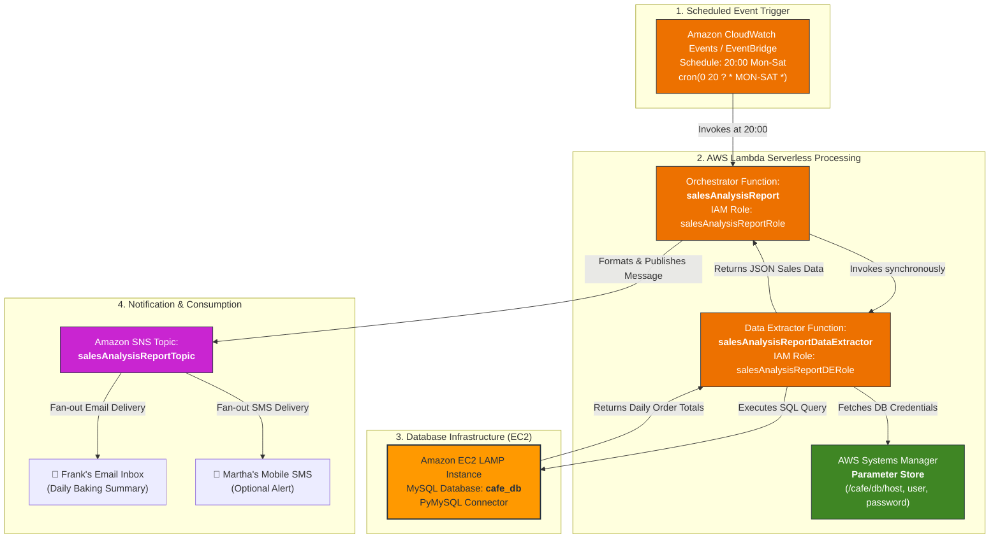
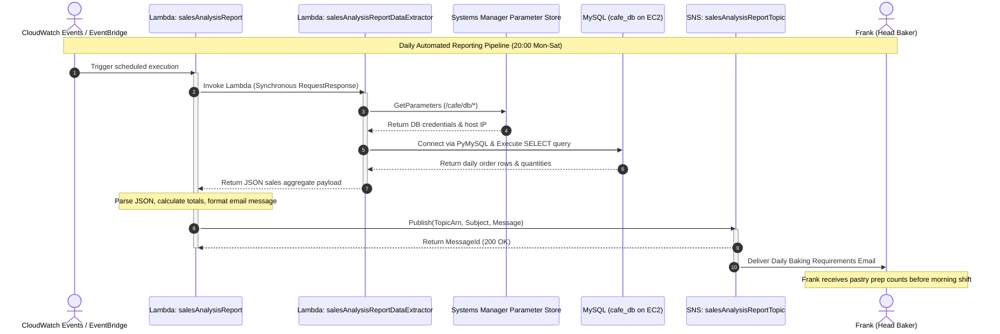
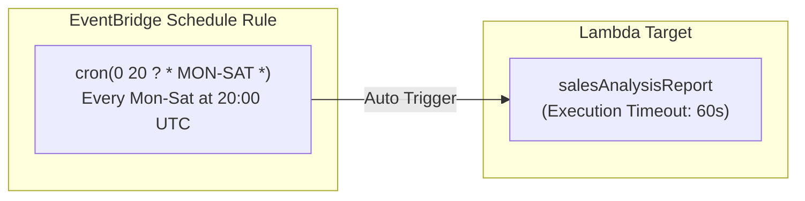
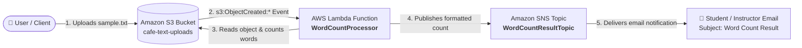

# ☕ Module 12: Lab – Working with AWS Lambda (Café Automated Sales Analysis)

> **Course**: AWS re/Start  
> **Module**: Serverless and Containers (Module 12)  
> **Source Document**: `T16-0003-RSSECO_EN-US_SG_M12_CAFEWORKWITHLAMBDA.pdf`  
> **Target Audience**: AWS re/Start Learners, Cloud Practitioners & Solutions Architects  

---

## 🎯 Lab Overview & Context

Welcome to the **Working with AWS Lambda** lab guide. In this lab, you step into the role of a cloud consultant supporting **The Café**, a thriving local business owned and operated by **Frank** and **Martha**, with operational management spearheaded by **Sofía** and technical cloud guidance provided by **Nikhil**.

As the café's customer base expands, fresh pastry sales and custom cake pre-orders have experienced exponential growth. While higher sales are welcome, the manual processes behind managing daily kitchen operations have become a critical bottleneck. Frank and Martha need to know exactly how much flour, sugar, fruit, and specialty dairy to prepare each evening so the bakers can begin prep at dawn without risking stockouts or food waste.

Rather than provisioning, managing, and paying for dedicated Amazon EC2 virtual servers 24 hours a day to run periodic batch reports, Nikhil designs an **event-driven, serverless computing solution using AWS Lambda**. This architecture automatically queries the café's MySQL sales database on Amazon EC2, calculates daily itemized order summaries, formats an executive digest, and distributes the report to kitchen leadership via **Amazon Simple Notification Service (Amazon SNS)**—running completely autonomously on a scheduled cron trigger.

Additionally, this guide includes the **Challenge Activity**, where you will implement an event-driven word-counting Lambda function triggered directly by **Amazon S3** object uploads.

---

### 📌 Learning Objectives

By the end of this lab, you will be able to:

- [ ] **Analyze Serverless Business Justifications**: Contrast serverless compute (AWS Lambda) against traditional virtual machine architectures (Amazon EC2) in terms of operational overhead, scaling, and cost efficiency.
- [ ] **Decouple Architectural Responsibilities**: Implement a multi-function serverless pattern where an orchestrator function invokes a specialized data extraction function.
- [ ] **Configure IAM Execution Roles**: Apply least-privilege security policies permitting Lambda functions to query AWS Systems Manager Parameter Store, invoke peer Lambda functions, and publish messages to Amazon SNS.
- [ ] **Author & Inspect Lambda Handlers**: Write and analyze Python-based Lambda handlers (`lambda_handler(event, context)`), parsing incoming event payloads and handling return responses.
- [ ] **Secure Database Credentials with Systems Manager**: Retrieve sensitive database credentials dynamically using AWS Systems Manager Parameter Store instead of hardcoding secrets in application source code.
- [ ] **Manage Database Connectivity with Lambda**: Connect to a relational database (MySQL on EC2) using Python database drivers (`PyMySQL`) inside a serverless execution environment.
- [ ] **Orchestrate Scheduled Event Triggers**: Configure Amazon CloudWatch Events / Amazon EventBridge rules to trigger Lambda functions on a recurring cron schedule.
- [ ] **Implement Push Notifications with Amazon SNS**: Publish dynamic operational digests to an SNS topic and verify message delivery via email endpoints.
- [ ] **Inspect & Interpret CloudWatch Logs**: Analyze execution logs, cold start initialization times, request IDs, execution durations, billed durations, and memory consumption.
- [ ] **Troubleshoot Serverless Failure Modes**: Diagnose and resolve runtime timeouts, payload `KeyError` exceptions, VPC networking blocks, and IAM `AccessDeniedException` errors.
- [ ] **Deploy Event-Driven S3 Automation**: Build an asynchronous S3-triggered Lambda function that processes newly uploaded text files and alerts stakeholders with computed metrics.

---

## 🎭 Café Business Case Scenario & Operational Need

### 1. The Operational Bottleneck

At the end of every business day, Sofía sits down with cash register receipts, mobile ordering logs, and online orders to compile a forecast for Frank and Martha. Frank needs precise baking quantities for tomorrow's shift—such as dozens of blueberry scones, croissants, and artisan loaves.

```
┌──────────────────────────────────────────────────────────────────────────────┐
│                           Café Scenario Dialogue                             │
├──────────────────────────────────────────────────────────────────────────────┤
│ Sofía:  "Hello, Nikhil! We would like to send a daily report so that we can  │
│          plan tomorrow's baking requirements based on today's sales. Right   │
│          now, compiling this manually takes over an hour every evening, and  │
│          if I make a mistake, Frank either bakes too little or wastes dough."│
│                                                                              │
│ Nikhil: "You could send a daily report cost-effectively with a Lambda        │
│          function. You can use Lambda functions to automate actions that are │
│          based on events, or you can schedule the actions to happen at a     │
│          specific time—like 8:00 PM every evening."                          │
│                                                                              │
│ Sofía:  "Do we need to buy another server for this reporting script?"        │
│                                                                              │
│ Nikhil: "Not at all. With AWS Lambda, there are no servers to provision or   │
│          patch. It runs only when needed, costs pennies or fractions of a    │
│          cent per month, and scales automatically. I'll design an            │
│          architecture that automates this entire daily report for Frank."    │
└──────────────────────────────────────────────────────────────────────────────┘
```

### 2. Business Requirements Matrix

| Business Goal | Operational Constraint | Serverless Architectural Solution |
| :--- | :--- | :--- |
| **Daily Kitchen Forecast** | Report must be delivered at exactly 20:00 (8:00 PM) Mon–Sat. | Amazon CloudWatch Events / EventBridge cron trigger (`cron(0 20 ? * MON-SAT *)`). |
| **Zero Idle Compute Cost** | Café cannot justify paying for an EC2 instance running 24/7 for a 5-second report. | AWS Lambda executes on-demand; billed strictly in millisecond increments of execution time. |
| **Secure Credential Storage** | Database passwords cannot be stored in plain text in script files or GitHub. | AWS Systems Manager Parameter Store stores DB host, user, and password as secure parameters. |
| **Modular Security & Decoupling** | The reporting function should not directly embed heavy relational database client logic. | Two-tier Lambda architecture: Orchestrator (`salesAnalysisReport`) and Data Extractor (`salesAnalysisReportDataExtractor`). |
| **Instant Multi-Channel Alerts** | Frank needs an email on his tablet; future phases may require SMS alerts. | Amazon Simple Notification Service (Amazon SNS) topic with email/SMS subscriptions. |

---

## 🏗️ Architectural Blueprint & Data Flow

The café implements a decoupled, event-driven architecture that bridges scheduled event rules, serverless compute, secure configuration management, existing relational database infrastructure on Amazon EC2, and pub/sub messaging.



### Detailed Execution Flow Breakdown

1. **Scheduled Invocation**: At 20:00 local time every day from Monday through Saturday, Amazon CloudWatch Events (EventBridge) fires a rule that invokes the `salesAnalysisReport` Lambda orchestrator function.
2. **Synchronous Sub-Function Delegation**: The `salesAnalysisReport` function assumes its IAM role (`salesAnalysisReportRole`) and invokes the `salesAnalysisReportDataExtractor` Lambda function using the AWS SDK (`boto3`).
3. **Secure Credential Resolution**: The `salesAnalysisReportDataExtractor` function retrieves the database connection string, username, and decrypted password from **AWS Systems Manager Parameter Store**.
4. **Relational Database Extraction**: The extractor function establishes a TCP socket connection to the MySQL database (`cafe_db`) hosted on the Amazon EC2 LAMP instance, executes an aggregation query across today's orders table, and formats the result as a structured JSON array.
5. **Payload Return & Message Formatting**: The data extractor returns the JSON payload to `salesAnalysisReport`. The orchestrator iterates through the records, computes category totals, and composes a human-readable summary email.
6. **Publishing to Notification Topic**: The orchestrator publishes the formatted text message to the `salesAnalysisReportTopic` Amazon SNS topic.
7. **Subscriber Delivery**: Amazon SNS fans out the message to all confirmed subscribers, delivering the baking schedule directly to Frank's email inbox.

---

## 🔄 Lab Execution Sequence Diagram



---

## 🛠️ Step-by-Step Hands-On Lab Walkthrough

### Task 1: Reviewing Starter Architecture and IAM Permissions

Before creating or editing Lambda functions, verify the supporting infrastructure and security roles provisioned in your AWS account.

1. In the **AWS Management Console**, navigate to **EC2** > **Instances**:
   - Verify that the instance named `Café Web Server` (or `LAMP Server`) is in the **Running** state.
   - Note the **Private IPv4 address** of the instance (e.g., `10.0.1.xxx`).
2. Navigate to **AWS Systems Manager** > **Application Management** > **Parameter Store**:
   - Inspect the parameters storing database connectivity configurations:
     - `/cafe/dbUrl`: Hostname or IP address of the MySQL instance.
     - `/cafe/dbName`: Target database name (`cafe_db`).
     - `/cafe/dbUser`: Database user (e.g., `cafe_admin`).
     - `/cafe/dbPassword`: SecureString containing the database password.
3. Navigate to **IAM** > **Roles** and inspect the two pre-created execution roles:

```
┌────────────────────────────────────────────────────────────────────────┐
│                        IAM Execution Roles                             │
├────────────────────────────────┬───────────────────────────────────────┤
│ Role Name                      │ Attached Policies & Permissions       │
├────────────────────────────────┼───────────────────────────────────────┤
│ salesAnalysisReportRole        │ • AWSLambdaBasicExecutionRole         │
│                                │ • lambda:InvokeFunction               │
│                                │ • sns:Publish (salesAnalysisReportTopic)│
├────────────────────────────────┼───────────────────────────────────────┤
│ salesAnalysisReportDERole      │ • AWSLambdaBasicExecutionRole         │
│                                │ • ssm:GetParameters / ssm:GetParameter│
│                                │ • AWSLambdaVPCAccessExecutionRole     │
│                                │   (if ENI attachment inside VPC)      │
└────────────────────────────────┴───────────────────────────────────────┘
```

> [!IMPORTANT]
> **Least Privilege Access**: Notice how `salesAnalysisReportRole` does **not** have permissions to access the database or Parameter Store directly. It only has rights to invoke `salesAnalysisReportDataExtractor` and publish to SNS. Conversely, `salesAnalysisReportDERole` cannot publish to SNS. This separation of concerns limits the blast radius if either function is compromised.

---

### Task 2: Creating the AWS Lambda Functions in the AWS Console

#### 2.1 Create the Data Extractor Function (`salesAnalysisReportDataExtractor`)

1. Open the **AWS Lambda Console** (`https://console.aws.amazon.com/lambda`).
2. Choose **Create function**.
3. Select **Author from scratch** and configure the following parameters:
   - **Function name**: `salesAnalysisReportDataExtractor`
   - **Runtime**: `Python 3.9` (or `Python 3.10` / `Python 3.11`)
   - **Architecture**: `x86_64`
   - **Permissions**: Expand *Change default execution role*.
     - Select **Use an existing role**.
     - Choose `salesAnalysisReportDERole`.
4. Choose **Create function**.
5. In the **Configuration** tab:
   - Under **General configuration**, set **Timeout** to `30 seconds` and **Memory** to `256 MB`.
   - Under **VPC** (if the EC2 instance resides in a private subnet), associate the function with the café VPC, private subnets, and a security group permitting outbound port 3306.

#### 2.2 Create the Orchestrator Function (`salesAnalysisReport`)

1. In the Lambda Console, choose **Create function**.
2. Select **Author from scratch** and configure:
   - **Function name**: `salesAnalysisReport`
   - **Runtime**: `Python 3.9` (or latest Python 3.x)
   - **Architecture**: `x86_64`
   - **Permissions**:
     - Select **Use an existing role**.
     - Choose `salesAnalysisReportRole`.
3. Choose **Create function**.
4. In the **Configuration** tab:
   - Set **Timeout** to `1 minute 0 seconds`.
   - Set **Environment variables**:
     - Key: `DATA_EXTRACTOR_FUNCTION` | Value: `salesAnalysisReportDataExtractor`
     - Key: `SNS_TOPIC_ARN` | Value: `arn:aws:sns:<region>:<account-id>:salesAnalysisReportTopic`

---

### Task 3: Analyzing Lambda Function Code

#### 3.1 Data Extractor Function Code (`salesAnalysisReportDataExtractor`)

This function connects to Parameter Store, establishes a connection to MySQL using `pymysql`, executes a SQL query aggregating product sales, and returns the result.

```python
"""
AWS Lambda Function: salesAnalysisReportDataExtractor
Role: salesAnalysisReportDERole
Description: Queries MySQL database on EC2 for daily sales data and returns JSON.
"""

import json
import logging
import os
import pymysql
import boto3

# Initialize logger
logger = logging.getLogger()
logger.setLevel(logging.INFO)

# Initialize AWS Systems Manager client
ssm = boto3.client('ssm')

def get_db_credentials():
    """Retrieve database connection parameters securely from SSM Parameter Store."""
    logger.info("Fetching database configuration from SSM Parameter Store...")
    try:
        response = ssm.get_parameters(
            Names=[
                '/cafe/dbUrl',
                '/cafe/dbName',
                '/cafe/dbUser',
                '/cafe/dbPassword'
            ],
            WithDecryption=True
        )
        params = {p['Name']: p['Value'] for p in response['Parameters']}
        return {
            'host': params['/cafe/dbUrl'],
            'database': params['/cafe/dbName'],
            'user': params['/cafe/dbUser'],
            'password': params['/cafe/dbPassword']
        }
    except Exception as e:
        logger.error("Failed to retrieve parameters from SSM: %s", str(e))
        raise e

def lambda_handler(event, context):
    """
    Standard Lambda Entry Point.
    Args:
        event (dict): Inbound event invocation payload.
        context (LambdaContext): Runtime metadata and execution context.
    Returns:
        dict: Status code and JSON serialized sales records.
    """
    logger.info("salesAnalysisReportDataExtractor execution started. RequestId: %s", context.aws_request_id)
    
    db_config = get_db_credentials()
    sales_data = []

    try:
        logger.info("Connecting to MySQL host: %s", db_config['host'])
        connection = pymysql.connect(
            host=db_config['host'],
            user=db_config['user'],
            password=db_config['password'],
            database=db_config['database'],
            cursorclass=pymysql.cursors.DictCursor,
            connect_timeout=10
        )
        
        with connection.cursor() as cursor:
            # Query aggregating daily quantities sold per product
            sql_query = """
                SELECT 
                    p.product_id,
                    p.product_name,
                    p.category,
                    SUM(o.quantity) AS total_quantity_sold,
                    SUM(o.quantity * p.price) AS total_revenue
                FROM orders o
                JOIN products p ON o.product_id = p.product_id
                WHERE DATE(o.order_date) = CURDATE()
                GROUP BY p.product_id, p.product_name, p.category
                ORDER BY total_quantity_sold DESC;
            """
            logger.info("Executing analytical sales query...")
            cursor.execute(sql_query)
            sales_data = cursor.fetchall()
            
        connection.close()
        logger.info("Retrieved %d sales records successfully.", len(sales_data))

    except Exception as err:
        logger.error("Database query execution error: %s", str(err))
        return {
            'statusCode': 500,
            'body': json.dumps({'error': str(err)})
        }

    return {
        'statusCode': 200,
        'reportDate': event.get('reportDate', 'TODAY'),
        'recordsCount': len(sales_data),
        'salesData': sales_data
    }
```

#### 3.2 Orchestrator Function Code (`salesAnalysisReport`)

This function invokes the data extractor, parses the results, builds an ASCII summary report, and delivers it via SNS.

```python
"""
AWS Lambda Function: salesAnalysisReport
Role: salesAnalysisReportRole
Description: Orchestrates report generation and dispatches email via Amazon SNS.
"""

import json
import logging
import os
import boto3

logger = logging.getLogger()
logger.setLevel(logging.INFO)

lambda_client = boto3.client('lambda')
sns_client = boto3.client('sns')

DATA_EXTRACTOR_FUNCTION = os.environ.get('DATA_EXTRACTOR_FUNCTION', 'salesAnalysisReportDataExtractor')
SNS_TOPIC_ARN = os.environ.get('SNS_TOPIC_ARN')

def format_baking_report(sales_records):
    """Formats raw sales records into an actionable email for Frank and Martha."""
    header = "=" * 55 + "\n"
    header += "          THE CAFÉ - DAILY BAKING REQUIREMENTS REPORT\n"
    header += "=" * 55 + "\n\n"
    
    if not sales_records:
        return header + "No sales recorded for today. Standard minimum prep applies.\n"

    table_header = f"{'Product Item':<25} | {'Category':<12} | {'Qty Sold':>8}\n"
    divider = "-" * 55 + "\n"
    body = table_header + divider
    
    total_items = 0
    pastry_prep_recommendations = []

    for item in sales_records:
        p_name = item.get('product_name', 'Unknown')
        p_cat = item.get('category', 'General')
        qty = int(item.get('total_quantity_sold', 0))
        total_items += qty
        
        body += f"{p_name:<25} | {p_cat:<12} | {qty:>8}\n"
        
        # Predictive recommendation: bake 115% of today's sales to meet morning demand
        if p_cat.lower() in ['bakery', 'pastry']:
            prep_target = int(qty * 1.15) + 2
            pastry_prep_recommendations.append(f"  • {p_name}: Bake target = {prep_target} units")

    summary = "\n" + "=" * 55 + "\n"
    summary += f"TOTAL ITEMS SOLD TODAY: {total_items}\n"
    summary += "=" * 55 + "\n\n"
    summary += "RECOMMENDED KITCHEN PREPARATION FOR TOMORROW MORNING:\n"
    summary += "(Based on 115% volume buffer + safety threshold)\n"
    summary += "\n".join(pastry_prep_recommendations) + "\n\n"
    summary += "Automated notification dispatched via AWS Lambda & Amazon SNS.\n"
    
    return header + body + summary

def lambda_handler(event, context):
    logger.info("salesAnalysisReport invoked. Event: %s", json.dumps(event))

    # 1. Invoke the Data Extractor Function synchronously
    try:
        logger.info("Invoking downstream function: %s", DATA_EXTRACTOR_FUNCTION)
        invoke_response = lambda_client.invoke(
            FunctionName=DATA_EXTRACTOR_FUNCTION,
            InvocationType='RequestResponse',
            Payload=json.dumps({'source': 'scheduled_report', 'reportDate': 'CURRENT_DATE'})
        )
        
        payload_bytes = invoke_response['Payload'].read()
        result_payload = json.loads(payload_bytes.decode('utf-8'))
        
        if result_payload.get('statusCode') != 200:
            raise Exception(f"Downstream extractor failed: {result_payload}")
            
        sales_records = result_payload.get('salesData', [])
        logger.info("Extracted %d records from extractor.", len(sales_records))
        
    except Exception as e:
        logger.error("Error during downstream extractor invocation: %s", str(e))
        raise e

    # 2. Format the human-readable report
    report_message = format_baking_report(sales_records)
    logger.info("Generated Report Message:\n%s", report_message)

    # 3. Publish to Amazon SNS Topic
    try:
        logger.info("Publishing report to SNS Topic: %s", SNS_TOPIC_ARN)
        publish_response = sns_client.publish(
            TopicArn=SNS_TOPIC_ARN,
            Subject="Daily Café Sales & Baking Requirements Report",
            Message=report_message
        )
        logger.info("Published successfully. MessageId: %s", publish_response.get('MessageId'))
        
    except Exception as e:
        logger.error("Failed to publish message to SNS: %s", str(e))
        raise e

    return {
        'statusCode': 200,
        'message': 'Daily report compiled and sent successfully.',
        'snsMessageId': publish_response.get('MessageId')
    }
```

---

### Task 4: Testing Functions with Mock JSON Test Events in the Console

Testing in the AWS Lambda console allows you to validate code execution without waiting for scheduled triggers.

#### 4.1 Testing `salesAnalysisReportDataExtractor`

1. In the `salesAnalysisReportDataExtractor` function page, select the **Test** tab.
2. Select **Create new event**:
   - **Event name**: `MockExtractorTest`
   - **Template**: `hello-world`
   - **Event JSON**:
     ```json
     {
       "source": "console_unit_test",
       "reportDate": "TODAY"
     }
     ```
3. Choose **Save** and then click **Test**.
4. Examine the **Execution result**:
   - Status: `Succeeded`
   - Expand **Details** to verify the returned status code (`200`) and the populated `salesData` list containing product names like *Blueberry Muffin*, *Croissant*, and *Cinnamon Roll*.

#### 4.2 Testing `salesAnalysisReport`

1. In the `salesAnalysisReport` function page, select the **Test** tab.
2. Create test event:
   - **Event name**: `TriggerReportJob`
   - **Event JSON**:
     ```json
     {
       "trigger": "manual_admin_test"
     }
     ```
3. Click **Test**.
4. Check your email inbox subscribed to `salesAnalysisReportTopic`. You should receive an email with the subject **Daily Café Sales & Baking Requirements Report** formatted with the exact item breakdown and kitchen prep targets.

---

### Task 5: Configuring Event Triggers (EventBridge Scheduled Rule)

To meet the requirement that the report fires automatically at 20:00 every day from Monday through Saturday:

1. In the `salesAnalysisReport` function page, under **Function overview**, click **+ Add trigger**.
2. In the **Trigger configuration** dropdown, select **EventBridge (CloudWatch Events)**.
3. Configure the trigger rule:
   - **Rule**: Create a new rule
   - **Rule name**: `CafeDailySalesAt2000`
   - **Rule description**: `Triggers café sales analysis report at 20:00 Mon-Sat`
   - **Rule type**: **Schedule expression**
   - **Schedule expression**:
     ```
     cron(0 20 ? * MON-SAT *)
     ```
4. Click **Add**.



> [!NOTE]
> **Understanding AWS Cron Expressions**:
> AWS EventBridge cron expressions use 6 required fields: `cron(Minutes Hours Day-of-month Month Day-of-week Year)`.
> In `cron(0 20 ? * MON-SAT *)`:
> - `0` = Minute 0 (on the hour)
> - `20` = 20:00 (8:00 PM UTC)
> - `?` = No specific day of month (used when day of week is specified)
> - `*` = Every month
> - `MON-SAT` = Monday through Saturday
> - `*` = Every year

---

### Task 6: Inspecting Amazon CloudWatch Logs

Whenever a Lambda function executes, runtime logs and standard `print()` or Python `logging` statements are streamed to **Amazon CloudWatch Logs**.

1. In the Lambda function console, choose the **Monitor** tab.
2. Click **View CloudWatch logs**.
3. Under **Log streams**, select the most recent stream for the log group `/aws/lambda/salesAnalysisReport`.
4. Locate the standard three-part log execution cycle:
   - `START RequestId: ... Version: $LATEST`
   - Application logger statements (`[INFO] Fetching database configuration...`)
   - `END RequestId: ...`
   - `REPORT RequestId: ...`

#### Deconstructing the CloudWatch `REPORT` Line

Every Lambda invocation concludes with a mandatory diagnostic `REPORT` log entry:

```
REPORT RequestId: 8b7d34a1-02c3-421b-85ea-27f12e8b919a
       Duration: 412.35 ms
       Billed Duration: 413 ms
       Memory Size: 256 MB
       Max Memory Used: 78 MB
       Init Duration: 184.22 ms
```

| Metric Field | Measured Value | Architectural Meaning & Optimization Impact |
| :--- | :--- | :--- |
| **RequestId** | UUID string | Globally unique invocation ID used to trace requests across services in AWS X-Ray and CloudWatch. |
| **Duration** | `412.35 ms` | Exact wall-clock execution time taken by your handler code from invocation to return. |
| **Billed Duration** | `413 ms` | Duration rounded up to the nearest millisecond for billing calculation. |
| **Memory Size** | `256 MB` | Configured memory capacity allocated to the function's microVM container. |
| **Max Memory Used** | `78 MB` | Peak memory consumed during this invocation. Here, 78 MB out of 256 MB indicates no out-of-memory risk. |
| **Init Duration** | `184.22 ms` | **Cold Start** overhead: Time taken by AWS Lambda to download the code, initialize the runtime, and execute top-level code outside `lambda_handler`. Only occurs on new containers. |

---

### Task 7: Troubleshooting Common Lambda Errors

When deploying serverless architectures, several standard failure modes can occur. Use this diagnostic matrix to resolve them quickly:

```
┌────────────────────────────────────────────────────────────────────────┐
│                   Lambda Troubleshooting Matrix                        │
└────────────────────────────────────────────────────────────────────────┘
```

| Error Signature | Root Cause | Remediation Procedure |
| :--- | :--- | :--- |
| **`Task timed out after 3.00 seconds`** | Function execution exceeded the default 3-second timeout limit while waiting on database queries or external API calls. | Navigate to **Configuration** > **General configuration** > **Edit**. Increase timeout from `3 sec` to `30 sec` or `60 sec`. Optimize database query indexing. |
| **`KeyError: 'salesData'`** | Downstream function returned an error response or unexpected JSON structure without the requested key. | Check log group for `salesAnalysisReportDataExtractor`. Wrap payload access in defensive Python `.get('salesData', [])` syntax. |
| **`ClientError: An error occurred (AccessDeniedException) when calling the Publish operation`** | The IAM execution role lacks `sns:Publish` permissions on the target SNS topic. | Edit the IAM role policy for `salesAnalysisReportRole` to include `"Action": ["sns:Publish"]` with `"Resource": "<TopicARN>"`. |
| **`OperationalError: (2003, "Can't connect to MySQL server on '...' (timed out)")`** | Security group on EC2 blocks inbound port 3306, or Lambda is not attached to the same VPC / subnet. | Add an inbound rule to the EC2 security group allowing port 3306 from the Lambda security group ID or VPC CIDR block. |
| **`ClientError: (ParameterNotFound) when calling GetParameters`** | Parameter key path in SSM Parameter Store does not match the key requested in the code. | Verify exact casing and path prefixes in Parameter Store (e.g., `/cafe/dbUrl` vs `/Cafe/DBUrl`). |

---

## 🏆 Challenge Activity: S3 Event-Driven Word Counter

In this challenge, you expand your serverless expertise by implementing an event-driven Lambda function that monitors an Amazon S3 storage bucket. When any `.txt` file is uploaded, the function calculates the total word count and broadcasts the result via Amazon SNS.

### Challenge Requirements

1. **Language & Environment**: Python 3.x authored via the AWS Management Console.
2. **Event Trigger**: Automatically invoke when any text file (`.txt`) is uploaded to a designated S3 bucket.
3. **Notification Output**: Broadcast result via an Amazon SNS topic subscribed by email.
4. **Exact Formatting Standards**:
   - Message Body: `The word count in the file <textFileName> is nnn.`
   - Email Subject: `Word Count Result`

### Architecture Diagram: S3 to Lambda to SNS



### Complete Challenge Solution Code

Create a Lambda function named `WordCountProcessor` with an execution role containing `AmazonS3ReadOnlyAccess` and `AmazonSNSFullAccess` (or custom least-privilege equivalents):

```python
"""
AWS Lambda Function: WordCountProcessor
Challenge Activity: Event-driven word counting triggered by Amazon S3 uploads.
"""

import json
import logging
import os
import urllib.parse
import boto3

logger = logging.getLogger()
logger.setLevel(logging.INFO)

s3_client = boto3.client('s3')
sns_client = boto3.client('sns')

# SNS Topic ARN configured via environment variable
SNS_TOPIC_ARN = os.environ.get('SNS_TOPIC_ARN', 'arn:aws:sns:us-east-1:123456789012:WordCountResultTopic')

def lambda_handler(event, context):
    """
    Handles Amazon S3 ObjectCreated events.
    Parses bucket name and object key, retrieves file content,
    counts words, and dispatches formatted email notification.
    """
    logger.info("Received event: %s", json.dumps(event))
    
    # Validate records in incoming S3 event payload
    if 'Records' not in event or not event['Records']:
        logger.warning("No Records found in event payload.")
        return {'statusCode': 400, 'body': 'No S3 records found'}
        
    for record in event['Records']:
        # Extract bucket and URL-decoded object key
        bucket_name = record['s3']['bucket']['name']
        object_key = urllib.parse.unquote_plus(record['s3']['object']['key'])
        
        logger.info("Processing file '%s' from bucket '%s'", object_key, bucket_name)
        
        try:
            # 1. Fetch the uploaded object from S3
            response = s3_client.get_object(Bucket=bucket_name, Key=object_key)
            file_content = response['Body'].read().decode('utf-8', errors='ignore')
            
            # 2. Compute word count
            words = file_content.split()
            word_count = len(words)
            logger.info("Computed word count for '%s': %d", object_key, word_count)
            
            # 3. Format message per strict lab requirement
            # Required format: "The word count in the file <textFileName> is nnn."
            message_body = f"The word count in the file {object_key} is {word_count}."
            subject_line = "Word Count Result"
            
            # 4. Publish message to SNS Topic
            sns_response = sns_client.publish(
                TopicArn=SNS_TOPIC_ARN,
                Subject=subject_line,
                Message=message_body
            )
            logger.info("Notification sent to SNS. MessageId: %s", sns_response.get('MessageId'))
            
        except Exception as e:
            logger.error("Failed processing file %s from bucket %s: %s", object_key, bucket_name, str(e))
            raise e
            
    return {
        'statusCode': 200,
        'body': json.dumps({'message': 'Word count processing completed successfully.'})
    }
```

### Challenge Verification Steps

1. Create a test file named `menu_review.txt` locally containing:
   ```text
   Fresh artisan bread baked every morning with locally sourced organic flour.
   ```
2. Upload `menu_review.txt` to the S3 bucket via the console or AWS CLI:
   ```bash
   aws s3 cp menu_review.txt s3://cafe-text-uploads/menu_review.txt
   ```
3. Verify that an email arrives within seconds:
   - **From**: AWS Notifications
   - **Subject**: `Word Count Result`
   - **Body**: `The word count in the file menu_review.txt is 10.`

---

## 💻 AWS CLI Quick Reference for AWS Lambda

While the AWS Management Console is great for visual exploration, production cloud engineering relies on the AWS CLI and Infrastructure as Code (IaC).

```bash
# 1. Package Python handler code into a zip archive
zip function.zip lambda_function.py

# 2. Create a new Lambda function via AWS CLI
aws lambda create-function \
    --function-name salesAnalysisReport \
    --runtime python3.9 \
    --role arn:aws:iam::123456789012:role/salesAnalysisReportRole \
    --handler lambda_function.lambda_handler \
    --zip-file fileb://function.zip \
    --timeout 60 \
    --memory-size 256

# 3. Update existing Lambda function code
aws lambda update-function-code \
    --function-name salesAnalysisReport \
    --zip-file fileb://function.zip

# 4. Invoke a Lambda function manually and write output to response.json
aws lambda invoke \
    --function-name salesAnalysisReport \
    --invocation-type RequestResponse \
    --payload '{"trigger":"cli_test"}' \
    response.json

# 5. Add permission for Amazon S3 to invoke the Lambda function
aws lambda add-permission \
    --function-name WordCountProcessor \
    --statement-id S3InvokePermission \
    --action lambda:InvokeFunction \
    --principal s3.amazonaws.com \
    --source-arn arn:aws:s3:::cafe-text-uploads

# 6. Stream live execution logs from CloudWatch
aws logs tail /aws/lambda/salesAnalysisReport --follow
```

---

## ❓ Checkpoint Review Questions & Answers

### Question 1: What are two ways to invoke an AWS Lambda function?
**Answer:**
1. **On a Schedule (Time-driven / Scheduled Invocation)**: Invoking a function at a specified time or recurring interval (e.g., every weekday at 20:00) using Amazon EventBridge (formerly Amazon CloudWatch Events) cron or rate expressions.
2. **In Response to an Event (Event-driven Invocation)**: Invoking a function asynchronously or synchronously when a specific state change occurs in an integrated AWS service, such as an object upload to an Amazon S3 bucket, a new record written to an Amazon DynamoDB table, an incoming API request via Amazon API Gateway, or a message arriving in an Amazon SQS queue.

---

### Question 2: How do you give an AWS Lambda function permission to access other AWS resources?
**Answer:**
You create an **AWS Identity and Access Management (IAM) execution role** that defines an IAM policy specifying the exact permissions (actions and resources) required by the function (e.g., `ssm:GetParameters`, `sns:Publish`, `s3:GetObject`). You then attach this execution role to the Lambda function configuration. When the Lambda service provisions the microVM execution environment, it automatically supplies temporary security credentials via the role that your AWS SDK (`boto3`) transparently uses.

---

### Question 3: What is the AWS Command Line Interface (AWS CLI) command that you use to create a Lambda function?
**Answer:**
```bash
aws lambda create-function
```
*Key parameters include:* `--function-name`, `--runtime`, `--role`, `--handler`, `--zip-file` (or `--image-uri` for container images), `--timeout`, and `--memory-size`.

---

### Question 4: In the Café architecture, why was the solution divided into two separate Lambda functions (`salesAnalysisReport` and `salesAnalysisReportDataExtractor`) rather than a single monolith?
**Answer:**
Separating the solution follows the architectural principle of **single responsibility and least privilege**:
- **Security Isolation**: The data extractor function requires network connectivity to the database subnet and permissions to read database credentials from Parameter Store. The reporting orchestrator function only requires permission to invoke the extractor and publish to SNS. Neither function holds excessive permissions.
- **Maintainability & Reusability**: The `salesAnalysisReportDataExtractor` function can be reused by other reporting pipelines (such as weekly inventory audits or accounting dashboards) without duplicating database query code.
- **Resource Tuning**: The extractor may require different memory or timeout allocations (due to SQL query execution times) compared to the orchestrator, allowing independent performance and cost optimization.

---

### Question 5: When inspecting a CloudWatch Logs `REPORT` line, what is the difference between `Duration` and `Billed Duration`?
**Answer:**
- **`Duration`** measures the actual elapsed time (in fractions of a millisecond, e.g., `412.35 ms`) that the Lambda handler code executed.
- **`Billed Duration`** is the duration rounded up to the nearest millisecond (e.g., `413 ms`) for which AWS calculates billing charges. (Historically rounded to 100 ms increments, AWS modern billing meters Lambda at 1 ms granularity, making serverless compute exceptionally cost-effective).
