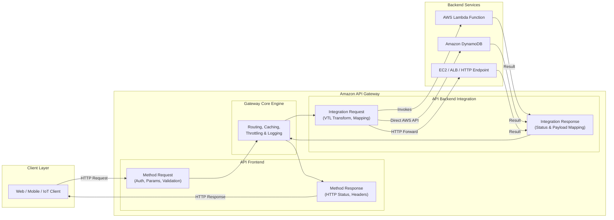
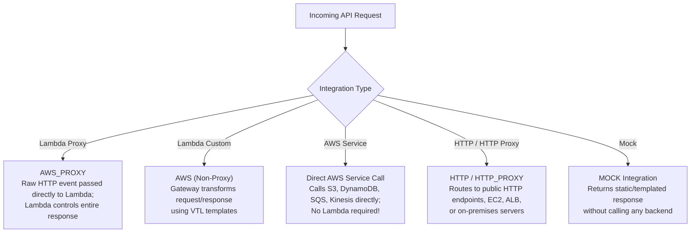
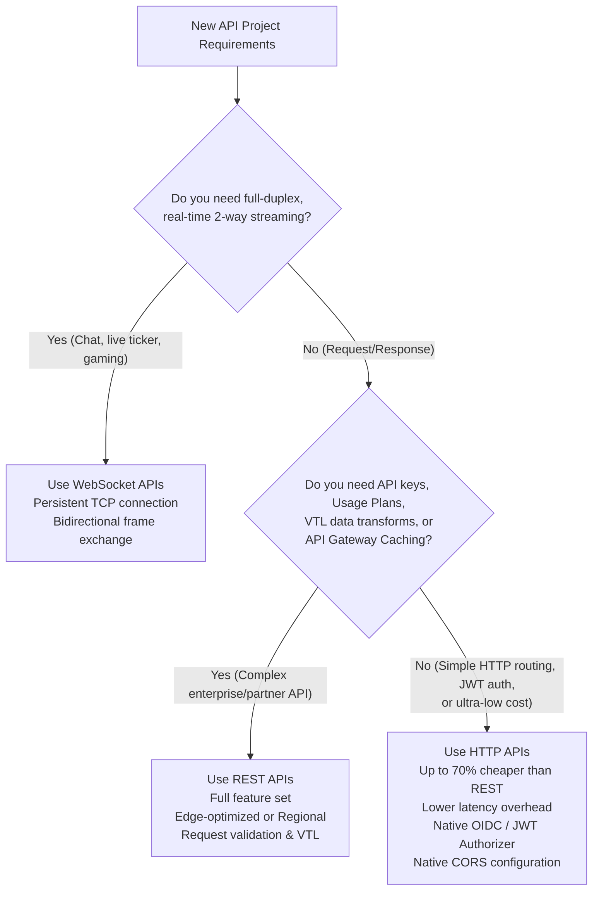
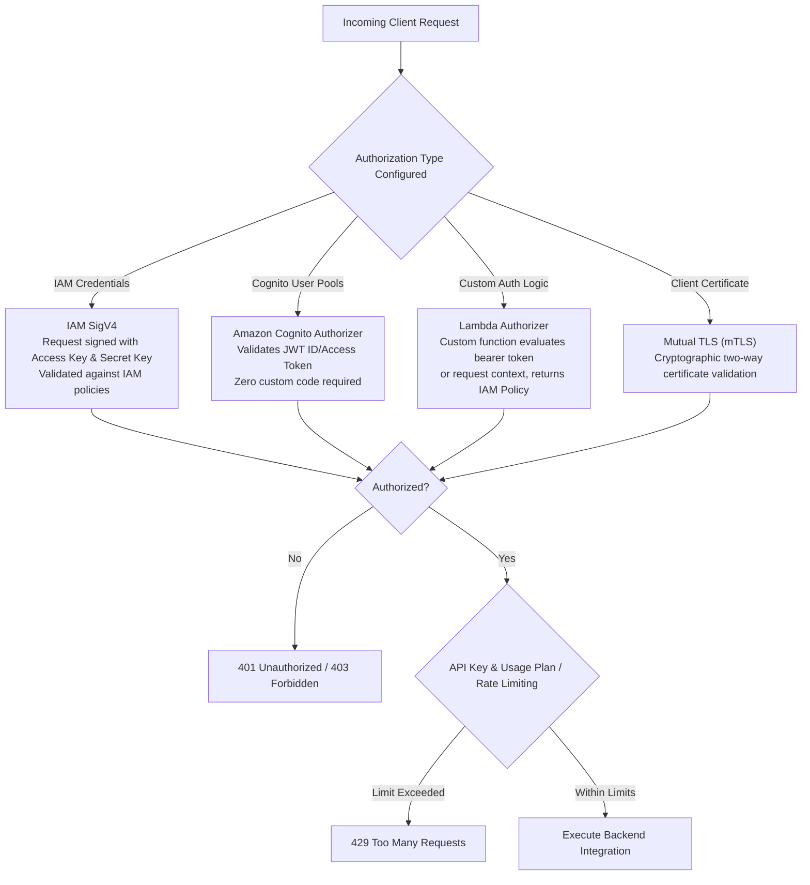
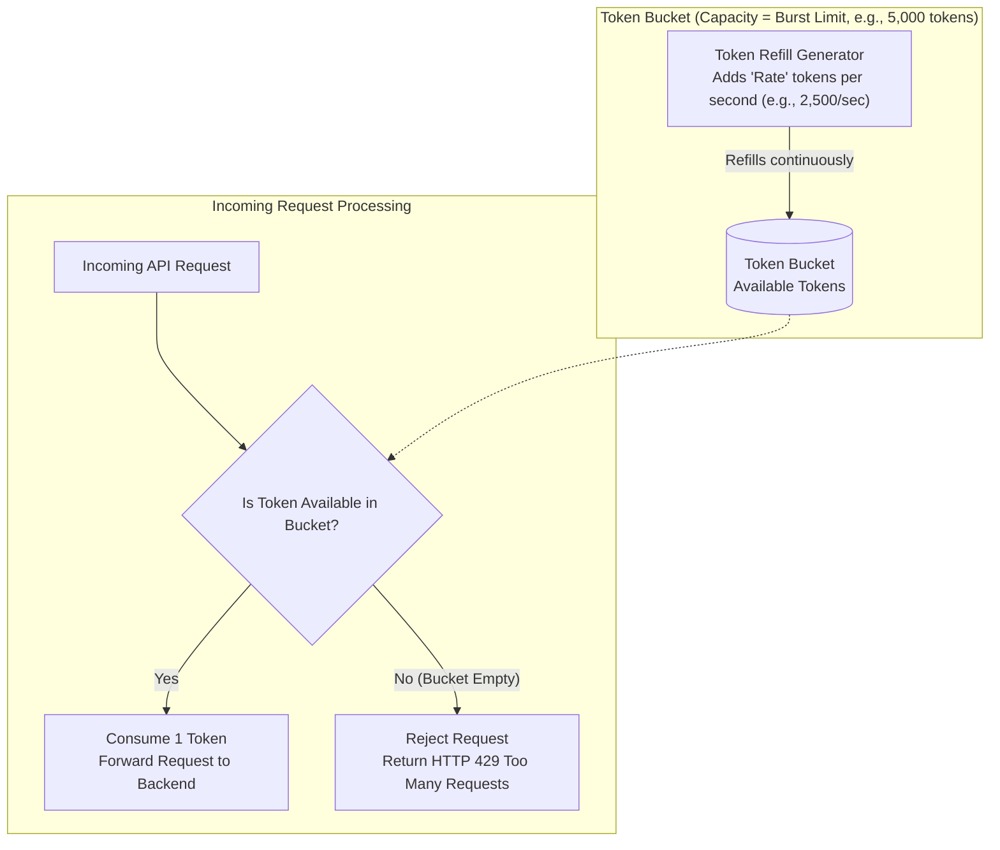
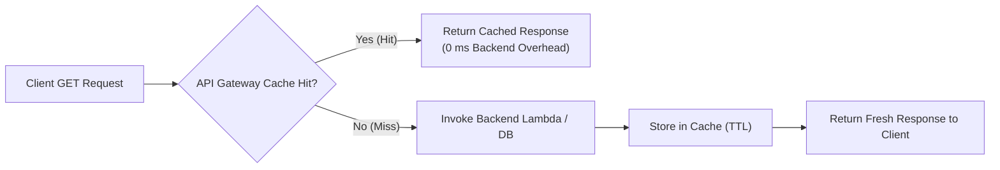
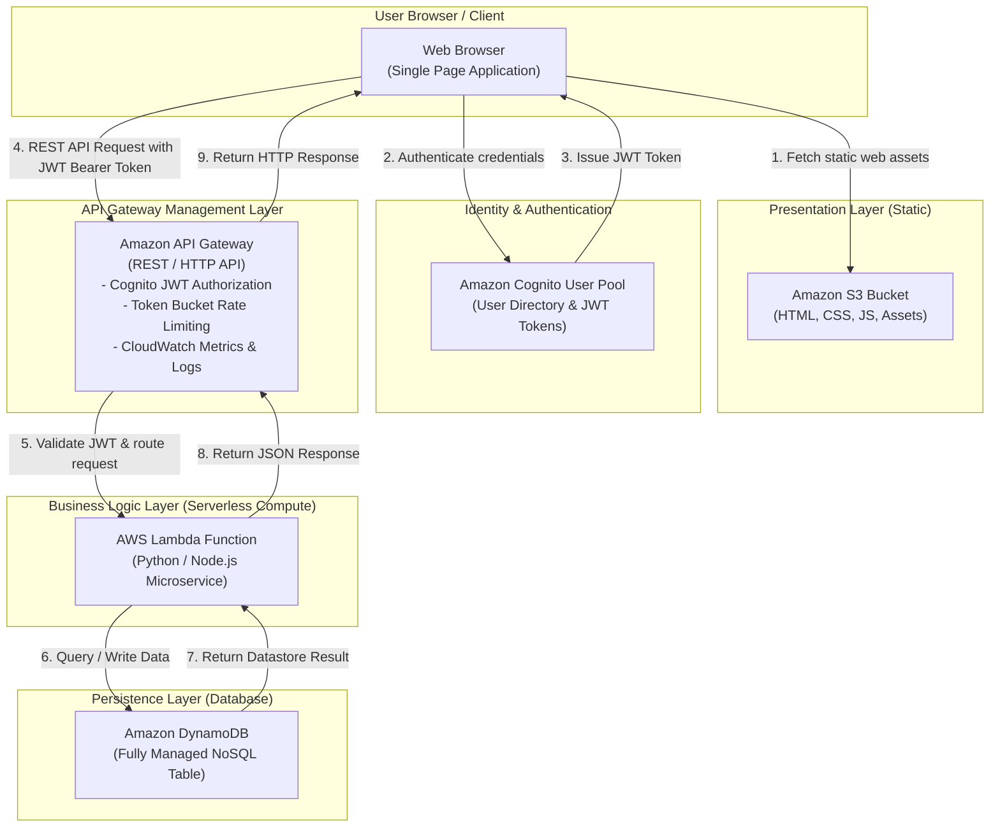

# 🌐 Amazon API Gateway: Architecture, API Types & Serverless Integration

> **Course**: AWS re/Start  
> **Module**: Serverless and Containers – M12 Amazon API Gateway  
> **Source Document**: `T16-0005-RSSECO_EN-US_SG_M12_AMAZONAPIGATEWAY.pdf`  
> **Target Audience**: AWS re/Start Learners / Cloud Practitioners / Solutions Architects / Junior Developers  

---

## 🎯 Module Overview

Application Programming Interfaces (APIs) form the connective tissue of modern distributed systems, enabling web applications, mobile devices, Internet of Things (IoT) sensors, and third-party services to securely communicate with backend computational workloads and data stores. However, operating public-facing APIs at cloud scale presents substantial operational challenges—including DDoS mitigation, traffic spikes, global latency, authentication, rate limiting, and lifecycle management.

**Amazon API Gateway** is a fully managed AWS service that abstracts these operational complexities. It acts as a resilient, secure "front door" for applications, allowing developers to create, publish, maintain, monitor, and secure APIs at any scale. API Gateway handles the heavy lifting of accepting and processing hundreds of thousands of concurrent API requests, integrating natively with serverless computing engines like **AWS Lambda**, containerized services, and traditional workloads.

---

### 📌 Learning Objectives

- [ ] **Define Amazon API Gateway**: Understand API Gateway as a fully managed API management service, identifying its core benefits, operational model, and pay-as-you-go pricing structure.
- [ ] **Differentiate API Types**: Compare and evaluate **REST APIs**, **HTTP APIs**, and **WebSocket APIs** based on feature set, latency requirements, authentication mechanisms, and cost efficiency.
- [ ] **Master Core Architectural Components**: Explain how API Gateway separates frontend definitions (Method Requests/Responses) from backend implementations (Integration Requests/Responses), and manage Resources, Methods, Stages, and Stage Variables.
- [ ] **Analyze Integration Types**: Contrast Lambda Proxy Integration (`AWS_PROXY`) with Custom/Non-Proxy Integrations, HTTP Integrations, Mock Integrations, and direct AWS Service Integrations.
- [ ] **Select Appropriate Endpoint Types**: Identify use cases and network paths for Edge-Optimized, Regional, and Private API endpoints.
- [ ] **Implement Multi-Layered Security & Access Control**: Secure APIs using AWS Identity and Access Management (IAM) SigV4, Amazon Cognito User Pools, Lambda Authorizers (custom tokens/requests), and API Keys with Usage Plans.
- [ ] **Understand Traffic Throttling & Rate Limiting**: Demystify the Token Bucket Algorithm, steady-state rate limits, and burst capacities to protect backend services from denial of service and runaway costs.
- [ ] **Optimize Performance & Enable Observability**: Configure API Gateway caching, analyze CloudWatch metrics (`Count`, `4XXError`, `5XXError`, `Latency`, `IntegrationLatency`), configure access logs, and trace requests end-to-end with AWS X-Ray.

---

## 🏗️ 1. What is Amazon API Gateway?

Amazon API Gateway is an AWS service that acts as a secure, scalable intermediary between client applications and backend business logic. Instead of provisioning, configuring, patching, and scaling reverse proxy servers (such as NGINX or HAProxy), developers can deploy managed API endpoints in minutes.

```
┌────────────────────────────────────────────────────────────────────────┐
│                   What Amazon API Gateway Handles                      │
├────────────────────────────────────────────────────────────────────────┤
│  1. Elastic Scaling         Auto-scales to handle hundreds of          │
│                             thousands of concurrent requests           │
│  2. Traffic Management      Throttles and buffers requests to protect  │
│                             downstream backends from overloading       │
│  3. Access Control          Natively integrates with IAM, Cognito,     │
│                             mTLS, and custom Lambda authorizers        │
│  4. API Lifecycle & Stages  Simultaneously hosts dev, test, staging,   │
│                             and production versions                    │
│  5. Protocol Translation    Converts REST/HTTP/WebSocket payloads      │
│                             and maps data between front/backend (VTL)  │
│  6. Monitoring & Auditing   Emits granular metrics, access logs, and   │
│                             X-Ray execution traces                     │
└────────────────────────────────────────────────────────────────────────┘
```

### Core Value Propositions & Benefits

| Benefit | Description & Operational Impact |
| :--- | :--- |
| **Efficient API Development** | Developers can run multiple versions of the same API simultaneously via Stages (`dev`, `v1`, `v2`), enabling seamless iteration, canary deployments, and zero-downtime rollouts. |
| **Performance at Any Scale** | Global clients experience low latency by leveraging the AWS global network of edge locations through built-in Amazon CloudFront distribution integration. |
| **Cost Savings at Scale** | Pure serverless billing model: you pay strictly for API requests received and data transferred out, with tiered volume discounts as traffic grows. No minimum fees or idle infrastructure costs. |
| **Built-in Security Controls** | Granular authorization using AWS Identity and Access Management (IAM), Amazon Cognito User Pools, mutual TLS (mTLS), and custom Lambda authorizers. |
| **Resilient Traffic Management** | Built-in token bucket rate limiting and bursting prevent downstream databases and services from being overwhelmed during unexpected traffic spikes. |
| **Comprehensive Monitoring** | Visual dashboards in the AWS Management Console provide real-time metrics on call counts, latency, and 4XX/5XX error rates via Amazon CloudWatch. |

> [!NOTE]
> **Serverless Synergy**: API Gateway pairs naturally with **AWS Lambda**. Client requests received by API Gateway trigger Lambda execution environments on demand, passing request metadata and payload bodies, eliminating the need to provision or manage any server infrastructure.

---

## 🔄 2. Architecture & Core Components

API Gateway cleanly decouples what the client interacts with (**Frontend**) from what processes the business logic (**Backend**).



### 1. Resources and Methods
- **Resources**: Represent hierarchical URI paths that identify application entities (e.g., `/users`, `/users/{userId}`, `/orders`).
- **Methods**: Represent the HTTP verbs executed against a resource (e.g., `GET`, `POST`, `PUT`, `DELETE`, `PATCH`, `OPTIONS`, `ANY`).
  - **`ANY` Method**: A wildcard catch-all method that routes all HTTP verbs on a resource to the same integration (frequently used with Lambda Proxy integrations).

### 2. Frontend vs. Backend Separation
API Gateway decomposes each API call into four sequential processing stages:

1. **Method Request**: Configures the public contract of the API. Defines expected query parameters, path variables, request headers, request body models (JSON Schema validation), and authorization requirements.
2. **Integration Request**: Translates the public client request into the target protocol and format required by the backend service. Data transformation can be applied using Velocity Template Language (VTL).
3. **Integration Response**: Receives the raw output from the backend, intercepts backend status codes or error messages, and maps them to the appropriate format for the frontend.
4. **Method Response**: Specifies the final HTTP response status code (e.g., `200 OK`, `400 Bad Request`, `404 Not Found`), response headers, and response models returned to the client.

---

### 3. Integration Types

API Gateway supports five distinct integration patterns:



1. **Lambda Proxy Integration (`AWS_PROXY`)**:
   - The most common and recommended pattern for serverless applications.
   - API Gateway forwards the raw HTTP request (headers, query string parameters, path parameters, body, client identity) directly to the Lambda function as a JSON event object.
   - The Lambda function is responsible for parsing input and returning a formatted JSON response containing `statusCode`, `headers`, and `body`.
   - **Advantage**: Zero configuration overhead; business logic and schema validations are handled in application code.

2. **Lambda Custom / Non-Proxy Integration (`AWS`)**:
   - API Gateway intercepts the request, validates the payload, and applies VTL mapping templates to reshape the data before invoking the Lambda function.
   - The Lambda function receives only the transformed data, not raw HTTP details.

3. **AWS Service Integration**:
   - API Gateway communicates **directly** with AWS services (such as DynamoDB, Amazon S3, Amazon SQS, or Amazon Kinesis) without requiring an intermediate Lambda function.
   - *Example*: A `POST /records` endpoint can write directly into an Amazon SQS queue, achieving minimal latency and zero compute execution costs.

4. **HTTP and HTTP Proxy Integration (`HTTP` / `HTTP_PROXY`)**:
   - Forwards client requests to an existing HTTP/HTTPS endpoint on the internet, Amazon EC2 instance, Application Load Balancer (ALB), or an on-premises data center.

5. **Mock Integration (`MOCK`)**:
   - API Gateway generates an HTTP response directly without invoking any backend service.
   - Essential for testing API definitions, handling CORS `OPTIONS` preflight requests, or returning mock development data to frontend teams before the backend is implemented.

---

### 4. Deployments, Stages, and Stage Variables

In API Gateway, editing a resource or method does **not** automatically apply changes to public consumers. To publish changes, developers create a **Deployment** associated with a **Stage**.

- **Deployment**: An immutable snapshot of the API configuration at a specific point in time.
- **Stage**: A named logical reference to a deployment representing an operational environment (e.g., `dev`, `test`, `staging`, `prod`). Each stage provides a unique invocation URL:
  $$\text{https://}\{\text{api-id}\}\text{.execute-api.}\{\text{region}\}\text{.amazonaws.com/}\{\text{stage-name}\}$$
- **Stage Variables**: Key-value configuration pairs attached to specific stages that act like environment variables. They allow a single API definition to point to different backend resources depending on the stage:
  - `dev` stage variable: `lambdaFunction = ProcessOrder-Dev`
  - `prod` stage variable: `lambdaFunction = ProcessOrder-Prod`
  - Integration target: `arn:aws:apigateway:us-east-1:lambda:path/.../functions/arn:aws:lambda:us-east-1:123456789012:function:${stageVariables.lambdaFunction}/invocations`

---

## 🔀 3. API Types Supported

Amazon API Gateway supports three distinct API protocols, tailored for different communication paradigms and operational budgets:



### 1. REST APIs (Full-Featured RESTful Services)
- Comprehensive, feature-dense option designed for enterprise workloads, monetization, and complex API topologies.
- Supports API keys, Usage Plans, client request validation, request/response data transformations using VTL, API Gateway caching, and private endpoints.

### 2. HTTP APIs (Lightweight, High-Performance, Cost-Optimized)
- Designed specifically for serverless workloads and proxying requests to AWS Lambda or HTTP backends.
- **Up to 70% cheaper** and delivers significantly lower latency than REST APIs.
- Features native support for OpenID Connect (OIDC) and OAuth 2.0 JWT authorizers, native Cross-Origin Resource Sharing (CORS) setup, and automatic staging/deployments.

### 3. WebSocket APIs (Bidirectional, Real-Time Streaming)
- Maintains persistent, full-duplex TCP connections between client applications and API Gateway.
- Eliminates the need for client polling. When events occur on the backend, the server can push updates directly to connected clients using the `@connections` API.
- Ideal for real-time multiplayer games, live chat platforms, financial market tickers, and collaborative editing tools.

---

### REST APIs vs. HTTP APIs: Comprehensive Comparison

| Feature / Capability | REST APIs | HTTP APIs |
| :--- | :--- | :--- |
| **Pricing (per million requests)** | $\approx \$3.50$ / million | $\approx \$1.00$ / million (**$\approx 70\%$ savings**) |
| **Latency** | Standard ($\approx 10\text{–}35\text{ ms}$ gateway overhead) | Ultra-low ($\approx 5\text{–}10\text{ ms}$ gateway overhead) |
| **Lambda Proxy Integration** | Yes (`AWS_PROXY`, Payload v1.0) | Yes (`AWS_PROXY`, Payload v1.0 & v2.0) |
| **HTTP Backend Proxy** | Yes | Yes |
| **Direct AWS Service Integrations** | Yes (over 100 AWS services) | Limited (SQS, EventBridge, AppConfig, Step Functions, DynamoDB) |
| **Data Transformation (VTL Templates)** | Yes (Full Velocity Template Language) | No (Passthrough only) |
| **Request Validation** | Yes (JSON Schema validation) | No (Handled by backend application) |
| **API Keys & Usage Plans** | Yes (Tiered rate limits per client) | No |
| **API Gateway In-Memory Caching** | Yes (Per-stage / per-method TTL cache) | No (Use ElastiCache or CloudFront caching) |
| **Built-in CORS Configuration** | Requires manual `OPTIONS` mock method setup | Built-in native console/CLI configuration |
| **JWT Authorizers (OIDC / OAuth 2.0)** | Requires custom Lambda Authorizer | Native (Zero compute cost authorizer) |
| **Lambda Authorizers** | Yes (Token and Request-based) | Yes (Simple payload format) |
| **Mutual TLS (mTLS)** | Yes | Yes |
| **Private Endpoints (VPC)** | Yes (via VPC Interface Endpoints) | Yes (via VPC Link) |
| **Endpoint Types** | Edge-Optimized, Regional, Private | Regional, Private |
| **WAF Integration (AWS WAF)** | Yes | Yes |

> [!TIP]
> **Architectural Recommendation**: Use **HTTP APIs** by default for new microservices and serverless architectures with Lambda or container backends unless you specifically require features exclusive to **REST APIs** (such as API keys/usage plans, VTL mapping templates, request validation, or built-in API caching).

---

## 🌐 4. Endpoint Types & Network Topologies

Amazon API Gateway supports three distinct endpoint types depending on where your clients reside and your latency requirements:

```mermaid
flowchart TD
    subgraph EdgeOpt["1. Edge-Optimized Endpoint"]
        ClientGlobal["Global Clients (Europe, Asia, Americas)"] --> CFManaged["AWS-Managed Amazon CloudFront Distribution\n(Edge Locations Worldwide)"]
        CFManaged -->|"AWS High-Speed Backbone"| APIEdge["API Gateway Core\n(Target Region)"]
    end

    subgraph Reg["2. Regional Endpoint"]
        ClientRegional["Clients in Same AWS Region or Custom CDN"] --> APIReg["Regional API Gateway\n(Specific AWS Region)"]
    end

    subgraph Priv["3. Private Endpoint"]
        ClientVPC["EC2 / Fargate inside Amazon VPC"] --> VPCE["VPC Interface Endpoint\n(AWS PrivateLink)"]
        VPCE --> APIPriv["Private API Gateway\n(Accessible only via VPC Endpoint)"]
    end
```



### 1. Edge-Optimized API Endpoints
- **Mechanism**: Automatically provisions and routes requests through an AWS-managed Amazon CloudFront distribution spanning hundreds of Points of Presence (PoPs) worldwide.
- **Best Suited For**: Geographically distributed client applications (mobile apps, web browsers worldwide) making requests across the public internet.
- **Benefit**: Requests enter the AWS global network at the edge location closest to the user, traveling across AWS's low-latency, private fiber backbone to the target region.

### 2. Regional API Endpoints
- **Mechanism**: Deployed directly within a specific AWS Region without an AWS-managed CloudFront distribution in front of it.
- **Best Suited For**:
  - Clients running in the same AWS Region (e.g., EC2 instances or microservices calling each other).
  - Workloads where you want to manage your **own custom CloudFront distribution** in front of the API (allowing custom WAF rules, custom domain certificates, or multi-origin routing).

### 3. Private API Endpoints
- **Mechanism**: Endpoints that can only be accessed from within an **Amazon Virtual Private Cloud (Amazon VPC)** or connected corporate networks (via AWS Direct Connect or AWS Site-to-Site VPN).
- **Architecture**: Leverages **AWS PrivateLink** interface VPC endpoints (`com.amazonaws.{region}.execute-api`). Traffic never traverses the public internet.
- **Access Control**: Governed by API Gateway **Resource Policies** that restrict access exclusively to specific VPC Endpoint IDs (`aws:sourceVpce`).

---

## 🔒 5. Security & Access Control

Securing public endpoints requires a multi-layered defense architecture. API Gateway provides diverse authorization and traffic management mechanisms:



### Authorization Mechanisms Breakdown

| Mechanism | Description | Best Use Case |
| :--- | :--- | :--- |
| **IAM Permissions (SigV4)** | Requests are cryptographically signed using AWS Signature Version 4 (SigV4) with IAM user/role credentials. Validated against IAM resource and identity policies. | Internal service-to-service communication, AWS SDK clients, internal microservices. |
| **Amazon Cognito User Pools** | Client authenticates against Cognito, receives a JSON Web Token (JWT), and passes it in the `Authorization` header. API Gateway validates token expiration and signature automatically. | User-facing web and mobile applications with end-user logins (Google, Apple, SAML, or Cognito). |
| **Lambda Authorizers (Custom)** | A custom Lambda function is invoked with the client's token (TOKEN type) or headers/query params (REQUEST type) to execute custom auth logic (OAuth2, LDAP, HMAC) and return an IAM allow/deny policy document. | Third-party OAuth 2.0 tokens (Auth0, Okta), legacy token systems, or fine-grained parameter-based authorization. |
| **Resource Policies** | JSON policy documents attached directly to the API Gateway to allow or deny requests from specified AWS accounts, IP CIDR ranges, or VPC endpoints. | IP whitelisting, cross-account access boundaries, locking down Private APIs to specific VPCs. |
| **Mutual TLS (mTLS)** | Two-way cryptographic authentication between client and API Gateway using X.509 certificates. | Enterprise B2B integrations, banking regulations (Open Banking), zero-trust architectures. |

---

### API Keys, Usage Plans & The Token Bucket Throttling Algorithm

To monetize APIs, enforce Service Level Agreements (SLAs), or protect downstream backends from resource starvation, API Gateway uses **API Keys** coupled with **Usage Plans**.

- **API Keys**: Alphanumeric strings passed in the `x-api-key` header to identify client applications. (API keys identify the caller for metering; they should **not** be used as the sole authentication mechanism).
- **Usage Plans**: Define throttle limits and quota allowances for clients holding specific API keys.

#### The Token Bucket Algorithm

API Gateway implements the **Token Bucket Algorithm** to enforce rate limits and burst capacities:



- **Steady-State Rate Limit**: The continuous average number of requests per second (RPS) permitted (e.g., 2,500 requests/second). Tokens are continuously added to the bucket at this rate.
- **Burst Limit**: The maximum capacity of the bucket (e.g., 5,000 tokens). If traffic arrives in a sudden spike, API Gateway can immediately process requests up to the burst limit without throttling.
- **Quota**: The maximum cumulative number of requests allowed over an extended time window (e.g., 100,000 requests per day or month).
- **HTTP 429 Too Many Requests**: Returned automatically to the caller when tokens are exhausted or quotas are reached, preventing downstream overload.

---

## ⚡ 6. Performance Optimization, Caching & Monitoring

### 1. API Gateway Caching
- **How It Works**: API Gateway can provision a dedicated, in-memory cache for REST API stages. When a client makes a request, API Gateway checks the cache using the method, query parameters, or headers defined as **cache keys**.
- **Cache Hit vs. Cache Miss**: If data exists and the Time to Live (TTL) has not expired, API Gateway returns the cached response directly, completely bypassing backend Lambda functions or databases.
- **Configurable TTL**: Default TTL is 300 seconds (5 minutes); configurable from 0 to 3,600 seconds.
- **Invalidation**: Clients with appropriate IAM permissions can invalidate cache entries by sending the `Cache-Control: max-age=0` header.



---

### 2. Amazon CloudWatch Metrics & Diagnostic Analysis

API Gateway automatically streams operational metrics to Amazon CloudWatch at 1-minute intervals. Understanding the distinction between latency metrics is vital for diagnosing performance bottlenecks:

```
Total Request Time (Latency)
├─────────────────────────────────────────────────────────────────────────────┤
│ Gateway Overhead │           IntegrationLatency (Backend Time)              │
│ (Auth, VTL, WAF) │ (Lambda cold start, code execution, DB queries)          │
└──────────────────┴──────────────────────────────────────────────────────────┘
```

| CloudWatch Metric | Definition & Diagnostic Utility |
| :--- | :--- |
| `Count` | Total number of API requests received across a given stage or method over the evaluation period. |
| `4XXError` | Number of client-side errors (400, 401, 403, 404, 429). Indicates auth failures, invalid payloads, or rate limiting. |
| `5XXError` | Number of server-side errors (500, 502, 503, 504). Indicates backend crashes, Lambda timeouts, or gateway configuration bugs. |
| `IntegrationLatency` | Time elapsed from when API Gateway dispatches the request to the backend until it receives the backend response. Measures purely backend performance. |
| `Latency` | Total round-trip time from when API Gateway receives the first byte from the client until it finishes returning the response to the client. |

> [!IMPORTANT]
> **Diagnostic Formula**:
> $$\text{Gateway Overhead} = \text{Latency} - \text{IntegrationLatency}$$
> - If `IntegrationLatency` is high $\rightarrow$ Optimize the backend (Lambda cold starts, DynamoDB query indexing, external API calls).
> - If `IntegrationLatency` is low but `Latency` is high $\rightarrow$ Investigate API Gateway caching, Lambda authorizer latency, VTL transformations, or large response payload transfers.

---

### 3. Access Logging & AWS X-Ray Tracing

- **CloudWatch Access Logging**: Generates detailed, customizable log records for every single request using standard log formats (JSON, CSV, W3C, Common Log Format). Developers can log caller IP, user identity, request duration, status code, and error messages.
- **AWS X-Ray Active Tracing**: By enabling X-Ray on an API stage, API Gateway generates and propagates trace headers (`X-Amzn-Trace-Id`). This creates an end-to-end service map showing request propagation across API Gateway, Lambda, DynamoDB, and external services, isolating latency bottlenecks to individual lines of execution.

---

## 🏛️ 7. End-to-End Serverless Web Application Architecture

The following architecture demonstrates how Amazon API Gateway integrates with other core AWS serverless services to power a scalable, resilient web application:



### Architectural Step-by-Step Flow

1. **Static Presentation Delivery**: The user navigates to the application URL. The browser downloads static frontend assets (HTML5, CSS, client-side JavaScript, images) hosted in an **Amazon S3 bucket** (optionally accelerated by CloudFront).
2. **User Authentication**: The client-side JavaScript initiates an authentication request against an **Amazon Cognito User Pool**. Upon successful login, Cognito issues signed JSON Web Tokens (ID token, access token, refresh token).
3. **API Request Dispatch**: The client application issues an asynchronous HTTP request (e.g., `POST /orders`) to the **Amazon API Gateway** endpoint, passing the Cognito JWT in the `Authorization` header.
4. **Gateway Authorization & Traffic Control**:
   - API Gateway validates the JWT's cryptographic signature and expiration against Cognito without executing any backend code.
   - The token bucket throttling algorithm verifies that the caller is within rate limits.
5. **Serverless Compute Execution**: API Gateway invokes the target **AWS Lambda** function via Lambda Proxy Integration, passing the parsed HTTP request parameters and user identity.
6. **Data Persistence**: The Lambda function executes business validation logic and performs read/write operations against an **Amazon DynamoDB** table using the AWS SDK.
7. **Response Delivery**: DynamoDB returns the database result to Lambda, which formats an HTTP response object (`statusCode: 200`, `body: ...`). API Gateway delivers the response back to the client browser.

---

## ❓ 8. Checkpoint Questions & Review

### Question 1: What is Amazon API Gateway used for?
**Answer**:  
Amazon API Gateway is a fully managed service used by developers to create, publish, maintain, monitor, and secure APIs (REST, HTTP, and WebSocket) at any scale. It handles traffic management, authorization, DDoS mitigation, throttling, API versioning, and lifecycle management for concurrent API requests.

---

### Question 2: Which types of applications use APIs and Amazon API Gateway?
**Answer**:  
A wide spectrum of modern applications rely on API Gateway, including:
- **Single Page Applications (SPAs)** and dynamic web frontends.
- **Mobile applications** (iOS and Android).
- **Internet of Things (IoT)** sensors and edge devices transmitting telemetry.
- **B2B partner integrations** and public developer APIs.
- **Backend microservice architectures** communicating across distributed systems.

---

### Question 3: What is the architectural difference between an API frontend and an API backend in API Gateway?
**Answer**:  
- **API Frontend**: Encapsulated by **Method Requests** and **Method Responses**. It represents the client-facing contract—defining how clients call the API (HTTP verbs, URI path, headers, query parameters, authorization, and validation) and what HTTP responses they receive.
- **API Backend**: Encapsulated by **Integration Requests** and **Integration Responses**. It represents the internal communication link between API Gateway and the downstream AWS service (Lambda, DynamoDB, SQS) or HTTP endpoint, including any data transformation (VTL) required by the target system.

---

### Question 4: Under what conditions should an architect choose an HTTP API instead of a REST API?
**Answer**:  
An architect should choose an **HTTP API** when building serverless APIs with AWS Lambda or routing to HTTP backends where low latency and cost optimization are primary objectives. HTTP APIs are up to **70% cheaper**, support native JWT authentication (Cognito/OAuth2), and include native CORS configuration. A **REST API** should only be selected if the workload requires advanced capabilities unique to REST APIs—such as API keys with usage plans, request/response data transformation using VTL, API Gateway in-memory caching, request body validation, or direct integrations with complex AWS services.

---

### Question 5: If API Gateway reports a total `Latency` of 1,200 ms and an `IntegrationLatency` of 1,180 ms in CloudWatch, where does the performance bottleneck lie?
**Answer**:  
The bottleneck is located in the **backend integration** (e.g., AWS Lambda or the database), not in API Gateway. `IntegrationLatency` represents the time spent waiting for the backend to respond (1,180 ms), whereas API Gateway's own internal overhead (`Latency` - `IntegrationLatency`) was only 20 ms. Troubleshooting should focus on Lambda execution time, cold starts, or slow database queries.

---

## 🔑 Key Takeaways & Exam Quick Reference

- **Fully Managed & Serverless**: Amazon API Gateway handles scaling, traffic management, authorization, and monitoring with pay-per-request pricing.
- **Three API Types**:
  - **REST APIs**: Full-featured, complex transformations (VTL), API keys, usage plans, caching.
  - **HTTP APIs**: Low-latency, lightweight, up to 70% cheaper, native OIDC/OAuth 2.0 JWT authorizers, native CORS.
  - **WebSocket APIs**: Persistent bidirectional TCP connections for real-time applications (chat, live notifications).
- **Three Endpoint Types**:
  - **Edge-Optimized**: Routes traffic through AWS-managed CloudFront edge locations for global clients.
  - **Regional**: Deployed directly in the host AWS Region for same-region clients or custom CloudFront setups.
  - **Private**: Accessible exclusively within an Amazon VPC via AWS PrivateLink interface endpoints.
- **Security Options**: IAM SigV4, Amazon Cognito User Pools (JWT), custom Lambda Authorizers, resource policies, mTLS.
- **Traffic Protection**: Token Bucket Algorithm enforces continuous rate limits and burst capacities, returning `HTTP 429 Too Many Requests` when limits are exceeded.
- **Observability**: CloudWatch metrics differentiate total `Latency` from backend `IntegrationLatency`; access logs and AWS X-Ray provide deep tracing.
