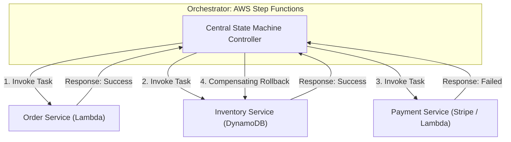
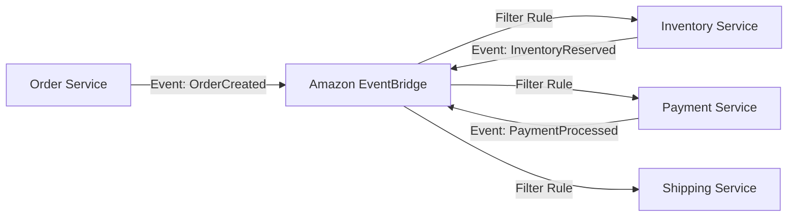
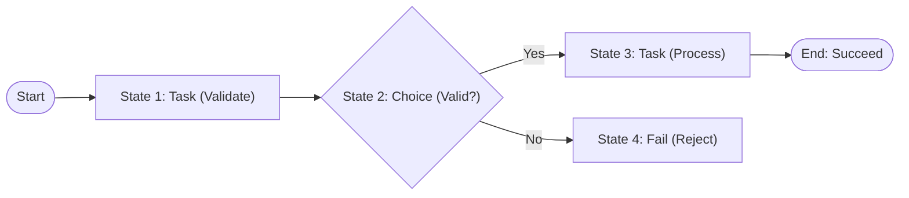
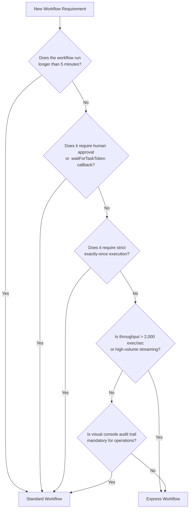
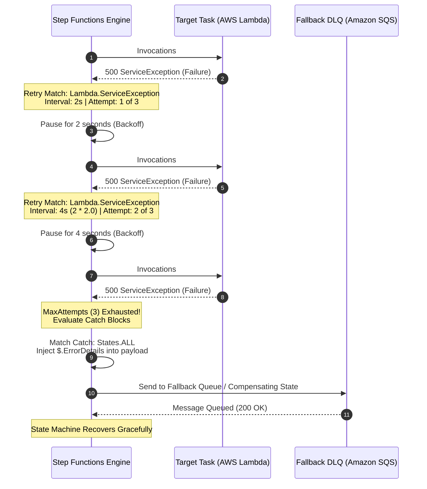
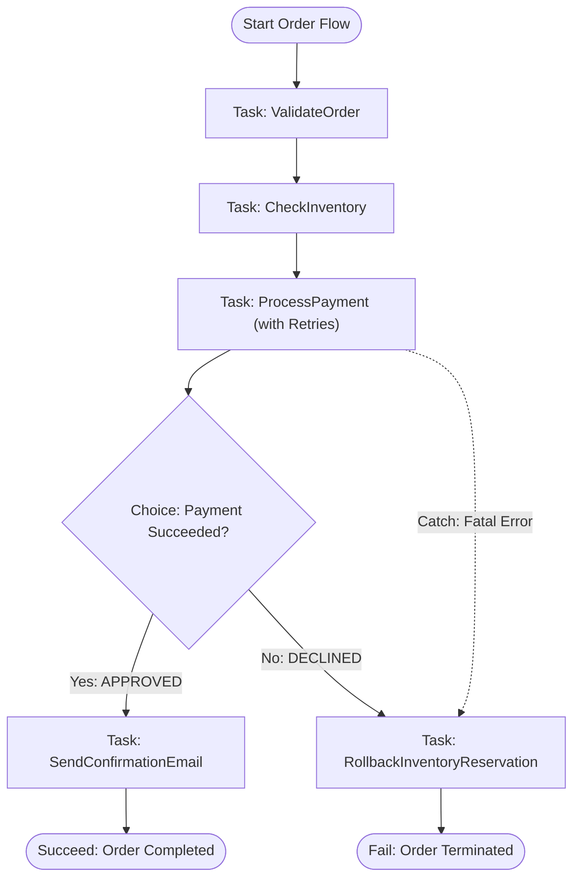
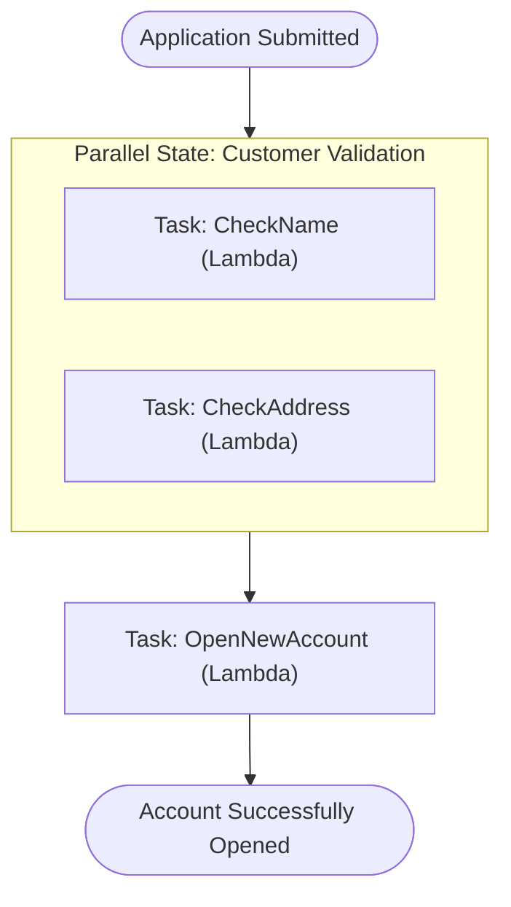

# ⚡ Module 12: AWS Step Functions – Study Guide

> **Course**: AWS re/Start  
> **Module**: Serverless and Containers  
> **Source Document**: `T16-0006-RSSECO_EN-US_SG_M12_AWSSTEPFUNCTIONS.pdf`  
> **Target Audience**: AWS re/Start Learners, Cloud Practitioners, Solutions Architects, and SysOps Engineers  

---

## 🎯 Module Overview

Modern cloud-native applications are rarely built as monolithic blocks. Instead, they are engineered as decoupled microservices and distributed serverless components (such as **AWS Lambda** functions, **Amazon ECS** container tasks, and managed databases like **Amazon DynamoDB**). While decomposing applications into microservices yields immense flexibility, independent scaling, and fault isolation, it introduces a major operational challenge: **coordination**. 

How do distributed components communicate their completion, handle complex multi-step branching logic, pause for external human approvals or delayed callbacks, and recover gracefully when transient network or downstream service errors occur? Hardcoding this coordination logic inside individual application functions produces tight coupling, brittle point-to-point dependencies, cascading failures, and hidden technical debt.

**AWS Step Functions** resolves this architectural challenge by providing a fully managed serverless orchestration service. Step Functions enables developers to visually assemble distributed services and custom code into resilient, observable, multi-step workflows known as **state machines**. By separating workflow control logic from core business logic, Step Functions delivers declarative error handling, visual execution auditing, automatic state management, and seamless native integration with over 220 AWS services.

---

### 📌 Learning Objectives

- [ ] **Define AWS Step Functions**: Explain its role as a serverless orchestration service that coordinates distributed components, AWS services, and microservices into visual, resilient workflows.
- [ ] **Analyze Orchestration vs. Choreography**: Compare centralized workflow management (orchestration) with decentralized event-driven design (choreography), evaluating trade-offs in coupling, end-to-end visibility, and failure recovery.
- [ ] **Explain Core Step Functions Concepts**: Understand the operational mechanics of state machines, individual states, tasks, and state transitions.
- [ ] **Evaluate Workflow Types (Standard vs. Express)**: Differentiate between Standard Workflows (auditability, up to 1-year duration, exactly-once execution semantics) and Express Workflows (high-throughput, sub-second to 5-minute durations, cost-efficiency for streaming and IoT).
- [ ] **Master Amazon States Language (ASL)**: Understand the declarative JSON specification used to define workflow state machines.
- [ ] **Classify Key ASL State Types**:
  - `Task`: Executing work across Lambda, ECS, DynamoDB, SQS, SNS, and third-party APIs.
  - `Choice`: Evaluating dynamic input parameters to perform conditional branching logic.
  - `Wait`: Delaying workflow progress for a specific duration or until a scheduled timestamp.
  - `Parallel`: Forking execution into concurrent, independent branches.
  - `Map`: Dynamically iterating over arrays in parallel (Inline and Distributed Map).
  - `Pass`: Injecting, mocking, or transforming data payloads without external work.
  - `Fail` & `Succeed`: Gracefully terminating workflows with designated outcome codes and error metadata.
- [ ] **Implement Declarative Error Resilience**: Configure `Retry` blocks (using `ErrorEquals`, `IntervalSeconds`, `MaxAttempts`, and `BackoffRate`) and `Catch` blocks for fallback routing and Dead-Letter Queue (DLQ) containment.
- [ ] **Examine Enterprise Use Cases**: Explore data processing pipelines, IT operations automation, e-commerce order fulfillment, and human-in-the-loop approval patterns.

---

## 📚 Key Terminology

| Term | Definition |
| :--- | :--- |
| **AWS Step Functions** | A fully managed, serverless orchestration service that coordinates distributed components and AWS services into visual workflows. |
| **Orchestration** | A software architectural pattern where a centralized controller coordinates workflow execution, tracks progress, manages state, and triggers tasks. |
| **Choreography** | A decentralized architectural pattern where distributed components publish and react independently to domain events via message brokers or event buses without central oversight. |
| **State Machine** | A mathematical and computational model representing a system that can exist in one of several states at any given time, transitioning between them based on inputs. In Step Functions, the workflow itself is a state machine. |
| **State** | An individual step within a Step Functions state machine that performs work, makes decisions, waits, iterates, or modifies data. |
| **Task** | A single unit of work executed within a `Task` state, performed by an integrated AWS service (e.g., AWS Lambda, Amazon ECS, Amazon DynamoDB) or an external activity worker. |
| **Amazon States Language (ASL)** | A structured, declarative, JSON-based domain-specific language used to define states, transitions, parameters, retries, and error handling in Step Functions. |
| **Standard Workflow** | A Step Functions workflow type designed for long-running (up to 1 year), durable, auditable processes requiring visual step-by-step history and at-most-once execution. |
| **Express Workflow** | A Step Functions workflow type designed for high-throughput (up to 100,000+ executions/second), short-duration (up to 5 minutes) event processing, data ingestion, and streaming workloads. |
| **Exponential Backoff** | An algorithm that progressively increases the delay between retry attempts following a failure, preventing downstream service exhaustion. |
| **Jitter** | Randomized latency variance introduced into backoff algorithms to prevent retry storms (thundering herd problem). |
| **JSONPath** | A query expression language used by Step Functions to navigate, select, filter, and extract attributes from JSON input and output payloads. |
| **Activity Worker** | An external compute worker (running on Amazon EC2, containers, or on-premises servers) that polls Step Functions for tasks via long polling APIs (`GetActivityTask`). |
| **Callback Pattern (`waitForTaskToken`)** | An asynchronous integration pattern where a task initiates external work with a generated token and pauses the workflow until an external process returns the token with results. |

---

## 🔄 1. Application Coordination: Orchestration vs. Choreography

Distributed cloud architectures typically employ one of two coordination paradigms: **Orchestration** or **Choreography**. Choosing the correct pattern—or an intentional hybrid of both—is fundamental to building resilient serverless architectures.

```
                  ┌─────────────────────────────────────────────────────────┐
                  │                 COORDINATION PARADIGMS                  │
                  └─────────────────────────────────────────────────────────┘
                                /                             \
                               /                               \
     ┌────────────────────────────────────┐   ┌────────────────────────────────────┐
     │           ORCHESTRATION            │   │            CHOREOGRAPHY            │
     │      (Centralized Controller)      │   │     (Decentralized Event-Driven)   │
     │                                    │   │                                    │
     │  "Conductor directs each musician" │   │    "Dancers react to each other"   │
     └────────────────────────────────────┘   └────────────────────────────────────┘
```

### 1.1 The Challenge of Distributed Systems & Microservices

When decomposing a monolithic application into microservices, each service owns its data and specific domain logic. However, end-to-end business transactions almost always span multiple microservices. 

For instance, an e-commerce checkout flow requires:
1. Validating customer credit and identity.
2. Reserving inventory in the warehouse.
3. Charging the customer's credit card.
4. Generating a shipping label.
5. Sending a confirmation notification.

If each microservice calls the next via point-to-point HTTP or SDK invocations, several problems emerge:
- **Tight Coupling**: Service A must know the network endpoint, contract, and error response model of Service B.
- **Complex Error Handling**: If Step 4 fails, Service A must know how to rollback Step 2 (inventory) and Step 3 (payment).
- **Zero Central Visibility**: Diagnosing where a transaction stalled requires correlating logs across five different microservices and log groups.
- **Cascading Failures**: A downstream slowdown causes upstream timeouts and thread starvation across the entire call chain.

---

### 1.2 Orchestration (Centralized Control)

In an **Orchestrated** architecture, a central coordinator (the "conductor") explicitly directs each service. The orchestrator:
- Knows the global state of the workflow at all times.
- Decides which step executes next based on predefined business rules and previous outputs.
- Directly invokes tasks, awaits responses, and handles timeouts.
- Centralizes retry schedules, branching logic, and rollback compensation workflows.



**Key Advantages**:
- **Single Source of Truth**: The full state and historical lineage of any workflow run are recorded centrally.
- **Simplified Service Code**: Microservices remain pure and focused purely on business logic; they do not need complex retry loops or awareness of subsequent steps.
- **Visual Auditing**: Operations teams can visually inspect execution graphs, identifying bottlenecks or failures immediately.

---

### 1.3 Choreography (Decentralized Event-Driven Architecture)

In a **Choreographed** architecture, there is no central brain or orchestrator. Instead, components communicate asynchronously by publishing and subscribing to domain events via message brokers or event routers, such as **Amazon EventBridge**, **Amazon SNS**, or **Amazon SQS**.



Each service:
- Listens for specific event types.
- Performs its discrete domain action.
- Emits a new event indicating completion (e.g., `OrderCreated`, `InventoryReserved`, `PaymentProcessed`).
- Has no knowledge of what downstream services exist or what they will do with the emitted event.

**Key Advantages**:
- **Extreme Decoupling**: Producers and consumers are completely agnostic of one another.
- **High Extensibility**: New services can subscribe to existing events without modifying upstream publishers.
- **High Throughput**: No central coordinator bottlenecking rapid event delivery.

---

### 1.4 Orchestration vs. Choreography: Comparative Trade-Off Analysis

| Dimension | Orchestration (AWS Step Functions) | Choreography (Amazon EventBridge / SNS / SQS) |
| :--- | :--- | :--- |
| **Control Model** | Centralized coordinator directs execution. | Decentralized components react autonomously to events. |
| **Service Coupling** | Microservices are coupled to the orchestrator's interface, but decoupled from each other. | Highly decoupled; services know only about event schemas, not other services. |
| **End-to-End Visibility** | **High**: Single visual console shows exact step status, inputs, outputs, errors, and timeline. | **Low**: Requires distributed tracing (AWS X-Ray) and correlated log analytics (CloudWatch Insights). |
| **Error Handling & Compensation** | Declarative retries, centralized catch blocks, and coordinated compensating transactions (Saga pattern). | Complex; each service must publish failure events, and every preceding service must listen and roll back. |
| **Change Management** | Workflow sequence modifications occur in the state machine definition without touching service code. | Changes require updating event schemas, event bus routing rules, and multi-service listeners. |
| **Best Used For** | Multi-step business processes, ordered workflows, human approval gates, ETL data pipelines, transactional rollback. | Broadcast notifications, cross-domain service communication, reactive event streaming, high fan-out systems. |

> [!TIP]
> **Architectural Best Practice: The Hybrid Approach**  
> Modern enterprise architectures rarely choose between orchestration and choreography in isolation. The industry-standard approach uses **Choreography between major domain boundaries** (e.g., using Amazon EventBridge to communicate between the Order Domain and the Billing Domain) and **Orchestration within a single domain** (e.g., using AWS Step Functions to coordinate the multi-step checkout sequence inside the Order Domain).

---

## ⚡ 2. What is AWS Step Functions?

### 2.1 Core Architectural Definition & Purpose

**AWS Step Functions** is a fully managed, low-code visual workflow service that enables developers to build distributed applications, automate IT processes, orchestrate microservices, and create data pipelines at cloud scale.

Step Functions manages state, checkpoints progress, automatically restarts failed components with backoff schedules, and scales compute infrastructure dynamically based on demand. Because it is completely serverless, developers manage zero servers, operating systems, or clustering software.

```
       ┌─────────────────────────────────────────────────────────────────┐
       │                     AWS STEP FUNCTIONS                          │
       │                                                                 │
       │  ┌─────────────────┐   ┌─────────────────┐   ┌───────────────┐  │
       │  │ State Machine   │   │  JSONPaylod     │   │ Visual Graph  │  │
       │  │ (Workflow Logic)│   │  State Tracking │   │ & Audit Trail │  │
       │  └────────┬────────┘   └────────┬────────┘   └───────┬───────┘  │
       └───────────┼─────────────────────┼────────────────────┼──────────┘
                   ▼                     ▼                    ▼
       ┌─────────────────────────────────────────────────────────────────┐
       │             INTEGRATED COMPUTE & AWS ECOSYSTEM                  │
       │   AWS Lambda  •  Amazon ECS/Fargate  •  Amazon DynamoDB         │
       │   Amazon SNS  •  Amazon SQS  •  AWS Glue  •  Amazon SageMaker   │
       └─────────────────────────────────────────────────────────────────┘
```

---

### 2.2 Core Concepts: State Machines, States, and Tasks

Step Functions operates on three core building blocks:

1. **State Machine (Workflow)**:
   - The overall workflow container.
   - Defined declaratively using the JSON-based **Amazon States Language (ASL)** or visually using the **Step Functions Workflow Studio**.
   - Contains a collection of interconnected states, an entry point (`StartAt`), and exit termination states.

2. **State**:
   - An individual step or node within the state machine.
   - States have unique names within the state machine and perform specific functions (such as doing work, evaluating conditions, pausing execution, or formatting JSON).
   - Each state takes a JSON payload as input and outputs a transformed JSON payload to the next state.

3. **Task**:
   - Represents the actual work performed by a `Task` state.
   - Can invoke an AWS Lambda function, run an Amazon ECS container, write to a DynamoDB table, publish to SNS/SQS, or dispatch an HTTP request to an external third-party API.
   - Can also dispatch work to custom applications hosted on EC2 or on-premises servers via **Activity Workers**.



---

### 2.3 Core Benefits

The curriculum highlights three primary architectural benefits:

#### 1. Productivity
- **Decoupled Architecture**: Workflow definition and sequencing are decoupled from business logic. You can swap, reorder, or introduce new steps without rewriting existing microservices.
- **Built-in Resilience**: Ready-made retry, catch, and timeout configurations reduce boilerplate error-handling code across your application components.
- **Visual Workflow Studio**: Developers and business stakeholders can collaborate using drag-and-drop workflow modeling.

#### 2. Agility
- **Visual Audit History**: Step Functions automatically captures every execution event, state transition, input, output, and execution timestamp in an interactive visual console.
- **Rapid Experimentation**: Adding a fraud check or notification step takes minutes by modifying state transitions rather than rebuilding deployment pipelines.
- **Massive Scalability**: Automatically scales from zero to tens of thousands of concurrent executions alongside AWS serverless services (Lambda, DynamoDB, S3).
- **Cost Transparency**: Pay solely for what you use, with zero upfront provisioning.

#### 3. Resilience
- **Automated Fault Tolerance**: Built-in state checkpointing ensures that if an execution encounters an intermittent failure, it can retry without restarting from scratch.
- **Managed High Availability**: Underlying workflow state is replicated across multiple Availability Zones within the AWS Region.
- **Graceful Failure Paths**: Unhandled exceptions are trapped cleanly, triggering fallback logic or human escalations.

---

### 2.4 Service Features

- **Automatic Scaling**: Step Functions automatically provisions and scales the underlying compute resources necessary to execute workflow steps in response to traffic volume, ensuring consistent execution latency.
- **High Availability & Durability**: Maintained across multiple Availability Zones (AZs) in each Region. If an underlying physical data center encounters issues, state machines seamlessly continue execution.
- **Pay Per Use**:
  - **Standard Workflows**: Metered strictly by **state transitions** ($0.025 per 1,000 state transitions). Idle time incurs zero cost, even if a workflow pauses in a `Wait` state for months.
  - **Express Workflows**: Metered by execution count and total execution duration (memory-seconds).
- **Security & Enterprise Compliance**:
  - **IAM Least Privilege**: Native integration with AWS Identity and Access Management (IAM) role execution policies, ensuring Step Functions only has permissions to invoke designated resources.
  - **VPC Endpoints & PrivateLink**: Securely invoke Step Functions from private VPC subnets and private Lambda functions without traffic traversing the public internet.
  - **Encryption**: Payload data is encrypted at rest using AWS Key Management Service (AWS KMS) and encrypted in transit via TLS.
  - **Compliance Certifications**: HIPAA eligible, SOC (1, 2, 3) compliant, PCI DSS compliant, and ISO certified.

---

## ⚙️ 3. Workflow Types: Standard vs. Express Workflows

AWS Step Functions provides two distinct workflow execution models tailored for fundamentally different operational requirements: **Standard Workflows** and **Express Workflows**.

```
                   ┌────────────────────────────────────────────────────────┐
                   │               STEP FUNCTIONS WORKFLOW TYPES            │
                   └────────────────────────────────────────────────────────┘
                                /                            \
                               /                              \
         ┌───────────────────────────┐          ┌───────────────────────────┐
         │     STANDARD WORKFLOWS    │          │     EXPRESS WORKFLOWS     │
         │                           │          │                           │
         │  • Up to 1 Year Duration  │          │  • Up to 5 Min Duration   │
         │  • Exactly-Once Execution │          │  • At-Least / At-Most-Once│
         │  • Full Visual History    │          │  • 100,000+ Executions/sec│
         │  • Auditable Business App │          │  • High-Volume Streaming  │
         └───────────────────────────┘          └───────────────────────────┘
```

### 3.1 Standard Workflows Deep Dive

Standard Workflows are built for long-running, mission-critical, auditable business workflows. 

- **Execution Duration**: Can run for up to **1 year**. A workflow can initiate a process, enter a `Wait` state for 30 days, pause for a human manager approval token, and resume seamlessly.
- **Execution Semantics**: **Exactly-once** execution model. State transitions and task invocations never execute more than once unless explicitly directed by configured `Retry` policies.
- **Complete Visual History**: Step Functions maintains a detailed audit trail of every single state transition, including complete input and output JSON payloads, step duration, and error codes for up to **90 days** in the management console.
- **Pricing**: Billed per **state transition**.

---

### 3.2 Express Workflows Deep Dive

Express Workflows are engineered for high-throughput, short-duration data ingestion, streaming transformations, IoT sensor processing, and microservice coordination.

- **Execution Duration**: Maximum execution duration of **5 minutes**.
- **Execution Rate**: Capable of handling over **100,000 executions per second**.
- **Execution Models**:
  - **Asynchronous Express Workflows**: Return an immediate confirmation that the execution started. Guarantee **at-least-once** execution semantics. Ideal for messaging ingestion and event streaming.
  - **Synchronous Express Workflows**: Hold the HTTP connection open and return the completed execution result directly to the caller. Guarantee **at-most-once** execution semantics. Ideal for web backend REST APIs via Amazon API Gateway.
- **Observability**: Because of the extreme throughput, execution histories are not displayed in the Step Functions console. Instead, logs and execution metrics are streamed directly to **Amazon CloudWatch Logs**.
- **Pricing**: Billed based on the number of executions, execution duration, and memory consumption.

---

### 3.3 Standard vs. Express Workflows: Comprehensive Comparison Table

| Feature / Dimension | Standard Workflows | Express Workflows |
| :--- | :--- | :--- |
| **Maximum Duration** | Up to **1 year** | Up to **5 minutes** |
| **Execution Rate Limit** | Over 2,000 executions / second (burst up to 4,000) | Over **100,000 executions / second** |
| **Execution Semantics** | **Exactly-once** execution | **At-least-once** (Asynchronous) or **At-most-once** (Synchronous) |
| **Execution History** | Full visual step-by-step history stored for **90 days** in the AWS Console | Streamed directly to **Amazon CloudWatch Logs** |
| **Billing Model** | **$0.025 per 1,000 state transitions** | **$1.00 per million executions** + duration fees ($/GB-second) |
| **Pricing for Idle Wait Time** | **$0.00** (Zero cost while waiting) | Continues billing for duration of execution |
| **Callback Pattern (`.waitForTaskToken`)** | **Supported** (Pauses until token returned) | **Not supported** |
| **Human-in-the-Loop Approval** | Supported natively | Not supported (due to 5-minute timeout) |
| **Activity Workers** | Supported | Not supported |
| **Primary Use Cases** | Order fulfillment, user onboarding, mortgage processing, long-running ETL, disaster recovery orchestration. | IoT telemetry ingestion, payment authorization APIs, clickstream processing, rapid streaming ETL. |

---

### 3.4 Decision Framework: Choosing Standard vs. Express



---

## 📝 4. Amazon States Language (ASL) & State Types

### 4.1 What is Amazon States Language (ASL)?

The **Amazon States Language (ASL)** is a formal, JSON-based specification used to define state machines in AWS Step Functions. An ASL definition specifies:
- The starting state (`StartAt`).
- An optional description and timeout duration.
- The dictionary of available `States`.
- State transitions, branch conditions, retry policies, and catch handlers.

#### Minimal ASL Structure Example
```json
{
  "Comment": "A minimal single-task state machine",
  "StartAt": "InvokeLambdaFunction",
  "States": {
    "InvokeLambdaFunction": {
      "Type": "Task",
      "Resource": "arn:aws:lambda:us-east-1:123456789012:function:ProcessOrder",
      "End": true
    }
  }
}
```

---

### 4.2 Comprehensive State Types Breakdown

Step Functions provides eight fundamental state types to construct any operational workflow:

```
                          ┌─────────────────────────────┐
                          │    ASL STATE TYPE FAMILY    │
                          └─────────────────────────────┘
                                         │
        ┌──────────────┬─────────────────┼────────────────┬──────────────┐
        ▼              ▼                 ▼                ▼              ▼
     [Task]         [Choice]          [Wait]         [Parallel]        [Map]
  Execute work   Branching logic   Delay progress  Concurrent forks  Dynamic loops
        │              │                 │                │              │
        └──────────────┴─────────────────┼────────────────┴──────────────┘
                                         ▼
                                  [Pass / Fail / Succeed]
                               Data injection & Terminal states
```

#### 1. `Task` State
The primary workhorse of Step Functions. A `Task` state invokes external compute or orchestrates an integrated AWS service.
- **Supported Integrations**: AWS Lambda, Amazon ECS/Fargate tasks, Amazon DynamoDB (Get/Put/Update), Amazon SQS, Amazon SNS, AWS Glue, Amazon Athena, AWS Batch, and third-party HTTP endpoints via EventBridge API Destinations.
- **Execution Modes**:
  - *Request-Response* (default): Calls the service and immediately advances upon response.
  - *Run a Job (`.sync`)*: Submits a job (e.g., AWS Batch, ECS task) and waits for completion.
  - *Wait for Task Token (`.waitForTaskToken`)*: Pauses workflow execution until an external process returns the generated token.

```json
"ProcessPayment": {
  "Type": "Task",
  "Resource": "arn:aws:states:::lambda:invoke",
  "Parameters": {
    "FunctionName": "ProcessPaymentLambda",
    "Payload.$": "$"
  },
  "Next": "EvaluatePaymentResult"
}
```

#### 2. `Choice` State
Provides conditional branching logic based on runtime JSON payload evaluation. It does not perform work; it evaluates comparison operators (e.g., `StringEquals`, `NumericGreaterThan`, `BooleanEquals`, `IsPresent`) and directs traffic to the appropriate `Next` state.

```json
"EvaluatePaymentResult": {
  "Type": "Choice",
  "Choices": [
    {
      "Variable": "$.PaymentStatus",
      "StringEquals": "APPROVED",
      "Next": "ShipOrder"
    },
    {
      "Variable": "$.PaymentStatus",
      "StringEquals": "DECLINED",
      "Next": "HandleDeclinedPayment"
    }
  ],
  "Default": "UnknownPaymentStateFallback"
}
```

#### 3. `Wait` State
Delays execution progress for a defined duration or until a specific calendar timestamp. The state machine pauses without consuming compute resources.
- `Seconds`: Delays execution for a fixed number of seconds.
- `Timestamp`: Delays execution until an absolute ISO-8601 timestamp (e.g., `2026-12-01T00:00:00Z`).
- `SecondsPath` / `TimestampPath`: Dynamically extracts the delay duration or target timestamp from the incoming JSON payload.

```json
"WaitForCoolingPeriod": {
  "Type": "Wait",
  "Seconds": 300,
  "Next": "VerifyAccountStatus"
}
```

#### 4. `Parallel` State
Enables concurrent execution of fixed, independent branches of execution.
- Each branch contains its own independent state machine logic (with its own `StartAt` and states).
- Execution proceeds in parallel.
- The `Parallel` state waits until **all** branches have successfully completed before combining their individual output payloads into a single JSON array passed to the `Next` state.

```json
"ValidateCustomer": {
  "Type": "Parallel",
  "Branches": [
    {
      "StartAt": "CheckCreditScore",
      "States": {
        "CheckCreditScore": {
          "Type": "Task",
          "Resource": "arn:aws:lambda:us-east-1:123456789012:function:CheckCredit",
          "End": true
        }
      }
    },
    {
      "StartAt": "VerifyPhysicalAddress",
      "States": {
        "VerifyPhysicalAddress": {
          "Type": "Task",
          "Resource": "arn:aws:lambda:us-east-1:123456789012:function:CheckAddress",
          "End": true
        }
      }
    }
  ],
  "Next": "ConsolidateValidationResults"
}
```

#### 5. `Map` State
Executes dynamic parallel iterations over an array of items found in the input JSON payload. Unlike `Parallel` (which runs fixed, pre-defined branches), `Map` runs the identical workflow definition once for every item in an input list.
- **Inline Map**: Executes up to 40 concurrent iterations in memory.
- **Distributed Map**: Launches up to **10,000 concurrent child workflow executions**, capable of processing massive data sets (e.g., millions of files in Amazon S3, parquet files, or multi-gigabyte CSVs).

```json
"ProcessOrderItems": {
  "Type": "Map",
  "ItemsPath": "$.Order.Items",
  "ItemProcessor": {
    "ProcessorConfig": {
      "Mode": "INLINE"
    },
    "StartAt": "ProcessSingleItem",
    "States": {
      "ProcessSingleItem": {
        "Type": "Task",
        "Resource": "arn:aws:lambda:us-east-1:123456789012:function:ReserveItemStock",
        "End": true
      }
    }
  },
  "Next": "FinalizeCart"
}
```

#### 6. `Pass` State
Passes its input directly to its output, optionally injecting fixed mock data or applying JSON payload transformations.
- Essential for testing, debugging, injecting configuration parameters, or filtering payload attributes before downstream processing.

```json
"InjectMockPaymentResponse": {
  "Type": "Pass",
  "Result": {
    "PaymentStatus": "APPROVED",
    "TransactionId": "TX-998877"
  },
  "ResultPath": "$.PaymentDetails",
  "Next": "ShipOrder"
}
```

#### 7. `Fail` and `Succeed` States
Terminal states that explicitly halt state machine execution:
- **`Succeed` State**: Stops the workflow execution with a `SUCCEEDED` status. Useful for early, successful exits in conditional branching.
- **`Fail` State**: Stops the workflow execution with a `FAILED` status. Allows developers to declare custom `Error` codes and human-readable `Cause` strings for debugging and CloudWatch alert triggers.

```json
"RejectApplication": {
  "Type": "Fail",
  "Error": "FraudDetectedError",
  "Cause": "Identity verification failed cross-reference checks."
}
```

---

### 4.3 Data Flow & JSONPath Processing

Data flows through a Step Functions state machine as raw JSON text. When a state begins, it receives an input JSON payload; when it completes, it passes an output JSON payload to the next state.

Step Functions uses **JSONPath** filters to manipulate and control this data pipeline at every step:

```
               Incoming State Input JSON Payload
                              │
                              ▼
                        [ InputPath ]          (Selects subset of input JSON)
                              │
                              ▼
                        [ Parameters ]         (Constructs custom payload for task)
                              │
                              ▼
                        [ Task Execution ]     (Performs external work)
                              │
                              ▼
                        [ ResultSelector ]     (Filters raw task result)
                              │
                              ▼
                        [ ResultPath ]         (Inserts result into original input)
                              │
                              ▼
                        [ OutputPath ]         (Selects subset to pass to Next state)
                              │
                              ▼
                  Final State Output JSON Payload
```

- **`InputPath`**: Filters the incoming JSON to extract only the relevant sub-object needed by the state.
- **`Parameters`**: Constructs a brand-new JSON object using hardcoded key-values and dynamic JSONPath selections (`.$`) to pass to the task API.
- **`ResultSelector`**: Filters raw responses returned by AWS APIs (e.g., stripping away HTTP headers, keeping only `ResponseBody`).
- **`ResultPath`**: Specifies where the result of the state's execution should be inserted into the state's original input JSON without overwriting existing data.
- **`OutputPath`**: Filters the combined JSON payload before passing it forward to become the input of the next state.

---

## 🛡️ 5. Error Handling, Retries, and Resilience

In distributed systems, failures are inevitable: remote APIs time out, network connections drop intermittently, and databases hit capacity limits. Hardcoding retry logic inside application code leads to inconsistent timeout management, memory leaks, and cascading failures.

Step Functions provides declarative, visual, and highly configurable resilience through **`Retry`** and **`Catch`** blocks directly within the state machine definition.

---

### 5.1 Error Matching with `ErrorEquals`

Both `Retry` and `Catch` blocks use the `ErrorEquals` array to match specific error conditions. Step Functions supports both built-in system errors and custom application errors:

- **Built-in System Errors**:
  - `States.ALL`: Wildcard that matches any error name.
  - `States.Timeout`: Triggered when a task runs longer than its configured `TimeoutSeconds` or fails to heartbeat before `HeartbeatSeconds`.
  - `States.TaskFailed`: Triggered when an integrated service or Lambda function encounters an execution exception.
  - `States.Permissions`: Triggered when the Step Functions execution role lacks IAM permissions to invoke the target resource.
  - `States.DataLimitExceeded`: Triggered when input or output payloads exceed the 256 KB state limit.
- **Custom Application Errors**: Custom exception names thrown by Lambda functions or container code (e.g., `PaymentDeclinedException`, `InventoryExhaustedError`).

---

### 5.2 Exponential Backoff with `Retry`

The `Retry` block automatically repeats a failed task state. To protect downstream dependencies from being overwhelmed during recovery, Step Functions implements **exponential backoff**.

Key parameters:
- **`ErrorEquals`**: Array of error names that trigger this retry rule.
- **`IntervalSeconds`**: The initial delay before the first retry attempt (default: `1`).
- **`MaxAttempts`**: The maximum number of retry attempts before giving up (default: `3`; set to `0` to disable retries).
- **`BackoffRate`**: The multiplier applied to the delay interval after each attempt (default: `2.0`).

$$\text{Delay for attempt } n = \text{IntervalSeconds} \times (\text{BackoffRate})^{(n-1)}$$

For example, with `IntervalSeconds: 2`, `MaxAttempts: 4`, and `BackoffRate: 2.0`:
- Attempt 1: Fails $\rightarrow$ Wait $2 \times 2^0 = \mathbf{2\text{ seconds}}$
- Attempt 2: Fails $\rightarrow$ Wait $2 \times 2^1 = \mathbf{4\text{ seconds}}$
- Attempt 3: Fails $\rightarrow$ Wait $2 \times 2^2 = \mathbf{8\text{ seconds}}$
- Attempt 4: Fails $\rightarrow$ State transitions to `Catch` block or fails.

```json
"Retry": [
  {
    "ErrorEquals": ["Lambda.ServiceException", "Lambda.AWSLambdaException"],
    "IntervalSeconds": 2,
    "MaxAttempts": 3,
    "BackoffRate": 2.0
  }
]
```

---

### 5.3 Graceful Fallback with `Catch`

If all retry attempts are exhausted—or if a fatal error occurs that should not be retried (e.g., `InvalidCardNumberException`)—the `Catch` block transitions execution to a fallback recovery state.

Key parameters:
- **`ErrorEquals`**: Array of error names to catch.
- **`Next`**: The name of the fallback state to transition to.
- **`ResultPath`**: The JSONPath location where the error object (containing `Error` and `Cause`) is injected into the payload.

```json
"Catch": [
  {
    "ErrorEquals": ["PaymentDeclinedException"],
    "ResultPath": "$.ErrorDetails",
    "Next": "NotifyCustomerPaymentFailed"
  },
  {
    "ErrorEquals": ["States.ALL"],
    "ResultPath": "$.ErrorDetails",
    "Next": "SendToDeadLetterQueue"
  }
]
```

---

### 5.4 Sequence Diagram: Error Handling & Retry/Catch Flow

The following sequence diagram illustrates how Step Functions orchestrates retries with exponential backoff and executes a fallback catch transition when retries are exhausted:



---

## 🛒 6. Real-World Architectural Patterns & Use Cases

### 6.1 Order Processing Workflow (End-to-End Walkthrough)

To understand how tasks, choices, retries, and catches integrate into a cohesive enterprise system, consider an e-commerce order fulfillment pipeline:

1. **ValidateOrder**: Inspects incoming order schema, user identity, and pricing.
2. **CheckInventory**: Queries warehouse database to confirm item stock.
3. **ProcessPayment**: Charges customer payment card with built-in retries.
4. **EvaluatePayment**: Evaluates payment result via a `Choice` state:
   - If payment succeeds: Invokes **SendConfirmationEmail** and terminates in **OrderSucceeded**.
   - If payment fails: Traps error, routes to **RollbackInventoryReservation**, and terminates in **OrderFailed**.

#### Mermaid Visual Workflow Diagram



#### Amazon States Language (ASL) JSON Definition

```json
{
  "Comment": "Resilient Order Processing Workflow with Retries, Choice Branching, and Rollback",
  "StartAt": "ValidateOrder",
  "States": {
    "ValidateOrder": {
      "Type": "Task",
      "Resource": "arn:aws:lambda:us-east-1:123456789012:function:ValidateOrderFunction",
      "Next": "CheckInventory",
      "Catch": [
        {
          "ErrorEquals": ["States.ALL"],
          "ResultPath": "$.ErrorDetails",
          "Next": "OrderFailed"
        }
      ]
    },
    "CheckInventory": {
      "Type": "Task",
      "Resource": "arn:aws:lambda:us-east-1:123456789012:function:CheckInventoryFunction",
      "Next": "ProcessPayment",
      "Catch": [
        {
          "ErrorEquals": ["InventoryUnavailableException"],
          "ResultPath": "$.ErrorDetails",
          "Next": "OrderFailed"
        }
      ]
    },
    "ProcessPayment": {
      "Type": "Task",
      "Resource": "arn:aws:lambda:us-east-1:123456789012:function:ProcessPaymentFunction",
      "Retry": [
        {
          "ErrorEquals": ["PaymentGatewayTimeoutException", "Lambda.ServiceException"],
          "IntervalSeconds": 2,
          "MaxAttempts": 3,
          "BackoffRate": 2.0
        }
      ],
      "Catch": [
        {
          "ErrorEquals": ["States.ALL"],
          "ResultPath": "$.PaymentError",
          "Next": "RollbackInventory"
        }
      ],
      "Next": "EvaluatePaymentStatus"
    },
    "EvaluatePaymentStatus": {
      "Type": "Choice",
      "Choices": [
        {
          "Variable": "$.PaymentStatus",
          "StringEquals": "APPROVED",
          "Next": "SendConfirmationEmail"
        }
      ],
      "Default": "RollbackInventory"
    },
    "SendConfirmationEmail": {
      "Type": "Task",
      "Resource": "arn:aws:states:::sns:publish",
      "Parameters": {
        "TopicArn": "arn:aws:sns:us-east-1:123456789012:OrderNotifications",
        "Message.$": "$"
      },
      "Next": "OrderSucceeded"
    },
    "RollbackInventory": {
      "Type": "Task",
      "Resource": "arn:aws:lambda:us-east-1:123456789012:function:ReleaseInventoryHoldFunction",
      "Next": "OrderFailed"
    },
    "OrderSucceeded": {
      "Type": "Succeed"
    },
    "OrderFailed": {
      "Type": "Fail",
      "Error": "OrderProcessingFailed",
      "Cause": "Order failed validation, inventory reservation, or payment authorization."
    }
  }
}
```

---

### 6.2 The Curriculum Banking System Example

The curriculum presents a banking account onboarding workflow (`account-processing-workflow`):
- When a customer submits an application for a new bank account, the system validates both the customer's name and residential address.
- These two verification steps run concurrently as **parallel task states** invoking two separate Lambda functions: `CheckName` and `CheckAddress`.
- Only when **both** parallel validations complete successfully does the state machine transition to the `OpenNewAccount` Lambda function.
- Built-in `Retry` and `Catch` clauses handle transient verification API errors, keeping the Lambda code concise, decoupled, and focused exclusively on verification logic.



---

### 6.3 Common Enterprise Use Cases

```
                  ┌─────────────────────────────────────────────────────────┐
                  │          ENTERPRISE STEP FUNCTIONS USE CASES            │
                  └─────────────────────────────────────────────────────────┘
                                /        |         |        \
                               /         |         |         \
                              ▼          ▼         ▼          ▼
                       ┌──────────┐ ┌──────────┐ ┌──────────┐ ┌──────────┐
                       │   Data   │ │    IT    │ │E-Commerce│ │Web Apps &│
                       │Processing│ │Automation│ │Fulfillment││ Approvals│
                       └──────────┘ └──────────┘ └──────────┘ └──────────┘
```

1. **Data Processing & Analytics Pipelines**:
   - Consolidating data across multiple disparate databases (Amazon RDS, DynamoDB, external APIs).
   - Normalizing and cleaning raw data sets before loading into Amazon S3 data lakes.
   - Orchestrating AWS Glue ETL crawlers, Amazon Athena queries, and Amazon SageMaker machine learning training jobs in strict chronological sequence.

2. **IT Automation & Operations**:
   - Building continuous integration and continuous deployment (CI/CD) pipelines.
   - Synchronizing and validating assets between source and destination Amazon S3 buckets across AWS accounts.
   - Automated incident response: rotating credentials, quarantining compromised EC2 instances, and snapshotting EBS volumes upon receiving AWS Health or Amazon GuardDuty alerts.

3. **E-Commerce & Supply Chain Logistics**:
   - Managing complex order fulfillment, real-time inventory tracking, supplier procurement, and delivery scheduling.
   - Visualizing workflows enables cross-functional collaboration between software engineers, operations staff, and business product managers to spot bottlenecks.

4. **Web Applications & Human-in-the-Loop Approvals**:
   - Implementing user onboarding workflows, multi-step identity verification, and fraud scoring.
   - **Human Approval Pattern**: Using the `.waitForTaskToken` callback pattern to send an email (via Amazon SES or Slack) with approval/rejection links. The state machine pauses for up to 1 year until a manager clicks the link, calling the `SendTaskSuccess` API.

---

## 💡 7. Architectural Best Practices & Design Principles

> [!TIP]
> **Use Step Functions Instead of Orchestrating from Inside Lambda Functions**  
> Never write a "master" Lambda function that invokes other Lambda functions synchronously and waits for their responses. Doing so forces you to pay for idle execution time in the master Lambda, risks hitting the 15-minute Lambda execution limit, and creates fragile point-to-point error handling. Let Step Functions handle state, transitions, and timeouts for free while idle.

> [!IMPORTANT]
> **Enforce Execution Timeouts on Every State**  
> By default, a Step Functions state machine can run for up to 1 year, and individual tasks do not time out unless specified. Always configure `TimeoutSeconds` and `HeartbeatSeconds` on `Task` states to prevent stalled tasks from hanging executions indefinitely.

> [!NOTE]
> **Manage the 256 KB Payload Limit**  
> Step Functions enforces a strict maximum payload size of **256 KB** for state inputs, outputs, and execution history events. If your workflow processes large payloads (such as high-resolution images, large JSON datasets, or video files), use the **Claim Check Pattern**: store the actual data in Amazon S3 and pass only the S3 bucket and object key through the state machine.

> [!CAUTION]
> **Design for Idempotency in Task Handlers**  
> Because Step Functions may retry a task following a network timeout or transient error, your backend tasks (such as Lambda functions or payment APIs) must be **idempotent**. Executing the same task twice with the same transaction token must produce the exact same outcome without creating duplicate database records or double-charging customers.

---

## ❓ 8. Review Questions & Knowledge Check

### Checkpoint Questions (from Curriculum)

#### Question 1: What are the features of Step Functions?
**Answer**:
AWS Step Functions provides the following core features:
1. **Automatic Scaling**: Automatically scales the underlying operations and compute capacity in response to changing request volume, maintaining consistent execution performance.
2. **High Availability**: Built-in fault tolerance that maintains service capacity across multiple Availability Zones in each AWS Region to protect against data center and hardware failures.
3. **Pay Per Use**: Metered by state transitions (Standard Workflows) or execution count and duration (Express Workflows), with zero cost for idle time.
4. **Security and Compliance**: Integrated with AWS IAM for least-privileged role enforcement, AWS PrivateLink for private VPC communication without traversing the public internet, and compliance certifications including HIPAA, SOC, and PCI DSS.

---

#### Question 2: What are the benefits of Step Functions?
**Answer**:
1. **Productivity**: Accelerates development by separating workflow sequencing from application business logic. Ready-made state types, native AWS service integrations, and declarative retry/catch logic eliminate custom boilerplate code.
2. **Agility**: Records a comprehensive execution history of all events and payloads in one central visual console. Enables rapid reconfiguration of steps and scales seamlessly from single runs to thousands of concurrent executions alongside other serverless services (Lambda, S3, DynamoDB).
3. **Resilience**: Provides automated error handling, exponential backoff retries, and graceful fallback routing without requiring developers to manage underlying compute clusters.

---

#### Question 3: What is the difference between state machines, states, and tasks?
**Answer**:
- **State Machine**: The entire workflow definition itself, modeling a multi-step business process from start to finish.
- **State**: An individual step or node within the state machine (e.g., `Task`, `Choice`, `Wait`, `Parallel`, `Map`, `Pass`, `Fail`, `Succeed`).
- **Task**: The specific unit of work performed within a `Task` state, executed by invoking an external AWS service (such as an AWS Lambda function, Amazon ECS container task, or Amazon DynamoDB query) or an activity worker.

---

### Additional Scenario-Based Knowledge Check

#### Question 4: An enterprise media workflow processes incoming video uploads. The processing involves transcoding videos into five different resolutions concurrently, followed by generating image thumbnails. Which Step Functions state type should be used to run the transcoding tasks simultaneously?
* **A)** `Choice` state  
* **B)** `Map` state  
* **C)** `Parallel` state  
* **D)** `Pass` state  

**Correct Answer**: **C**  
**Explanation**: A `Parallel` state creates fixed, independent branches of execution that run concurrently. Each branch can transcode the source video into a specific target resolution. The state machine waits until all parallel branches complete before continuing to the thumbnail generation step. (Note: If the list of resolutions was provided dynamically as an array at runtime, a `Map` state could also be used, but for fixed, pre-defined independent branches, `Parallel` is the canonical ASL state type).

---

#### Question 5: A financial services company needs to process high-volume IoT sensor telemetry data arriving at 50,000 events per second. Each event requires a 2-second processing sequence involving two Lambda functions. The system must be cost-effective and handle sudden bursts. Which Step Functions workflow type should the solutions architect choose?
* **A)** Standard Workflow  
* **B)** Express Workflow  
* **C)** Activity Worker Workflow  
* **D)** EC2 Auto Scaling State Machine  

**Correct Answer**: **B**  
**Explanation**: Express Workflows are purpose-built for high-frequency, short-duration (up to 5 minutes) event processing, capable of exceeding 100,000 executions per second. Standard Workflows support a maximum burst of 4,000 executions per second and would be substantially more expensive at 50,000 executions per second because they bill per state transition.

---

#### Question 6: A developer configures a `Task` state with the following retry configuration:
```json
"Retry": [
  {
    "ErrorEquals": ["Lambda.ServiceException"],
    "IntervalSeconds": 3,
    "MaxAttempts": 3,
    "BackoffRate": 2.0
  }
]
```
If the Lambda function throws `Lambda.ServiceException` continuously, what will be the delay before the second retry attempt?
* **A)** 3 seconds  
* **B)** 6 seconds  
* **C)** 9 seconds  
* **D)** 12 seconds  

**Correct Answer**: **B**  
**Explanation**: Following the exponential backoff formula:  
- Delay before Attempt 1 = $\text{IntervalSeconds} \times (\text{BackoffRate})^0 = 3 \times 1 = \mathbf{3\text{ seconds}}$.  
- Delay before Attempt 2 = $\text{IntervalSeconds} \times (\text{BackoffRate})^1 = 3 \times 2 = \mathbf{6\text{ seconds}}$.  
- Delay before Attempt 3 = $\text{IntervalSeconds} \times (\text{BackoffRate})^2 = 3 \times 4 = \mathbf{12\text{ seconds}}$.  
Therefore, the delay before the second retry attempt is 6 seconds.

---

#### Question 7: An HR onboarding state machine requires an executive manager to review and approve an employee's equipment requisition before an order is placed. The approval process typically takes between 24 and 72 hours. How should this step be architected?
* **A)** Use an Express Workflow with a `Wait` state set to 72 hours.  
* **B)** Use a Standard Workflow with a `Task` state configured with the `.waitForTaskToken` callback pattern.  
* **C)** Write an infinite `while` loop inside an AWS Lambda function that queries a DynamoDB approval table.  
* **D)** Use an Amazon SQS FIFO queue with a maximum message retention of 15 minutes.  

**Correct Answer**: **B**  
**Explanation**: Standard Workflows can run for up to 1 year and support the `.waitForTaskToken` callback pattern. When Step Functions enters this state, it generates a unique task token and pauses execution without consuming compute resources or incurring cost. The token is emailed to the manager. When the manager clicks "Approve", an external API calls `SendTaskSuccess` with the token, allowing the workflow to resume. Express Workflows cannot be used because their maximum duration is 5 minutes.

---

## 🎯 Summary & Key Takeaways

1. **Centralized Orchestration**: AWS Step Functions replaces brittle point-to-point microservice coordination with centralized, declarative, visual state machine workflows.
2. **Separation of Concerns**: Step Functions separates application workflow sequencing, branching, and error handling from core domain logic, making microservices cleaner, modular, and easier to test.
3. **Workflow Types**:
   - **Standard Workflows**: For long-running (up to 1 year), auditable, exactly-once business processes with full visual execution history.
   - **Express Workflows**: For high-throughput (100,000+ executions/sec), short-duration (up to 5 min) event streaming, IoT ingestion, and REST API backends.
4. **Rich State Machine Capabilities**: The Amazon States Language (ASL) provides expressive state types (`Task`, `Choice`, `Wait`, `Parallel`, `Map`, `Pass`, `Fail`, `Succeed`) and JSONPath payload filtering (`InputPath`, `Parameters`, `ResultSelector`, `ResultPath`, `OutputPath`).
5. **Declarative Fault Tolerance**: Built-in `Retry` blocks with exponential backoff and `Catch` blocks for fallback routing guarantee resilient execution across unpredictable distributed networks.
