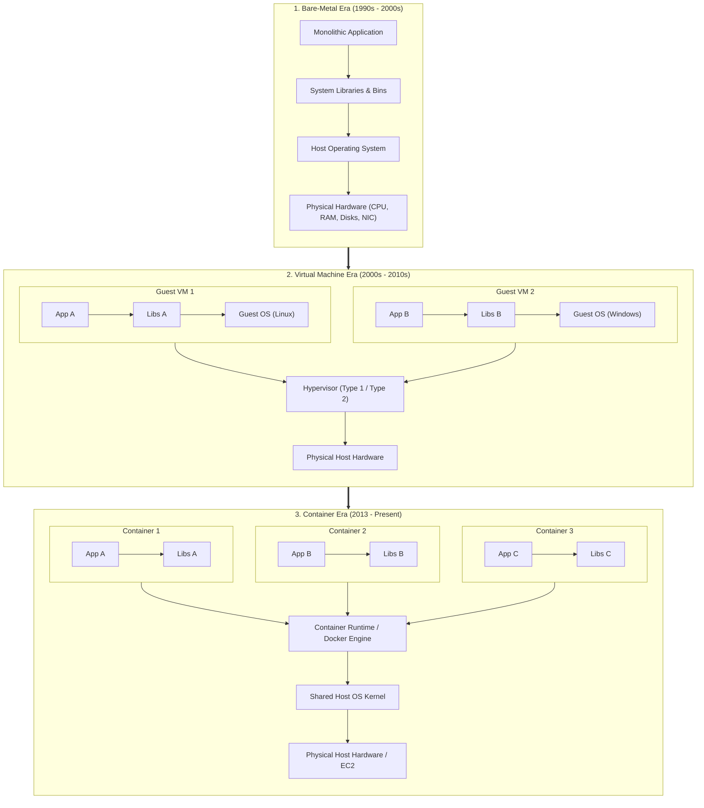
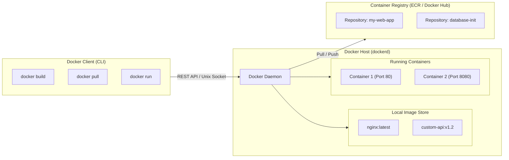
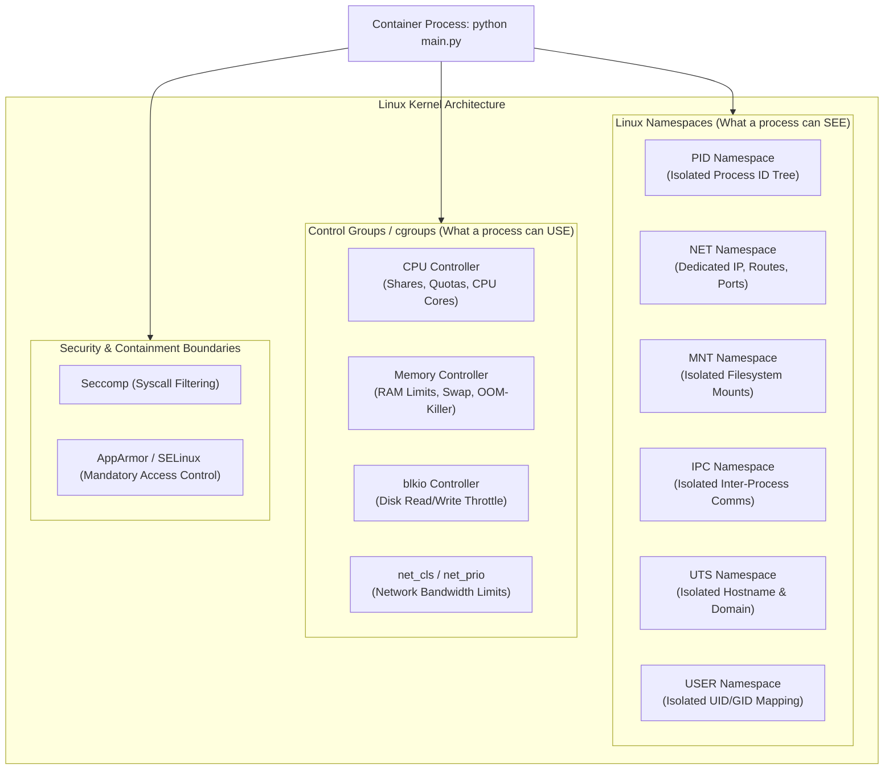
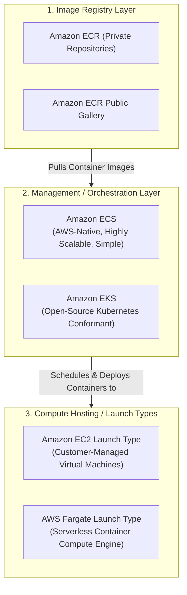
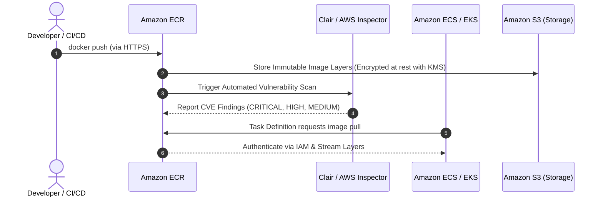
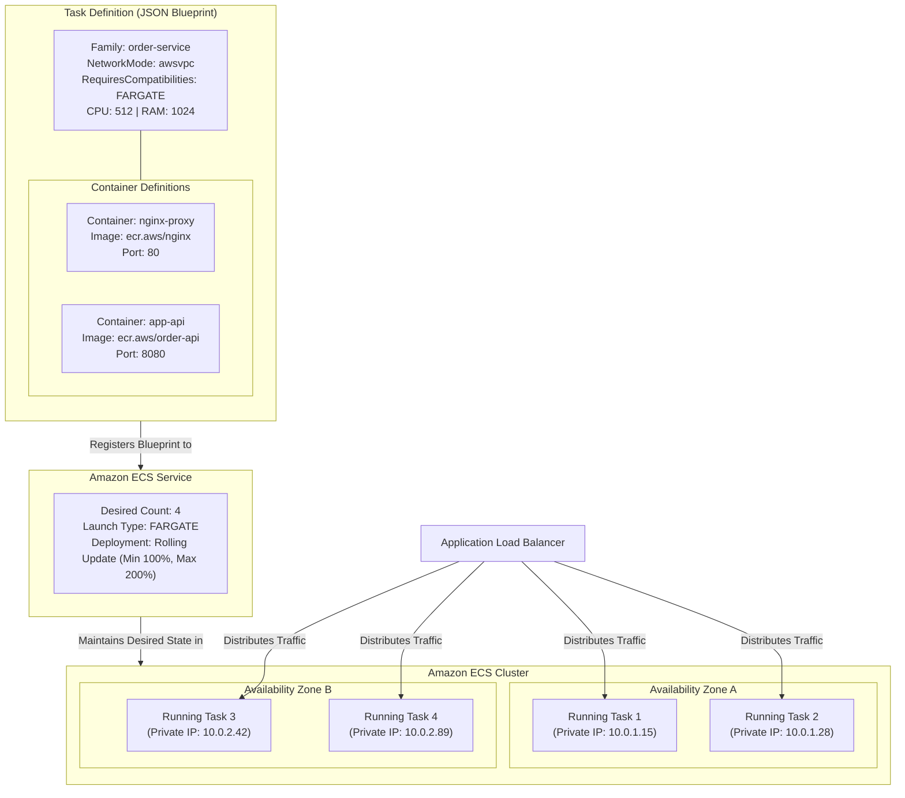
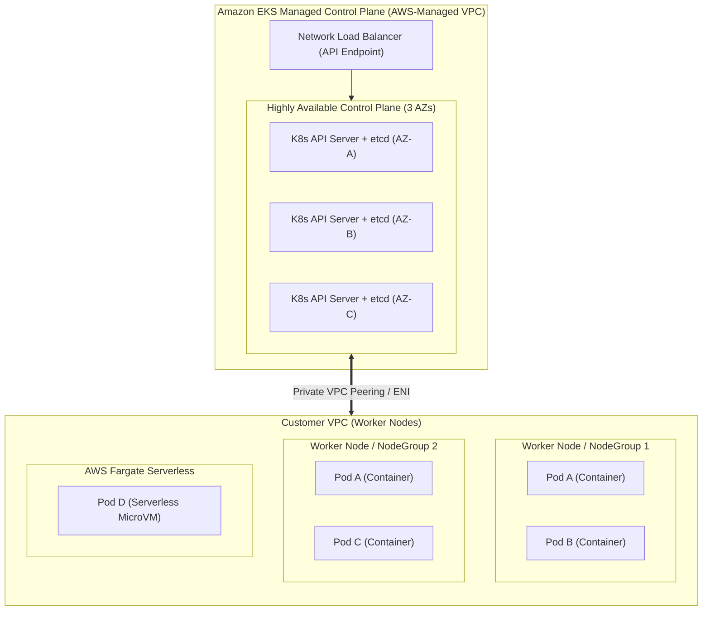
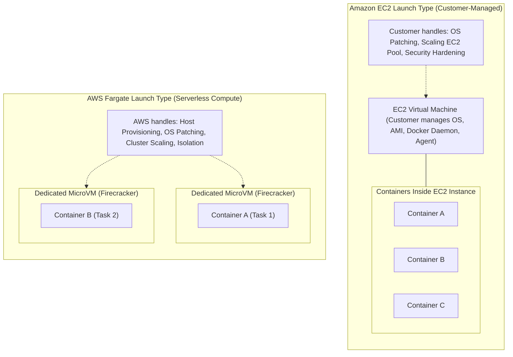
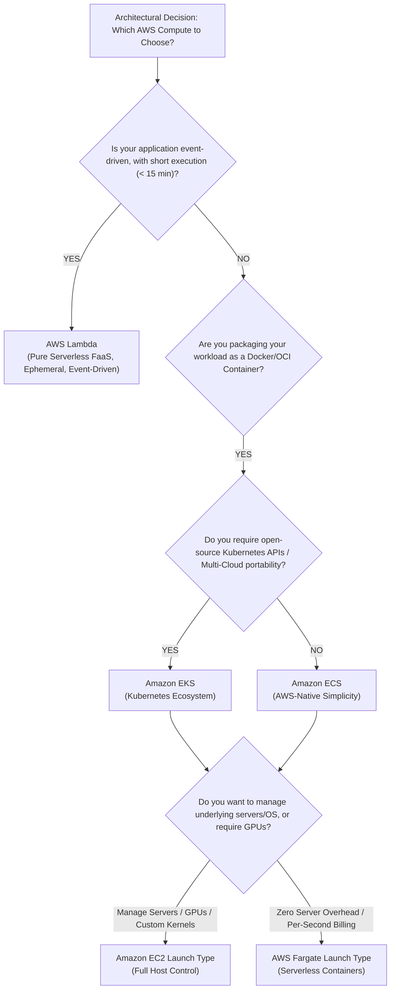

# 📦 Module 12: Containers on AWS – Study Guide

> **Course**: AWS re/Start  
> **Module**: Serverless and Containers  
> **Source Document**: `T16-0007-RSSECO_EN-US_SG_M12_CONTAINERSAWS.pdf`  
> **Target Audience**: AWS re/Start Learners, Cloud Practitioners, Solutions Architects, and DevOps/SysOps Engineers  

---

## 🎯 Module Overview

In modern application engineering, agility, portability, and resource efficiency dictate how software is developed and delivered. Historically, application deployments suffered from environmental friction: software configured and tested in a local development environment frequently failed when deployed to test, staging, or production servers. This classic *"it worked on my machine"* dilemma stemmed from discrepancies in underlying operating systems, installed system libraries, system dependencies, kernel parameters, and hardware architectures.

Traditional virtualization using Virtual Machines (VMs) addressed host-level hardware sharing by virtualizing physical server components. However, running a complete guest operating system inside every VM introduces significant overhead in CPU, memory, storage footprint, and startup latency.

**Containerization** solves this fundamental challenge through operating system-level virtualization. By packaging application code alongside its runtime dependencies, binaries, configuration files, and libraries into a single immutable artifact, containers ensure complete environmental consistency across any infrastructure—from local workstations to bare metal servers and cloud platforms.

On Amazon Web Services (AWS), container services provide enterprise-grade capabilities spanning the entire container lifecycle:
1. **Image Storage & Governance**: **Amazon Elastic Container Registry (ECR)** provides secure, private, and public OCI-compliant container repositories with automated vulnerability scanning and KMS encryption.
2. **Container Orchestration**: **Amazon Elastic Container Service (ECS)** offers an AWS-opinionated, deeply integrated, and highly scalable management service, while **Amazon Elastic Kubernetes Service (EKS)** delivers a fully managed, upstream-certified Kubernetes environment.
3. **Compute Hosting / Launch Types**: Organizations can run containers on self-managed infrastructure using the **Amazon EC2 Launch Type** or eliminate server management altogether using **AWS Fargate**, a purpose-built serverless compute engine for containers.

This comprehensive study guide explores the evolution of compute packaging, dissects Docker fundamentals and Linux kernel primitives, evaluates the AWS container services ecosystem, analyzes deployment launch types, and provides architectural decision frameworks for modern container workloads.

---

### 📌 Learning Objectives

- [ ] **Analyze the Evolution of Compute Packaging**: Trace compute architectures from bare-metal servers to hardware-level hypervisors (VMs) to OS-level containerization, identifying efficiency and isolation trade-offs.
- [ ] **Define Containerization and Core Benefits**: Understand how containers encapsulate code and dependencies into isolated user spaces, delivering environmental consistency, process isolation, rapid boot times, and high density.
- [ ] **Deconstruct Docker Architecture**: Master core Docker components—Dockerfiles, immutable layered images, runtime containers, the Docker Daemon (`dockerd`), the Docker CLI, and container registries.
- [ ] **Explain Linux Kernel Isolation Primitives**: Differentiate how Linux **Namespaces** (PID, NET, IPC, MNT, UTS, USER) deliver process isolation while **Control Groups (cgroups)** enforce hardware resource allocation and throttling.
- [ ] **Compare Virtual Machines vs. Containers**: Evaluate an exhaustive architectural comparison spanning resource consumption, startup latency, security isolation, operating system overhead, and portability.
- [ ] **Examine Amazon Elastic Container Registry (ECR)**: Configure private and public image registries, implement vulnerability scanning, enforce image tag immutability, automate lifecycle policies, and manage IAM access permissions.
- [ ] **Evaluate AWS Container Orchestration Services**:
  - **Amazon ECS**: Understand Task Definitions, Tasks, Services, Task Roles, Execution Roles, and deep integrations with AWS Application Load Balancers and CloudWatch.
  - **Amazon EKS**: Understand managed Kubernetes control plane architecture, multi-AZ manager nodes, open-source ecosystem compatibility, and IAM Roles for Service Accounts (IRSA).
- [ ] **Select Container Compute Launch Types**: Contrast full server control, custom AMIs, and daemon scheduling on **Amazon EC2** with serverless, per-second billing and zero-infrastructure management on **AWS Fargate**.
- [ ] **Apply Strategic Architectural Decision Frameworks**: Choose accurately between Amazon ECS, Amazon EKS, AWS Fargate, and AWS Lambda based on operational overhead, execution limits, latency, compliance, and ecosystem requirements.

---

## 📚 Key Terminology

| Term | Definition |
| :--- | :--- |
| **Container** | A standard unit of software packaging code and all its dependencies, running as a resource-isolated process sharing the host operating system kernel. |
| **Virtual Machine (VM)** | An emulation of a physical computer system that executes on a hypervisor, running its own complete guest operating system, device drivers, and binaries. |
| **Hypervisor** | A software, firmware, or hardware layer (Type 1 bare-metal or Type 2 hosted) that creates and manages virtual machines by virtualizing physical hardware. |
| **Docker** | An open-source software platform designed to automate the deployment, scaling, and management of applications inside portable, self-sufficient containers. |
| **Dockerfile** | A text configuration file containing ordered instructions and commands used to assemble and build an immutable Docker container image. |
| **Docker Image** | A read-only, multi-layered, immutable package containing application binaries, libraries, configuration files, and runtime specifications. |
| **Docker Container** | A runnable, isolated, lightweight execution instance of a Docker image with a thin, writable top layer. |
| **Linux Namespaces** | Kernel features that partition global system resources (process IDs, network interfaces, mount points, IPC) into isolated environments visible only to designated processes. |
| **Control Groups (cgroups)** | Linux kernel features that isolate, monitor, meter, and throttle hardware resource utilization (CPU, memory, disk I/O, network) for groups of processes. |
| **Amazon ECR** | Amazon Elastic Container Registry; a fully managed, highly available Docker/OCI container image registry integrated with AWS IAM and Amazon S3. |
| **Amazon ECS** | Amazon Elastic Container Service; a fully managed, AWS-native container orchestration service engineered for simplicity, reliability, and deep AWS integration. |
| **Amazon EKS** | Amazon Elastic Kubernetes Service; a managed service that runs upstream-certified Kubernetes control planes across multiple Availability Zones without manual server provisioning. |
| **AWS Fargate** | A serverless compute engine for Amazon ECS and EKS that executes containers without requiring customers to provision, configure, patch, or scale virtual machines. |
| **Task Definition** | A declarative JSON template used in Amazon ECS that defines one or more containers, container image URIs, CPU/memory allocations, port mappings, and storage volumes. |
| **ECS Task** | The instantiated, running execution of an Amazon ECS Task Definition on a cluster host or via AWS Fargate. |
| **ECS Service** | An Amazon ECS configuration that maintains a specified desired count of running Tasks simultaneously, handling self-healing, rolling deployments, and ELB target registration. |
| **Kubernetes (K8s)** | An open-source container orchestration platform originally designed by Google for automating application deployment, scaling, and management. |
| **Kubernetes Pod** | The smallest deployable computing unit in Kubernetes, consisting of one or more tightly coupled containers sharing storage and network resources. |

---

## 🏗️ 1. The Evolution of Compute Packaging

To understand why modern cloud architectures prioritize containers, it is critical to trace the historical evolution of compute resource packaging from bare-metal hardware to virtual machines and container runtimes.

### 1.1 Physical Bare-Metal Servers (The Monolithic Model)
In traditional on-premises data centers, applications ran directly on dedicated physical server hardware:
- **Resource Underutilization**: To prevent catastrophic failures during unexpected peak traffic, servers were over-provisioned (often sized for 5x–10x normal load), leaving CPU and memory utilization hovering below 10%–15% for long periods.
- **Dependency Conflicts**: Running multiple distinct applications on a single server frequently caused library version conflicts (e.g., App 1 requiring Python 2.7 while App 2 requiring Python 3.6). Consequently, administrators adopted a *"one application per physical server"* model.
- **Slow Provisioning**: Procuring, cabling, configuring, and deploying new physical hardware required weeks or months.
- **Environmental Rigidity**: Migrating an application to a new physical server or different data center required rebuilding the host environment manually, often introducing subtle incompatibilities.

### 1.2 Virtual Machines (Hardware-Level Virtualization)
The advent of hypervisors (such as VMware ESXi, KVM, Xen, and Microsoft Hyper-V) revolutionized compute packaging by virtualizing physical hardware:
- **Hardware Abstraction**: A hypervisor intercepts physical server CPU, RAM, storage, and networking calls, presenting virtualized hardware interfaces to guest operating systems.
- **Complete Isolation**: Each virtual machine operates in strict boundary isolation with its own dedicated kernel, device drivers, and system services.
- **The "Virtualization Tax" (Overhead)**:
  - **Duplicate OS Overhead**: Every VM requires its own full guest OS (consuming hundreds of megabytes to gigabytes of disk and RAM just for OS background processes).
  - **Slow Boot Latency**: Booting a VM requires initializing virtual BIOS/UEFI, launching the OS kernel, starting system daemons (`systemd`, services), taking 30 seconds to several minutes.
  - **Hypervisor Overhead**: Translating virtual hardware calls to physical hardware introduces CPU context-switching overhead.

### 1.3 Containers (Operating System-Level Virtualization)
Containers discard the requirement for virtualized hardware and guest operating systems altogether:
- **Shared Host Kernel**: Containers run as isolated user-space processes on top of the host operating system, sharing the host’s Linux kernel.
- **Direct Hardware Execution**: Because containerized processes execute directly on the host CPU and memory without an intermediary hypervisor layer, execution performance is near bare-metal speed.
- **Sub-Second Initialization**: Without an operating system to boot, a container starts in milliseconds to seconds (the time required to execute the application's entrypoint binary).
- **Extreme Density**: A single host that could comfortably run 10–15 full virtual machines can easily host hundreds of microservice containers simultaneously.

---

## ⚙️ 2. Containerization Fundamentals & Docker

### 2.1 What is Docker?
**Docker** is an open platform for developing, shipping, and running applications. Created by Solomon Hykes in 2013, Docker transformed existing Linux kernel primitives into an intuitive, standardized developer workflow.

Docker decouples application software from infrastructure management. By encapsulating code, runtime, system tools, libraries, and settings into portable units, Docker guarantees that an application runs identically across:
- A developer’s local laptop (macOS, Windows, or Linux)
- An internal testing/CI pipeline
- An Amazon EC2 virtual machine
- A production bare-metal cluster

> [!NOTE]  
> Prior to Docker, container technologies like FreeBSD Jails, Solaris Zones, and Linux Containers (LXC) existed, but required deep operating system expertise and lacked standardized image formats, version control, and distribution ecosystems. Docker popularized containerization by establishing standard packaging and distribution tooling.

### 2.2 Core Components of the Docker Architecture

The Docker ecosystem comprises five primary building blocks:

1. **Dockerfile (The Declarative Blueprint)**:
   - A plain-text configuration file containing ordered instructions executed sequentially to construct a container image.
   - Core directives include:
     - `FROM`: Specifies the base parent image (e.g., `FROM public.ecr.aws/docker/library/python:3.11-slim`).
     - `WORKDIR`: Sets the working directory inside the container filesystem.
     - `COPY` / `ADD`: Transfers files and source code from the build host into the image.
     - `RUN`: Executes shell commands during image build (e.g., `RUN pip install -r requirements.txt`) to install packages.
     - `ENV`: Defines persistent environment variables.
     - `EXPOSE`: Documents the networking port the application listens on.
     - `ENTRYPOINT` / `CMD`: Specifies the default executable command when the container initializes.

2. **Docker Image (The Immutable Layered Artifact)**:
   - A read-only, binary template used to instantiate containers.
   - **Layered Architecture (Union File System)**: Each instruction in a Dockerfile generates an immutable, cached filesystem layer. When an image is updated, only modified layers are rebuilt and downloaded, optimizing network bandwidth and storage.

3. **Docker Container (The Runnable Instance)**:
   - A running, stateful instantiation of an image.
   - When a container starts, the Docker runtime adds a thin, read-write layer (the *Container Layer*) on top of the stacked read-only image layers. All runtime file modifications, temporary writes, and logs occur in this ephemeral writable layer.

4. **Docker Daemon (`dockerd`) & CLI**:
   - **Docker Daemon**: A persistent background service running on the host that manages Docker objects (images, containers, networks, volumes) and listens for API requests.
   - **Docker CLI (`docker`)**: The command-line client that communicates with the daemon over local Unix domain sockets or remote REST APIs.

5. **Container Registry**:
   - A centralized, version-controlled repository system for uploading, storing, cataloging, and distributing Docker images.
   - Public examples include Docker Hub and Amazon ECR Public Gallery; enterprise private examples include **Amazon Elastic Container Registry (ECR)**.

---

### 2.3 Underlying Linux Kernel Isolation Primitives

Containers are **not** virtual machines. In Linux, a container is simply a standard Linux process governed by two foundational kernel primitives: **Namespaces** and **Control Groups (cgroups)**.

#### A. Linux Namespaces (Visibility & Scoping Isolation)
Namespaces provide process-level isolation by virtualizing system resources. A process assigned to a namespace can only see resources within that namespace:
- **PID Namespace (Process Isolation)**: Isolates the process ID space. Inside the container, the primary application process perceives itself as PID 1 (init), completely isolated from processes running on the host OS or other containers.
- **NET Namespace (Network Isolation)**: Grants the container its own virtual network stack, including private network interfaces (such as `eth0`), loopback device, private IP address, routing tables, and firewall/port bindings.
- **MNT Namespace (Mount / Filesystem Isolation)**: Gives the container an isolated view of the filesystem mount points (`/`), preventing it from accessing the host’s root filesystem unless explicitly mounted via volumes.
- **IPC Namespace (Inter-Process Communication)**: Isolates System V IPC and POSIX message queues, ensuring processes in different containers cannot communicate via shared memory segments.
- **UTS Namespace (Hostname Isolation)**: Allows the container to maintain its own hostname and domain name independent of the host machine.
- **USER Namespace (User & Group ID Isolation)**: Maps the container’s root user (UID 0 inside the container) to an unprivileged user (e.g., UID 10001 on the host), mitigating host compromise risks if a container process is exploited.

#### B. Control Groups / cgroups (Resource Metering & Throttling)
While namespaces restrict what a process can *see*, control groups restrict what a process can *use*:
- **CPU Quotas & Shares**: Enforces hard limits (e.g., capping a container at 1.5 vCPUs) or proportional weights during CPU contention.
- **Memory Limits**: Sets maximum RAM consumption (e.g., 512 MB). If a container breaches its hard memory limit, the Linux kernel Out-Of-Memory (OOM) killer terminates the offending process without affecting other host operations.
- **Block I/O (blkio)**: Throttles disk read and write throughput (IOPS and megabytes/sec), preventing a noisy container from starving neighbor processes of disk access.

#### C. Union Filesystems (OverlayFS) & Copy-on-Write (CoW)
Docker uses layered union filesystems like **OverlayFS**. All base image layers are mounted read-only. When a container process modifies an existing file, OverlayFS copies the file up from the read-only layer into the container's top writable layer (**Copy-on-Write**). This makes container instantiation almost instantaneous, as no files need to be copied when spawning a new container.

---

### 2.4 Virtual Machines vs. Containers: Exhaustive Comparison Matrix

| Architectural Dimension | Virtual Machines (VMs) | Containers (Docker) |
| :--- | :--- | :--- |
| **Virtualization Level** | **Hardware-Level Virtualization**: Emulates physical hardware via hypervisors (Type 1 or Type 2). | **Operating System-Level Virtualization**: Shares the host Linux kernel; isolates user-space processes. |
| **Guest Operating System** | **Mandatory**: Every VM runs its own full guest OS (kernel, device drivers, system daemons). | **None**: No guest OS; containers utilize the host kernel directly. |
| **Storage & Image Size** | **Gigabytes**: Full OS installations range from 2 GB (minimal Linux) to 30+ GB (Windows Server). | **Megabytes**: Slim microservice images typically range from 20 MB to 200 MB. |
| **Startup / Boot Latency** | **Minutes**: 30 seconds to several minutes to boot virtual BIOS, initialize OS kernel, and run services. | **Seconds / Milliseconds**: Instantaneous process start; boots in 1–3 seconds. |
| **Resource Overhead** | **High**: Substantial "virtualization tax" dedicating RAM and CPU to duplicate OS kernels and hypervisor translation. | **Negligible**: Near zero overhead; processes execute directly on bare metal / host CPU. |
| **System Density** | **Low to Moderate**: 10 to 50 VMs per physical enterprise host server. | **High to Extreme**: Hundreds to thousands of containers per host server. |
| **Security & Isolation** | **Hardware-Enforced Boundary**: Extremely strong hardware-level boundary; hypervisor breakout is rare. | **Kernel-Shared Isolation**: Relies on Linux namespaces, cgroups, seccomp filters; kernel exploits could affect host. |
| **Portability** | **Moderate**: Constrained by hypervisor formats (OVF, VMDK, VHD) and underlying architecture. | **Universal**: OCI/Docker compliant; runs identically on any environment supporting container runtimes. |
| **Lifecycle & State** | **Stateful & Long-Lived**: Typically patched in-place, treated as long-running pets. | **Ephemeral & Immutable**: Stateless by design, replaced rather than patched (cattle approach). |

---

## ☁️ 3. Container Services on AWS

The AWS container ecosystem is structured into three distinct layers: **Image Registry**, **Management / Orchestration**, and **Compute Hosting (Launch Types)**.

---

## 🗄️ 4. Container Registry: Amazon Elastic Container Registry (ECR)

### 4.1 Overview of Amazon ECR
**Amazon Elastic Container Registry (ECR)** is a fully managed, enterprise-grade Docker and Open Container Initiative (OCI) image registry that allows developers to securely store, manage, share, and deploy container images.

Backed by **Amazon S3** under the hood, Amazon ECR inherits high availability (99.999999999% durability). It eliminates the operational overhead of installing, maintaining, scaling, and patching self-hosted Docker registries.

### 4.2 Key Capabilities & Architectural Features

1. **Private and Public Repositories**:
   - **Private Repositories**: Secured within an AWS account; access is strictly governed via AWS Identity and Access Management (IAM) and repository resource-based policies.
   - **Amazon ECR Public Gallery**: Allows publishers to share container images globally with anyone, without requiring AWS authentication.

2. **Standard API Compatibility**:
   - Amazon ECR fully supports the **Docker Registry HTTP API V2**. Engineers interact using standard Docker CLI commands (`docker login`, `docker build`, `docker tag`, `docker push`, `docker pull`).

3. **Enterprise Security & Granular Access Control**:
   - **IAM Authentication**: Integrates seamlessly with IAM users, IAM roles, and AWS STS temporary credentials. EC2 worker nodes or ECS Tasks assume IAM roles to pull images without embedding static credentials in code.
   - **In-Transit Encryption**: All image layer uploads and downloads occur over secure HTTPS endpoints.
   - **At-Rest Encryption**: Container images are automatically encrypted at rest using server-side encryption with AWS Key Management Service (**AWS KMS**) or Amazon S3 managed keys (**SSE-S3**).

4. **Image Vulnerability Scanning**:
   - **Basic Scanning**: Powered by the open-source **Clair** engine, scans images on push or manually against Common Vulnerabilities and Exposures (CVEs).
   - **Enhanced Scanning**: Powered by **AWS Inspector**, delivers continuous vulnerability assessment, automated scans when new CVEs are published, and deep package-level inspection (operating system and application programming language dependencies).

5. **Image Tag Immutability**:
   - Prevents image tags (e.g., `app:v1.0.0`) from being overwritten by subsequent pushes. This eliminates production deployment tampering and ensures exact reproducibility.

6. **Automated Lifecycle Policies**:
   - Rules configured to automatically expire and purge stale, untagged, or older image revisions (e.g., *"keep only the latest 30 tagged builds"*), preventing runaway storage costs.

7. **Cross-Region & Cross-Account Replication**:
   - Natively replicates container images across multiple AWS Regions and secondary AWS accounts, ensuring low-latency image pulls in multi-region deployments and disaster recovery.

---

## 🎯 5. Container Orchestration on AWS

While running a single Docker container on a server is straightforward, running thousands of microservices across distributed server clusters requires **Container Orchestration**. Orchestrators solve critical operational challenges:
- **Scheduling**: Determining which host instance has available CPU and memory to place new containers.
- **Self-Healing & High Availability**: Detecting crashed containers or unhealthy worker hosts and automatically rescheduling replacements.
- **Service Discovery & Load Balancing**: Directing incoming web traffic across dynamic container IP addresses.
- **Rolling Deployments & Canary Releases**: Updating application versions without downtime.
- **Auto Scaling**: Dynamically adding or removing container replicas based on CPU, memory, or custom business metrics.

AWS offers two distinct orchestration solutions: **Amazon ECS** and **Amazon EKS**.

---

### 5.1 Amazon Elastic Container Service (ECS)

**Amazon ECS** is an AWS-native, highly opinionated, fast, and scalable container management service designed for deep integration with AWS infrastructure.

#### Core Components of Amazon ECS:
1. **Cluster**: A logical grouping of compute capacity (EC2 instances, external servers via ECS Anywhere, or serverless Fargate pools) where tasks and services run.
2. **Task Definition**: A declarative JSON configuration specifying:
   - Container image URIs (from Amazon ECR or Docker Hub)
   - CPU and memory allocations (at task and container levels)
   - Networking mode (`awsvpc`, `bridge`, `host`, `none`)
   - IAM Task Role (application permissions) and Task Execution Role (infrastructure permissions)
   - Logging configurations (AWS CloudWatch Logs driver)
   - Environment variables, secrets (AWS Secrets Manager / SSM Parameter Store), and volume mounts
3. **Task**: The runtime execution of a Task Definition. An ephemeral unit of work that runs either to completion (batch processing) or indefinitely.
4. **Service**: Ensures that a designated number of tasks (*Desired Count*) are constantly running and healthy across multiple Availability Zones. If a task crashes or a host node fails, the ECS Service scheduler automatically launches a new task. The service coordinates rolling deployments and registers task targets with an Application Load Balancer (ALB).

#### ECS IAM Security Separation: Task Role vs. Task Execution Role
A crucial architectural standard in ECS is distinguishing between the two IAM roles configured in a Task Definition:
- **Task Execution Role (`executionRoleArn`)**: Used by the **Amazon ECS agent / infrastructure** before the container starts. Authorizes the agent to:
  - Pull private container images from Amazon ECR (`ecr:GetAuthorizationToken`, `ecr:BatchGetImage`).
  - Stream logs to Amazon CloudWatch (`logs:CreateLogStream`, `logs:PutLogEvents`).
  - Decrypt and fetch sensitive environment variables from AWS Secrets Manager or SSM Parameter Store.
- **Task Role (`taskRoleArn`)**: Assigned directly to the **application running inside the container**. Authorizes the container code to interact with AWS APIs (e.g., read/write to Amazon DynamoDB, put objects into Amazon S3, publish messages to Amazon SQS) without storing hardcoded AWS credentials in the container image.

---

### 5.2 Amazon Elastic Kubernetes Service (EKS)

**Amazon EKS** is a fully managed service that allows organizations to run **Kubernetes** on AWS without needing to install, configure, operate, or maintain their own Kubernetes control plane.

#### Key Capabilities of Amazon EKS:
- **Upstream Kubernetes Certified**: EKS runs official, unmodified open-source Kubernetes. Applications running on EKS are 100% portable to and from any standard Kubernetes cluster (on-premises, bare-metal, or other cloud providers).
- **Managed High Availability Control Plane**:
  - AWS provisions, monitors, and scales the Kubernetes control plane.
  - Runs three redundant API servers and three distributed `etcd` key-value persistence nodes across three separate Availability Zones.
  - Automatically detects and replaces unhealthy master instances.
  - Manages seamless control plane version upgrades and zero-downtime security patching.
- **Deep AWS Ecosystem Integrations**:
  - **AWS VPC CNI Plugin**: Gives every Kubernetes Pod a real, routable IP address from the customer’s Amazon VPC CIDR block.
  - **IAM Roles for Service Accounts (IRSA)**: Binds Kubernetes ServiceAccounts to AWS IAM roles using OpenID Connect (OIDC) federation, enforcing least-privilege security per pod.
  - **Elastic Load Balancing**: Uses the AWS Load Balancer Controller to automatically provision ALBs (Ingress) and NLBs (Service Type: LoadBalancer).
  - **CloudWatch & Fluent Bit**: Forward container logs from pods to Amazon CloudWatch, OpenSearch, or Kinesis.

---

### 5.3 Amazon ECS vs. Amazon EKS Comparison

| Feature / Dimension | Amazon Elastic Container Service (ECS) | Amazon Elastic Kubernetes Service (EKS) |
| :--- | :--- | :--- |
| **Philosophy & Design** | **AWS-Native Simplicity**: Deeply integrated into the AWS control plane; minimal learning curve. | **Open-Source Standard**: Community-driven, cloud-agnostic, extensible Kubernetes ecosystem. |
| **Complexity & Learning Curve** | **Low**: Simple primitives (Clusters, Task Definitions, Tasks, Services). Easy to master for AWS teams. | **High**: Steep learning curve (Pods, Deployments, Services, CRDs, Helm charts, ingress controllers). |
| **Portability** | **AWS-Specific**: Task Definitions are specific to AWS ECS (though ECS Anywhere extends to on-prem). | **Universal**: 100% portable across on-prem, multi-cloud, and developer local minikube/kind clusters. |
| **Control Plane Cost** | **Free**: No charge for the ECS cluster or control plane; pay only for underlying EC2 or Fargate resources. | **$0.10/hour per cluster** (~$73/month) for the managed Kubernetes control plane. |
| **AWS Integration** | **Native**: Direct first-class support for IAM, CloudWatch, ALB/NLB, Secrets Manager. | **Add-on Controllers**: Requires installing AWS-specific open-source controllers (VPC CNI, AWS Load Balancer Controller, Karpenter). |
| **Tooling & Ecosystem** | AWS Console, AWS CLI, AWS Copilot, AWS CDK. | Vast open-source ecosystem: `kubectl`, Helm, ArgoCD, Prometheus, Grafana, Istio, Cilium. |

---

## 💻 6. Compute Hosting & Launch Types

Both Amazon ECS and Amazon EKS support two primary compute models for hosting containers: **Amazon EC2 Launch Type** and **AWS Fargate Launch Type**.

### 6.1 Amazon EC2 Launch Type (Self-Managed Compute)
Under the EC2 launch type, container workloads run on a fleet of Amazon EC2 instances provisioned inside the customer’s VPC.
- **Operating Mechanics**:
  - The customer chooses instance families (e.g., `t3`, `c6g`, `m6i`, `p4d` for GPUs).
  - Each EC2 instance runs an operating system (such as Amazon Linux 2 / Amazon Linux 2023 with the ECS-optimized AMI), the Docker daemon, and the **Amazon ECS Container Agent**.
  - The ECS Container Agent communicates with the regional ECS control plane, registering the instance and executing tasks assigned to it.
- **Customer Responsibilities**:
  - Managing EC2 Auto Scaling groups to ensure adequate cluster capacity.
  - Operating system patching, kernel updates, and AMI rotations.
  - Security hardening of the host OS and Docker daemon configuration.
  - Optimizing bin-packing (allocating tasks efficiently across available instance CPU and RAM).
- **When to Use EC2**:
  - Workloads requiring specialized hardware (such as NVIDIA GPUs for machine learning, AWS Inferentia/Trainium, or custom ARM Graviton chips).
  - Applications demanding full OS-level control (e.g., custom kernel modules, specific sysctl parameters, or privileged container execution).
  - Heavy, continuous baseline workloads where pre-purchased **EC2 Reserved Instances (RIs)** or **Savings Plans** maximize cost efficiency.

### 6.2 AWS Fargate (Serverless Container Compute)
**AWS Fargate** is a purpose-built serverless compute engine for Amazon ECS and Amazon EKS that allows developers to run containers without managing physical or virtual servers.

- **Operating Mechanics**:
  - Fargate removes the concept of the underlying server. Instead of provisioning an EC2 cluster, developers simply specify the required compute parameters in their task definition (e.g., 0.5 vCPU and 1 GB RAM).
  - AWS instantly allocates an isolated, dedicated compute environment using lightweight virtualization (**AWS Firecracker MicroVMs**).
  - Each ECS Task or EKS Pod receives its own dedicated kernel boundary, elastic network interface (ENI), and private VPC IP address.
- **Key Benefits of AWS Fargate**:
  - **Zero Server Management**: No EC2 instances to provision, configure, patch, reboot, or manage.
  - **Granular Right-Sizing**: Developers allocate exact vCPU (from 0.25 to 16 vCPUs) and RAM (from 0.5 GB to 120 GB) combinations per task.
  - **Per-Second Billing**: Pricing is calculated purely on the vCPU and memory resources requested by the task, billed to the nearest second (with a 1-minute minimum).
  - **Built-In Security & Isolation**: Because tasks execute in dedicated microVMs, no compute resources are shared with other tasks or AWS customers, eliminating container-escape risks.
  - **Simplified Scaling**: Scaling out simply launches new tasks; there is no lag waiting for new EC2 instances to boot and join a cluster.

### 6.3 Amazon EC2 vs. AWS Fargate Comparison Matrix

| Comparison Criteria | Amazon EC2 Launch Type | AWS Fargate (Serverless) |
| :--- | :--- | :--- |
| **Server Management** | **High**: Customer manages EC2 instances, OS updates, security patches, Docker daemon. | **None**: Completely serverless; AWS manages all underlying host infrastructure. |
| **Startup Latency** | Fast for pre-existing EC2 capacity; slow (1–3 min) if new EC2 instances must boot. | Consistently fast (typically 30–60 seconds to provision microVM and pull image). |
| **Resource Billing** | Pay for the EC2 instance uptime (24/7), regardless of whether containers utilize 5% or 100% capacity. | Pay strictly for the vCPU and memory provisioned for running tasks per second. |
| **Security Isolation** | Multi-tenant on host: Multiple containers share the same host OS kernel and storage. | Single-tenant microVM: Every task runs in its own isolated Firecracker VM. |
| **Specialized Hardware** | Supports GPUs, AWS Trainium/Inferentia, high-memory instances, custom storage. | CPU/Memory only (standard x86_64 and ARM64 Graviton); no GPU support. |
| **Privileged Mode** | Supported (`privileged: true` allows raw hardware and kernel modification). | Not supported (raw root host privileges prohibited for security). |
| **Cluster Capacity Planning** | Required: Must balance task scheduling against EC2 Auto Scaling groups. | Automated: AWS handles capacity pools transparently. |

---

## 🧭 7. Strategic Compute Selection Framework

AWS offers four primary compute engines for executing application code: **AWS Lambda**, **AWS Fargate**, **Amazon ECS on EC2**, and **Amazon EKS**. Choosing the correct compute platform depends on architecture patterns, operational overhead, control requirements, and runtime characteristics.

### Detailed Compute Selection Matrix

| Evaluation Dimension | AWS Lambda | AWS Fargate (ECS/EKS) | Amazon ECS on EC2 | Amazon EKS on EC2 |
| :--- | :--- | :--- | :--- | :--- |
| **Compute Abstraction** | Function-as-a-Service (FaaS) | Serverless Container Engine | Managed Container Orchestration | Managed Kubernetes Orchestration |
| **Packaging Format** | Code zip / Container image (up to 10 GB) | Docker / OCI Container image | Docker / OCI Container image | Docker / OCI Container image |
| **Maximum Execution Limit** | **15 minutes** (hard limit) | **Unlimited** (runs indefinitely) | **Unlimited** (runs indefinitely) | **Unlimited** (runs indefinitely) |
| **Operational Overhead** | Lowest (zero server or container lifecycle management) | Low (no server management; define tasks/pods only) | Medium (manage EC2 fleet, scaling, patching) | High (manage Kubernetes cluster, controllers, addons, nodes) |
| **Cold Start / Latency** | Milliseconds to low seconds (cold starts) | ~30 to 60 seconds | Sub-second (if host has headroom) | Sub-second (if host has headroom) |
| **Pricing Model** | Per invocation and duration (per 1 ms) | Per vCPU and RAM per second | Per running EC2 instance-hour/second | Control plane ($0.10/hr) + EC2 instance costs |
| **Primary Use Cases** | Event handlers, API backends, cron jobs, asynchronous S3/SQS processing | Microservices, web apps, background processing, batch jobs without GPU | High-density continuous microservices, GPU machine learning, legacy app migration | Enterprise microservices, hybrid-cloud portability, existing Kubernetes tooling |

---

## 💡 8. Summary of Best Practices

1. **Adopt Single-Process Containers**:
   - Design container images adhering to the single-responsibility principle. Run one process per container to ensure independent horizontal scaling and granular rollbacks.
2. **Minimize Container Image Footprint**:
   - Use multi-stage Docker builds to separate compilation tools from the final runtime image.
   - Choose minimal base operating systems (such as Alpine Linux or slim Debian variants) to reduce network transfer time, attack surface, and vulnerability surface.
3. **Never Hardcode Secrets in Container Images**:
   - Keep images immutable and environment-agnostic. Inject secrets and environment variables at runtime via AWS Secrets Manager, SSM Parameter Store, and IAM Task Roles.
4. **Implement Defense-in-Depth Security**:
   - Run containers as non-root users (`USER 10001` in Dockerfiles).
   - Enforce ECR image tag immutability and enable continuous vulnerability scanning with AWS Inspector.
   - Configure security groups tightly around individual ECS Tasks using `awsvpc` network mode.
5. **Implement Comprehensive Observability**:
   - Configure container logging using the `awslogs` log driver to stream `stdout` and `stderr` directly into Amazon CloudWatch Logs.
   - Enable Amazon CloudWatch Container Insights to collect automated metrics on CPU, memory, network, and disk utilization across clusters, tasks, and pods.

---

## ❓ 9. Knowledge Check & Review Questions

### Checkpoint Question 1
**What is the core difference between a Virtual Machine (VM) and a Container?**  
> **Answer**: A Virtual Machine virtualizes underlying physical hardware via a hypervisor and requires a complete, independent guest operating system (with its own kernel, system binaries, and device drivers) for each VM. In contrast, a Container virtualizes the host operating system. Containers run as resource-isolated user-space processes that share the host's operating system kernel, making them significantly smaller, lighter on memory, and capable of booting in seconds rather than minutes.

### Checkpoint Question 2
**What is Docker and what are its core architectural components?**  
> **Answer**: Docker is an open software platform used to create, manage, run, and distribute containerized applications. Its primary components include:
> - **Dockerfile**: The declarative text file containing instructions to build an image.
> - **Docker Image**: An immutable, read-only, multi-layered template packaged with application code and dependencies.
> - **Docker Container**: A runnable, isolated runtime instance instantiated from an image.
> - **Docker Daemon (`dockerd`)**: The background process that manages images, containers, networks, and storage volumes.
> - **Container Registry (e.g., Amazon ECR)**: A centralized repository for storing, versioning, and sharing images.

### Checkpoint Question 3
**What are the two primary container orchestration services provided by AWS?**  
> **Answer**: **Amazon Elastic Container Service (Amazon ECS)**, an AWS-opinionated, highly scalable, and simple orchestration service with deep AWS native integrations; and **Amazon Elastic Kubernetes Service (Amazon EKS)**, a fully managed service that provides certified, upstream-compatible Kubernetes clusters.

### Checkpoint Question 4
**What is AWS Fargate, and what operational advantage does it provide over the EC2 launch type?**  
> **Answer**: AWS Fargate is a serverless compute engine for Amazon ECS and Amazon EKS. Its primary operational advantage is that it completely eliminates the need to provision, configure, scale, patch, or secure virtual machines (EC2 instances). Developers define required vCPU and memory allocations at the task level, and AWS runs the containers in isolated microVMs with per-second billing.

### Checkpoint Question 5
**In Amazon ECS, what is the difference between the Task Role and the Task Execution Role?**  
> **Answer**: 
> - The **Task Execution Role** is used by the underlying ECS agent and infrastructure *before* the container starts to authorize pulling container images from Amazon ECR, creating CloudWatch log streams, and retrieving secrets from AWS Secrets Manager.
> - The **Task Role** is assumed by the *application code inside the container* during runtime, granting permissions to call AWS APIs (such as reading from Amazon DynamoDB or writing to Amazon S3) securely without hardcoded credentials.
