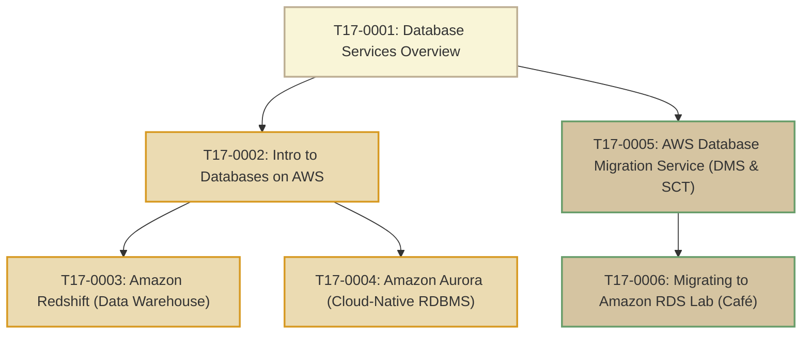

# T17: AWS Database Services

> **Course**: AWS re/Start Curriculum  
> **Module**: T17 – AWS Database Services (`M13`)  
> **Total Guides**: 6 Study Guides  
> **Status**: Completed (100%)

---

## Module Overview

The **AWS Database Services** module details how modern cloud architectures move away from legacy monolithic, one-size-fits-all relational databases toward **purpose-built databases** tailored to specific access patterns and scale. The curriculum spans:
1. **Purpose-Built Databases Taxonomy**: Comparing relational (RDS, Aurora), key-value & document (DynamoDB, DocumentDB), in-memory (ElastiCache, MemoryDB), graph (Neptune), time-series (Timestream), and ledger (QLDB) engines.
2. **Cloud Data Warehousing**: Petabyte-scale OLAP analytics and Lake House architectures using Amazon Redshift and Redshift Spectrum.
3. **Cloud-Native Relational Innovation**: Decoupled compute and distributed 6-way replicated storage with Amazon Aurora.
4. **Database Modernization & Migration**: Leveraging AWS Database Migration Service (AWS DMS) and AWS Schema Conversion Tool (AWS SCT) for near-zero downtime homogeneous and heterogeneous migrations.
5. **Hands-On Lab Execution**: Migrating the Café's self-managed MySQL database on EC2 to Amazon RDS MySQL to eliminate administrative overhead.

---

## Study Guide Index

| # | Study Guide | Primary Topics Covered |
|---|-------------|------------------------|
| **0001** | [T17-0001-RSJAWS_EN-US_SG_M13_DATABASESVCSOVERVIEW.md](file:///work/tmp/aws-cf/T17-AWS_Databases_Services/T17-0001-RSJAWS_EN-US_SG_M13_DATABASESVCSOVERVIEW.md) | Moving beyond one-size-fits-all, purpose-built taxonomy, managed vs unmanaged shared responsibility, module roadmap, troubleshooting KB runbooks |
| **0002** | [T17-0002-AWSD_INTRODATABASESAWS_EN.md](file:///work/tmp/aws-cf/T17-AWS_Databases_Services/T17-0002-AWSD_INTRODATABASESAWS_EN.md) | On-prem database friction, unmanaged (EC2) vs managed (RDS/Aurora/DynamoDB) responsibility matrix, SQL vs NoSQL models, workload decision tree |
| **0003** | [T17-0003-AWSD_AMAZONREDSHIFT_EN.md](file:///work/tmp/aws-cf/T17-AWS_Databases_Services/T17-0003-AWSD_AMAZONREDSHIFT_EN.md) | Petabyte-scale OLAP data warehousing, OLTP vs OLAP, Leader & Compute nodes/slices, Columnar storage, MPP, Redshift Spectrum & Serverless |
| **0004** | [T17-0004-AWSD_AMAZONAURORA_EN.md](file:///work/tmp/aws-cf/T17-AWS_Databases_Services/T17-0004-AWSD_AMAZONAURORA_EN.md) | Cloud-native RDBMS, decoupled compute and storage, 6-way replication across 3 AZs with quorum consensus, up to 15 read replicas (<10ms lag), sub-30s failover |
| **0005** | [T17-0005-AWSD_AWSDBMIGRATION_EN.md](file:///work/tmp/aws-cf/T17-AWS_Databases_Services/T17-0005-AWSD_AWSDBMIGRATION_EN.md) | Homogeneous vs Heterogeneous migrations, AWS Schema Conversion Tool (AWS SCT), AWS DMS replication instance/endpoints/tasks, Change Data Capture (CDC) |
| **0006** | [T17-0006-AWSD_MIGRATINGTORDS_EN.md](file:///work/tmp/aws-cf/T17-AWS_Databases_Services/T17-0006-AWSD_MIGRATINGTORDS_EN.md) | Café business scenario (Sofía & Nikhil administrative burden), 7-step hands-on migration to Amazon RDS MySQL, `mysqldump` export/import, config cutover |

---

## AWS Purpose-Built Databases at a Glance

| Database Service | Primary Data Model | Typical Use Cases | Key Differentiators |
|---|---|---|---|
| **Amazon RDS** | Relational (SQL) | Traditional ERP, CRM, e-commerce | Automated backups, Multi-AZ failover, supports 6 engines |
| **Amazon Aurora** | Relational (SQL) | High-throughput OLTP enterprise applications | Up to 5x MySQL / 3x PostgreSQL throughput, 6-way 3-AZ storage |
| **Amazon DynamoDB** | Key-Value / Document | Mobile backends, shopping carts, gaming | Single-digit ms latency, fully serverless, global active-active tables |
| **Amazon DocumentDB** | Document (JSON) | Content management, user profiles | Native MongoDB API compatibility, decoupled storage architecture |
| **Amazon ElastiCache** | In-Memory (Key-Value) | Session caching, leaderboards, pub/sub | Sub-millisecond read/write latency (Redis & Memcached) |
| **Amazon Neptune** | Graph | Social networks, fraud detection, recommendation engines | Highly interconnected datasets (Property Graph & W3C RDF) |
| **Amazon Timestream** | Time-Series | IoT telemetry, industrial sensors, DevOps metrics | Serverless automated storage tiering across memory and magnetic |
| **Amazon Redshift** | Columnar (OLAP) | Enterprise analytics, BI dashboards, data lakes | MPP, petabyte-scale queries, direct S3 queries with Spectrum |
| **Amazon QLDB** | Cryptographic Ledger | Financial audit trails, supply chain tracking | Append-only immutable journal backed by cryptographic hash tree |
